<!-- source: DeepWiki mcp.deepwiki.com · repo huggingface/optimum-neuron · page 4.5 Validation and Troubleshooting · fetched 2026-10-26 -->

# Validation and Troubleshooting Export

<details>
<summary>Relevant source files</summary>

The following files were used as context for generating this wiki page:

- [optimum/commands/export/neuron.py](optimum/commands/export/neuron.py)
- [optimum/commands/export/neuronx.py](optimum/commands/export/neuronx.py)
- [optimum/exporters/neuron/__main__.py](optimum/exporters/neuron/__main__.py)
- [optimum/exporters/neuron/base.py](optimum/exporters/neuron/base.py)
- [optimum/exporters/neuron/convert.py](optimum/exporters/neuron/convert.py)
- [optimum/exporters/neuron/model_configs.py](optimum/exporters/neuron/model_configs.py)
- [optimum/exporters/neuron/utils.py](optimum/exporters/neuron/utils.py)
- [optimum/neuron/modeling_diffusion.py](optimum/neuron/modeling_diffusion.py)
- [optimum/neuron/modeling_seq2seq.py](optimum/neuron/modeling_seq2seq.py)
- [optimum/neuron/modeling_traced.py](optimum/neuron/modeling_traced.py)
- [optimum/neuron/utils/argument_utils.py](optimum/neuron/utils/argument_utils.py)
- [optimum/neuron/utils/optimization_utils.py](optimum/neuron/utils/optimization_utils.py)
- [tests/exporters/exporters_utils.py](tests/exporters/exporters_utils.py)
- [tests/inference/inference_utils.py](tests/inference/inference_utils.py)

</details>


This page explains the validation system that verifies exported Neuron models match their source PyTorch models, and provides troubleshooting guidance for common export errors. The validation process compares outputs between the original model and the compiled Neuron model to ensure correctness.

For information about the export configuration and compilation process, see [Export Configuration](#4.1). For details on exporting specific model types, see [Exporting Different Model Types](#4.2).

---

## Overview of Validation Process

After a model is compiled to Neuron format, the export system automatically validates that the compiled model produces outputs matching the original PyTorch model. This validation ensures that the compilation process has not introduced numerical errors or structural changes that would affect model behavior.

### Validation Architecture

```mermaid
graph TB
    subgraph "Export Flow"
        EXPORT["main_export()<br/>optimum/exporters/neuron/__main__.py:614"]
        COMPILE["export_models()<br/>optimum/exporters/neuron/convert.py:294"]
        VALIDATE["validate_models_outputs()<br/>optimum/exporters/neuron/convert.py:78"]
    end
    
    subgraph "Validation Steps"
        VALMODEL["validate_model_outputs()<br/>For each submodel<br/>convert.py:146"]
        GENREF["Generate reference outputs<br/>PyTorch model on CPU<br/>convert.py:184-208"]
        GENNEU["Generate Neuron outputs<br/>Load TorchScript model<br/>convert.py:211-216"]
        CHECKNAMES["Check output names<br/>convert.py:218-233"]
        CHECKSHAPE["Check output shapes<br/>convert.py:262-272"]
        CHECKVAL["Check output values<br/>with atol tolerance<br/>convert.py:274-280"]
    end
    
    subgraph "Error Handling"
        SHAPEERR["ShapeError<br/>Raised on shape mismatch<br/>convert.py:283-284"]
        ATOLERR["AtolError<br/>Warning on value mismatch<br/>convert.py:286-291"]
        OUTERR["OutputMatchError<br/>Raised on name mismatch<br/>convert.py:225-230"]
    end
    
    EXPORT --> COMPILE
    COMPILE --> VALIDATE
    VALIDATE --> VALMODEL
    
    VALMODEL --> GENREF
    GENREF --> GENNEU
    GENNEU --> CHECKNAMES
    CHECKNAMES --> CHECKSHAPE
    CHECKSHAPE --> CHECKVAL
    
    CHECKNAMES -->|Mismatch| OUTERR
    CHECKSHAPE -->|Mismatch| SHAPEERR
    CHECKVAL -->|Exceeds atol|ATOLERR
    
    style VALIDATE fill:#e1f5ff
    style SHAPEERR fill:#f8d7da
    styleATOLERR fill:#fff3cd
    style OUTERR fill:#f8d7da
```

**Sources:**
- [optimum/exporters/neuron/__main__.py:614-734]()
- [optimum/exporters/neuron/convert.py:78-291]()

---

## Validation Checks

The validation system performs three primary checks to ensure model correctness:

### 1. Output Name Validation

The validator first checks that the exported Neuron model produces outputs with names matching the expected output specification.

| Check | Description | Error Type |
|-------|-------------|------------|
| **Output names match** | Neuron output names must be a subset of reference output names | `OutputMatchError` |
| **Output count** | Number of outputs must match expected count | `OutputMatchError` |

**Implementation:**
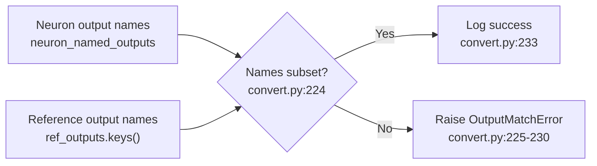

**Sources:**
- [optimum/exporters/neuron/convert.py:218-244]()

### 2. Shape Validation

After verifying output names, the system compares tensor shapes between reference and Neuron outputs.

**Shape checking logic:**

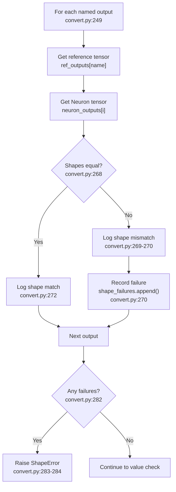

**Sources:**
- [optimum/exporters/neuron/convert.py:262-284]()

### 3. Value Validation with Tolerance

The final check compares output values using an absolute tolerance (atol) to account for minor numerical differences from compilation.

**Tolerance configuration:**

| Configuration Level | Priority | Source |
|---------------------|----------|--------|
| CLI argument `--atol` | Highest | [optimum/commands/export/neuronx.py:54-58]() |
| Config task-specific | Medium | [optimum/exporters/neuron/base.py:119]() |
| Config default | Lowest | Model-specific configs |

**Value checking process:**

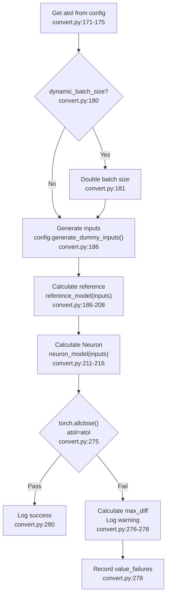

**Sources:**
- [optimum/exporters/neuron/convert.py:171-280]()
- [optimum/exporters/neuron/base.py:116-122]()

---

## Common Export Errors and Solutions

### ShapeError: Output Shape Mismatch

**Error message:**
```
Output shapes do not match between reference model and the Neuron exported model:
- output_name: got (batch, seq, hidden) (reference) and (batch, seq, different) (neuron)
```

**Common causes:**

1. **Dynamic shape configuration mismatch**
   - Exported with `dynamic_batch_size=True` but shapes don't account for it
   - Solution: Ensure input shapes during validation match compilation configuration

2. **Model wrapper issues**
   - Custom model wrappers (e.g., `CUSTOM_MODEL_WRAPPER`) modify output structure
   - Check [optimum/exporters/neuron/model_wrappers.py]() for wrapper behavior

3. **Encoder-decoder model issues**
   - Decoder outputs may have unexpected shapes
   - Verify [optimum/exporters/neuron/convert.py:188-199]() patching logic

**Debugging approach:**

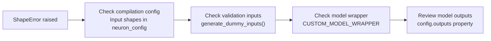

**Sources:**
- [optimum/exporters/neuron/convert.py:283-284]()
- [optimum/exporters/neuron/__main__.py:718-719]()

### AtolError: Value Tolerance Exceeded

**Error message:**
```
The maximum absolute difference between the output of the reference model and the Neuron 
exported model is not within the set tolerance 1e-05:
- logits: max diff = 0.0023
```

**This is typically a WARNING, not a failure.** The export succeeds but indicates numerical differences.

**Common causes:**

1. **Model architecture sensitivity**
   - Some architectures (e.g., ConvBert) have naturally higher tolerances
   - Default ATOL_FOR_VALIDATION varies: 1e-5 (default), 1e-3 (BERT), 1e-1 (ConvBert)

2. **Precision modes**
   - Using `auto_cast=all` or `auto_cast_type=bf16` introduces precision loss
   - Check compiler arguments: [optimum/exporters/neuron/__main__.py:100-110]()

3. **Compilation optimizations**
   - Higher optimization levels (O2, O3) may trade accuracy for performance
   - Consider using O1 if accuracy is critical

**Adjusting tolerance:**

| Method | Command | File Reference |
|--------|---------|----------------|
| CLI argument | `--atol 1e-3` | [optimum/commands/export/neuronx.py:54-58]() |
| Config override | Set in model config | [optimum/exporters/neuron/model_configs.py:106]() |

**Example tolerance values:**

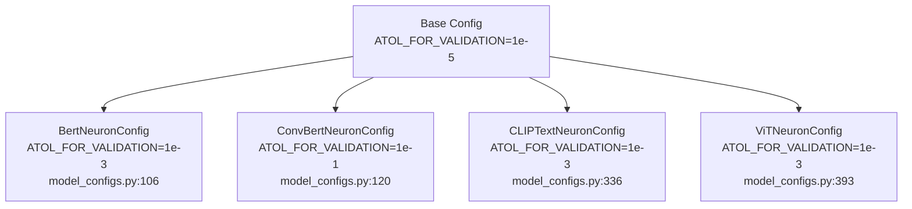

**Sources:**
- [optimum/exporters/neuron/convert.py:286-291]()
- [optimum/exporters/neuron/__main__.py:720-724]()
- [optimum/exporters/neuron/model_configs.py:106-394]()

### OutputMatchError: Output Name Mismatch

**Error message:**
```
Neuron model output names do not match reference model output names.
Reference model output names: {'logits', 'hidden_states'}
Neuron model output names: {'logits', 'pooler_output'}
Difference: {'pooler_output'}
```

**Common causes:**

1. **Task configuration mismatch**
   - Task specified doesn't match model architecture
   - Verify task with `infer_task()`: [optimum/exporters/neuron/__main__.py:113-124]()

2. **Optional outputs configuration**
   - `output_attentions` or `output_hidden_states` flags don't match
   - Check [optimum/exporters/neuron/__main__.py:165-174]()

3. **Model-specific output requirements**
   - Some models have task-specific outputs (e.g., `outputs` property in configs)
   - Review [optimum/exporters/neuron/base.py:296-304]()

**Resolution steps:**

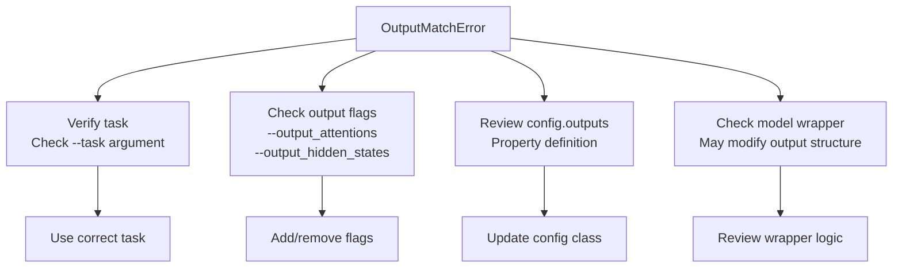

**Sources:**
- [optimum/exporters/neuron/convert.py:225-230]()
- [optimum/exporters/neuron/__main__.py:725-729]()

---

## Validation Configuration

### Disabling Validation

Validation can be disabled entirely for faster exports when you're confident in the model configuration.

**CLI usage:**
```bash
optimum-cli export neuron \
  --model bert-base-uncased \
  --disable-validation \
  output_dir/
```

**Programmatic control:**

The `do_validation` parameter controls validation:

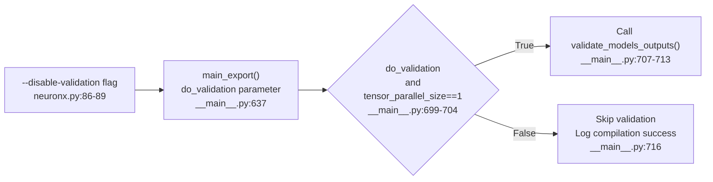

**Note:** Validation is automatically disabled for tensor parallel models (`tensor_parallel_size > 1`) as stated in [optimum/exporters/neuron/__main__.py:699-704]().

**Sources:**
- [optimum/commands/export/neuronx.py:86-89]()
- [optimum/exporters/neuron/__main__.py:637-734]()

### Custom Tolerance Configuration

Tolerance can be configured at multiple levels:

**1. Command-line override:**
```bash
optimum-cli export neuron \
  --model my-model \
  --atol 1e-3 \
  output_dir/
```

**2. Model config class:**

```python
class MyModelNeuronConfig(TextEncoderNeuronConfig):
    ATOL_FOR_VALIDATION = 1e-3  # Single value
    
    # OR task-specific
    ATOL_FOR_VALIDATION = {
        "text-classification": 1e-3,
        "token-classification": 1e-4,
    }
```

**3. Validation function call:**

The atol is resolved with this priority:
1. Explicit `atol` parameter (CLI argument)
2. Config's `ATOL_FOR_VALIDATION[task]` (task-specific)
3. Config's `ATOL_FOR_VALIDATION` (default value)

**Sources:**
- [optimum/exporters/neuron/convert.py:171-175]()
- [optimum/exporters/neuron/base.py:116-122]()
- [optimum/commands/export/neuronx.py:54-58]()

---

## Advanced Debugging Strategies

### Inspecting Dummy Inputs

The validation system generates dummy inputs for testing. To debug shape or type issues, examine the input generation:

**Input generation flow:**

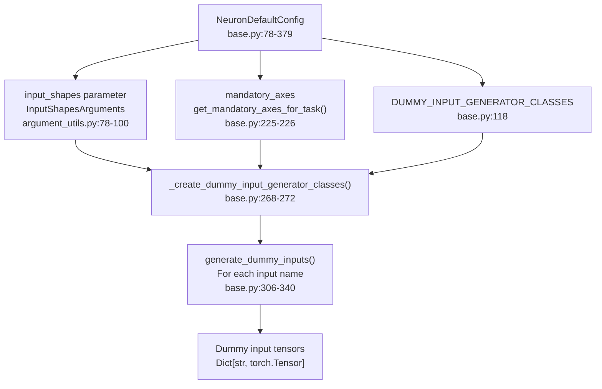

**Checking generated inputs:**

The dummy inputs respect:
- `int_dtype`: Data type for integer tensors (default: int64)
- `float_dtype`: Data type for float tensors (default: fp32)
- Input shape arguments passed during export

**Sources:**
- [optimum/exporters/neuron/base.py:268-340]()
- [optimum/neuron/utils/argument_utils.py:78-100]()
- [optimum/exporters/neuron/convert.py:600-610]()

### Validation for Special Models

#### Diffusion Models

Diffusion models (Stable Diffusion, SDXL) validate multiple submodels independently:

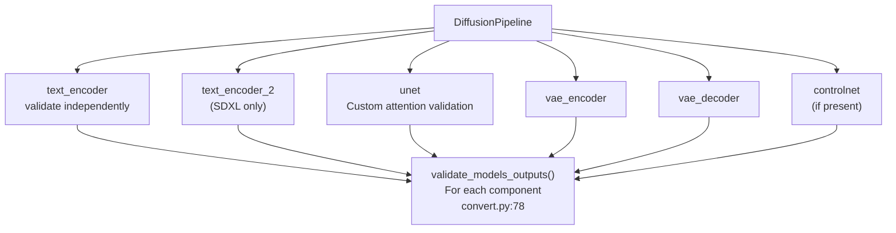

**Special considerations:**
- VAE components may return tuples of tensors (e.g., `hidden_states`)
- UNet with ControlNet has additional residual outputs
- Custom lowering for Softmax/SILU operations: [optimum/exporters/neuron/__main__.py:337-338]()

**Sources:**
- [optimum/exporters/neuron/__main__.py:419-502]()
- [optimum/exporters/neuron/convert.py:194-199]()

#### Encoder-Decoder Models

Encoder-decoder models (T5, BART) require special patching during validation:

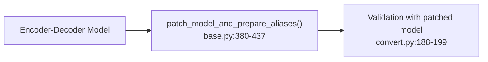

The patching:
- Adjusts forward signatures
- Handles decoder cross-attention properly
- Wraps models if needed (e.g., T5EncoderWrapper)

**Sources:**
- [optimum/exporters/neuron/convert.py:188-199]()
- [optimum/exporters/neuron/__main__.py:505-541]()

### Debugging Compilation vs. Validation Issues

When export fails, determine whether it's a compilation or validation issue:

**Decision tree:**

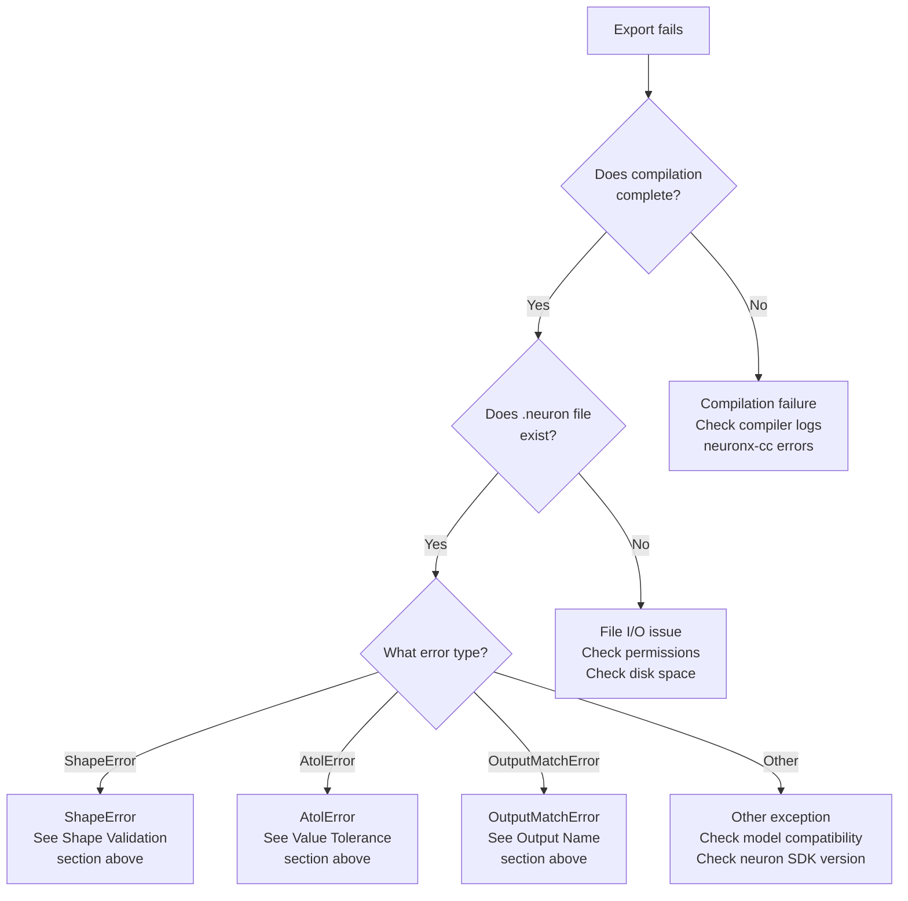

**Log analysis:**

Validation logging provides detailed information:
- Each submodel validation: `"Validating {model_name} model..."` ([convert.py:129]())
- Per-output checks: `"Validating Neuron Model output..."` ([convert.py:260]())
- Success indicators: `"[✓]"` markers
- Failure indicators: `"[x]"` markers with details

**Sources:**
- [optimum/exporters/neuron/convert.py:129-143]()
- [optimum/exporters/neuron/__main__.py:699-734]()

### Compiler Arguments Impact

Certain compiler arguments affect validation outcomes:

| Argument | Effect on Validation | Recommendation |
|----------|---------------------|----------------|
| `auto_cast=all` | Higher tolerance needed | Use `--atol 1e-3` or higher |
| `auto_cast_type=fp16` | Significant precision loss | Increase atol, monitor outputs |
| `optlevel=3` | May increase numerical drift | Test with O2 first |
| `dynamic_batch_size=True` | Validation uses 2x batch | Ensure sufficient memory |

**Compiler argument configuration:**

The `infer_compiler_kwargs()` function at [optimum/exporters/neuron/__main__.py:100-110]() processes:
- `auto_cast`: Controls precision casting
- `auto_cast_type`: Target precision (bf16, fp16, tf32)
- `disable_fast_relayout`: Affects memory layout optimization
- `disable_fallback`: Forces all ops to Neuron (may cause failures)

**Sources:**
- [optimum/exporters/neuron/__main__.py:100-110]()
- [optimum/exporters/neuron/convert.py:613-663]()

---

## Summary

The validation system provides three levels of checks:
1. **Output name matching** - Ensures structural correctness
2. **Shape validation** - Verifies tensor dimensions
3. **Value validation** - Confirms numerical accuracy within tolerance

When debugging export issues:
- Check error type (Shape, Atol, OutputMatch) to identify root cause
- Adjust tolerance with `--atol` for numerical precision issues
- Disable validation with `--disable-validation` only after verifying correctness
- Review compiler arguments impact on numerical precision
- Use detailed logs to identify specific failing outputs

The validation process is automatic but configurable, balancing correctness verification with flexibility for different model architectures and precision requirements.

---

