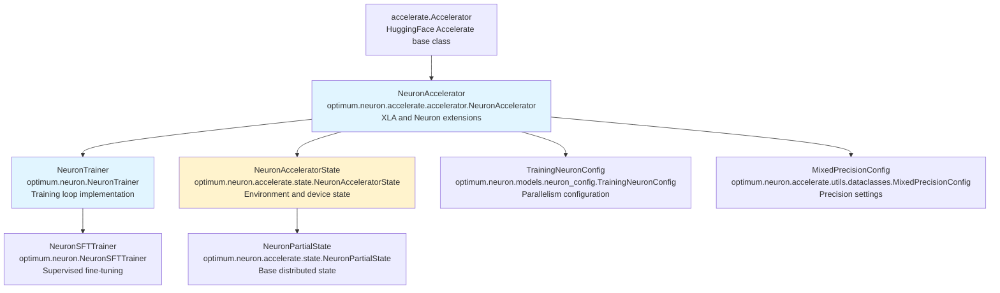
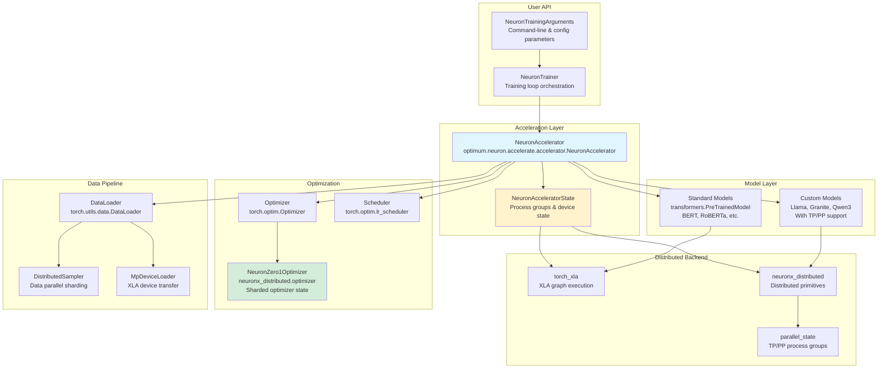
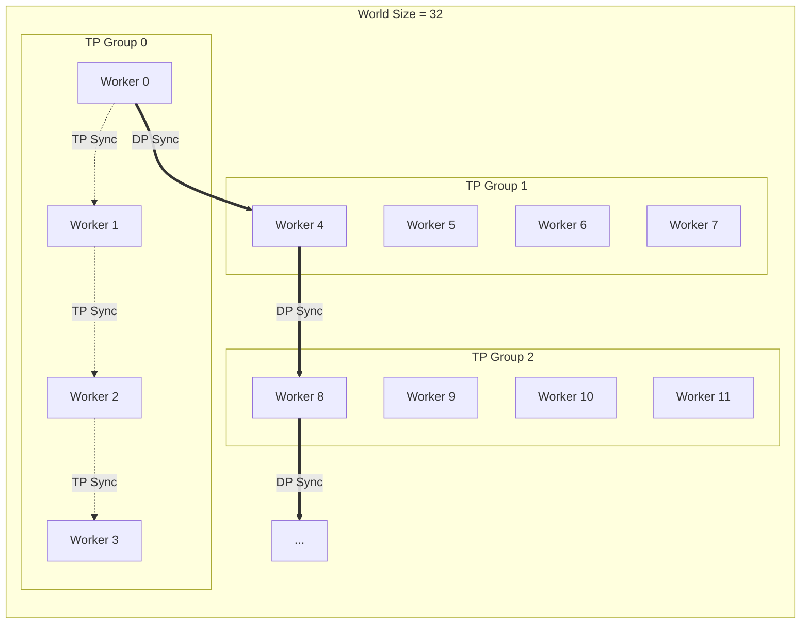
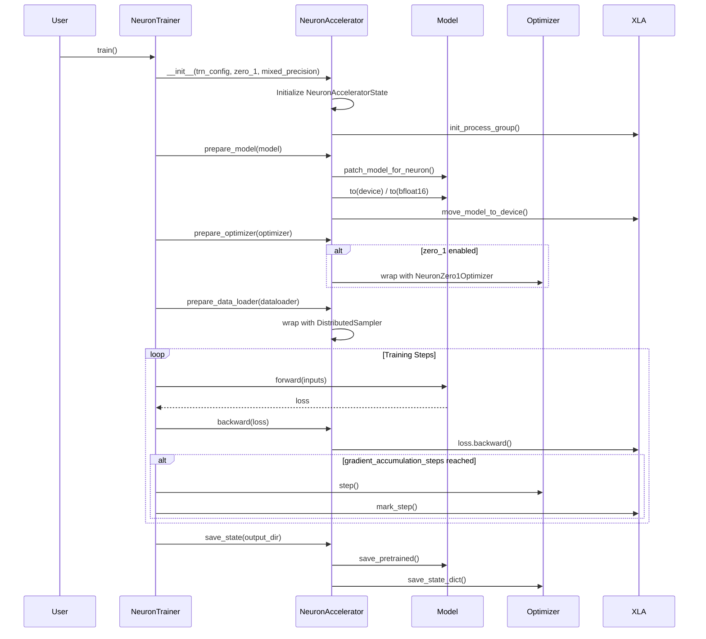

<!-- source: DeepWiki mcp.deepwiki.com · repo huggingface/optimum-neuron · page 5 Training on AWS Neuron · fetched 2026-10-26 -->

# Training on AWS Neuron

Relevant source files

The following files were used as context for generating this wiki page:

- [docs/source/training_tutorials/finetune_llama.mdx](docs/source/training_tutorials/finetune_llama.mdx)
- [docs/source/training_tutorials/finetune_qwen3.mdx](docs/source/training_tutorials/finetune_qwen3.mdx)
- [examples/training/llama/finetune_llama.py](examples/training/llama/finetune_llama.py)
- [examples/training/qwen3/finetune_qwen3.py](examples/training/qwen3/finetune_qwen3.py)
- [optimum/neuron/accelerate/accelerator.py](optimum/neuron/accelerate/accelerator.py)
- [optimum/neuron/accelerate/state.py](optimum/neuron/accelerate/state.py)
- [optimum/neuron/accelerate/utils/dataclasses.py](optimum/neuron/accelerate/utils/dataclasses.py)
- [optimum/neuron/trainers/sft_config.py](optimum/neuron/trainers/sft_config.py)
- [optimum/neuron/trainers/sft_trainer.py](optimum/neuron/trainers/sft_trainer.py)
- [optimum/neuron/trainers/training_args.py](optimum/neuron/trainers/training_args.py)
- [optimum/neuron/trainers/transformers.py](optimum/neuron/trainers/transformers.py)
- [optimum/neuron/trainers/trl_utils.py](optimum/neuron/trainers/trl_utils.py)
- [pyproject.toml](pyproject.toml)
- [tests/training/test_neuron_sft_trainer.py](tests/training/test_neuron_sft_trainer.py)

## Purpose and Scope

This page provides an overview of the training system in `optimum-neuron`, which enables distributed training of large language models and other deep learning models on AWS Trainium accelerators. The training system extends HuggingFace Accelerate with Neuron-specific optimizations and distributed training strategies.

This page introduces the core training components and their architecture. For detailed information on specific topics, see:
- Training API details: [NeuronTrainer and NeuronAccelerator](#5.1)
- Distributed parallelism strategies: [Distributed Training Strategies](#5.2)
- Precision and optimization settings: [Mixed Precision Training](#5.3)
- Neuron-optimized model implementations: [Custom Model Architectures](#5.4)

For inference on Neuron accelerators, see [Inference with Neuron Models](#6).

---

## Overview

The `optimum-neuron` training system is built on three foundational layers:

1. **HuggingFace Accelerate** - Provides the base distributed training abstraction
2. **NeuronAccelerator** - Extends Accelerate with XLA and Neuron-specific functionality
3. **neuronx_distributed** - Provides low-level distributed primitives for model and data parallelism

The training system supports both standard transformers models and custom Neuron-optimized models with tensor parallelism, pipeline parallelism, sequence parallelism, and ZeRO-1 optimizer sharding.

**Sources:** [optimum/neuron/accelerate/accelerator.py:79-597](), [optimum/neuron/accelerate/state.py:85-177]()

---

## Core Training Components

### Component Hierarchy

### NeuronAccelerator

`NeuronAccelerator` is the central class that manages training on Neuron hardware. It extends `accelerate.Accelerator` and provides:

| Feature | Description | Implementation |
|---------|-------------|----------------|
| **XLA Integration** | Manages XLA device and graph execution | [optimum/neuron/accelerate/accelerator.py:79-157]() |
| **Distributed Setup** | Initializes process groups and parallel state | [optimum/neuron/accelerate/state.py:43-83]() |
| **Model Preparation** | Patches models for Neuron, applies mixed precision | [optimum/neuron/accelerate/accelerator.py:338-398]() |
| **Optimizer Wrapping** | Supports ZeRO-1 optimizer sharding | [optimum/neuron/accelerate/accelerator.py:253-306]() |
| **Data Parallel Loading** | Configures distributed data loaders | [optimum/neuron/accelerate/accelerator.py:208-251]() |
| **Checkpointing** | Handles model and optimizer state persistence | [optimum/neuron/accelerate/accelerator.py:436-548]() |

**Key initialization parameters:**

- `trn_config: TrainingNeuronConfig` - Configures tensor/pipeline parallelism
- `zero_1: bool` - Enables ZeRO-1 optimizer state sharding
- `mixed_precision_config: MixedPrecisionConfig` - Controls precision modes
- `gradient_accumulation_steps: int` - Number of microbatches before optimizer step

**Sources:** [optimum/neuron/accelerate/accelerator.py:79-170]()

### NeuronAcceleratorState

`NeuronAcceleratorState` manages the global training environment state, including:

- Distributed backend initialization (XLA/torch.distributed)
- Device assignment and process topology
- Parallel state initialization via `neuronx_distributed.parallel_layers.parallel_state`
- Training configuration (`TrainingNeuronConfig`) storage

The state is a singleton that persists across the training session.

**Sources:** [optimum/neuron/accelerate/state.py:85-177]()

---

## Training System Architecture

### Full System View

**Sources:** [optimum/neuron/accelerate/accelerator.py:79-597](), [optimum/neuron/accelerate/state.py:85-177]()

---

## Distributed Training Support

The training system supports multiple distributed parallelism strategies that can be combined:

### Parallelism Strategies

| Strategy | Purpose | Configuration | Support Level |
|----------|---------|---------------|---------------|
| **Data Parallelism** | Replicate model across devices | Automatic via process count | Standard models |
| **Tensor Parallelism** | Shard model layers across devices | `trn_config.tensor_parallel_size` | Custom models only |
| **Pipeline Parallelism** | Split model stages across devices | `trn_config.pipeline_parallel_size` | Custom models only |
| **Sequence Parallelism** | Shard activation tensors | `trn_config.sequence_parallel_enabled` | Custom models only |
| **ZeRO-1** | Shard optimizer states | `zero_1=True` | All models |

### Process Group Topology

**Example:** With `tensor_parallel_size=4` and 32 workers, you get 8 data parallel replicas, each containing 4 tensor parallel shards.

The parallel state is initialized by `neuronx_distributed.parallel_layers.parallel_state.initialize_model_parallel()` during `NeuronAcceleratorState` setup.

**Sources:** [optimum/neuron/accelerate/state.py:153-157](), [optimum/neuron/accelerate/accelerator.py:253-300]()

---

## Training Workflow

### Typical Training Loop

### Model Preparation Pipeline

The `prepare_model()` method performs these steps:

1. **Patching** - Disables incompatible features ([optimum/neuron/accelerate/accelerator.py:312-336]())
   - Sets `config.layerdrop = 0`
   - Disables cache and attention outputs
   - Replaces `save_pretrained` for standard models
   - Adds `no_sync` context manager

2. **Precision Conversion** - Applies mixed precision ([optimum/neuron/accelerate/accelerator.py:361-389]())
   - `FULL_BF16`: Convert entire model to bfloat16
   - `AUTOCAST_BF16`: Enable autocast for selective bf16 operations

3. **Device Placement** - Moves model to Neuron cores ([optimum/neuron/accelerate/accelerator.py:363-391]())
   - Standard models: `move_model_to_device(model, xm.xla_device())`
   - Custom models with PP: `create_nxdpp_model()` and `model.move_model_to_device()`
   - Custom models without PP: `move_model_to_device(model, self.device)`

4. **Weight Tying** - Ensures embeddings are tied ([optimum/neuron/accelerate/accelerator.py:373-391]())

5. **Registration** - Adds to `self._models` list for lifecycle management

**Sources:** [optimum/neuron/accelerate/accelerator.py:338-398]()

---

## Mixed Precision Training

The training system supports three mixed precision modes via `MixedPrecisionConfig`:

| Mode | Description | Use Case |
|------|-------------|----------|
| `NO` | Full FP32 training | Maximum accuracy, slow |
| `FULL_BF16` | All operations in BF16 | Fast training, requires stochastic rounding or master weights |
| `AUTOCAST_BF16` | Selective BF16 with FP32 accumulation | Balanced speed/accuracy |

### MixedPrecisionConfig Options

- `stochastic_rounding: bool` - Enables SR to reduce BF16 quantization error
- `optimizer_use_master_weights: bool` - Maintains FP32 optimizer state
- `optimizer_use_fp32_grad_acc: bool` - Uses FP32 for gradient accumulation
- `optimizer_save_master_weights_in_ckpt: bool` - Saves FP32 weights to checkpoint

The configuration sets environment variables and compiler flags to control precision behavior.

**Sources:** [optimum/neuron/accelerate/utils/dataclasses.py:28-70]()

For detailed information, see [Mixed Precision Training](#5.3).

---

## Custom Model Support

For models requiring tensor or pipeline parallelism, `optimum-neuron` provides custom implementations:

- `LlamaForCausalLM` - Base Llama architecture with parallel layers
- `GraniteForCausalLM` - Extends Llama with Granite-specific modifications  
- `Qwen3ForCausalLM` - Extends Llama with Qwen3 architecture changes

These models use:
- `neuronx_distributed.parallel_layers` - ColumnParallelLinear, RowParallelLinear, ParallelEmbedding
- `GQAQKVColumnParallelLinear` - Fused QKV projection for Grouped Query Attention
- `nki_flash_attn_func` - Flash Attention v2 implementation

The `NeuronModelMixin` provides shared functionality for weight transformations between HuggingFace and Neuron formats.

**Sources:** [optimum/neuron/accelerate/accelerator.py:348-373]()

For detailed information, see [Custom Model Architectures](#5.4).

---

## Environment Initialization

The training system initializes the XLA and Neuron environment through several steps:

1. **Flag Setting** - `set_common_flags()` configures Neuron compiler flags
2. **Process Group** - `init_process_group()` initializes torch.distributed backend
3. **Parallel State** - `parallel_state.initialize_model_parallel()` sets up TP/PP groups
4. **Device Assignment** - Workers receive device ordinal from `xm.xla_device()`

These operations occur during `NeuronAcceleratorState.__init__()` and are performed once per training session.

**Sources:** [optimum/neuron/accelerate/state.py:69-76](), [optimum/neuron/accelerate/state.py:153-157]()

---

## Unsupported Features

The following Accelerate features are **not supported** by `NeuronAccelerator`:

- DeepSpeed plugin - Neuron has native distributed strategies
- FSDP plugin - Use ZeRO-1 instead
- Dynamo backend - XLA graph compilation incompatible
- Megatron-LM plugin - Use neuronx_distributed instead
- Torch distributed tensor parallel - Use custom models with TP

Attempting to use these will raise `NotImplementedError`.

**Sources:** [optimum/neuron/accelerate/accelerator.py:95-129]()

---

## Summary

The `optimum-neuron` training system provides a comprehensive framework for distributed training on AWS Trainium, combining:

- **HuggingFace compatibility** through extended Accelerate APIs
- **Scalable parallelism** via tensor, pipeline, sequence, and data parallelism
- **Optimized execution** using XLA graph compilation
- **Flexible precision** with full BF16, autocast, and master weight options
- **Production-ready checkpointing** with optimizer state sharding support

For hands-on examples, see the training tutorials in the documentation tree at [docs/source/_toctree.yml:29-42]().

---

