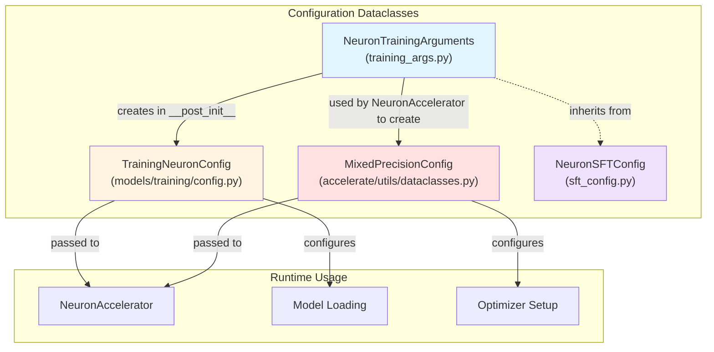
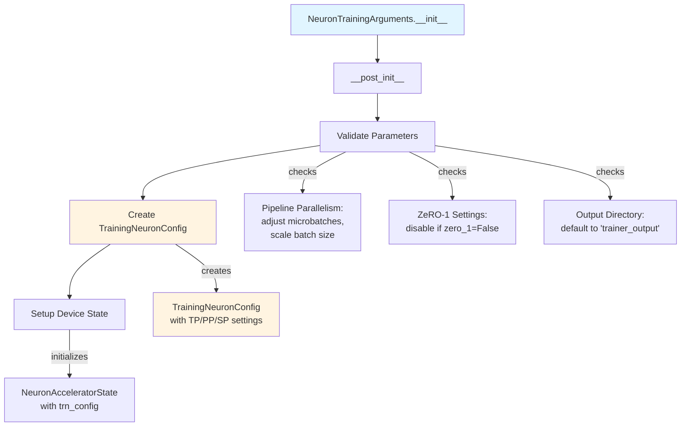
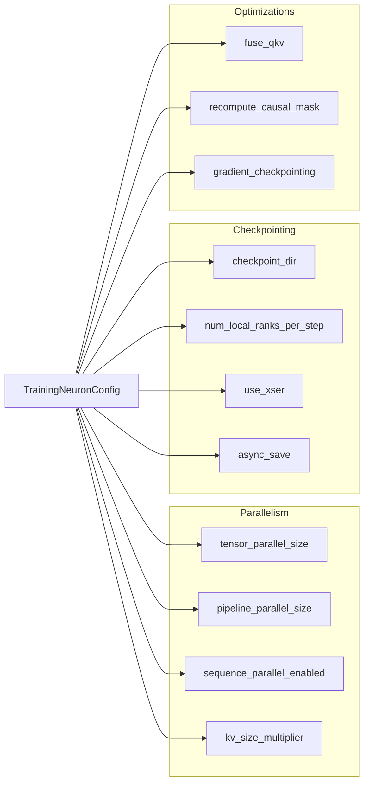
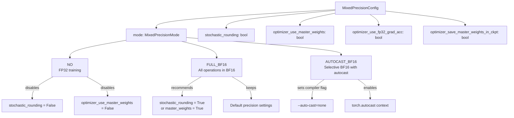
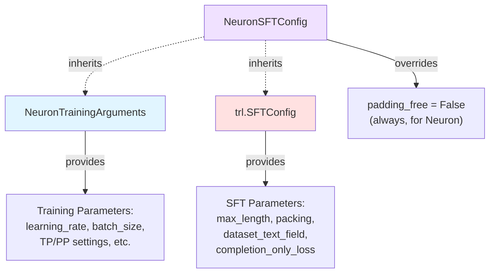
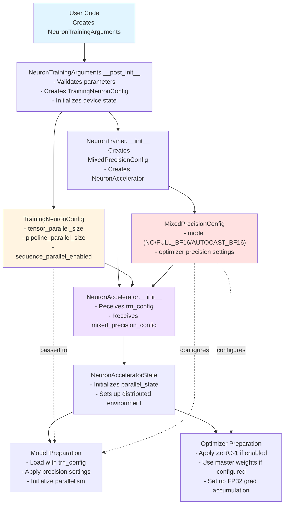

<!-- source: DeepWiki mcp.deepwiki.com · repo huggingface/optimum-neuron · page 5.1 Training Configuration System · fetched 2026-10-26 -->

# Training Configuration System

<details>
<summary>Relevant source files</summary>

The following files were used as context for generating this wiki page:

- [docs/source/training_tutorials/finetune_llama.mdx](docs/source/training_tutorials/finetune_llama.mdx)
- [docs/source/training_tutorials/finetune_qwen3.mdx](docs/source/training_tutorials/finetune_qwen3.mdx)
- [examples/training/llama/finetune_llama.py](examples/training/llama/finetune_llama.py)
- [examples/training/qwen3/finetune_qwen3.py](examples/training/qwen3/finetune_qwen3.py)
- [optimum/neuron/accelerate/accelerator.py](optimum/neuron/accelerate/accelerator.py)
- [optimum/neuron/accelerate/state.py](optimum/neuron/accelerate/state.py)
- [optimum/neuron/accelerate/utils/dataclasses.py](optimum/neuron/accelerate/utils/dataclasses.py)
- [optimum/neuron/trainers/sft_config.py](optimum/neuron/trainers/sft_config.py)
- [optimum/neuron/trainers/sft_trainer.py](optimum/neuron/trainers/sft_trainer.py)
- [optimum/neuron/trainers/training_args.py](optimum/neuron/trainers/training_args.py)
- [optimum/neuron/trainers/transformers.py](optimum/neuron/trainers/transformers.py)
- [optimum/neuron/trainers/trl_utils.py](optimum/neuron/trainers/trl_utils.py)
- [pyproject.toml](pyproject.toml)
- [tests/training/test_neuron_sft_trainer.py](tests/training/test_neuron_sft_trainer.py)

</details>


This document describes the configuration dataclasses used to control training behavior on AWS Trainium accelerators. These configurations define training hyperparameters, distributed training strategies, mixed precision settings, and hardware-specific optimizations.

For information about how these configurations are used by the training execution system, see [NeuronTrainer and NeuronAccelerator](#5.2). For details on the distributed training strategies these configurations enable, see [Distributed Training Strategies](#5.3). For mixed precision implementation details, see [Mixed Precision Training](#5.4).

## Configuration Architecture

The training configuration system is organized hierarchically, with specialized configurations for different training modes:



**Sources:**
- [optimum/neuron/trainers/training_args.py:49-677]()
- [optimum/neuron/accelerate/utils/dataclasses.py:34-70]()
- [optimum/neuron/trainers/sft_config.py:33-56]()

## NeuronTrainingArguments

`NeuronTrainingArguments` is the primary configuration class, extending the standard transformers `TrainingArguments` pattern with Neuron-specific parameters. It is defined at [optimum/neuron/trainers/training_args.py:49]().

### Core Training Parameters

The class defines standard training hyperparameters inherited from transformers conventions:

| Parameter | Type | Default | Description |
|-----------|------|---------|-------------|
| `output_dir` | `str` | `"trainer_output"` | Directory for checkpoints and outputs |
| `per_device_train_batch_size` | `int` | `1` | Batch size per NeuronCore |
| `per_device_eval_batch_size` | `int` | `1` | Evaluation batch size per NeuronCore |
| `gradient_accumulation_steps` | `int` | `1` | Steps to accumulate before backward pass |
| `learning_rate` | `float` | `5e-5` | Initial learning rate |
| `num_train_epochs` | `float` | `3.0` | Total training epochs |
| `max_steps` | `int` | `-1` | Total training steps (overrides epochs) |
| `bf16` | `bool` | `False` | Enable bfloat16 precision |
| `logging_steps` | `float` | `500` | Log every N steps |
| `save_steps` | `float` | `500` | Save checkpoint every N steps |

**Sources:**
- [optimum/neuron/trainers/training_args.py:62-238]()

### Neuron-Specific Parameters

Trainium-specific optimizations and distributed training configurations:

| Parameter | Type | Default | Description |
|-----------|------|---------|-------------|
| `zero_1` | `bool` | `True` | Enable ZeRO Stage 1 optimizer sharding |
| `tensor_parallel_size` | `int` | `1` | Number of tensor parallel replicas |
| `pipeline_parallel_size` | `int` | `1` | Number of pipeline parallel stages |
| `pipeline_parallel_num_microbatches` | `int` | `-1` | Microbatches for pipeline execution |
| `disable_sequence_parallel` | `bool` | `False` | Disable sequence parallelism |
| `use_autocast` | `bool` | `False` | Use torch autocast for mixed precision |
| `stochastic_rounding_enabled` | `bool` | `True` | Enable stochastic rounding for bf16 |
| `optimizer_use_master_weights` | `bool` | `True` | Use FP32 master weights with bf16 |
| `optimizer_use_fp32_grad_acc` | `bool` | `True` | Use FP32 for gradient accumulation |
| `optimizer_save_master_weights_in_ckpt` | `bool` | `False` | Save master weights in checkpoint |
| `kv_size_multiplier` | `int` | `None` | KV head replication for GQA with TP |
| `num_local_ranks_per_step` | `int` | `8` | Concurrent ranks for checkpointing |
| `use_xser` | `bool` | `True` | Use torch-xla serialization |
| `async_save` | `bool` | `False` | Asynchronous checkpoint saving |
| `fuse_qkv` | `bool` | `False` | Fuse Q/K/V linear layers |
| `recompute_causal_mask` | `bool` | `True` | Recompute causal mask in forward pass |

**Sources:**
- [optimum/neuron/trainers/training_args.py:311-428]()

### Training Metrics Configuration

Performance and efficiency metric collection settings:

| Parameter | Type | Default | Description |
|-----------|------|---------|-------------|
| `enable_throughput_metrics` | `bool` | `True` | Calculate tokens/sec and samples/sec |
| `enable_mfu_metrics` | `bool` | `True` | Calculate Model FLOPs Utilization |
| `enable_efficiency_metrics` | `bool` | `True` | Calculate training efficiency metrics |
| `metrics_window_size` | `int` | `50` | Moving average window size |

**Sources:**
- [optimum/neuron/trainers/training_args.py:431-465]()

### Configuration Initialization Flow



The `__post_init__` method performs several critical setup tasks at [optimum/neuron/trainers/training_args.py:467-684]():

1. **Parameter validation and defaults**: Sets `output_dir` to `"trainer_output"` if not provided
2. **Pipeline parallelism adjustments**: When `pipeline_parallel_size > 1`, scales batch size and sets `gradient_accumulation_steps=1`
3. **ZeRO-1 dependency checks**: Disables optimizer master weights and FP32 grad accumulation if `zero_1=False`
4. **TrainingNeuronConfig creation**: Instantiates the distributed training config at line 662
5. **Device setup**: Initializes `NeuronAcceleratorState` with the configuration

**Sources:**
- [optimum/neuron/trainers/training_args.py:467-684]()
- [optimum/neuron/trainers/training_args.py:662-676]()

## TrainingNeuronConfig

`TrainingNeuronConfig` is a specialized configuration class that encapsulates distributed training and model parallelism settings. It is created automatically by `NeuronTrainingArguments.__post_init__` and passed to model loading and accelerator initialization.

### Core Configuration Fields



The configuration is instantiated at [optimum/neuron/trainers/training_args.py:662-676]():

```python
self.trn_config = TrainingNeuronConfig(
    self.tensor_parallel_size,
    sequence_parallel_enabled=not self.disable_sequence_parallel,
    kv_size_multiplier=self.kv_size_multiplier,
    pipeline_parallel_size=self.pipeline_parallel_size,
    pipeline_parallel_num_microbatches=self.pipeline_parallel_num_microbatches,
    pipeline_parallel_use_zero1_optimizer=self.zero_1,
    checkpoint_dir=resume_from_checkpoint,
    num_local_ranks_per_step=self.num_local_ranks_per_step,
    use_xser=self.use_xser,
    async_save=self.async_save,
    fuse_qkv=self.fuse_qkv,
    recompute_causal_mask=self.recompute_causal_mask,
    gradient_checkpointing=self.gradient_checkpointing,
)
```

### Usage in Model Loading

The configuration is passed to custom model implementations when loading models for training:

```python
# From examples/training/qwen3/finetune_qwen3.py:66-72
model = NeuronModelForCausalLM.from_pretrained(
    model_id,
    trn_config,  # TrainingNeuronConfig instance
    torch_dtype=dtype,
    attn_implementation="flash_attention_2",
)
```

### Distributed State Initialization

`TrainingNeuronConfig` is used by `NeuronAcceleratorState` to initialize model parallelism at [optimum/neuron/accelerate/state.py:148-157]():

```python
if self.distributed_type == DistributedType.XLA:
    if trn_config is None:
        trn_config = TrainingNeuronConfig()
    
    self.trn_config = trn_config
    
    if torch.distributed.is_initialized() and not parallel_state.model_parallel_is_initialized():
        parallel_state.initialize_model_parallel(
            tensor_model_parallel_size=self.trn_config.tensor_parallel_size,
            pipeline_model_parallel_size=self.trn_config.pipeline_parallel_size,
        )
```

**Sources:**
- [optimum/neuron/trainers/training_args.py:662-676]()
- [optimum/neuron/accelerate/state.py:148-157]()
- [examples/training/qwen3/finetune_qwen3.py:60-72]()

## MixedPrecisionConfig

`MixedPrecisionConfig` defines precision modes and optimizer precision settings for training. It is defined at [optimum/neuron/accelerate/utils/dataclasses.py:34-70]().

### Precision Modes



### Configuration Fields

| Field | Type | Default | Description |
|-------|------|---------|-------------|
| `mode` | `MixedPrecisionMode` | - | Precision mode (NO, FULL_BF16, AUTOCAST_BF16) |
| `stochastic_rounding` | `bool` | `True` | Enable stochastic rounding for BF16 |
| `optimizer_use_master_weights` | `bool` | `False` | Use FP32 master weights in optimizer |
| `optimizer_use_fp32_grad_acc` | `bool` | `False` | Use FP32 for gradient accumulation |
| `optimizer_save_master_weights_in_ckpt` | `bool` | `False` | Save master weights in checkpoint |

**Sources:**
- [optimum/neuron/accelerate/utils/dataclasses.py:28-70]()

### Creation from NeuronTrainingArguments

`MixedPrecisionConfig` is created by `NeuronTrainer` based on `NeuronTrainingArguments` settings at [optimum/neuron/trainers/transformers.py:348-360]():

```python
if self.args.bf16 and self.args.use_autocast:
    mode = "AUTOCAST_BF16"
elif self.args.bf16:
    mode = "FULL_BF16"
else:
    mode = "NO"

self.mixed_precision_config = MixedPrecisionConfig(
    mode=mode,
    stochastic_rounding=self.args.stochastic_rounding_enabled,
    optimizer_use_master_weights=self.args.optimizer_use_master_weights,
    optimizer_use_fp32_grad_acc=self.args.optimizer_use_fp32_grad_acc,
    optimizer_save_master_weights_in_ckpt=self.args.optimizer_save_master_weights_in_ckpt,
)
```

### Validation Logic

The `__post_init__` method enforces consistency rules at [optimum/neuron/accelerate/utils/dataclasses.py:42-69]():

1. **NO mode**: Disables all precision-related features
2. **FULL_BF16 mode**: Warns if neither stochastic rounding nor master weights are enabled
3. **AUTOCAST_BF16 mode**: Sets Neuron compiler flag `--auto-cast=none`
4. **Dependencies**: Validates that `optimizer_use_fp32_grad_acc` and `optimizer_save_master_weights_in_ckpt` require `optimizer_use_master_weights=True`
5. **Environment variable**: Sets `NEURON_RT_STOCHASTIC_ROUNDING_EN` based on `stochastic_rounding` setting

**Sources:**
- [optimum/neuron/trainers/transformers.py:348-360]()
- [optimum/neuron/accelerate/utils/dataclasses.py:42-69]()

## NeuronSFTConfig

`NeuronSFTConfig` extends `NeuronTrainingArguments` with supervised fine-tuning specific parameters from TRL's `SFTConfig`. It is defined at [optimum/neuron/trainers/sft_config.py:33-56]().

### Class Hierarchy



### Neuron-Specific Adaptations

The `__post_init__` method enforces Neuron compatibility at [optimum/neuron/trainers/sft_config.py:46-55]():

```python
def __post_init__(self):
    # Handle max_seq_length -> max_length migration for backward compatibility
    if hasattr(self, "max_seq_length") and self.max_seq_length is not None:
        self.max_length = self.max_seq_length
    
    # Force padding_free to False for Neuron - critical for avoiding recompilation
    # Neuron devices require fixed input shapes; padding_free flattening breaks this requirement
    self.padding_free = False
    
    super().__post_init__()
```

The `padding_free` parameter must always be `False` because Neuron compilation requires fixed input shapes. Variable-length sequences without padding would trigger recompilation for each unique sequence length.

### Usage in NeuronSFTTrainer

`NeuronSFTConfig` is passed to `NeuronSFTTrainer` at [optimum/neuron/trainers/sft_trainer.py:158-166]():

```python
args = training_args.to_dict()

sft_config = NeuronSFTConfig(
    max_length=4096,
    packing=True,
    **args,
)

trainer = NeuronSFTTrainer(
    args=sft_config,
    model=model,
    peft_config=lora_config,
    processing_class=tokenizer,
    train_dataset=dataset,
    formatting_func=formatting_function,
)
```

**Sources:**
- [optimum/neuron/trainers/sft_config.py:33-56]()
- [examples/training/qwen3/finetune_qwen3.py:83-104]()

## Configuration Lifecycle and Interactions

The configuration system flows through several initialization stages:



### Stage 1: User Configuration Creation

Users create training arguments in their script, as shown in [examples/training/qwen3/finetune_qwen3.py:117-131]():

```python
training_args = NeuronTrainingArguments(
    output_dir=output_dir,
    num_train_epochs=3,
    per_device_train_batch_size=1,
    gradient_accumulation_steps=8,
    learning_rate=5e-4,
    bf16=True,
    tensor_parallel_size=8,
    logging_steps=2,
    lr_scheduler_type="cosine",
)
```

### Stage 2: Configuration Initialization

`NeuronTrainingArguments.__post_init__` creates `TrainingNeuronConfig` and initializes the accelerator state at [optimum/neuron/trainers/training_args.py:662-684]().

### Stage 3: Trainer Initialization

`NeuronTrainer.__init__` creates `MixedPrecisionConfig` and `NeuronAccelerator` at [optimum/neuron/trainers/transformers.py:348-368]().

### Stage 4: Accelerator Setup

`NeuronAccelerator.__init__` receives both configurations and initializes distributed state at [optimum/neuron/accelerate/accelerator.py:80-169]().

### Stage 5: Model and Optimizer Preparation

The accelerator uses the configurations to prepare the model and optimizer with appropriate distributed and precision settings at [optimum/neuron/accelerate/accelerator.py:338-398]() and [optimum/neuron/accelerate/accelerator.py:253-306]().

**Sources:**
- [optimum/neuron/trainers/training_args.py:467-684]()
- [optimum/neuron/trainers/transformers.py:118-176]()
- [optimum/neuron/trainers/transformers.py:348-368]()
- [optimum/neuron/accelerate/accelerator.py:80-169]()
- [optimum/neuron/accelerate/accelerator.py:338-398]()
- [examples/training/qwen3/finetune_qwen3.py:117-131]()

---

