<!-- source: DeepWiki mcp.deepwiki.com · repo huggingface/optimum-neuron · page 5.2 NeuronTrainer and NeuronAccelerator · fetched 2026-10-26 -->

# NeuronTrainer and NeuronAccelerator

<details>
<summary>Relevant source files</summary>

The following files were used as context for generating this wiki page:

- [optimum/neuron/accelerate/accelerator.py](optimum/neuron/accelerate/accelerator.py)
- [optimum/neuron/accelerate/state.py](optimum/neuron/accelerate/state.py)
- [optimum/neuron/accelerate/utils/dataclasses.py](optimum/neuron/accelerate/utils/dataclasses.py)

</details>


This page documents the core training infrastructure for AWS Neuron accelerators, focusing on `NeuronAccelerator` which manages distributed state and orchestrates the training loop with XLA synchronization. The `NeuronTrainer` class (documented in page 13.2) extends `transformers.Trainer` and uses `NeuronAccelerator` internally to handle Neuron-specific operations. For distributed training strategies (ZeRO-1, Tensor Parallelism, Pipeline Parallelism), see page 5.3. For mixed precision configuration, see page 5.4. For custom model implementations, see page 5.5.

## Purpose and Scope

`NeuronAccelerator` is the primary orchestrator for training models on AWS Trainium and Inferentia2 hardware. It extends `accelerate.Accelerator` to provide:

- **Distributed state management** via `NeuronAcceleratorState` singleton
- **XLA graph synchronization** through `xm.mark_step()` coordination
- **Component preparation** for models, optimizers, schedulers, and dataloaders
- **Neuron-specific optimizations** including ZeRO-1, model patching, and checkpoint handling
- **Mixed precision training** with BF16 autocast and master weights support

This page covers the architecture, initialization, component preparation, training loop operations, and checkpointing mechanisms that enable efficient training on Neuron hardware.

## Architecture Overview

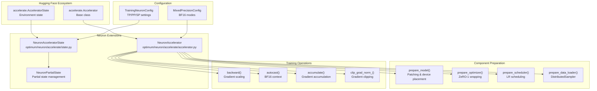

**Sources:** [optimum/neuron/accelerate/accelerator.py:79-157](), [optimum/neuron/accelerate/state.py:85-177]()

## Class Hierarchy

| Class | Location | Purpose |
|-------|----------|---------|
| `NeuronAccelerator` | [optimum/neuron/accelerate/accelerator.py:79]() | Main training orchestrator, extends `accelerate.Accelerator` |
| `NeuronAcceleratorState` | [optimum/neuron/accelerate/state.py:85]() | Singleton managing training environment state |
| `NeuronPartialState` | [optimum/neuron/accelerate/state.py:43]() | Base state class for distributed setup |
| `MixedPrecisionConfig` | [optimum/neuron/accelerate/utils/dataclasses.py:35]() | Configuration for BF16 training modes |
| `NeuronAcceleratedOptimizer` | [optimum/neuron/accelerate/optimizer.py]() | Wrapper for Neuron-optimized optimizers |
| `NeuronAcceleratedScheduler` | [optimum/neuron/accelerate/scheduler.py]() | Wrapper for learning rate schedulers |

**Sources:** [optimum/neuron/accelerate/accelerator.py:1-70](), [optimum/neuron/accelerate/state.py:1-42]()

## Initialization

### NeuronAccelerator Constructor

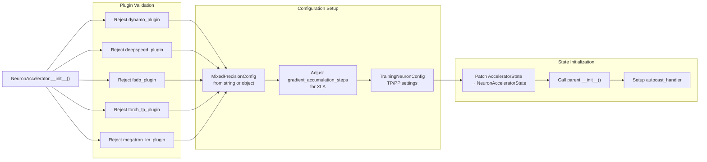

**Constructor Signature:**

```python
def __init__(
    self,
    *args,
    trn_config: TrainingNeuronConfig | None = None,
    zero_1: bool = False,
    mixed_precision_config: MixedPrecisionConfig | str | None = None,
    **kwargs,
)
```

**Key Parameters:**

| Parameter | Type | Default | Description |
|-----------|------|---------|-------------|
| `trn_config` | `TrainingNeuronConfig` | `None` | Configuration for tensor/pipeline parallelism, sequence parallelism |
| `zero_1` | `bool` | `False` | Enable ZeRO-1 optimizer state sharding |
| `mixed_precision_config` | `MixedPrecisionConfig \| str` | `None` | BF16 mode: `"NO"`, `"FULL_BF16"`, or `"AUTOCAST_BF16"` |

**Unsupported Plugins:**

The following Accelerate plugins are explicitly rejected with `NotImplementedError`:
- `dynamo_plugin` - Dynamic compilation not supported on Neuron
- `deepspeed_plugin` - Use ZeRO-1 instead
- `fsdp_plugin` - Use Tensor/Pipeline Parallelism instead
- `torch_tp_plugin` - Use `TrainingNeuronConfig.tensor_parallel_size` instead
- `megatron_lm_plugin` - Not compatible with NeuronX Distributed

**Sources:** [optimum/neuron/accelerate/accelerator.py:80-170]()

### NeuronAcceleratorState Initialization

The state singleton manages the XLA/Neuron training environment:

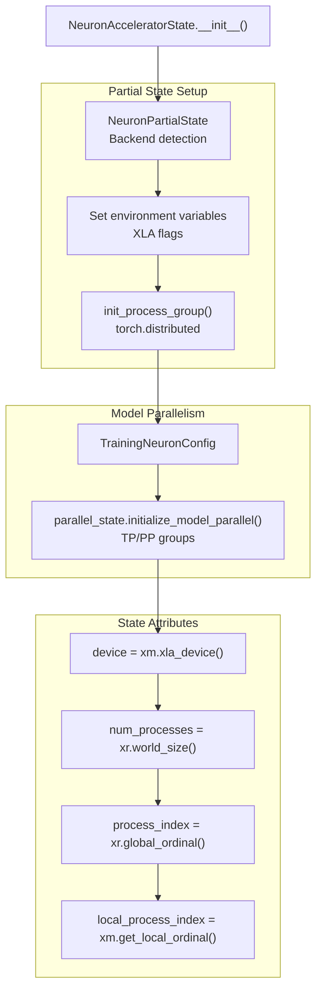

**Key State Attributes:**

| Attribute | Type | Description |
|-----------|------|-------------|
| `device` | `torch.device` | XLA device (`xm.xla_device()`) |
| `num_processes` | `int` | Total number of workers (`xr.world_size()`) |
| `process_index` | `int` | Global rank (`xr.global_ordinal()`) |
| `local_process_index` | `int` | Local rank on node (`xm.get_local_ordinal()`) |
| `distributed_type` | `DistributedType` | Always `DistributedType.XLA` for Neuron |
| `trn_config` | `TrainingNeuronConfig` | Parallelism configuration |
| `mixed_precision` | `str` | `"bf16"` or `"no"` |

**Sources:** [optimum/neuron/accelerate/state.py:85-163]()

## Component Preparation

### Model Preparation

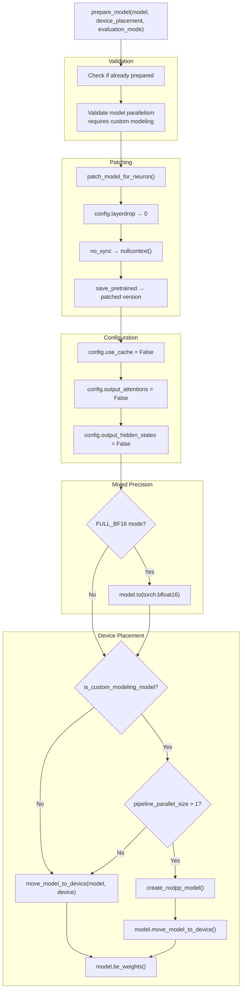

**Model Patching Specifications:**

The following attributes/methods are patched on the model:

| Attribute/Method | Patched Value | Purpose |
|------------------|---------------|---------|
| `config.layerdrop` | `0` | Disable layer dropout for deterministic execution |
| `no_sync` | `contextlib.nullcontext()` | Remove gradient synchronization wrapper (XLA handles it) |
| `save_pretrained` | Custom function | Handle Neuron-specific checkpoint format |

**Activation Checkpointing:**

For non-custom models with gradient checkpointing enabled, the standard checkpointing is replaced with Neuron-specific implementation via `apply_activation_checkpointing()`.

**SDPA Disabling:**

Scaled Dot Product Attention (SDPA) is disabled on PyTorch 2.x+ because Neuron uses custom attention kernels: [optimum/neuron/accelerate/accelerator.py:382-384]()

**Sources:** [optimum/neuron/accelerate/accelerator.py:338-398](), [optimum/neuron/accelerate/accelerator.py:312-336]()

### Optimizer Preparation

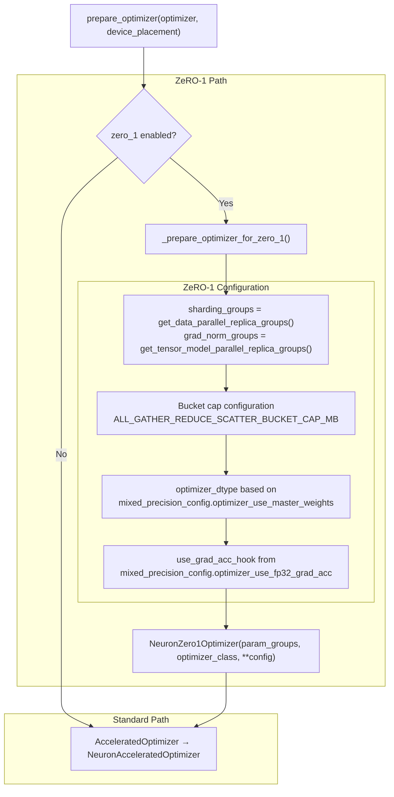

**ZeRO-1 Configuration Parameters:**

| Parameter | Computation | Description |
|-----------|-------------|-------------|
| `sharding_groups` | `get_data_parallel_replica_groups()` | Process groups for optimizer state sharding |
| `grad_norm_groups` | `get_tensor_model_parallel_replica_groups()` | Groups for gradient norm computation across TP ranks |
| `bucket_cap_mb_all_gather` | `max(1, bucket_cap // get_data_parallel_size())` | All-gather bucket size in MB |
| `bucket_cap_mb_reduce_scatter` | `bucket_cap` (default: 130 MB) | Reduce-scatter bucket size in MB |
| `optimizer_dtype` | `torch.float32` if master weights, else `torch.bfloat16` | Optimizer state storage dtype |
| `use_grad_acc_hook` | From `mixed_precision_config.optimizer_use_fp32_grad_acc` | Use FP32 for gradient accumulation |
| `higher_cc_precision` | From `mixed_precision_config.optimizer_use_fp32_grad_acc` | Use higher precision for collective communication |
| `save_master_weights` | From `mixed_precision_config.optimizer_save_master_weights_in_ckpt` | Include FP32 weights in checkpoints |

**Context Model Parallelism Restriction:**

ZeRO-1 cannot be used with context model parallelism (`context_model_parallel_size > 1`) due to incompatible sharding strategies: [optimum/neuron/accelerate/accelerator.py:256-260]()

**Sources:** [optimum/neuron/accelerate/accelerator.py:253-306]()

### Scheduler Preparation

Scheduler preparation is straightforward, wrapping the scheduler in `NeuronAcceleratedScheduler`:

```python
@patch_within_function(("accelerate.accelerator.AcceleratedScheduler", NeuronAcceleratedScheduler))
def prepare_scheduler(self, scheduler: torch.optim.lr_scheduler.LRScheduler):
    return super().prepare_scheduler(scheduler)
```

**Sources:** [optimum/neuron/accelerate/accelerator.py:308-310]()

### DataLoader Preparation

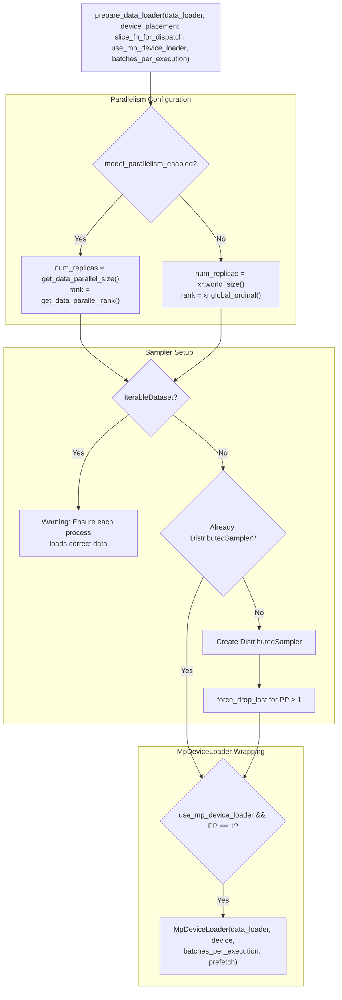

**MpDeviceLoader Configuration:**

When `use_mp_device_loader=True` and pipeline parallelism is disabled:
- `loader_prefetch_size`: `2 * batches_per_execution`
- `device_prefetch_size`: `batches_per_execution`

This reduces host-device communication by batching transfers.

**Pipeline Parallelism Constraint:**

When `pipeline_parallel_size > 1`, the dataloader is forced to drop the last incomplete batch to prevent failures with uneven microbatch distribution: [optimum/neuron/accelerate/accelerator.py:224-228]()

**Sources:** [optimum/neuron/accelerate/accelerator.py:208-251](), [optimum/neuron/accelerate/accelerator.py:171-206]()

## Training Loop Operations

### Backward Pass

```python
def backward(self, loss, **kwargs):
    if self.distributed_type != DistributedType.DEEPSPEED:
        loss = loss / self.gradient_accumulation_steps
    if self.scaler is not None:
        self.scaler.scale(loss).backward(**kwargs)
    else:
        loss.backward(**kwargs)
```

**Gradient Accumulation Scaling:**

Loss is automatically divided by `gradient_accumulation_steps` to ensure correct gradient magnitude when accumulating.

**XLA Synchronization:**

Note that `backward()` does not call `xm.mark_step()` directly. The training loop must explicitly call `xm.mark_step()` after optimizer steps to commit pending operations to the XLA device. This gives fine-grained control over when graph compilation and execution occur.

**Sources:** [optimum/neuron/accelerate/accelerator.py:400-406]()

### Autocast Context

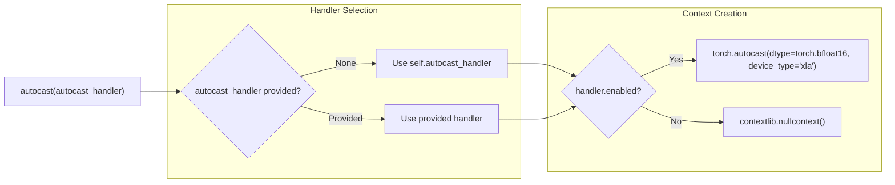

**Default Behavior:**

`self.autocast_handler` is automatically enabled when `mixed_precision="bf16"` (i.e., `AUTOCAST_BF16` mode).

**Sources:** [optimum/neuron/accelerate/accelerator.py:408-422](), [optimum/neuron/accelerate/accelerator.py:161-163]()

### Gradient Clipping

```python
def clip_grad_norm_(
    self, parameters, max_norm, norm_type=2, 
    postpone_clipping_to_optimizer_step: bool = False
):
    if postpone_clipping_to_optimizer_step:
        parameters = list(parameters)
        if len(self._optimizers) > 1:
            raise RuntimeError(
                "Postponing gradient clipping to the optimizer step is not possible "
                "when multiple optimizer were prepared by the NeuronAccelerator."
            )
        self._optimizers[0].prepare_clip_grad_norm(parameters, max_norm, norm_type=norm_type)
    else:
        return super().clip_grad_norm_(parameters, max_norm, norm_type=norm_type)
```

**Postponed Clipping:**

Setting `postpone_clipping_to_optimizer_step=True` defers gradient clipping until the optimizer step, which can be more efficient for distributed training. This requires exactly one optimizer.

**Sources:** [optimum/neuron/accelerate/accelerator.py:424-434]()

### Gradient Accumulation

```python
@contextlib.contextmanager
def accumulate(self):
    self._do_sync()
    yield
```

The `accumulate()` context manager calls `_do_sync()` to synchronize gradients at the end of accumulation steps.

**Sources:** [optimum/neuron/accelerate/accelerator.py:593-596]()

## Gathering Operations

### Standard Gather

```python
def gather(self, tensor, out_of_graph: bool = False):
    return _xla_gather(tensor, out_of_graph=out_of_graph)
```

The `out_of_graph` parameter controls whether the gather operation is performed outside the XLA computation graph, which is necessary to prevent recompilation.

### Gather for Metrics

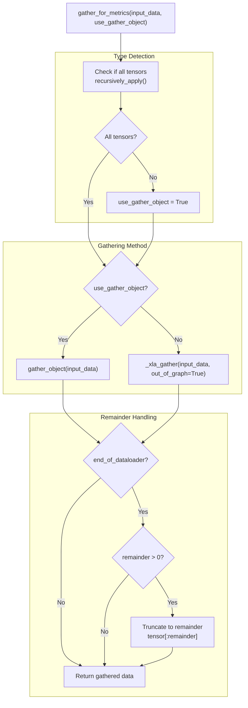

**Out-of-Graph Gathering:**

Using `out_of_graph=True` is critical for evaluation to prevent recompilation at every evaluation step: [optimum/neuron/accelerate/accelerator.py:565-566]()

**Remainder Handling:**

When the dataset doesn't divide evenly across processes, the last batch is truncated to the actual number of samples to avoid duplication in metrics.

**Sources:** [optimum/neuron/accelerate/accelerator.py:550-591]()

## Checkpointing

### Save State

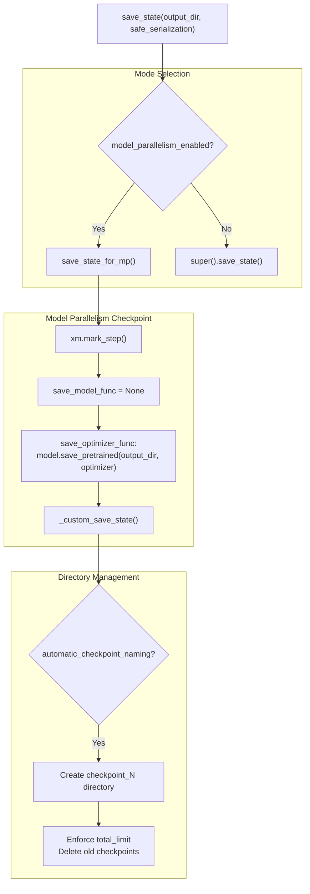

**Model Parallelism Checkpointing:**

For models with tensor or pipeline parallelism, the model and optimizer are saved together using the model's custom `save_pretrained()` method, which handles sharded state: [optimum/neuron/accelerate/accelerator.py:523-539]()

**Checkpoint Rotation:**

When `automatic_checkpoint_naming=True` and `total_limit` is set, old checkpoints are automatically deleted to maintain the limit: [optimum/neuron/accelerate/accelerator.py:455-467]()

**XLA Synchronization:**

`xm.mark_step()` is called before checkpointing to ensure all pending operations complete: [optimum/neuron/accelerate/accelerator.py:477]()

**Sources:** [optimum/neuron/accelerate/accelerator.py:436-548]()

## Mixed Precision Configuration

The `MixedPrecisionConfig` dataclass controls BF16 training behavior:

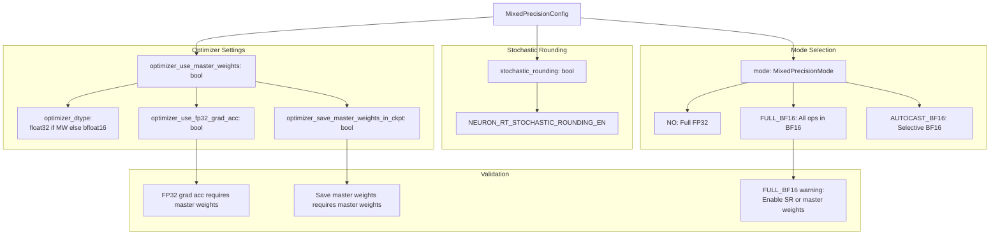

**Configuration Parameters:**

| Parameter | Default | Description |
|-----------|---------|-------------|
| `mode` | Required | `"NO"`, `"FULL_BF16"`, or `"AUTOCAST_BF16"` |
| `stochastic_rounding` | `True` | Enable stochastic rounding for BF16 to improve convergence |
| `optimizer_use_master_weights` | `False` | Store optimizer state in FP32 for better numerical stability |
| `optimizer_use_fp32_grad_acc` | `False` | Accumulate gradients in FP32 (requires master weights) |
| `optimizer_save_master_weights_in_ckpt` | `False` | Include FP32 weights in checkpoints (requires master weights) |

**Mode-Specific Behavior:**

| Mode | Model Weights | Computation | Compiler Flag |
|------|---------------|-------------|---------------|
| `NO` | FP32 | FP32 | Default |
| `FULL_BF16` | BF16 | BF16 | Default |
| `AUTOCAST_BF16` | FP32 | Mixed (BF16 where safe) | `--auto-cast none` |

**Sources:** [optimum/neuron/accelerate/utils/dataclasses.py:28-70](), [optimum/neuron/accelerate/accelerator.py:146-153]()

## XLA Graph Synchronization with xm.mark_step()

The XLA/Neuron execution model requires explicit synchronization points to commit pending operations. The `xm.mark_step()` function serves as the boundary between graph construction and execution.

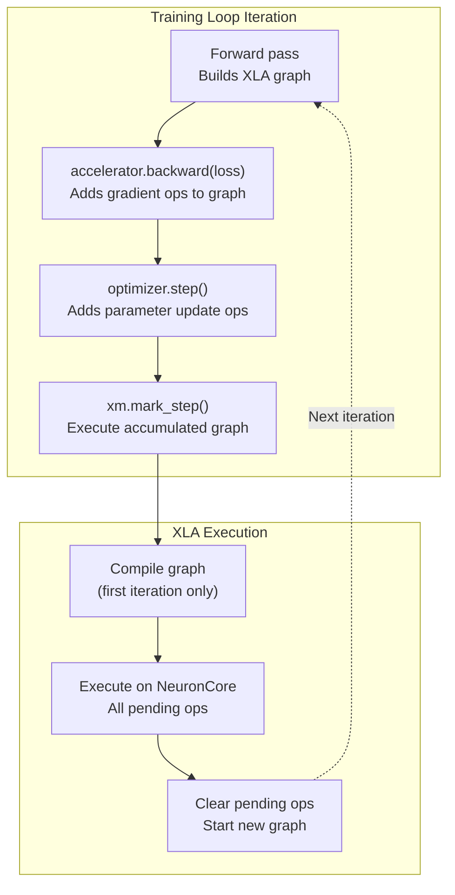

**Key Synchronization Points in NeuronAccelerator:**

| Location | Purpose | Code Reference |
|----------|---------|----------------|
| After model preparation | Ensure model is fully placed on device before training | [optimum/neuron/accelerate/accelerator.py:393]() |
| Before checkpointing | Flush pending operations before saving state | [optimum/neuron/accelerate/accelerator.py:477]() |
| After optimizer step | Commit weight updates (called by training loop, not accelerator) | Training loop responsibility |

**Why Not Automatic?**

`NeuronAccelerator` does not automatically insert `xm.mark_step()` after every operation because:
1. **Gradient accumulation**: Multiple backward passes must accumulate before synchronization
2. **Performance**: Larger graphs can be more efficiently compiled and executed
3. **Flexibility**: Users can control synchronization granularity based on their needs

**Training Loop Pattern:**

```python
for batch in dataloader:
    with accelerator.accumulate(model):
        outputs = model(**batch)
        loss = outputs.loss
        accelerator.backward(loss)
        
        if accelerator.sync_gradients:
            # Only clip/update after accumulation is complete
            accelerator.clip_grad_norm_(model.parameters(), max_norm)
            optimizer.step()
            scheduler.step()
            optimizer.zero_grad()
            # Synchronization happens here
            xm.mark_step()
```

**Sources:** [optimum/neuron/accelerate/accelerator.py:393](), [optimum/neuron/accelerate/accelerator.py:477]()

## Integration with NeuronTrainer

`NeuronTrainer` (detailed in API reference page 13.2) extends `transformers.Trainer` and uses `NeuronAccelerator` to orchestrate Neuron-specific training operations.

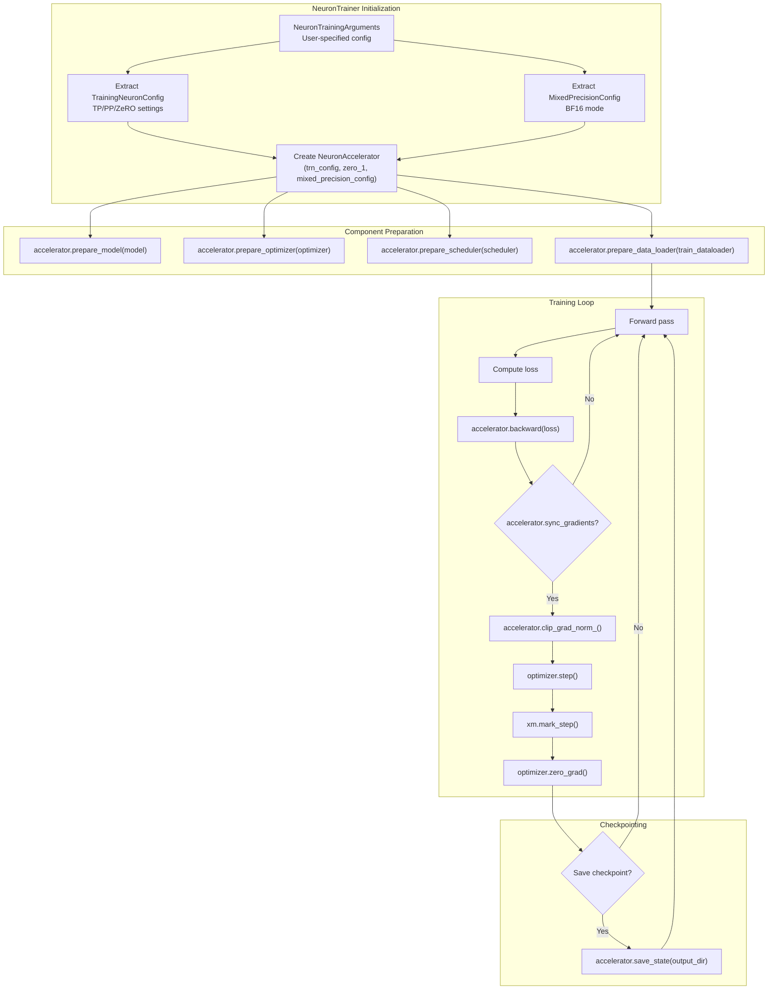

**NeuronTrainer Responsibilities:**

| Responsibility | Implementation |
|----------------|----------------|
| **Create NeuronAccelerator** | Instantiate with `TrainingNeuronConfig` and `MixedPrecisionConfig` from `NeuronTrainingArguments` |
| **Prepare components** | Call `accelerator.prepare_*()` methods for model, optimizer, scheduler, and dataloaders |
| **Training loop** | Use `accelerator.backward()`, check `accelerator.sync_gradients` for synchronization |
| **XLA synchronization** | Call `xm.mark_step()` after optimizer step when `sync_gradients=True` |
| **Gradient clipping** | Use `accelerator.clip_grad_norm_()` with optional postponement |
| **Checkpointing** | Use `accelerator.save_state()` which handles model parallelism automatically |
| **Evaluation** | Use `accelerator.gather_for_metrics()` with out-of-graph gathering |

**Key Integration Points:**

1. **Gradient Accumulation**: `NeuronTrainer` uses `accelerator.accumulate()` context manager and checks `accelerator.sync_gradients` to determine when to update parameters
2. **Mixed Precision**: `NeuronTrainer` wraps forward pass with `accelerator.autocast()` when using `AUTOCAST_BF16` mode
3. **Distributed Metrics**: `NeuronTrainer` uses `accelerator.gather_for_metrics()` during evaluation to collect results across all processes
4. **State Persistence**: `NeuronTrainer` delegates checkpoint saving to `accelerator.save_state()` which handles both standard and model-parallel checkpoints

**Sources:** [optimum/neuron/accelerate/accelerator.py:79-597]()

## Key Design Decisions

| Decision | Rationale |
|----------|-----------|
| Extend `Accelerator` instead of replacing it | Maintain compatibility with Hugging Face ecosystem |
| Reject unsupported plugins explicitly | Provide clear error messages for incompatible features |
| Force gradient accumulation adjustment | XLA requires special handling for gradient accumulation |
| Patch `AcceleratorState` during initialization | Inject Neuron-specific state management |
| Use `NeuronZero1Optimizer` wrapper | Integrate NeuronX Distributed optimizer sharding |
| Disable model caching and unused outputs | Reduce memory and communication overhead |
| Force `drop_last=True` for pipeline parallelism | Prevent failures with uneven microbatch distribution |
| Use out-of-graph gather for metrics | Prevent recompilation during evaluation |
| Separate checkpoint path for model parallelism | Handle sharded state correctly |

**Sources:** [optimum/neuron/accelerate/accelerator.py:79-597]()

---

