<!-- source: DeepWiki mcp.deepwiki.com · repo huggingface/optimum-neuron · page 5.3 Distributed Training Strategies · fetched 2026-10-26 -->

# Distributed Training Strategies

<details>
<summary>Relevant source files</summary>

The following files were used as context for generating this wiki page:

- [docs/source/guides/distributed_training.mdx](docs/source/guides/distributed_training.mdx)
- [optimum/neuron/accelerate/accelerator.py](optimum/neuron/accelerate/accelerator.py)
- [optimum/neuron/accelerate/state.py](optimum/neuron/accelerate/state.py)
- [optimum/neuron/accelerate/utils/dataclasses.py](optimum/neuron/accelerate/utils/dataclasses.py)
- [optimum/neuron/models/training/config.py](optimum/neuron/models/training/config.py)
- [optimum/neuron/models/training/granite/modeling_granite.py](optimum/neuron/models/training/granite/modeling_granite.py)
- [optimum/neuron/models/training/llama/modeling_llama.py](optimum/neuron/models/training/llama/modeling_llama.py)
- [optimum/neuron/models/training/modeling_utils.py](optimum/neuron/models/training/modeling_utils.py)
- [optimum/neuron/models/training/qwen3/modeling_qwen3.py](optimum/neuron/models/training/qwen3/modeling_qwen3.py)
- [tests/training/test_custom_modeling.py](tests/training/test_custom_modeling.py)

</details>


## Overview

This document details the distributed training parallelism strategies available in optimum-neuron, explaining how they distribute computation and memory across multiple NeuronCores on AWS Trainium instances. Each parallelism strategy addresses different memory bottlenecks in large model training.

For the high-level training APIs, see page 5.2. For mixed precision settings, see page 5.4. For custom model implementations, see page 5.5.

### Available Strategies

| Strategy | What It Shards | Memory Reduction | Configuration Parameter | Requires Custom Model |
|----------|----------------|------------------|------------------------|----------------------|
| Data Parallelism (DP) | Batches across replicas | N/A (replicates model) | Automatic | No |
| ZeRO-1 | Optimizer state | Optimizer state ÷ DP size | `zero_1=True` | No |
| Tensor Parallelism (TP) | Layers horizontally | Model params ÷ TP size | `tensor_parallel_size` | Yes |
| Sequence Parallelism (SP) | Activations along sequence | Activations ÷ TP size | `sequence_parallel_enabled` | Yes |
| Pipeline Parallelism (PP) | Layers vertically | Model params ÷ PP size | `pipeline_parallel_size` | Yes |

### World Size and Process Coordination

The total number of processes (`world_size`) must satisfy:

```
world_size = data_parallel_size × tensor_parallel_size × pipeline_parallel_size
```

Each process runs on one NeuronCore. For example, on a `trn1.32xlarge` instance with 32 NeuronCores:
- `world_size=32` total processes
- Configuration: `tp_size=4, pp_size=2` → `dp_size = 32 / (4 × 2) = 4`
- Result: 4 data-parallel model replicas, each using 8 NeuronCores (4 for TP, 2 for PP)

## Data Parallelism

Data Parallelism (DP) is the fundamental parallelism strategy where multiple model replicas process different batches of data in parallel. Each replica has a complete copy of the model.

### How It Works

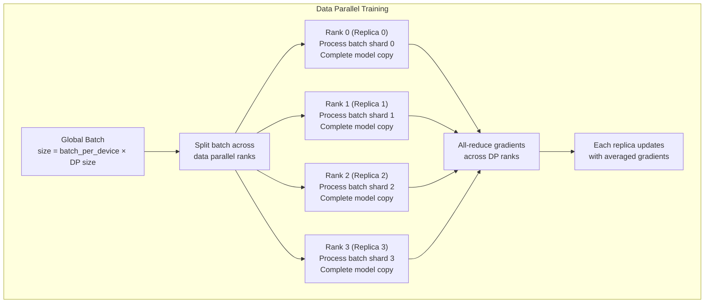

### Data Parallel Size Computation

When using model parallelism (TP or PP), the data parallel size is automatically computed:

```python
# From TrainingNeuronConfig.__post_init__
# After initializing model parallelism
self.data_parallel_size = parallel_state.get_data_parallel_size()

# Which computes: world_size / (tensor_parallel_size × pipeline_parallel_size)
```

### DataLoader Distribution

The `NeuronAccelerator` automatically distributes data across DP ranks using `DistributedSampler`:

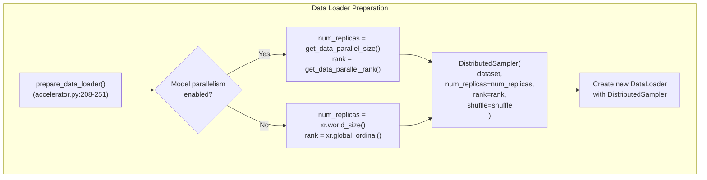

**Sources:**
- [optimum/neuron/models/training/config.py:55]()
- [optimum/neuron/accelerate/accelerator.py:208-251]()

## Configuration Architecture

The distributed training configuration is managed through `TrainingNeuronConfig` and applied via `NeuronAccelerator`.

### TrainingNeuronConfig Class Structure

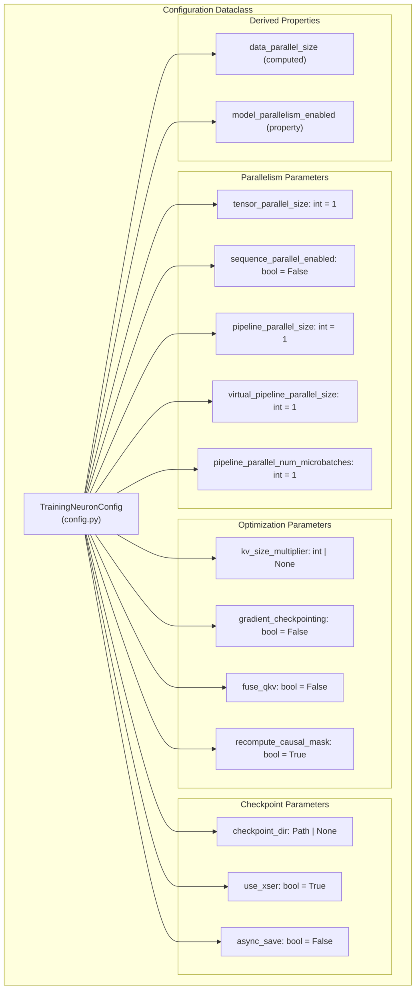

**TrainingNeuronConfig Initialization Flow**

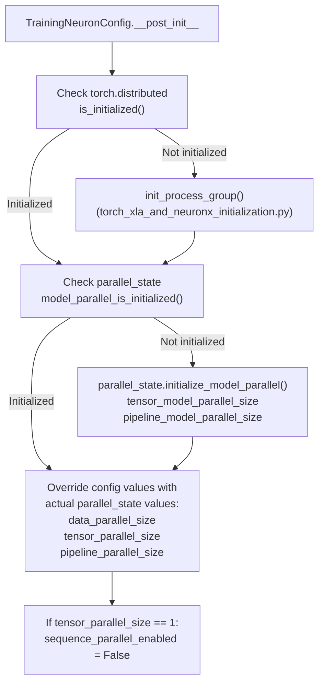

**Sources:**
- [optimum/neuron/models/training/config.py:1-74]()
- [optimum/neuron/utils/torch_xla_and_neuronx_initialization.py]()

### Integration with NeuronAccelerator

The `TrainingNeuronConfig` is integrated into the training pipeline through `NeuronAcceleratorState` and `NeuronAccelerator`.

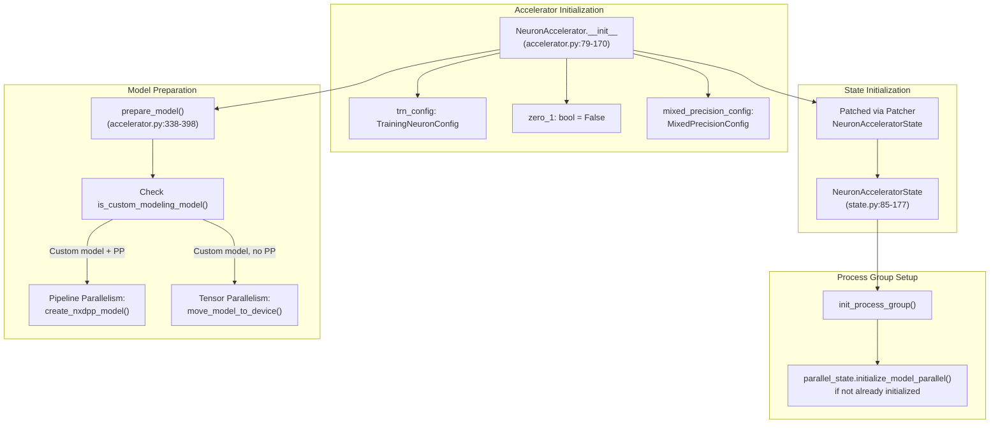

**Sources:**
- [optimum/neuron/accelerate/accelerator.py:79-170]()
- [optimum/neuron/accelerate/state.py:85-177]()
- [optimum/neuron/accelerate/accelerator.py:338-398]()

## Process Coordination and Initialization

Distributed training on Neuron requires coordinating processes across NeuronCores through torch.distributed and neuronx_distributed process groups.

### Initialization Flow

```mermaid
graph TB
    subgraph "Process Group Initialization"
        Launch["torchrun --nproc_per_node=N<br/>Launch N processes,<br/>one per NeuronCore"]
        
        TNCInit["TrainingNeuronConfig.__post_init__<br/>(config.py:30-61)"]
        
        CheckDist{"torch.distributed<br/>initialized?"}
        
        InitPG["init_process_group()<br/>(torch_xla_and_neuronx_initialization.py)<br/>- Set backend='xla'<br/>- Initialize XLA runtime"]
        
        CheckMP{"parallel_state<br/>initialized?"}
        
        InitMP["parallel_state.initialize_model_parallel(<br/>tensor_model_parallel_size,<br/>pipeline_model_parallel_size<br/>)"]
        
        CreateGroups["Create process groups:<br/>- Data parallel groups<br/>- Tensor parallel groups<br/>- Pipeline parallel groups"]
        
        ComputeDP["Compute data_parallel_size:<br/>world_size / (TP × PP)"]
    end
    
    Launch --> TNCInit
    TNCInit --> CheckDist
    CheckDist -->|"No"| InitPG
    CheckDist -->|"Yes"| CheckMP
    InitPG --> CheckMP
    CheckMP -->|"No"| InitMP
    CheckMP -->|"Yes"| ComputeDP
    InitMP --> CreateGroups
    CreateGroups --> ComputeDP
```

### Process Group Topology

Each process belongs to multiple overlapping groups:

| Group Type | Purpose | Members | Communication Pattern |
|------------|---------|---------|----------------------|
| **World** | All processes | All ranks [0, world_size) | All-to-all coordination |
| **Data Parallel** | Gradient synchronization | Ranks with same TP/PP coordinates | All-reduce gradients |
| **Tensor Parallel** | Layer-wise parallel ops | Ranks within same TP group | All-reduce, all-gather, scatter |
| **Pipeline Parallel** | Send/recv activations | Ranks across PP stages | Point-to-point |

### Example: 32 Processes, TP=4, PP=2

```
world_size = 32
tensor_parallel_size = 4
pipeline_parallel_size = 2
data_parallel_size = 32 / (4 × 2) = 4

Data Parallel Group 0: Ranks [0, 1, 2, 3, 4, 5, 6, 7]
  ├─ TP Group 0, PP Stage 0: Ranks [0, 1, 2, 3]
  └─ TP Group 0, PP Stage 1: Ranks [4, 5, 6, 7]

Data Parallel Group 1: Ranks [8, 9, 10, 11, 12, 13, 14, 15]
  ├─ TP Group 1, PP Stage 0: Ranks [8, 9, 10, 11]
  └─ TP Group 1, PP Stage 1: Ranks [12, 13, 14, 15]

Data Parallel Group 2: Ranks [16, 17, 18, 19, 20, 21, 22, 23]
  ├─ TP Group 2, PP Stage 0: Ranks [16, 17, 18, 19]
  └─ TP Group 2, PP Stage 1: Ranks [20, 21, 22, 23]

Data Parallel Group 3: Ranks [24, 25, 26, 27, 28, 29, 30, 31]
  ├─ TP Group 3, PP Stage 0: Ranks [24, 25, 26, 27]
  └─ TP Group 3, PP Stage 1: Ranks [28, 29, 30, 31]
```

**Sources:**
- [optimum/neuron/models/training/config.py:30-61]()
- [optimum/neuron/accelerate/state.py:68-76]()
- [optimum/neuron/accelerate/state.py:153-157]()

## ZeRO-1 Optimizer State Sharding

ZeRO-1 (Zero Redundancy Optimizer Stage 1) shards the optimizer state (gradients, momentum, variance) across data parallel ranks, reducing memory usage without changing model architecture.

### Memory Savings

Without ZeRO-1, each data parallel rank maintains:
- Full optimizer state (momentum, variance) for all parameters
- Memory cost: `optimizer_state_size × data_parallel_size` total across all ranks

With ZeRO-1:
- Optimizer state sharded across data parallel ranks
- Each rank maintains `1/data_parallel_size` of the optimizer state
- Memory saving per rank: `(data_parallel_size - 1) / data_parallel_size` of optimizer memory

### Configuration

ZeRO-1 is enabled via the `zero_1` parameter in `NeuronAccelerator`:

```python
accelerator = NeuronAccelerator(
    trn_config=trn_config,
    zero_1=True,  # Enable ZeRO-1
)
```

### Implementation Architecture

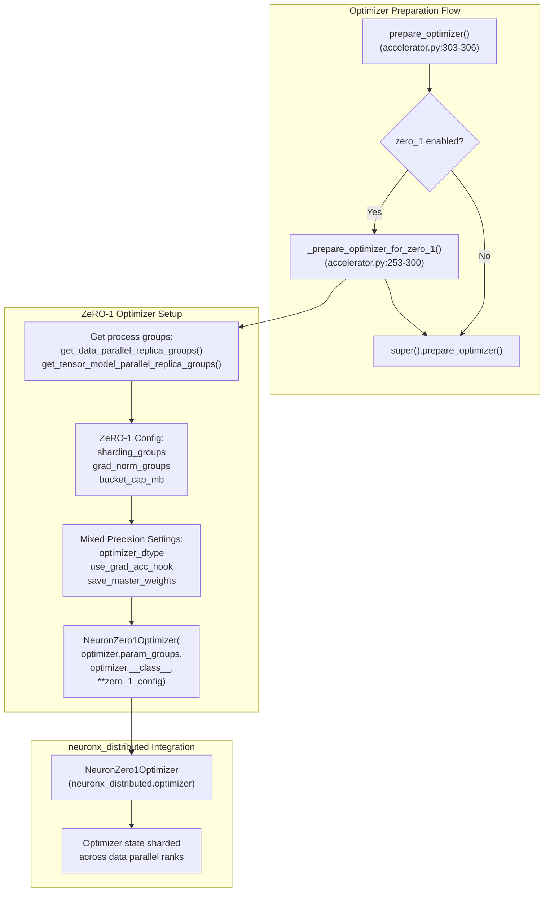

### ZeRO-1 Configuration Details

The ZeRO-1 optimizer wraps the base optimizer with sharding logic:

| Parameter | Source | Description |
|-----------|--------|-------------|
| `sharding_groups` | `get_data_parallel_replica_groups()` | Process groups for sharding optimizer state across DP ranks |
| `grad_norm_groups` | `get_tensor_model_parallel_replica_groups()` | Process groups for gradient norm computation when TP is used |
| `bucket_cap_mb_all_gather` | `ALL_GATHER_REDUCE_SCATTER_BUCKET_CAP_MB` env var | Bucket size for all-gather (default: 130 MB / DP size) |
| `bucket_cap_mb_reduce_scatter` | `ALL_GATHER_REDUCE_SCATTER_BUCKET_CAP_MB` env var | Bucket size for reduce-scatter (default: 130 MB) |
| `optimizer_dtype` | Based on `mixed_precision_config` | `torch.float32` if master weights enabled, else `torch.bfloat16` |
| `use_grad_acc_hook` | `mixed_precision_config.optimizer_use_fp32_grad_acc` | Enable FP32 gradient accumulation |
| `save_master_weights` | `mixed_precision_config.optimizer_save_master_weights_in_ckpt` | Save FP32 master weights in checkpoint |

### Gradient Synchronization

With ZeRO-1, gradients are synchronized using reduce-scatter and all-gather:

1. **Backward pass**: Each rank computes gradients for all parameters
2. **Reduce-scatter**: Gradients are reduced and scattered across DP ranks
   - Each rank ends up with full gradient for its shard of parameters
3. **Optimizer step**: Each rank updates its shard of parameters
4. **All-gather** (implicit): During forward pass, parameters are gathered from all DP ranks

**Sources:**
- [optimum/neuron/accelerate/accelerator.py:253-306]()
- [optimum/neuron/accelerate/utils/dataclasses.py:34-70]()

## Tensor Parallelism

Tensor Parallelism (TP) splits individual model layers across multiple devices by sharding matrix multiplications along rows or columns.

### Requirements and Configuration

Tensor Parallelism requires custom model implementations from `optimum.neuron.models.training` (e.g., `LlamaForCausalLM`, `GraniteForCausalLM`, `Qwen3ForCausalLM`).

Configuration is done via `TrainingNeuronConfig`:

```python
trn_config = TrainingNeuronConfig(
    tensor_parallel_size=8,
    sequence_parallel_enabled=True,  # Recommended with TP
    kv_size_multiplier=None,  # Auto-computed or manually set
    fuse_qkv=True,  # Optimization flag
)
```

### Parallel Layer Types

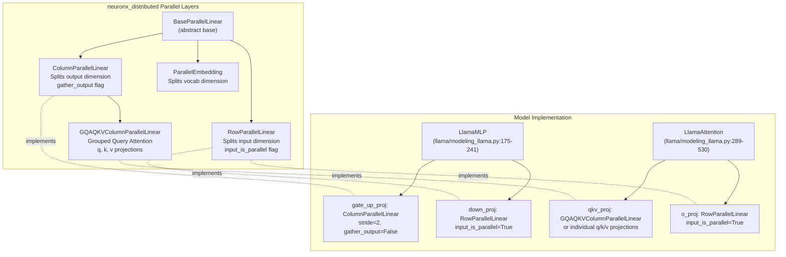

### Weight Transformation Specifications

Custom models use `ModelWeightTransformationSpecs` to define how standard Transformers weights are converted to tensor-parallel weights.

```mermaid
graph TB
    subgraph "Transformation Specs"
        Specs["ModelWeightTransformationSpecs<br/>(transformations_utils.py)"]
        
        FusedSpec["FusedLinearsSpec<br/>Fuses multiple linears<br/>e.g., gate_proj + up_proj"]
        
        GQASpec["GQAQKVColumnParallelLinearSpec<br/>Transforms q/k/v projections<br/>to GQAQKVColumnParallelLinear"]
    end
    
    subgraph "Adaptation Flow"
        LoadStateDict["Load checkpoint state_dict"]
        AdaptSD["adapt_state_dict()<br/>(modeling_utils.py:576-583)"]
        ApplySpecs["Apply transformation specs:<br/>1. Fuse linears<br/>2. Shard across TP ranks<br/>3. Handle GQA"]
        LoadToModel["_load_state_dict_into_model()"]
    end
    
    subgraph "Reverse Transformation"
        SaveModel["Save model"]
        ToOriginal["to_original_weights()<br/>(transformations_utils.py)"]
        Unfuse["1. Concat shards<br/>2. Unfuse weights<br/>3. Restore original names"]
        SaveCheckpoint["Save checkpoint"]
    end
    
    FusedSpec --> Specs
    GQASpec --> Specs
    
    LoadStateDict --> AdaptSD
    AdaptSD --> ApplySpecs
    ApplySpecs --> LoadToModel
    
    SaveModel --> ToOriginal
    ToOriginal --> Unfuse
    Unfuse --> SaveCheckpoint
```

**Example: FusedLinearsSpec for MLP**

The MLP layer fuses `gate_proj` and `up_proj` into a single `gate_up_proj`:

```python
# From LlamaMLP.__init__
self.specs = ModelWeightTransformationSpecs(
    specs=FusedLinearsSpec(
        fused_linear_name="gate_up_proj",
        linear_names=["gate_proj", "up_proj"],
        bias=False,
        fuse_axis="column",
        original_dims=[self.intermediate_size] * 2,
    )
)
```

During loading, the spec:
1. Gathers `gate_proj.weight` and `up_proj.weight` from checkpoint
2. Shards each along column dimension across TP ranks
3. Concatenates sharded pieces into `gate_up_proj.weight`

**Sources:**
- [optimum/neuron/models/training/llama/modeling_llama.py:175-241]()
- [optimum/neuron/models/training/llama/modeling_llama.py:289-530]()
- [optimum/neuron/models/training/transformations_utils.py:365-733]()
- [optimum/neuron/models/training/modeling_utils.py:576-583]()

### KV Size Multiplier for GQA

When `num_key_value_heads < tensor_parallel_size`, the Key and Value heads must be replicated to enable sharding. This is controlled by `kv_size_multiplier`:

```python
# From TrainingNeuronConfig
def auto_kv_size_multiplier(self, num_key_value_heads: int) -> int:
    kv_size_multiplier = max(1, self.tensor_parallel_size // num_key_value_heads)
    return kv_size_multiplier
```

For example, with `tensor_parallel_size=8` and `num_key_value_heads=2`:
- `kv_size_multiplier = 8 // 2 = 4`
- Each KV head is replicated 4 times before sharding

**Sources:**
- [optimum/neuron/models/training/config.py:62-69]()
- [optimum/neuron/models/training/llama/modeling_llama.py:314-322]()

## Sequence Parallelism

Sequence Parallelism (SP) is an optimization that works alongside Tensor Parallelism to reduce activation memory by sharding activations along the sequence dimension in regions where tensors are not already sharded by TP.

### Configuration and Requirements

Sequence Parallelism requires:
1. `tensor_parallel_size > 1`
2. `sequence_parallel_enabled=True` in `TrainingNeuronConfig`
3. Custom model implementation

If `tensor_parallel_size == 1`, sequence parallelism is automatically disabled.

### Implementation in Custom Models

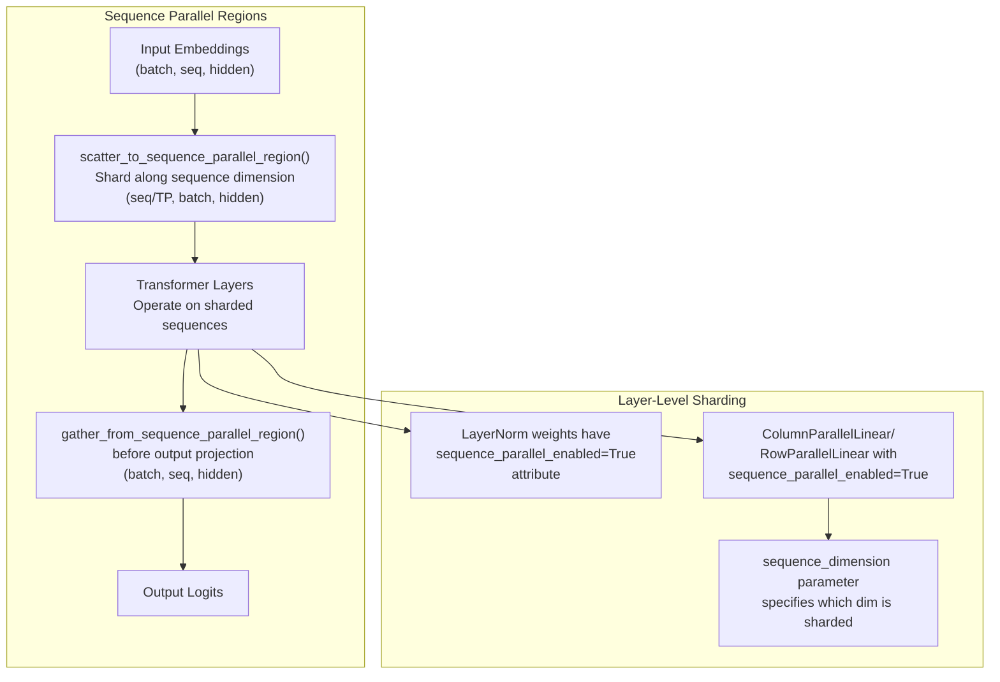

**Example from GraniteModel:**

```python
# Scatter at the beginning
if self.trn_config.sequence_parallel_enabled:
    inputs_embeds = inputs_embeds.transpose(0, 1).contiguous()
    inputs_embeds = scatter_to_sequence_parallel_region(inputs_embeds)

# ... transformer layers operate on sharded sequence ...

# Gather before output
if self.trn_config.sequence_parallel_enabled:
    logits = gather_from_sequence_parallel_region(logits)
    logits = logits.transpose(0, 1).contiguous()
```

**Sources:**
- [optimum/neuron/models/training/granite/modeling_granite.py:136-139]()
- [optimum/neuron/models/training/granite/modeling_granite.py:252-254]()
- [optimum/neuron/models/training/llama/modeling_llama.py:63-84]()

## Pipeline Parallelism

Pipeline Parallelism (PP) splits model layers into stages, with each stage running on different devices. It uses microbatching to keep all devices busy and reduce pipeline bubbles.

### Configuration and Requirements

Pipeline Parallelism requires:
1. Model with `SUPPORTS_PIPELINE_PARALLELISM = True`
2. Defined `PIPELINE_TRANSFORMER_LAYER_CLS`
3. `pipeline_parallel_size > 1` in `TrainingNeuronConfig`
4. Optional: `pipeline_parallel_num_microbatches` for scheduling

### Model Support Matrix

| Model | Supports PP | Transformer Layer Class |
|-------|-------------|------------------------|
| LlamaForCausalLM | Yes | `LlamaDecoderLayer` |
| GraniteForCausalLM | No (explicitly disabled) | - |
| Qwen3ForCausalLM | Yes | `Qwen3DecoderLayer` |

```python
# Example from Qwen3ForCausalLM
SUPPORTS_PIPELINE_PARALLELISM = True
PIPELINE_TRANSFORMER_LAYER_CLS = Qwen3DecoderLayer
PIPELINE_INPUT_NAMES = ["input_ids", "attention_mask", "labels"]
PIPELINE_LEAF_MODULE_CLASSE_NAMES = ["Qwen3RMSNorm", "LlamaRotaryEmbedding"]
```

### Pipeline Parallelism Flow

```mermaid
graph TB
    subgraph "Model Preparation with PP"
        PrepModel["prepare_model()<br/>(accelerator.py:338-398)"]
        CheckPP{"pipeline_parallel_size > 1?"}
        CreatePP["create_nxdpp_model()<br/>(pipeline_utils.py)"]
        MoveModel["move_model_to_device()<br/>to current PP stage devices"]
    end
    
    subgraph "Pipeline Model Wrapper"
        NxDPP["neuronx_distributed.pipeline<br/>NxDPipelineModel"]
        
        Stages["Model split into stages:<br/>Stage 0: embeddings + first N layers<br/>Stage 1: middle layers<br/>...<br/>Stage K: last layers + head"]
        
        Schedule["Pipeline schedule:<br/>1F1B (1-forward-1-backward)<br/>with num_microbatches"]
    end
    
    subgraph "Parameter Loading"
        GetPPParams["get_pipeline_parameters_for_current_stage()<br/>(pipeline_utils.py)"]
        
        LoadOnlyStage["Only load parameters<br/>for current PP stage<br/>Others remain on meta device"]
    end
    
    PrepModel --> CheckPP
    CheckPP -->|Yes| CreatePP
    CreatePP --> NxDPP
    NxDPP --> Stages
    NxDPP --> Schedule
    CreatePP --> MoveModel
    
    LoadOnlyStage --> GetPPParams
```

### Pipeline Stage Assignment

Parameters are assigned to pipeline stages based on the transformer layer structure:

```python
# From get_pipeline_parameters_for_current_stage
pp_rank = get_pipeline_model_parallel_rank()
pp_size = get_pipeline_model_parallel_size()

# Each stage gets approximately num_layers / pp_size layers
layers_per_stage = num_layers // pp_size
start_layer = pp_rank * layers_per_stage
end_layer = (pp_rank + 1) * layers_per_stage if pp_rank < pp_size - 1 else num_layers

# Stage 0 also gets embeddings
# Last stage also gets final norm + lm_head
```

**Sources:**
- [optimum/neuron/accelerate/accelerator.py:364-368]()
- [optimum/neuron/models/training/qwen3/modeling_qwen3.py:217-221]()
- [optimum/neuron/models/training/granite/modeling_granite.py:204]()
- [optimum/neuron/models/training/pipeline_utils.py]()

## Combining Parallelism Strategies

Multiple parallelism strategies can be combined. The relationship between world_size and parallelism dimensions is:

```
world_size = data_parallel_size × tensor_parallel_size × pipeline_parallel_size
```

Each strategy targets different memory bottlenecks:
- **TP + SP**: Reduce model parameter and activation memory per device
- **PP**: Reduce model parameter memory per device with different communication pattern than TP
- **DP + ZeRO-1**: Scale to more devices while reducing optimizer memory per device
- **TP + PP + DP + ZeRO-1**: Maximum scalability for very large models

### Process Group Hierarchy

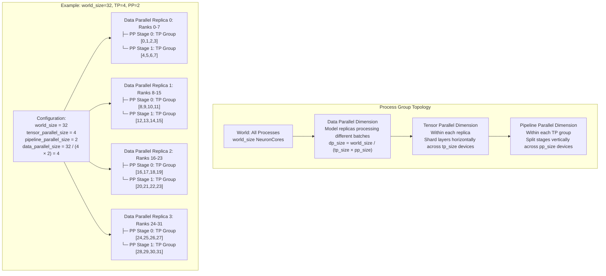

### Combined Configuration Example

```python
# Configure all parallelism strategies
trn_config = TrainingNeuronConfig(
    tensor_parallel_size=4,              # Shard layers across 4 devices
    sequence_parallel_enabled=True,       # Shard activations with TP
    pipeline_parallel_size=2,             # Split model into 2 stages
    pipeline_parallel_num_microbatches=8, # 8 microbatches for pipeline
    gradient_checkpointing=True,          # Save activation memory
    fuse_qkv=True,                        # Optimization: fuse Q,K,V projections
)

accelerator = NeuronAccelerator(
    trn_config=trn_config,
    zero_1=True,                          # Shard optimizer state across DP ranks
    mixed_precision="bf16",
)

# Launch with: torchrun --nproc_per_node=32 train.py
# Results in: dp_size=4, tp_size=4, pp_size=2
```

With 32 processes on a `trn1.32xlarge` instance:
- TP=4, PP=2 → 8 processes per data parallel replica
- DP = 32 / (4 × 2) = 4 data parallel replicas
- ZeRO-1 shards optimizer state across the 4 DP groups
- Total: 4 model replicas, each using 8 NeuronCores

### Memory Breakdown Per Rank

For a model with parameter memory M:

| Component | Without Parallelism | With TP=4, PP=2, DP=4, ZeRO-1 |
|-----------|--------------------|-----------------------------|
| Model Parameters | M | M / (TP × PP) = M / 8 |
| Activations | A | A / TP (with SP) = A / 4 |
| Gradients | M | M / (TP × PP) = M / 8 |
| Optimizer State | 2M (Adam) | 2M / (TP × PP × DP) = 2M / 32 |

**Sources:**
- [optimum/neuron/accelerate/state.py:153-157]()
- [optimum/neuron/models/training/config.py:48-61]()

## Implementation Architecture Deep Dive

### Model Preparation Pipeline

```mermaid
graph TB
    subgraph "NeuronAccelerator.prepare_model()"
        Start["prepare_model(model)<br/>(accelerator.py:338-398)"]
        
        CheckPrepared{"Model already<br/>in _models?"}
        ReturnEarly["Return model"]
        
        CheckCustom{"is_custom_modeling_model?"}
        RaiseError["Raise NotImplementedError<br/>if model_parallelism_enabled"]
        
        Patch["patch_model_for_neuron()<br/>- Disable layerdrop<br/>- Replace no_sync<br/>- Patch save_pretrained"]
    end
    
    subgraph "Configuration Application"
        DisableCache["model.config.use_cache = False<br/>model.config.output_attentions = False<br/>model.config.output_hidden_states = False"]
        
        CheckBF16{"FULL_BF16 mode?"}
        ToBF16["model.to(torch.bfloat16)"]
    end
    
    subgraph "Parallelism Setup"
        CheckPP2{"pipeline_parallel_size > 1?"}
        CreatePP2["create_nxdpp_model(model)"]
        MoveDevice["move_model_to_device(model, device)"]
        TieWeights["model.tie_weights()"]
    end
    
    subgraph "Gradient Checkpointing"
        CheckGC{"gradient_checkpointing<br/>enabled?"}
        ApplyGC["apply_activation_checkpointing(model)<br/>(utils/misc.py)"]
    end
    
    Start --> CheckPrepared
    CheckPrepared -->|Yes| ReturnEarly
    CheckPrepared -->|No| CheckCustom
    CheckCustom -->|No + MP enabled| RaiseError
    CheckCustom -->|OK| Patch
    Patch --> DisableCache
    DisableCache --> CheckBF16
    CheckBF16 -->|Yes| ToBF16
    CheckBF16 -->|No| CheckPP2
    ToBF16 --> CheckPP2
    CheckPP2 -->|Yes| CreatePP2
    CheckPP2 -->|No| CheckGC
    CreatePP2 --> MoveDevice
    CheckGC -->|Yes (non-custom)| ApplyGC
    CheckGC -->|No or custom| MoveDevice
    ApplyGC --> MoveDevice
    MoveDevice --> TieWeights
```

### Parallel Layer Weight Management

```mermaid
graph TB
    subgraph "Weight Initialization"
        InitMethod["init_method = partial(_init_normal, std)"]
        
        CreateLayer["ColumnParallelLinear(<br/>input_size, output_size,<br/>init_method=init_method,<br/>sequence_parallel_enabled=...<br/>)"]
        
        SetTPAttrs["Set TP attributes on weight:<br/>- tensor_model_parallel<br/>- partition_dim<br/>- partition_stride"]
    end
    
    subgraph "Weight Loading"
        LoadCkpt["Load checkpoint state_dict"]
        
        AdaptFlow["adapt_state_dict():<br/>1. Check for fused linears<br/>2. Shard full weights<br/>3. Create local weight slice"]
        
        CreateLocal["create_local_weight(<br/>full_weight,<br/>partition_dim,<br/>stride<br/>)"]
        
        SetWeight["Set parameter.data<br/>with local weight"]
    end
    
    subgraph "Weight Saving"
        GatherWeights["Gather sharded weights<br/>from all TP ranks"]
        
        ToOriginal["to_original_weights():<br/>1. Concat shards<br/>2. Unfuse if needed<br/>3. Rename to original names"]
        
        SaveCkpt["Save consolidated checkpoint"]
    end
    
    InitMethod --> CreateLayer
    CreateLayer --> SetTPAttrs
    
    LoadCkpt --> AdaptFlow
    AdaptFlow --> CreateLocal
    CreateLocal --> SetWeight
    
    GatherWeights --> ToOriginal
    ToOriginal --> SaveCkpt
```

**Sources:**
- [optimum/neuron/accelerate/accelerator.py:338-398]()
- [optimum/neuron/models/training/modeling_utils.py:308-633]()
- [optimum/neuron/models/training/transformations_utils.py:54-88]()

### Checkpoint Saving with Model Parallelism

When using model parallelism (TP or PP), checkpoints are saved in a sharded format:

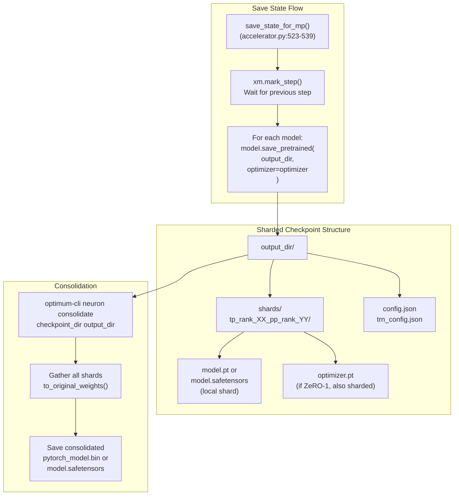

**Sources:**
- [optimum/neuron/accelerate/accelerator.py:523-548]()
- [optimum/neuron/models/training/modeling_utils.py:116-128]()

### Attention Implementation with Parallelism

The attention mechanism in custom models uses parallel layers and can leverage flash attention:

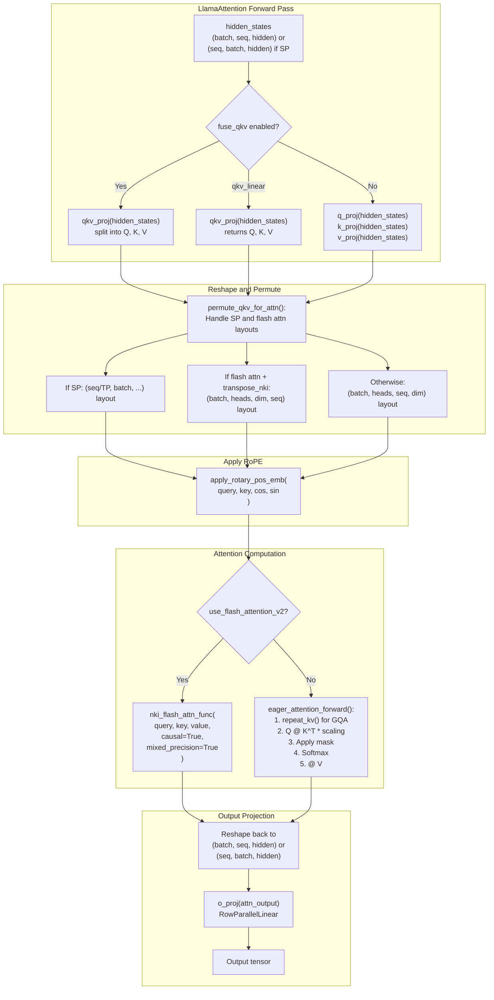

**Sources:**
- [optimum/neuron/models/training/llama/modeling_llama.py:458-530]()
- [optimum/neuron/models/training/llama/modeling_llama.py:432-456]()
- [optimum/neuron/models/training/llama/modeling_llama.py:256-286]()

## Loss Computation with Tensor Parallelism

When using tensor parallelism, the loss computation must account for the vocabulary being sharded across TP ranks.

### Parallel Cross Entropy

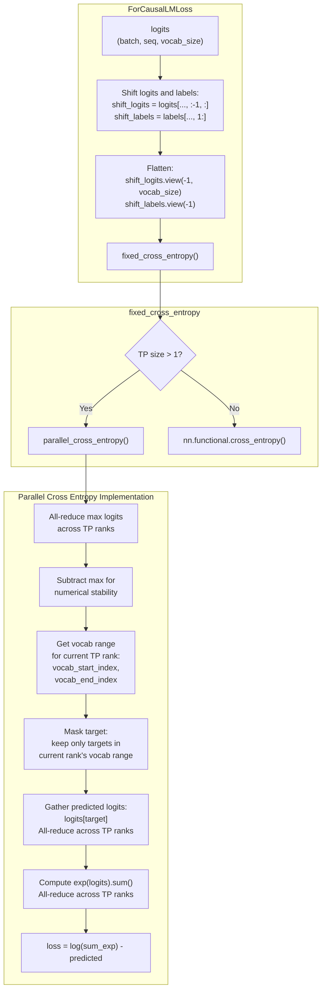

**Sources:**
- [optimum/neuron/models/training/loss_utils.py:198-212]()
- [optimum/neuron/models/training/loss_utils.py:27-131]()
- [optimum/neuron/models/training/loss_utils.py:185-195]()

---

