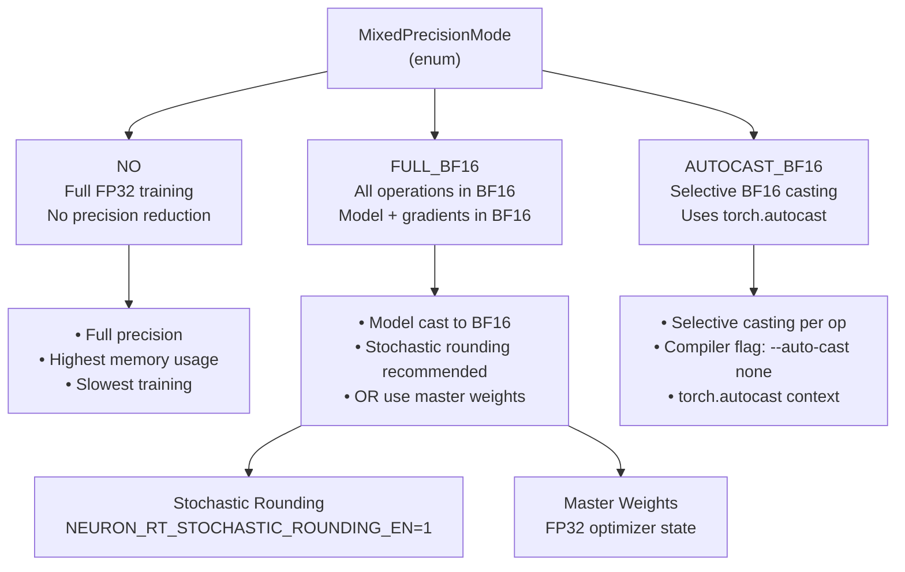
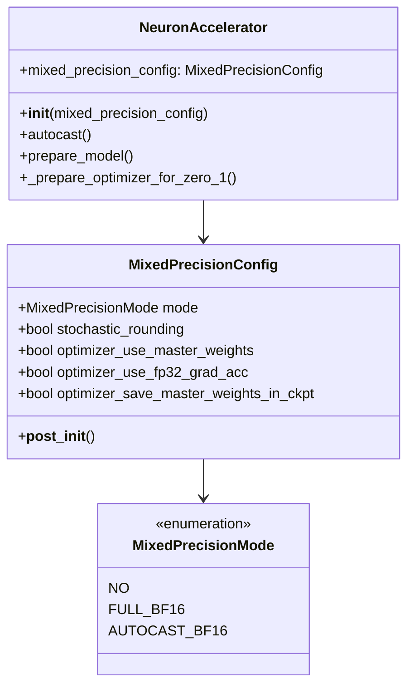
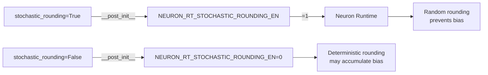
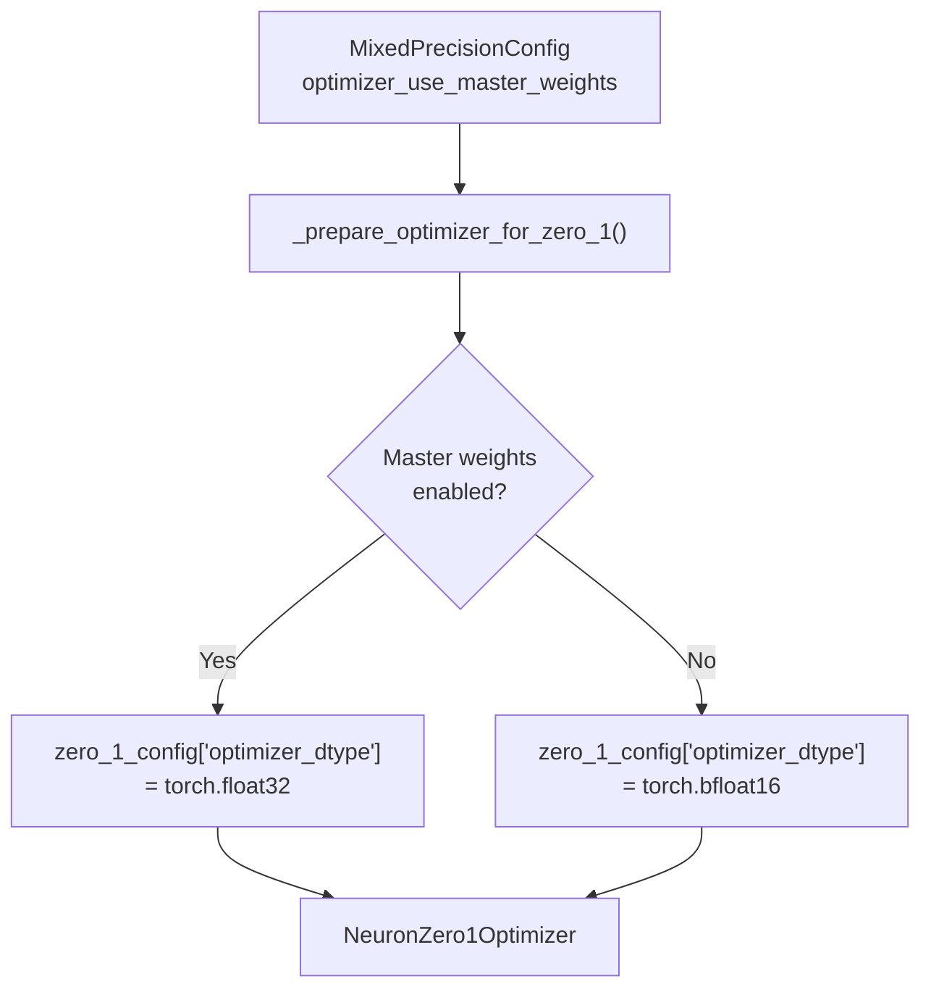
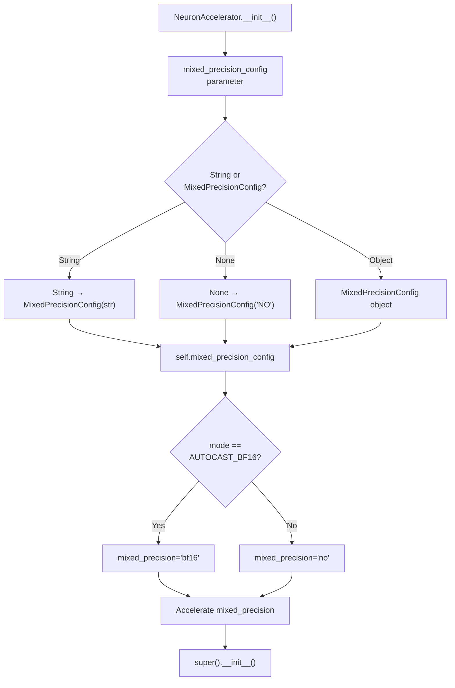
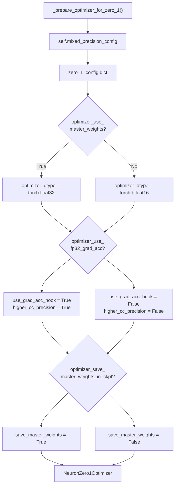
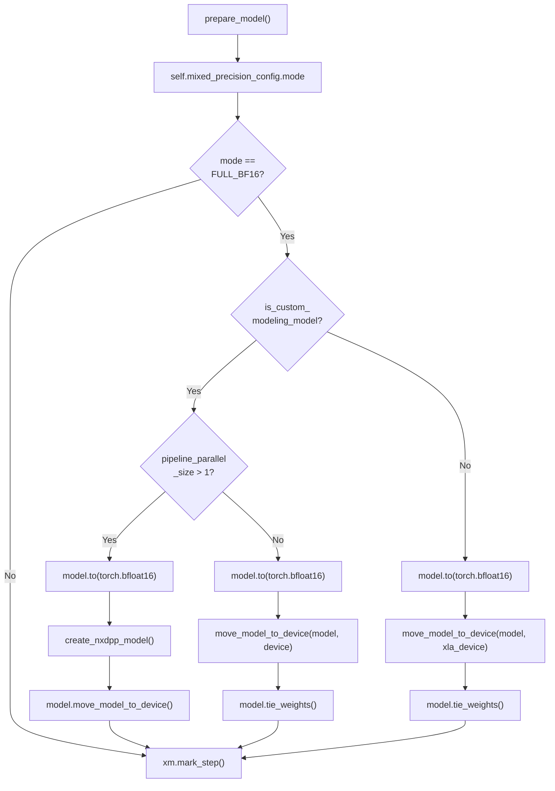
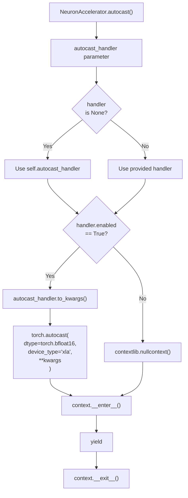
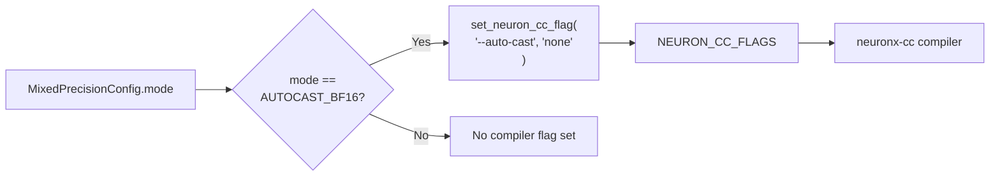

<!-- source: DeepWiki mcp.deepwiki.com · repo huggingface/optimum-neuron · page 5.4 Mixed Precision Training · fetched 2026-10-26 -->

# Mixed Precision Training

<details>
<summary>Relevant source files</summary>

The following files were used as context for generating this wiki page:

- [docs/source/training_tutorials/finetune_llama.mdx](docs/source/training_tutorials/finetune_llama.mdx)
- [docs/source/training_tutorials/finetune_qwen3.mdx](docs/source/training_tutorials/finetune_qwen3.mdx)
- [examples/training/llama/finetune_llama.py](examples/training/llama/finetune_llama.py)
- [examples/training/qwen3/finetune_qwen3.py](examples/training/qwen3/finetune_qwen3.py)
- [optimum/neuron/accelerate/accelerator.py](optimum/neuron/accelerate/accelerator.py)
- [optimum/neuron/accelerate/state.py](optimum/neuron/accelerate/state.py)
- [optimum/neuron/accelerate/utils/dataclasses.py](optimum/neuron/accelerate/utils/dataclasses.py)
- [optimum/neuron/trainers/sft_config.py](optimum/neuron/trainers/sft_config.py)
- [optimum/neuron/trainers/sft_trainer.py](optimum/neuron/trainers/sft_trainer.py)
- [optimum/neuron/trainers/training_args.py](optimum/neuron/trainers/training_args.py)
- [optimum/neuron/trainers/transformers.py](optimum/neuron/trainers/transformers.py)
- [optimum/neuron/trainers/trl_utils.py](optimum/neuron/trainers/trl_utils.py)
- [pyproject.toml](pyproject.toml)
- [tests/training/test_neuron_sft_trainer.py](tests/training/test_neuron_sft_trainer.py)

</details>


## Purpose and Scope

This document covers mixed precision training capabilities in `optimum-neuron`, which enable training neural networks using lower-precision data types (bfloat16) instead of full float32 precision. Mixed precision training reduces memory consumption and accelerates training on AWS Neuron accelerators while maintaining model quality through various numerical stability techniques.

For general training configuration including distributed strategies, see [Distributed Training Strategies](#5.2). For custom model architectures that utilize mixed precision, see [Custom Model Architectures](#5.4).

**Sources:** [optimum/neuron/accelerate/utils/dataclasses.py:1-70](), [optimum/neuron/accelerate/accelerator.py:79-157]()

## Mixed Precision Modes

The system provides three mixed precision modes through the `MixedPrecisionMode` enum:



**Mode Descriptions:**

| Mode | Description | Use Case |
|------|-------------|----------|
| `NO` | Full FP32 training with no precision reduction | Baseline training, debugging numerical issues |
| `FULL_BF16` | Entire model and gradients in BF16 | Maximum memory savings and speed with stochastic rounding or master weights |
| `AUTOCAST_BF16` | Selective BF16 casting via `torch.autocast` | Balance between speed and numerical stability |

**Sources:** [optimum/neuron/accelerate/utils/dataclasses.py:28-32](), [optimum/neuron/accelerate/accelerator.py:146-153]()

## MixedPrecisionConfig Dataclass

The `MixedPrecisionConfig` dataclass configures all mixed precision behavior:



**Initialization:**

```python
# String shorthand
config = MixedPrecisionConfig("FULL_BF16")

# Explicit configuration
config = MixedPrecisionConfig(
    mode="FULL_BF16",
    stochastic_rounding=True,
    optimizer_use_master_weights=False
)
```

**Sources:** [optimum/neuron/accelerate/utils/dataclasses.py:34-70](), [optimum/neuron/accelerate/accelerator.py:85-86]()

## Configuration Options

### Stochastic Rounding

Stochastic rounding randomly rounds values instead of using deterministic rounding. This prevents systematic bias accumulation during gradient updates in BF16 precision.

**Behavior:**

- **Default:** `True` for `FULL_BF16` mode
- **Environment Variable:** Sets `NEURON_RT_STOCHASTIC_ROUNDING_EN=1` when enabled
- **Warning:** In `FULL_BF16` mode without stochastic rounding or master weights, a warning is logged recommending one of these techniques



**Sources:** [optimum/neuron/accelerate/utils/dataclasses.py:37,46-51,66-69]()

### Master Weights

Master weights maintain a full FP32 copy of model parameters in the optimizer state. Gradients are accumulated in FP32, then parameters are updated in FP32 and cast back to BF16.

**Configuration:**

- `optimizer_use_master_weights`: Enable FP32 master weights
- `optimizer_save_master_weights_in_ckpt`: Save master weights in checkpoints (requires master weights enabled)

**Integration with ZeRO-1:**



**Sources:** [optimum/neuron/accelerate/utils/dataclasses.py:38,40,63-64](), [optimum/neuron/accelerate/accelerator.py:280-283,292]()

### FP32 Gradient Accumulation

When enabled with master weights, gradients are accumulated in FP32 instead of BF16, providing higher precision for gradient accumulation across multiple micro-batches.

**Requirements and Configuration:**

| Option | Required | Effect |
|--------|----------|--------|
| `optimizer_use_fp32_grad_acc` | Requires `optimizer_use_master_weights=True` | Accumulates gradients in FP32 |
| Sets `use_grad_acc_hook=True` | - | Enables gradient accumulation hook in ZeRO-1 |
| Sets `higher_cc_precision=True` | - | Uses higher precision in collective communication |

**Validation:**

The `__post_init__` method validates that `optimizer_use_fp32_grad_acc` cannot be `True` if `optimizer_use_master_weights` is `False`, raising a `ValueError` if misconfigured.

**Sources:** [optimum/neuron/accelerate/utils/dataclasses.py:39,60-61](), [optimum/neuron/accelerate/accelerator.py:287-288]()

## Integration with NeuronAccelerator

The `NeuronAccelerator` integrates mixed precision configuration throughout the training lifecycle:



**Key Integration Points:**

1. **Initialization** [optimum/neuron/accelerate/accelerator.py:146-153](): Converts input to `MixedPrecisionConfig` and maps to Accelerate's mixed precision string
2. **Model Preparation** [optimum/neuron/accelerate/accelerator.py:361-391](): Casts model to BF16 if `mode is FULL_BF16`
3. **Optimizer Preparation** [optimum/neuron/accelerate/accelerator.py:254-300](): Configures ZeRO-1 optimizer with mixed precision settings
4. **Autocast Handler** [optimum/neuron/accelerate/accelerator.py:161-163](): Creates `AutocastKwargs` if in AUTOCAST_BF16 mode

**Sources:** [optimum/neuron/accelerate/accelerator.py:80-157]()

## Optimizer Configuration with ZeRO-1

The `_prepare_optimizer_for_zero_1` method translates `MixedPrecisionConfig` into ZeRO-1 optimizer settings:



**ZeRO-1 Configuration Mapping:**

| MixedPrecisionConfig Field | ZeRO-1 Config Key | Effect |
|----------------------------|-------------------|--------|
| `optimizer_use_master_weights=True` | `optimizer_dtype=torch.float32` | Optimizer maintains FP32 state |
| `optimizer_use_master_weights=False` | `optimizer_dtype=torch.bfloat16` | Optimizer uses BF16 state |
| `optimizer_use_fp32_grad_acc=True` | `use_grad_acc_hook=True`<br/>`higher_cc_precision=True` | FP32 gradient accumulation and communication |
| `optimizer_save_master_weights_in_ckpt=True` | `save_master_weights=True` | Master weights persisted in checkpoints |

**Sources:** [optimum/neuron/accelerate/accelerator.py:253-300]()

## Model Preparation with Mixed Precision

The `prepare_model` method applies mixed precision configuration to models:



**Casting Behavior:**

- **When `FULL_BF16`:** Model is cast to `torch.bfloat16` before device placement
- **When `NO` or `AUTOCAST_BF16`:** Model remains in original dtype (typically FP32)
- **After Casting:** Model is moved to device (XLA device or specific Neuron cores) and weight tying is performed

**Sources:** [optimum/neuron/accelerate/accelerator.py:338-398]()

## Autocast Context Manager

The `autocast` method provides selective mixed precision for operations when using `AUTOCAST_BF16` mode:



**Default Behavior:**

When `mixed_precision_config.mode is AUTOCAST_BF16`, the accelerator initializes with `mixed_precision="bf16"` passed to the parent `Accelerator` class. This creates an `AutocastKwargs` with `enabled=True`.

**Usage Example:**

```python
# Inside training loop
with accelerator.autocast():
    outputs = model(inputs)  # Operations automatically cast to BF16 where beneficial
    loss = outputs.loss
```

**Sources:** [optimum/neuron/accelerate/accelerator.py:161-164,408-422]()

## Compiler Integration

Mixed precision configuration affects Neuron compiler behavior:



**Compiler Flag Behavior:**

- **`AUTOCAST_BF16` mode:** Sets `--auto-cast=none` to disable automatic casting by the compiler, relying instead on PyTorch's `torch.autocast`
- **`FULL_BF16` mode:** No special compiler flag; compiler sees BF16 model directly
- **`NO` mode:** No compiler flags set; standard FP32 compilation

**Sources:** [optimum/neuron/accelerate/utils/dataclasses.py:52-53]()

## Complete Configuration Example

```python
from optimum.neuron.accelerate import NeuronAccelerator
from optimum.neuron.accelerate.utils.dataclasses import MixedPrecisionConfig

# Full BF16 with stochastic rounding (recommended for memory efficiency)
config = MixedPrecisionConfig(
    mode="FULL_BF16",
    stochastic_rounding=True,
    optimizer_use_master_weights=False
)

# Full BF16 with master weights (recommended for numerical stability)
config_master = MixedPrecisionConfig(
    mode="FULL_BF16",
    stochastic_rounding=False,
    optimizer_use_master_weights=True,
    optimizer_use_fp32_grad_acc=True,
    optimizer_save_master_weights_in_ckpt=True
)

# Autocast mode (selective casting)
config_autocast = MixedPrecisionConfig(
    mode="AUTOCAST_BF16"
)

# Initialize accelerator
accelerator = NeuronAccelerator(
    mixed_precision_config=config,
    zero_1=True  # ZeRO-1 optimizer sharding
)

# Prepare model and optimizer
model = accelerator.prepare_model(model)
optimizer = accelerator.prepare_optimizer(optimizer)

# Training loop with autocast
for batch in dataloader:
    with accelerator.autocast():
        outputs = model(**batch)
        loss = outputs.loss
    
    accelerator.backward(loss)
    optimizer.step()
```

**Sources:** [optimum/neuron/accelerate/accelerator.py:80-157](), [optimum/neuron/accelerate/utils/dataclasses.py:34-70]()

---

