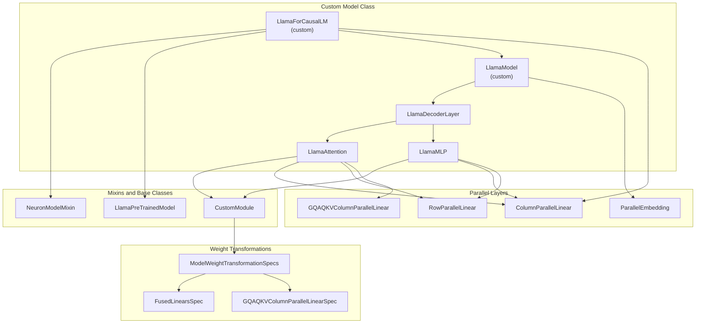
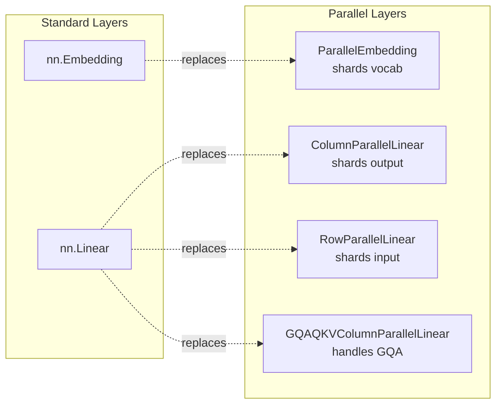
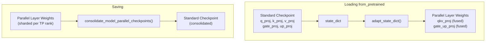
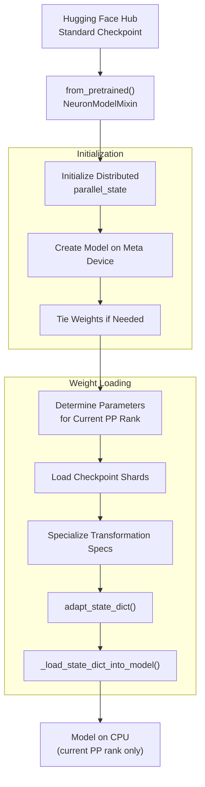

<!-- source: DeepWiki mcp.deepwiki.com · repo huggingface/optimum-neuron · page 5.5 Custom Model Implementations · fetched 2026-10-26 -->

# Custom Model Implementations

<details>
<summary>Relevant source files</summary>

The following files were used as context for generating this wiki page:

- [docs/source/guides/distributed_training.mdx](docs/source/guides/distributed_training.mdx)
- [optimum/neuron/models/training/config.py](optimum/neuron/models/training/config.py)
- [optimum/neuron/models/training/granite/modeling_granite.py](optimum/neuron/models/training/granite/modeling_granite.py)
- [optimum/neuron/models/training/llama/modeling_llama.py](optimum/neuron/models/training/llama/modeling_llama.py)
- [optimum/neuron/models/training/modeling_utils.py](optimum/neuron/models/training/modeling_utils.py)
- [optimum/neuron/models/training/qwen3/modeling_qwen3.py](optimum/neuron/models/training/qwen3/modeling_qwen3.py)
- [tests/training/test_custom_modeling.py](tests/training/test_custom_modeling.py)

</details>


This page documents the custom model implementations in `optimum.neuron.models.training` that enable distributed training on AWS Trainium. These implementations replace standard PyTorch layers with neuronx_distributed parallel layers to support Tensor Parallelism, Pipeline Parallelism, and Sequence Parallelism.

For information about configuring distributed training strategies (TP, PP, ZeRO-1), see [Distributed Training Strategies](#5.3). For information about training configuration parameters, see [Training Configuration System](#5.1).

## Overview and Purpose

Standard Transformers models use regular PyTorch layers (`nn.Linear`, `nn.Embedding`) that cannot be automatically sharded across devices for Tensor Parallelism. Custom model implementations solve this by:

1. Replacing standard layers with `neuronx_distributed` parallel layers (`ColumnParallelLinear`, `RowParallelLinear`, `ParallelEmbedding`)
2. Implementing weight transformation logic to convert between standard checkpoints and parallel layer formats
3. Supporting pipeline parallelism by defining which layers can be distributed across pipeline stages
4. Integrating with Sequence Parallelism for activation sharding

Custom implementations inherit from `NeuronModelMixin` [optimum/neuron/models/training/modeling_utils.py:177-244]() and must be used for any training with `tensor_parallel_size > 1` or `pipeline_parallel_size > 1`.

**Available Implementations**: Llama, Qwen3, Granite (all decoder-only causal language models)

Sources: [optimum/neuron/models/training/modeling_utils.py:177-244](), [optimum/neuron/models/training/llama/modeling_llama.py:1-15](), [docs/source/guides/distributed_training.mdx:156-157]()

## Architecture Overview



**Custom Model Implementation Hierarchy**

Sources: [optimum/neuron/models/training/llama/modeling_llama.py:578-703](), [optimum/neuron/models/training/modeling_utils.py:177-244]()

## NeuronModelMixin

`NeuronModelMixin` [optimum/neuron/models/training/modeling_utils.py:177-244]() provides the base functionality for all custom model implementations.

### Key Methods and Properties

| Method/Property | Purpose |
|----------------|---------|
| `supports_pipeline_parallelism()` | Returns whether model supports PP; checks for required attributes |
| `parameters_for_current_stage` | Returns parameter names for current PP rank; caches result |
| `from_pretrained()` | Custom loading logic that handles TP/PP weight distribution |
| `_load_pretrained_model()` | Loads weights and applies transformations for parallel layers |
| `_fix_state_dict_key_on_load()` | Fixes legacy parameter names (e.g., LayerNorm.beta → bias) |
| `_check_and_adjust_attn_implementation()` | Validates attention implementation (eager or flash_attention_2) |

### Pipeline Parallelism Support

Models declare PP support via class attributes [optimum/neuron/models/training/llama/modeling_llama.py:699-702]():

```python
SUPPORTS_PIPELINE_PARALLELISM = True
PIPELINE_TRANSFORMER_LAYER_CLS = LlamaDecoderLayer  # Which layer to split
PIPELINE_INPUT_NAMES = ["input_ids", "attention_mask", "labels"]  # Required inputs
PIPELINE_LEAF_MODULE_CLASSE_NAMES = ["LlamaRMSNorm", "LlamaRotaryEmbedding"]  # Don't split these
```

The `parameters_for_current_stage` property [optimum/neuron/models/training/modeling_utils.py:197-205]() determines which parameters belong to the current PP rank, allowing `from_pretrained` to load only relevant weights to CPU while keeping others on meta device.

Sources: [optimum/neuron/models/training/modeling_utils.py:177-244](), [optimum/neuron/models/training/llama/modeling_llama.py:699-702]()

## Parallel Layer Integration

Custom models replace standard PyTorch layers with neuronx_distributed parallel layers that implement tensor parallelism.

### Parallel Layer Types



**Parallel Layer Replacement Strategy**

| Layer | Standard | Parallel Replacement | Sharding Strategy |
|-------|----------|---------------------|-------------------|
| Embeddings | `nn.Embedding` | `ParallelEmbedding` | Shard vocabulary across TP ranks |
| Query/Key/Value projections | `nn.Linear` | `GQAQKVColumnParallelLinear` or `ColumnParallelLinear` | Shard output dimension (heads) |
| Output projection | `nn.Linear` | `RowParallelLinear` | Shard input dimension, all-reduce output |
| MLP up/gate projections | `nn.Linear` | `ColumnParallelLinear` (fused) | Shard output dimension |
| MLP down projection | `nn.Linear` | `RowParallelLinear` | Shard input dimension |
| LM head | `nn.Linear` | `ColumnParallelLinear` | Shard vocabulary |

### Example: Llama Attention with Parallel Layers

The `LlamaAttention` class [optimum/neuron/models/training/llama/modeling_llama.py:289-421]() demonstrates parallel layer usage:

**Initialization** [optimum/neuron/models/training/llama/modeling_llama.py:314-416]():
```python
# Option 1: GQAQKVColumnParallelLinear for GQA (num_kv_heads < tp_size)
self.qkv_proj = GQAQKVColumnParallelLinear(
    self.hidden_size,
    [self.num_heads * self.head_dim, self.num_key_value_heads * self.head_dim],
    bias=False,
    gather_output=False,
    kv_size_multiplier=self.kv_size_multiplier,
    fuse_qkv=trn_config.fuse_qkv,
)

# Option 2: Separate projections
self.q_proj = ColumnParallelLinear(...)
self.k_proj = ColumnParallelLinear(...)
self.v_proj = ColumnParallelLinear(...)

# Output projection always uses RowParallelLinear
self.o_proj = RowParallelLinear(
    self.num_heads * self.head_dim,
    self.hidden_size,
    input_is_parallel=True,  # Input already sharded from attention
)
```

**Sequence Parallel Integration** [optimum/neuron/models/training/llama/modeling_llama.py:204-224](): All parallel layers accept `sequence_parallel_enabled` parameter to enable activation sharding along sequence dimension.

Sources: [optimum/neuron/models/training/llama/modeling_llama.py:289-421](), [optimum/neuron/models/training/llama/modeling_llama.py:175-241]()

## Weight Transformation System

Custom models define `ModelWeightTransformationSpecs` to convert between standard checkpoint formats and parallel layer formats during loading/saving.

### Transformation Flow



**Weight Transformation During Loading and Saving**

### Transformation Specs

Modules inherit from `CustomModule` [optimum/neuron/models/training/transformations_utils.py:49]() and define specs in their `__init__`:

**FusedLinearsSpec** - Fuses multiple linear layers [optimum/neuron/models/training/llama/modeling_llama.py:195-203]():
```python
self.specs = ModelWeightTransformationSpecs(
    specs=FusedLinearsSpec(
        fused_linear_name="gate_up_proj",  # Name in custom model
        linear_names=["gate_proj", "up_proj"],  # Names in checkpoint
        bias=False,
        fuse_axis="column",  # Concatenate along output dimension
        original_dims=[self.intermediate_size] * 2,
    )
)
```

**GQAQKVColumnParallelLinearSpec** - Handles GQA attention projections [optimum/neuron/models/training/llama/modeling_llama.py:339-352]():
```python
gqa_qkv_specs = GQAQKVColumnParallelLinearSpec(
    gqa_qkv_projection_name="qkv_proj",
    query_projection_name="q_proj",
    key_projection_name="k_proj", 
    value_projection_name="v_proj",
    output_projection_name="o_proj",
    num_attention_heads=self.num_heads,
    num_key_value_heads=self.num_key_value_heads,
    kv_size_multiplier=self.kv_size_multiplier,  # Replicate KV heads when < tp_size
    fuse_qkv=trn_config.fuse_qkv,
)
```

### Adaptation Process

The `adapt_state_dict()` function [optimum/neuron/models/training/transformations_utils.py:604-650]() applies transformations:

1. **Specialization** [optimum/neuron/models/training/modeling_utils.py:569](): Specs are specialized for the model structure
2. **Metadata Creation** [optimum/neuron/models/training/transformations_utils.py:100-123](): Creates metadata about TP attributes for each parameter
3. **Weight Transformation** [optimum/neuron/models/training/transformations_utils.py:604-650](): Applies transformations based on specs
   - Fuses weights (e.g., gate_proj + up_proj → gate_up_proj)
   - Handles GQA query index mapping and KV replication
   - Shards weights across TP ranks
4. **Loading** [optimum/neuron/models/training/modeling_utils.py:639](): Transformed weights loaded into model

Sources: [optimum/neuron/models/training/llama/modeling_llama.py:175-241](), [optimum/neuron/models/training/transformations_utils.py:604-650](), [optimum/neuron/models/training/modeling_utils.py:569-639]()

## from_pretrained and Model Loading

### Custom Loading Process



**Custom Model Loading Flow**

The custom `from_pretrained()` [optimum/neuron/models/training/modeling_utils.py:704-1022]() differs from standard Transformers:

1. **Requires `TrainingNeuronConfig`**: Must pass `trn_config` parameter [optimum/neuron/models/training/modeling_utils.py:708]()
2. **Initializes Parallel State**: Sets up TP/PP groups [optimum/neuron/models/training/config.py:40-52]()
3. **PP-Aware Loading**: Only loads weights for current PP rank to CPU; others stay on meta device [optimum/neuron/models/training/modeling_utils.py:613-620]()
4. **Weight Transformation**: Applies specs during loading [optimum/neuron/models/training/modeling_utils.py:604-609]()
5. **Preserves TP Attributes**: Caches and restores TP metadata after loading [optimum/neuron/models/training/modeling_utils.py:152-163]()

### Usage Example

From [docs/source/guides/distributed_training.mdx:269-272]():
```python
from optimum.neuron.models.training import LlamaForCausalLM
from optimum.neuron.models.training.config import TrainingNeuronConfig

trn_config = TrainingNeuronConfig(
    tensor_parallel_size=4,
    pipeline_parallel_size=2,
)

model = LlamaForCausalLM.from_pretrained(
    "meta-llama/Llama-3.2-3B",
    trn_config=trn_config
)
```

Sources: [optimum/neuron/models/training/modeling_utils.py:704-1022](), [optimum/neuron/models/training/config.py:30-58](), [docs/source/guides/distributed_training.mdx:269-272]()

## Checkpoint Saving and Consolidation

### Sharded Checkpoint Format

Training with TP/PP produces sharded checkpoints per rank [optimum/neuron/models/training/modeling_utils.py:108]():

```
output_dir/
└── shards/
    ├── tp_rank_00_pp_rank_00/
    │   ├── model.pt
    │   └── optimizer.pt
    ├── tp_rank_01_pp_rank_00/
    ├── tp_rank_00_pp_rank_01/
    └── tp_rank_01_pp_rank_01/
```

Each shard contains:
- Model weights for that TP/PP rank
- Optimizer state for that rank (when using ZeRO-1, optimizer state is also sharded)

### Consolidation Process

The `optimum-cli neuron consolidate` command [docs/source/guides/distributed_training.mdx:384-396]() merges sharded checkpoints back to standard format:

```bash
optimum-cli neuron consolidate checkpoint_dir output_dir [--format safetensors]
```

**Consolidation Steps** [optimum/neuron/models/training/transformations_utils.py:744-870]():

1. **Load All Shards**: Reads checkpoints from all TP/PP ranks
2. **Gather Weights**: Concatenates TP-sharded parameters
3. **Reverse Transformations**: Unfuses layers (e.g., gate_up_proj → gate_proj + up_proj)
4. **Handle GQA**: Removes replicated KV heads, maps query heads back
5. **Save Standard Format**: Writes consolidated checkpoint in PyTorch or SafeTensors format

### Consolidation Implementation

Key function: `consolidate_model_parallel_checkpoints()` [optimum/neuron/models/training/transformations_utils.py:744-870]()

- Loads metadata about TP sharding from checkpoint [optimum/neuron/models/training/transformations_utils.py:100-123]()
- Applies reverse transformations defined in specs [optimum/neuron/models/training/transformations_utils.py:486-540]()
- Handles both embeddings and linear layers
- Outputs standard checkpoint loadable by vanilla Transformers

Sources: [optimum/neuron/models/training/modeling_utils.py:108](), [docs/source/guides/distributed_training.mdx:377-449](), [optimum/neuron/models/training/transformations_utils.py:744-870]()

## Available Custom Implementations

### Implementation Comparison

| Model | Base Implementation | Key Differences | PP Support |
|-------|-------------------|----------------|------------|
| `LlamaForCausalLM` | Llama 2/3 architecture | Base implementation | Yes [optimum/neuron/models/training/llama/modeling_llama.py:699]() |
| `Qwen3ForCausalLM` | Extends Llama | Adds Q/K normalization [optimum/neuron/models/training/qwen3/modeling_qwen3.py:84-89]() | Yes [optimum/neuron/models/training/qwen3/modeling_qwen3.py:218]() |
| `GraniteForCausalLM` | Extends Llama | Adds residual/embedding multipliers [optimum/neuron/models/training/granite/modeling_granite.py:55-100]() | No [optimum/neuron/models/training/granite/modeling_granite.py:204]() |

### Llama Implementation

**Location**: [optimum/neuron/models/training/llama/modeling_llama.py]()

**Architecture**:
- `LlamaForCausalLM` [optimum/neuron/models/training/llama/modeling_llama.py:696-750]() - Top-level causal LM model
- `LlamaModel` [optimum/neuron/models/training/llama/modeling_llama.py:594-693]() - Base model (embeddings + layers + norm)
- `LlamaDecoderLayer` [optimum/neuron/models/training/llama/modeling_llama.py:533-575]() - Single transformer layer
- `LlamaAttention` [optimum/neuron/models/training/llama/modeling_llama.py:289-530]() - Multi-head attention with parallel layers
- `LlamaMLP` [optimum/neuron/models/training/llama/modeling_llama.py:175-241]() - Feed-forward network with fused gate/up projections
- `LlamaRMSNorm` [optimum/neuron/models/training/llama/modeling_llama.py:63-84]() - RMS normalization
- `LlamaRotaryEmbedding` [optimum/neuron/models/training/llama/modeling_llama.py:87-145]() - Rotary position embeddings

**Key Features**:
- Support for GQA via `GQAQKVColumnParallelLinear` or `kv_size_multiplier`
- Fused QKV projections when `fuse_qkv=True`
- Fused gate/up projections in MLP
- Flash Attention 2 support via `nki_flash_attn_func`
- Sequence parallel support throughout

### Qwen3 Implementation

**Location**: [optimum/neuron/models/training/qwen3/modeling_qwen3.py]()

**Differences from Llama**:
- Inherits most structure from Llama [optimum/neuron/models/training/qwen3/modeling_qwen3.py:29-39]()
- Adds `Qwen3RMSNorm` with configurable `reduction_dim` [optimum/neuron/models/training/qwen3/modeling_qwen3.py:49-75]()
- `Qwen3Attention` applies Q/K normalization after projection [optimum/neuron/models/training/qwen3/modeling_qwen3.py:119-120]()
- Validates that sliding window attention is disabled [optimum/neuron/models/training/qwen3/modeling_qwen3.py:183-186]()

### Granite Implementation  

**Location**: [optimum/neuron/models/training/granite/modeling_granite.py]()

**Differences from Llama**:
- Adds `attention_multiplier` scaling [optimum/neuron/models/training/granite/modeling_granite.py:55]()
- Adds `residual_multiplier` in decoder layer [optimum/neuron/models/training/granite/modeling_granite.py:61-89]()
- Adds `embedding_multiplier` for embeddings [optimum/neuron/models/training/granite/modeling_granite.py:100-140]()
- Adds `logits_scaling` for output logits [optimum/neuron/models/training/granite/modeling_granite.py:250]()
- Does not support pipeline parallelism [optimum/neuron/models/training/granite/modeling_granite.py:204]()

Sources: [optimum/neuron/models/training/llama/modeling_llama.py:1-750](), [optimum/neuron/models/training/qwen3/modeling_qwen3.py:1-226](), [optimum/neuron/models/training/granite/modeling_granite.py:1-267]()

## Integration with Training

### Usage with NeuronTrainer

From [docs/source/guides/distributed_training.mdx:253-282]():

```python
from optimum.neuron import NeuronTrainingArguments, NeuronTrainer
from optimum.neuron.models.training import LlamaForCausalLM

training_args = NeuronTrainingArguments(
    tensor_parallel_size=4,
    pipeline_parallel_size=2,
    # ... other args
)

# Must load with custom implementation for TP/PP
model = LlamaForCausalLM.from_pretrained(
    "meta-llama/Llama-3.2-3B",
    trn_config=training_args.trn_config  # Auto-generated from training_args
)

trainer = NeuronTrainer(
    model=model,
    args=training_args,
    train_dataset=train_dataset,
)
```

### Usage with NeuronAccelerator

```python
from optimum.neuron import NeuronAccelerator
from optimum.neuron.models.training.config import TrainingNeuronConfig
from optimum.neuron.models.training import LlamaForCausalLM

trn_config = TrainingNeuronConfig(
    tensor_parallel_size=4,
    pipeline_parallel_size=2,
)

model = LlamaForCausalLM.from_pretrained(
    "meta-llama/Llama-3.2-3B",
    trn_config=trn_config
)

accelerator = NeuronAccelerator(trn_config=trn_config)
model = accelerator.prepare(model)
```

**Important**: Custom model class must be imported directly, not via `AutoModelForCausalLM`, when using TP/PP.

Sources: [docs/source/guides/distributed_training.mdx:253-282](), [tests/training/test_custom_modeling.py:232-298]()

## Testing Custom Models

The test suite validates custom models against original Transformers implementations [tests/training/test_custom_modeling.py:112-231]():

**Test Coverage**:
- Output matching between custom and original models [tests/training/test_custom_modeling.py:76-110]()
- QKV implementations (regular, fused, qkv_linear) [tests/training/test_custom_modeling.py:233]()
- Pipeline parallelism [tests/training/test_custom_modeling.py:256-259]()
- Checkpoint consolidation [tests/training/test_custom_modeling.py:401-412]()
- Weight tying [tests/training/test_custom_modeling.py:500-580]()
- Attention implementations [tests/training/test_custom_modeling.py:611-669]()
- PEFT/LoRA integration [tests/training/test_custom_modeling.py:671-735]()

**Test Execution** [tests/training/test_custom_modeling.py:288-298]():
```python
run_fn = partial(
    _custom_model_matches_original_model,
    model_class_name,
    model_name_or_path,
    (world_size, tp_size, pp_size),
    sequence_parallel_enabled,
    qkv_implementation,
    attn_implementation,
    monkeypatch,
)
run_distributed_test(run_fn, world_size=world_size, tp_size=tp_size, pp_size=pp_size)
```

Sources: [tests/training/test_custom_modeling.py:61-298]()

---

