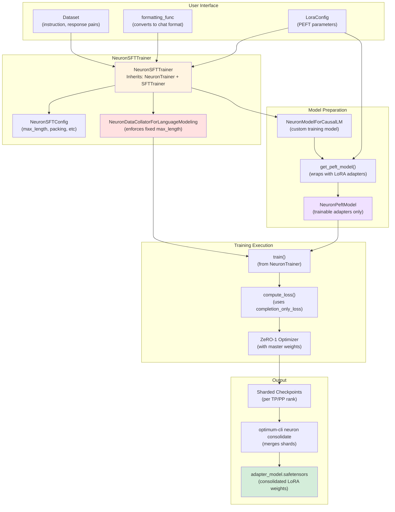
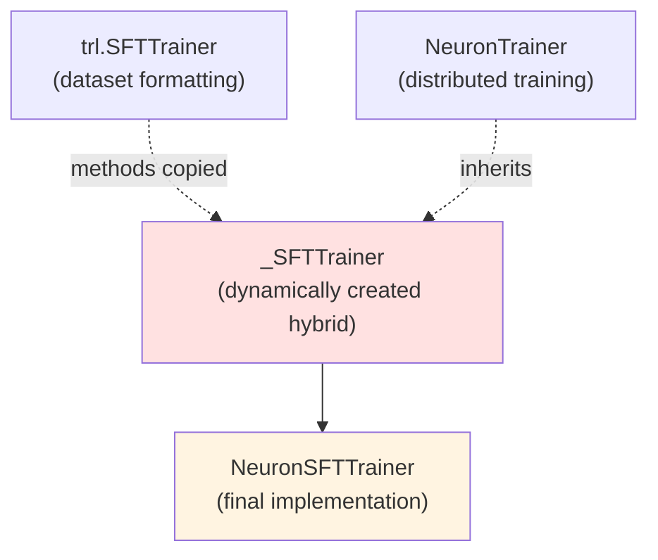
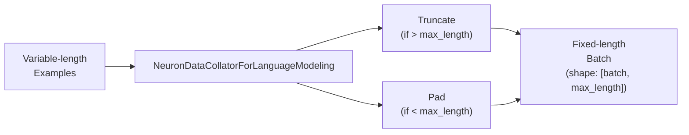
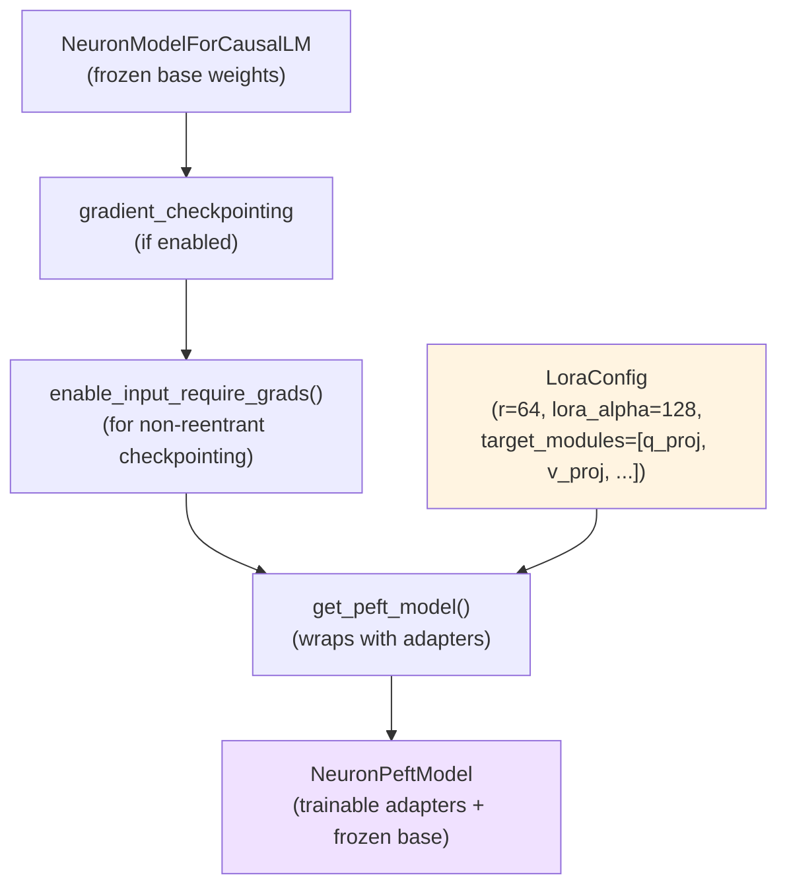
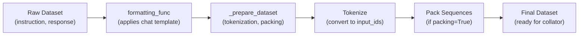
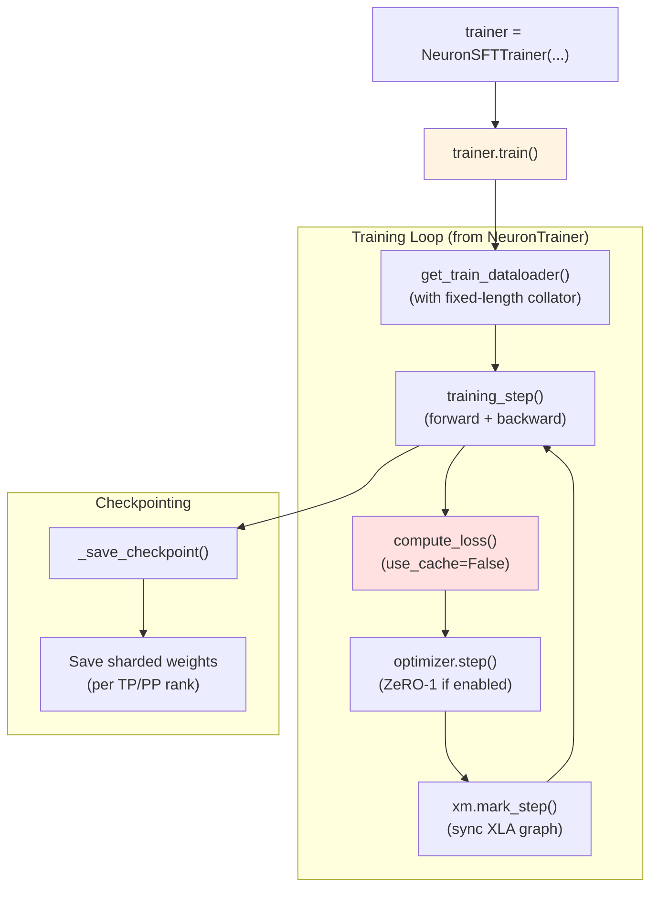

<!-- source: DeepWiki mcp.deepwiki.com · repo huggingface/optimum-neuron · page 5.6 Supervised Fine-Tuning and PEFT · fetched 2026-10-26 -->

# Supervised Fine-Tuning and PEFT

<details>
<summary>Relevant source files</summary>

The following files were used as context for generating this wiki page:

- [docs/source/training_tutorials/finetune_llama.mdx](docs/source/training_tutorials/finetune_llama.mdx)
- [docs/source/training_tutorials/finetune_qwen3.mdx](docs/source/training_tutorials/finetune_qwen3.mdx)
- [examples/training/llama/finetune_llama.py](examples/training/llama/finetune_llama.py)
- [examples/training/qwen3/finetune_qwen3.py](examples/training/qwen3/finetune_qwen3.py)
- [optimum/neuron/trainers/sft_config.py](optimum/neuron/trainers/sft_config.py)
- [optimum/neuron/trainers/sft_trainer.py](optimum/neuron/trainers/sft_trainer.py)
- [optimum/neuron/trainers/training_args.py](optimum/neuron/trainers/training_args.py)
- [optimum/neuron/trainers/transformers.py](optimum/neuron/trainers/transformers.py)
- [optimum/neuron/trainers/trl_utils.py](optimum/neuron/trainers/trl_utils.py)
- [pyproject.toml](pyproject.toml)
- [tests/training/test_neuron_sft_trainer.py](tests/training/test_neuron_sft_trainer.py)

</details>


This page documents the supervised fine-tuning (SFT) system for training language models on AWS Trainium using optimum-neuron, including integration with Parameter-Efficient Fine-Tuning (PEFT) techniques like LoRA. For general training configuration, see [Training Configuration System](#5.1). For the base trainer implementation, see [NeuronTrainer and NeuronAccelerator](#5.2). For custom model architectures used in training, see [Custom Model Implementations](#5.5).

## Purpose and Scope

Supervised fine-tuning adapts pre-trained language models to specific tasks by training on instruction-response pairs. The `NeuronSFTTrainer` provides a Neuron-optimized implementation of TRL's `SFTTrainer`, enabling efficient fine-tuning on Trainium accelerators with support for:

- Chat-based instruction datasets with formatting functions
- PEFT techniques (LoRA, QLoRA) for memory-efficient training
- Fixed-length sequence padding required by Neuron compilation
- Distributed training with tensor and pipeline parallelism
- Dataset packing for improved throughput

## System Architecture



**Sources:** [optimum/neuron/trainers/sft_trainer.py:132-420](), [optimum/neuron/trainers/sft_config.py:34-56]()

## NeuronSFTTrainer Class

The `NeuronSFTTrainer` class provides supervised fine-tuning capabilities for Neuron devices by combining `NeuronTrainer`'s distributed training infrastructure with TRL's `SFTTrainer` dataset processing functionality.

### Class Hierarchy



The trainer is constructed using dynamic class composition at [optimum/neuron/trainers/sft_trainer.py:76-80]() to combine functionality from both base classes while avoiding multiple inheritance conflicts.

### Key Responsibilities

| Responsibility | Implementation | Location |
|---------------|----------------|----------|
| Dataset Formatting | Applies `formatting_func` to convert structured data to text | [optimum/neuron/trainers/sft_trainer.py:345-358]() |
| PEFT Integration | Wraps model with LoRA adapters via `get_peft_model` | [optimum/neuron/trainers/sft_trainer.py:258-278]() |
| Fixed-Length Padding | Uses `NeuronDataCollatorForLanguageModeling` | [optimum/neuron/trainers/sft_trainer.py:315-321]() |
| Chat Templates | Handles tokenizer chat template configuration | [optimum/neuron/trainers/sft_trainer.py:206-216]() |
| Training Loop | Delegates to `NeuronTrainer.train()` | [optimum/neuron/trainers/sft_trainer.py:381-385]() |

**Sources:** [optimum/neuron/trainers/sft_trainer.py:132-420]()

## NeuronSFTConfig

`NeuronSFTConfig` combines Neuron-specific training parameters from `NeuronTrainingArguments` with SFT-specific parameters from TRL's `SFTConfig`.

### Configuration Parameters

```python
@dataclass
class NeuronSFTConfig(NeuronTrainingArguments, SFTConfig):
    # From NeuronTrainingArguments (see section 5.1)
    tensor_parallel_size: int = 1
    pipeline_parallel_size: int = 1
    bf16: bool = True
    zero_1: bool = True
    
    # From SFTConfig (TRL)
    max_length: int = 512
    packing: bool = False
    dataset_text_field: str | None = None
    completion_only_loss: bool | None = None
    pad_to_multiple_of: int | None = None
```

### Neuron-Specific Constraints

The `__post_init__` method enforces critical constraints for Neuron compilation at [optimum/neuron/trainers/sft_config.py:46-55]():

1. **`padding_free` is always `False`**: Neuron devices require fixed input shapes to avoid recompilation. Padding-free training with flattened sequences would change input dimensions dynamically.

2. **`max_length` enforcement**: All sequences are padded or truncated to exactly `max_length` to maintain static shapes throughout training.

**Sources:** [optimum/neuron/trainers/sft_config.py:34-56]()

## Fixed-Length Data Collation

### NeuronDataCollatorForLanguageModeling

The `NeuronDataCollatorForLanguageModeling` extends TRL's data collator to enforce strict `max_length` padding, which is critical for avoiding recompilation on Neuron devices.



### Implementation Details

The collator processes each example at [optimum/neuron/trainers/sft_trainer.py:98-129]():

| Field | Truncation | Padding Value |
|-------|-----------|---------------|
| `input_ids` | First `max_length` tokens | `pad_token_id` |
| `labels` | First `max_length` tokens | `-100` (ignored in loss) |
| `attention_mask` | First `max_length` positions | `0` |
| `completion_mask` | First `max_length` positions | `0` |

This ensures all batches have consistent shape `[batch_size, max_length]` regardless of original sequence lengths.

**Sources:** [optimum/neuron/trainers/sft_trainer.py:86-129]()

## PEFT/LoRA Integration

### LoRA Configuration and Application

The trainer integrates with PEFT to enable parameter-efficient fine-tuning. When a `peft_config` is provided, the trainer wraps the base model with trainable adapter layers.



### PEFT Setup Process

The trainer applies PEFT at [optimum/neuron/trainers/sft_trainer.py:258-278]():

1. **Gradient Checkpointing**: If enabled with non-reentrant mode, enables gradient computation on input embeddings
2. **Adapter Wrapping**: Calls `get_peft_model()` to inject LoRA layers into target modules
3. **Virtual Tokens**: Extracts `num_virtual_tokens` for prompt tuning configurations (used in accuracy calculations)

### Trainable Parameter Reduction

LoRA significantly reduces memory requirements by training only adapter parameters:

```
Total Parameters: ~8B (for Llama 3.1 8B)
Trainable Parameters: ~100M (with r=64, ~1.25% of total)
```

The test at [tests/training/test_neuron_sft_trainer.py:202-206]() verifies trainable parameters are less than 10% of total when using LoRA.

**Sources:** [optimum/neuron/trainers/sft_trainer.py:229-278](), [optimum/neuron/peft/__init__.py](), [tests/training/test_neuron_sft_trainer.py:141-241]()

## Dataset Formatting and Chat Templates

### Formatting Function

The `formatting_func` parameter converts structured dataset examples into formatted text suitable for causal language modeling. It receives dataset examples and returns formatted strings.

Example formatting function from [docs/source/training_tutorials/finetune_llama.mdx:77-93]():

```python
def format_dolly(example, tokenizer):
    """Format Dolly dataset examples using chat template."""
    user_content = example["instruction"]
    if len(example["context"]) > 0:
        user_content += f"\n\nContext: {example['context']}"
    
    messages = [
        {"role": "system", "content": "You are a helpful assistant"},
        {"role": "user", "content": user_content},
        {"role": "assistant", "content": example["response"]}
    ]
    
    return tokenizer.apply_chat_template(messages, tokenize=False)
```

### Chat Template Handling

The trainer supports three ways to specify chat templates at [optimum/neuron/trainers/sft_trainer.py:206-216]():

1. **Custom EOS Token**: Set via `args.eos_token` to override tokenizer's default
2. **Template File**: Load `.jinja` or `.j2` file from `args.chat_template_path`
3. **Template Cloning**: Clone template from another model using TRL's `clone_chat_template`

When cloning adds new tokens, the trainer automatically ensures they're trainable by updating `peft_config.trainable_token_indices` and adding `lm_head` to `modules_to_save`.

### Dataset Preparation Pipeline



The dataset preparation occurs at [optimum/neuron/trainers/sft_trainer.py:345-358](), with special handling for:
- **Completion-only loss**: When `completion_only_loss=True`, only assistant responses contribute to loss
- **Packing**: Multiple sequences are concatenated to fill `max_length` (improves throughput)
- **Vision datasets**: Special path for datasets containing image data

**Sources:** [optimum/neuron/trainers/sft_trainer.py:206-216](), [optimum/neuron/trainers/sft_trainer.py:345-358](), [docs/source/training_tutorials/finetune_llama.mdx:77-93]()

## Complete Training Example

### Initialization and Configuration

A complete training workflow from [examples/training/qwen3/finetune_qwen3.py:60-105]():

```python
# 1. Load dataset and define formatting function
dataset = load_dataset("tengomucho/simple_recipes", split="train")

def formatting_function(examples):
    return tokenizer.apply_chat_template(
        examples["messages"], 
        tokenize=False, 
        add_generation_prompt=False
    )

# 2. Configure training arguments
training_args = NeuronTrainingArguments(
    output_dir="qwen3-finetuned",
    num_train_epochs=3,
    per_device_train_batch_size=1,
    gradient_accumulation_steps=8,
    learning_rate=5e-4,
    bf16=True,
    tensor_parallel_size=8,
    logging_steps=2
)

# 3. Load model with TrainingNeuronConfig
model = NeuronModelForCausalLM.from_pretrained(
    "Qwen/Qwen3-8B",
    training_args.trn_config,
    dtype=torch.bfloat16,
    attn_implementation="flash_attention_2"
)

# 4. Configure LoRA
lora_config = LoraConfig(
    r=64,
    lora_alpha=128,
    target_modules=["q_proj", "v_proj", "o_proj", "k_proj", 
                    "up_proj", "down_proj", "gate_proj"],
    task_type="CAUSAL_LM"
)

# 5. Create SFT configuration
sft_config = NeuronSFTConfig(
    max_length=4096,
    packing=True,
    **training_args.to_dict()
)

# 6. Initialize trainer
trainer = NeuronSFTTrainer(
    args=sft_config,
    model=model,
    peft_config=lora_config,
    processing_class=tokenizer,
    train_dataset=dataset,
    formatting_func=formatting_function
)

# 7. Train
trainer.train()
```

### Training Execution Flow



The training loop delegates to `NeuronTrainer.train()` at [optimum/neuron/trainers/sft_trainer.py:381-385](), which handles:
- Distributed data parallel training across data parallel ranks
- Gradient accumulation across `gradient_accumulation_steps`
- XLA graph synchronization with `xm.mark_step()`
- Periodic checkpointing of sharded model weights

**Sources:** [examples/training/qwen3/finetune_qwen3.py:60-105](), [optimum/neuron/trainers/sft_trainer.py:381-419]()

## Checkpoint Consolidation

### Sharded Checkpoint Structure

During distributed training with tensor parallelism, the trainer saves separate checkpoint shards for each TP rank. The checkpoint directory structure:

```
output_dir/
├── checkpoint-100/
│   ├── pytorch_model_neuronx_mp_rank_00_000.pt
│   ├── pytorch_model_neuronx_mp_rank_01_000.pt
│   ├── ...
│   └── pytorch_model_neuronx_mp_rank_07_000.pt
├── adapter_default/  # LoRA adapter directory
│   ├── adapter_config.json
│   └── adapter_model_neuronx_mp_rank_XX_000.pt (sharded)
```

### Consolidation Process

The `optimum-cli neuron consolidate` command merges sharded adapters into a single file:

```bash
optimum-cli neuron consolidate \
    output_dir \
    output_dir/adapter_default
```

This creates `adapter_model.safetensors` at [output_dir/adapter_default/adapter_model.safetensors](), which can be loaded with standard PEFT APIs:

```python
from peft import PeftModel, PeftConfig

# Load base model
base_model = AutoModelForCausalLM.from_pretrained("Qwen/Qwen3-8B")

# Load consolidated adapter
adapter_config = PeftConfig.from_pretrained("output_dir/adapter_default")
model = PeftModel.from_pretrained(
    base_model, 
    "output_dir/adapter_default", 
    config=adapter_config
)

# Merge adapter into base model for inference
merged_model = model.merge_and_unload()
```

The consolidation process is documented in [docs/source/training_tutorials/finetune_qwen3.mdx:245-283]().

**Sources:** [docs/source/training_tutorials/finetune_qwen3.mdx:245-283](), [docs/source/training_tutorials/finetune_llama.mdx:248-286]()

## Key Implementation Details

### Method Override Strategy

The `NeuronSFTTrainer` overrides specific methods to use `NeuronTrainer` implementations instead of TRL's:

| Method | Override Reason | Location |
|--------|----------------|----------|
| `train()` | Use NeuronTrainer's distributed training loop | [optimum/neuron/trainers/sft_trainer.py:381-385]() |
| `log()` | Use NeuronTrainer's logging (avoids TRL metrics) | [optimum/neuron/trainers/sft_trainer.py:387-393]() |
| `_save_checkpoint()` | Use NeuronTrainer's sharded checkpoint saving | [optimum/neuron/trainers/sft_trainer.py:395-401]() |
| `compute_loss()` | Set `use_cache=False` for gradient checkpointing | [optimum/neuron/trainers/sft_trainer.py:403-411]() |
| `training_step()` | Use NeuronTrainer's XLA-optimized training step | [optimum/neuron/trainers/sft_trainer.py:413-419]() |

### Unsupported Features

Several TRL features are explicitly disabled for Neuron compatibility:

1. **Padding-free training** (`padding_free=False`): Fixed shapes required for compilation at [optimum/neuron/trainers/sft_trainer.py:282-288]()
2. **NeFTune noise** (`_trainer_supports_neftune=False`): Not supported on Neuron devices at [optimum/neuron/trainers/sft_trainer.py:361]()
3. **Vision-language packing**: VLM datasets cannot use packing at [optimum/neuron/trainers/sft_trainer.py:219-227]()

### Validation During Initialization

The trainer performs several validation checks:

- **TRL version**: Requires exactly `trl==0.24.0` at [optimum/neuron/trainers/sft_trainer.py:154-155]()
- **Dataset format**: Detects vision datasets and validates model compatibility at [optimum/neuron/trainers/sft_trainer.py:297-302]()
- **Pad token**: Ensures tokenizer has a valid pad token at [optimum/neuron/trainers/sft_trainer.py:306-313]()
- **Fixed-length validation**: Test verifies all sequences are exactly `max_length` at [tests/training/test_neuron_sft_trainer.py:99-109]()

**Sources:** [optimum/neuron/trainers/sft_trainer.py:154-420](), [tests/training/test_neuron_sft_trainer.py:47-138]()

## Dependencies and Version Requirements

The SFT training system requires specific package versions:

```python
# From pyproject.toml
dependencies = [
    "trl == 0.24.0",     # SFT trainer base functionality
    "peft == 0.17.0",    # LoRA and adapter support
]
```

The version constraint is enforced at [optimum/neuron/trainers/trl_utils.py:16]() and checked during `NeuronSFTTrainer` initialization.

**Sources:** [pyproject.toml:77-80](), [optimum/neuron/trainers/trl_utils.py:16](), [optimum/neuron/trainers/sft_trainer.py:154-155]()

---

