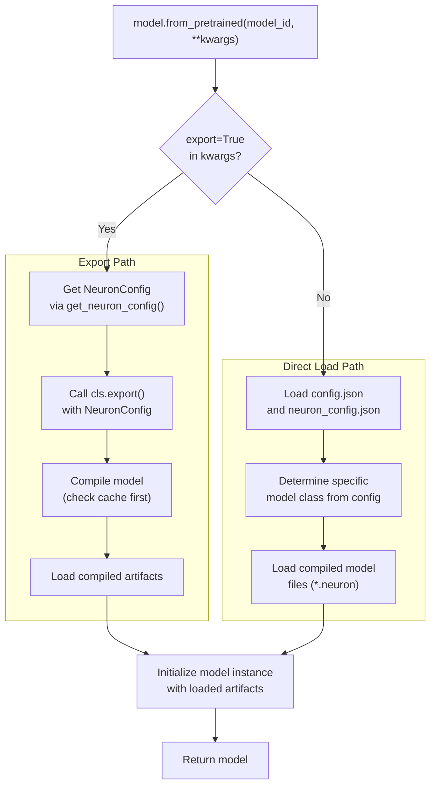
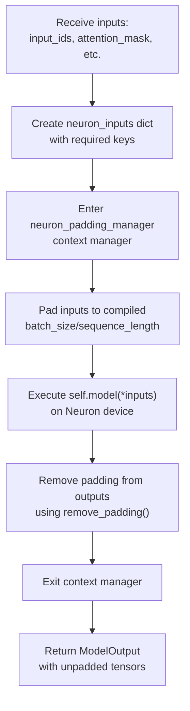

<!-- source: DeepWiki mcp.deepwiki.com · repo huggingface/optimum-neuron · page 6 Inference with Neuron Models · fetched 2026-10-26 -->

# Inference with Neuron Models

<details>
<summary>Relevant source files</summary>

The following files were used as context for generating this wiki page:

- [optimum/neuron/__init__.py](optimum/neuron/__init__.py)
- [optimum/neuron/modeling.py](optimum/neuron/modeling.py)
- [optimum/neuron/modeling_base.py](optimum/neuron/modeling_base.py)
- [optimum/neuron/models/inference/auto_models.py](optimum/neuron/models/inference/auto_models.py)
- [optimum/neuron/pipelines/transformers/base.py](optimum/neuron/pipelines/transformers/base.py)
- [optimum/neuron/utils/__init__.py](optimum/neuron/utils/__init__.py)
- [tests/decoder/test_cli.py](tests/decoder/test_cli.py)
- [tests/decoder/test_decoder_export.py](tests/decoder/test_decoder_export.py)
- [tests/decoder/test_decoder_generation.py](tests/decoder/test_decoder_generation.py)
- [tests/decoder/test_decoder_hub.py](tests/decoder/test_decoder_hub.py)
- [tests/decoder/test_decoder_pipelines.py](tests/decoder/test_decoder_pipelines.py)
- [tests/fixtures/llm/export_models.py](tests/fixtures/llm/export_models.py)
- [tests/vllm/engine/test_vllm_engine_generate.py](tests/vllm/engine/test_vllm_engine_generate.py)

</details>


This page provides an overview of the inference system in optimum-neuron, explaining the model class architecture, how to load pre-compiled Neuron models, and the organization of model classes by task and modality.

**Scope**: This page covers the general concepts and architecture of the inference system. For detailed information on specific model types, see:
- Catalog of all model classes: [Model Class Reference](#6.1)
- Text generation models: [Causal Language Models](#6.2)
- BERT-like encoder models: [Encoder Models and Pipelines](#6.3)
- Image generation: [Diffusion Pipelines](#6.4)
- High-throughput serving: [vLLM Integration](#6.5)

For exporting models to Neuron format, see [Model Export System](#4).

---

## Model Class Architecture

The inference system is built on a hierarchical class structure where all Neuron models inherit from `NeuronModel`, an abstract base class that provides device management and common functionality.

### Class Hierarchy

```mermaid
graph TB
    subgraph "Base Layer"
        NM["NeuronModel<br/>(modeling_base.py)"]
        PTM["PreTrainedModel<br/>(fake class for transformers)"]
    end
    
    subgraph "Intermediate Abstractions"
        NTM["NeuronTracedModel<br/>(modeling_traced.py)"]
        NMCLM["NeuronModelForCausalLM<br/>(modeling_decoder.py)"]
        NMSLM["NeuronModelForSeq2SeqLM<br/>(modeling_seq2seq.py)"]
        NDPB["NeuronDiffusionPipelineBase<br/>(modeling_diffusion.py)"]
    end
    
    subgraph "Task-Specific Models"
        NMFE["NeuronModelForFeatureExtraction"]
        NMMLM["NeuronModelForMaskedLM"]
        NMQA["NeuronModelForQuestionAnswering"]
        NMSC["NeuronModelForSequenceClassification"]
        NMTC["NeuronModelForTokenClassification"]
        NMMC["NeuronModelForMultipleChoice"]
        NMIC["NeuronModelForImageClassification"]
        NMSS["NeuronModelForSemanticSegmentation"]
        NMOD["NeuronModelForObjectDetection"]
        NMAC["NeuronModelForAudioClassification"]
        NMAFC["NeuronModelForAudioFrameClassification"]
        NMCTC["NeuronModelForCTC"]
        NMXV["NeuronModelForXVector"]
    end
    
    subgraph "Specific Implementations"
        NBERT["NeuronBertForXXX<br/>(models/inference/bert.py)"]
        NCLIP["NeuronCLIPModel<br/>(models/inference/clip.py)"]
        NWHISPER["NeuronWhisperForConditionalGeneration<br/>(models/inference/whisper.py)"]
        NYOLOS["NeuronYolosForObjectDetection<br/>(models/inference/yolos.py)"]
        NSDP["NeuronStableDiffusionPipeline"]
        NSDXLP["NeuronStableDiffusionXLPipeline"]
        NFPP["NeuronFluxPipeline"]
    end
    
    PTM --> NM
    NM --> NTM
    NM --> NMCLM
    NM --> NMSLM
    NM --> NDPB
    
    NTM --> NMFE
    NTM --> NMMLM
    NTM --> NMQA
    NTM --> NMSC
    NTM --> NMTC
    NTM --> NMMC
    NTM --> NMIC
    NTM --> NMSS
    NTM --> NMOD
    NTM --> NMAC
    NTM --> NMAFC
    NTM --> NMCTC
    NTM --> NMXV
    
    NTM --> NBERT
    NTM --> NCLIP
    NMSLM --> NWHISPER
    NTM --> NYOLOS
    
    NDPB --> NSDP
    NDPB --> NSDXLP
    NDPB --> NFPP
```



**Key Classes**:

| Class | Location | Role |
|-------|----------|------|
| `NeuronModel` | [optimum/neuron/modeling_base.py:28-44]() | Abstract base providing device management and `__call__` interface |
| `NeuronTracedModel` | [optimum/neuron/modeling_traced.py]() | Handles compiled models with static shapes, padding management |
| `NeuronModelForCausalLM` | [optimum/neuron/modeling_decoder.py:105-368]() | Abstract base for decoder-only text generation models |
| `NeuronDiffusionPipelineBase` | [optimum/neuron/modeling_diffusion.py]() | Base for multi-component diffusion pipelines |

**Sources**: [optimum/neuron/modeling_base.py:1-44](), [optimum/neuron/modeling_decoder.py:1-368](), [optimum/neuron/__init__.py:34-88]()

---

## Loading Pre-Compiled Models

Neuron models can be loaded in two ways: by loading an already-compiled model from disk or the Hub, or by exporting a standard model during loading.

### Loading from Pre-Compiled Checkpoint

```python
from optimum.neuron import NeuronModelForSequenceClassification

# Load from Hub or local path
model = NeuronModelForSequenceClassification.from_pretrained(
    "optimum/distilbert-base-uncased-finetuned-sst-2-english-neuronx"
)
```

### Exporting During Load

```python
from optimum.neuron import NeuronModelForSequenceClassification

# Export on-the-fly with export=True
model = NeuronModelForSequenceClassification.from_pretrained(
    "distilbert-base-uncased-finetuned-sst-2-english",
    export=True,
    batch_size=1,
    sequence_length=128
)
```

### Loading Workflow



**Key Methods**:

- **`from_pretrained()`**: Class method that handles both loading and export scenarios [optimum/neuron/modeling_decoder.py:251-260]()
- **`get_neuron_config()`**: Creates appropriate `NeuronConfig` for the model architecture [optimum/neuron/modeling_decoder.py:107-196]()
- **`export()`**: Compiles model to Neuron format [optimum/neuron/modeling_decoder.py:199-248]()
- **`_from_pretrained()`**: Subclass-specific loading logic (abstract method) [optimum/neuron/modeling_decoder.py:263-269]()

**Sources**: [optimum/neuron/modeling_decoder.py:106-270](), [tests/inference/inference_utils.py:78-157]()

---

## Model Organization by Modality

The inference system provides model classes organized by task and input modality. All model classes follow a consistent API pattern with `from_pretrained()`, `forward()`, and `save_pretrained()` methods.

### NLP Models (Text Input)

| Class | Auto Model | Task | Output Type |
|-------|------------|------|-------------|
| `NeuronModelForFeatureExtraction` | `AutoModel` | Feature extraction, embeddings | `BaseModelOutputWithPooling` |
| `NeuronModelForSentenceTransformers` | `AutoModel` | Sentence embeddings | `ModelOutput` with `sentence_embedding` |
| `NeuronModelForMaskedLM` | `AutoModelForMaskedLM` | Masked language modeling | `MaskedLMOutput` |
| `NeuronModelForQuestionAnswering` | `AutoModelForQuestionAnswering` | Extractive QA | `QuestionAnsweringModelOutput` |
| `NeuronModelForSequenceClassification` | `AutoModelForSequenceClassification` | Text classification | `SequenceClassifierOutput` |
| `NeuronModelForTokenClassification` | `AutoModelForTokenClassification` | NER, POS tagging | `TokenClassifierOutput` |
| `NeuronModelForMultipleChoice` | `AutoModelForMultipleChoice` | Multiple choice tasks | `MultipleChoiceModelOutput` |
| `NeuronModelForCausalLM` | Various | Text generation | Varies by implementation |
| `NeuronModelForSeq2SeqLM` | Various | Seq2seq translation | Varies by implementation |

### Vision Models (Image Input)

| Class | Auto Model | Task | Output Type |
|-------|------------|------|-------------|
| `NeuronModelForImageClassification` | `AutoModelForImageClassification` | Image classification | `ImageClassifierOutput` |
| `NeuronModelForSemanticSegmentation` | `AutoModelForSemanticSegmentation` | Semantic segmentation | `SemanticSegmenterOutput` |
| `NeuronModelForObjectDetection` | `AutoModelForObjectDetection` | Object detection | `ModelOutput` with `logits`, `pred_boxes` |

### Audio Models

| Class | Auto Model | Task | Output Type |
|-------|------------|------|-------------|
| `NeuronModelForAudioClassification` | `AutoModelForAudioClassification` | Audio classification | `SequenceClassifierOutput` |
| `NeuronModelForAudioFrameClassification` | `AutoModelForAudioFrameClassification` | Frame-level classification | `TokenClassifierOutput` |
| `NeuronModelForCTC` | `AutoModelForCTC` | Speech recognition (CTC) | `CausalLMOutput` |
| `NeuronModelForXVector` | `AutoModelForAudioXVector` | Speaker verification | `XVectorOutput` |

### Diffusion Models (Image Generation)

| Class | Task | Key Components |
|-------|------|----------------|
| `NeuronStableDiffusionPipeline` | Text-to-image | UNet, VAE, Text Encoder |
| `NeuronStableDiffusionImg2ImgPipeline` | Image-to-image | UNet, VAE, Text Encoder |
| `NeuronStableDiffusionInpaintPipeline` | Inpainting | UNet, VAE, Text Encoder |
| `NeuronStableDiffusionXLPipeline` | SDXL text-to-image | UNet, VAE, 2× Text Encoders |
| `NeuronStableDiffusionControlNetPipeline` | Conditioned generation | UNet, VAE, Text Encoder, ControlNet |
| `NeuronFluxPipeline` | Flux text-to-image | Transformer, VAE, Text Encoders |

**Sources**: [optimum/neuron/__init__.py:43-88](), [optimum/neuron/modeling.py:86-744]()

---

## Common Inference Patterns

All Neuron model classes follow consistent patterns for inference execution, padding management, and device handling.

### Forward Method Pattern

Most traced models follow this pattern in their `forward()` method:



**Example from `NeuronModelForSequenceClassification`**:

```python
# From optimum/neuron/modeling.py:319-341
def forward(self, input_ids, attention_mask, token_type_ids=None, **kwargs):
    neuron_inputs = {
        "input_ids": input_ids,
        "attention_mask": attention_mask,
    }
    if token_type_ids is not None:
        neuron_inputs["token_type_ids"] = token_type_ids

    with self.neuron_padding_manager(neuron_inputs) as inputs:
        outputs = self.model(*inputs)  # Execute on Neuron
        outputs = self.remove_padding(
            outputs, dims=[0], indices=[input_ids.shape[0]]
        )  # Remove batch padding

    logits = outputs[0]
    return SequenceClassifierOutput(logits=logits)
```

### Padding Management

Models compiled with static shapes require inputs to match the compiled dimensions. The `neuron_padding_manager` context manager handles this automatically:

1. **Pad inputs** to match `batch_size` and `sequence_length` from `NeuronConfig`
2. **Execute model** on padded inputs
3. **Remove padding** from outputs using `remove_padding()` with dimension indices

**Key Dimensions**:
- **dim=0**: Batch size padding (common to all models)
- **dim=1**: Sequence length padding (text and audio models)
- **dim=-1**: Last dimension padding (e.g., `num_choices` in multiple choice)

**Sources**: [optimum/neuron/modeling.py:304-390]()

### Device Handling

The `NeuronModel` base class restricts device placement to prevent errors:

```python
# From optimum/neuron/modeling_base.py:36-40
def to(self, device: str | torch.device):
    if not isinstance(device, torch.device):
        device = torch.device(device)
    if device.type != self.device.type:
        raise ValueError(f"Neuron models cannot be moved to {device.type}.")
```

Neuron models are always executed on the Neuron device (via the Neuron Runtime), though tensors may reside in CPU memory. The `device` attribute defaults to `torch.device("cpu")` [optimum/neuron/modeling_base.py:31]().

**Sources**: [optimum/neuron/modeling_base.py:21-44]()

---

## Saving Models

After loading or exporting a model, it can be saved to disk for later use:

```python
# Save model locally
model.save_pretrained("./my_neuron_model")

# Push to Hugging Face Hub
model.push_to_hub("my-org/my-neuron-model")
```

The `save_pretrained()` method saves:
- Model configuration (`config.json`)
- Neuron configuration (`neuron_config.json`)
- Compiled model artifacts (`*.neuron` files or model subdirectories)
- Generation configuration (for generative models)

**Implementation**: Each model class implements `_save_pretrained()` for class-specific saving logic, called by the base `save_pretrained()` method [optimum/neuron/modeling_decoder.py:340-367]().

**Sources**: [optimum/neuron/modeling_decoder.py:340-367]()

---

## Integration with Transformers Pipelines

All `NeuronTracedModel` subclasses are compatible with the `transformers` pipeline interface through the fake `PreTrainedModel` parent class [optimum/neuron/modeling_base.py:21-24]():

```python
from optimum.neuron import pipeline

# Create pipeline with Neuron model
classifier = pipeline(
    "text-classification",
    model="optimum/distilbert-base-uncased-finetuned-sst-2-english-neuronx"
)

result = classifier("This movie is great!")
```

The `pipeline()` function in [optimum/neuron/pipelines.py]() provides a Neuron-aware wrapper around the standard transformers pipeline framework.

**Sources**: [optimum/neuron/modeling_base.py:21-24](), [optimum/neuron/__init__.py:87]()

---

## Next Steps

For detailed information on specific model types and usage patterns:

- **All model classes and their methods**: [Model Class Reference](#6.1)
- **Text generation with decoder models**: [Causal Language Models](#6.2)
- **Encoder models (BERT, RoBERTa, etc.)**: [Encoder Models and Pipelines](#6.3)
- **Image generation pipelines**: [Diffusion Pipelines](#6.4)
- **High-throughput serving**: [vLLM Integration](#6.5)

For information on converting models to Neuron format, see [Model Export System](#4).

---

