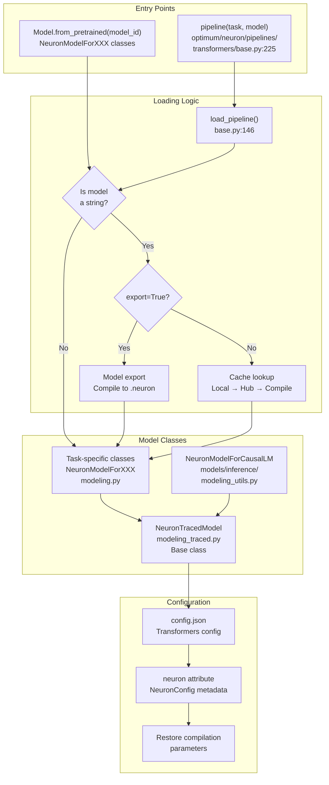
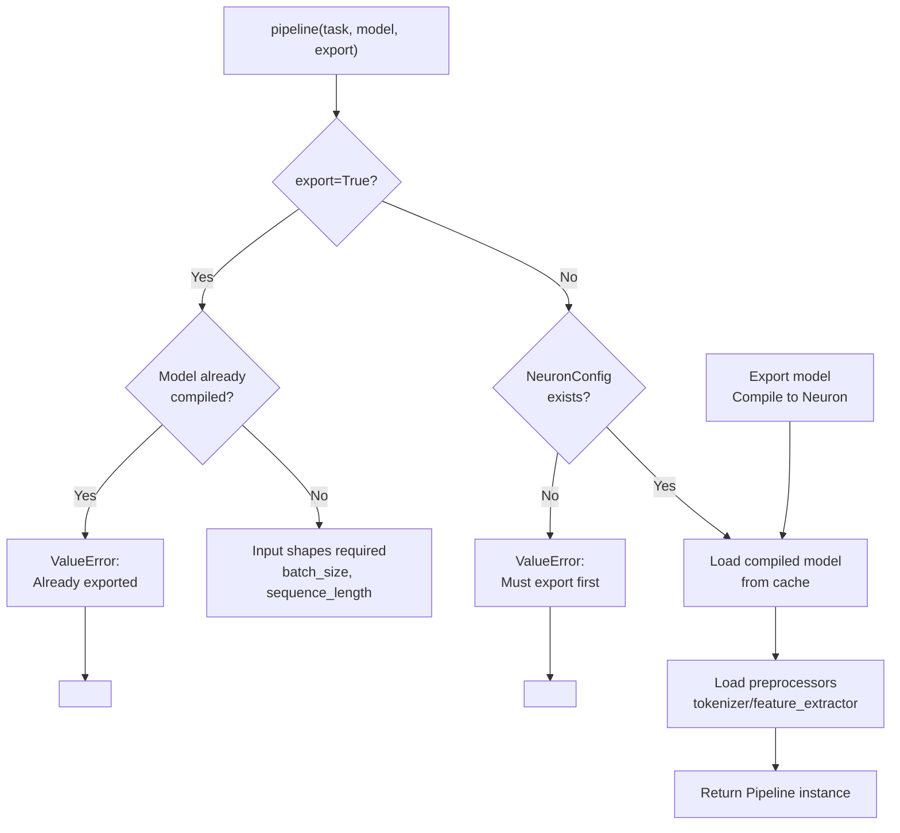
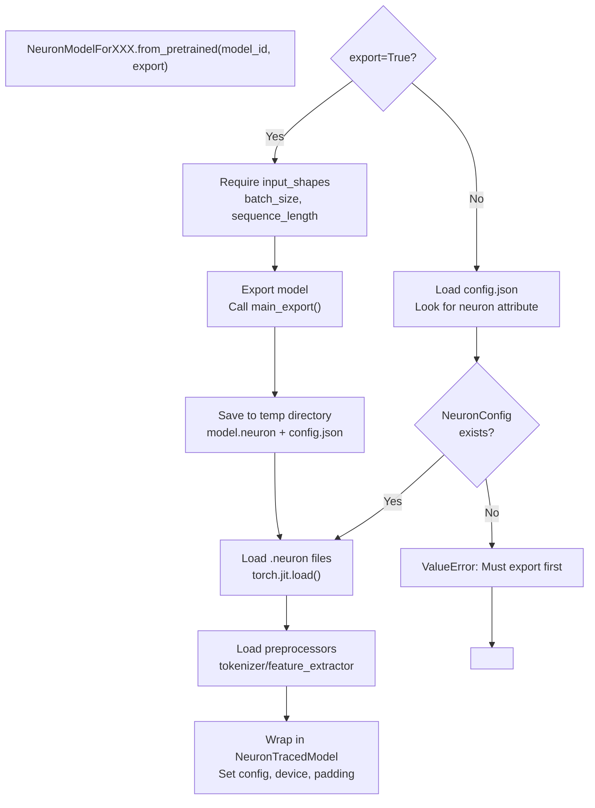
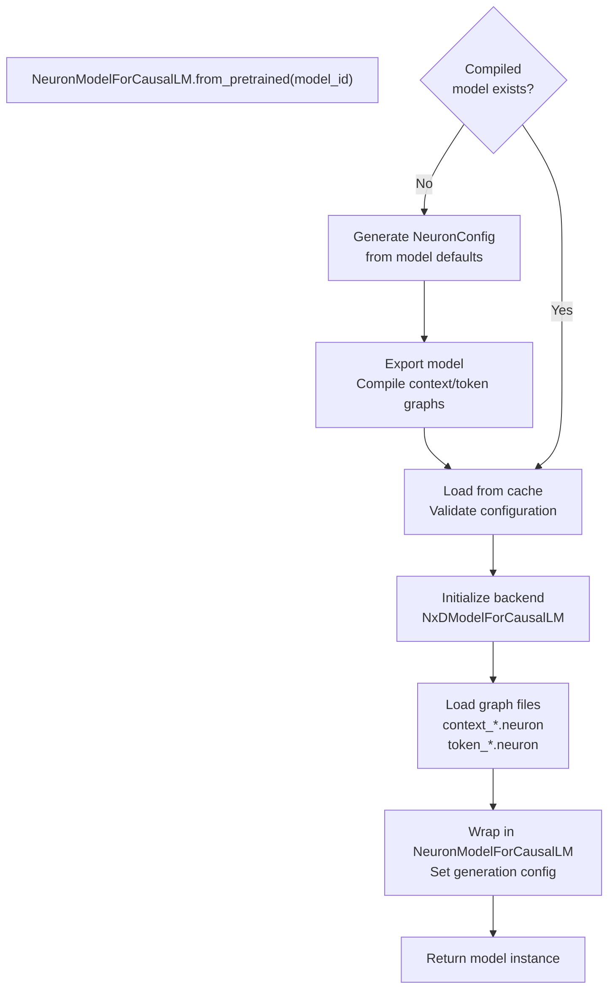
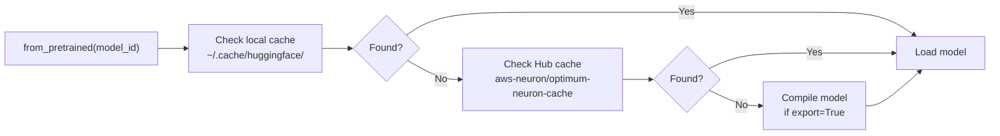
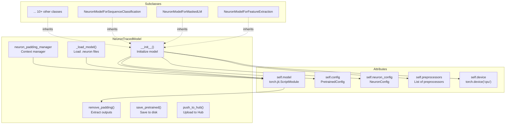

<!-- source: DeepWiki mcp.deepwiki.com · repo huggingface/optimum-neuron · page 6.1 Model Loading and Pipeline API · fetched 2026-10-26 -->

# Model Loading and Pipeline API

<details>
<summary>Relevant source files</summary>

The following files were used as context for generating this wiki page:

- [optimum/neuron/__init__.py](optimum/neuron/__init__.py)
- [optimum/neuron/modeling.py](optimum/neuron/modeling.py)
- [optimum/neuron/modeling_base.py](optimum/neuron/modeling_base.py)
- [optimum/neuron/pipelines/transformers/base.py](optimum/neuron/pipelines/transformers/base.py)
- [optimum/neuron/utils/__init__.py](optimum/neuron/utils/__init__.py)

</details>


This page documents how to load compiled Neuron models and use the high-level pipeline API for inference. The loading system provides two main entry points: the `pipeline()` function for task-oriented inference, and the `from_pretrained()` method for direct model instantiation. Both mechanisms handle loading pre-compiled models from cache, exporting models on-the-fly, and restoring compilation configurations from saved artifacts.

For causal language model specifics, see [Causal Language Models and Text Generation](#6.2). For backend inference architecture details, see [Backend Inference Architecture](#6.3). For encoder model usage, see [Encoder Models and Task Pipelines](#6.4). For diffusion models, see [Diffusion Pipelines](#6.5).

## Loading Architecture Overview

The model loading system provides two primary interfaces: the high-level `pipeline()` function and the direct `from_pretrained()` method. Both support loading pre-compiled models from cache or exporting models on-demand.



**Sources:** [optimum/neuron/pipelines/transformers/base.py:146-223](), [optimum/neuron/pipelines/transformers/base.py:225-405](), [optimum/neuron/modeling_base.py:21-44]()

## The pipeline() Function

The `pipeline()` function provides a high-level interface for task-oriented inference, automatically selecting the appropriate model class and handling preprocessing.

### Function Signature

```python
def pipeline(
    task: str = None,
    model: str | NeuronModel | None = None,
    tokenizer: str | PreTrainedTokenizer | None = None,
    feature_extractor: str | PreTrainedFeatureExtractor | None = None,
    image_processor: str | BaseImageProcessor | None = None,
    use_fast: bool = True,
    export: bool = False,
    input_shapes: dict[str, int] | None = {},
    compiler_args: dict[str, int] | None = {},
    token: str | bool | None = None,
    revision: str | None = None,
    trust_remote_code: bool | None = None,
    **kwargs,
) -> Pipeline
```

**Sources:** [optimum/neuron/pipelines/transformers/base.py:225-239]()

### Supported Tasks

The `NEURONX_SUPPORTED_TASKS` dictionary defines all available tasks and their configurations:

| Task | Implementation | Model Class | Default Model | Modality |
|------|----------------|-------------|---------------|----------|
| `"feature-extraction"` | `FeatureExtractionPipeline` | `NeuronModelForFeatureExtraction` | `distilbert-base-cased` | text |
| `"fill-mask"` | `FillMaskPipeline` | `NeuronModelForMaskedLM` | `bert-base-cased` | text |
| `"question-answering"` | `QuestionAnsweringPipeline` | `NeuronModelForQuestionAnswering` | `distilbert-base-cased-distilled-squad` | text |
| `"text-classification"` | `TextClassificationPipeline` | `NeuronModelForSequenceClassification` | `distilbert-base-uncased-finetuned-sst-2-english` | text |
| `"token-classification"` | `TokenClassificationPipeline` | `NeuronModelForTokenClassification` | `dbmdz/bert-large-cased-finetuned-conll03-english` | text |
| `"text-generation"` | `TextGenerationPipeline` | `NeuronModelForCausalLM` | `Qwen/Qwen2.5-0.5B-Instruct` | text |
| `"image-classification"` | `ImageClassificationPipeline` | `NeuronModelForImageClassification` | `microsoft/beit-base-patch16-224-pt22k-ft22k` | image |
| `"image-segmentation"` | `ImageSegmentationPipeline` | `NeuronModelForSemanticSegmentation` | `apple/deeplabv3-mobilevit-small` | image |
| `"object-detection"` | `ObjectDetectionPipeline` | `NeuronModelForSemanticSegmentation` | `apple/deeplabv3-mobilevit-small` | image |
| `"automatic-speech-recognition"` | `AutomaticSpeechRecognitionPipeline` | `NeuronModelForCTC` | `facebook/wav2vec2-large-960h-lv60-self` | audio |
| `"audio-classification"` | `AudioClassificationPipeline` | `NeuronModelForAudioClassification` | `facebook/wav2vec2-large-960h-lv60-self` | audio |

**Sources:** [optimum/neuron/pipelines/transformers/base.py:69-136]()

### Export vs Load Behavior

The `export` parameter controls whether models are compiled on-the-fly or loaded from cache:



**Sources:** [optimum/neuron/pipelines/transformers/base.py:280-306]()

### Batch Size Configuration

The pipeline automatically determines batch size from the model's `NeuronConfig`:

```python
# Priority order for batch_size:
# 1. Explicit batch_size parameter
# 2. config.neuron.batch_size
# 3. config.neuron.static_batch_size  
# 4. Default to 1

neuron_config = getattr(config, "neuron", None)
if isinstance(neuron_config, NeuronConfig):
    batch_size = neuron_config.batch_size
elif isinstance(neuron_config, dict):
    for attr in ["batch_size", "static_batch_size"]:
        batch_size = neuron_config.get(attr, batch_size)
```

When batch_size > 1 and the tokenizer lacks a pad token, the pipeline automatically sets `tokenizer.pad_token_id = model.config.eos_token_id`.

**Sources:** [optimum/neuron/pipelines/transformers/base.py:369-389]()

### Usage Examples

**Loading a pre-compiled model:**

```python
from optimum.neuron import pipeline

# Load from Hub cache
classifier = pipeline("text-classification", model="optimum/distilbert-base-uncased-finetuned-sst-2-english-neuronx")
result = classifier("I love using Neuron models!")
```

**Exporting and using in one step:**

```python
# Export on-the-fly with custom shapes
classifier = pipeline(
    "text-classification",
    model="distilbert-base-uncased-finetuned-sst-2-english",
    export=True,
    batch_size=4,
    sequence_length=128
)
```

**Using a NeuronModel directly:**

```python
from optimum.neuron import NeuronModelForSequenceClassification, pipeline
from transformers import AutoTokenizer

model = NeuronModelForSequenceClassification.from_pretrained("my-model-neuronx")
tokenizer = AutoTokenizer.from_pretrained("my-model-neuronx")

# Pass model instance to pipeline
classifier = pipeline("text-classification", model=model, tokenizer=tokenizer)
```

**Sources:** [optimum/neuron/pipelines/transformers/base.py:225-405]()

## Model Loading with from_pretrained()

All Neuron model classes inherit a `from_pretrained()` method that loads compiled models from disk or Hugging Face Hub. The loading process differs between encoder models and decoder models.

### Loading Flow for Encoder Models



**Sources:** [optimum/neuron/modeling_traced.py]() (referenced in modeling.py), [optimum/neuron/modeling.py:90-142]()

### Loading Flow for Causal LM Models

`NeuronModelForCausalLM` has a different loading path that uses the backend infrastructure:



**Sources:** [optimum/neuron/models/inference/modeling_utils.py]() (referenced in __init__.py:102)

### Configuration Restoration

When loading a compiled model, the system restores compilation metadata from the `config.json` file's `neuron` attribute:

```python
# config.json structure
{
    "model_type": "bert",
    "hidden_size": 768,
    ...,
    "neuron": {
        "batch_size": 4,
        "sequence_length": 128,
        "num_cores": 1,
        "auto_cast_type": "fp32",
        "compiler_type": "neuronx-cc",
        "compiler_version": "2.10.0.35",
        "input_names": ["input_ids", "attention_mask", "token_type_ids"],
        "output_names": ["logits"],
        "dynamic_batch_size": false
    }
}
```

The `NeuronConfig` class stores these parameters and validates them during loading:

| Parameter | Purpose | Validation |
|-----------|---------|------------|
| `batch_size` | Compiled batch dimension | Must match input batch size at runtime |
| `sequence_length` | Compiled sequence dimension | Inputs are padded to this length |
| `num_cores` or `tensor_parallel_size` | Number of NeuronCores used | Must match available hardware |
| `compiler_type` | Neuron compiler version | `"neuronx-cc"` or `"neuron-cc"` |
| `input_names` | Expected input tensor names | Used for validation |
| `output_names` | Model output tensor names | Used for output extraction |

**Sources:** [optimum/neuron/pipelines/transformers/base.py:269-279](), [optimum/neuron/configuration_utils.py]() (referenced)

### Cache Priority

The loading system searches for compiled models in this priority order:

1. **Local cache**: `~/.cache/huggingface/hub/models--<org>--<model>/snapshots/<hash>/`
2. **Hub cache repository**: `aws-neuron/optimum-neuron-cache` or custom cache repo
3. **Compilation**: If not found, compile from scratch (when `export=True`)



**Sources:** See page [8.1 Cache Architecture and Priority](#8.1) for detailed cache mechanism

## NeuronTracedModel Base Class

`NeuronTracedModel` is the base class for all encoder-based Neuron models. It provides common functionality for loading compiled models, managing static shapes, and handling preprocessing.

### Class Responsibilities



**Sources:** [optimum/neuron/modeling_traced.py]() (referenced), [optimum/neuron/modeling_base.py:21-44]()

### Padding Management

The `neuron_padding_manager` context manager handles the conversion from dynamic runtime shapes to static compiled shapes:

```python
# Usage in forward() method
def forward(self, input_ids, attention_mask, **kwargs):
    neuron_inputs = {
        "input_ids": input_ids,
        "attention_mask": attention_mask,
    }
    
    # Pad inputs to compiled shape
    with self.neuron_padding_manager(neuron_inputs) as padded_inputs:
        # Execute on NeuronCores
        outputs = self.model(*padded_inputs)
        
        # Remove padding from outputs
        outputs = self.remove_padding(
            outputs,
            dims=[0, 1],  # batch_size, sequence_length
            indices=[input_ids.shape[0], input_ids.shape[1]]
        )
    
    return outputs
```

The padding manager:
1. Validates input shapes against `neuron_config.input_names`
2. Pads tensors to `neuron_config.batch_size` and `neuron_config.sequence_length`
3. Converts to the appropriate device
4. Yields padded inputs for model execution

**Sources:** [optimum/neuron/modeling.py:107-127]() (pattern usage)

### Output Padding Removal

The `remove_padding()` method extracts the actual output dimensions from the padded results:

```python
# Remove padding from batch and sequence dimensions
outputs = self.remove_padding(
    outputs,
    dims=[0, 1],           # Which dimensions to unpad
    indices=[batch_size, seq_len]  # Actual sizes
)

# Remove padding from batch dimension only
outputs = self.remove_padding(
    outputs,
    dims=[0],
    indices=[batch_size]
)
```

**Sources:** [optimum/neuron/modeling.py:118-120]() (feature extraction), [optimum/neuron/modeling.py:168-170]() (masked LM)

### Preprocessor Management

`NeuronTracedModel` stores references to preprocessors (tokenizers, feature extractors, image processors) loaded during initialization:

```python
# Automatic preprocessor loading from model
if isinstance(model, NeuronModel):
    if tokenizer is None and load_tokenizer:
        for preprocessor in model.preprocessors:
            if isinstance(preprocessor, (PreTrainedTokenizer, PreTrainedTokenizerFast)):
                tokenizer = preprocessor
                break
```

This enables pipelines to automatically retrieve preprocessors without requiring separate `AutoTokenizer.from_pretrained()` calls.

**Sources:** [optimum/neuron/pipelines/transformers/base.py:188-196]()

### Saving and Sharing Models

`NeuronTracedModel` provides methods to save compiled models:

```python
# Save to local directory
model.save_pretrained("./my-neuron-model")
# Creates:
# - model.neuron (compiled graph)
# - config.json (with neuron attribute)
# - tokenizer files

# Upload to Hub
model.push_to_hub("my-org/my-neuron-model")
# Uploads all files to Hugging Face Hub
```

**Sources:** [optimum/neuron/modeling_traced.py]() (referenced method signatures)

## Available Model Classes

The following model classes are available for different tasks. All classes inherit from `NeuronTracedModel` (for encoder models) or have specialized implementations (for causal LM and diffusion models).

### Text Models

| Class | Task | Typical Use Cases | Sources |
|-------|------|-------------------|---------|
| `NeuronModelForFeatureExtraction` | Feature extraction | Embeddings, semantic search | [optimum/neuron/modeling.py:85-129]() |
| `NeuronModelForMaskedLM` | Masked language modeling | Fill-mask, pre-training | [optimum/neuron/modeling.py:137-175]() |
| `NeuronModelForSequenceClassification` | Text classification | Sentiment, intent classification | [optimum/neuron/modeling.py:231-269]() |
| `NeuronModelForTokenClassification` | Token classification | NER, POS tagging | [optimum/neuron/modeling.py:278-317]() |
| `NeuronModelForQuestionAnswering` | Extractive QA | SQuAD, reading comprehension | [optimum/neuron/modeling.py:183-222]() |
| `NeuronModelForMultipleChoice` | Multiple choice | SWAG, RocStories | [optimum/neuron/modeling.py:326-365]() |
| `NeuronModelForCausalLM` | Text generation | Chat, completion, code generation | [optimum/neuron/models/inference/modeling_utils.py]() |
| `NeuronModelForSeq2SeqLM` | Seq2seq | Translation, summarization | [optimum/neuron/modeling_seq2seq.py]() |

### Vision Models

| Class | Task | Typical Use Cases | Sources |
|-------|------|-------------------|---------|
| `NeuronModelForImageClassification` | Image classification | ImageNet, custom categories | [optimum/neuron/modeling.py:373-412]() |
| `NeuronModelForSemanticSegmentation` | Semantic segmentation | Scene parsing, masking | [optimum/neuron/modeling.py:420-459]() |
| `NeuronModelForObjectDetection` | Object detection | COCO detection, localization | [optimum/neuron/modeling.py:467-508]() |

### Audio Models

| Class | Task | Typical Use Cases | Sources |
|-------|------|-------------------|---------|
| `NeuronModelForAudioClassification` | Audio classification | Keyword spotting, sound classification | [optimum/neuron/modeling.py:516-549]() |
| `NeuronModelForAudioFrameClassification` | Frame classification | Speaker diarization, VAD | [optimum/neuron/modeling.py:557-589]() |
| `NeuronModelForCTC` | Speech recognition | ASR with CTC decoder | [optimum/neuron/modeling.py:597-630]() |
| `NeuronModelForXVector` | Speaker verification | Speaker recognition, verification | [optimum/neuron/modeling.py:638-671]() |

### Specialized Implementations

Some architectures have optimized implementations:

- **BERT models**: [optimum/neuron/models/inference/bert.py]() - `NeuronBertModel`, `NeuronBertForMaskedLM`, etc.
- **CLIP models**: [optimum/neuron/models/inference/clip.py]() - `NeuronCLIPModel`, `NeuronCLIPForImageClassification`
- **Whisper models**: [optimum/neuron/models/inference/whisper.py]() - `NeuronWhisperForConditionalGeneration`
- **YOLOS models**: [optimum/neuron/models/inference/yolos.py]() - `NeuronYolosForObjectDetection`

**Sources:** [optimum/neuron/__init__.py:44-88](), [optimum/neuron/__init__.py:91-102]()

### Diffusion Pipelines

Diffusion pipelines are documented separately in [Diffusion Pipelines](#6.5). Available pipelines include:

- Stable Diffusion variants (SD 1.x, SDXL)
- ControlNet pipelines
- PixArt pipelines (Alpha, Sigma)
- Flux pipelines (base, Kontext, inpainting)
- Latent Consistency Models

**Sources:** [optimum/neuron/__init__.py:59-76]()

## Common Usage Patterns

### Loading Pre-compiled Models

The most common pattern is loading a pre-compiled model from Hugging Face Hub:

```python
from optimum.neuron import NeuronModelForSequenceClassification

# Load from Hub - automatically uses cache
model = NeuronModelForSequenceClassification.from_pretrained(
    "optimum/distilbert-base-uncased-finetuned-sst-2-english-neuronx"
)

# Model configuration is restored from config.json
print(model.neuron_config.batch_size)  # e.g., 1
print(model.neuron_config.sequence_length)  # e.g., 128
```

### Exporting During Loading

To compile a model on-the-fly, use the `export=True` parameter:

```python
# Export with custom input shapes
model = NeuronModelForSequenceClassification.from_pretrained(
    "distilbert-base-uncased-finetuned-sst-2-english",
    export=True,
    batch_size=4,
    sequence_length=256
)

# Model is compiled and cached locally
model.save_pretrained("./my-neuron-model")
```

### Using the Pipeline API

The pipeline API provides the simplest interface:

```python
from optimum.neuron import pipeline

# Load pre-compiled model
classifier = pipeline(
    "text-classification",
    model="optimum/distilbert-base-uncased-finetuned-sst-2-english-neuronx"
)

# Automatic preprocessing and inference
results = classifier(["I love Neuron!", "This is great."])
# [{'label': 'POSITIVE', 'score': 0.999}, ...]
```

### Batch Processing

Models automatically handle batching up to their compiled batch size:

```python
# Model compiled with batch_size=8
results = classifier([
    "First text",
    "Second text",
    # ... up to 8 texts processed in parallel
])

# Inputs exceeding batch_size are processed in multiple batches
large_batch = ["text"] * 100  # Automatically chunked into batches of 8
results = classifier(large_batch)
```

**Sources:** [optimum/neuron/pipelines/transformers/base.py:225-405](), [optimum/neuron/modeling.py:231-269]()

### Custom Preprocessors

When loading models directly, you can specify custom preprocessors:

```python
from optimum.neuron import NeuronModelForTokenClassification
from transformers import AutoTokenizer

model = NeuronModelForTokenClassification.from_pretrained("my-neuron-model")
tokenizer = AutoTokenizer.from_pretrained("my-neuron-model")

# Manual preprocessing
inputs = tokenizer("Hello world", return_tensors="pt")
outputs = model(**inputs)

# Or use with pipeline
from optimum.neuron import pipeline
ner = pipeline("token-classification", model=model, tokenizer=tokenizer)
```

**Sources:** [optimum/neuron/pipelines/transformers/base.py:362-367]()

## Input Shape Requirements

Neuron models are compiled for specific input shapes. Understanding these requirements is essential for proper usage:

| Shape Parameter | Encoder Models | Causal LM Models | Vision Models | Audio Models |
|-----------------|----------------|------------------|---------------|--------------|
| `batch_size` | Required | Optional (dynamic) | Required | Required |
| `sequence_length` | Required | Optional (dynamic) | N/A | Required |
| `height`, `width` | N/A | N/A | Required | N/A |
| `num_beams` | N/A | Optional | N/A | N/A |

**Padding behavior:**
- Inputs smaller than compiled shape are padded automatically
- Inputs larger than compiled shape cause an error
- Padding is removed from outputs before returning

```python
# Model compiled with sequence_length=128
inputs = tokenizer("Short text", return_tensors="pt")
# input_ids.shape = [1, 5] -> padded to [1, 128] internally

outputs = model(**inputs)
# outputs.logits.shape = [1, 5] -> padding removed
```

**Sources:** [optimum/neuron/modeling.py:107-120](), [optimum/neuron/pipelines/transformers/base.py:285-287]()

## Related Documentation

- For loading and exporting models, see [Export a model to Inferentia](#4)
- For text generation specifics, see [Causal Language Models](#6.2)
- For pipeline integration, see [Encoder Models and Pipelines](#6.3)
- For diffusion model usage, see [Diffusion Pipelines](#6.4)
- For high-throughput serving, see [vLLM Integration](#6.5)
- For complete API reference, see [Inference API](#12.2)

**Sources:** [docs/source/_toctree.yml:1-150](), [docs/source/model_doc/modeling_auto.mdx:1-151]()

---

