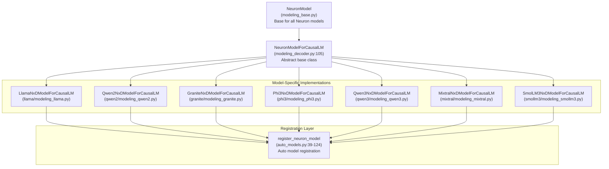
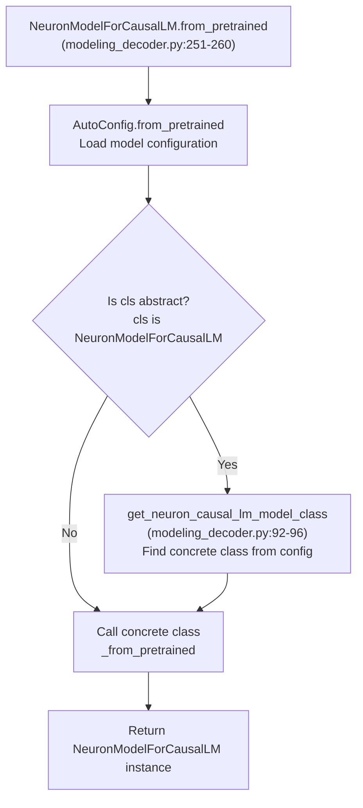
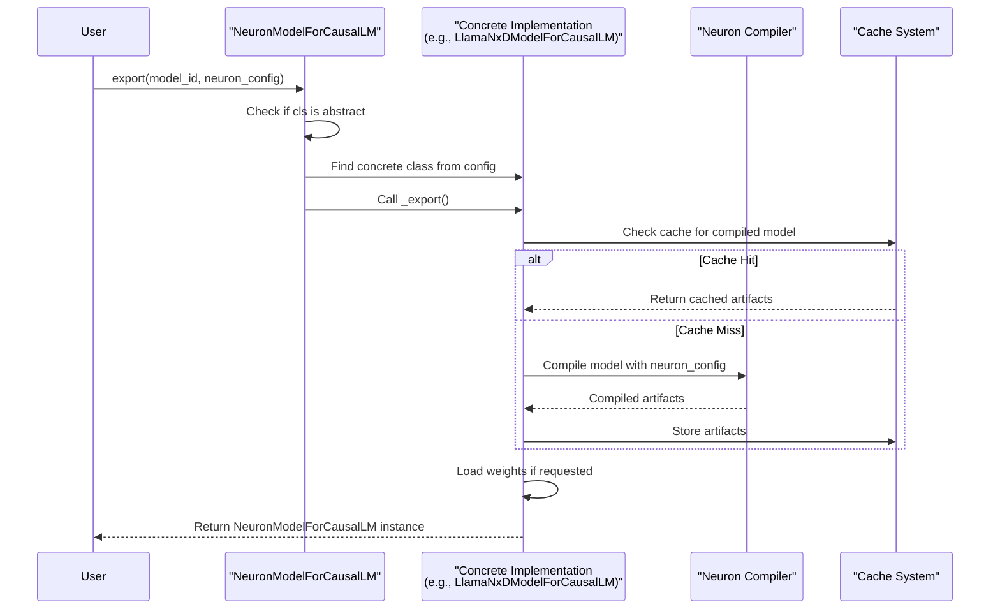
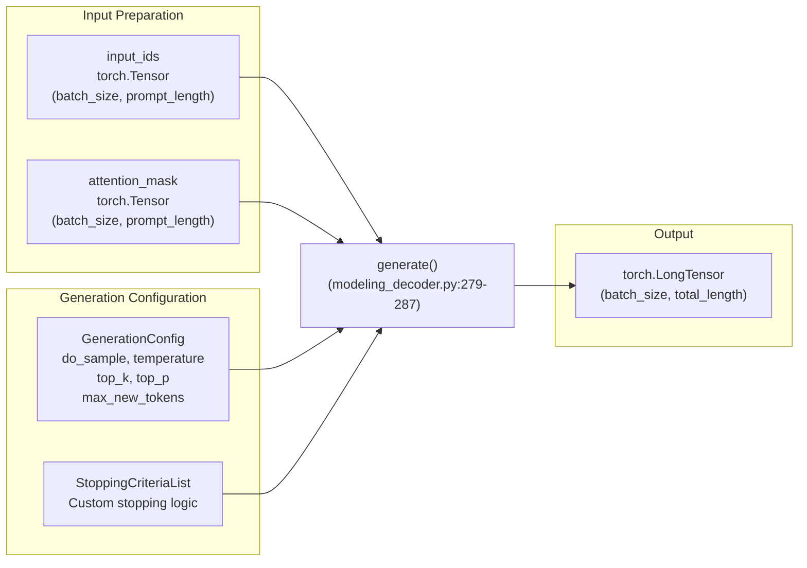
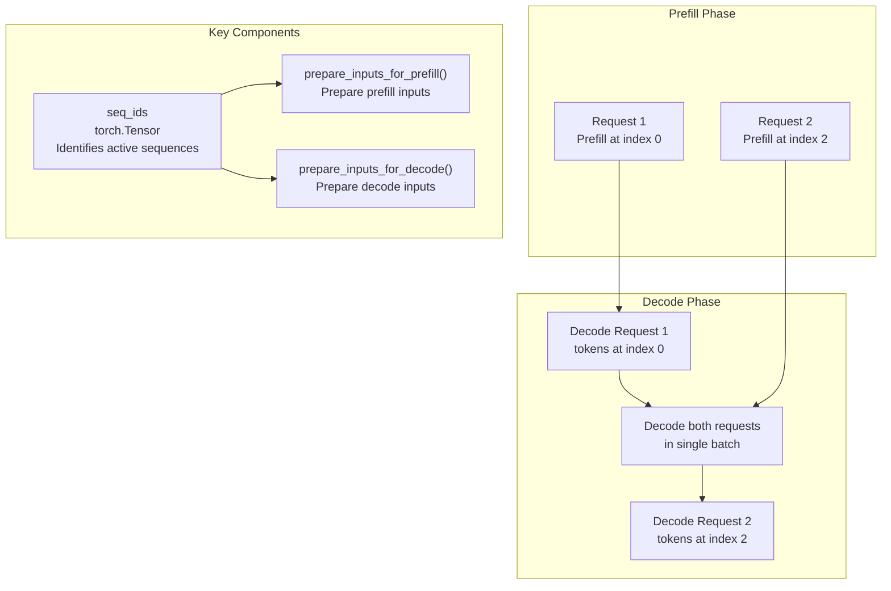
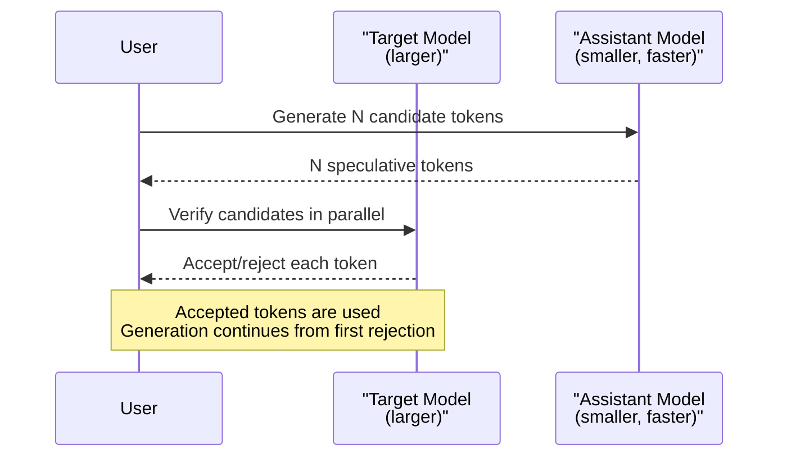
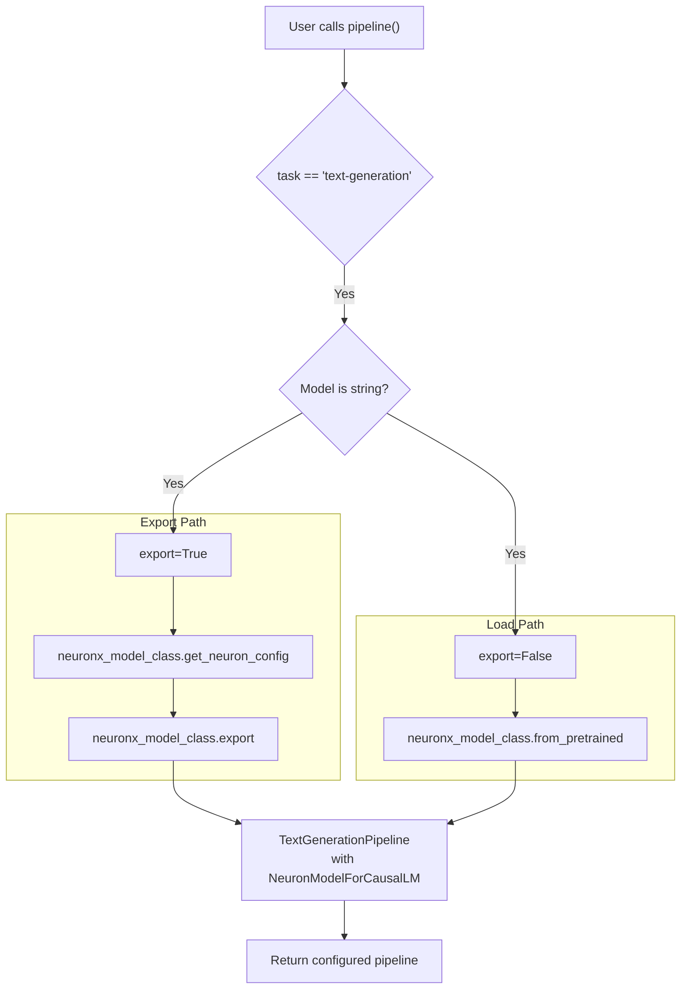

<!-- source: DeepWiki mcp.deepwiki.com · repo huggingface/optimum-neuron · page 6.2 Causal Language Models and Text Generation · fetched 2026-10-26 -->

# Causal Language Models

<details>
<summary>Relevant source files</summary>

The following files were used as context for generating this wiki page:

- [optimum/neuron/__init__.py](optimum/neuron/__init__.py)
- [optimum/neuron/modeling.py](optimum/neuron/modeling.py)
- [optimum/neuron/modeling_base.py](optimum/neuron/modeling_base.py)
- [optimum/neuron/models/inference/auto_models.py](optimum/neuron/models/inference/auto_models.py)
- [optimum/neuron/pipelines/transformers/base.py](optimum/neuron/pipelines/transformers/base.py)
- [optimum/neuron/utils/__init__.py](optimum/neuron/utils/__init__.py)
- [tests/decoder/test_cli.py](tests/decoder/test_cli.py)
- [tests/decoder/test_decoder_export.py](tests/decoder/test_decoder_export.py)
- [tests/decoder/test_decoder_generation.py](tests/decoder/test_decoder_generation.py)
- [tests/decoder/test_decoder_hub.py](tests/decoder/test_decoder_hub.py)
- [tests/decoder/test_decoder_pipelines.py](tests/decoder/test_decoder_pipelines.py)
- [tests/fixtures/llm/export_models.py](tests/fixtures/llm/export_models.py)
- [tests/vllm/engine/test_vllm_engine_generate.py](tests/vllm/engine/test_vllm_engine_generate.py)

</details>


## Purpose and Scope

This document covers the `NeuronModelForCausalLM` class and its concrete implementations, which provide text generation capabilities on AWS Neuron hardware. This page focuses on loading pretrained Neuron models, exporting standard models to Neuron format, and performing inference with text generation.

For information about training causal language models on Neuron, see [Training on AWS Neuron](#5). For encoder-decoder models (seq2seq), see [Encoder Models and Pipelines](#6.3). For general information about the model class hierarchy, see [Model Class Reference](#6.1).

---

## Class Architecture

The causal language model system is built on an abstract base class with model-specific implementations. All causal language models share a common interface but delegate implementation details to specialized subclasses.

### Class Hierarchy



**Sources:** [optimum/neuron/modeling_decoder.py:105-368](), [optimum/neuron/models/inference/auto_models.py:1-125]()

### Abstract Methods

The `NeuronModelForCausalLM` base class defines several abstract methods that subclasses must implement:

| Method | Line Reference | Purpose |
|--------|---------------|---------|
| `_get_neuron_config` | [modeling_decoder.py:290-300]() | Create model-specific NeuronConfig |
| `_export` | [modeling_decoder.py:303-338]() | Export model to Neuron format |
| `_from_pretrained` | [modeling_decoder.py:263-269]() | Load compiled Neuron model |
| `_save_pretrained` | [modeling_decoder.py:359-367]() | Save model artifacts |
| `generate` | [modeling_decoder.py:279-287]() | Perform text generation |

**Sources:** [optimum/neuron/modeling_decoder.py:263-367]()

---

## Loading Pretrained Models

The `from_pretrained` method loads a Neuron-compiled model from a local directory or the Hugging Face Hub. The method automatically selects the appropriate model class based on the model configuration.

### Basic Usage

```python
from optimum.neuron import NeuronModelForCausalLM

# Load from Hub
model = NeuronModelForCausalLM.from_pretrained("your-org/neuron-model-name")

# Load from local path
model = NeuronModelForCausalLM.from_pretrained("./local/path/to/model")
```

### Method Flow



**Sources:** [optimum/neuron/modeling_decoder.py:251-260](), [optimum/neuron/modeling_decoder.py:92-96]()

### Class Selection

When calling `from_pretrained` on the abstract `NeuronModelForCausalLM` class, the system automatically determines the correct concrete implementation using the model's configuration:

```python
def get_neuron_causal_lm_model_class(config: PretrainedConfig):
    cls = get_neuron_model_class(config.model_type, task="text-generation", mode="inference")
    if not issubclass(cls, NeuronModelForCausalLM):
        raise ValueError(f"Model {config.model_type} is not a causal language model")
    return cls
```

**Sources:** [optimum/neuron/modeling_decoder.py:92-96]()

---

## Exporting Models to Neuron Format

The `export` method converts a standard Hugging Face model to Neuron-optimized format. This involves compiling the model for the Neuron hardware with specific configuration parameters.

### Export Configuration

Before exporting, create a `NeuronConfig` using the `get_neuron_config` class method:

```mermaid
flowchart LR
    Input["Model Parameters<br/>batch_size, sequence_length<br/>tensor_parallel_size<br/>auto_cast_type"]
    GetConfig["get_neuron_config<br/>(modeling_decoder.py:107-196)"]
    
    subgraph "Configuration Resolution"
        ResolveBS["Resolve batch_size<br/>default: 1"]
        ResolveSeq["Resolve sequence_length<br/>from config.n_positions or<br/>config.max_position_embeddings<br/>default: 1024, max: 4096"]
        ResolveTP["Resolve tensor_parallel_size<br/>default: all available cores"]
        ResolveDtype["Resolve auto_cast_type<br/>from config.torch_dtype<br/>default: fp32"]
    end
    
    ConcreteConfig["Concrete class<br/>_get_neuron_config<br/>Returns NeuronConfig"]
    Output["NeuronConfig instance"]
    
    Input --> GetConfig
    GetConfig --> ResolveBS
    ResolveBS --> ResolveSeq
    ResolveSeq --> ResolveTP
    ResolveTP --> ResolveDtype
    ResolveDtype --> ConcreteConfig
    ConcreteConfig --> Output
```



**Sources:** [optimum/neuron/modeling_decoder.py:107-196]()

### Configuration Parameters

| Parameter | Line Reference | Default Value | Description |
|-----------|---------------|---------------|-------------|
| `batch_size` | [modeling_decoder.py:162-163]() | 1 | Number of sequences processed in parallel |
| `sequence_length` | [modeling_decoder.py:165-173]() | From config, max 4096 | Maximum input + output sequence length |
| `tensor_parallel_size` | [modeling_decoder.py:174-176]() | All available cores | Number of Neuron cores for tensor parallelism |
| `auto_cast_type` | [modeling_decoder.py:177-182]() | From `config.torch_dtype` | Data type for computation (fp32, fp16, bf16) |

**Sources:** [optimum/neuron/modeling_decoder.py:162-182]()

### Export Examples

```python
from optimum.neuron import NeuronModelForCausalLM

# Example 1: Export with automatic configuration
neuron_config = NeuronModelForCausalLM.get_neuron_config(
    "meta-llama/Llama-3.2-1B",
    batch_size=4,
    sequence_length=2048,
    tensor_parallel_size=2,
    auto_cast_type="bf16"
)

model = NeuronModelForCausalLM.export(
    "meta-llama/Llama-3.2-1B",
    neuron_config=neuron_config,
    load_weights=True  # Load weights during export
)

# Save the compiled model
model.save_pretrained("./neuron-llama-3.2-1b")

# Example 2: Export from local checkpoint
model = NeuronModelForCausalLM.export(
    "./local/checkpoint",
    neuron_config=neuron_config,
    load_weights=False  # Skip weight loading for faster export
)
```

**Sources:** [optimum/neuron/modeling_decoder.py:199-248](), [tests/decoder/test_decoder_export.py:78-106]()

### Export Process Flow



**Sources:** [optimum/neuron/modeling_decoder.py:199-248](), [optimum/neuron/modeling_decoder.py:303-338]()

---

## Text Generation

The `generate` method performs autoregressive text generation using the compiled Neuron model. It supports both greedy decoding and sampling strategies.

### Generation Interface



**Sources:** [optimum/neuron/modeling_decoder.py:279-287](), [optimum/neuron/modeling_decoder.py:42-71]()

### Generation Modes

The `generate` method supports two primary generation strategies:

| Mode | Configuration | Description |
|------|---------------|-------------|
| Greedy | `do_sample=False` | Select the most probable token at each step |
| Sampling | `do_sample=True` | Sample from the probability distribution with optional temperature, top-k, and top-p |

**Sources:** [tests/decoder/test_decoder_generation.py:42-56]()

### Generation Examples

```python
from transformers import AutoTokenizer
from optimum.neuron import NeuronModelForCausalLM

model = NeuronModelForCausalLM.from_pretrained("neuron-model-path")
tokenizer = AutoTokenizer.from_pretrained("neuron-model-path")

# Example 1: Greedy generation
prompt = "What is Deep Learning?"
inputs = tokenizer(prompt, return_tensors="pt")
outputs = model.generate(**inputs, do_sample=False, max_new_tokens=20)
print(tokenizer.decode(outputs[0]))

# Example 2: Sampling with temperature
outputs = model.generate(
    **inputs,
    do_sample=True,
    temperature=0.7,
    top_k=50,
    top_p=0.9,
    max_new_tokens=50
)

# Example 3: Repetition penalty
outputs = model.generate(
    **inputs,
    do_sample=False,
    repetition_penalty=1.2,
    max_new_tokens=30
)
```

**Sources:** [tests/decoder/test_decoder_generation.py:42-56](), [tests/decoder/test_decoder_generation.py:95-113]()

### Stopping Criteria

The generation supports multiple stopping mechanisms:

#### Multiple EOS Token IDs

```python
generation_config = model.generation_config
generation_config.eos_token_id = [eos_id_1, eos_id_2, eos_id_3]
outputs = model.generate(**inputs, generation_config=generation_config)
```

**Sources:** [tests/decoder/test_decoder_generation.py:118-132]()

#### Stop Strings

```python
generation_config = model.generation_config
generation_config.stop_strings = ["END", "STOP"]
outputs = model.generate(
    **inputs,
    generation_config=generation_config,
    tokenizer=tokenizer  # Required for stop strings
)
```

**Sources:** [tests/decoder/test_decoder_generation.py:137-156]()

#### Custom Stopping Criteria

```python
from transformers.generation import StoppingCriteria

class CustomStoppingCriteria(StoppingCriteria):
    def __call__(self, input_ids, scores, **kwargs):
        # Return True to stop generation
        return some_condition(input_ids)

criteria = CustomStoppingCriteria()
outputs = model.generate(**inputs, stopping_criteria=[criteria])
```

**Sources:** [tests/decoder/test_decoder_generation.py:77-90]()

---

## Advanced Features

### Continuous Batching

Continuous batching allows different sequences in a batch to have different lengths and to be prefilled/decoded independently, enabling efficient multi-request serving.



**Sources:** [tests/decoder/test_decoder_generation.py:161-243]()

#### Continuous Batching API

The model provides specific input preparation methods for continuous batching:

- **`prepare_inputs_for_prefill`**: Prepares inputs for the initial prefill phase
- **`prepare_inputs_for_decode`**: Prepares inputs for subsequent decode steps
- **`seq_ids`**: Tensor specifying which batch indices contain active sequences

```python
# Check if model supports continuous batching
if model.neuron_config.continuous_batching:
    # Prefill first request at index 0
    first_inputs = {
        "input_ids": input_ids,
        "attention_mask": attention_mask,
        "seq_ids": torch.tensor([0])
    }
    outputs = model(**model.prepare_inputs_for_prefill(**first_inputs))
    
    # Decode a few tokens
    first_inputs["input_ids"] = outputs.logits[:, -1, :].argmax(dim=-1, keepdim=True)
    for _ in range(5):
        outputs = model(**model.prepare_inputs_for_decode(**first_inputs))
    
    # Prefill second request at index 2
    second_inputs = {
        "input_ids": input_ids,
        "attention_mask": attention_mask,
        "seq_ids": torch.tensor([2])
    }
    outputs = model(**model.prepare_inputs_for_prefill(**second_inputs))
    
    # Continue decoding both requests together
    combined_inputs = {
        "input_ids": torch.cat([first_tokens, second_tokens]),
        "attention_mask": torch.cat([first_mask, second_mask]),
        "seq_ids": torch.tensor([0, 2])
    }
    outputs = model(**model.prepare_inputs_for_decode(**combined_inputs))
```

**Sources:** [tests/decoder/test_decoder_generation.py:161-243]()

### Speculative Decoding

Speculative decoding (also called assisted decoding) accelerates generation by using a smaller draft model to generate candidate tokens, which are then verified by the target model.



**Sources:** [tests/decoder/test_decoder_generation.py:246-258](), [tests/decoder/conftest.py:211-270]()

#### Speculative Decoding Setup

To use speculative decoding:

1. Export the target model with `speculation_length` parameter
2. Export a draft model without speculation
3. Pass the draft model as `assistant_model` during generation

```python
from optimum.neuron.models.inference.backend.config import NxDNeuronConfig
from optimum.neuron.models.inference.llama.modeling_llama import LlamaNxDModelForCausalLM

# Export target model with speculation
target_config = NxDNeuronConfig(
    checkpoint_id="meta-llama/Llama-3.2-1B",
    batch_size=1,
    sequence_length=4096,
    tp_degree=2,
    torch_dtype="bf16",
    speculation_length=5  # Number of speculative tokens
)
target_model = LlamaNxDModelForCausalLM.export(
    "meta-llama/Llama-3.2-1B",
    neuron_config=target_config
)

# Export draft model (smaller, faster variant)
draft_config = NxDNeuronConfig(
    checkpoint_id="meta-llama/Llama-3.2-1B",
    batch_size=1,
    sequence_length=4096,
    tp_degree=2,
    torch_dtype="bf16"
)
draft_model = LlamaNxDModelForCausalLM.export(
    "meta-llama/Llama-3.2-1B",
    neuron_config=draft_config
)

# Generate with speculative decoding
outputs = target_model.generate(
    **inputs,
    assistant_model=draft_model,
    do_sample=False,
    max_new_tokens=50
)
```

**Sources:** [tests/decoder/conftest.py:211-270](), [tests/decoder/test_decoder_generation.py:246-258]()

---

## Supported Model Architectures

The following table lists the causal language model architectures supported for inference on Neuron:

| Model Type | Implementation Class | Registration | Model Examples |
|------------|---------------------|--------------|----------------|
| Llama | `LlamaNxDModelForCausalLM` | [auto_models.py:55-61]() | Llama 2, Llama 3, Llama 3.1, Llama 3.2 |
| Llama 4 | `Llama4NxDModelForCausalLM` | [auto_models.py:64-70]() | Llama 4 |
| Qwen2 | `Qwen2NxDModelForCausalLM` | [auto_models.py:91-97]() | Qwen2, Qwen2.5 |
| Qwen3 | `Qwen3NxDModelForCausalLM` | [auto_models.py:100-106]() | Qwen3 |
| Qwen3-MoE | `Qwen3MoeNxDModelForCausalLM` | [auto_models.py:109-115]() | Qwen3 Mixture of Experts |
| Granite | `GraniteNxDModelForCausalLM` | [auto_models.py:46-52]() | IBM Granite |
| Phi-3 | `Phi3NxDModelForCausalLM` | [auto_models.py:82-88]() | Microsoft Phi-3, Phi-4 |
| Mixtral | `MixtralNxDModelForCausalLM` | [auto_models.py:73-79]() | Mixtral (MoE) |
| SmolLM3 | `SmolLM3NxDModelForCausalLM` | [auto_models.py:118-124]() | HuggingFace SmolLM3 |

**Sources:** [optimum/neuron/models/inference/auto_models.py:46-124](), [tests/decoder/conftest.py:30-85]()

### Backend Implementation

All causal language models use the **NxD (NeuronX Distributed) backend**, which provides:
- Tensor parallelism across multiple Neuron cores
- Optimized attention mechanisms
- Continuous batching support
- On-device sampling capabilities

**Sources:** [optimum/neuron/models/inference/auto_models.py:1-34]()

---

## Pipeline Integration

Causal language models integrate with the Hugging Face `pipeline` API for text generation tasks.

### Pipeline Creation



**Sources:** [optimum/neuron/pipelines/transformers/base.py:146-223](), [optimum/neuron/pipelines/transformers/base.py:225-406]()

### Pipeline Usage

```python
from optimum.neuron.pipelines import pipeline

# Example 1: Export and use in one step
generator = pipeline(
    "text-generation",
    model="meta-llama/Llama-3.2-1B",
    export=True,
    batch_size=2,
    sequence_length=1024,
    tensor_parallel_size=2,
    auto_cast_type="bf16"
)

outputs = generator("Hello, how are you?", max_new_tokens=20)

# Example 2: Load pre-exported model
generator = pipeline("text-generation", model="./neuron-llama-3.2-1b")
outputs = generator(
    ["First prompt", "Second prompt"],
    batch_size=2,
    do_sample=True,
    temperature=0.9
)

# Example 3: From model instance
from optimum.neuron import NeuronModelForCausalLM
from transformers import AutoTokenizer

model = NeuronModelForCausalLM.from_pretrained("./neuron-model")
tokenizer = AutoTokenizer.from_pretrained("./neuron-model")

generator = pipeline("text-generation", model=model, tokenizer=tokenizer)
```

**Sources:** [tests/decoder/test_decoder_pipelines.py:46-110](), [optimum/neuron/pipelines/transformers/base.py:100-105]()

### Pipeline Configuration

The pipeline automatically infers batch size from the Neuron configuration and sets appropriate padding tokens:

```python
# The pipeline extracts batch_size from neuron_config
batch_size = neuron_config.batch_size

# If the tokenizer lacks a pad_token_id, the pipeline sets it to eos_token_id
if tokenizer.pad_token_id is None:
    tokenizer.pad_token_id = model.config.eos_token_id
```

**Sources:** [optimum/neuron/pipelines/transformers/base.py:370-390]()

---

## Model Persistence

### Saving Models

The `save_pretrained` method saves both the compiled model artifacts and configuration files:

```python
model.save_pretrained("./output/directory")
```

This saves:
- `neuron_config.json` - Neuron compilation configuration
- `config.json` - Model configuration
- Model-specific artifacts (weights, compiled graphs, etc.)

**Sources:** [optimum/neuron/modeling_decoder.py:340-357]()

### Hub Integration

Models can be pushed to and loaded from the Hugging Face Hub:

```python
# Push to Hub
model.push_to_hub(
    save_directory="./local/path",
    repository_id="your-org/model-name",
    token="your_token"
)

# Load from Hub
model = NeuronModelForCausalLM.from_pretrained("your-org/model-name")
```

**Sources:** [tests/decoder/test_decoder_hub.py:28-70]()

---

## Input Validation

Causal language models enforce input dimension constraints based on the compilation configuration:

### Batch Size Validation

```python
if input_batch_size != model.neuron_config.batch_size:
    raise ValueError(
        f"The specified batch_size {input_batch_size} does not match "
        f"the model's compiled batch_size {model.neuron_config.batch_size}"
    )
```

### Sequence Length Validation

```python
if input_length > model.neuron_config.sequence_length:
    raise ValueError(
        f"The input sequence length {input_length} exceeds "
        f"the model's maximum sequence_length {model.neuron_config.sequence_length}"
    )
```

**Sources:** [tests/decoder/test_decoder_generation.py:61-72]()

---

## Summary

The `NeuronModelForCausalLM` class provides a unified interface for text generation on AWS Neuron hardware:

1. **Loading**: Use `from_pretrained()` to load compiled Neuron models
2. **Exporting**: Use `export()` with `get_neuron_config()` to compile standard models
3. **Generation**: Use `generate()` with flexible configuration options
4. **Advanced Features**: Support for continuous batching and speculative decoding
5. **Architecture Support**: Multiple model families (Llama, Qwen, Granite, Phi, Mixtral, etc.)
6. **Integration**: Seamless integration with Hugging Face pipelines

All implementations use the NeuronX Distributed (NxD) backend for optimized inference on Inferentia2 and Trainium hardware.

**Sources:** [optimum/neuron/modeling_decoder.py:1-368](), [optimum/neuron/models/inference/auto_models.py:1-125]()

---

