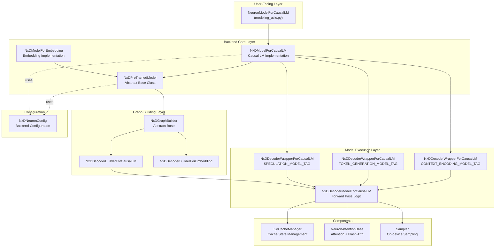
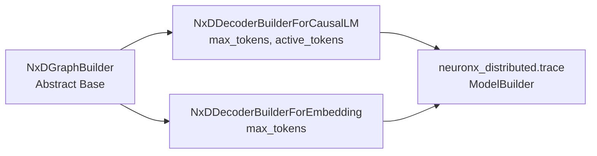
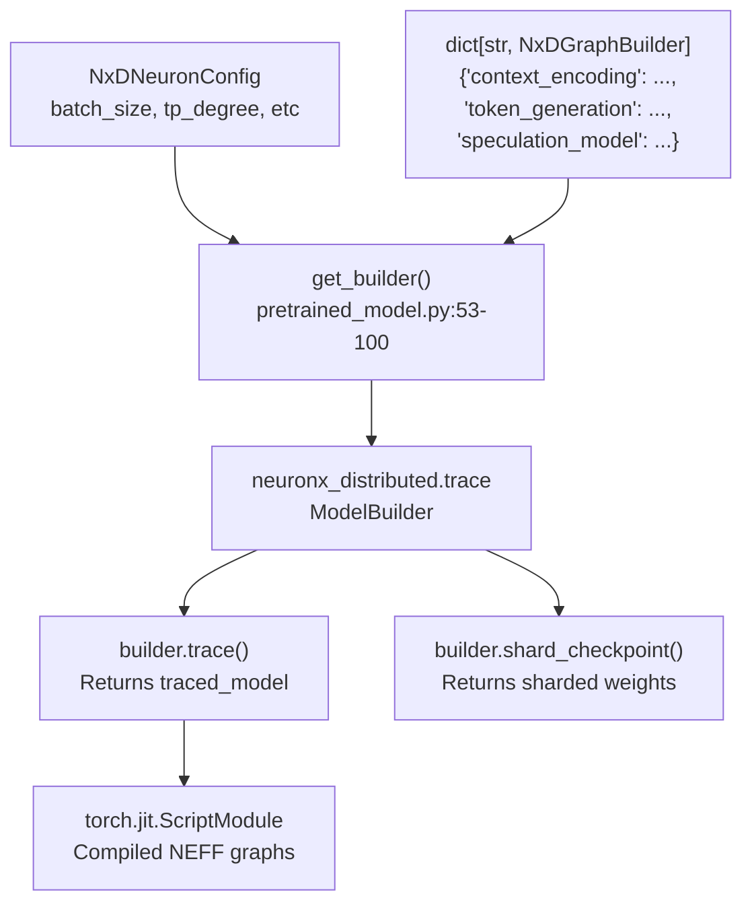
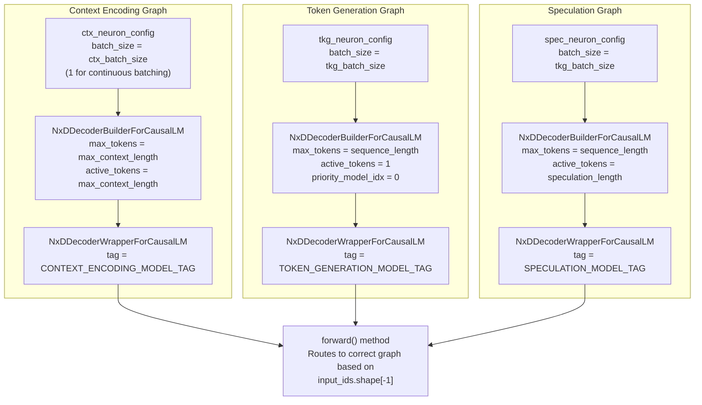
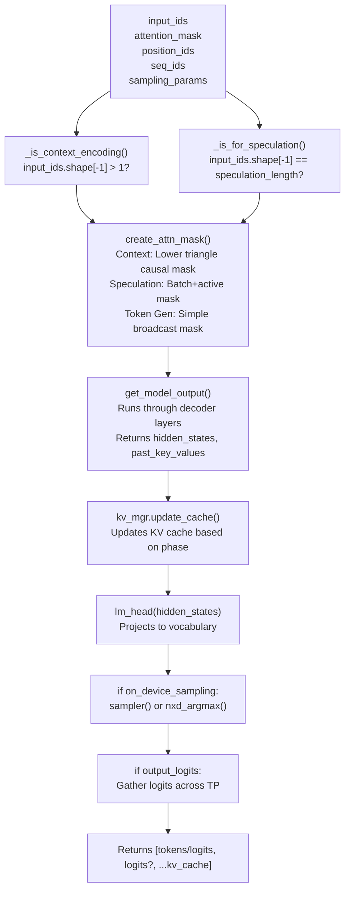
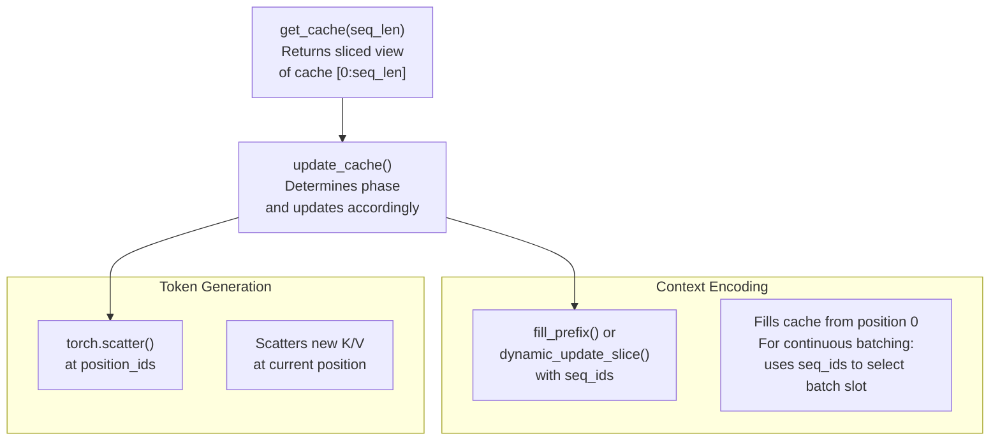
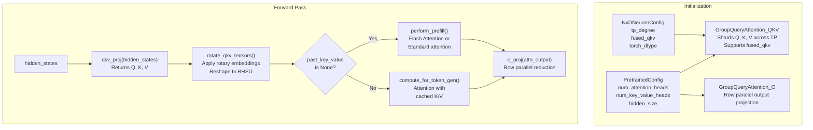
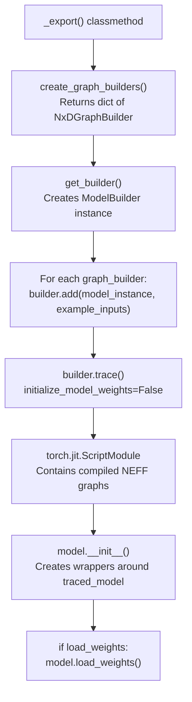
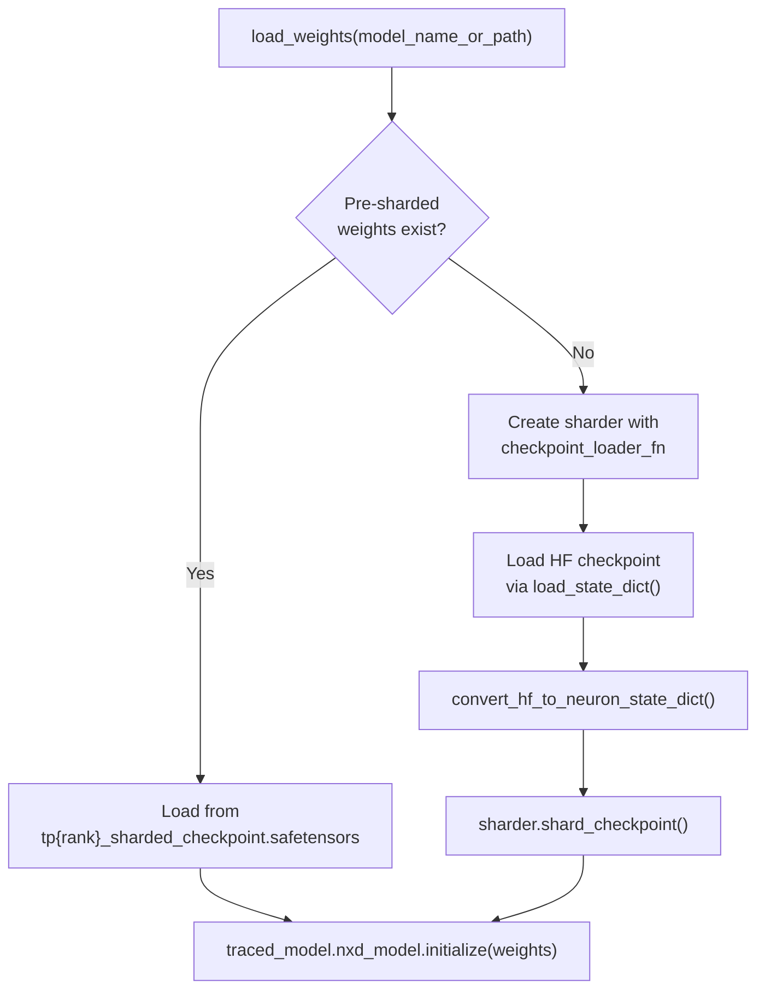

<!-- source: DeepWiki mcp.deepwiki.com · repo huggingface/optimum-neuron · page 6.3 Backend Inference Architecture · fetched 2026-10-26 -->

# Backend Inference Architecture

<details>
<summary>Relevant source files</summary>

The following files were used as context for generating this wiki page:

- [optimum/neuron/models/inference/backend/config.py](optimum/neuron/models/inference/backend/config.py)
- [optimum/neuron/models/inference/backend/graph_builder.py](optimum/neuron/models/inference/backend/graph_builder.py)
- [optimum/neuron/models/inference/backend/modules/attention/attention_base.py](optimum/neuron/models/inference/backend/modules/attention/attention_base.py)
- [optimum/neuron/models/inference/backend/modules/decoder/modeling_decoder.py](optimum/neuron/models/inference/backend/modules/decoder/modeling_decoder.py)
- [optimum/neuron/models/inference/backend/modules/kvcache/kv_cache_manager.py](optimum/neuron/models/inference/backend/modules/kvcache/kv_cache_manager.py)
- [optimum/neuron/models/inference/backend/pretrained_model.py](optimum/neuron/models/inference/backend/pretrained_model.py)

</details>


## Purpose and Scope

This page documents the low-level backend infrastructure that powers inference on AWS Neuron devices. It covers the `NxDPreTrainedModel` base class, graph builders, KV cache management, and attention mechanisms including Flash Attention. This is the implementation layer that sits beneath the user-facing inference APIs.

For information about the high-level inference APIs, see [Model Loading and Pipeline API](#6.1) and [Causal Language Models and Text Generation](#6.2). For training architecture, see [Training on AWS Neuron](#5).

---

## Architecture Overview

The backend inference system is built around a layered architecture where compilation, model management, and execution are separated into distinct components:



**Sources:** [optimum/neuron/models/inference/backend/pretrained_model.py:103-148](), [optimum/neuron/models/inference/backend/modules/decoder/modeling_decoder.py:345-437]()

---

## NxDPreTrainedModel: Base Class

`NxDPreTrainedModel` is the abstract base class for all backend inference models. It provides the core compilation, loading, and weight management infrastructure.

### Class Hierarchy and Responsibilities

| Class | Location | Responsibility |
|-------|----------|---------------|
| `NxDPreTrainedModel` | `backend/pretrained_model.py` | Abstract base for compilation, weight loading, save/load |
| `NxDModelForCausalLM` | `backend/modules/decoder/modeling_decoder.py` | Causal LM with context/token/speculation graphs |
| `NxDModelForEmbedding` | `backend/modules/decoder/modeling_decoder.py` | Text embedding extraction |
| `NxDDecoderModelForCausalLM` | `backend/modules/decoder/modeling_decoder.py` | Forward pass implementation (traced module) |
| `NxDDecoderModelForEmbedding` | `backend/modules/decoder/modeling_decoder.py` | Embedding forward pass (traced module) |

**Sources:** [optimum/neuron/models/inference/backend/pretrained_model.py:103-310]()

### Key Methods

The `NxDPreTrainedModel` class defines several abstract methods that subclasses must implement:

```python
# Abstract methods that subclasses must implement
@abstractmethod
def forward(self, *args, **kwargs)
    
@classmethod
@abstractmethod
def get_compiler_args(cls, neuron_config) -> str | None
    
@classmethod
@abstractmethod
def create_graph_builders(cls, config, neuron_config) -> dict[str, NxDGraphBuilder]
```

And concrete methods for compilation and loading:

```python
# Compilation
@staticmethod
def compile(neuron_config, graph_builders, compiler_args, debug=False)

# Export workflow
@classmethod
def _export(cls, model_id, config, neuron_config, ...)

# Loading workflow  
@classmethod
def _from_pretrained(cls, model_id, config, ...)

# Weight management
def load_weights(self, model_name_or_path, ...)
def checkpoint_loader_fn(self, checkpoint_path, config, neuron_config)
```

**Sources:** [optimum/neuron/models/inference/backend/pretrained_model.py:124-149](), [optimum/neuron/models/inference/backend/pretrained_model.py:313-441]()

---

## Graph Builder System

Graph builders are responsible for constructing the model graphs that will be traced and compiled. Each graph builder defines the model structure and example inputs for a specific use case.

### NxDGraphBuilder Abstract Class



The abstract `NxDGraphBuilder` class defines two key methods:

```python
@abstractmethod
def input_generator(self) -> list[torch.Tensor]:
    """Return the list of model input tensors for tracing"""
    
@abstractmethod  
def get_model_instance(self) -> BaseModelInstance:
    """Return the underlying ModelInstance for compilation"""
```

**Sources:** [optimum/neuron/models/inference/backend/graph_builder.py:21-41]()

### Graph Builder Usage in Compilation

The `get_builder()` function orchestrates the compilation process by combining graph builders with the NeuronX Distributed `ModelBuilder`:



The function creates a `ModelBuilder` instance and registers each graph:

```python
# For each graph builder
for tag, graph_builder in graph_builders.items():
    builder.add(
        key=tag,
        model_instance=graph_builder.get_model_instance(),
        example_inputs=graph_builder.input_generator(),
        compiler_args=compiler_args,
        priority_model_idx=graph_builder.priority_model_idx,
    )
```

**Sources:** [optimum/neuron/models/inference/backend/pretrained_model.py:53-100](), [optimum/neuron/models/inference/backend/modules/decoder/modeling_decoder.py:404-436]()

---

## NxDModelForCausalLM: Multiple Graph Architecture

`NxDModelForCausalLM` implements causal language modeling using three separate compiled graphs, each optimized for a specific phase of generation:

### Three Graph Types



### Graph Selection Logic

The `forward()` method routes to the appropriate graph based on input characteristics:

| Condition | Graph Used | Description |
|-----------|------------|-------------|
| `input_ids.shape[-1] > 1` AND `position_ids.min() == 0` | Context Encoding | Processing initial prompt with multiple tokens |
| `input_ids.shape[-1] == speculation_length` | Speculation | Generating multiple tokens at once (speculative decoding) |
| Otherwise | Token Generation | Standard autoregressive generation (1 token at a time) |

**Sources:** [optimum/neuron/models/inference/backend/modules/decoder/modeling_decoder.py:364-402](), [optimum/neuron/models/inference/backend/modules/decoder/modeling_decoder.py:512-554]()

### NxDDecoderModelForCausalLM: Forward Pass Logic

The `NxDDecoderModelForCausalLM` class implements the actual forward pass that gets traced and compiled. It manages KV cache, attention masks, and sampling:



**Sources:** [optimum/neuron/models/inference/backend/modules/decoder/modeling_decoder.py:59-343]()

---

## KV Cache Management

The `KVCacheManager` class manages the key-value cache state across inference steps. It handles cache initialization, reading, and updating for all decoder layers.

### Cache Layout and Structure

The KV cache uses a **BHSD layout** (Batch, Heads, Sequence, Dimension):

```python
# Cache shape per layer: (batch_size, num_kv_heads_per_rank, max_len, head_dim)
kv_shape = (
    max_batch_size,
    num_kv_heads_per_rank,
    max_len,
    hidden_dim_per_head,
)
```

The cache is stored as a `nn.ParameterList` with `num_layers * 2` entries (K and V for each layer):

```python
self.past_key_values = nn.ParameterList([
    nn.Parameter(torch.zeros(self.kv_shape, dtype=dtype), requires_grad=False) 
    for _ in range(num_layer * 2)
])
```

**Sources:** [optimum/neuron/models/inference/backend/modules/kvcache/kv_cache_manager.py:35-80]()

### Cache Operations



The `update_cache()` method handles both phases:

```python
if is_for_context_encoding:
    if self.is_continuous_batching:
        # Use dynamic_update_slice with seq_ids to select batch slot
        k_cache = dynamic_update_slice(k_cache, latest_k, indices)
    else:
        # Fill from start
        k_cache = fill_prefix(k_cache, latest_k)
else:
    # Token generation: scatter at position_ids
    scatter_index_new = self._get_index_to_update_new_position(...)
    k_cache = torch.scatter(input=k_cache, dim=2, index=scatter_index_new, src=latest_k)
```

**Sources:** [optimum/neuron/models/inference/backend/modules/kvcache/kv_cache_manager.py:115-184]()

---

## Attention Mechanisms

### NeuronAttentionBase: Core Attention Implementation

The `NeuronAttentionBase` class implements Neuron-optimized attention with tensor parallelism, GQA support, and Flash Attention:



**Sources:** [optimum/neuron/models/inference/backend/modules/attention/attention_base.py:60-143]()

### Flash Attention Strategies

Flash Attention is a memory-efficient attention algorithm that fuses operations. The system selects between three strategies based on configuration and sequence length:

| Strategy | Condition | Description |
|----------|-----------|-------------|
| `NONE` | `q_len < threshold` OR `custom qk_scale` | Standard PyTorch attention implementation |
| `UNSHARDED_KERNEL` | LNC1 AND `q_len >= 4096` | Single NeuronCore kernel, best for long sequences |
| `SHARDED_KERNEL` | LNC2 AND `q_len % 1024 == 0` | Multi-NeuronCore kernel, requires aligned sequence length |

```python
def get_flash_attention_strategy(self, q_len) -> FlashAttentionStrategy:
    if self._qk_scale is not None:
        return FlashAttentionStrategy.NONE
        
    if int(self.logical_nc_config) > 1:  # LNC2
        if q_len < 1024:
            return FlashAttentionStrategy.NONE
        if q_len % 1024 == 0:
            return FlashAttentionStrategy.SHARDED_KERNEL
        else:
            return FlashAttentionStrategy.NONE
    
    # LNC1
    if q_len >= 4096:
        return FlashAttentionStrategy.UNSHARDED_KERNEL
    
    return FlashAttentionStrategy.NONE
```

**Sources:** [optimum/neuron/models/inference/backend/modules/attention/attention_base.py:255-287]()

### Flash Attention Implementation

The prefill phase uses the NKI Flash Attention kernel when enabled:

```python
# Reshape to kernel format: (B*H)DS
Q = Q.permute(0, 1, 3, 2).reshape((bsz * self.num_heads, self.head_dim, q_len))
Q = Q * self.qk_scale  # Apply scaling
K_active = K_active.permute(0, 1, 3, 2).reshape((bsz * self.num_heads, self.head_dim, q_len))
V_active = V_active.reshape((bsz * self.num_heads, q_len, self.head_dim))

# Call flash attention kernel
if flash_attn_strategy == FlashAttentionStrategy.SHARDED_KERNEL:
    grid = (nc(self.logical_nc_config),)
    _flash_fwd_call[grid](Q, K_active, V_active, 1.0, attn_output, 
                          kernel_name="CausalAttentionMMSoftmaxMMWithoutSwap")
elif flash_attn_strategy == FlashAttentionStrategy.UNSHARDED_KERNEL:
    _flash_fwd_call(Q, K_active, V_active, 1.0, attn_output,
                    kernel_name="CausalAttentionMMSoftmaxMMWithoutSwap")
```

**Sources:** [optimum/neuron/models/inference/backend/modules/attention/attention_base.py:185-253]()

### Token Generation Attention

For token generation, attention is computed manually in two parts (prior cached KV and active new KV):

```python
# Prior (cached) KV attention
K_prior = repeat_kv(past_key_value[0], self.num_key_value_groups)
V_prior = repeat_kv(past_key_value[1], self.num_key_value_groups)
prior_scores = torch.matmul(Q, K_prior.transpose(2, 3)) * self.qk_scale
prior_scores = torch.where(attention_mask, prior_scores, torch.finfo(prior_scores.dtype).min)

# Active (new) KV attention  
K_active = repeat_kv(K, self.num_key_value_groups)
V_active = repeat_kv(V, self.num_key_value_groups)
active_scores = torch.matmul(Q, K_active.transpose(2, 3)) * self.qk_scale

# Combined softmax
softmax_prior, softmax_active = manual_softmax(prior_scores, active_scores)
attn_output = torch.matmul(softmax_prior, V_prior) + torch.matmul(softmax_active, V_active)
```

**Sources:** [optimum/neuron/models/inference/backend/modules/attention/attention_base.py:289-319]()

---

## Compilation and Weight Loading

### Compilation Process

The compilation flow creates traced models through the NeuronX Distributed `ModelBuilder`:



**Sources:** [optimum/neuron/models/inference/backend/pretrained_model.py:313-382]()

### Weight Loading and Sharding

Weights are loaded and sharded across tensor parallel ranks:



The `checkpoint_loader_fn` method is called by the sharder to load and transform weights:

```python
def checkpoint_loader_fn(self, checkpoint_path, config, neuron_config):
    """Load model's state dictionary and weights from HF model"""
    model_sd = self.get_state_dict(checkpoint_path, config, neuron_config)
    
    # Convert to target dtype
    if neuron_config.torch_dtype != torch.float32:
        for name, param in model_sd.items():
            if torch.is_floating_point(param) and param.dtype is not neuron_config.torch_dtype:
                model_sd[name] = param.to(neuron_config.torch_dtype)
    
    return model_sd
```

**Sources:** [optimum/neuron/models/inference/backend/pretrained_model.py:178-213](), [optimum/neuron/models/inference/backend/pretrained_model.py:251-283]()

### Compiler Arguments

Each model class specifies compiler arguments via `get_compiler_args()`:

```python
@classmethod
def get_compiler_args(cls, neuron_config: NxDNeuronConfig) -> str:
    tensorizer_options = (
        "--enable-ccop-compute-overlap "
        "--cc-pipeline-tiling-factor=2 "
        "--vectorize-strided-dma"
    )
    
    compiler_args = (
        "--auto-cast=none --model-type=transformer "
        f"--tensorizer-options='{tensorizer_options}' "
        "-O2 "
        f"--lnc={neuron_config.logical_nc_config}"
    )
    
    if neuron_config.target:
        compiler_args += f" --target {neuron_config.target}"
    
    return compiler_args
```

**Sources:** [optimum/neuron/models/inference/backend/modules/decoder/modeling_decoder.py:579-594]()

---

## Configuration: NxDNeuronConfig

The `NxDNeuronConfig` class contains all backend-specific configuration parameters:

### Key Configuration Parameters

| Parameter | Type | Default | Description |
|-----------|------|---------|-------------|
| `batch_size` | int | 1 | Batch size for token generation |
| `sequence_length` | int | 128 | Maximum sequence length / KV cache size |
| `tp_degree` | int | 1 | Tensor parallelism degree |
| `pp_degree` | int | 1 | Pipeline parallelism degree |
| `ep_degree` | int | 1 | Expert parallelism degree (MoE) |
| `torch_dtype` | torch.dtype | bfloat16 | Model weight and computation dtype |
| `max_context_length` | int | sequence_length | Maximum context encoding length |
| `continuous_batching` | bool | False | Enable continuous batching (batch_size becomes max) |
| `speculation_length` | int | 0 | Number of tokens for speculative decoding |
| `on_device_sampling` | bool | False | Enable on-device sampling |
| `output_logits` | bool | False | Return logits in addition to tokens |
| `fused_qkv` | bool | False | Fuse Q, K, V projections |
| `target` | str | None | Target hardware ("trn2" for Trainium2) |

### Computed Properties

```python
@property
def ctx_batch_size(self) -> int:
    """Batch size for context encoding (1 if continuous_batching)"""
    return 1 if self.continuous_batching else self.batch_size

@property
def world_size(self) -> int:
    """Total number of ranks (tp_degree * pp_degree * ep_degree)"""
    return self.tp_degree * self.pp_degree * self.ep_degree

@property
def logical_nc_config(self) -> int:
    """Logical NeuronCore configuration (1 or 2)"""
    return 2 if self.target == "trn2" else 1
```

**Sources:** [optimum/neuron/models/inference/backend/config.py:44-159]()

---

## Summary

The backend inference architecture provides:

1. **NxDPreTrainedModel**: Abstract base class managing compilation, weight loading, and model lifecycle
2. **Multiple Graph System**: Separate optimized graphs for context encoding, token generation, and speculation
3. **Graph Builders**: Abstract interface for defining model structure and example inputs
4. **KV Cache Manager**: Efficient cache management with support for continuous batching
5. **Advanced Attention**: Flash Attention with automatic strategy selection based on sequence length and hardware
6. **Weight Sharding**: Automatic weight distribution across tensor parallel ranks
7. **Configuration**: Comprehensive `NxDNeuronConfig` for controlling all backend behavior

This architecture enables high-performance inference on AWS Neuron devices while maintaining compatibility with Hugging Face Transformers models.

---

