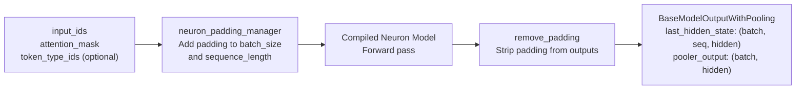
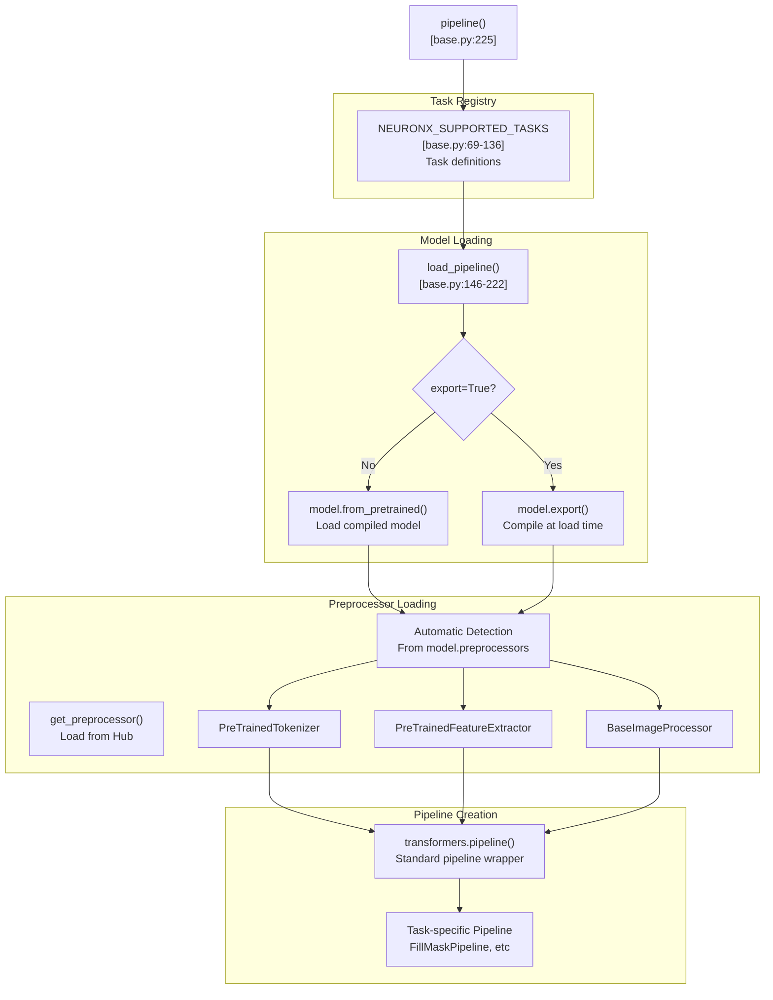
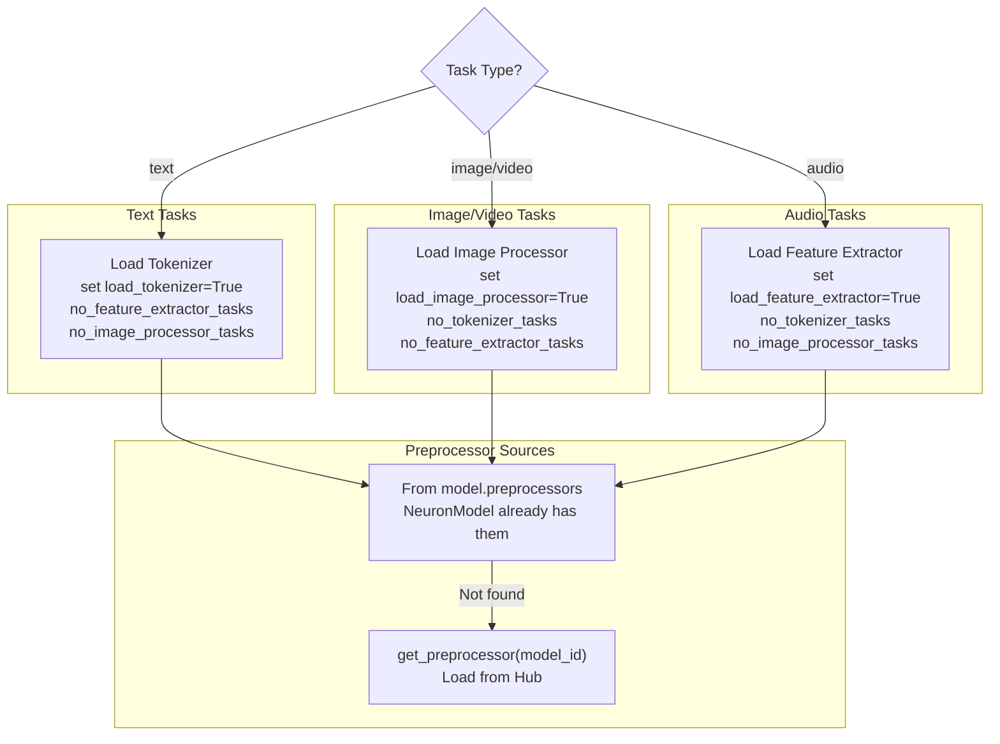
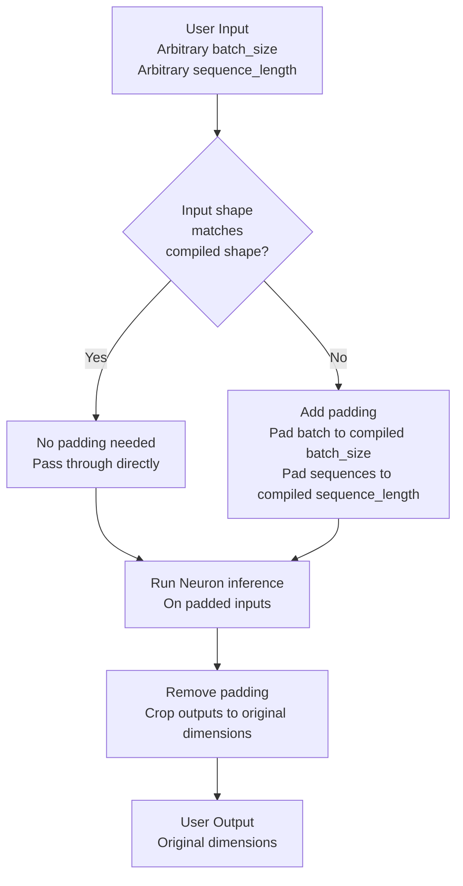

<!-- source: DeepWiki mcp.deepwiki.com · repo huggingface/optimum-neuron · page 6.4 Encoder Models and Task Pipelines · fetched 2026-10-26 -->

# Encoder Models and Task Pipelines

<details>
<summary>Relevant source files</summary>

The following files were used as context for generating this wiki page:

- [optimum/neuron/__init__.py](optimum/neuron/__init__.py)
- [optimum/neuron/modeling.py](optimum/neuron/modeling.py)
- [optimum/neuron/modeling_base.py](optimum/neuron/modeling_base.py)
- [optimum/neuron/pipelines/transformers/base.py](optimum/neuron/pipelines/transformers/base.py)
- [optimum/neuron/utils/__init__.py](optimum/neuron/utils/__init__.py)
- [tests/pipelines/conftest.py](tests/pipelines/conftest.py)
- [tests/pipelines/test_encoder_pipelines.py](tests/pipelines/test_encoder_pipelines.py)

</details>


## Purpose and Scope

This page documents encoder model inference on AWS Neuron devices through both direct model classes and the high-level `pipeline()` API. Encoder models process fixed-size inputs bidirectionally (unlike causal language models covered in page 6.2). Key topics include:

- Text encoder models: feature extraction, classification, question answering, masked language modeling
- Vision models: image classification, segmentation, object detection
- Audio models: classification, speech recognition, speaker verification  
- The `pipeline()` function from [optimum/neuron/pipelines/transformers/base.py:225-405]() for unified task-based inference
- Automatic model export, preprocessor loading, and padding management

For diffusion models, see page 6.5. For causal language models and text generation, see page 6.2.

---

## Architecture Overview

All encoder models inherit from `NeuronTracedModel`, which extends the base `NeuronModel` class. These models wrap pre-compiled Neuron graphs and handle input padding/unpadding, device management, and output formatting. Unlike decoder models, encoder models process fixed-size inputs and do not support autoregressive generation.

```mermaid
graph TB
    NeuronModel["NeuronModel<br/>(modeling_base.py:28)"]
    NeuronTracedModel["NeuronTracedModel<br/>(modeling_traced.py)<br/>Compiled model wrapper<br/>Padding management"]
    
    subgraph "NLP Models"
        FeatureExtraction["NeuronModelForFeatureExtraction<br/>BaseModelOutputWithPooling"]
        MaskedLM["NeuronModelForMaskedLM<br/>MaskedLMOutput"]
        QA["NeuronModelForQuestionAnswering<br/>QuestionAnsweringModelOutput"]
        SeqClass["NeuronModelForSequenceClassification<br/>SequenceClassifierOutput"]
        TokenClass["NeuronModelForTokenClassification<br/>TokenClassifierOutput"]
        MultipleChoice["NeuronModelForMultipleChoice<br/>MultipleChoiceModelOutput"]
        SentenceTransformers["NeuronModelForSentenceTransformers<br/>ModelOutput"]
    end
    
    subgraph "Vision Models"
        ImageClass["NeuronModelForImageClassification<br/>ImageClassifierOutput"]
        SemanticSeg["NeuronModelForSemanticSegmentation<br/>SemanticSegmenterOutput"]
        ObjectDet["NeuronModelForObjectDetection<br/>ModelOutput"]
    end
    
    subgraph "Audio Models"
        AudioClass["NeuronModelForAudioClassification<br/>SequenceClassifierOutput"]
        CTC["NeuronModelForCTC<br/>CausalLMOutput"]
        XVector["NeuronModelForXVector<br/>XVectorOutput"]
        AudioFrame["NeuronModelForAudioFrameClassification<br/>TokenClassifierOutput"]
    end
    
    NeuronModel --> NeuronTracedModel
    
    NeuronTracedModel --> FeatureExtraction
    NeuronTracedModel --> MaskedLM
    NeuronTracedModel --> QA
    NeuronTracedModel --> SeqClass
    NeuronTracedModel --> TokenClass
    NeuronTracedModel --> MultipleChoice
    NeuronTracedModel --> SentenceTransformers
    
    NeuronTracedModel --> ImageClass
    NeuronTracedModel --> SemanticSeg
    NeuronTracedModel --> ObjectDet
    
    NeuronTracedModel --> AudioClass
    NeuronTracedModel --> CTC
    NeuronTracedModel --> XVector
    NeuronTracedModel --> AudioFrame
```



**Sources:** [optimum/neuron/modeling_base.py:28-44](), [optimum/neuron/modeling.py:86-744]()

---

## Model Class Reference by Modality

The following table summarizes all available encoder model classes, their corresponding Transformers auto-classes, and typical use cases:

| Model Class | Auto Model Class | Input Type | Output Type | Use Cases |
|------------|-----------------|------------|-------------|-----------|
| `NeuronModelForFeatureExtraction` | `AutoModel` | Text | `BaseModelOutputWithPooling` | Embeddings, transfer learning |
| `NeuronModelForSentenceTransformers` | `AutoModel` | Text/Image | `ModelOutput` | Semantic search, similarity |
| `NeuronModelForMaskedLM` | `AutoModelForMaskedLM` | Text | `MaskedLMOutput` | Fill-mask tasks |
| `NeuronModelForQuestionAnswering` | `AutoModelForQuestionAnswering` | Text | `QuestionAnsweringModelOutput` | SQuAD, extractive QA |
| `NeuronModelForSequenceClassification` | `AutoModelForSequenceClassification` | Text | `SequenceClassifierOutput` | Sentiment, GLUE tasks |
| `NeuronModelForTokenClassification` | `AutoModelForTokenClassification` | Text | `TokenClassifierOutput` | NER, POS tagging |
| `NeuronModelForMultipleChoice` | `AutoModelForMultipleChoice` | Text | `MultipleChoiceModelOutput` | SWAG, RocStories |
| `NeuronModelForImageClassification` | `AutoModelForImageClassification` | Image | `ImageClassifierOutput` | ImageNet classification |
| `NeuronModelForSemanticSegmentation` | `AutoModelForSemanticSegmentation` | Image | `SemanticSegmenterOutput` | Pixel-level segmentation |
| `NeuronModelForObjectDetection` | `AutoModelForObjectDetection` | Image | `ModelOutput` | COCO detection |
| `NeuronModelForAudioClassification` | `AutoModelForAudioClassification` | Audio | `SequenceClassifierOutput` | Keyword spotting |
| `NeuronModelForAudioFrameClassification` | `AutoModelForAudioFrameClassification` | Audio | `TokenClassifierOutput` | Speaker diarization |
| `NeuronModelForCTC` | `AutoModelForCTC` | Audio | `CausalLMOutput` | Speech recognition |
| `NeuronModelForXVector` | `AutoModelForAudioXVector` | Audio | `XVectorOutput` | Speaker verification |

**Sources:** [optimum/neuron/modeling.py:97-744](), [optimum/neuron/__init__.py:43-58]()

---

## Loading and Using Encoder Models

### From Pre-compiled Models

Load a pre-compiled Neuron model from the Hugging Face Hub or a local directory:

```python
from optimum.neuron import NeuronModelForSequenceClassification

# Load from Hub
model = NeuronModelForSequenceClassification.from_pretrained(
    "optimum/distilbert-base-uncased-finetuned-sst-2-english-neuronx"
)

# Load from local directory
model = NeuronModelForSequenceClassification.from_pretrained("./my_neuron_model")
```

### Exporting at Load Time

Compile a standard Transformers model to Neuron format during loading:

```python
model = NeuronModelForSequenceClassification.from_pretrained(
    "distilbert-base-uncased-finetuned-sst-2",
    export=True,
    batch_size=1,
    sequence_length=128
)

# Save for reuse
model.save_pretrained("./distilbert_neuron")
```

**Sources:** [optimum/neuron/modeling.py:92-438]()

---

## NLP Encoder Models

### Feature Extraction

`NeuronModelForFeatureExtraction` extracts embeddings from text inputs. It returns both token-level embeddings (`last_hidden_state`) and optional pooled sentence embeddings (`pooler_output`).



**Input Requirements:**
- `input_ids`: Token IDs, shape `(batch_size, sequence_length)`
- `attention_mask`: Attention mask, shape `(batch_size, sequence_length)`
- `token_type_ids` (optional): Segment IDs for BERT-style models

**Output:**
- `last_hidden_state`: Token embeddings, shape `(batch_size, sequence_length, hidden_size)`
- `pooler_output`: Sentence embedding (if available), shape `(batch_size, hidden_size)`

**Sources:** [optimum/neuron/modeling.py:92-136]()

### Masked Language Modeling

`NeuronModelForMaskedLM` predicts masked tokens in sequences, useful for fill-mask tasks:

**Input:** Text with `[MASK]` tokens  
**Output:** `MaskedLMOutput` with logits over vocabulary for each position  
**Shape:** `(batch_size, sequence_length, vocab_size)`

**Sources:** [optimum/neuron/modeling.py:210-248]()

### Question Answering

`NeuronModelForQuestionAnswering` performs extractive question answering by predicting start and end positions of answers in context:

**Input:** Question + context text  
**Output:** `QuestionAnsweringModelOutput` with:
- `start_logits`: Start position scores, shape `(batch_size, sequence_length)`
- `end_logits`: End position scores, shape `(batch_size, sequence_length)`

**Sources:** [optimum/neuron/modeling.py:256-294]()

### Sequence Classification

`NeuronModelForSequenceClassification` classifies entire sequences (e.g., sentiment analysis):

**Input:** Text sequence  
**Output:** `SequenceClassifierOutput` with logits over classes, shape `(batch_size, num_labels)`

**Sources:** [optimum/neuron/modeling.py:304-342]()

### Token Classification

`NeuronModelForTokenClassification` classifies each token in a sequence (e.g., Named Entity Recognition):

**Input:** Text sequence  
**Output:** `TokenClassifierOutput` with per-token logits, shape `(batch_size, sequence_length, num_labels)`

**Sources:** [optimum/neuron/modeling.py:351-390]()

### Multiple Choice

`NeuronModelForMultipleChoice` selects the best option from multiple text choices:

**Input:** Multiple choice options with shape `(batch_size, num_choices, sequence_length)`  
**Output:** `MultipleChoiceModelOutput` with logits per choice, shape `(batch_size, num_choices)`

**Sources:** [optimum/neuron/modeling.py:399-438]()

### Sentence Transformers

`NeuronModelForSentenceTransformers` supports sentence-transformers library models for semantic search and similarity tasks. It handles both text-only and CLIP-style text+image models:

**Text-only models:**
- Input: `input_ids`, `attention_mask`
- Output: `token_embeddings` (batch, seq, hidden), `sentence_embedding` (batch, hidden)

**CLIP models:**
- Input: `input_ids`, `pixel_values`, `attention_mask`
- Output: `text_embeds` (batch, hidden), `image_embeds` (batch, hidden)

**Sources:** [optimum/neuron/modeling.py:144-202]()

---

## Vision Models

### Image Classification

`NeuronModelForImageClassification` classifies images into predefined categories. Supports architectures like ViT, BEiT, ConvNeXT, MobileNet, etc.

**Input:** `pixel_values` with shape `(batch_size, num_channels, height, width)`  
**Output:** `ImageClassifierOutput` with logits, shape `(batch_size, num_labels)`

The model includes a `dtype` property that returns the input dtype (default `torch.float32`) to avoid casting errors in Transformers pipelines.

**Sources:** [optimum/neuron/modeling.py:446-485]()

### Semantic Segmentation

`NeuronModelForSemanticSegmentation` performs pixel-level classification for tasks like scene parsing:

**Input:** `pixel_values` with shape `(batch_size, num_channels, height, width)`  
**Output:** `SemanticSegmenterOutput` with per-pixel logits, shape `(batch_size, num_labels, height, width)`

**Sources:** [optimum/neuron/modeling.py:493-532]()

### Object Detection

`NeuronModelForObjectDetection` detects and localizes objects in images:

**Input:** `pixel_values` with shape `(batch_size, num_channels, height, width)`  
**Output:** `ModelOutput` containing:
- `logits`: Object class predictions
- `pred_boxes`: Bounding box coordinates
- `last_hidden_state`: Feature representations

**Sources:** [optimum/neuron/modeling.py:540-581]()

---

## Audio Models

### Audio Classification

`NeuronModelForAudioClassification` classifies audio sequences (e.g., keyword spotting):

**Input:** `input_values` with shape `(batch_size, sequence_length)`  
**Output:** `SequenceClassifierOutput` with logits, shape `(batch_size, num_labels)`

**Sources:** [optimum/neuron/modeling.py:589-622]()

### Connectionist Temporal Classification (CTC)

`NeuronModelForCTC` performs speech recognition using CTC loss:

**Input:** `input_values` with shape `(batch_size, sequence_length)`  
**Output:** `CausalLMOutput` with logits over vocabulary, shape `(batch_size, sequence_length, vocab_size)`

The `main_input_name` is set to `"input_values"` for audio inputs.

**Sources:** [optimum/neuron/modeling.py:670-703]()

### XVector for Speaker Verification

`NeuronModelForXVector` extracts speaker embeddings for verification tasks:

**Input:** `input_values` with shape `(batch_size, sequence_length)`  
**Output:** `XVectorOutput` containing:
- `logits`: Speaker classification scores
- `embeddings`: Speaker embedding vectors

**Sources:** [optimum/neuron/modeling.py:711-744]()

### Audio Frame Classification

`NeuronModelForAudioFrameClassification` classifies audio at the frame level (e.g., speaker diarization):

**Input:** `input_values` with shape `(batch_size, sequence_length)`  
**Output:** `TokenClassifierOutput` with per-frame logits

**Sources:** [optimum/neuron/modeling.py:630-662]()

---

## Pipeline Integration

The `pipeline()` function provides a unified Transformers-compatible interface for all encoder models, handling model loading, export, preprocessor selection, and device management automatically.

### Task Configuration System

All supported tasks are defined in the `NEURONX_SUPPORTED_TASKS` dictionary in [optimum/neuron/pipelines/transformers/base.py:69-136](). Each task specifies:

- `impl`: Pipeline implementation class (from `transformers.pipelines`)
- `class`: Tuple of compatible `NeuronModelForXXX` classes  
- `default`: Default model ID if none provided
- `type`: Input modality (`"text"`, `"image"`, `"audio"`)



**Supported Encoder Tasks:**

| Task | Pipeline Name | Model Class | Implementation | Input Type |
|------|--------------|-------------|----------------|------------|
| Feature Extraction | `"feature-extraction"` | `NeuronModelForFeatureExtraction` | `FeatureExtractionPipeline` | text |
| Fill Mask | `"fill-mask"` | `NeuronModelForMaskedLM` | `FillMaskPipeline` | text |
| Question Answering | `"question-answering"` | `NeuronModelForQuestionAnswering` | `QuestionAnsweringPipeline` | text |
| Text Classification | `"text-classification"` | `NeuronModelForSequenceClassification` | `TextClassificationPipeline` | text |
| Token Classification | `"token-classification"` | `NeuronModelForTokenClassification` | `TokenClassificationPipeline` | text |
| Image Classification | `"image-classification"` | `NeuronModelForImageClassification` | `ImageClassificationPipeline` | image |
| Image Segmentation | `"image-segmentation"` | `NeuronModelForSemanticSegmentation` | `ImageSegmentationPipeline` | image |
| Object Detection | `"object-detection"` | `NeuronModelForObjectDetection` | `ObjectDetectionPipeline` | image |
| Audio Classification | `"audio-classification"` | `NeuronModelForAudioClassification` | `AudioClassificationPipeline` | audio |
| ASR | `"automatic-speech-recognition"` | `NeuronModelForCTC` | `AutomaticSpeechRecognitionPipeline` | audio |

**Sources:** [optimum/neuron/pipelines/transformers/base.py:69-136]()

### Preprocessor Loading Strategy

The pipeline automatically loads appropriate preprocessors based on task type:



**Implementation Details:**

1. **Task-based routing** [optimum/neuron/pipelines/transformers/base.py:308-342](): Determine which preprocessor types to load based on task modality
2. **Automatic detection** [optimum/neuron/pipelines/transformers/base.py:188-215](): If model is already a `NeuronModel`, extract preprocessors from `model.preprocessors` list
3. **Hub fallback** [optimum/neuron/pipelines/transformers/base.py:362-367](): Use `transformers.onnx.utils.get_preprocessor()` if not found

**Sources:** [optimum/neuron/pipelines/transformers/base.py:188-215](), [optimum/neuron/pipelines/transformers/base.py:308-367]()

### Batch Size Inference

When `batch_size` is not specified, the pipeline infers it from the model's `NeuronConfig`:

```python
# From optimum/neuron/pipelines/transformers/base.py:369-383
if batch_size is None:
    neuron_config = (
        getattr(config, "neuron", None)
        or getattr(model.config, "neuron", None)
        or getattr(model, "neuron_config", None)
    )
    if isinstance(neuron_config, NeuronConfig):
        batch_size = neuron_config.batch_size
    elif isinstance(neuron_config, dict):
        for attr in ["batch_size", "static_batch_size"]:
            batch_size = neuron_config.get(attr, batch_size)
    else:
        batch_size = 1
```

This ensures the pipeline batches inputs according to the compiled model's static batch size.

**Sources:** [optimum/neuron/pipelines/transformers/base.py:369-383]()

### Export During Pipeline Creation

Models can be exported to Neuron format during pipeline creation:

```python
from optimum.neuron import pipeline

# Export with explicit input shapes
classifier = pipeline(
    "text-classification",
    model="distilbert-base-uncased-finetuned-sst-2",
    export=True,
    batch_size=1,
    sequence_length=128
)

# Export for decoder models (uses defaults from config)
generator = pipeline(
    "text-generation",
    model="Qwen/Qwen2.5-0.5B-Instruct",
    export=True,
    batch_size=1,
    sequence_length=128,
    tensor_parallel_size=2
)
```

**Export Logic** [optimum/neuron/pipelines/transformers/base.py:281-301]():

1. For non-decoder tasks: require explicit `input_shapes` or use defaults `{"batch_size": 1, "sequence_length": 128}`
2. For `text-generation`: `batch_size`, `sequence_length`, and `tensor_parallel_size` are passed as `export_kwargs` to model export
3. If model already has `neuron` config, export is rejected

**Sources:** [optimum/neuron/pipelines/transformers/base.py:281-301]()

### Pipeline Usage Examples

**Text Classification:**
```python
from optimum.neuron import pipeline

# From pre-compiled model
classifier = pipeline(
    "text-classification",
    model="optimum/distilbert-base-uncased-finetuned-sst-2-english-neuronx"
)
result = classifier("I love using Neuron accelerators!")
# [{'label': 'POSITIVE', 'score': 0.9998}]

# With export
classifier = pipeline(
    "text-classification",
    model="distilbert-base-uncased-finetuned-sst-2",
    export=True,
    batch_size=4,  # Batch multiple inputs
    sequence_length=128
)
results = classifier([
    "Great product!",
    "Terrible experience.",
    "It's okay.",
    "Absolutely wonderful!"
])
```

**Feature Extraction:**
```python
# Standard feature extraction
extractor = pipeline(
    "feature-extraction",
    model="optimum/all-MiniLM-L6-v2-neuronx"
)
embeddings = extractor("Sample text for embedding")

# Sentence Transformers are automatically detected
# See optimum/neuron/pipelines/transformers/base.py:170-174
sentence_transformer = pipeline(
    "feature-extraction",
    model="sentence-transformers/all-MiniLM-L6-v2",
    export=True
)
```

**Question Answering:**
```python
qa = pipeline(
    "question-answering",
    model="optimum/roberta-base-squad2-neuronx"
)
answer = qa(
    question="What is AWS Neuron?",
    context="AWS Neuron is an SDK for machine learning inference on AWS Inferentia chips."
)
# {'score': 0.95, 'start': 14, 'end': 78, 'answer': 'an SDK for machine learning inference on AWS Inferentia chips'}
```

**Token Classification (NER):**
```python
ner = pipeline(
    "token-classification",
    model="optimum/bert-base-NER-neuronx",
    aggregation_strategy="simple"
)
entities = ner("Hugging Face is based in New York City.")
# [{'entity_group': 'ORG', 'word': 'Hugging Face', ...},
#  {'entity_group': 'LOC', 'word': 'New York City', ...}]
```

**Image Classification:**
```python
image_classifier = pipeline(
    "image-classification",
    model="optimum/vit-base-patch16-224-neuronx"
)
from PIL import Image
result = image_classifier(Image.open("cat.jpg"))
# [{'label': 'tabby cat', 'score': 0.89}, ...]
```

**Audio Classification:**
```python
audio_classifier = pipeline(
    "audio-classification",
    model="Jingya/wav2vec2-large-960h-lv60-self-neuronx-audio-classification"
)
result = audio_classifier("audio.wav")
# [{'label': 'speech', 'score': 0.95}]
```

**Sources:** [optimum/neuron/pipelines/transformers/base.py:225-405](), [tests/pipelines/test_encoder_pipelines.py:6-10]()

---

## Common Patterns

### Padding Management

All encoder models use the `neuron_padding_manager` context manager to handle static shape requirements:



**Implementation Pattern (from all encoder forward methods):**

1. Create input dictionary with required tensors
2. Enter `self.neuron_padding_manager(neuron_inputs)` context
3. Call compiled model with padded inputs
4. Call `self.remove_padding()` with original dimensions
5. Return formatted output

**Example from NeuronModelForSequenceClassification:**

```python
# Lines 326-341 from modeling.py
neuron_inputs = {
    "input_ids": input_ids,
    "attention_mask": attention_mask,
}
if token_type_ids is not None:
    neuron_inputs["token_type_ids"] = token_type_ids

with self.neuron_padding_manager(neuron_inputs) as inputs:
    outputs = self.model(*inputs)  # shape: [batch_size, num_labels]
    outputs = self.remove_padding(
        outputs, dims=[0], indices=[input_ids.shape[0]]
    )  # Remove padding on batch_size(0)

logits = outputs[0]
return SequenceClassifierOutput(logits=logits)
```

**Sources:** [optimum/neuron/modeling.py:114-122](), [optimum/neuron/modeling.py:232-243](), [optimum/neuron/modeling.py:326-341]()

### Input Shape Requirements

Encoder models are compiled for specific input shapes specified during export:

- **Text models:** `batch_size`, `sequence_length`
- **Vision models:** `batch_size`, `num_channels`, `height`, `width`
- **Audio models:** `batch_size`, `sequence_length`

Dynamic batch sizes can be enabled during export for some models, allowing variable batch sizes up to the maximum compiled batch size.

**Sources:** [tests/inference/inference_utils.py:111](), [tests/inference/inference_utils.py:143-147]()

### Output Dimension Handling

Each model removes padding from specific dimensions based on its output structure:

| Model Type | Padding Removal Dimensions | Example |
|-----------|---------------------------|---------|
| Feature Extraction | `[0, 1]` (batch, sequence) | Token embeddings |
| Sequence Classification | `[0]` (batch only) | Single score per sequence |
| Token Classification | `[0, 1]` (batch, sequence) | Per-token predictions |
| Multiple Choice | `[0, -1]` (batch, num_choices) | Choice scores |
| Image Classification | `[0]` (batch only) | Class scores |

**Sources:** [optimum/neuron/modeling.py:123-135](), [optimum/neuron/modeling.py:241-243](), [optimum/neuron/modeling.py:335-337]()

---

## Testing Encoder Pipelines

The test infrastructure validates encoder model integration with the pipeline API:

```python
# From tests/pipelines/test_encoder_pipelines.py
@is_inferentia_test
def test_export_no_parameters(std_text_task, inf_encoder_model):
    p = pipeline(std_text_task, inf_encoder_model, export=True)
    assert p.task == std_text_task
    assert isinstance(p.model, NeuronTracedModel)
```

Tests verify that:
1. Models can be exported through the pipeline interface
2. The correct task is assigned
3. The resulting model is a `NeuronTracedModel` instance

**Sources:** [tests/pipelines/test_encoder_pipelines.py:1-11](), [tests/pipelines/conftest.py:19-30]()

---

