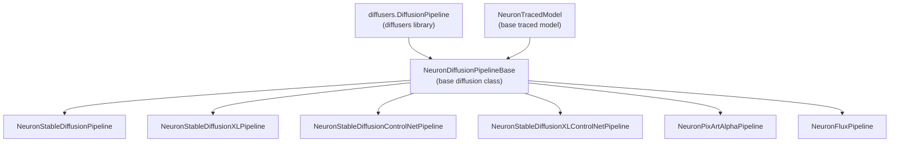
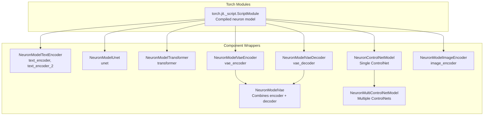
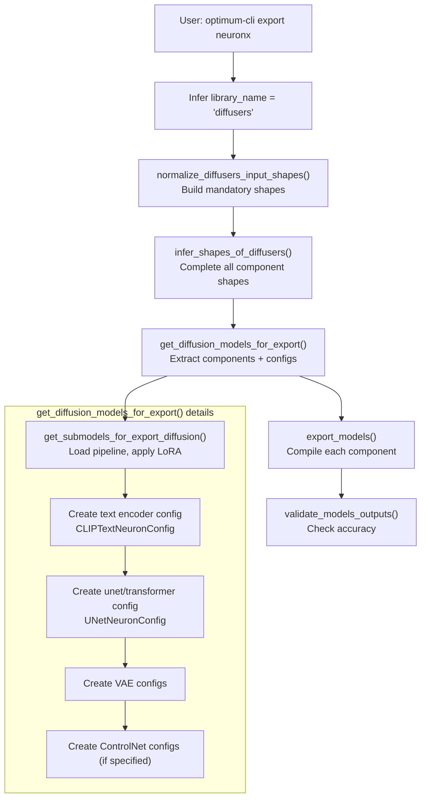

<!-- source: DeepWiki mcp.deepwiki.com · repo huggingface/optimum-neuron · page 6.5 Diffusion Pipelines · fetched 2026-10-26 -->

# Diffusion Pipelines

<details>
<summary>Relevant source files</summary>

The following files were used as context for generating this wiki page:

- [optimum/neuron/__init__.py](optimum/neuron/__init__.py)
- [optimum/neuron/modeling.py](optimum/neuron/modeling.py)
- [optimum/neuron/modeling_base.py](optimum/neuron/modeling_base.py)
- [optimum/neuron/pipelines/transformers/base.py](optimum/neuron/pipelines/transformers/base.py)
- [optimum/neuron/utils/__init__.py](optimum/neuron/utils/__init__.py)

</details>


This document covers the **NeuronDiffusionPipelineBase** system and its pipeline variants for executing diffusion models (Stable Diffusion, SDXL, PixArt, Flux) on AWS Neuron devices. The system provides pre-compiled TorchScript modules for image generation tasks.

For text generation models, see [Causal Language Models](#6.2). For general inference model classes, see [Model Class Reference](#6.1).

---

## Purpose and Scope

The diffusion pipeline system enables deployment of image generation models on Inferentia2 hardware by:

1. Compiling individual pipeline components (text encoders, UNet/Transformer, VAE) into Neuron-optimized modules
2. Managing multi-component model loading and execution
3. Supporting advanced features like ControlNet, LoRA adapters, and IP-Adapters
4. Providing a `diffusers`-compatible API for seamless integration

The system is designed for **inference only** and does not support training diffusion models.

---

## Architecture Overview

### Class Hierarchy



**Sources:** [optimum/neuron/modeling_diffusion.py:123-141](), [optimum/neuron/__init__.py:59-76]()

### Component Architecture

The diffusion pipeline is decomposed into independently compiled components:

| Component | Purpose | File Name Constant | Config Class |
|-----------|---------|-------------------|--------------|
| Text Encoder | Encode text prompts to embeddings | `DIFFUSION_MODEL_TEXT_ENCODER_NAME` | `CLIPTextNeuronConfig` |
| Text Encoder 2 | Second text encoder (SDXL only) | `DIFFUSION_MODEL_TEXT_ENCODER_2_NAME` | `CLIPTextWithProjectionNeuronConfig` |
| UNet | Denoising network (SD/SDXL) | `DIFFUSION_MODEL_UNET_NAME` | `UNetNeuronConfig` |
| Transformer | Denoising transformer (PixArt/Flux) | `DIFFUSION_MODEL_TRANSFORMER_NAME` | `PixartTransformerNeuronConfig`, `FluxTransformerNeuronConfig` |
| VAE Encoder | Encode images to latents | `DIFFUSION_MODEL_VAE_ENCODER_NAME` | Auto-configured |
| VAE Decoder | Decode latents to images | `DIFFUSION_MODEL_VAE_DECODER_NAME` | Auto-configured |
| ControlNet | Conditional control (optional) | `DIFFUSION_MODEL_CONTROLNET_NAME` | Auto-configured |
| Image Encoder | Encode images for IP-Adapter (optional) | `DIFFUSION_MODEL_IMAGE_ENCODER_NAME` | `CLIPVisionWithProjectionNeuronConfig` |

**Sources:** [optimum/neuron/utils/__init__.py:31-44](), [optimum/exporters/neuron/model_configs.py:650-854]()

---

## Component Models

Each pipeline component is wrapped in a specialized model class that manages Neuron-specific functionality:



### Key Component Classes

**NeuronModelTextEncoder** [optimum/neuron/modeling_diffusion.py:1366-1445]()
- Wraps CLIP text encoder models
- Manages batched text encoding with attention masks
- Returns `last_hidden_state` and `pooler_output` tensors

**NeuronModelUnet** [optimum/neuron/modeling_diffusion.py:1501-1710]()
- Implements the denoising UNet for Stable Diffusion
- Handles conditional inputs: `sample`, `timestep`, `encoder_hidden_states`
- Supports SDXL additional embeddings (`text_embeds`, `time_ids`)
- Integrates with ControlNet and IP-Adapter outputs

**NeuronModelTransformer** [optimum/neuron/modeling_diffusion.py:1713-1878]()
- Implements diffusion transformer (PixArt, Flux)
- Handles transformer-specific inputs like `pooled_projections` (Flux)
- Uses rotary position embeddings computed on CPU

**NeuronModelVae** [optimum/neuron/modeling_diffusion.py:1881-1967]()
- Combines encoder and decoder into unified interface
- Implements `encode()` and `decode()` methods matching `diffusers` API
- Returns `AutoencoderKLOutput` and `DecoderOutput` objects

**Sources:** [optimum/neuron/modeling_diffusion.py:1366-1967]()

---

## Pipeline Variants

### Available Pipeline Classes

| Pipeline Class | Base Diffusers Class | Primary Use Case |
|----------------|---------------------|------------------|
| `NeuronStableDiffusionPipeline` | `StableDiffusionPipeline` | Text-to-image (SD 1.x/2.x) |
| `NeuronStableDiffusionImg2ImgPipeline` | `StableDiffusionImg2ImgPipeline` | Image-to-image |
| `NeuronStableDiffusionInpaintPipeline` | `StableDiffusionInpaintPipeline` | Image inpainting |
| `NeuronStableDiffusionInstructPix2PixPipeline` | `StableDiffusionInstructPix2PixPipeline` | Instruction-based editing |
| `NeuronLatentConsistencyModelPipeline` | `LatentConsistencyModelPipeline` | Fast generation with LCM |
| `NeuronStableDiffusionXLPipeline` | `StableDiffusionXLPipeline` | Text-to-image (SDXL) |
| `NeuronStableDiffusionXLImg2ImgPipeline` | `StableDiffusionXLImg2ImgPipeline` | SDXL image-to-image |
| `NeuronStableDiffusionXLInpaintPipeline` | `StableDiffusionXLInpaintPipeline` | SDXL inpainting |
| `NeuronStableDiffusionControlNetPipeline` | `StableDiffusionControlNetPipeline` | SD with ControlNet |
| `NeuronStableDiffusionXLControlNetPipeline` | `StableDiffusionXLControlNetPipeline` | SDXL with ControlNet |
| `NeuronPixArtAlphaPipeline` | `PixArtAlphaPipeline` | PixArt-α model |
| `NeuronPixArtSigmaPipeline` | `PixArtSigmaPipeline` | PixArt-Σ model |
| `NeuronFluxPipeline` | `FluxPipeline` | Flux.1 text-to-image |
| `NeuronFluxKontextPipeline` | `FluxKontextPipeline` | Flux with context |
| `NeuronFluxInpaintPipeline` | `FluxInpaintPipeline` | Flux inpainting |

**Sources:** [optimum/neuron/__init__.py:59-76](), [optimum/neuron/modeling_diffusion.py:76-94]()

### Pipeline Initialization

All pipelines are initialized through `NeuronDiffusionPipelineBase.__init__()` [optimum/neuron/modeling_diffusion.py:143-363]():

```python
def __init__(
    self,
    config: dict[str, Any],              # model_index.json contents
    configs: dict[str, PretrainedConfig],  # Component configs
    neuron_configs: dict[str, NeuronDefaultConfig],  # Compilation configs
    data_parallel_mode: Literal["none", "unet", "transformer", "all"],
    scheduler: SchedulerMixin,
    vae_decoder: torch.jit._script.ScriptModule,
    text_encoder: torch.jit._script.ScriptModule | None = None,
    text_encoder_2: torch.jit._script.ScriptModule | None = None,
    unet: torch.jit._script.ScriptModule | None = None,
    transformer: torch.jit._script.ScriptModule | None = None,
    # ... additional components
)
```

The initialization:
1. Wraps raw TorchScript modules in component classes (e.g., `NeuronModelUnet`)
2. Detects LCM schedulers and replaces standard scheduler if needed
3. Configures data parallel mode for multi-core execution
4. Creates dummy IP-Adapter projection layers if needed
5. Initializes image processors and tokenizers

**Sources:** [optimum/neuron/modeling_diffusion.py:143-388]()

---

## Export Process

### Export Entry Point

Diffusion model export is triggered through [optimum/exporters/neuron/__main__.py:814-871]():

```python
library_name = TasksManager.infer_library_from_model(args.model)
if library_name == "diffusers":
    input_shapes = normalize_diffusers_input_shapes(args)
    # ... export via main_export()
```

### Component Export Flow



**Sources:** [optimum/exporters/neuron/__main__.py:419-502](), [optimum/exporters/neuron/utils.py:123-347]()

### Shape Inference

The system automatically infers missing shape parameters:

**normalize_diffusers_input_shapes()** [optimum/exporters/neuron/__main__.py:195-216]()
- Takes user-provided `batch_size`, `height`, `width`, `num_images_per_prompt`
- Builds initial shape dictionaries for each component

**infer_shapes_of_diffusers()** [optimum/exporters/neuron/__main__.py:219-308]()
- Completes missing dimensions from model config:
  - `vae_scale_factor = 2 ** (len(vae.config.block_out_channels) - 1)`
  - `max_sequence_length` from tokenizer
  - `unet_num_channels = unet.config.in_channels`
  - Scaled latent dimensions: `scaled_height = height // vae_scale_factor`
- Adds ControlNet, image encoder shapes if needed
- Returns complete `InputShapesArguments` for each component

**Sources:** [optimum/exporters/neuron/__main__.py:195-308]()

### Component Compilation

Each component is compiled independently via [optimum/exporters/neuron/convert.py:294-441]():

1. **Prepare dummy inputs:** `config.generate_dummy_inputs()` creates tensors matching static shapes
2. **Patch model:** `config.patch_model_and_prepare_aliases()` applies Neuron-specific optimizations
3. **Trace:** `trace_neuronx()` compiles with compiler flags (optlevel, auto_cast, etc.)
4. **Save:** Compiled `.neuron` file + `config.json` saved to output directory
5. **Cache:** Upload to Hub cache if enabled

For UNet/Transformer, special optimizations are applied:
- Custom softmax fusion: `os.environ["NEURON_FUSE_SOFTMAX"] = "1"`
- Custom SILU activation: `os.environ["NEURON_CUSTOM_SILU"] = "1"`

**Sources:** [optimum/exporters/neuron/convert.py:294-441](), [optimum/exporters/neuron/__main__.py:336-338]()

---

## Configuration System

### Component Configuration Classes

Each component type has a dedicated configuration class:

**UNetNeuronConfig** [optimum/exporters/neuron/model_configs.py:650-753]()
```python
INPUT_ARGS = ("batch_size", "sequence_length", "num_channels", 
              "width", "height", "vae_scale_factor")
CUSTOM_MODEL_WRAPPER = UnetNeuronWrapper
NORMALIZED_CONFIG_CLASS = NormalizedConfig.with_args(
    height="height", width="width", num_channels="in_channels",
    hidden_size="cross_attention_dim", vocab_size="norm_num_groups"
)
```

Key properties:
- `is_sdxl`: Boolean flag for SDXL-specific handling
- `with_controlnet`: Enable ControlNet integration
- `with_ip_adapter`: Enable IP-Adapter integration
- Custom input generation for complex inputs (e.g., `added_cond_kwargs`)

**FluxTransformerNeuronConfig** [optimum/exporters/neuron/model_configs.py:796-885]()
```python
INPUT_ARGS = ("batch_size", "sequence_length", "num_channels",
              "width", "height", "vae_scale_factor", 
              "encoder_hidden_size", "rotary_axes_dim")
```
- Computes rotary embeddings on CPU to save Neuron memory
- Handles joint attention dimensions and pooled projections

**PixartTransformerNeuronConfig** [optimum/exporters/neuron/model_configs.py:755-794]()
```python
INPUT_ARGS = ("batch_size", "sequence_length", "num_channels",
              "width", "height", "vae_scale_factor", "encoder_hidden_size")
```

**Sources:** [optimum/exporters/neuron/model_configs.py:650-885]()

### Dynamic Input Shapes

The `dynamic_batch_size` parameter enables variable batch sizes at inference:

```python
neuron_config = UNetNeuronConfig(
    config, 
    dynamic_batch_size=True,  # Allows batch_size to be multiple of compile-time value
    input_shapes=InputShapesArguments(batch_size=1, ...)
)
```

When enabled:
- Batch size can be any multiple of the compiled batch size
- Slight latency tradeoff vs. static compilation
- Implemented via `NeuronDefaultConfig` [optimum/exporters/neuron/base.py:165-173]()

**Sources:** [optimum/exporters/neuron/base.py:144-223](), [optimum/neuron/modeling_diffusion.py:231-233]()

---

## Data Parallelism

The `data_parallel_mode` parameter controls multi-core execution:

| Mode | Components on Both Cores | Use Case |
|------|-------------------------|----------|
| `"none"` | None | Single-core inference |
| `"unet"` | UNet only | Maximize UNet throughput |
| `"transformer"` | Transformer only | Maximize transformer throughput |
| `"all"` | All components | Maximize overall throughput |

### Implementation

**Model Loading** [optimum/neuron/modeling_diffusion.py:396-502]()
```python
@staticmethod
def load_model(
    data_parallel_mode: Literal["none", "unet", "transformer", "all"],
    tensor_parallel_size: int,
    unet_path: str | Path | None = None,
    # ... other paths
):
    # Load models with data parallelism
    if data_parallel_mode in ["unet", "all"]:
        unet = [torch.jit.load(unet_path), torch.jit.load(unet_path)]
    else:
        unet = torch.jit.load(unet_path)
```

**Runtime Execution** [optimum/neuron/modeling_diffusion.py:1613-1654]()
- If data parallel list detected, iterate through both cores
- Aggregate outputs from both executions

**Limitations:**
- Only applies to single-device inference
- Tensor parallelism (`tensor_parallel_size > 1`) takes precedence

**Sources:** [optimum/neuron/modeling_diffusion.py:396-502](), [optimum/neuron/modeling_diffusion.py:1613-1654]()

---

## Advanced Features

### LoRA Adapter Support

LoRA (Low-Rank Adaptation) adapters can be fused at compile time:

**Export with LoRA** [optimum/exporters/neuron/utils.py:349-406]()
```python
def get_submodels_for_export_diffusion(
    pipeline: DiffusionPipeline,
    lora_args: LoRAAdapterArguments,  # model_ids, weight_names, adapter_names, scales
):
    # Load and fuse LoRA weights
    if lora_model_ids is not None:
        pipeline.load_lora_weights(
            lora_model_ids,
            weight_name=lora_weight_names,
            adapter_name=lora_adapter_names
        )
        pipeline.set_adapters(lora_adapter_names, adapter_weights=lora_scales)
        pipeline.fuse_lora(adapter_names=lora_adapter_names, lora_scale=1.0)
```

CLI usage:
```bash
optimum-cli export neuronx \
  --lora_model_ids "user/lora-1" "user/lora-2" \
  --lora_adapter_names "style1" "style2" \
  --lora_scales 0.8 0.6
```

**Sources:** [optimum/exporters/neuron/utils.py:349-406](), [optimum/commands/export/neuronx.py:143-171]()

### IP-Adapter Support

IP-Adapter enables image-conditional generation:

**Export Configuration** [optimum/exporters/neuron/__main__.py:584-591]()
```python
ip_adapter_args = IPAdapterArguments(
    model_id=args.ip_adapter_id,
    subfolder=args.ip_adapter_subfolder,
    weight_name=args.ip_adapter_weight_name,
    scale=args.ip_adapter_scale
)
```

**Image Encoder Integration** [optimum/exporters/neuron/utils.py:282-287]()
- Compiles separate `image_encoder` (CLIP vision model)
- Adds `image_encoder_shapes` to UNet config with `sequence_length`, `hidden_size`, `projection_dim`
- UNet receives `image_embeds` or `image_enc_hidden_states` as additional input

**Dummy Projection Layers** [optimum/neuron/modeling_diffusion.py:1293-1364]()
- Creates fake `encoder_hid_proj` module for compatibility
- Required because IP-Adapter projection is compiled into UNet

**Sources:** [optimum/neuron/modeling_diffusion.py:1293-1364](), [optimum/exporters/neuron/utils.py:282-287]()

### ControlNet Support

ControlNet provides spatial control over generation:

**Single vs. Multi-ControlNet** [optimum/neuron/modeling_diffusion.py:295-312]()
```python
if isinstance(controlnet, list) and len(controlnet) > 1:
    self.controlnet = NeuronMultiControlNetModel(controlnet, ...)
else:
    self.controlnet = NeuronControlNetModel(controlnet, ...)
```

**ControlNet Outputs** [optimum/neuron/modeling_diffusion.py:1448-1499]()
- Returns `ControlNetOutput` with `down_block_res_samples` and `mid_block_additional_residual`
- These tensors are passed as additional inputs to UNet

**UNet Integration** [optimum/exporters/neuron/model_configs.py:685-687]()
```python
if self.with_controlnet:
    common_inputs += ["down_block_additional_residuals", "mid_block_additional_residual"]
```

**Export** [optimum/exporters/neuron/utils.py:288-336]()
- Each ControlNet compiled separately with IDs like `controlnet_0`, `controlnet_1`
- Shape parameters match UNet (scaled latent dimensions)

**Sources:** [optimum/neuron/modeling_diffusion.py:1448-1499](), [optimum/exporters/neuron/model_configs.py:674-696]()

---

## Loading and Inference

### Loading a Pre-compiled Pipeline

```python
from optimum.neuron import NeuronStableDiffusionPipeline

pipeline = NeuronStableDiffusionPipeline.from_pretrained(
    "optimum/sd-1.5-neuronx",  # Hub repo with compiled components
)
```

**from_pretrained() Flow** [optimum/neuron/modeling_diffusion.py:680-919]()
1. Download or locate compiled components
2. Load `model_index.json` (pipeline config)
3. Load component configs from `<component>/config.json`
4. Call `load_model()` to load TorchScript modules
5. Initialize pipeline with loaded components

### Exporting During Load

```python
pipeline = NeuronStableDiffusionPipeline.from_pretrained(
    "runwayml/stable-diffusion-v1-5",
    export=True,
    batch_size=1,
    height=512,
    width=512,
    num_images_per_prompt=1,
    auto_cast="matmul",
    auto_cast_type="bf16",
)
```

When `export=True` [optimum/neuron/modeling_diffusion.py:935-1036]():
1. Call `main_export()` to compile components
2. Save compiled models to temporary directory
3. Load compiled models and return initialized pipeline

**Sources:** [optimum/neuron/modeling_diffusion.py:680-1036]()

### Inference Execution

Standard `diffusers` API works unchanged:

```python
images = pipeline(
    prompt="A photo of a cat",
    num_inference_steps=50,
    guidance_scale=7.5,
).images
```

Pipeline execution flow [optimum/neuron/modeling_diffusion.py:1070-1288]():
1. Encode prompt with `text_encoder` → `prompt_embeds`
2. Prepare latents with `vae_encoder` (for img2img) or random noise
3. Denoise latents in loop:
   - For each timestep, call `unet(latent_model_input, t, encoder_hidden_states)`
   - Apply scheduler step
4. Decode final latents with `vae_decoder` → images
5. Run safety checker (if present)
6. Return `StableDiffusionPipelineOutput`

**Sources:** [optimum/neuron/modeling_diffusion.py:1070-1288]()

---

## Static Shape Constraints

All diffusion pipelines require fixed input shapes at compile time:

### Required Shape Parameters

| Parameter | Description | Typical Values |
|-----------|-------------|----------------|
| `batch_size` | Number of prompts | 1, 2, 4 |
| `height` | Generated image height (pixels) | 512, 768, 1024 |
| `width` | Generated image width (pixels) | 512, 768, 1024 |
| `num_images_per_prompt` | Images per prompt | 1 |
| `sequence_length` | Max token length (optional) | Auto-inferred from tokenizer |

### VAE Scale Factor

Images and latents have different dimensions related by `vae_scale_factor`:

```python
vae_scale_factor = 2 ** (len(vae.config.block_out_channels) - 1)  # Usually 8
scaled_height = height // vae_scale_factor  # e.g., 512 // 8 = 64
scaled_width = width // vae_scale_factor
```

- VAE encoder input: `[batch_size, 3, height, width]`
- UNet/Transformer input: `[batch_size, num_channels, scaled_height, scaled_width]`
- VAE decoder input: `[batch_size, num_channels, scaled_height, scaled_width]`

**Sources:** [optimum/neuron/modeling_diffusion.py:366-369](), [optimum/exporters/neuron/__main__.py:233-271]()

### Runtime Shape Validation

Inference-time inputs must match compiled shapes, except:
- With `dynamic_batch_size=True`, batch can be multiples of compiled batch
- Prompts are automatically padded/truncated to `sequence_length`

**Sources:** [optimum/neuron/modeling_diffusion.py:231-233]()

---

## Configuration Files

### model_index.json

Pipeline-level configuration stored in output directory root:

```json
{
  "_class_name": "StableDiffusionPipeline",
  "_diffusers_version": "0.31.0",
  "text_encoder": ["transformers", "CLIPTextModel"],
  "unet": ["diffusers", "UNet2DConditionModel"],
  "vae": ["diffusers", "AutoencoderKL"],
  "scheduler": ["diffusers", "PNDMScheduler"],
  "tokenizer": ["transformers", "CLIPTokenizer"]
}
```

**Sources:** [optimum/neuron/modeling_diffusion.py:128]()

### Component config.json

Each component directory contains `config.json` with:

```json
{
  "model_type": "clip_text_model",
  "neuron": {
    "static_batch_size": 1,
    "static_sequence_length": 77,
    "compiler_type": "neuronx-cc",
    "compiler_version": "2.21.18209.0",
    "input_names": ["input_ids"],
    "output_names": ["last_hidden_state", "pooler_output"],
    "dynamic_batch_size": false
  }
}
```

Created by `store_compilation_config()` [optimum/neuron/utils/argument_utils.py:258-317]()

**Sources:** [optimum/exporters/neuron/convert.py:400-421](), [optimum/neuron/utils/argument_utils.py:258-317]()

---

