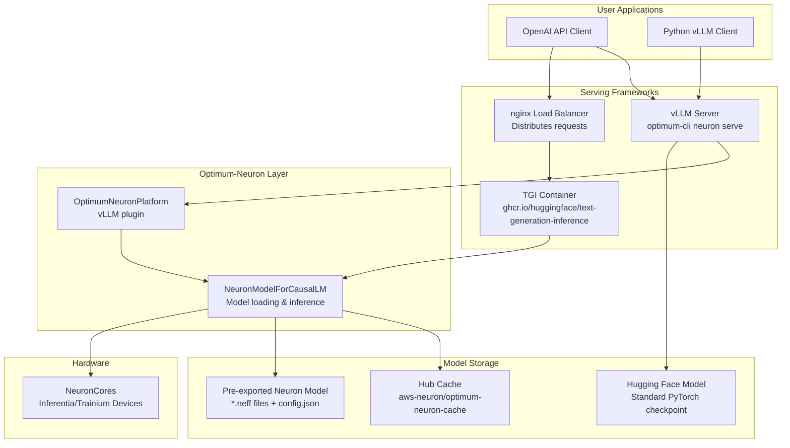
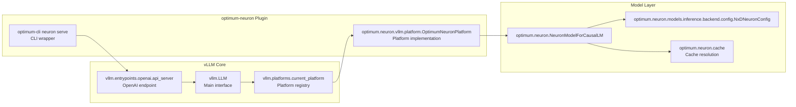
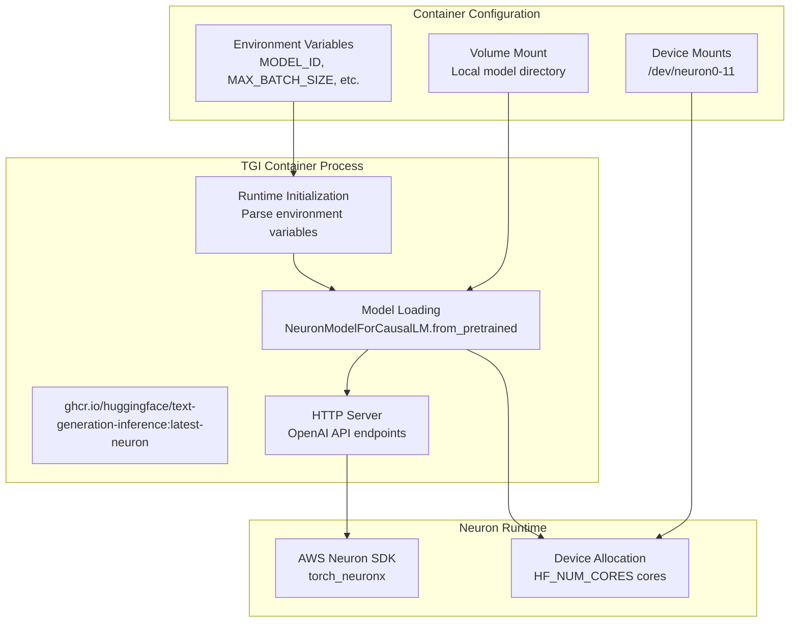
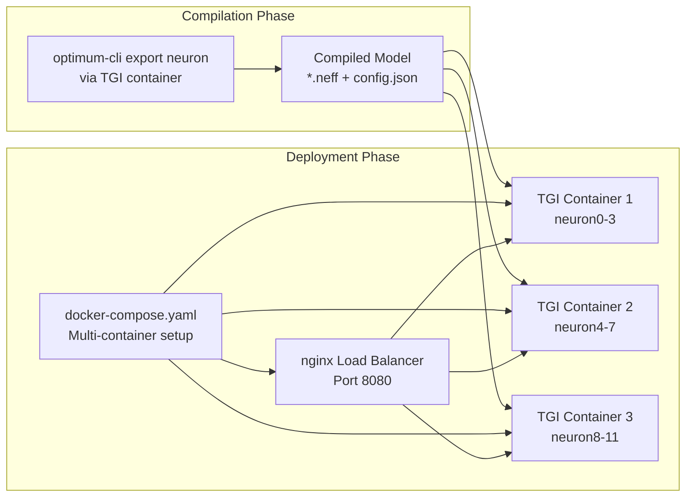
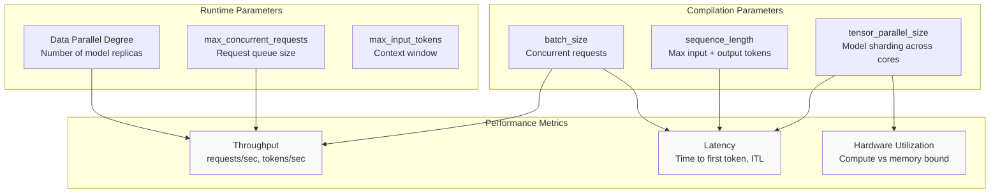
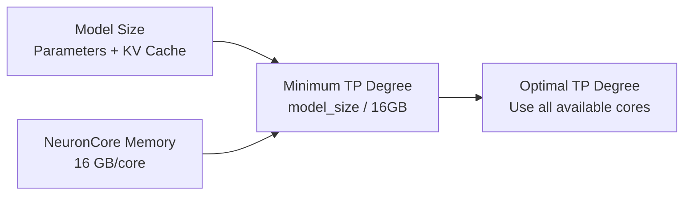
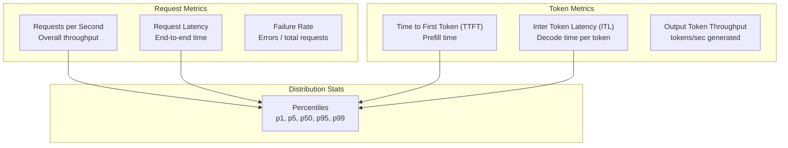
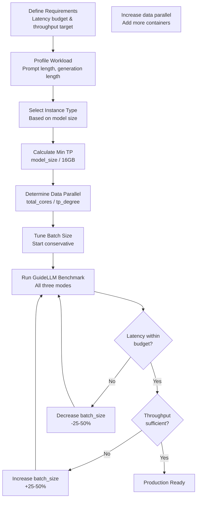

<!-- source: DeepWiki mcp.deepwiki.com · repo huggingface/optimum-neuron · page 7 vLLM and TGI Integration · fetched 2026-10-26 -->

# vLLM and TGI Integration

<details>
<summary>Relevant source files</summary>

The following files were used as context for generating this wiki page:

- [docs/source/guides/benchmark.mdx](docs/source/guides/benchmark.mdx)
- [docs/source/guides/export_model.mdx](docs/source/guides/export_model.mdx)
- [docs/source/guides/vllm_plugin.mdx](docs/source/guides/vllm_plugin.mdx)
- [docs/source/index.mdx](docs/source/index.mdx)
- [docs/source/inference_tutorials/llama2-13b-chatbot.mdx](docs/source/inference_tutorials/llama2-13b-chatbot.mdx)
- [docs/source/inference_tutorials/notebooks.mdx](docs/source/inference_tutorials/notebooks.mdx)
- [optimum/neuron/models/inference/auto_models.py](optimum/neuron/models/inference/auto_models.py)
- [tests/decoder/test_cli.py](tests/decoder/test_cli.py)
- [tests/decoder/test_decoder_export.py](tests/decoder/test_decoder_export.py)
- [tests/decoder/test_decoder_generation.py](tests/decoder/test_decoder_generation.py)
- [tests/decoder/test_decoder_hub.py](tests/decoder/test_decoder_hub.py)
- [tests/decoder/test_decoder_pipelines.py](tests/decoder/test_decoder_pipelines.py)
- [tests/fixtures/llm/export_models.py](tests/fixtures/llm/export_models.py)
- [tests/vllm/engine/test_vllm_engine_generate.py](tests/vllm/engine/test_vllm_engine_generate.py)

</details>


## Purpose and Scope

This page documents the integration of optimum-neuron with two production serving frameworks: **vLLM** and **Text Generation Inference (TGI)**. These integrations enable scalable deployment of Neuron-compiled models on AWS Inferentia and Trainium instances.

For information about model export and compilation, see [Model Export System](#4). For direct inference without serving frameworks, see [Inference with Neuron Models](#6).

## Serving Architecture Overview

Optimum-neuron provides two pathways for deploying models in production environments:



**Sources:** [docs/source/guides/vllm_plugin.mdx:1-106](), [docs/source/guides/benchmark.mdx:1-332]()

Both frameworks support:
- **Pre-exported models**: Models already compiled to Neuron format
- **Cached models**: Vanilla models that leverage pre-compiled artifacts from the Neuron cache
- **OpenAI-compatible API**: Standard `/v1/completions` and `/v1/chat/completions` endpoints

## vLLM Integration Architecture

The vLLM integration is implemented as a platform plugin that registers the `optimum-neuron` platform with vLLM's platform detection system.

### Component Mapping



**Sources:** [tests/vllm/engine/test_vllm_engine_generate.py:1-103](), [docs/source/guides/vllm_plugin.mdx:1-106]()

### Using vLLM Programmatically

The `vllm.LLM` class automatically detects the optimum-neuron platform and handles model loading:

```python
# Example from tests/vllm/engine/test_vllm_engine_generate.py:43-46
from vllm import LLM, SamplingParams

# Load pre-exported Neuron model
llm = LLM(model="path/to/neuron-model")

# Or load vanilla model with automatic cache lookup
llm = LLM(
    model="Qwen/Qwen2.5-0.5B",
    max_num_seqs=4,
    max_model_len=4096,
    tensor_parallel_size=2
)

# Generate
prompts = ["Hello, my name is"]
sampling_params = SamplingParams(temperature=0.8, top_p=0.95)
outputs = llm.generate(prompts, sampling_params)
```

**Sources:** [tests/vllm/engine/test_vllm_engine_generate.py:19-46](), [docs/source/guides/vllm_plugin.mdx:32-57]()

### Model Loading Strategy

The platform follows this priority order:

| Priority | Model Type | Detection | Cache Lookup |
|----------|-----------|-----------|--------------|
| 1 | Pre-exported Neuron model | `config.json` contains `NeuronConfig` | No |
| 2 | Cached configuration | Model + export params match cache entry | Yes |
| 3 | Fresh export | No match found | Creates new cache entry |

**Sources:** [docs/source/guides/vllm_plugin.mdx:7-15](), [optimum/neuron/models/inference/auto_models.py:1-134]()

### CLI Server Deployment

The `optimum-cli neuron serve` command provides a simplified interface:

```bash
# Serve pre-exported model
optimum-cli neuron serve --model=path/to/neuron-model

# Serve vanilla model with cache lookup
optimum-cli neuron serve \
    --model="unsloth/Llama-3.1-1B-Instruct" \
    --batch_size=4 \
    --sequence_length=4096 \
    --tensor_parallel_size=2

# Override cache requirement (force export if no cache)
optimum-cli neuron serve \
    --model="custom/model" \
    --allow_non_cached_model
```

**Sources:** [docs/source/guides/vllm_plugin.mdx:60-84](), [docs/source/guides/export_model.mdx:315-336]()

The server exposes OpenAI-compatible endpoints:

```bash
# Test completion endpoint
curl 127.0.0.1:8080/v1/completions \
    -H 'Content-Type: application/json' \
    -X POST \
    -d '{"prompt":"Once upon a time", "temperature": 0.8, "max_tokens":128}'
```

**Sources:** [docs/source/guides/vllm_plugin.mdx:85-93]()

### Platform Detection

The `OptimumNeuronPlatform` registers itself with vLLM's platform system:

```python
# From tests/vllm/engine/test_vllm_engine_generate.py:15-16
from vllm.platforms import current_platform
from optimum.neuron.vllm.platform import OptimumNeuronPlatform

assert isinstance(current_platform, OptimumNeuronPlatform)
```

**Sources:** [tests/vllm/engine/test_vllm_engine_generate.py:15-16]()

## Text Generation Inference (TGI) Container Deployment

TGI containers provide enterprise-grade serving with built-in optimizations for Neuron hardware.

### Container Image and Environment Variables



**Sources:** [docs/source/guides/export_model.mdx:337-362](), [docs/source/guides/benchmark.mdx:49-79]()

### Key Environment Variables

| Variable | Purpose | Example | Equivalent Export Param |
|----------|---------|---------|------------------------|
| `MODEL_ID` | Model identifier or path | `meta-llama/Llama-3.1-8B` | `--model` |
| `MAX_BATCH_SIZE` | Compiled batch size | `8` | `--batch_size` |
| `MAX_TOTAL_TOKENS` | Total sequence length | `4096` | `--sequence_length` |
| `HF_NUM_CORES` | Tensor parallel degree | `8` | `--tensor_parallel_size` |
| `MAX_INPUT_TOKENS` | Maximum input length | `3600` | N/A (computed) |
| `MAX_CONCURRENT_REQUESTS` | Request queue size | `512` | N/A (runtime) |
| `PORT` | Server port | `8080` | N/A (runtime) |

**Sources:** [docs/source/guides/export_model.mdx:342-353](), [docs/source/guides/benchmark.mdx:95-105]()

### Compilation and Deployment Workflow



**Sources:** [docs/source/guides/benchmark.mdx:49-79](), [docs/source/guides/benchmark.mdx:133-236]()

### Export Using TGI Container

The TGI container includes compilation tools:

```bash
# Export model to Neuron format using TGI container
docker run --entrypoint optimum-cli \
    -v $(pwd)/data:/data \
    --privileged \
    ghcr.io/huggingface/optimum-neuron-vllm:latest \
    export neuron \
    --model meta-llama/Llama-3.1-8B-Instruct \
    --batch_size 8 \
    --sequence_length 4096 \
    --tensor_parallel_size 8 \
    /data/exported-model/
```

**Sources:** [docs/source/guides/export_model.mdx:315-336](), [docs/source/guides/benchmark.mdx:56-79]()

### Multi-Container Deployment with Data Parallelism

Data parallelism is achieved by running multiple TGI containers, each handling a subset of devices:

#### docker-compose.yaml Structure

```yaml
# From docs/source/guides/benchmark.mdx:136-215
services:
  tgi-1:
    image: ghcr.io/huggingface/text-generation-inference:latest-neuron
    ports: ["8081:8081"]
    environment:
      - PORT=8081
      - MODEL_ID=/data/exported-model
      - HF_NUM_CORES=8           # Tensor parallel degree
      - MAX_BATCH_SIZE=8
      - MAX_TOTAL_TOKENS=16512
      - MAX_CONCURRENT_REQUESTS=512
    devices:
      - "/dev/neuron0"
      - "/dev/neuron1"
      - "/dev/neuron2"
      - "/dev/neuron3"
  
  tgi-2:
    # Similar config with neuron4-7
  
  tgi-3:
    # Similar config with neuron8-11
  
  loadbalancer:
    image: nginx:alpine
    ports: ["8080:80"]
    volumes:
      - ./nginx.conf:/etc/nginx/nginx.conf:ro
```

**Sources:** [docs/source/guides/benchmark.mdx:133-215]()

#### nginx Load Balancer Configuration

```nginx
# From docs/source/guides/benchmark.mdx:218-235
events {}
http {
  upstream tgicluster {
    server tgi-1:8081;
    server tgi-2:8082;
    server tgi-3:8083;
  }
  server {
    listen 80;
    location / {
      proxy_pass http://tgicluster;
    }
  }
}
```

**Sources:** [docs/source/guides/benchmark.mdx:217-235]()

This configuration creates:
- **Tensor Parallelism**: Each container uses 8 cores (4 devices × 2 cores/device)
- **Data Parallelism**: 3 containers handle requests in parallel (degree = 3)
- **Total Cores**: 24 cores across inf2.48xlarge instance

### Deployment Patterns

#### Single Container (Simple Deployment)

```bash
docker run -p 8080:80 \
    -e MODEL_ID=path/to/model \
    -e MAX_BATCH_SIZE=4 \
    -e MAX_TOTAL_TOKENS=4096 \
    -e HF_NUM_CORES=2 \
    --device=/dev/neuron0 \
    ghcr.io/huggingface/text-generation-inference:latest-neuron
```

**Use case**: Low-traffic applications, development/testing

#### Multi-Container with Load Balancing (Production)

```bash
# Start all containers
docker compose -f docker-compose.yaml --env-file .env up
```

**Use case**: Production workloads requiring high throughput

**Sources:** [docs/source/guides/benchmark.mdx:238-246]()

## Performance Optimization and Benchmarking

### Optimization Parameters



**Sources:** [docs/source/guides/benchmark.mdx:83-92]()

### Batch Size Tuning

Batch size directly controls the **latency-throughput tradeoff**:

| Batch Size | Latency | Throughput | Use Case |
|------------|---------|------------|----------|
| 1-2 | Lowest | Low | Real-time chat, interactive applications |
| 4-8 | Medium | Medium | General purpose serving |
| 16-32 | Higher | High | Batch processing, offline inference |

**Memory Considerations:**
- Each batch slot requires KV cache memory: `(batch_size × sequence_length × hidden_dim × num_layers × 2) bytes`
- NeuronCore memory limit: 16 GB per core
- Larger batch sizes require higher `tensor_parallel_size`

**Sources:** [docs/source/guides/benchmark.mdx:83-92]()

### Tensor Parallel Degree Selection



**Guidelines:**
- **Minimum TP**: Divide model size by 16 GB and round up
- **Optimal TP**: Use all cores on device for maximum memory bandwidth
- **Example (inf2.48xlarge)**: 24 total cores ÷ data_parallel_degree

**Sources:** [docs/source/guides/benchmark.mdx:80-82](), [tests/fixtures/llm/export_models.py:42-91]()

### Benchmarking with GuideLLM

GuideLLM provides systematic performance analysis through three benchmark modes:

```bash
# From docs/source/guides/benchmark.mdx:107-128
guidellm \
  --target "http://localhost:8080/v1" \
  --model meta-llama/Meta-Llama-3.1-8B-Instruct \
  --data-type emulated \
  --data "prompt_tokens=15900,generated_tokens=450" \
  --output-path benchmark_report.json
```

**Sources:** [docs/source/guides/benchmark.mdx:107-128](), [docs/source/guides/benchmark.mdx:237-249]()

#### Benchmark Modes

| Mode | Description | Metric Focus |
|------|-------------|--------------|
| **Synchronous** | One request at a time | Minimum latency, baseline performance |
| **Throughput** | Maximum concurrent requests | Peak throughput, saturation point |
| **Asynchronous** | Fixed request rate | Sustained performance at target load |

**Sources:** [docs/source/guides/benchmark.mdx:312-317]()

#### Key Metrics Reported



**Sources:** [docs/source/guides/benchmark.mdx:253-310]()

### Example Benchmark Results Analysis

From a real benchmark on inf2.48xlarge with Llama 3.1 8B:

| Configuration | Value |
|--------------|-------|
| Batch size | 8 |
| Tensor parallel | 8 (4 devices × 2 cores) |
| Data parallel | 3 |
| Sequence length | 16512 |
| Prompt tokens | ~15900 |
| Generated tokens | ~450 |

**Results:**

| Benchmark Mode | Req/sec | Avg Latency | TTFT | ITL | Token Throughput |
|----------------|---------|-------------|------|-----|------------------|
| Synchronous | 0.10 | 10.32s | 1585ms | 29.81ms | 28.39 tok/s |
| Asynchronous@0.85 | 0.77 | 20.77s | 2401ms | 63.69ms | 221.75 tok/s |
| Throughput (max) | 0.85 | 43.78s | 24624ms | 65.18ms | 249.64 tok/s |

**Interpretation:**
- **TTFT dominates latency** due to large prompt size (15900 tokens)
- **Maximum sustainable throughput**: 0.85 req/sec = ~250 tokens/sec
- **Latency budget determines batch size**: Current config suitable for ~44s response time

**Sources:** [docs/source/guides/benchmark.mdx:253-310](), [docs/source/guides/benchmark.mdx:319-322]()

### Optimization Strategy



**Sources:** [docs/source/guides/benchmark.mdx:83-92](), [docs/source/guides/benchmark.mdx:319-326]()

## Testing and Validation

### vLLM Integration Tests

The test suite validates vLLM functionality across multiple model architectures:

```python
# From tests/vllm/engine/test_vllm_engine_generate.py:43-59
def test_vllm_from_hub_model(neuron_llm_config):
    """Test vLLM generation on cached models from hub"""
    model_id = neuron_llm_config["model_id"]
    export_kwargs = neuron_llm_config["export_kwargs"]
    llm = LLM(
        model=model_id,
        max_num_seqs=export_kwargs["batch_size"],
        max_model_len=export_kwargs["sequence_length"],
        tensor_parallel_size=export_kwargs["tensor_parallel_size"],
    )
    # Generation test follows
```

Test configurations span multiple architectures:
- Llama (unsloth/Llama-3.2-1B-Instruct)
- Qwen2 (Qwen/Qwen2.5-0.5B)
- Granite (ibm-granite/granite-3.1-2b-instruct)
- Phi (microsoft/Phi-3-mini-4k-instruct)
- SmolLM3 (HuggingFaceTB/SmolLM3-3B)

**Sources:** [tests/vllm/engine/test_vllm_engine_generate.py:1-103](), [tests/fixtures/llm/export_models.py:42-91]()

### Pipeline Integration Tests

Tests validate seamless integration between vLLM/TGI backends and the pipeline API:

```python
# From tests/decoder/test_decoder_pipelines.py:48-58
@is_inferentia_test
@requires_neuronx
def test_export_no_parameters():
    """Pipeline auto-exports with sensible defaults"""
    p = pipeline("text-generation", "Qwen/Qwen2.5-0.5B", export=True)
    # Automatically selects batch_size, sequence_length, tensor_parallel_size
    # based on available cores and cached configurations
```

**Sources:** [tests/decoder/test_decoder_pipelines.py:1-108]()

## Related Documentation

- For model export procedures, see [Model Export System](#4)
- For direct inference APIs, see [Causal Language Models and Text Generation](#6.2)
- For training and fine-tuning, see [Training on AWS Neuron](#5)
- For cache management, see [Model Cache System](#8)
- For deployment guides, see [Deployment Guide](#9)

---

