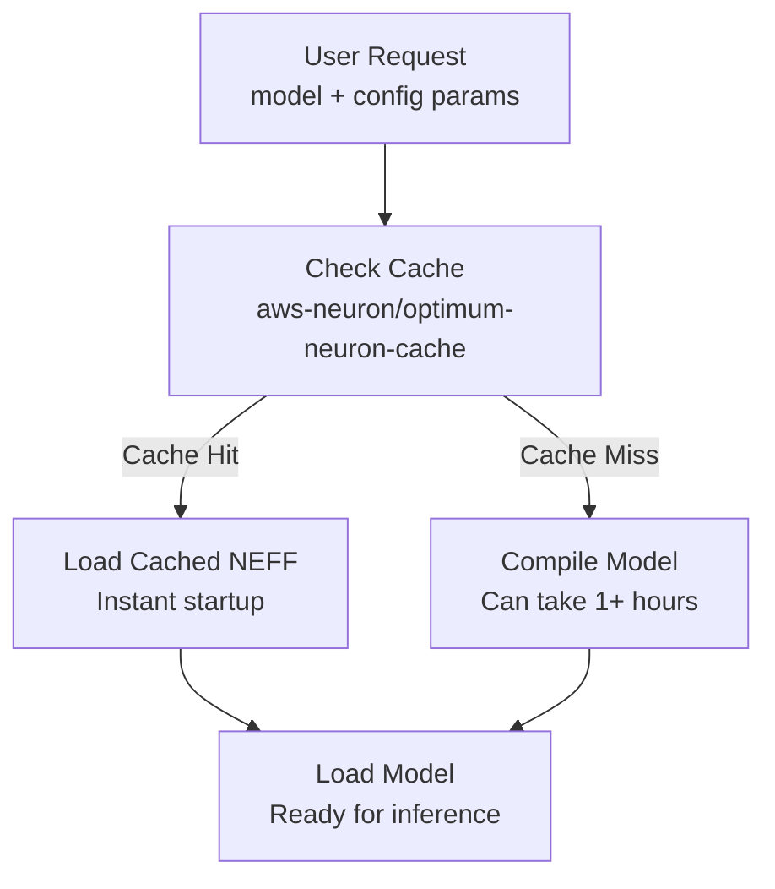
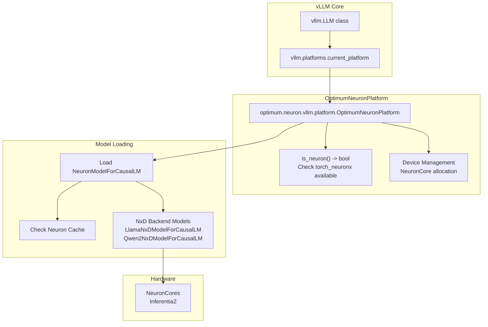
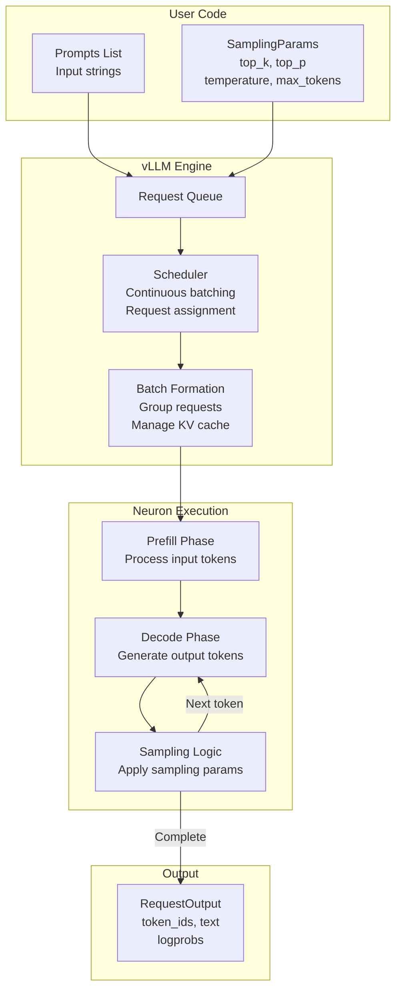
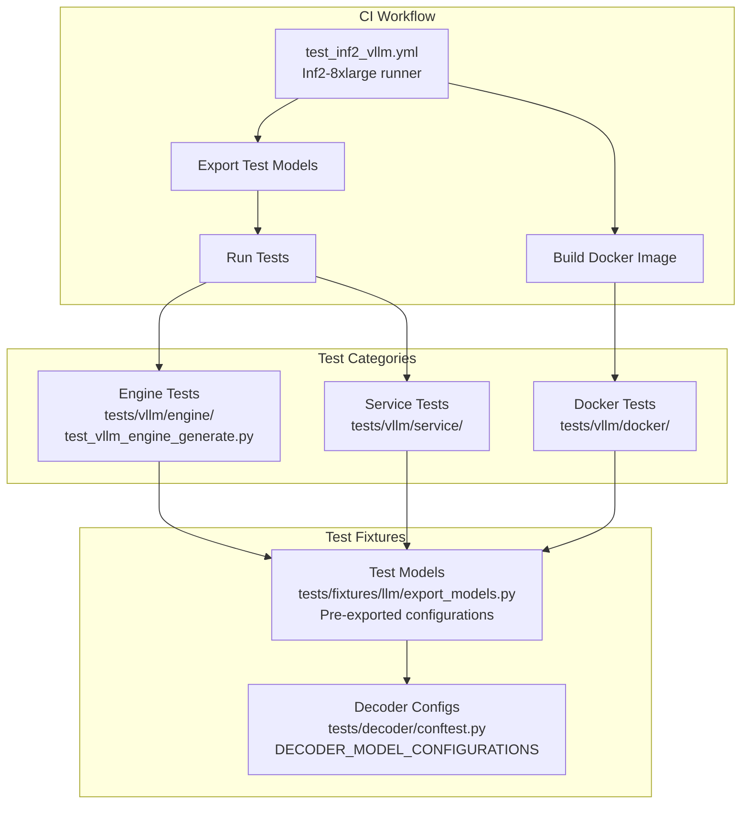

<!-- source: DeepWiki mcp.deepwiki.com · repo huggingface/optimum-neuron · page 7.1 vLLM Plugin · fetched 2026-10-26 -->

# vLLM Plugin

<details>
<summary>Relevant source files</summary>

The following files were used as context for generating this wiki page:

- [docs/source/guides/benchmark.mdx](docs/source/guides/benchmark.mdx)
- [docs/source/guides/export_model.mdx](docs/source/guides/export_model.mdx)
- [docs/source/guides/vllm_plugin.mdx](docs/source/guides/vllm_plugin.mdx)
- [docs/source/index.mdx](docs/source/index.mdx)
- [docs/source/inference_tutorials/llama2-13b-chatbot.mdx](docs/source/inference_tutorials/llama2-13b-chatbot.mdx)
- [docs/source/inference_tutorials/notebooks.mdx](docs/source/inference_tutorials/notebooks.mdx)
- [optimum/neuron/models/inference/auto_models.py](optimum/neuron/models/inference/auto_models.py)
- [tests/decoder/test_cli.py](tests/decoder/test_cli.py)
- [tests/decoder/test_decoder_export.py](tests/decoder/test_decoder_export.py)
- [tests/decoder/test_decoder_generation.py](tests/decoder/test_decoder_generation.py)
- [tests/decoder/test_decoder_hub.py](tests/decoder/test_decoder_hub.py)
- [tests/decoder/test_decoder_pipelines.py](tests/decoder/test_decoder_pipelines.py)
- [tests/fixtures/llm/export_models.py](tests/fixtures/llm/export_models.py)
- [tests/vllm/engine/test_vllm_engine_generate.py](tests/vllm/engine/test_vllm_engine_generate.py)

</details>


## Purpose and Scope

This page documents the `optimum-neuron` vLLM plugin, which registers an `optimum-neuron` vLLM platform for simplified deployment of Hugging Face models to AWS Trainium and Inferentia. The plugin supports two operational modes: inference of pre-exported Neuron models directly from the Hub, and simplified deployment of standard models using cached artifacts from the Hugging Face Neuron Cache.

The page covers:
- Using `optimum-cli neuron serve` for simplified model serving
- Programmatic usage with the vLLM `LLM` class
- The `OptimumNeuronPlatform` integration architecture
- Hugging Face Neuron Cache for automatic compilation reuse

For general model export and compilation, see [Model Export System](#4). For the underlying NxD backend models, see [Backend Inference Architecture](#6.3). For production deployment with TGI containers, see [Text Generation Inference Containers](#7.2).

**Note:** Trn2 instances are not currently supported by the `optimum-neuron` platform.

---

## Setup and Installation

The easiest way to use the `optimum-neuron` vLLM platform is to launch an Amazon EC2 instance using the [Hugging Face Neuron Deep Learning AMI](https://aws.amazon.com/marketplace/pp/prodview-gr3e6yiscria2). After launching the instance and connecting via SSH, activate the pre-installed environment:

```bash
source /opt/aws_neuronx_venv_pytorch_2_7/bin/activate
```

Alternatively, install manually in a Neuron environment:

```bash
pip install optimum-neuron[neuronx,vllm]
```

For development and testing, also install test dependencies:

```bash
pip install optimum-neuron[vllm,vllm-tests]
```

**Sources:** [docs/source/guides/vllm_plugin.mdx:17-29](), [.github/workflows/test_inf2_vllm.yml:75-78]()

---

## Serving Models with optimum-cli

The simplest way to serve a model is using the `optimum-cli neuron serve` command:

```bash
optimum-cli neuron serve --model=<model_name_or_path>
```

The model can be either a pre-exported Neuron model or a standard Hugging Face model. When deploying a standard model, you can customize the export configuration:

```bash
optimum-cli neuron serve \
    --model="unsloth/Llama-3.1-1B-Instruct" \
    --batch_size=4 \
    --sequence_length=4096 \
    --tensor_parallel_size=2
```

**Behavior with Standard Models:**
- By default, `optimum-cli` will only serve models for which a cached configuration exists in the [Hugging Face Neuron Cache](#hugging-face-neuron-cache)
- Use `--allow_non_cached_model` to override this and compile models on-the-fly
- If you omit parameters, `optimum-neuron` will select default values based on the deployment target, prioritizing cached configurations

Once the server is running, test it with a curl request:

```bash
curl 127.0.0.1:8080/v1/completions \
    -H 'Content-Type: application/json' \
    -X POST \
    -d '{"prompt":"One of my fondest memory is", "temperature": 0.8, "max_tokens":128}'
```

**Sources:** [docs/source/guides/vllm_plugin.mdx:60-92]()

---

## Programmatic Usage with LLM Class

For programmatic control, use the vLLM Python API directly:

```python
from vllm import LLM, SamplingParams

prompts = [
    "Hello, my name is",
    "The president of the United States is",
    "The capital of France is",
    "The future of AI is",
]
sampling_params = SamplingParams(temperature=0.8, top_p=0.95)

llm = LLM(model="unsloth/Llama-3.2-1B-Instruct",
          max_num_seqs=4,
          max_model_len=4096,
          tensor_parallel_size=2)

outputs = llm.generate(prompts, sampling_params)

for output in outputs:
    prompt = output.prompt
    generated_text = output.outputs[0].text
    print(f"Prompt: {prompt!r}, Generated text: {generated_text!r}")
```

The `LLM` class initialization parameters map to Neuron configuration:

| vLLM Parameter | Neuron Config | Description |
|----------------|---------------|-------------|
| `model` | `checkpoint_id` | Path or Hub ID of model |
| `max_num_seqs` | `batch_size` | Static batch size for compilation |
| `max_model_len` | `sequence_length` | Maximum sequence length |
| `tensor_parallel_size` | `tp_degree` | Number of NeuronCores for tensor parallelism |

**Sources:** [docs/source/guides/vllm_plugin.mdx:32-57](), [tests/vllm/engine/test_vllm_engine_generate.py:49-60]()

---

## Hugging Face Neuron Cache

The Hugging Face Neuron Cache stores pre-compiled Neuron models to avoid redundant compilation. When deploying models with vLLM, the system automatically checks the cache:

**Diagram: Cache Lookup Flow**



**Key Points:**
- Only a relevant subset of configurations for each model are cached
- Use `optimum-cli` to list all cached configurations for a model
- Models not in the cache must be exported beforehand using `optimum-cli export neuron`
- The cache significantly reduces deployment time for common configurations

For details on cache management, see [Model Cache System](#8).

**Sources:** [docs/source/guides/vllm_plugin.mdx:7-15]()

---

## OptimumNeuronPlatform Architecture

The vLLM integration is implemented through the `OptimumNeuronPlatform` class, which extends vLLM's platform abstraction to support Neuron devices. When vLLM is imported in an environment with `optimum-neuron` installed, this platform is automatically registered.

**Diagram: Platform Plugin Architecture**



The platform plugin handles:
- **Platform Detection**: Checks for `torch_neuronx` availability via `is_neuron()` method
- **Device Management**: Manages NeuronCore allocation and memory
- **Model Loading**: Loads pre-exported Neuron models or triggers compilation via cache
- **Execution Context**: Provides Neuron-specific execution environment for inference

**Sources:** [tests/vllm/engine/test_vllm_engine_generate.py:15-16]()

---

## Advanced Deployment

For advanced users who need full control over the vLLM server configuration, you can launch the OpenAI-compatible inference server directly:

```bash
python -m vllm.entrypoints.openai.api_server \
    --model="unsloth/Llama-3.2-1B-Instruct" \
    --max-num-seqs=4 \
    --max-model-len=4096 \
    --tensor-parallel-size=2 \
    --port=8080
```

This approach provides access to all vLLM server options while still utilizing the `OptimumNeuronPlatform` for model execution.

**Sources:** [docs/source/guides/vllm_plugin.mdx:94-105]()

---

## Model Loading Modes

The vLLM plugin supports two model loading modes:

### Loading Pre-Exported Neuron Models

Load models that have already been exported to Neuron format:

```python
from vllm import LLM

# Load from local directory
llm = LLM(model="/path/to/exported/neuron/model")

# Load from HuggingFace Hub
llm = LLM(model="org/neuron-model-id")
```

When a pre-exported Neuron model is loaded, the plugin uses the model's compiled artifacts directly, resulting in instant startup.

**Sources:** [tests/vllm/engine/test_vllm_engine_generate.py:43-46]()

### Loading Standard Models with Automatic Compilation

Load standard HuggingFace models and leverage cached configurations or compile on-the-fly:

```python
from vllm import LLM

llm = LLM(
    model="meta-llama/Llama-2-7b-hf",
    max_num_seqs=4,                    # Batch size
    max_model_len=4096,                # Sequence length
    tensor_parallel_size=2,             # TP degree
)
```

**Compilation Behavior:**
1. First checks Hugging Face Neuron Cache for matching configuration
2. If found, loads pre-compiled artifacts (fast startup)
3. If not found, compiles the model (can take 1+ hours)

To see all cached configurations for a model, use:

```bash
optimum-cli neuron cache list --model meta-llama/Llama-2-7b-hf
```

**Sources:** [tests/vllm/engine/test_vllm_engine_generate.py:49-60](), [docs/source/guides/vllm_plugin.mdx:7-15]()

---

## Generation and Sampling

vLLM provides flexible text generation with various sampling strategies:

**Diagram: Generation Flow**



Example usage with different sampling strategies:

```python
from vllm import SamplingParams

# Greedy sampling (deterministic)
greedy_params = SamplingParams(top_k=1, max_tokens=50)

# Top-k sampling
topk_params = SamplingParams(top_k=50, temperature=0.9, max_tokens=50)

# Top-p (nucleus) sampling
topp_params = SamplingParams(top_p=0.95, temperature=0.8, max_tokens=50)

outputs = llm.generate(prompts, sampling_params=greedy_params)
```

Each `RequestOutput` contains:
- `prompt`: Original input prompt
- `outputs`: List of completion outputs (typically one per prompt)
  - `text`: Generated text string
  - `token_ids`: List of generated token IDs
  - `logprobs`: Log probabilities (if requested)

**Sources:** [tests/vllm/engine/test_vllm_engine_generate.py:19-41](), [tests/vllm/engine/test_vllm_engine_generate.py:63-147]()

---

## Continuous Batching Support

The vLLM integration leverages Neuron's continuous batching capabilities for efficient request processing. Unlike static batching, continuous batching allows:

- **Dynamic Request Assignment**: New requests fill slots as previous requests complete
- **Variable Sequence Lengths**: Different requests can have different generation lengths
- **Higher Throughput**: Better GPU/NeuronCore utilization by minimizing idle time

**Diagram: Continuous Batching Timeline**

```mermaid
gantt
    title Continuous Batching Request Timeline
    dateFormat X
    axisFormat %L
    
    section Batch Slot 0
    Request A - Prefill :milestone, 0, 0
    Request A - Decode :active, 0, 10
    Request D - Prefill :milestone, 10, 10
    Request D - Decode :active, 10, 20
    
    section Batch Slot 1
    Request B - Prefill :milestone, 2, 2
    Request B - Decode :active, 2, 15
    Request E - Prefill :milestone, 15, 15
    Request E - Decode :active, 15, 25
    
    section Batch Slot 2
    Request C - Prefill :milestone, 5, 5
    Request C - Decode :active, 5, 25
    
    section Batch Slot 3
    Idle :crit, 0, 8
    Request F - Prefill :milestone, 8, 8
    Request F - Decode :active, 8, 18
    Idle :crit, 18, 25
```



The model's `neuron_config.continuous_batching` flag indicates support for this feature. When enabled, vLLM can efficiently manage multiple concurrent requests with different lengths.

**Sources:** [tests/decoder/test_decoder_generation.py:161-243]()

---

## Environment Variables

When using Docker or SageMaker for deployment, environment variables control the export and serving configuration:

### vLLM / SageMaker Variables

```bash
SM_ON_MODEL=model_id                    # Model ID or path
SM_ON_BATCH_SIZE=batch_size             # Batch size for compilation
SM_ON_SEQUENCE_LENGTH=sequence_length   # Maximum sequence length
SM_ON_TENSOR_PARALLEL_SIZE=tp_degree    # Tensor parallel degree
```

These variables are used when deploying with SageMaker endpoints or containerized environments.

**Sources:** [docs/source/guides/export_model.mdx:354-361]()

---

## Docker Container Usage

The `optimum-neuron` package provides pre-built Docker containers for vLLM deployment. Use the container to export models or serve them:

### Exporting Models in Container

```bash
docker run --entrypoint optimum-cli \
       -v $(pwd)/data:/data \
       --privileged \
       ghcr.io/huggingface/optimum-neuron-vllm:latest \
       export neuron \
       --model <organization>/<model> \
       --batch_size 1 \
       --sequence_length 4096 \
       --tensor_parallel_size 2 \
       /data/<neuron_model_path>
```

The exported model will be saved to `./data/<neuron_model_path>`.

### Serving Models in Container

```bash
docker run -p 8000:8000 \
  --device=/dev/neuron0 \
  ghcr.io/huggingface/optimum-neuron-vllm:latest \
  --model meta-llama/Llama-2-7b-hf \
  --max-num-seqs 4 \
  --max-model-len 4096
```

The container exposes a REST API compatible with OpenAI's API format.

**Sources:** [docs/source/guides/export_model.mdx:315-335](), [.github/workflows/test_inf2_vllm.yml:94-102]()

---

## Model Compatibility

vLLM integration supports the same model architectures as the NxD backend inference system:

| Architecture | Model Class | Status |
|--------------|-------------|--------|
| Llama | `LlamaNxDModelForCausalLM` | Supported |
| Llama 4 | `Llama4NxDModelForCausalLM` | Supported |
| Qwen2 | `Qwen2NxDModelForCausalLM` | Supported |
| Qwen3 | `Qwen3NxDModelForCausalLM` | Supported |
| Qwen3 MoE | `Qwen3MoeNxDModelForCausalLM` | Supported |
| Granite | `GraniteNxDModelForCausalLM` | Supported |
| Phi-3 | `Phi3NxDModelForCausalLM` | Supported |
| Mixtral | `MixtralNxDModelForCausalLM` | Supported |
| SmolLM3 | `SmolLM3NxDModelForCausalLM` | Supported |

All models must be exported with the NxD backend configuration (see [Model Class Reference](#6.1) for details).

**Sources:** [optimum/neuron/models/inference/auto_models.py:1-125](), [tests/vllm/engine/test_vllm_engine_generate.py:49-60](), [tests/vllm/engine/test_vllm_engine_generate.py:93-142]()

---

## Installation

To use vLLM with optimum-neuron, install with the vLLM extra dependencies:

```bash
pip install optimum-neuron[vllm]
```

For development and testing, also install test dependencies:

```bash
pip install optimum-neuron[vllm,vllm-tests]
```

The installation includes:
- `vllm` package with Neuron platform plugin
- Required dependencies for model serving
- Integration with neuronx-distributed for efficient execution

**Sources:** [.github/workflows/test_inf2_vllm.yml:75-78]()

---

## Testing and CI/CD

The vLLM integration has dedicated test coverage and CI workflows:

**Diagram: Test Organization**



Test coverage includes:
- **Platform Detection**: Verify `OptimumNeuronPlatform` is active
- **Model Loading**: Load from local paths and HuggingFace Hub
- **Generation Correctness**: Validate greedy and sampling outputs
- **Continuous Batching**: Test variable-length generation with concurrent requests
- **Docker Integration**: End-to-end container testing

The CI workflow runs on Inf2 instances with multiple model configurations to ensure compatibility across the supported architecture matrix.

**Sources:** [.github/workflows/test_inf2_vllm.yml:1-103](), [tests/vllm/engine/test_vllm_engine_generate.py:1-148](), [tests/decoder/conftest.py:30-85]()

---

## Performance Characteristics

The vLLM integration provides high-throughput inference through several optimizations:

| Feature | Benefit |
|---------|---------|
| Continuous Batching | Higher throughput by filling batch slots dynamically |
| PagedAttention | Efficient KV cache memory management |
| Pre-compilation | Zero compilation time for cached models |
| Tensor Parallelism | Scale to large models across multiple NeuronCores |
| Asynchronous Processing | Non-blocking request handling |

For production deployments, consider:
- Pre-exporting models with appropriate batch size and sequence length
- Using the compilation cache to avoid startup latency
- Selecting tensor parallelism degree based on model size
- Monitoring NeuronCore utilization and request queue depth

**Sources:** [tests/vllm/engine/test_vllm_engine_generate.py:1-148](), [tests/decoder/test_decoder_generation.py:161-243]()

---

