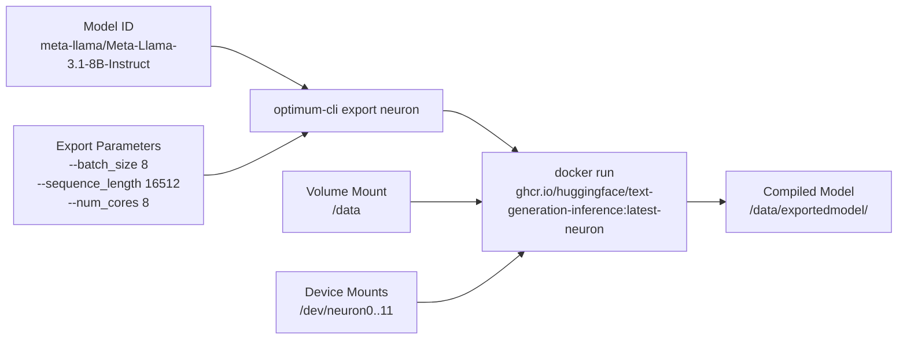
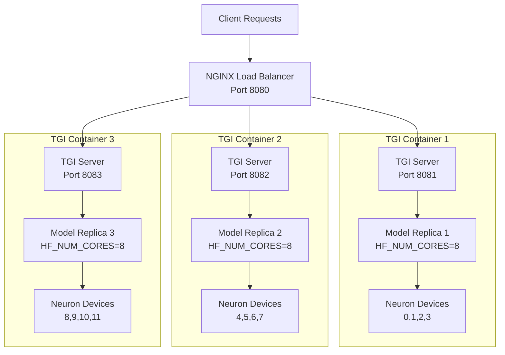
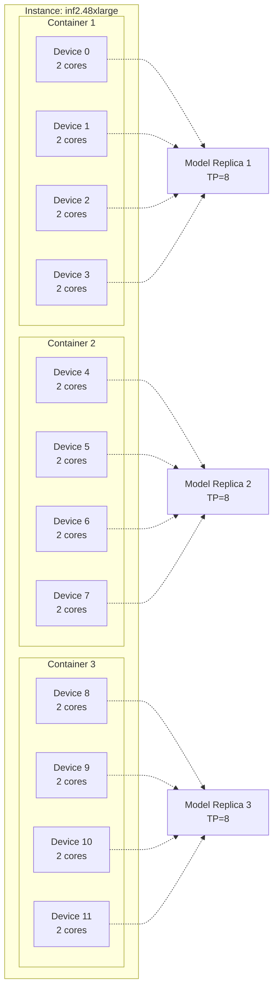
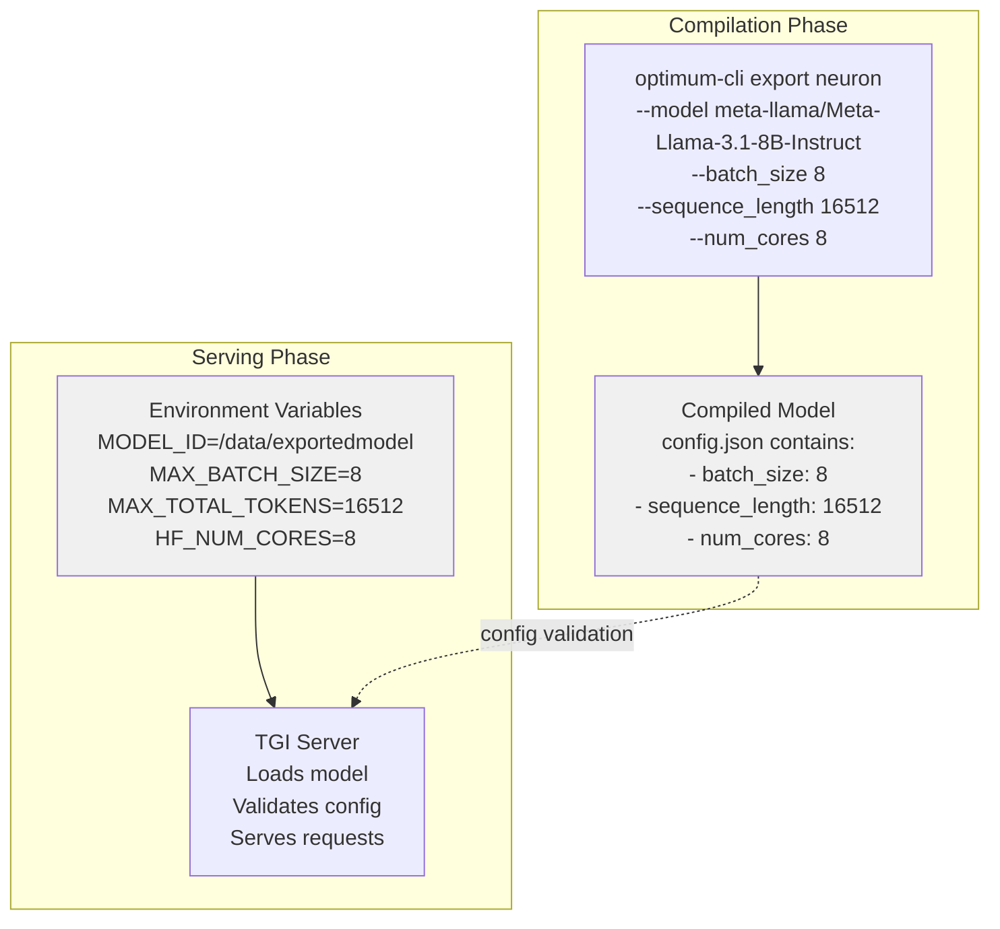
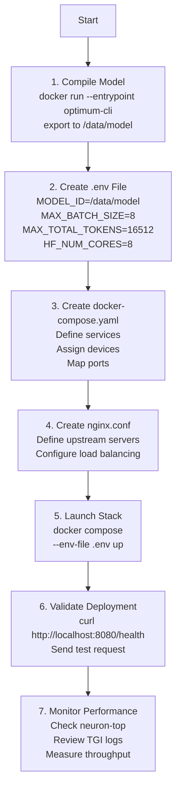

<!-- source: DeepWiki mcp.deepwiki.com · repo huggingface/optimum-neuron · page 7.2 Text Generation Inference Containers · fetched 2026-10-26 -->

# Text Generation Inference Containers

<details>
<summary>Relevant source files</summary>

The following files were used as context for generating this wiki page:

- [docs/source/guides/benchmark.mdx](docs/source/guides/benchmark.mdx)
- [docs/source/guides/export_model.mdx](docs/source/guides/export_model.mdx)
- [docs/source/guides/vllm_plugin.mdx](docs/source/guides/vllm_plugin.mdx)
- [docs/source/index.mdx](docs/source/index.mdx)
- [docs/source/inference_tutorials/llama2-13b-chatbot.mdx](docs/source/inference_tutorials/llama2-13b-chatbot.mdx)
- [docs/source/inference_tutorials/notebooks.mdx](docs/source/inference_tutorials/notebooks.mdx)

</details>


## Purpose and Scope

This page documents the use of Text Generation Inference (TGI) containers for deploying optimum-neuron models on AWS Inferentia and Trainium hardware. TGI containers provide a production-ready serving framework with built-in support for model compilation, environment-based configuration, and multi-container load balancing.

For information about the vLLM serving framework, see [vLLM Plugin](#7.1). For performance optimization strategies, see [Performance Optimization and Benchmarking](#7.3).

## TGI Container Overview

The `ghcr.io/huggingface/text-generation-inference:latest-neuron` container includes:

- **NeuronX Runtime**: Full AWS Neuron SDK for running compiled models on Inferentia/Trainium
- **Compilation Tools**: `optimum-cli` and supporting packages for model export
- **Serving Infrastructure**: OpenAI-compatible API server with batching and queueing
- **Model Cache Integration**: Automatic lookup and download from the Hugging Face Hub cache

The TGI container can be used for both model compilation and serving, providing a unified environment that ensures consistency between export and deployment configurations.

Sources: [docs/source/guides/export_model.mdx:315-336](), [docs/source/guides/benchmark.mdx:38-48]()

## TGI Container Architecture

```mermaid
graph TB
    subgraph "TGI Container Environment"
        CLI["optimum-cli export"]
        Server["TGI Server Process"]
        SDK["NeuronX SDK<br/>torch_neuronx<br/>neuronx_distributed"]
        Cache["Model Cache Lookup"]
    end
    
    subgraph "Configuration Sources"
        EnvVars["Environment Variables<br/>MODEL_ID<br/>MAX_BATCH_SIZE<br/>MAX_TOTAL_TOKENS<br/>HF_NUM_CORES"]
        DotEnv[".env File"]
    end
    
    subgraph "Storage"
        LocalFS["Local Filesystem<br/>/data volume mount"]
        HubCache["Hugging Face Hub<br/>aws-neuron/optimum-neuron-cache"]
    end
    
    subgraph "Hardware"
        Devices["Neuron Devices<br/>/dev/neuron0..N"]
    end
    
    EnvVars --> Server
    DotEnv --> EnvVars
    EnvVars --> CLI
    
    Server --> Cache
    Cache --> HubCache
    Cache --> LocalFS
    
    CLI --> LocalFS
    
    Server --> SDK
    CLI --> SDK
    SDK --> Devices
    
    LocalFS -.mount.-> TGI Container Environment
    Devices -.mount.-> TGI Container Environment
```

**TGI Container Execution Environment**: The container provides a complete runtime with configuration through environment variables, integration with the model cache system, and direct hardware access via device mounts.

Sources: [docs/source/guides/export_model.mdx:317-336](), [docs/source/guides/benchmark.mdx:136-215]()

## Environment Variables

TGI containers are configured through environment variables that control compilation parameters and serving behavior. These variables must match the parameters used during model export to ensure compatibility.

### Core Configuration Variables

| Environment Variable | Purpose | Maps to Export Parameter | Example Value |
|---------------------|---------|-------------------------|---------------|
| `MODEL_ID` | Model identifier or path | `--model` | `meta-llama/Meta-Llama-3.1-8B-Instruct` or `/data/exportedmodel` |
| `MAX_BATCH_SIZE` | Maximum batch size for inference | `--batch_size` | `8` |
| `MAX_TOTAL_TOKENS` | Maximum sequence length (input + output) | `--sequence_length` | `16512` |
| `MAX_INPUT_TOKENS` | Maximum input tokens (prefill) | Derived from `--sequence_length` | `16000` |
| `HF_NUM_CORES` | Tensor parallel size (cores per replica) | `--tensor_parallel_size` or `--num_cores` | `8` |
| `MAX_CONCURRENT_REQUESTS` | Request queue depth | N/A (serving-only) | `512` |
| `HF_TOKEN` | Hugging Face authentication token | `--token` | `hf_...` |
| `PORT` | Server listening port | N/A (serving-only) | `8080` |

### Variable Mappings

The relationship between export CLI parameters and TGI environment variables:

```
optimum-cli export neuron            TGI Environment Variables
--model <model>                  --> MODEL_ID=<model>
--batch_size <N>                 --> MAX_BATCH_SIZE=<N>
--sequence_length <N>            --> MAX_TOTAL_TOKENS=<N>
--tensor_parallel_size <N>       --> HF_NUM_CORES=<N>
--num_cores <N>                  --> HF_NUM_CORES=<N>
```

Sources: [docs/source/guides/export_model.mdx:337-362](), [docs/source/guides/benchmark.mdx:95-104]()

## Model Compilation with TGI Containers

TGI containers include the full NeuronX toolchain, enabling model compilation without a separate Python environment. This approach ensures that the compilation environment exactly matches the serving environment.

### Compilation Workflow



**Compilation with TGI Container**: The container is invoked with `--entrypoint "optimum-cli"` to run compilation instead of the default TGI server, producing a compiled model in the mounted volume.

### Docker Command Structure

The compilation command follows this pattern:

```bash
docker run \
    --entrypoint "optimum-cli" \
    -v $(pwd)/data:/data \
    --device=/dev/neuron0 \
    --device=/dev/neuron1 \
    [... additional devices ...] \
    ghcr.io/huggingface/text-generation-inference:latest-neuron \
    export neuron \
    --model <model_id> \
    --sequence_length <N> \
    --batch_size <N> \
    --num_cores <N> \
    /data/<output_path>
```

**Key components:**
- `--entrypoint "optimum-cli"`: Override the default TGI server entrypoint to run compilation
- `-v $(pwd)/data:/data`: Mount local directory for model output
- `--device=/dev/neuronX`: Mount Neuron devices needed for compilation
- Export parameters specify static shapes and parallelism degree

Sources: [docs/source/guides/export_model.mdx:317-336](), [docs/source/guides/benchmark.mdx:56-79]()

## Model Serving with TGI Containers

### Single Container Deployment

For simple deployments, a single TGI container serves the model with configuration through environment variables:

```bash
docker run -p 8080:80 \
    -e MODEL_ID=<model_or_path> \
    -e MAX_BATCH_SIZE=8 \
    -e MAX_TOTAL_TOKENS=16512 \
    -e HF_NUM_CORES=8 \
    -e HF_TOKEN=<token> \
    -v $(pwd)/data:/data \
    --device=/dev/neuron0 \
    --device=/dev/neuron1 \
    [... devices for HF_NUM_CORES ...] \
    ghcr.io/huggingface/text-generation-inference:latest-neuron
```

The container automatically:
1. Checks the model cache (Hub and local)
2. Loads the compiled model onto specified devices
3. Starts the OpenAI-compatible API server
4. Begins accepting requests on the configured port

### Environment File Configuration

For reproducible deployments, configuration is typically stored in a `.env` file:

```bash
MODEL_ID=/data/exportedmodel
MAX_BATCH_SIZE=8
MAX_INPUT_TOKENS=16000
MAX_TOTAL_TOKENS=16512
HF_NUM_CORES=8
MAX_CONCURRENT_REQUESTS=512
```

This file is referenced by Docker Compose for consistent configuration across multiple containers.

Sources: [docs/source/guides/benchmark.mdx:94-105]()

## Multi-Container Deployment

For production workloads requiring higher throughput, multiple TGI containers can be deployed with load balancing. This implements **data parallelism**, where each container serves a complete copy of the model and processes independent requests.

### Data Parallelism Architecture



**Multi-Container Data Parallelism**: On an `inf2.48xlarge` (24 cores), three containers each use 8 cores (`HF_NUM_CORES=8`) for tensor parallelism, providing 3x data parallelism. The load balancer distributes requests across containers.

### Docker Compose Configuration

The `docker-compose.yaml` file defines multiple TGI services with distinct device allocations:

```yaml
version: '3.7'

services:
  tgi-1:
    image: ghcr.io/huggingface/text-generation-inference:latest-neuron
    ports:
      - "8081:8081"
    volumes:
      - $PWD:/data
    environment:
      - PORT=8081
      - MODEL_ID=${MODEL_ID}
      - HF_NUM_CORES=8
      - MAX_BATCH_SIZE=${MAX_BATCH_SIZE}
      - MAX_TOTAL_TOKENS=${MAX_TOTAL_TOKENS}
      - MAX_INPUT_TOKENS=${MAX_INPUT_TOKENS}
      - MAX_CONCURRENT_REQUESTS=512
    devices:
      - "/dev/neuron0"
      - "/dev/neuron1"
      - "/dev/neuron2"
      - "/dev/neuron3"

  tgi-2:
    # Similar config with devices 4-7, port 8082

  tgi-3:
    # Similar config with devices 8-11, port 8083

  loadbalancer:
    image: nginx:alpine
    ports:
      - "8080:80"
    volumes:
      - ./nginx.conf:/etc/nginx/nginx.conf:ro
    depends_on:
      - tgi-1
      - tgi-2
      - tgi-3
```

**Key configuration elements:**
- Each service has a unique `PORT` and port mapping
- `devices` section assigns non-overlapping Neuron devices to each container
- `HF_NUM_CORES` determines tensor parallelism within each container
- Shared volume mount (`$PWD:/data`) allows all containers to access the compiled model
- `.env` file variables are referenced with `${VARIABLE}` syntax

Sources: [docs/source/guides/benchmark.mdx:135-215]()

### NGINX Load Balancer Configuration

The `nginx.conf` file defines round-robin load balancing across TGI containers:

```nginx
events {}
http {
  upstream tgicluster {
    server tgi-1:8081;
    server tgi-2:8082;
    server tgi-3:8083;
  }
  server {
    listen 80;
    location / {
      proxy_pass http://tgicluster;
    }
  }
}
```

**Configuration details:**
- `upstream tgicluster` block defines the backend server pool
- Each backend references the Docker Compose service name and internal port
- `proxy_pass` directive routes all traffic to the upstream pool
- Default round-robin algorithm distributes requests evenly

The load balancer container exposes port 8080, providing a single endpoint for clients while distributing load across the data parallel replicas.

Sources: [docs/source/guides/benchmark.mdx:217-235]()

### Device Allocation Strategy

For an `inf2.48xlarge` instance with 12 Neuron devices (24 cores), the allocation strategy:



**Device allocation calculation:**
- `HF_NUM_CORES=8` means each model replica uses 8 cores (4 devices × 2 cores/device)
- Total cores available: 24
- Data parallel degree: 24 / 8 = 3 replicas
- Each container gets exclusive access to 4 contiguous devices

For different instance types:
- `inf2.24xlarge` (12 cores): 1-2 replicas with TP=6-12
- `inf2.8xlarge` (2 cores): 1 replica with TP=2

Sources: [docs/source/guides/benchmark.mdx:14-35](), [docs/source/guides/benchmark.mdx:80-82]()

## Configuration Consistency

The critical requirement for TGI deployments is that **serving configuration must exactly match compilation configuration**. Mismatched parameters will cause runtime errors or undefined behavior.

### Parameter Correspondence



**Configuration Flow**: Compilation parameters are embedded in `config.json` of the compiled model. TGI validates that environment variables match these parameters during model loading.

### Common Configuration Errors

| Error Condition | Symptom | Resolution |
|----------------|---------|------------|
| `MAX_BATCH_SIZE` > compiled `batch_size` | Runtime error: batch size mismatch | Set `MAX_BATCH_SIZE` ≤ compiled value |
| `MAX_TOTAL_TOKENS` > compiled `sequence_length` | Runtime error: sequence length mismatch | Set `MAX_TOTAL_TOKENS` ≤ compiled value |
| `HF_NUM_CORES` ≠ compiled `num_cores` | Model loading failure | Set `HF_NUM_CORES` = compiled value exactly |
| Device count < `HF_NUM_CORES` / 2 | Insufficient hardware | Mount at least `HF_NUM_CORES/2` devices |

The TGI container will fail fast during initialization if configuration mismatches are detected, preventing silent degradation or incorrect results.

Sources: [docs/source/guides/export_model.mdx:337-362](), [docs/source/guides/benchmark.mdx:95-105]()

## Deployment Workflow



**Complete TGI Deployment Workflow**: From compilation through monitoring, ensuring configuration consistency at each step.

Sources: [docs/source/guides/benchmark.mdx:38-249]()

## Integration with Optimum-Neuron Ecosystem

TGI containers integrate with the broader optimum-neuron infrastructure:

- **Model Cache System**: TGI automatically queries the Hub cache repository (`aws-neuron/optimum-neuron-cache`) before compilation, see [Model Cache System](#8)
- **Export System**: Uses the same `optimum-cli export neuron` command as standalone installations, see [Model Export System](#4)
- **Inference APIs**: Provides OpenAI-compatible endpoints that can be used with standard client libraries, see [Inference with Neuron Models](#6)
- **Benchmarking Tools**: Compatible with GuideLLM and other benchmarking frameworks, see [Performance Optimization and Benchmarking](#7.3)

The containerized approach ensures environment reproducibility while maintaining full compatibility with optimum-neuron's Python APIs and CLI tools.

Sources: [docs/source/guides/export_model.mdx:315-362](), [docs/source/guides/benchmark.mdx:1-332]()

---

