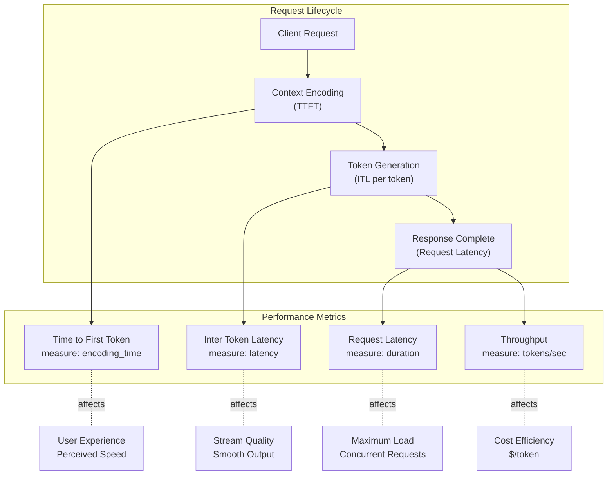
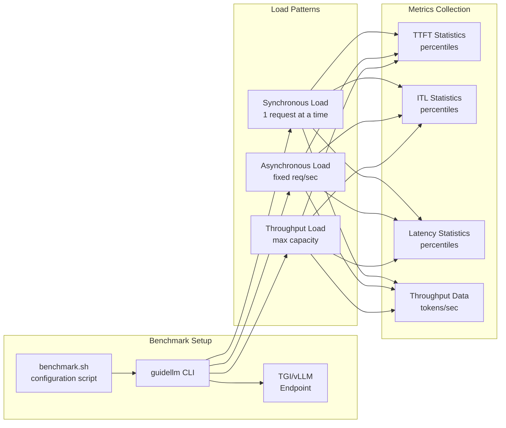
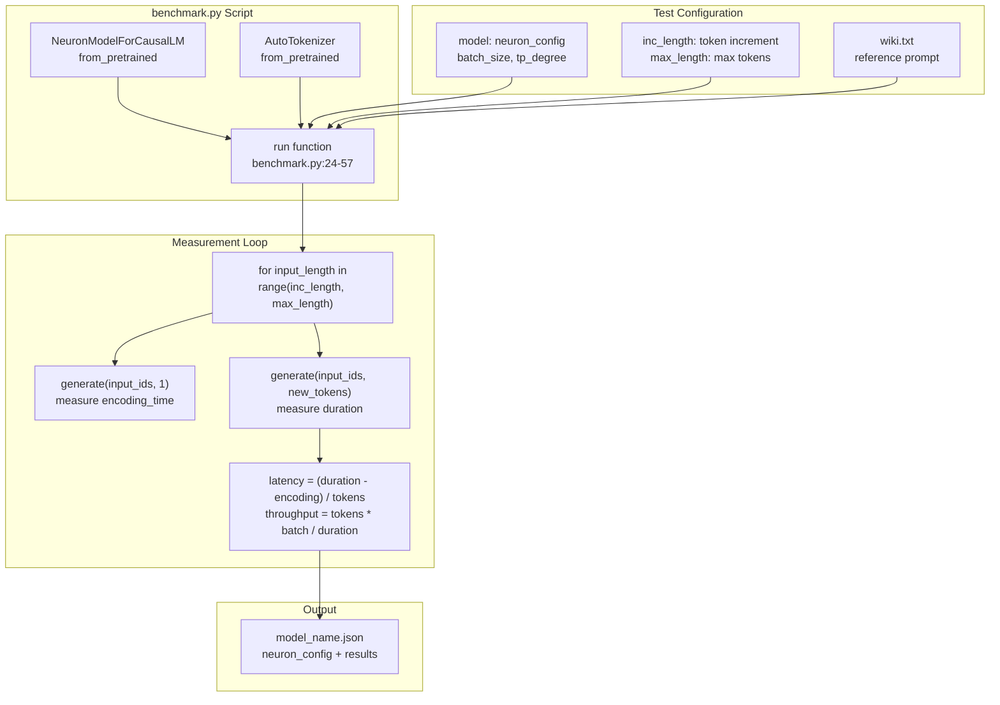
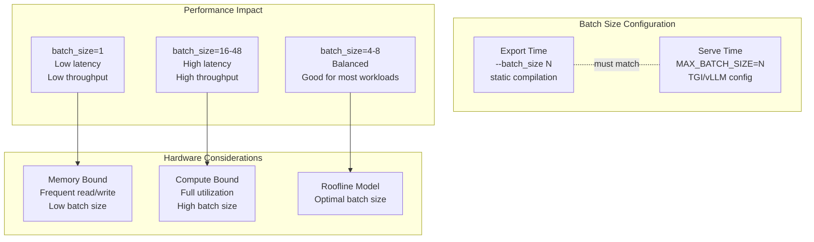
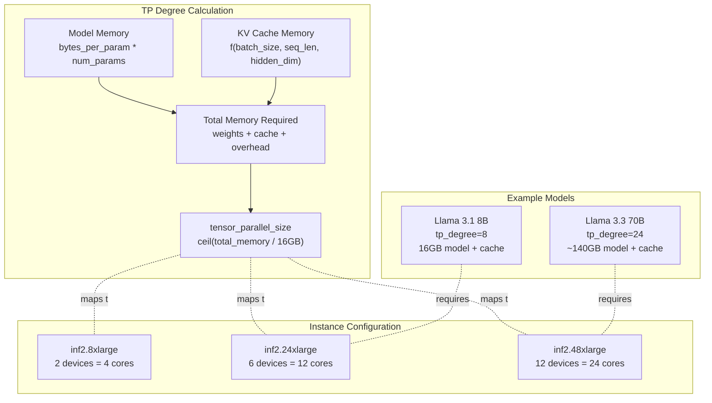
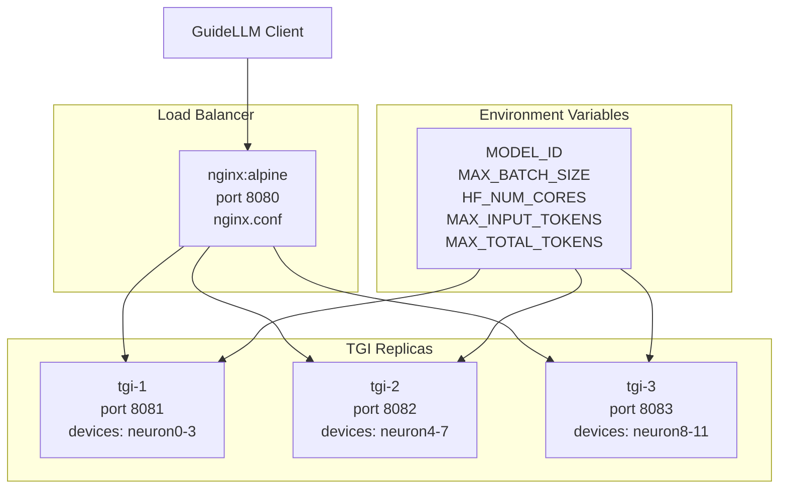
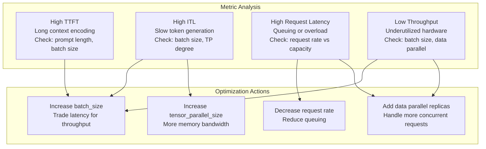
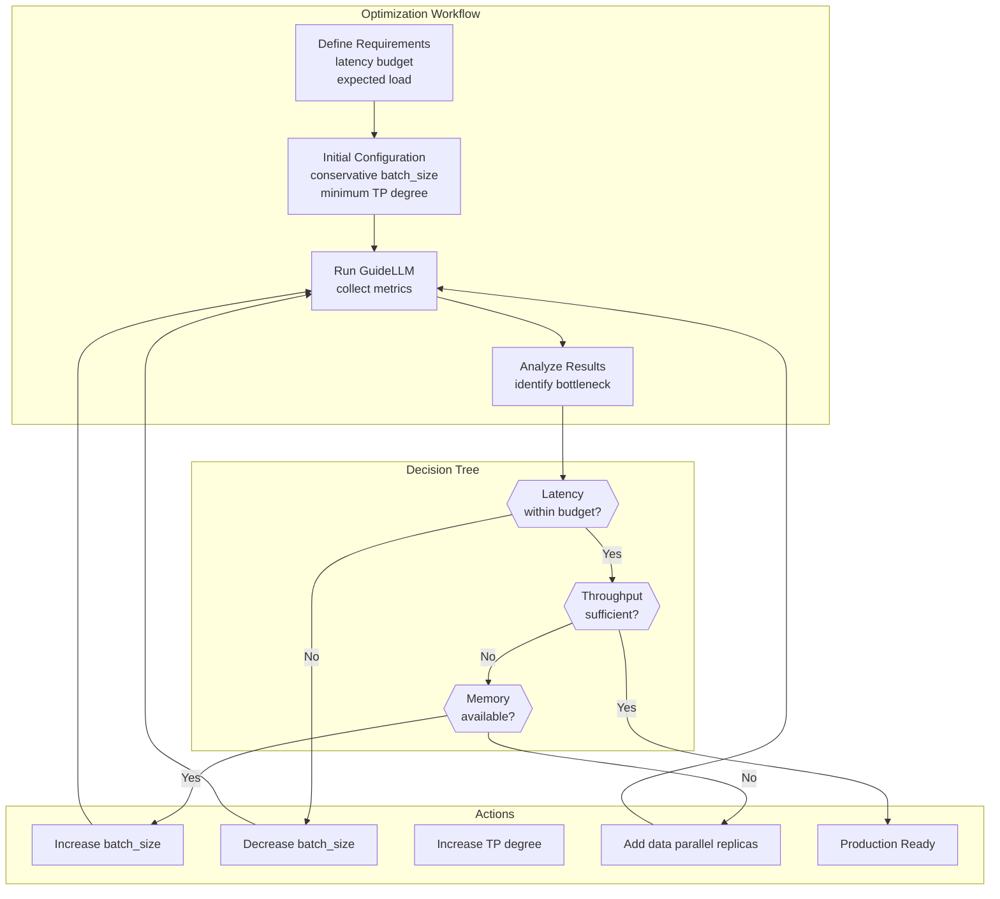

<!-- source: DeepWiki mcp.deepwiki.com · repo huggingface/optimum-neuron · page 7.3 Performance Optimization and Benchmarking · fetched 2026-10-26 -->

# Performance Optimization and Benchmarking

<details>
<summary>Relevant source files</summary>

The following files were used as context for generating this wiki page:

- [.github/actions/install_neuronx_runtime/action.yml](.github/actions/install_neuronx_runtime/action.yml)
- [.github/actions/install_optimum_neuron/action.yml](.github/actions/install_optimum_neuron/action.yml)
- [.github/actions/prepare_venv/action.yml](.github/actions/prepare_venv/action.yml)
- [.github/workflows/inference_cache_diffusion.yml](.github/workflows/inference_cache_diffusion.yml)
- [.github/workflows/inference_cache_llm.yml](.github/workflows/inference_cache_llm.yml)
- [.github/workflows/test_inf2_llm.yml](.github/workflows/test_inf2_llm.yml)
- [.github/workflows/test_inf2_vllm.yml](.github/workflows/test_inf2_vllm.yml)
- [benchmark/text-generation/performance/benchmark.py](benchmark/text-generation/performance/benchmark.py)
- [benchmark/text-generation/performance/llama3.1-8b.py](benchmark/text-generation/performance/llama3.1-8b.py)
- [benchmark/text-generation/performance/llama3.3-70b.py](benchmark/text-generation/performance/llama3.3-70b.py)
- [docs/source/guides/benchmark.mdx](docs/source/guides/benchmark.mdx)
- [docs/source/guides/export_model.mdx](docs/source/guides/export_model.mdx)
- [docs/source/guides/vllm_plugin.mdx](docs/source/guides/vllm_plugin.mdx)
- [docs/source/index.mdx](docs/source/index.mdx)
- [docs/source/inference_tutorials/llama2-13b-chatbot.mdx](docs/source/inference_tutorials/llama2-13b-chatbot.mdx)
- [docs/source/inference_tutorials/notebooks.mdx](docs/source/inference_tutorials/notebooks.mdx)
- [tests/decoder/test_decoder_embedding.py](tests/decoder/test_decoder_embedding.py)

</details>


This page explains how to measure and optimize the performance of deployed Neuron models using benchmarking tools like GuideLLM. It covers key performance metrics, optimization parameters (batch_size, tensor_parallel_size), and strategies for balancing throughput versus latency. For information about deploying models with vLLM or TGI, see [vLLM Plugin](#7.1) and [Text Generation Inference Containers](#7.2).

## Performance Metrics

Understanding performance metrics is essential for optimizing model deployments on Neuron hardware. The primary metrics that characterize inference performance are:

| Metric | Description | Unit | Optimization Goal |
|--------|-------------|------|-------------------|
| **Request Latency** | Total time from request submission to complete response | seconds | Minimize |
| **Time to First Token (TTFT)** | Time from request start until first output token | milliseconds | Minimize for perceived responsiveness |
| **Inter-Token Latency (ITL)** | Time between consecutive output tokens | milliseconds | Minimize for smooth streaming |
| **Throughput** | Number of output tokens generated per second | tokens/sec | Maximize for cost efficiency |
| **Requests per Second** | Number of complete requests processed per second | requests/sec | Maximize for concurrent users |



**Sources:** [benchmark/text-generation/performance/benchmark.py:12-22](), [benchmark/text-generation/performance/benchmark.py:36-53](), [docs/source/guides/benchmark.mdx:250-310]()

## Benchmarking Tools

### GuideLLM

GuideLLM is the primary tool for evaluating deployed model performance. It simulates real-world traffic patterns and measures performance under three distinct load scenarios:

1. **Synchronous**: Processes one request at a time, measuring baseline single-request performance
2. **Asynchronous**: Tests a specific request rate (e.g., 0.85 req/sec) to evaluate sustained load handling
3. **Throughput**: Determines maximum capacity by sending requests as fast as possible



**Sources:** [docs/source/guides/benchmark.mdx:106-128](), [docs/source/guides/benchmark.mdx:237-249](), [docs/source/guides/benchmark.mdx:312-317]()

### Internal Benchmark Script

For controlled experiments without external dependencies, the repository includes a performance benchmark script that measures encoding time, latency, and throughput across different input lengths.



**Sources:** [benchmark/text-generation/performance/benchmark.py:24-78](), [benchmark/text-generation/performance/llama3.1-8b.py:1-42](), [benchmark/text-generation/performance/llama3.3-70b.py:1-53]()

## Optimization Parameters

### Batch Size

The `batch_size` parameter directly controls the throughput-latency tradeoff. It specifies the maximum number of input sequences the model processes in parallel.

**Tradeoffs:**
- **Larger batch size**: Higher throughput (more tokens/sec), higher latency per request
- **Smaller batch size**: Lower latency per request, lower overall throughput

The optimal batch size depends on:
1. **Latency budget**: Maximum acceptable response time
2. **Expected load**: Number of concurrent users
3. **Hardware utilization**: Maximizing NeuronCore compute efficiency



**Example configurations** from Llama 3.1 8B benchmarks:

| Configuration | Batch Size | Expected Use Case |
|---------------|------------|-------------------|
| BS1 | 1 | Minimum latency, single user |
| BS4 | 4 | Low latency, few concurrent users |
| BS8 | 8 | Balanced, moderate concurrency |
| BS16 | 16 | Higher throughput, moderate latency |
| BS32 | 32 | High throughput, higher latency |
| BS48 | 48 | Maximum throughput, high latency |

**Sources:** [benchmark/text-generation/performance/llama3.1-8b.py:14-23](), [docs/source/guides/benchmark.mdx:82-92](), [docs/source/guides/export_model.mdx:254-260]()

### Tensor Parallel Size

The `tensor_parallel_size` (TP degree) parameter determines how many NeuronCores are used to shard the model weights and computation. Each NeuronCore has 16GB of memory.

**Factors affecting TP selection:**

1. **Model size**: Larger models require higher TP to fit in memory
2. **Sequence length**: Longer sequences increase KV cache memory requirements
3. **Performance**: Higher TP improves memory bandwidth and can increase throughput



**Sources:** [docs/source/guides/export_model.mdx:254-260](), [docs/source/inference_tutorials/llama2-13b-chatbot.mdx:96-124](), [benchmark/text-generation/performance/llama3.1-8b.py:9-12](), [benchmark/text-generation/performance/llama3.3-70b.py:11-14]()

### Data Parallelism

When the number of available cores exceeds the tensor parallelism requirement, remaining cores can be used for data parallelism by running multiple model replicas.

**Calculation:**
```
data_parallel_degree = total_cores / tensor_parallel_size
```

**Example**: On inf2.48xlarge (24 cores) with TP=8:
- Data parallel degree = 24 / 8 = 3
- 3 model replicas running concurrently
- Load balancer distributes requests across replicas

**Sources:** [docs/source/guides/benchmark.mdx:80-82](), [docs/source/guides/benchmark.mdx:133-215]()

## Running Benchmarks

### Benchmark Setup with GuideLLM

The complete benchmarking workflow requires three configuration files:

1. **.env file** - Environment variables for TGI container
2. **docker-compose.yaml** - Multi-replica deployment with load balancer
3. **benchmark.sh** - GuideLLM execution script

**Environment Configuration (.env):**

```bash
MODEL_ID='/data/exportedmodel'  # or HuggingFace model ID
MAX_BATCH_SIZE=8
MAX_INPUT_TOKENS=16000
MAX_TOTAL_TOKENS=16512
```

**Docker Compose Configuration** for data parallelism:

The docker-compose.yaml defines multiple TGI containers, each assigned to specific NeuronCore devices, with an nginx load balancer distributing requests.



**GuideLLM Benchmark Script (benchmark.sh):**

Key parameters:
- `--target`: Endpoint URL (http://localhost:8080/v1)
- `--model`: Model identifier
- `--data-type`: "emulated" generates synthetic prompts
- `--data`: Token distribution (prompt_tokens, generated_tokens with variance)

**Sources:** [docs/source/guides/benchmark.mdx:93-128](), [docs/source/guides/benchmark.mdx:133-235]()

### Internal Benchmark Script

For reproducible offline benchmarks without deploying a server:

```bash
python benchmark/text-generation/performance/benchmark.py \
    <neuron_model_directory> \
    --inc-length 512 \
    --max-length 4096 \
    --seed 42 \
    --name <output_name>
```

**Parameters:**
- `model`: Path to compiled Neuron model
- `--inc-length`: Token increment for each test iteration (default: 512)
- `--max-length`: Maximum input length to test (default: 4096)
- `--seed`: Random seed for reproducibility
- `--name`: Output JSON filename

The script generates a JSON report with encoding times, latency, and throughput for each input length tested.

**Sources:** [benchmark/text-generation/performance/benchmark.py:60-78](), [benchmark/text-generation/performance/llama3.1-8b.py:25-37](), [benchmark/text-generation/performance/llama3.3-70b.py:24-48]()

## Interpreting Results

### GuideLLM Output Analysis

GuideLLM produces comprehensive reports with three test scenarios. Understanding each metric helps identify bottlenecks:

**Performance Summary Table:**

| Benchmark | Requests/Sec | Request Latency | TTFT | ITL | Output Throughput |
|-----------|-------------|-----------------|------|-----|-------------------|
| Synchronous | 0.10 | 10.32 sec | 1585 ms | 29.81 ms | 28.39 tokens/sec |
| Asynchronous@0.85 | 0.77 | 20.77 sec | 2401 ms | 63.69 ms | 221.75 tokens/sec |
| Throughput | 0.85 | 43.78 sec | 24624 ms | 65.18 ms | 249.64 tokens/sec |

**Interpreting each benchmark:**

1. **Synchronous**: Baseline single-request performance
   - Best-case latency without queuing
   - TTFT reflects pure encoding time
   - ITL reflects pure token generation speed

2. **Asynchronous**: Realistic sustained load
   - Tests system under continuous request flow
   - Reveals queuing behavior and request scheduling
   - Key metric for capacity planning

3. **Throughput**: Maximum system capacity
   - Identifies saturation point
   - High latency indicates queuing and resource contention
   - Maximum tokens/sec represents peak throughput



**Sources:** [docs/source/guides/benchmark.mdx:250-310](), [docs/source/guides/benchmark.mdx:312-322]()

### Percentile Analysis

GuideLLM reports percentile distributions (1%, 5%, 10%, 50%, 90%, 95%, 99%) for each metric. These reveal performance consistency:

- **Low variance (tight percentiles)**: Consistent performance, predictable latency
- **High variance (wide percentiles)**: Inconsistent performance, investigate outliers
- **99th percentile spike**: Indicates occasional bottlenecks (GC pauses, queuing)

**Example from benchmark output:**

| Metric | 50th (Median) | 95th | 99th |
|--------|---------------|------|------|
| Request Latency | 20.66 sec | 32.78 sec | 35.07 sec |
| TTFT | 1629.7 ms | 4924.1 ms | 5345.6 ms |
| ITL | 34.3 ms | 54.5 ms | 1613.9 ms |

The large gap between 95th and 99th percentile TTFT (4924ms → 5345ms) indicates occasional encoding delays, possibly from batch formation delays.

**Sources:** [docs/source/guides/benchmark.mdx:287-298]()

### Internal Benchmark Results

The internal benchmark script outputs JSON with per-input-length results:

```json
{
  "neuron_config": {
    "batch_size": 4,
    "sequence_length": 4096,
    "tp_degree": 8
  },
  "results": [
    {
      "input_length": 512,
      "batch_size": 4,
      "encoding_time": 0.156,
      "new_tokens": 256,
      "latency": 29.5,
      "throughput": 34.7
    }
  ]
}
```

**Key insights:**
- `encoding_time`: Context encoding overhead (affects TTFT)
- `latency`: Per-token generation time in milliseconds (affects ITL)
- `throughput`: Overall tokens/sec (batch_size × tokens / duration)

**Sources:** [benchmark/text-generation/performance/benchmark.py:36-57]()

## Optimization Strategies

### Latency-Optimized Configuration

**Goal**: Minimize response time for interactive applications (chatbots, code completion)

**Configuration:**
- Small batch_size (1-4)
- Minimum tensor_parallel_size that fits model
- Prioritize TTFT and ITL

**Example**: Llama 3.1 8B for low-latency inference
```bash
optimum-cli export neuron \
  --model unsloth/Llama-3.1-8B-Instruct \
  --batch_size 1 \
  --sequence_length 4096 \
  --num_cores 8
```

**Expected performance:**
- TTFT: < 2 seconds
- ITL: < 30 ms
- Throughput: 20-30 tokens/sec per request

**Sources:** [docs/source/guides/export_model.mdx:261-267](), [benchmark/text-generation/performance/llama3.1-8b.py:17]()

### Throughput-Optimized Configuration

**Goal**: Maximize cost efficiency for batch processing or high-traffic services

**Configuration:**
- Large batch_size (16-48)
- Full instance utilization (use all cores for TP + DP)
- Tolerate higher latency

**Example**: Llama 3.1 8B for maximum throughput on inf2.48xlarge
```bash
optimum-cli export neuron \
  --model unsloth/Llama-3.1-8B-Instruct \
  --batch_size 48 \
  --sequence_length 4096 \
  --num_cores 8
```

With 24 cores total:
- TP degree: 8
- Data parallel: 3 replicas
- Combined batch capacity: 48 × 3 = 144 concurrent sequences

**Expected performance:**
- Request latency: 30-60 seconds
- Throughput: 200+ tokens/sec
- Cost per token: Minimized

**Sources:** [docs/source/guides/benchmark.mdx:82-92](), [benchmark/text-generation/performance/llama3.1-8b.py:22]()

### Balanced Configuration

**Goal**: Good performance for most production workloads

**Configuration:**
- Medium batch_size (4-8)
- Efficient tensor parallel for model size
- Some data parallelism for concurrency

**Example**: Llama 3.1 8B balanced setup
```bash
optimum-cli export neuron \
  --model unsloth/Llama-3.1-8B-Instruct \
  --batch_size 8 \
  --sequence_length 4096 \
  --num_cores 8
```

**Expected performance:**
- TTFT: 2-5 seconds
- ITL: 30-40 ms
- Throughput: 80-120 tokens/sec
- Good balance of latency and cost

**Sources:** [benchmark/text-generation/performance/llama3.1-8b.py:19](), [docs/source/guides/benchmark.mdx:50-81]()

### Iterative Optimization Process



**Steps:**

1. **Establish baseline**: Start with conservative settings (small batch, minimum TP)
2. **Measure**: Run GuideLLM or internal benchmark
3. **Identify constraint**: Analyze which metric is bottleneck
4. **Adjust parameters**: 
   - If latency too high → decrease batch_size or increase TP
   - If throughput too low → increase batch_size or add replicas
   - If memory constrained → increase TP degree
5. **Re-benchmark**: Verify improvements
6. **Iterate**: Repeat until requirements met

**Sources:** [docs/source/guides/benchmark.mdx:1-332]()

## Cache and CI/CD Integration

The cache generation workflows use benchmark configurations to pre-compile and validate models for common deployment scenarios.

**Cache generation matrix** from [.github/workflows/inference_cache_llm.yml:30-42]():

- Multiple model families (llama3, llama4, mixtral, qwen3, granite, phi4, smollm3)
- Target platforms (trn1, trn2)
- Various batch sizes and TP configurations

These cached models enable fast deployment without compilation overhead, with configurations optimized based on benchmark data.

**Testing workflows** validate performance:
- [.github/workflows/test_inf2_llm.yml]() - Tests decoder models on real hardware
- [.github/workflows/test_inf2_vllm.yml]() - Tests vLLM integration

**Sources:** [.github/workflows/inference_cache_llm.yml:1-58](), [.github/workflows/test_inf2_llm.yml:1-94](), [.github/workflows/test_inf2_vllm.yml:1-103]()

---

