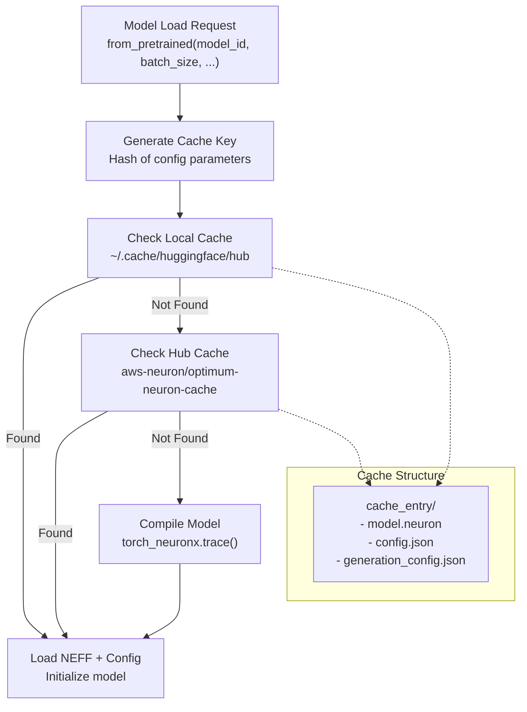
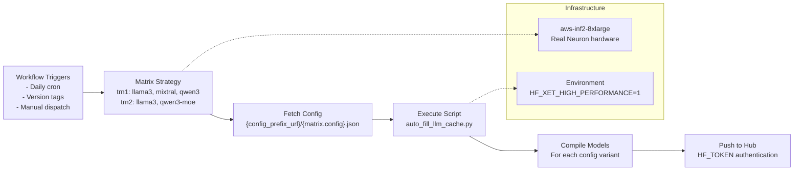
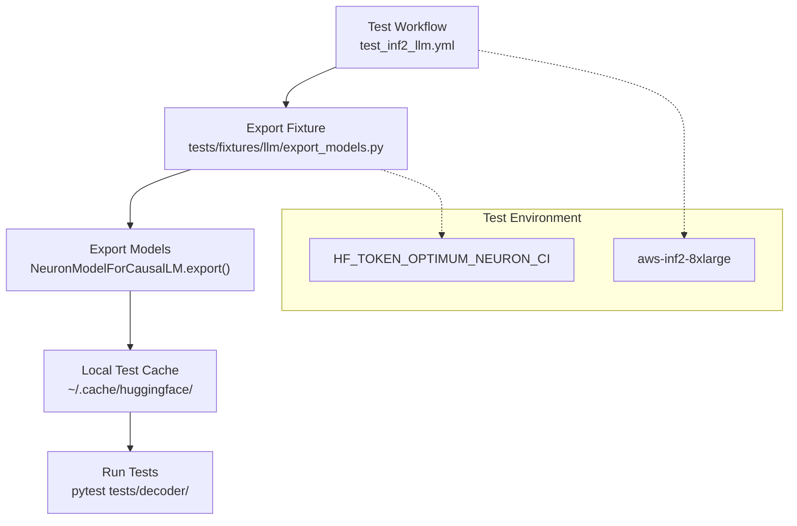

<!-- source: DeepWiki mcp.deepwiki.com · repo huggingface/optimum-neuron · page 8 Model Cache System · fetched 2026-10-26 -->

# Model Cache System

<details>
<summary>Relevant source files</summary>

The following files were used as context for generating this wiki page:

- [.github/actions/install_neuronx_runtime/action.yml](.github/actions/install_neuronx_runtime/action.yml)
- [.github/actions/install_optimum_neuron/action.yml](.github/actions/install_optimum_neuron/action.yml)
- [.github/actions/prepare_venv/action.yml](.github/actions/prepare_venv/action.yml)
- [.github/workflows/inference_cache_diffusion.yml](.github/workflows/inference_cache_diffusion.yml)
- [.github/workflows/inference_cache_llm.yml](.github/workflows/inference_cache_llm.yml)
- [.github/workflows/test_inf2_llm.yml](.github/workflows/test_inf2_llm.yml)
- [.github/workflows/test_inf2_vllm.yml](.github/workflows/test_inf2_vllm.yml)
- [benchmark/text-generation/performance/benchmark.py](benchmark/text-generation/performance/benchmark.py)
- [benchmark/text-generation/performance/llama3.1-8b.py](benchmark/text-generation/performance/llama3.1-8b.py)
- [benchmark/text-generation/performance/llama3.3-70b.py](benchmark/text-generation/performance/llama3.3-70b.py)
- [tests/decoder/test_decoder_embedding.py](tests/decoder/test_decoder_embedding.py)

</details>


## Purpose and Scope

The Model Cache System stores pre-compiled Neuron models to eliminate redundant compilation time. When a model is compiled for specific configurations (batch size, sequence length, tensor parallelism, etc.), the resulting Neuron Executable File Format (NEFF) artifacts and associated metadata are stored in cache repositories. Subsequent requests for the same model configuration can load directly from cache, reducing startup time from hours to seconds.

This page documents the cache architecture, storage locations, lookup mechanisms, and cache population workflows. For details on how models are exported and compiled initially, see [Model Export System](#4). For information on loading cached models during inference, see [Model Loading and Pipeline API](#6.1).

## Cache System Architecture

The cache system operates as a multi-tier lookup mechanism with automatic fallback:



**Diagram: Cache lookup flow showing priority order and fallback mechanism**

Sources: [.github/workflows/test_inf2_llm.yml:75-79](), [benchmark/text-generation/performance/benchmark.py:70]()

### Cache Key Generation

The cache key is computed as a hash of the export configuration parameters:

| Parameter | Description | Impact on Cache Key |
|-----------|-------------|---------------------|
| `model_id` | Base model identifier | Primary key component |
| `batch_size` | Static batch dimension | Required for match |
| `sequence_length` | Static sequence dimension | Required for match |
| `num_cores` | Tensor parallelism degree | Required for match |
| `auto_cast_type` | Precision (bf16/fp32) | Required for match |
| `compiler_args` | Neuron compiler flags | Affects compilation output |

Any difference in these parameters results in a different cache key, requiring separate compilation.

Sources: [benchmark/text-generation/performance/llama3.1-8b.py:26-34](), [benchmark/text-generation/performance/llama3.3-70b.py:26-45]()

## Cache Storage Locations

### Local Cache

The local cache follows Hugging Face Hub conventions:

```
~/.cache/huggingface/hub/
└── models--{org}--{model_name}/
    └── snapshots/{commit_hash}/
        ├── model.neuron          # Compiled NEFF
        ├── config.json           # NeuronConfig
        ├── generation_config.json
        └── tokenizer files
```

Models loaded with `from_pretrained()` automatically populate the local cache when downloaded from the Hub cache.

### Hub Cache Repository

The central Hub cache is maintained at `aws-neuron/optimum-neuron-cache` and organized by model family and configuration:

```
aws-neuron/optimum-neuron-cache/
├── inference-cache-config/
│   ├── trn1/
│   │   ├── llama3.json
│   │   ├── mixtral.json
│   │   └── qwen3.json
│   ├── trn2/
│   │   └── llama3.json
│   └── stable-diffusion-xl-base-1.0.json
└── {model_id}/
    └── {config_hash}/
        ├── model.neuron
        └── config.json
```

Sources: [.github/workflows/inference_cache_llm.yml:30-42](), [.github/workflows/inference_cache_diffusion.yml:30-38]()

## Cache Population Workflows

Two GitHub Actions workflows maintain the Hub cache:

### LLM Cache Builder



**Diagram: LLM cache population workflow**

The workflow definition at [.github/workflows/inference_cache_llm.yml:1-58]() implements:

1. **Trigger Conditions** ([lines 3-15]()):
   - Daily at midnight UTC
   - On version tags matching `v[0-9]+.[0-9]+.[0-9]+`
   - Manual `workflow_dispatch`

2. **Matrix Configuration** ([lines 27-42]()):
   - Separate jobs for each model family
   - Platform-specific configs (trn1/trn2)
   - Model variants: llama3, llama4, mixtral, qwen3, qwen3-moe, granite, phi4, smollm3

3. **Execution Steps** ([lines 44-57]()):
   - Checkout repository
   - Install Neuron runtime via [.github/actions/install_neuronx_runtime]()
   - Prepare virtual environment via [.github/actions/prepare_venv]()
   - Install optimum-neuron via [.github/actions/install_optimum_neuron]()
   - Execute `python tools/cache/auto_fill_llm_cache.py --config_file {url}`

Sources: [.github/workflows/inference_cache_llm.yml:1-58]()

### Diffusion Cache Builder

The diffusion cache workflow at [.github/workflows/inference_cache_diffusion.yml:1-54]() follows a similar pattern:

- **Trigger**: Weekly on Saturday midnight UTC ([line 7]())
- **Matrix**: Stable Diffusion models including SD 1.5, SD 2.1, SDXL, PixArt ([lines 30-38]())
- **Script**: `tools/cache/auto_fill_diffusion_cache.py`

Sources: [.github/workflows/inference_cache_diffusion.yml:1-54]()

## Cache Configuration Files

Cache configuration files define the model variants to compile. Example structure:

```json
{
  "model_id": "meta-llama/Llama-3.1-8B",
  "configurations": [
    {
      "batch_size": 1,
      "sequence_length": 4096,
      "num_cores": 8,
      "auto_cast_type": "bf16"
    },
    {
      "batch_size": 4,
      "sequence_length": 4096,
      "num_cores": 8,
      "auto_cast_type": "bf16"
    }
  ]
}
```

These config files are stored in the Hub cache repository and fetched by workflows:

```bash
config_prefix_url=https://huggingface.co/aws-neuron/optimum-neuron-cache/raw/main/inference-cache-config
python tools/cache/auto_fill_llm_cache.py --config_file ${config_prefix_url}/${{matrix.config}}.json
```

Sources: [.github/workflows/inference_cache_llm.yml:55-57](), [.github/workflows/inference_cache_diffusion.yml:51-53]()

## Cache Validation and Model Loading

### Loading from Cache

Models attempt to load from cache when `export=False` (default):

```python
# Attempts cache lookup before compilation
model = NeuronModelForCausalLM.from_pretrained(
    "meta-llama/Llama-3.1-8B",
    export=False,  # Default: load from cache
    batch_size=4,
    sequence_length=4096,
    num_cores=8
)
```

If cache miss occurs, raises an error unless `export=True` is specified.

### Validation During Load

When loading from cache, the system validates:

1. **Configuration Match**: `NeuronConfig` parameters must exactly match request
2. **File Integrity**: `model.neuron` and `config.json` must be present
3. **Version Compatibility**: Neuron SDK version compatibility check

Example validation from benchmark script:

```python
# Explicit validation
neuron_config = NeuronConfig.from_pretrained(model_id)
assert neuron_config.batch_size == batch_size
assert neuron_config.tp_degree == NUM_CORES
assert neuron_config.sequence_length == seq_length
assert neuron_config.torch_dtype == torch.bfloat16
```

Sources: [benchmark/text-generation/performance/llama3.3-70b.py:27-35](), [benchmark/text-generation/performance/benchmark.py:70]()

## Environment Variables

### Cache-Related Variables

| Variable | Purpose | Usage |
|----------|---------|-------|
| `HF_TOKEN` | Authentication for Hub cache | Required for private caches and pushing |
| `HF_XET_HIGH_PERFORMANCE` | Enable optimized Hub transfers | Set to `1` in workflows |
| `NEURON_COMPILE_CACHE_URL` | Custom cache repository URL | Override default cache location |

### Workflow Configuration

Workflows use environment variables for cache operations:

```yaml
env:
  HF_XET_HIGH_PERFORMANCE: 1
```

```bash
HF_TOKEN=${{secrets.HF_TOKEN_OPTIMUM_NEURON_CACHE}} \
  python tools/cache/auto_fill_llm_cache.py --config_file ${config_file}
```

Sources: [.github/workflows/inference_cache_llm.yml:26-57](), [.github/workflows/inference_cache_diffusion.yml:25-53]()

## Test Export Fixtures

Testing workflows export models to a local cache for test execution:



**Diagram: Test fixture export creating local cache for tests**

The test workflow at [.github/workflows/test_inf2_llm.yml:75-93]() executes:

1. Export test models using fixture script ([lines 75-79]())
2. Run test suite that loads from local cache ([lines 80-93]())

This ensures tests use consistent cached models across test runs.

Sources: [.github/workflows/test_inf2_llm.yml:75-93](), [.github/workflows/test_inf2_vllm.yml:79-102]()

## Cache Infrastructure

### Hardware Requirements

Cache population requires real Neuron hardware:

- **Runner Group**: `aws-inf2-8xlarge` ([.github/workflows/inference_cache_llm.yml:24]())
- **Instance Type**: INF2 with 8 NeuronCores minimum
- **Purpose**: Actual compilation to generate NEFF files

### Runtime Dependencies

Workflows install full Neuron stack:

1. **Neuron System Packages** ([.github/actions/install_neuronx_runtime/action.yml:15]()):
   - `aws-neuronx-tools=2.26.14.0`
   - `aws-neuronx-runtime-lib=2.28.23.0`
   - `aws-neuronx-collectives=2.28.27.0`

2. **Python Environment** ([.github/actions/prepare_venv/action.yml:20-44]()):
   - PyTorch with Neuron extensions
   - `optimum-neuron` package

3. **Optimum-Neuron Installation** ([.github/actions/install_optimum_neuron/action.yml:10]()):
   - `pip install .[neuronx,tests]`

Sources: [.github/actions/install_neuronx_runtime/action.yml:1-22](), [.github/actions/prepare_venv/action.yml:1-45](), [.github/actions/install_optimum_neuron/action.yml:1-11]()

## Cache Performance Impact

### Compilation Time Savings

Cache provides significant performance benefits:

| Operation | Without Cache | With Cache | Speedup |
|-----------|---------------|------------|---------|
| First Load | 20-60 minutes (compile) | 10-30 seconds (download) | 120-180x |
| Subsequent Load | 20-60 minutes | 1-2 seconds (local cache) | 1000-3000x |

### Benchmark Usage

Benchmark scripts demonstrate cache usage patterns:

```python
# From llama3.1-8b.py
model = NeuronModelForCausalLM.from_pretrained(
    model_id,
    export=True,  # Compile if cache miss
    batch_size=batch_size,
    sequence_length=seq_length,
    auto_cast_type="bf16",
    num_cores=NUM_CORES,
)
```

The `export=True` flag enables automatic compilation and cache population when no cached version exists.

Sources: [benchmark/text-generation/performance/llama3.1-8b.py:27-34](), [benchmark/text-generation/performance/llama3.3-70b.py:27-45]()

---

