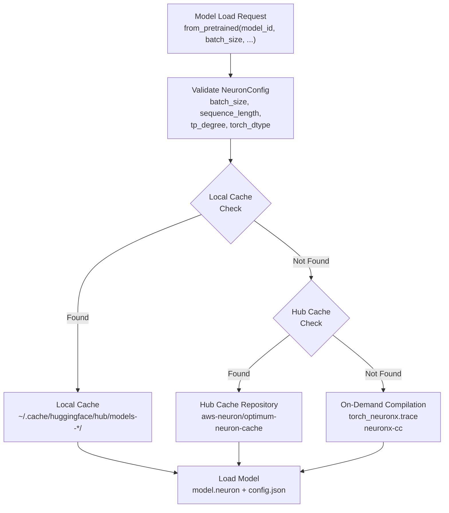
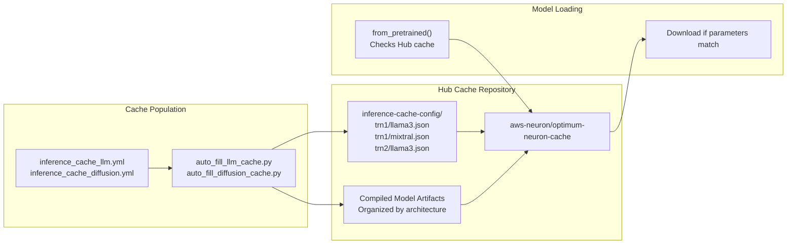
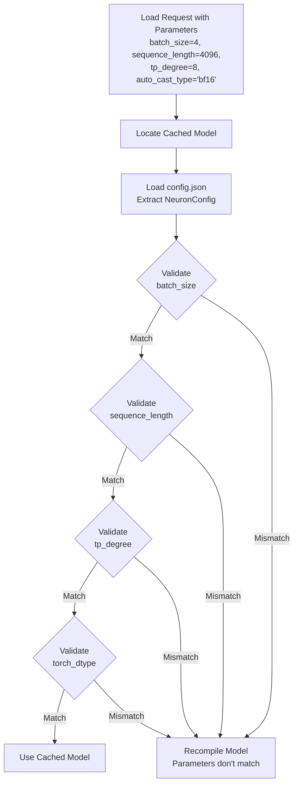

<!-- source: DeepWiki mcp.deepwiki.com · repo huggingface/optimum-neuron · page 8.1 Cache Architecture and Priority · fetched 2026-10-26 -->

# Cache Architecture and Priority

<details>
<summary>Relevant source files</summary>

The following files were used as context for generating this wiki page:

- [.github/actions/install_neuronx_runtime/action.yml](.github/actions/install_neuronx_runtime/action.yml)
- [.github/actions/install_optimum_neuron/action.yml](.github/actions/install_optimum_neuron/action.yml)
- [.github/actions/prepare_venv/action.yml](.github/actions/prepare_venv/action.yml)
- [.github/workflows/inference_cache_diffusion.yml](.github/workflows/inference_cache_diffusion.yml)
- [.github/workflows/inference_cache_llm.yml](.github/workflows/inference_cache_llm.yml)
- [.github/workflows/test_inf2_llm.yml](.github/workflows/test_inf2_llm.yml)
- [.github/workflows/test_inf2_vllm.yml](.github/workflows/test_inf2_vllm.yml)
- [benchmark/text-generation/performance/benchmark.py](benchmark/text-generation/performance/benchmark.py)
- [benchmark/text-generation/performance/llama3.1-8b.py](benchmark/text-generation/performance/llama3.1-8b.py)
- [benchmark/text-generation/performance/llama3.3-70b.py](benchmark/text-generation/performance/llama3.3-70b.py)
- [tests/decoder/test_decoder_embedding.py](tests/decoder/test_decoder_embedding.py)

</details>


## Purpose and Scope

This page documents the architecture of the Neuron model cache system, which stores pre-compiled models to avoid redundant compilation. It covers the cache lookup mechanism, priority order (local cache, Hub cache, compilation), cache validation against export parameters, and the hash-based cache key system.

For information about the workflows that populate and maintain the cache, see [Cache Population Workflows](#8.2). For guidance on setting up custom cache repositories, see [Managing Custom Cache Repositories](#8.3).

## Cache System Overview

The optimum-neuron cache system operates on a three-tier architecture that prioritizes speed and reusability. When loading a model with `NeuronModelForCausalLM.from_pretrained()` or similar methods, the system searches for pre-compiled artifacts in order of access speed, falling back to compilation only when necessary.



**Diagram: Three-Tier Cache Lookup Flow**

Sources: [benchmark/text-generation/performance/benchmark.py:70](), [benchmark/text-generation/performance/llama3.3-70b.py:27-45]()

The cache system provides significant performance benefits:
- **Local cache hits**: Instant loading from disk (seconds)
- **Hub cache hits**: Fast download from Hugging Face Hub (minutes)
- **Cache miss (compilation)**: Compilation from scratch (tens of minutes to hours)

## Cache Priority Order

### Priority 1: Local Cache

The local cache is the first location checked during model loading. It stores compiled models in the Hugging Face Hub cache directory structure, typically at `~/.cache/huggingface/hub/models--{org}--{model}/`.

When a model is exported or downloaded from the Hub cache, it is stored locally with the following structure:
- `model.neuron` or numbered model files (`model.0.neuron`, `model.1.neuron`, etc.) for tensor-parallel models
- `config.json` containing the `NeuronConfig` with export parameters
- `generation_config.json` for generation settings

The local cache is checked first because it provides the fastest access time with no network overhead.

Sources: [benchmark/text-generation/performance/benchmark.py:70]()

### Priority 2: Hub Cache

If the model is not found locally, the system queries the Hub cache repository at `aws-neuron/optimum-neuron-cache`. This centralized repository contains pre-compiled models for common configurations, maintained by automated workflows.



**Diagram: Hub Cache Repository Structure**

Sources: [.github/workflows/inference_cache_llm.yml:22-57](), [.github/workflows/inference_cache_diffusion.yml:21-53]()

The Hub cache repository provides:
- **Pre-compiled models**: Common model architectures with standard configurations
- **Version pinning**: Models compiled with specific optimum-neuron versions
- **Multi-architecture support**: Different hardware targets (trn1, trn2, inf2)
- **Shared access**: Multiple users and CI/CD pipelines benefit from the same cache

The cache is populated through GitHub Actions workflows that run:
- **Daily**: LLM cache builder via scheduled cron job
- **Weekly**: Diffusion model cache builder
- **On release**: When new versions are tagged
- **On demand**: Via `workflow_dispatch` trigger

Sources: [.github/workflows/inference_cache_llm.yml:3-10](), [.github/workflows/inference_cache_diffusion.yml:3-10]()

### Priority 3: On-Demand Compilation

When a model configuration is not found in either local or Hub cache, the system performs on-demand compilation. This is triggered automatically when `export=True` is passed to `from_pretrained()`.

```python
# Example from benchmark script showing export parameter
model = NeuronModelForCausalLM.from_pretrained(
    model_id,
    export=True,  # Triggers compilation if not cached
    batch_size=batch_size,
    sequence_length=seq_length,
    auto_cast_type="bf16",
    num_cores=NUM_CORES,
)
```

Sources: [benchmark/text-generation/performance/llama3.1-8b.py:27-34](), [benchmark/text-generation/performance/llama3.3-70b.py:38-45]()

On-demand compilation:
- Invokes the Neuron compiler (`neuronx-cc`) to generate NEFF executables
- Applies model-specific optimizations (GQA layouts, weight fusion, Flash Attention)
- Stores the compiled model in the local cache for future reuse
- Takes significantly longer than cache hits (minutes to hours depending on model size)

## Cache Key Generation and Validation

The cache system uses a hash-based key generation mechanism to uniquely identify compiled models based on their export parameters. This ensures that cached models match the exact configuration requested.

### Export Parameters

The `NeuronConfig` class stores all parameters that affect model compilation. These parameters form the basis for cache key generation:

| Parameter | Description | Impact on Compilation |
|-----------|-------------|----------------------|
| `checkpoint_id` | Model architecture identifier | Defines model structure |
| `batch_size` | Number of parallel sequences | Affects graph structure |
| `sequence_length` | Maximum token length | Affects memory allocation |
| `tp_degree` / `num_cores` | Tensor parallelism degree | Affects graph partitioning |
| `torch_dtype` / `auto_cast_type` | Precision (fp32, bf16) | Affects computation kernels |
| `compiler_version` | Neuron compiler version | Affects generated NEFF |

Sources: [benchmark/text-generation/performance/llama3.3-70b.py:27-35]()

### Cache Validation Logic

When loading a model, the system validates that the cached model's configuration matches the requested parameters:



**Diagram: Cache Validation Process**

Sources: [benchmark/text-generation/performance/llama3.3-70b.py:27-35]()

The validation ensures correctness by preventing the use of models compiled with incompatible configurations. For example, a model compiled with `batch_size=1` cannot be used for batch inference with `batch_size=4` due to the static shape requirements of Neuron compilation.

## Cache Access and Authentication

### Environment Variables

The cache system respects several environment variables for configuration:

| Variable | Purpose | Default |
|----------|---------|---------|
| `HF_TOKEN` | Authentication for Hub cache access | None (public read) |
| `HF_HOME` | Override Hugging Face cache directory | `~/.cache/huggingface` |
| `HF_XET_HIGH_PERFORMANCE` | Enable high-performance Hub transfer | Unset |

Sources: [.github/workflows/inference_cache_llm.yml:26,56](), [.github/workflows/test_inf2_llm.yml:65,78]()

### Authentication Requirements

- **Reading from Hub cache**: No authentication required for public `aws-neuron/optimum-neuron-cache` repository
- **Writing to Hub cache**: Requires `HF_TOKEN` with write permissions (used by CI/CD workflows)
- **Private cache repositories**: Require `HF_TOKEN` with appropriate access permissions

The CI/CD workflows use a dedicated token stored in GitHub Secrets:

```yaml
# Example from workflow
HF_TOKEN=${{secrets.HF_TOKEN_OPTIMUM_NEURON_CACHE}} \
  python tools/cache/auto_fill_llm_cache.py --config_file ${config_prefix_url}/${{matrix.config}}.json
```

Sources: [.github/workflows/inference_cache_llm.yml:56-57]()

## Matrix-Based Cache Population

The Hub cache is populated using a matrix strategy that compiles models across multiple configurations in parallel. This approach efficiently builds cache coverage for common use cases.

### LLM Cache Matrix

The LLM cache workflow defines a matrix of configurations targeting different hardware and model families:

```yaml
matrix:
  config: [
    trn1/llama3,
    trn1/llama4,
    trn1/mixtral,
    trn1/qwen3,
    trn1/qwen3-moe,
    trn1/granite,
    trn1/phi4,
    trn1/smollm3,
    trn2/llama3,
    trn2/llama4,
    trn2/qwen3-moe,
  ]
```

Sources: [.github/workflows/inference_cache_llm.yml:30-42]()

Each configuration corresponds to a JSON file in the Hub cache repository at:
```
https://huggingface.co/aws-neuron/optimum-neuron-cache/raw/main/inference-cache-config/{config}.json
```

### Diffusion Cache Matrix

The diffusion model cache covers popular Stable Diffusion variants:

```yaml
matrix:
  config: [
    pixart-alpha-xl-512x512,
    pixart-sigma-xl-512x512,
    sdxl-turbo,
    stable-diffusion-2-1,
    stable-diffusion-v1-5,
    stable-diffusion-xl-base-1.0,
    stable-diffusion-xl-refiner-1.0,
  ]
```

Sources: [.github/workflows/inference_cache_diffusion.yml:30-38]()

### Execution Environment

The cache population workflows run on dedicated Inferentia hardware to perform actual compilation:

```yaml
runs-on:
  group: aws-inf2-8xlarge
env:
  HF_XET_HIGH_PERFORMANCE: 1
```

Sources: [.github/workflows/inference_cache_llm.yml:23-26]()

The `aws-inf2-8xlarge` runner group provides access to instances with:
- Multiple Inferentia2 accelerators
- Sufficient memory for large model compilation
- Neuron SDK pre-installed

## Cache Testing Integration

The testing infrastructure verifies cache functionality across different scenarios. Tests export models using fixture scripts before running inference tests.

### Test Model Export

Test workflows first export models to populate local cache:

```bash
# From test workflow
export HF_TOKEN=${{ secrets.HF_TOKEN_OPTIMUM_NEURON_CI }}
python tests/fixtures/llm/export_models.py
```

Sources: [.github/workflows/test_inf2_llm.yml:75-79](), [.github/workflows/test_inf2_vllm.yml:80-83]()

### Cache Hit Testing

Tests verify that models can be loaded from cache by running with `export=False`:

```python
# Example showing loading from cache
model = NeuronModelForCausalLM.from_pretrained(
    args.model, 
    export=False,  # Expects model to be in cache
    low_cpu_mem_usage=True
)
```

Sources: [benchmark/text-generation/performance/benchmark.py:70]()

This approach validates:
- Cache lookup correctness
- Parameter validation accuracy
- Compiled model compatibility

Sources: [.github/workflows/test_inf2_llm.yml:80-93]()

---

