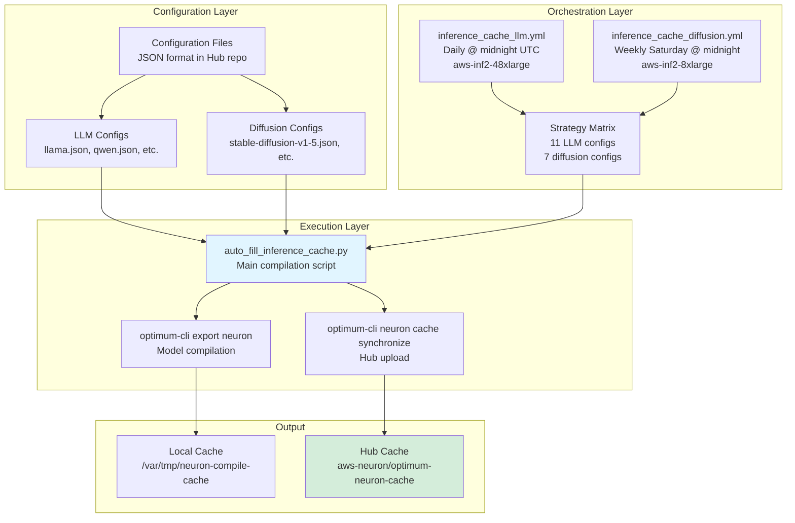
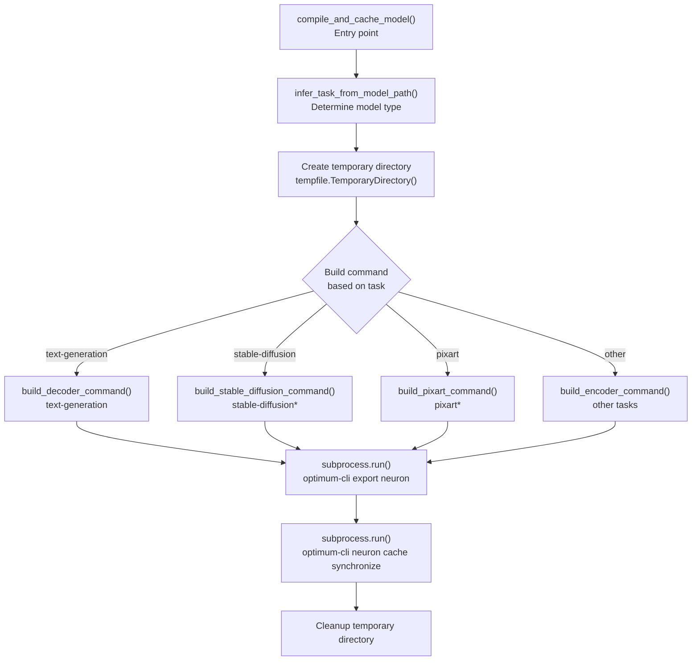
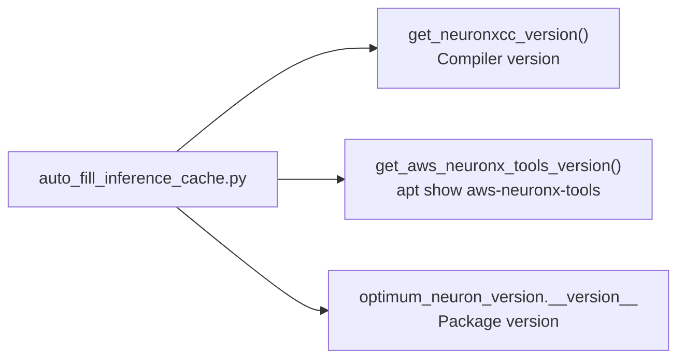
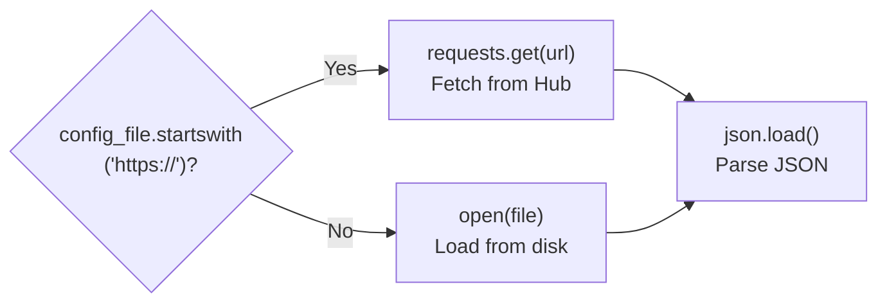
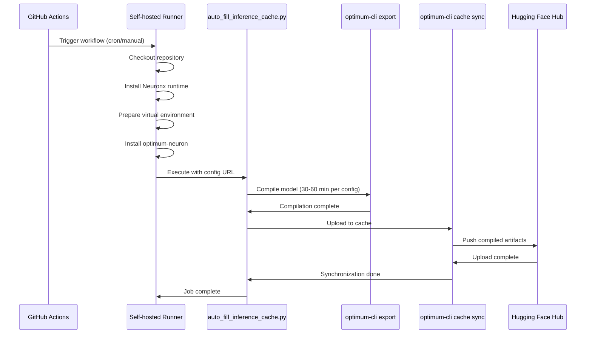
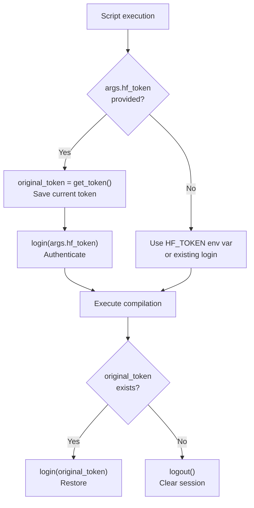

<!-- source: DeepWiki mcp.deepwiki.com · repo huggingface/optimum-neuron · page 8.2 Cache Population Workflows · fetched 2026-10-26 -->

# Cache Population System

<details>
<summary>Relevant source files</summary>

The following files were used as context for generating this wiki page:

- [.github/actions/install_neuronx_runtime/action.yml](.github/actions/install_neuronx_runtime/action.yml)
- [.github/actions/install_optimum_neuron/action.yml](.github/actions/install_optimum_neuron/action.yml)
- [.github/actions/prepare_venv/action.yml](.github/actions/prepare_venv/action.yml)
- [.github/workflows/inference_cache_diffusion.yml](.github/workflows/inference_cache_diffusion.yml)
- [.github/workflows/inference_cache_llm.yml](.github/workflows/inference_cache_llm.yml)
- [.github/workflows/test_inf2_llm.yml](.github/workflows/test_inf2_llm.yml)
- [.github/workflows/test_inf2_vllm.yml](.github/workflows/test_inf2_vllm.yml)
- [benchmark/text-generation/performance/benchmark.py](benchmark/text-generation/performance/benchmark.py)
- [benchmark/text-generation/performance/llama3.1-8b.py](benchmark/text-generation/performance/llama3.1-8b.py)
- [benchmark/text-generation/performance/llama3.3-70b.py](benchmark/text-generation/performance/llama3.3-70b.py)
- [tests/decoder/test_decoder_embedding.py](tests/decoder/test_decoder_embedding.py)

</details>


## Purpose and Scope

The Cache Population System automates the process of pre-compiling Neuron models and uploading them to Hugging Face Hub cache repositories. This system runs scheduled CI/CD jobs that compile popular model configurations, dramatically reducing deployment time for end users from 30-60 minutes to seconds.

This page covers the automated cache building infrastructure, including the `auto_fill_inference_cache.py` script, CI/CD workflows, and configuration management. For information about using cached models, see [Cache System](#7). For manual cache management commands, see [Cache CLI Commands](#7.3).

---

## System Architecture

The cache population system consists of three main components: a Python script that handles compilation and synchronization, configuration files that define which models and parameters to compile, and GitHub Actions workflows that orchestrate scheduled builds.



**Sources:**
- [tools/auto_fill_inference_cache.py:1-360]()
- [.github/workflows/inference_cache_llm.yml:1-54]()
- [.github/workflows/inference_cache_diffusion.yml:1-50]()

---

## The auto_fill_inference_cache.py Script

The core cache population logic resides in `auto_fill_inference_cache.py`, which handles model compilation and Hub synchronization. The script supports both single-model compilation and batch processing from configuration files.

### Main Entry Point

The script provides two modes of operation:

| Mode | Trigger | Use Case |
|------|---------|----------|
| Single Model | `--hf_model_id` argument | Manual ad-hoc compilation |
| Batch Processing | `--config_file` argument | Automated CI/CD builds |

**Sources:**
- [tools/auto_fill_inference_cache.py:269-353]()

### Compilation Function

The `compile_and_cache_model()` function orchestrates the entire compilation and caching process:



**Sources:**
- [tools/auto_fill_inference_cache.py:177-238]()
- [tools/auto_fill_inference_cache.py:241-266]()

### Command Builders

The script provides specialized command builders for different model types:

#### Decoder Models (LLMs)

[tools/auto_fill_inference_cache.py:65-88]() - Builds export commands for causal language models:
- Required parameters: `batch_size`, `sequence_length`, `tensor_parallel_size`, `auto_cast_type`
- Task: `text-generation`

#### Encoder Models

[tools/auto_fill_inference_cache.py:91-114]() - Builds export commands for BERT-like models:
- Required parameters: `task`, `batch_size`, `sequence_length`, `auto_cast`, `auto_cast_type`

#### Stable Diffusion Models

[tools/auto_fill_inference_cache.py:117-144]() - Builds export commands for diffusion models:
- Required parameters: `batch_size`, `height`, `width`, `auto_cast`, `auto_cast_type`
- Optional: `num_images_per_prompt`

#### PixArt Models

[tools/auto_fill_inference_cache.py:147-174]() - Builds export commands for PixArt models:
- Required parameters: `batch_size`, `sequence_length`, `height`, `width`, `torch_dtype`

**Sources:**
- [tools/auto_fill_inference_cache.py:65-174]()

### Version Tracking

The script logs version information for reproducibility and debugging:



[tools/auto_fill_inference_cache.py:54-62]() - Extracts SDK version from APT package information

[tools/auto_fill_inference_cache.py:306-311]() - Logs all version information for cache build tracking

**Sources:**
- [tools/auto_fill_inference_cache.py:54-62]()
- [tools/auto_fill_inference_cache.py:306-311]()

---

## Configuration Files

Configuration files define matrices of model IDs and compilation parameters. These JSON files are hosted in the `aws-neuron/optimum-neuron-cache` Hub repository under the `inference-cache-config/` directory.

### Configuration Format

The configuration file structure follows this format:

```json
{
    "model-id/path": [
        {
            "batch_size": 1,
            "sequence_length": 2048,
            "tensor_parallel_size": 2,
            "auto_cast_type": "bf16"
        },
        {
            "batch_size": 2,
            "sequence_length": 4096,
            "tensor_parallel_size": 4,
            "auto_cast_type": "fp16"
        }
    ]
}
```

Each model ID maps to an array of configuration dictionaries, allowing multiple variants to be compiled.

**Sources:**
- [tools/auto_fill_inference_cache.py:37-47]()

### Configuration Processing

[tools/auto_fill_inference_cache.py:314-338]() - The script processes configuration files as follows:

1. **Load Configuration**: Fetch from HTTPS URL or read from local file
2. **Iterate Models**: Loop through each model ID in the configuration
3. **Iterate Configs**: For each model, compile all specified parameter combinations
4. **Invoke Compilation**: Call `compile_and_cache_model()` with extracted parameters

### Remote Configuration Loading

The script supports loading configurations from remote URLs:



**Sources:**
- [tools/auto_fill_inference_cache.py:317-323]()

---

## CI/CD Workflows

Two GitHub Actions workflows orchestrate scheduled cache builds, each optimized for different model types and resource requirements.

### LLM Cache Workflow

The `inference_cache_llm.yml` workflow handles large language model compilation:

| Property | Value |
|----------|-------|
| **File** | `.github/workflows/inference_cache_llm.yml` |
| **Schedule** | Daily at midnight UTC (`cron: '0 0 * * *'`) |
| **Instance Type** | `aws-inf2-48xlarge` (12 NeuronCores-v2) |
| **Strategy** | Matrix with 11 configurations |
| **Trigger** | Schedule, workflow_dispatch, version tags |

#### Matrix Configurations

[.github/workflows/inference_cache_llm.yml:26-38]() - The workflow compiles 11 LLM families:

```
llama
llama4
qwen
qwen-moe
qwen2.5
granite
phi4
llama3.1-70b
qwen2.5-large
llama-variants
smollm3
```

Each matrix job runs independently and can fail without affecting others (`fail-fast: false`).

**Sources:**
- [.github/workflows/inference_cache_llm.yml:1-54]()

### Diffusion Cache Workflow

The `inference_cache_diffusion.yml` workflow handles image generation models:

| Property | Value |
|----------|-------|
| **File** | `.github/workflows/inference_cache_diffusion.yml` |
| **Schedule** | Weekly Saturday at midnight UTC (`cron: '0 0 * * 6'`) |
| **Instance Type** | `aws-inf2-8xlarge` (2 NeuronCores-v2) |
| **Strategy** | Matrix with 7 configurations |
| **Trigger** | Schedule, workflow_dispatch, version tags |

#### Matrix Configurations

[.github/workflows/inference_cache_diffusion.yml:26-34]() - The workflow compiles 7 diffusion models:

```
pixart-alpha-xl-512x512
pixart-sigma-xl-512x512
sdxl-turbo
stable-diffusion-2-1
stable-diffusion-v1-5
stable-diffusion-xl-base-1.0
stable-diffusion-xl-refiner-1.0
```

**Sources:**
- [.github/workflows/inference_cache_diffusion.yml:1-50]()

### Workflow Execution Steps

Both workflows follow a similar execution pattern:



**Sources:**
- [.github/workflows/inference_cache_llm.yml:40-53]()
- [.github/workflows/inference_cache_diffusion.yml:36-49]()

### Configuration URL Construction

Both workflows construct configuration URLs dynamically:

```
config_prefix_url=https://huggingface.co/aws-neuron/optimum-neuron-cache/raw/main/inference-cache-config
HF_TOKEN=${{secrets.HF_TOKEN_OPTIMUM_NEURON_CACHE}} \
  python tools/auto_fill_inference_cache.py --config_file ${config_prefix_url}/${{matrix.config}}.json
```

This pattern allows centralized configuration management in the Hub repository.

**Sources:**
- [.github/workflows/inference_cache_llm.yml:51-53]()
- [.github/workflows/inference_cache_diffusion.yml:47-49]()

---

## Environment Variables

The cache population system uses several environment variables for configuration:

| Variable | Purpose | Set In |
|----------|---------|--------|
| `HF_HUB_ENABLE_HF_TRANSFER` | Enable fast Hub transfers | Workflow files |
| `HF_TOKEN` | Authenticate with Hub for cache writes | GitHub Secrets |
| `AWS_REGION` | AWS region for operations | Workflow files |
| `NEURON_CC_FLAGS` | Compiler flags (inherited) | System environment |

**Sources:**
- [.github/workflows/inference_cache_llm.yml:20-22]()
- [.github/workflows/inference_cache_diffusion.yml:20-22]()

---

## Authentication and Token Management

The script includes token management logic to handle both environment variables and explicit token arguments:



[tools/auto_fill_inference_cache.py:298-304]() - Initial authentication logic

[tools/auto_fill_inference_cache.py:356-359]() - Token restoration after execution

**Sources:**
- [tools/auto_fill_inference_cache.py:298-304]()
- [tools/auto_fill_inference_cache.py:356-359]()

---

## Test Fixtures Integration

Test workflows also contribute to cache population through model export fixtures:

[.github/workflows/test_inf2_llm.yml:75-79]() - The test workflow exports models before running tests:

```bash
export HF_TOKEN=${{ secrets.HF_TOKEN_OPTIMUM_NEURON_CI }}
python tests/fixtures/llm/export_models.py
```

This creates a dual benefit: tests verify model functionality while populating the cache for CI use.

**Sources:**
- [.github/workflows/test_inf2_llm.yml:75-79]()
- [.github/workflows/test_inf2_vllm.yml:79-83]()

---

## Resource Considerations

The cache population system requires significant computational resources:

### Instance Type Selection

| Model Type | Instance Type | NeuronCores | Rationale |
|------------|---------------|-------------|-----------|
| LLMs | `aws-inf2-48xlarge` | 12 | Large models with tensor parallelism |
| Diffusion | `aws-inf2-8xlarge` | 2 | Smaller models, less parallelism needed |

### Compilation Time

Compilation times vary significantly:
- Small models (7B parameters, TP=2): 15-30 minutes
- Large models (70B parameters, TP=8): 45-90 minutes
- Multiple configurations per model multiply total time

### Cache Size

The Hub cache repository grows continuously:
- Each compiled model generates 1-10 GB of NEFF files
- Matrix of configurations creates hundreds of cache entries
- Automatic cleanup not implemented (manual management required)

**Sources:**
- [.github/workflows/inference_cache_llm.yml:19]()
- [.github/workflows/inference_cache_diffusion.yml:19]()

---

## Manual Cache Population

Users can manually populate caches using the same script:

### Single Model Example

```bash
# Set up authentication
export HF_TOKEN=hf_xxx

# Compile a specific configuration
python tools/auto_fill_inference_cache.py \
  --hf_model_id "meta-llama/Llama-2-7b-chat-hf" \
  --batch_size 1 \
  --sequence_length 2048 \
  --tensor_parallel_size 2 \
  --auto_cast_type fp16
```

### Batch Processing Example

```bash
# Using a local configuration file
python tools/auto_fill_inference_cache.py \
  --config_file my_models.json

# Using a remote configuration file
python tools/auto_fill_inference_cache.py \
  --config_file https://example.com/config.json
```

**Sources:**
- [tools/auto_fill_inference_cache.py:34-47]()

---

## Workflow Triggers

The cache workflows support multiple trigger mechanisms:

| Trigger Type | Purpose | Syntax |
|--------------|---------|--------|
| Schedule | Automated builds | `schedule: - cron: '0 0 * * *'` |
| Manual | On-demand builds | `workflow_dispatch` |
| Version Tags | Release-triggered | `push: tags: - 'v[0-9]+.[0-9]+.[0-9]+'` |

The manual trigger allows repository maintainers to initiate cache builds without waiting for the scheduled time.

**Sources:**
- [.github/workflows/inference_cache_llm.yml:3-10]()
- [.github/workflows/inference_cache_diffusion.yml:3-10]()

---

## Concurrency Control

Both workflows implement concurrency control to prevent duplicate builds:

```yaml
concurrency:
  group: ${{ github.workflow }}-${{ github.head_ref || github.run_id }}
```

This ensures that only one instance of each workflow runs at a time, preventing resource conflicts and duplicate cache uploads.

**Sources:**
- [.github/workflows/inference_cache_llm.yml:12-13]()
- [.github/workflows/inference_cache_diffusion.yml:12-13]()

---

