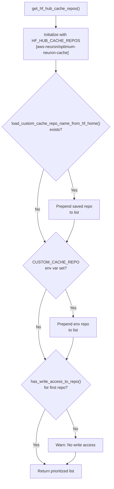
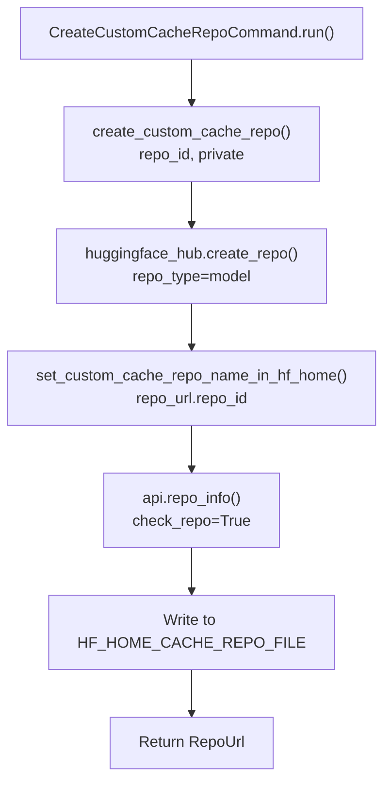
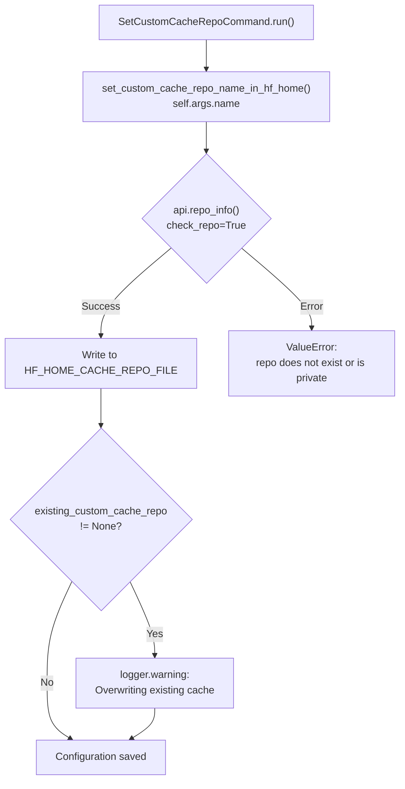
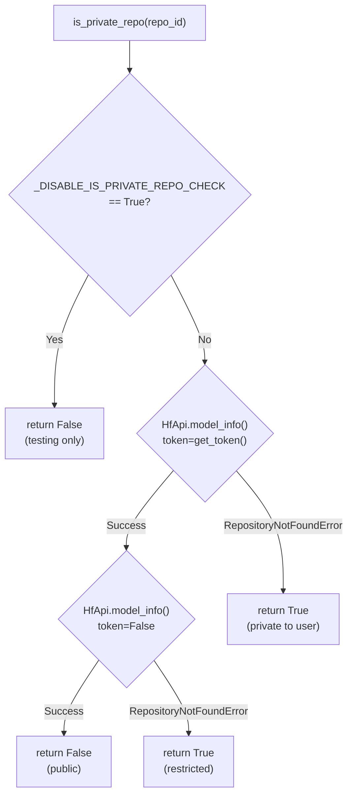
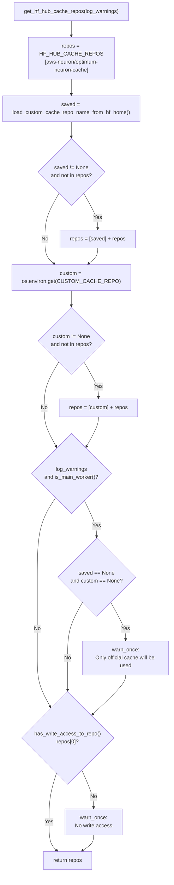
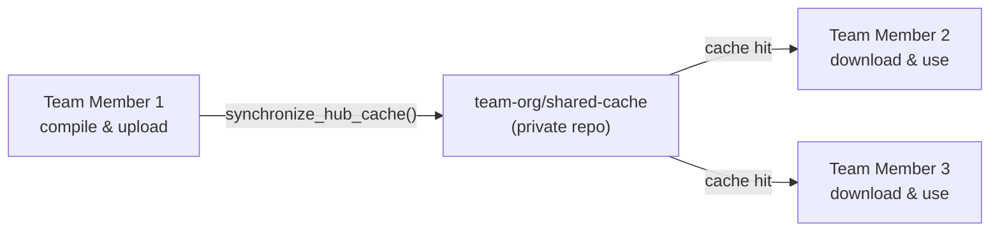

<!-- source: DeepWiki mcp.deepwiki.com · repo huggingface/optimum-neuron · page 8.3 Managing Custom Cache Repositories · fetched 2026-10-26 -->

# Managing Custom Cache Repositories

<details>
<summary>Relevant source files</summary>

The following files were used as context for generating this wiki page:

- [.github/actions/install_neuronx_runtime/action.yml](.github/actions/install_neuronx_runtime/action.yml)
- [.github/actions/install_optimum_neuron/action.yml](.github/actions/install_optimum_neuron/action.yml)
- [.github/actions/prepare_venv/action.yml](.github/actions/prepare_venv/action.yml)
- [.github/workflows/inference_cache_diffusion.yml](.github/workflows/inference_cache_diffusion.yml)
- [.github/workflows/inference_cache_llm.yml](.github/workflows/inference_cache_llm.yml)
- [.github/workflows/test_inf2_llm.yml](.github/workflows/test_inf2_llm.yml)
- [.github/workflows/test_inf2_vllm.yml](.github/workflows/test_inf2_vllm.yml)
- [benchmark/text-generation/performance/benchmark.py](benchmark/text-generation/performance/benchmark.py)
- [benchmark/text-generation/performance/llama3.1-8b.py](benchmark/text-generation/performance/llama3.1-8b.py)
- [benchmark/text-generation/performance/llama3.3-70b.py](benchmark/text-generation/performance/llama3.3-70b.py)
- [tests/decoder/test_decoder_embedding.py](tests/decoder/test_decoder_embedding.py)

</details>


This page covers the creation, configuration, and management of custom Hugging Face Hub repositories used as remote caches for Neuron compiled artifacts. It explains the repository priority system, access control mechanisms, and team collaboration workflows.

For general cache system concepts and usage patterns, see [Cache System](#7). For details on cache lookup priority and identification hashing, see [Understanding Cache Priority](#7.1). For CLI command reference, see [Cache CLI Commands](#7.3).

## Cache Repository Overview

A cache repository is a Hugging Face Hub model repository that stores pre-compiled NEFF (Neuron Executable File Format) files and associated metadata. The system uses these repositories to share compiled artifacts across team members, CI/CD systems, and deployment environments.

**Repository Types:**

| Type | Write Access | Use Case | Repository ID |
|------|-------------|----------|---------------|
| **Official Cache** | AWS Neuron team only | Public pre-compiled models | `aws-neuron/optimum-neuron-cache` |
| **Custom Private Cache** | Repository owners/collaborators | Team sharing, private models | User-defined (e.g., `my-org/my-cache`) |
| **Custom Public Cache** | Repository owners/collaborators | Open-source project sharing | User-defined with `--public` flag |

The default official cache (`aws-neuron/optimum-neuron-cache`) is read-only for most users. Custom cache repositories are required to upload your own compiled artifacts.

Sources: [optimum/neuron/utils/cache_utils.py:46-50](), [docs/source/guides/cache_system.mdx:82-93]()

## Repository Priority System

The cache system resolves which repository to use for both reading and writing through a three-tier priority hierarchy implemented in `get_hf_hub_cache_repos()`.



**Priority Resolution (highest to lowest):**

1. **Environment Variable** - `CUSTOM_CACHE_REPO` environment variable (highest priority)
2. **Saved Configuration** - Repository stored in `~/.cache/huggingface/optimum_neuron_custom_cache`
3. **Default Official Cache** - `aws-neuron/optimum-neuron-cache` (fallback)

When reading cached artifacts, the system checks repositories in priority order. When writing, it uses the highest-priority repository where the user has write access.

Sources: [optimum/neuron/utils/cache_utils.py:165-201]()

## Priority Implementation Details

### Saved Cache Repository File

The custom cache repository name is persisted in a file managed by three core functions:

**File Location:**
```python
HF_HOME = os.environ.get("HF_HOME", "~/.cache/huggingface")
HF_HOME_CACHE_REPO_FILE = f"{HF_HOME}/optimum_neuron_custom_cache"
```

**Functions:**

| Function | Purpose | File Path |
|----------|---------|-----------|
| `load_custom_cache_repo_name_from_hf_home()` | Reads saved repository ID from disk | [cache_utils.py:63-70]() |
| `set_custom_cache_repo_name_in_hf_home()` | Writes repository ID to disk, validates existence | [cache_utils.py:73-96]() |
| `delete_custom_cache_repo_name_from_hf_home()` | Removes saved repository configuration | [cache_utils.py:99-100]() |

The `set_custom_cache_repo_name_in_hf_home()` function includes validation via `api.repo_info()` to ensure the repository exists and is accessible before saving.

Sources: [optimum/neuron/utils/cache_utils.py:43-44, 63-100]()

### Environment Variable Override

The `CUSTOM_CACHE_REPO` environment variable provides session-level cache configuration without modifying persistent settings:

```bash
# Single-command override
CUSTOM_CACHE_REPO="my-org/experiment-cache" python train.py

# Session-level override
export CUSTOM_CACHE_REPO="my-org/experiment-cache"
```

This mechanism is particularly useful for:
- **CI/CD workflows** - Different caches per environment (dev/staging/prod)
- **Experimentation** - Temporary cache repositories for specific experiments
- **Multi-tenant systems** - User-specific cache isolation

The environment variable takes precedence over the saved configuration, allowing temporary overrides without affecting the persistent setting.

Sources: [optimum/neuron/utils/cache_utils.py:182-184]()

## Creating Custom Cache Repositories

### CLI Creation

The `CreateCustomCacheRepoCommand` provides the primary interface for creating cache repositories:

```bash
# Create private cache (default)
optimum-cli neuron cache create

# Create with custom name
optimum-cli neuron cache create -n my-custom-cache

# Create public cache
optimum-cli neuron cache create -n my-public-cache --public
```

**Implementation Flow:**



The command automatically sets the newly created repository as the active cache by calling `set_custom_cache_repo_name_in_hf_home()`.

Sources: [optimum/commands/neuron/cache.py:35-56](), [optimum/neuron/utils/cache_utils.py:103-106]()

### Programmatic Creation

For integration into scripts or automation:

```python
from optimum.neuron.utils.cache_utils import create_custom_cache_repo

# Create and set as active cache
repo_url = create_custom_cache_repo(
    repo_id="my-org/my-cache",
    private=True
)
print(f"Created cache: {repo_url.repo_id}")
```

The `create_custom_cache_repo()` function wraps `huggingface_hub.create_repo()` and automatically configures the new repository as the active cache.

Sources: [optimum/neuron/utils/cache_utils.py:103-106]()

## Setting Active Cache Repository

### CLI Configuration

The `SetCustomCacheRepoCommand` configures which repository to use without creating a new one:

```bash
# Set existing repository as active cache
optimum-cli neuron cache set my-org/existing-cache
```

**Implementation:**



The function validates repository accessibility before saving the configuration. If a cache is already configured, it logs a warning about the override.

Sources: [optimum/commands/neuron/cache.py:58-66](), [optimum/neuron/utils/cache_utils.py:73-96]()

### Programmatic Configuration

```python
from optimum.neuron.utils.cache_utils import set_custom_cache_repo_name_in_hf_home

# Set active cache with validation
set_custom_cache_repo_name_in_hf_home(
    repo_id="my-org/my-cache",
    check_repo=True  # Validates existence
)

# Skip validation (use carefully)
set_custom_cache_repo_name_in_hf_home(
    repo_id="my-org/my-cache",
    check_repo=False
)
```

The `check_repo` parameter controls whether the function validates repository existence via `api.repo_info()`. Skipping validation can be useful in automated scenarios where the repository is guaranteed to exist.

Sources: [optimum/neuron/utils/cache_utils.py:73-96]()

## Access Control and Permissions

### Repository Privacy Checks

The `is_private_repo()` function determines repository visibility using a two-stage token-based check:



**Privacy Determination Logic:**

1. **With token** - Tests if repository exists for authenticated user
2. **Without token** - Tests if repository is publicly accessible

If the repository is accessible with token but not without, it's private. This mechanism prevents compilation artifacts from private models being uploaded to public caches.

Sources: [optimum/neuron/utils/cache_utils.py:109-126]()

### Write Access Validation

The `has_write_access_to_repo()` function uses a clever branch deletion attempt to test write permissions:

```python
# Cached to avoid repeated API calls
_CACHED_HAS_WRITE_ACCESS_TO_REPO = {}

def has_write_access_to_repo(repo_id: str) -> bool:
    token = get_token()
    key = (token, repo_id)
    
    # Check cache first
    if key in _CACHED_HAS_WRITE_ACCESS_TO_REPO:
        return _CACHED_HAS_WRITE_ACCESS_TO_REPO[key]
    
    # Attempt to delete non-existent branch
    api.delete_branch(
        repo_id=repo_id,
        repo_type="model",
        branch=f"this-branch-does-not-exist-{uuid4()}"
    )
```

**Response Interpretation:**

| Exception | Write Access | Reason |
|-----------|-------------|--------|
| `RevisionNotFoundError` | ✅ Yes | Branch not found (expected), but no 403 error |
| `GatedRepoError` | ❌ No | Repository is gated |
| `RepositoryNotFoundError` | ❌ No | Repository doesn't exist or no access |
| `HfHubHTTPError` (401/403) | ❌ No | Insufficient permissions |

Results are cached in `_CACHED_HAS_WRITE_ACCESS_TO_REPO` to minimize API calls during training or compilation sessions.

Sources: [optimum/neuron/utils/cache_utils.py:129-162]()

## Repository Structure and Contents

Cache repositories store compiled artifacts organized by compilation parameters. While the exact structure is implementation-dependent, understanding what gets stored helps with repository management:

**Stored Artifacts:**

| File Type | Extension | Purpose | Size Range |
|-----------|-----------|---------|------------|
| NEFF Files | `.neff` | Compiled Neuron executable | 100 MB - 10+ GB per model |
| Protocol Buffers | `.pb` | Compilation metadata | 1-10 KB |
| Text Logs | `.txt` | Compiler output, configuration | 1-100 KB |

These files are identified by hash-based directory names that encode compilation parameters (see [Understanding Cache Priority](#7.1) for hash computation details).

**Repository Size Considerations:**

- Each model configuration generates multiple artifacts
- Large language models produce multi-GB NEFF files
- Tensor parallelism multiplies artifact count
- Consider Hub repository size limits for long-term use

Sources: [optimum/neuron/utils/cache_utils.py:261-267]()

## Cache Repository Discovery Flow

When the system needs to read or write cache artifacts, it uses the repository list returned by `get_hf_hub_cache_repos()`:



The function includes optional warnings when no custom cache is configured or when the user lacks write access to the highest-priority repository. These warnings appear only on the main worker in distributed settings (via `is_main_worker()`).

Sources: [optimum/neuron/utils/cache_utils.py:165-201]()

## Team Collaboration Patterns

### Pattern 1: Shared Team Cache

**Scenario:** Multiple team members compiling similar models



**Setup:**
1. Create shared cache: `optimum-cli neuron cache create -n team-org/shared-cache`
2. Add team members as collaborators on Hub repository
3. Each member sets cache: `optimum-cli neuron cache set team-org/shared-cache`
4. First compilation uploads to shared cache
5. Subsequent compilations hit cache automatically

Sources: [optimum/commands/neuron/cache.py:35-66]()

### Pattern 2: Environment-Specific Caches

**Scenario:** Separate caches for development, staging, and production

```bash
# Development environment
export CUSTOM_CACHE_REPO="my-org/dev-cache"

# Staging environment
export CUSTOM_CACHE_REPO="my-org/staging-cache"

# Production environment
export CUSTOM_CACHE_REPO="my-org/prod-cache"
```

This pattern uses environment variables to override the saved cache configuration, allowing different caches per environment without modifying persistent settings.

Sources: [optimum/neuron/utils/cache_utils.py:182-184](), [docs/source/guides/cache_system.mdx:176-192]()

### Pattern 3: CI/CD Cache Population

**Scenario:** Automated cache building in GitHub Actions

```yaml
# .github/workflows/build-cache.yml
env:
  CUSTOM_CACHE_REPO: ${{ secrets.CACHE_REPO_ID }}
  HF_TOKEN: ${{ secrets.HF_TOKEN }}

jobs:
  compile:
    runs-on: aws-inferentia2
    steps:
      - name: Compile and cache
        run: |
          python train_model.py
          optimum-cli neuron cache synchronize
```

The `HF_TOKEN` secret provides write access to the cache repository. The `synchronize` command uploads all locally compiled artifacts to the Hub after training completes.

Sources: [docs/source/guides/cache_system.mdx:176-192]()

## Common Management Tasks

### List Active Cache Configuration

```python
from optimum.neuron.utils.cache_utils import get_hf_hub_cache_repos

# Get prioritized list of cache repositories
repos = get_hf_hub_cache_repos(log_warnings=True)
print(f"Active caches (priority order): {repos}")
print(f"Primary cache: {repos[0]}")
```

The first repository in the returned list is used for writing; all repositories are checked when reading.

### Clear Saved Cache Configuration

```python
from optimum.neuron.utils.cache_utils import delete_custom_cache_repo_name_from_hf_home

# Remove saved cache configuration
delete_custom_cache_repo_name_from_hf_home()
# System will fall back to default aws-neuron/optimum-neuron-cache
```

This resets to the default official cache. The `CUSTOM_CACHE_REPO` environment variable still takes precedence if set.

### Verify Write Access

```python
from optimum.neuron.utils.cache_utils import has_write_access_to_repo

repo_id = "my-org/my-cache"
if has_write_access_to_repo(repo_id):
    print(f"✅ Write access confirmed for {repo_id}")
else:
    print(f"❌ No write access to {repo_id}")
```

This check is automatically performed by `get_hf_hub_cache_repos()` when `log_warnings=True`, but can be called directly for explicit verification.

Sources: [optimum/neuron/utils/cache_utils.py:129-162, 165-201]()

## Troubleshooting

### Repository Validation Failures

**Error:** `Could not save the custom Neuron cache repo... does not exist or is private to you`

**Resolution:**
1. Verify repository exists on Hugging Face Hub
2. Check authentication: `huggingface-cli whoami`
3. Confirm repository ID format: `username/repo-name` or `org/repo-name`
4. Ensure token has read access to repository

**Code Reference:** [optimum/neuron/utils/cache_utils.py:79-86]()

### Write Access Issues

**Symptom:** Compiled artifacts not uploading to cache repository

**Diagnosis:**
```python
from optimum.neuron.utils.cache_utils import has_write_access_to_repo, get_hf_hub_cache_repos

repos = get_hf_hub_cache_repos()
print(f"Primary cache: {repos[0]}")
print(f"Write access: {has_write_access_to_repo(repos[0])}")
```

**Common Causes:**
- Repository is private and user is not a collaborator
- Token lacks write permissions
- Repository is gated

**Code Reference:** [optimum/neuron/utils/cache_utils.py:195-200]()

### Priority Configuration Conflicts

**Symptom:** Wrong cache repository being used

**Verification:**
```python
import os
from optimum.neuron.utils.cache_utils import load_custom_cache_repo_name_from_hf_home, get_hf_hub_cache_repos

print(f"Env override: {os.environ.get('CUSTOM_CACHE_REPO', 'Not set')}")
print(f"Saved cache: {load_custom_cache_repo_name_from_hf_home()}")
print(f"Resolved priority: {get_hf_hub_cache_repos()}")
```

Remember the priority order:
1. `CUSTOM_CACHE_REPO` environment variable
2. Saved configuration file
3. Default official cache

**Code Reference:** [optimum/neuron/utils/cache_utils.py:165-201]()

---

