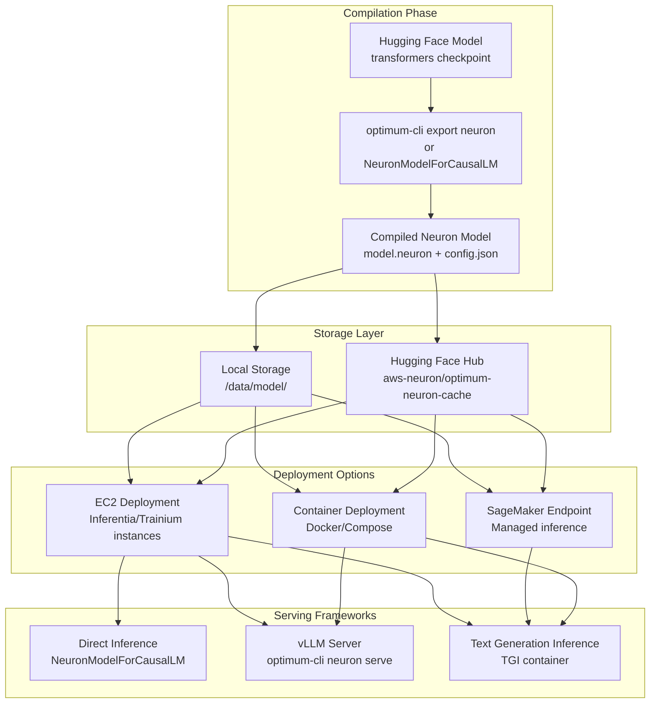
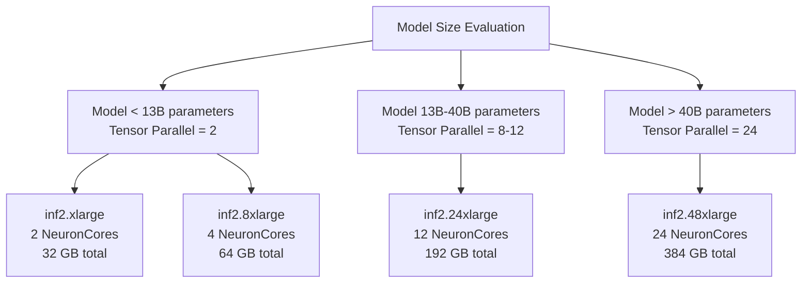
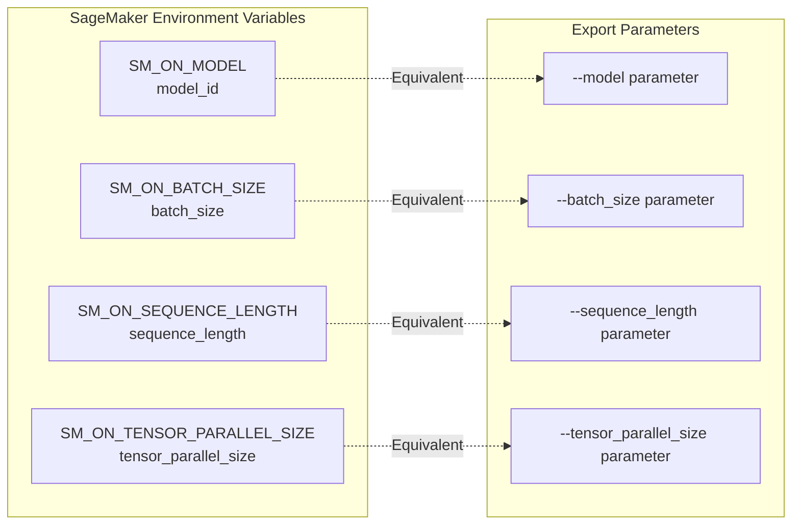
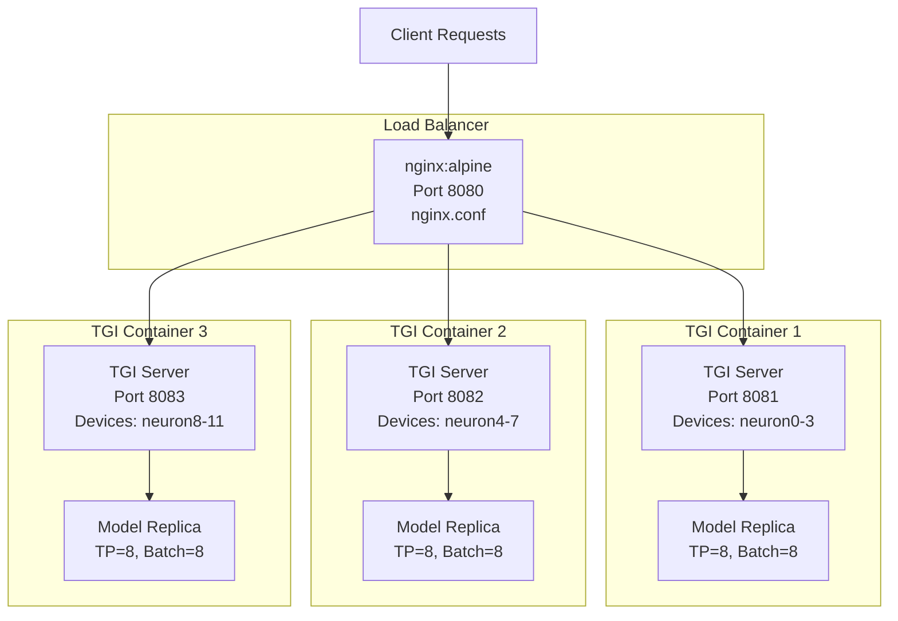
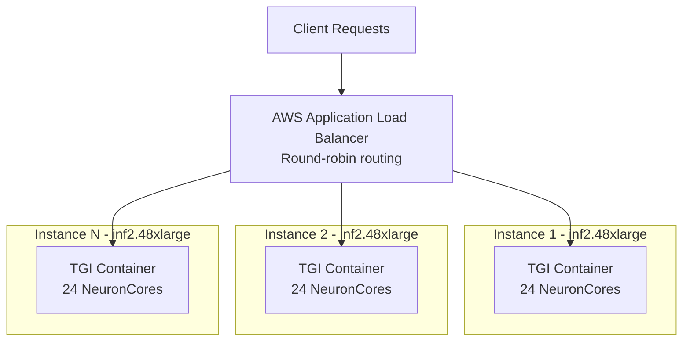

<!-- source: DeepWiki mcp.deepwiki.com · repo huggingface/optimum-neuron · page 9 Deployment Guide · fetched 2026-10-26 -->

# Deployment Guide

<details>
<summary>Relevant source files</summary>

The following files were used as context for generating this wiki page:

- [docs/source/guides/benchmark.mdx](docs/source/guides/benchmark.mdx)
- [docs/source/guides/export_model.mdx](docs/source/guides/export_model.mdx)
- [docs/source/guides/vllm_plugin.mdx](docs/source/guides/vllm_plugin.mdx)
- [docs/source/index.mdx](docs/source/index.mdx)
- [docs/source/inference_tutorials/llama2-13b-chatbot.mdx](docs/source/inference_tutorials/llama2-13b-chatbot.mdx)
- [docs/source/inference_tutorials/notebooks.mdx](docs/source/inference_tutorials/notebooks.mdx)

</details>


## Purpose and Scope

This document covers deploying optimum-neuron models in production environments on AWS infrastructure. It details deployment strategies for EC2 instances with Inferentia/Trainium hardware, SageMaker endpoints, and containerized deployments. Topics include AMI selection, instance type recommendations, environment configuration, Docker image usage, and load balancing strategies.

For model export and compilation before deployment, see [Model Export System](#4). For training on Trainium, see [Training on AWS Neuron](#5). For serving frameworks like vLLM and TGI integration, see [vLLM and TGI Integration](#7).

## Deployment Architecture Overview

The following diagram illustrates the three primary deployment pathways for optimum-neuron models:



Sources: [docs/source/guides/export_model.mdx:315-362](), [docs/source/guides/vllm_plugin.mdx:17-30](), [docs/source/guides/benchmark.mdx:37-48]()

## Deployment Prerequisites

### Hardware Requirements

Optimum-neuron models require AWS Neuron devices for execution:

| Device Generation | Instance Types | NeuronCores | Memory per Core | Use Case |
|-------------------|----------------|-------------|-----------------|----------|
| Inferentia 1 (NeuronCore-v1) | inf1.xlarge, inf1.2xlarge, inf1.6xlarge, inf1.24xlarge | 4-64 | 8 GB | Legacy inference |
| Inferentia 2 (NeuronCore-v2) | inf2.xlarge, inf2.8xlarge, inf2.24xlarge, inf2.48xlarge | 2-24 | 16 GB | Modern inference |
| Trainium (NeuronCore-v2) | trn1.2xlarge, trn1.32xlarge, trn1n.32xlarge, trn2.48xlarge | 2-32 | 16 GB | Training and inference |

**Key Constraint**: Models compiled for inf1 (NeuronCore-v1) are not compatible with inf2/trn1 (NeuronCore-v2), and vice versa. The `--instance_type` parameter during export must match the target deployment hardware.

Sources: [docs/source/guides/export_model.mdx:38-48](), [docs/source/guides/vllm_plugin.mdx:22]()

### Software Dependencies

For Inferentia 2 / Trainium:
```bash
pip install optimum-neuron[neuronx]
```

For Inferentia 1:
```bash
pip install optimum-neuron[neuron]
```

The installation includes dependencies on AWS Neuron SDK components (`torch_neuronx`, `neuronx_distributed` for Inferentia 2 or `torch_neuron` for Inferentia 1).

Sources: [docs/source/guides/export_model.mdx:63-75]()

## EC2 Instance Deployment

### AMI Selection and Setup

The recommended approach uses the Hugging Face Neuron Deep Learning AMI, which includes pre-configured Neuron SDK and optimum-neuron installation.

**Launching with HF Neuron DL AMI**:
1. Select AMI: [Hugging Face Neuron Deep Learning AMI](https://aws.amazon.com/marketplace/pp/prodview-gr3e6yiscria2) from AWS Marketplace
2. Choose instance type: `inf2.xlarge` or larger for Inferentia 2
3. Configure security groups to allow inbound traffic on serving ports (default 8080)
4. Connect via SSH

After connecting, activate the pre-installed environment:
```bash
source /opt/aws_neuronx_venv_pytorch_2_7/bin/activate
```

Sources: [docs/source/guides/vllm_plugin.mdx:17-29]()

### Direct Model Serving on EC2

Once connected to an EC2 instance, you can serve models using the `optimum-cli neuron serve` command:

```bash
optimum-cli neuron serve \
    --model="unsloth/Llama-3.1-1B-Instruct" \
    --batch_size=4 \
    --sequence_length=4096 \
    --tensor_parallel_size=2
```

The `optimum-cli neuron serve` command:
- Automatically loads pre-compiled models from the Hub cache if available
- Compiles models on-the-fly if cache miss occurs (use `--allow_non_cached_model` to force compilation)
- Launches a vLLM-based OpenAI-compatible API server on port 8080

Test the deployment:
```bash
curl 127.0.0.1:8080/v1/completions \
    -H 'Content-Type: application/json' \
    -X POST \
    -d '{"prompt":"One of my fondest memory is", "temperature": 0.8, "max_tokens":128}'
```

Sources: [docs/source/guides/vllm_plugin.mdx:59-92]()

### Programmatic Inference

For direct programmatic access without a serving layer:

```python
from vllm import LLM, SamplingParams
from optimum.neuron import NeuronModelForCausalLM

# Option 1: Using vLLM LLM class
llm = LLM(
    model="unsloth/Llama-3.2-1B-Instruct",
    max_num_seqs=4,
    max_model_len=4096,
    tensor_parallel_size=2
)
outputs = llm.generate(prompts, SamplingParams(temperature=0.8, top_p=0.95))

# Option 2: Using NeuronModelForCausalLM directly
model = NeuronModelForCausalLM.from_pretrained("./llama3-neuron")
tokenizer = AutoTokenizer.from_pretrained("meta-llama/Llama-3.2-1B")
tokens = tokenizer("Hello world", return_tensors="pt")
outputs = model.generate(**tokens, max_new_tokens=256, temperature=0.7)
```

Sources: [docs/source/guides/vllm_plugin.mdx:32-57](), [docs/source/guides/export_model.mdx:283-305]()

### EC2 Instance Type Selection

Selection criteria based on model size and parallelism requirements:



**Memory calculation formula**:
```
Required Memory = (bytes_per_parameter × num_parameters) + KV_cache_size
KV_cache_size ≈ batch_size × sequence_length × hidden_dim × num_layers × 4
```

For example, Llama-2 13B with float16 weights requires approximately 26 GB minimum, plus KV cache overhead, necessitating at least 2 NeuronCores (32 GB total).

Sources: [docs/source/inference_tutorials/llama2-13b-chatbot.mdx:96-123]()

## SageMaker Deployment

### Environment Variable Configuration

SageMaker deployments use environment variables prefixed with `SM_ON_*` to configure model compilation and serving:



**Mapping between export and deployment parameters**:

| Export Parameter | SageMaker Environment | TGI Environment | Required |
|------------------|----------------------|-----------------|----------|
| `--model` | `SM_ON_MODEL` | `MODEL_ID` | Yes |
| `--batch_size` | `SM_ON_BATCH_SIZE` | `MAX_BATCH_SIZE` | Yes |
| `--sequence_length` | `SM_ON_SEQUENCE_LENGTH` | `MAX_TOTAL_TOKENS` | Yes |
| `--tensor_parallel_size` | `SM_ON_TENSOR_PARALLEL_SIZE` | `HF_NUM_CORES` | Yes |

**Critical requirement**: The compilation parameters used during export must exactly match the environment variables used during SageMaker deployment. Mismatches will result in model load failures or incorrect inference behavior.

Sources: [docs/source/guides/export_model.mdx:337-362]()

### SageMaker Endpoint Setup

Example SageMaker endpoint configuration using compiled models:

```python
import sagemaker
from sagemaker.huggingface import HuggingFaceModel

# Define environment matching export configuration
env = {
    'SM_ON_MODEL': 'meta-llama/Meta-Llama-3.1-8B-Instruct',
    'SM_ON_BATCH_SIZE': '8',
    'SM_ON_SEQUENCE_LENGTH': '4096',
    'SM_ON_TENSOR_PARALLEL_SIZE': '2',
    'HF_TOKEN': '<your_token>'
}

# Create HuggingFace Model
huggingface_model = HuggingFaceModel(
    model_data='s3://path/to/compiled/model.tar.gz',
    role=role,
    transformers_version='4.35',
    pytorch_version='2.0',
    py_version='py310',
    env=env
)

# Deploy to endpoint
predictor = huggingface_model.deploy(
    instance_type='ml.inf2.xlarge',
    initial_instance_count=1
)
```

The model artifacts should be packaged as a `.tar.gz` archive containing the compiled `model.neuron` file and `config.json` from the export process.

Sources: [docs/source/guides/export_model.mdx:337-362]()

## Container Images and Docker Deployment

### Pre-built Container Images

Optimum-neuron provides pre-built Docker images for simplified deployment:

| Image | Purpose | Base Components |
|-------|---------|-----------------|
| `ghcr.io/huggingface/optimum-neuron-vllm:latest` | vLLM serving | vLLM + optimum-neuron + Neuron SDK |
| `ghcr.io/huggingface/text-generation-inference:latest-neuron` | TGI serving | TGI + optimum-neuron + Neuron SDK |

These images include:
- Complete Neuron SDK runtime (`neuronx-cc`, `torch_neuronx`)
- Optimum-neuron package with compilation tools
- Serving framework (vLLM or TGI)

Sources: [docs/source/guides/export_model.mdx:315-336](), [docs/source/guides/benchmark.mdx:37-48]()

### Single Container Deployment

Basic Docker deployment for model compilation:

```bash
docker run --entrypoint optimum-cli \
    -v $(pwd)/data:/data \
    --device=/dev/neuron0 \
    --device=/dev/neuron1 \
    --privileged \
    ghcr.io/huggingface/optimum-neuron-vllm:latest \
    export neuron \
    --model meta-llama/Meta-Llama-3.1-8B-Instruct \
    --batch_size 8 \
    --sequence_length 4096 \
    --tensor_parallel_size 2 \
    /data/compiled_model/
```

The `--device` flags map specific NeuronCores to the container. The `--privileged` flag is required for Neuron runtime access.

For serving the compiled model:

```bash
docker run -p 8080:80 \
    -e MODEL_ID=/data/compiled_model \
    -e MAX_BATCH_SIZE=8 \
    -e MAX_TOTAL_TOKENS=4096 \
    -e HF_NUM_CORES=2 \
    -v $(pwd)/data:/data \
    --device=/dev/neuron0 \
    --device=/dev/neuron1 \
    ghcr.io/huggingface/text-generation-inference:latest-neuron
```

Sources: [docs/source/guides/export_model.mdx:322-336](), [docs/source/guides/benchmark.mdx:57-79]()

### Multi-Container Load Balanced Deployment

For production deployments requiring data parallelism and high throughput, use Docker Compose with load balancing:



**Docker Compose configuration** for data parallelism = 3 on inf2.48xlarge (24 cores total, 8 cores per replica):

```yaml
# docker-compose.yaml
version: '3.7'

services:
  tgi-1:
    image: ghcr.io/huggingface/text-generation-inference:latest-neuron
    ports:
      - "8081:8081"
    volumes:
      - $PWD:/data
    environment:
      - PORT=8081
      - MODEL_ID=${MODEL_ID}
      - HF_NUM_CORES=8
      - MAX_BATCH_SIZE=${MAX_BATCH_SIZE}
      - MAX_INPUT_TOKENS=${MAX_INPUT_TOKENS}
      - MAX_TOTAL_TOKENS=${MAX_TOTAL_TOKENS}
      - MAX_CONCURRENT_REQUESTS=512
    devices:
      - "/dev/neuron0"
      - "/dev/neuron1"
      - "/dev/neuron2"
      - "/dev/neuron3"

  tgi-2:
    image: ghcr.io/huggingface/text-generation-inference:latest-neuron
    ports:
      - "8082:8082"
    volumes:
      - $PWD:/data
    environment:
      - PORT=8082
      - MODEL_ID=${MODEL_ID}
      - HF_NUM_CORES=8
      - MAX_BATCH_SIZE=${MAX_BATCH_SIZE}
      - MAX_INPUT_TOKENS=${MAX_INPUT_TOKENS}
      - MAX_TOTAL_TOKENS=${MAX_TOTAL_TOKENS}
      - MAX_CONCURRENT_REQUESTS=512
    devices:
      - "/dev/neuron4"
      - "/dev/neuron5"
      - "/dev/neuron6"
      - "/dev/neuron7"

  tgi-3:
    image: ghcr.io/huggingface/text-generation-inference:latest-neuron
    ports:
      - "8083:8083"
    volumes:
      - $PWD:/data
    environment:
      - PORT=8083
      - MODEL_ID=${MODEL_ID}
      - HF_NUM_CORES=8
      - MAX_BATCH_SIZE=${MAX_BATCH_SIZE}
      - MAX_INPUT_TOKENS=${MAX_INPUT_TOKENS}
      - MAX_TOTAL_TOKENS=${MAX_TOTAL_TOKENS}
      - MAX_CONCURRENT_REQUESTS=512
    devices:
      - "/dev/neuron8"
      - "/dev/neuron9"
      - "/dev/neuron10"
      - "/dev/neuron11"

  loadbalancer:
    image: nginx:alpine
    ports:
      - "8080:80"
    volumes:
      - ./nginx.conf:/etc/nginx/nginx.conf:ro
    depends_on:
      - tgi-1
      - tgi-2
      - tgi-3
```

**Nginx load balancer configuration**:

```nginx
# nginx.conf
events {}
http {
  upstream tgicluster {
    server tgi-1:8081;
    server tgi-2:8082;
    server tgi-3:8083;
  }
  server {
    listen 80;
    location / {
      proxy_pass http://tgicluster;
    }
  }
}
```

**Environment file** (`.env`):
```bash
MODEL_ID='/data/exportedmodel'
MAX_BATCH_SIZE=8
MAX_INPUT_TOKENS=16000
MAX_TOTAL_TOKENS=16512
```

Launch the deployment:
```bash
docker compose -f docker-compose.yaml --env-file .env up
```

This configuration achieves data parallelism by:
1. Running 3 independent TGI server replicas
2. Each replica loads the same compiled model
3. Each replica is assigned disjoint NeuronCore devices
4. Nginx distributes requests round-robin across replicas

Sources: [docs/source/guides/benchmark.mdx:94-236]()

## Configuration Management

### Environment Variables Reference

Complete mapping of configuration parameters across deployment contexts:

```mermaid
graph TB
    subgraph "Export Configuration"
        E1["--model"]
        E2["--batch_size"]
        E3["--sequence_length"]
        E4["--tensor_parallel_size"]
        E5["--auto_cast"]
        E6["--auto_cast_type"]
    end
    
    subgraph "TGI Environment"
        T1["MODEL_ID"]
        T2["MAX_BATCH_SIZE"]
        T3["MAX_TOTAL_TOKENS"]
        T4["HF_NUM_CORES"]
        T5["MAX_INPUT_TOKENS"]
        T6["MAX_CONCURRENT_REQUESTS"]
    end
    
    subgraph "SageMaker Environment"
        S1["SM_ON_MODEL"]
        S2["SM_ON_BATCH_SIZE"]
        S3["SM_ON_SEQUENCE_LENGTH"]
        S4["SM_ON_TENSOR_PARALLEL_SIZE"]
    end
    
    subgraph "vLLM Parameters"
        V1["model"]
        V2["max_num_seqs"]
        V3["max_model_len"]
        V4["tensor_parallel_size"]
    end
    
    E1 -.-> T1
    E1 -.-> S1
    E1 -.-> V1
    E2 -.-> T2
    E2 -.-> S2
    E2 -.-> V2
    E3 -.-> T3
    E3 -.-> S3
    E3 -.-> V3
    E4 -.-> T4
    E4 -.-> S4
    E4 -.-> V4
```



**Critical parameters that must match between export and deployment**:

| Parameter Category | Export Flag | TGI Env Var | SageMaker Env Var | vLLM Parameter |
|-------------------|-------------|-------------|-------------------|----------------|
| Model identifier | `--model` | `MODEL_ID` | `SM_ON_MODEL` | `model` |
| Batch size | `--batch_size` | `MAX_BATCH_SIZE` | `SM_ON_BATCH_SIZE` | `max_num_seqs` |
| Sequence length | `--sequence_length` | `MAX_TOTAL_TOKENS` | `SM_ON_SEQUENCE_LENGTH` | `max_model_len` |
| Tensor parallelism | `--tensor_parallel_size` | `HF_NUM_CORES` | `SM_ON_TENSOR_PARALLEL_SIZE` | `tensor_parallel_size` |

**Additional TGI-specific parameters**:
- `MAX_INPUT_TOKENS`: Maximum input context length (should be ≤ `MAX_TOTAL_TOKENS`)
- `MAX_CONCURRENT_REQUESTS`: Maximum concurrent requests in flight (default 512)
- `PORT`: Server port (default 80)
- `HF_TOKEN`: Hugging Face token for gated models

Sources: [docs/source/guides/export_model.mdx:337-362](), [docs/source/guides/benchmark.mdx:99-105]()

### Configuration Validation

The compiled model stores export parameters in `config.json`, which is automatically validated during loading. Mismatches between compilation and deployment parameters cause immediate failures:

```python
# Stored in config.json after export
{
  "batch_size": 8,
  "sequence_length": 4096,
  "num_cores": 2,
  "auto_cast_type": "bf16",
  "compiler_type": "neuronx-cc",
  "compiler_version": "2.12.0"
}
```

The `NeuronModelForCausalLM.from_pretrained()` method restores these parameters and validates against the target hardware. Parameters cannot be changed without recompilation.

Sources: [docs/source/guides/export_model.mdx:179-181]()

## Load Balancing and Scaling Strategies

### Data Parallelism vs Tensor Parallelism

Two strategies for utilizing multiple NeuronCores:

**Tensor Parallelism (TP)**: Splits a single model across multiple cores
- Use when: Model too large for single core (>16 GB)
- Configured via: `--tensor_parallel_size` or `HF_NUM_CORES`
- Example: 70B model with TP=24 across inf2.48xlarge
- Benefit: Enables running large models
- Tradeoff: Higher latency due to inter-core communication

**Data Parallelism (DP)**: Runs multiple model replicas on disjoint cores
- Use when: Model fits on fewer cores than available
- Configured via: Docker Compose with multiple containers
- Example: 8B model with TP=8, replicated 3x across inf2.48xlarge (DP=3)
- Benefit: Higher throughput via concurrent request handling
- Tradeoff: Requires load balancer

**Hybrid approach**: Combine TP and DP for optimal resource utilization:
```
Total Cores = Tensor Parallel Size × Data Parallel Degree
```

For inf2.48xlarge (24 cores):
- TP=8, DP=3: Three 8-core model replicas
- TP=12, DP=2: Two 12-core model replicas
- TP=24, DP=1: Single 24-core model

Sources: [docs/source/guides/benchmark.mdx:81-91](), [docs/source/inference_tutorials/llama2-13b-chatbot.mdx:117-123]()

### Horizontal Scaling

For scaling beyond a single instance, deploy multiple instances behind an Application Load Balancer (ALB) or API Gateway:



Each instance runs identical compiled models with consistent configuration. The ALB distributes requests across healthy instances based on configured routing algorithm (round-robin, least outstanding requests, etc.).

For auto-scaling, configure CloudWatch metrics:
- `neuroncore-utilization`: NeuronCore utilization percentage
- `inference-latency`: End-to-end inference latency
- `throughput`: Requests per second

Sources: [docs/source/guides/benchmark.mdx:202-215]()

## Deployment Validation

### Health Checks

Validate deployment by sending test requests:

```bash
# Health check endpoint
curl http://localhost:8080/health

# Inference test
curl http://localhost:8080/v1/completions \
    -H 'Content-Type: application/json' \
    -X POST \
    -d '{
        "prompt": "What is machine learning?",
        "max_tokens": 100,
        "temperature": 0.7
    }'
```

Expected response structure:
```json
{
  "id": "cmpl-xxxxx",
  "object": "text_completion",
  "created": 1234567890,
  "model": "meta-llama/Meta-Llama-3.1-8B-Instruct",
  "choices": [{
    "text": "Machine learning is...",
    "index": 0,
    "finish_reason": "length"
  }]
}
```

Sources: [docs/source/guides/vllm_plugin.mdx:86-92]()

### Performance Benchmarking

Use GuideLLM for comprehensive performance evaluation:

```bash
# Install GuideLLM
pip install guidellm==0.1.0

# Run benchmark
guidellm \
    --target "http://localhost:8080/v1" \
    --model "meta-llama/Meta-Llama-3.1-8B-Instruct" \
    --data-type emulated \
    --data "prompt_tokens=1000,generated_tokens=200" \
    --output-path benchmark_report.json
```

GuideLLM executes three benchmark modes:
1. **Synchronous**: Single request at a time (measures minimum latency)
2. **Throughput**: Maximum concurrent load (measures peak throughput)
3. **Asynchronous**: Fixed request rate (measures sustained performance)

Key metrics reported:
- `Request Latency`: End-to-end time per request
- `Time to First Token (TTFT)`: Prefill latency
- `Inter Token Latency (ITL)`: Decode latency per token
- `Output Token Throughput`: Tokens generated per second
- `Requests per Second`: Request processing rate

Sources: [docs/source/guides/benchmark.mdx:107-132](), [docs/source/guides/benchmark.mdx:238-322]()

### Monitoring NeuronCore Utilization

Check NeuronCore allocation and utilization:

```bash
# List all NeuronCores
neuron-ls

# Monitor real-time utilization
neuron-top

# View per-core metrics
neuron-monitor
```

Expected output from `neuron-ls` shows device topology:
```
instance-type: inf2.48xlarge
+--------+--------+--------+-----------+---------+
| NEURON | NEURON | NEURON | CONNECTED |   PCI   |
| DEVICE | CORES  | MEMORY |  DEVICES  |   BDF   |
+--------+--------+--------+-----------+---------+
| 0      | 2      | 32 GB  | 11, 1     | 80:1e.0 |
| 1      | 2      | 32 GB  | 0, 2      | 90:1e.0 |
...
```

Each container should show dedicated device allocation matching the `--device` flags in Docker configuration.

Sources: [docs/source/guides/benchmark.mdx:14-35]()

## Troubleshooting Common Deployment Issues

### Model Load Failures

**Symptom**: Container fails to start with "Cannot load model" error

**Causes and solutions**:
1. **Parameter mismatch**: Environment variables don't match compiled model configuration
   - Verify `config.json` parameters match `MODEL_ID`, `MAX_BATCH_SIZE`, `MAX_TOTAL_TOKENS`, `HF_NUM_CORES`
   
2. **Insufficient NeuronCore memory**: Model doesn't fit in allocated cores
   - Increase `--tensor_parallel_size` during export
   - Use larger instance type with more cores
   
3. **Device allocation conflict**: Multiple containers assigned same NeuronCore
   - Check `docker-compose.yaml` devices sections for overlaps
   - Ensure each container has disjoint device list

4. **SDK version mismatch**: Model compiled with different Neuron SDK version
   - Recompile model with matching SDK version
   - Check compiler version in `config.json`

Sources: [docs/source/guides/export_model.mdx:43-48](), [docs/source/guides/export_model.mdx:179-181]()

### Compilation Time Issues

**Symptom**: Export takes longer than expected (>1 hour)

**Expected behavior**: LLM compilation is inherently slow, especially for large models

**Optimization strategies**:
1. Use cached models from `aws-neuron/optimum-neuron-cache` hub repository
2. Compile on CPU-only instance with `--instance_type inf2` flag
3. Cache compiled models for reuse across deployments

Sources: [docs/source/guides/export_model.mdx:269-272](), [docs/source/guides/vllm_plugin.mdx:11-15]()

### Input Padding Overhead

**Symptom**: Inference slower than expected for short inputs

**Cause**: Inputs are always padded to `sequence_length` used during export

**Solution**: Export multiple model variants with different `sequence_length` values for different workload profiles (e.g., 512, 2048, 4096). Route requests to appropriate variant based on input length.

Sources: [docs/source/guides/export_model.mdx:182-185]()

---

