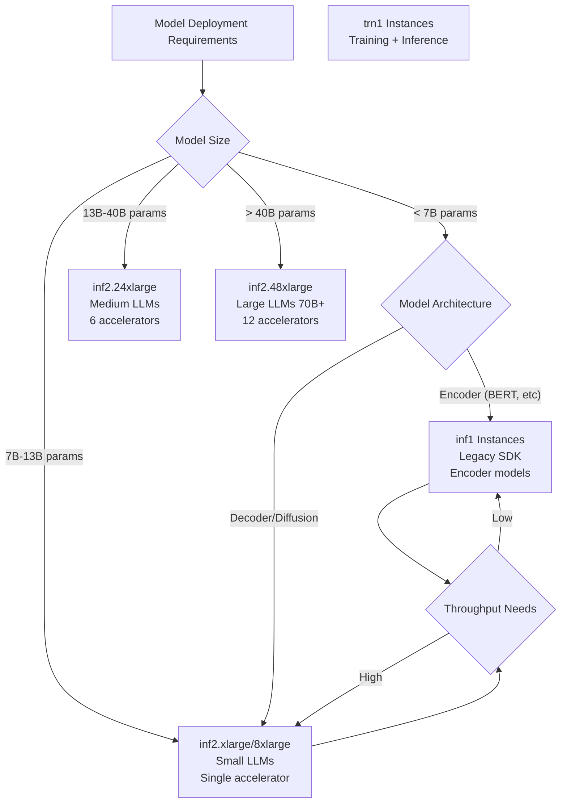
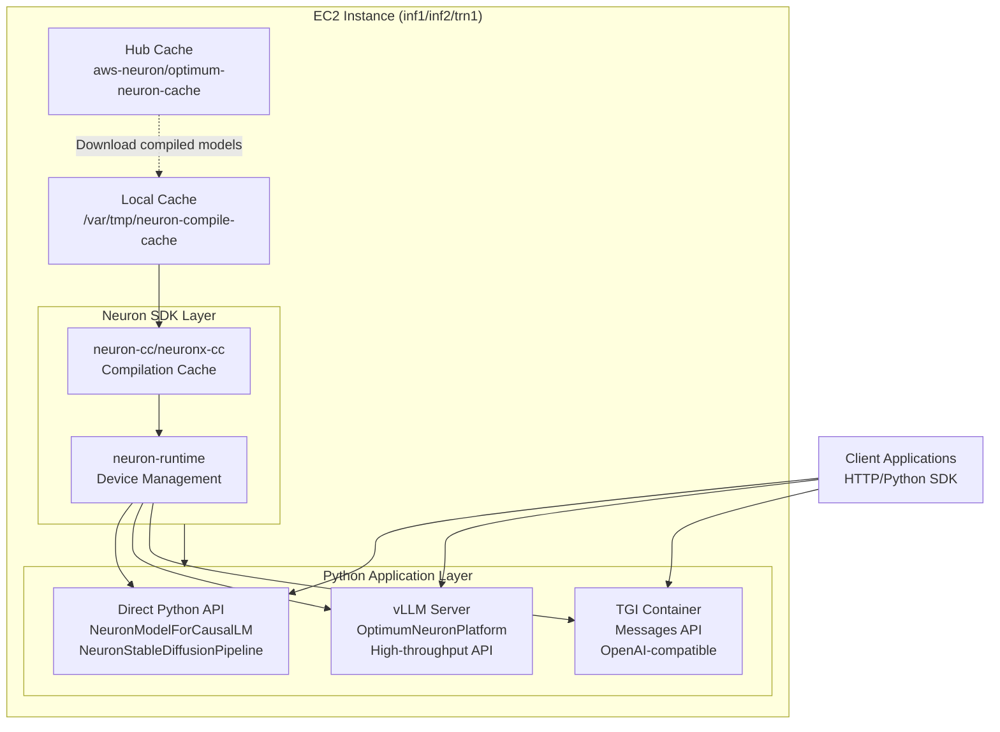
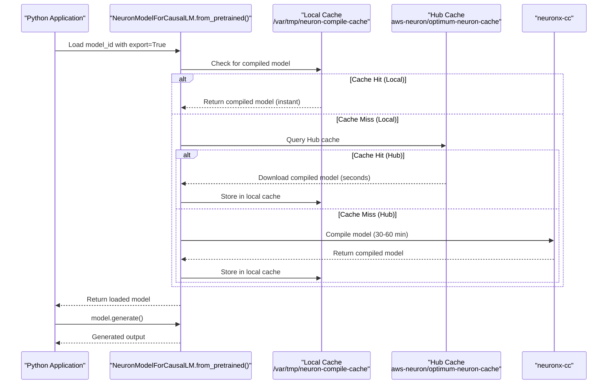
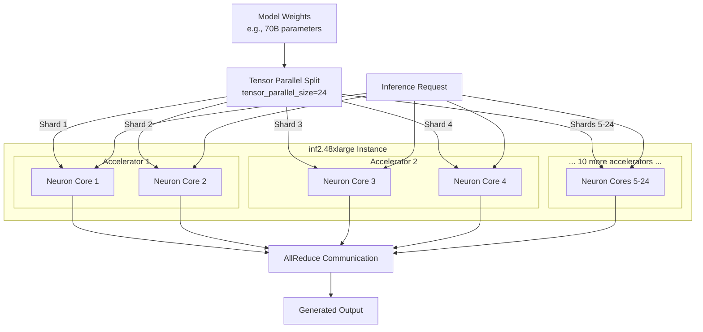
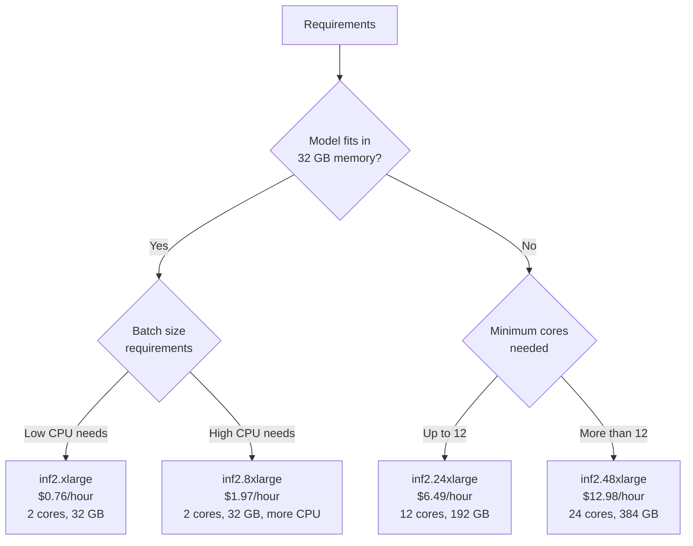

<!-- source: DeepWiki mcp.deepwiki.com · repo huggingface/optimum-neuron · page 9.1 EC2 Deployment · fetched 2026-10-26 -->

# EC2 Deployment

<details>
<summary>Relevant source files</summary>

The following files were used as context for generating this wiki page:

- [docs/source/guides/benchmark.mdx](docs/source/guides/benchmark.mdx)
- [docs/source/guides/export_model.mdx](docs/source/guides/export_model.mdx)
- [docs/source/guides/vllm_plugin.mdx](docs/source/guides/vllm_plugin.mdx)
- [docs/source/index.mdx](docs/source/index.mdx)
- [docs/source/inference_tutorials/llama2-13b-chatbot.mdx](docs/source/inference_tutorials/llama2-13b-chatbot.mdx)
- [docs/source/inference_tutorials/notebooks.mdx](docs/source/inference_tutorials/notebooks.mdx)

</details>


This page covers deploying optimum-neuron models directly on Amazon EC2 instances with AWS Neuron accelerators (Inferentia1, Inferentia2, and Trainium). It focuses on manual setup and direct model serving using Python APIs.

For managed deployment with automatic scaling and monitoring, see [SageMaker Deployment](#8.1). For containerized deployment patterns, see [Container Images and TGI](#8.3). For details on using pre-compiled models, see [Cache System](#7).

## Instance Type Selection

AWS provides three families of Neuron-enabled EC2 instances. Selecting the appropriate instance type depends on your model size, throughput requirements, and budget constraints.

### Inferentia1 Instances (inf1 family)

Inferentia1 instances support the legacy Neuron SDK and are suitable for encoder models and smaller workloads.

| Instance Type | Accelerators | Neuron Cores | Accelerator Memory (GB) | vCPUs | CPU Memory (GB) | On-Demand Price ($/hour) |
|---------------|--------------|--------------|-------------------------|-------|-----------------|--------------------------|
| inf1.xlarge   | 1            | 4            | 8                       | 4     | 8               | 0.368                    |
| inf1.2xlarge  | 1            | 4            | 8                       | 8     | 16              | 0.584                    |
| inf1.6xlarge  | 4            | 16           | 32                      | 24    | 48              | 1.904                    |
| inf1.24xlarge | 16           | 64           | 128                     | 96    | 192             | 6.240                    |

### Inferentia2 Instances (inf2 family)

Inferentia2 instances support the modern NeuronX SDK and are optimized for large language models and diffusion models.

| Instance Type  | Accelerators | Neuron Cores | Accelerator Memory (GB) | vCPUs | CPU Memory (GB) | On-Demand Price ($/hour) |
|----------------|--------------|--------------|-------------------------|-------|-----------------|--------------------------|
| inf2.xlarge    | 1            | 2            | 32                      | 4     | 16              | 0.76                     |
| inf2.8xlarge   | 1            | 2            | 32                      | 32    | 128             | 1.97                     |
| inf2.24xlarge  | 6            | 12           | 192                     | 96    | 384             | 6.49                     |
| inf2.48xlarge  | 12           | 24           | 384                     | 192   | 768             | 12.98                    |

### Trainium Instances (trn1 family)

Trainium instances are purpose-built for training workloads but also support inference.

| Instance Type | Accelerators | Neuron Cores | Accelerator Memory (GB) | vCPUs | CPU Memory (GB) | On-Demand Price ($/hour) |
|---------------|--------------|--------------|-------------------------|-------|-----------------|--------------------------|
| trn1.2xlarge  | 1            | 2            | 32                      | 8     | 32              | 1.34                     |
| trn1.32xlarge | 16           | 32           | 512                     | 128   | 512             | 21.50                    |

**Instance Selection Guidelines:**



Sources: [notebooks/sagemaker/deploy-mixtral-8x7b.ipynb:23-30](), [notebooks/sagemaker/deploy-llama-3-3-70b.ipynb:21-28]()

## Environment Setup

### Installing the Neuron SDK

The Neuron SDK installation differs based on the instance family. The SDK includes the Neuron compiler (`neuron-cc` or `neuronx-cc`), runtime, and PyTorch integration.

**For Inferentia1 (inf1) instances:**

```bash
# Configure Linux for Neuron repository
. /etc/os-release
sudo tee /etc/apt/sources.list.d/neuron.list > /dev/null <<EOF
deb https://apt.repos.neuron.amazonaws.com ${VERSION_CODENAME} main
EOF

# Install Neuron SDK
wget -qO - https://apt.repos.neuron.amazonaws.com/GPG-PUB-KEY-AMAZON-AWS-NEURON.PUB | sudo apt-key add -
sudo apt-get update -y
sudo apt-get install aws-neuronx-dkms -y
sudo apt-get install aws-neuronx-collectives=2.* -y
sudo apt-get install aws-neuronx-runtime-lib=2.* -y
sudo apt-get install aws-neuronx-tools=2.* -y

# Install Python virtual environment and Neuron packages
python3 -m venv aws_neuron_venv_pytorch
source aws_neuron_venv_pytorch/bin/activate
pip install torch-neuron==1.13.1.* neuron-cc[tensorflow]==1.22.* --extra-index-url=https://pip.repos.neuron.amazonaws.com
```

**For Inferentia2/Trainium (inf2/trn1) instances:**

```bash
# Configure Linux for Neuron repository
. /etc/os-release
sudo tee /etc/apt/sources.list.d/neuron.list > /dev/null <<EOF
deb https://apt.repos.neuron.amazonaws.com ${VERSION_CODENAME} main
EOF

# Install Neuron SDK
wget -qO - https://apt.repos.neuron.amazonaws.com/GPG-PUB-KEY-AMAZON-AWS-NEURON.PUB | sudo apt-key add -
sudo apt-get update -y
sudo apt-get install aws-neuronx-dkms=2.* -y
sudo apt-get install aws-neuronx-collectives=2.* -y
sudo apt-get install aws-neuronx-runtime-lib=2.* -y
sudo apt-get install aws-neuronx-tools=2.* -y

# Install Python virtual environment and NeuronX packages
python3.10 -m venv aws_neuron_venv_pytorch
source aws_neuron_venv_pytorch/bin/activate
pip install torch-neuronx==2.8.* neuronx-cc==2.21.* --extra-index-url=https://pip.repos.neuron.amazonaws.com
```

### Installing optimum-neuron

After installing the Neuron SDK, install optimum-neuron with the appropriate dependency group:

```bash
# For Inferentia1 instances
pip install optimum[neuron]

# For Inferentia2/Trainium instances
pip install optimum[neuronx]

# With additional features
pip install optimum[neuronx,diffusers]  # For diffusion models
```

Sources: [.github/actions/install_neuronx_runtime](), [docs/source/containers.mdx:15-38]()

## Deployment Architecture

EC2 deployment supports three primary patterns for serving models with optimum-neuron.



Sources: [docs/source/containers.mdx:13-38]()

## Direct Python Deployment

### Using Pre-Compiled Models from Cache

The most efficient deployment pattern leverages pre-compiled models from the Neuron cache, eliminating compilation time during deployment.

```python
from optimum.neuron import NeuronModelForCausalLM
from transformers import AutoTokenizer

# Model configuration
model_id = "mistralai/Mixtral-8x7B-Instruct-v0.1"

# Load tokenizer
tokenizer = AutoTokenizer.from_pretrained(model_id)

# Load pre-compiled model from cache
# optimum-neuron automatically checks:
# 1. Local cache (/var/tmp/neuron-compile-cache)
# 2. Hub cache (aws-neuron/optimum-neuron-cache)
# 3. Compiles if not found (30-60 minutes)
model = NeuronModelForCausalLM.from_pretrained(
    model_id,
    export=True,  # Enable automatic compilation if needed
)

# Run inference
inputs = tokenizer("What is deep learning?", return_tensors="pt")
outputs = model.generate(**inputs, max_length=100)
response = tokenizer.decode(outputs[0], skip_special_tokens=True)
```

**Cache Configuration Flow:**



Sources: [docs/source/containers.mdx:1-38]()

### Checking Available Cache Configurations

Before deploying, verify that your desired configuration exists in the cache:

```bash
# List available cached configurations
optimum-cli neuron cache lookup mistralai/Mixtral-8x7B-Instruct-v0.1

# Output shows available configurations:
# auto_cast_type: bf16
# batch_size: 1
# num_cores: 24
# sequence_length: 4096
# task: text-generation
```

If your configuration is not cached, you can either:
1. Request it at the [cache repository](https://huggingface.co/aws-neuron/optimum-neuron-cache/discussions)
2. Compile it yourself using `optimum-cli export neuron` (see [Model Export System](#4))
3. Upload to a custom cache repository (see [Managing Custom Cache Repositories](#7.2))

Sources: [notebooks/sagemaker/deploy-mixtral-8x7b.ipynb:163-204](), [notebooks/sagemaker/deploy-llama-3-3-70b.ipynb:113-153]()

### Model Class Selection by Task

optimum-neuron provides task-specific model classes that wrap compiled Neuron models:

| Task | Model Class | Use Case |
|------|-------------|----------|
| Text Generation | `NeuronModelForCausalLM` | LLMs (Llama, Mistral, Qwen) |
| Sequence Classification | `NeuronModelForSequenceClassification` | Sentiment analysis, topic classification |
| Feature Extraction | `NeuronModelForFeatureExtraction` | Embeddings, sentence transformers |
| Question Answering | `NeuronModelForQuestionAnswering` | Extractive QA |
| Image Classification | `NeuronModelForImageClassification` | Vision models |
| Image Segmentation | `NeuronModelForSemanticSegmentation` | Segmentation tasks |
| Stable Diffusion | `NeuronStableDiffusionPipeline` | Text-to-image generation |
| SDXL | `NeuronStableDiffusionXLPipeline` | High-resolution image generation |

**Example: Encoder Model Deployment**

```python
from optimum.neuron import NeuronModelForSequenceClassification
from transformers import AutoTokenizer

model_id = "bert-base-uncased"
tokenizer = AutoTokenizer.from_pretrained(model_id)

# Load or compile for classification
model = NeuronModelForSequenceClassification.from_pretrained(
    model_id,
    export=True,
    batch_size=1,
    sequence_length=128,
)

# Run inference
inputs = tokenizer("This movie is excellent!", return_tensors="pt", padding="max_length", max_length=128)
outputs = model(**inputs)
predictions = outputs.logits.argmax(-1)
```

**Example: Diffusion Model Deployment**

```python
from optimum.neuron import NeuronStableDiffusionPipeline

model_id = "stabilityai/stable-diffusion-2-1"

# Load pre-compiled diffusion pipeline
pipeline = NeuronStableDiffusionPipeline.from_pretrained(
    model_id,
    export=True,
    height=512,
    width=512,
    num_images_per_prompt=1,
)

# Generate image
image = pipeline("A photo of an astronaut riding a horse on mars").images[0]
image.save("astronaut.png")
```

Sources: [docs/source/model_doc/modeling_auto.mdx:1-151]()

## Tensor Parallelism Configuration

Large models that exceed single-accelerator memory require tensor parallelism to shard the model across multiple Neuron cores.



**Tensor Parallel Deployment Example:**

```python
from optimum.neuron import NeuronModelForCausalLM

model_id = "meta-llama/Meta-Llama-3-70B-Instruct"

# Load model with tensor parallelism
# This configuration requires inf2.48xlarge (24 cores)
model = NeuronModelForCausalLM.from_pretrained(
    model_id,
    export=True,
    batch_size=4,
    sequence_length=4096,
    tensor_parallel_size=24,  # Distribute across 24 cores
    auto_cast_type="bf16",
)
```

**Core Count Requirements by Model Size:**

| Model Size | Recommended Instance | Tensor Parallel Size | Accelerator Memory Used |
|------------|---------------------|---------------------|------------------------|
| 7B-13B     | inf2.xlarge         | 2                   | ~16 GB                 |
| 13B-20B    | inf2.8xlarge        | 2                   | ~24 GB                 |
| 20B-40B    | inf2.24xlarge       | 12                  | ~120 GB                |
| 40B-70B    | inf2.48xlarge       | 24                  | ~240 GB                |
| 70B+       | inf2.48xlarge       | 24                  | ~320 GB                |

Sources: [notebooks/sagemaker/deploy-mixtral-8x7b.ipynb:232-236](), [notebooks/sagemaker/deploy-llama-3-3-70b.ipynb:145-148]()

## Performance Optimization

### Batch Size Configuration

Neuron accelerators benefit from batching requests together. The batch size must be specified at compilation time due to static shape requirements.

```python
# Compile with batch size 4
model = NeuronModelForCausalLM.from_pretrained(
    model_id,
    export=True,
    batch_size=4,  # Must be specified at compile time
    sequence_length=4096,
)

# Runtime batching
inputs = tokenizer(
    ["Prompt 1", "Prompt 2", "Prompt 3", "Prompt 4"],
    return_tensors="pt",
    padding=True,
    max_length=4096,
)
outputs = model.generate(**inputs, max_new_tokens=100)
```

**Batch Size Trade-offs:**

| Batch Size | Throughput | Latency | Memory Usage | Best For |
|------------|------------|---------|--------------|----------|
| 1          | Low        | Lowest  | Minimal      | Interactive applications |
| 2-4        | Medium     | Medium  | Moderate     | Balanced workloads |
| 8-16       | High       | Higher  | High         | Batch processing |

### Sequence Length Optimization

Like batch size, sequence length is static and must be chosen at compilation time:

```python
# Compile with specific sequence length
model = NeuronModelForCausalLM.from_pretrained(
    model_id,
    export=True,
    batch_size=1,
    sequence_length=2048,  # Fixed at compile time
)

# Input must fit within sequence_length
# Padding is automatically handled
inputs = tokenizer(prompt, return_tensors="pt", max_length=2048, truncation=True)
```

**Sequence Length Guidelines:**

- **2048 tokens**: Standard chat applications, reduces compilation time
- **4096 tokens**: Extended context applications, most common for LLMs
- **8192+ tokens**: Long-document processing, significantly increases compilation time

### Cache Warming Strategy

For production deployments, pre-compile models before serving traffic:

```bash
# Pre-compile model during deployment initialization
python -c "
from optimum.neuron import NeuronModelForCausalLM
model = NeuronModelForCausalLM.from_pretrained(
    'mistralai/Mixtral-8x7B-Instruct-v0.1',
    export=True,
    batch_size=4,
    sequence_length=4096,
)
print('Model compiled and cached')
"

# Now start your application - model loads instantly
python serve.py
```

Sources: [notebooks/sagemaker/deploy-mixtral-8x7b.ipynb:214-228](), [notebooks/sagemaker/deploy-llama-3-3-70b.ipynb:127-144]()

## Monitoring and Resource Management

### System Metrics

Monitor Neuron accelerator utilization using AWS CloudWatch and Neuron tools:

```bash
# Install Neuron monitoring tools
sudo apt-get install aws-neuronx-tools -y

# Monitor Neuron core utilization
neuron-top

# View detailed runtime statistics
neuron-ls

# Check device health
neuron-ls --device-info
```

**Key Metrics to Monitor:**

| Metric | Tool | Threshold | Action |
|--------|------|-----------|--------|
| Core Utilization | `neuron-top` | > 80% | Increase batch size or add instances |
| Memory Usage | `neuron-monitor` | > 90% | Reduce model size or batch size |
| Compilation Cache Hit Rate | Application logs | < 50% | Review cache configuration |
| Request Latency | Application metrics | > SLA | Optimize batch size or sequence length |

### Environment Variables

Configure Neuron runtime behavior through environment variables:

```bash
# Set compilation cache directory
export NEURON_CC_FLAGS="--cache_dir=/mnt/neuron-cache"

# Enable runtime logging
export NEURON_RT_LOG_LEVEL=INFO

# Limit visible devices (useful for multi-tenancy)
export NEURON_RT_VISIBLE_CORES=0,1,2,3

# Configure number of workers
export NEURON_RT_NUM_CORES=2
```

Sources: [docs/source/containers.mdx:1-38]()

## High-Throughput Serving with vLLM

For production deployments requiring high throughput, use the vLLM platform plugin:

```bash
# Install vLLM with Neuron support
pip install optimum-neuron-vllm

# Start vLLM server
vllm serve mistralai/Mixtral-8x7B-Instruct-v0.1 \
    --device neuron \
    --tensor-parallel-size 24 \
    --max-model-len 4096 \
    --block-size 128
```

**Client Usage:**

```python
from openai import OpenAI

client = OpenAI(
    base_url="http://localhost:8000/v1",
    api_key="token-abc123",  # Dummy key for local server
)

response = client.chat.completions.create(
    model="mistralai/Mixtral-8x7B-Instruct-v0.1",
    messages=[
        {"role": "user", "content": "What is machine learning?"}
    ],
    max_tokens=100,
)

print(response.choices[0].message.content)
```

For detailed vLLM configuration and features, see [vLLM Integration](#6.5).

Sources: [docs/source/_toctree.yml:23-24]()

## Troubleshooting

### Common Issues

**Issue: Model compilation takes too long**

```bash
# Check if configuration exists in cache first
optimum-cli neuron cache lookup your-model-id

# If not found, request pre-compilation
# https://huggingface.co/aws-neuron/optimum-neuron-cache/discussions
```

**Issue: Out of memory during inference**

```python
# Reduce batch size or sequence length
model = NeuronModelForCausalLM.from_pretrained(
    model_id,
    export=True,
    batch_size=1,  # Reduced from 4
    sequence_length=2048,  # Reduced from 4096
)
```

**Issue: Neuron runtime not found**

```bash
# Verify Neuron runtime installation
neuron-ls

# If missing, reinstall runtime
sudo apt-get install aws-neuronx-runtime-lib=2.* -y

# Restart runtime
sudo systemctl restart neuron-runtime
```

**Issue: Cache not being used**

```bash
# Verify cache environment variable
echo $NEURON_CC_FLAGS

# Set cache directory explicitly
export NEURON_CC_FLAGS="--cache_dir=/var/tmp/neuron-compile-cache"

# Check cache permissions
ls -la /var/tmp/neuron-compile-cache
```

Sources: [docs/source/containers.mdx:1-38]()

## Cost Optimization

### Instance Selection Strategy

Choose the smallest instance that meets your requirements:



### Compilation Cache Strategy

Maximize cache hit rates to avoid repeated compilation costs:

1. **Use official cache**: The `aws-neuron/optimum-neuron-cache` repository provides pre-compiled popular models
2. **Create custom cache**: For team deployments, maintain a shared cache repository (see [Managing Custom Cache Repositories](#7.2))
3. **Persistent cache storage**: Mount EBS volumes for `/var/tmp/neuron-compile-cache` to persist across instance restarts

```bash
# Mount persistent cache volume
sudo mkfs -t ext4 /dev/nvme1n1
sudo mkdir -p /mnt/neuron-cache
sudo mount /dev/nvme1n1 /mnt/neuron-cache
export NEURON_CC_FLAGS="--cache_dir=/mnt/neuron-cache"
```

### Spot Instance Usage

For non-critical workloads, use EC2 Spot Instances for up to 90% cost savings:

```bash
# Launch spot instance with AWS CLI
aws ec2 run-instances \
    --instance-type inf2.xlarge \
    --spot-price "0.30" \
    --image-id ami-xxxxx \
    --key-name your-key \
    --security-group-ids sg-xxxxx \
    --subnet-id subnet-xxxxx \
    --block-device-mappings '[{"DeviceName":"/dev/sda1","Ebs":{"VolumeSize":100}}]' \
    --instance-market-options '{"MarketType":"spot"}'
```

Sources: [notebooks/sagemaker/deploy-mixtral-8x7b.ipynb:23-30](), [notebooks/sagemaker/deploy-llama-3-3-70b.ipynb:21-28]()

---

