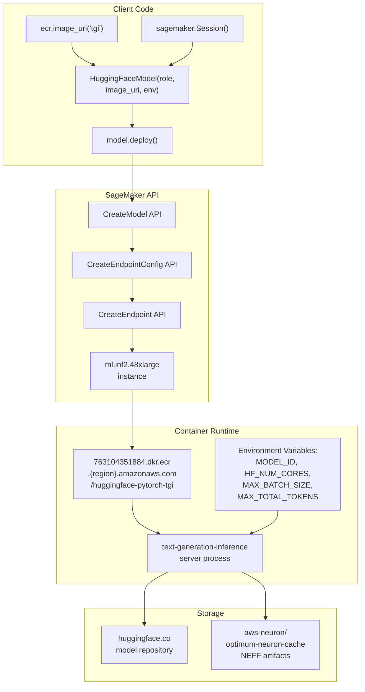
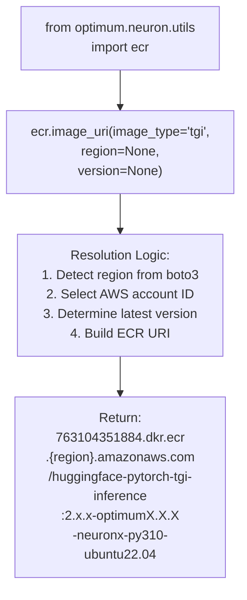
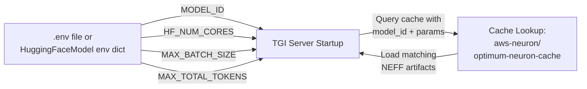
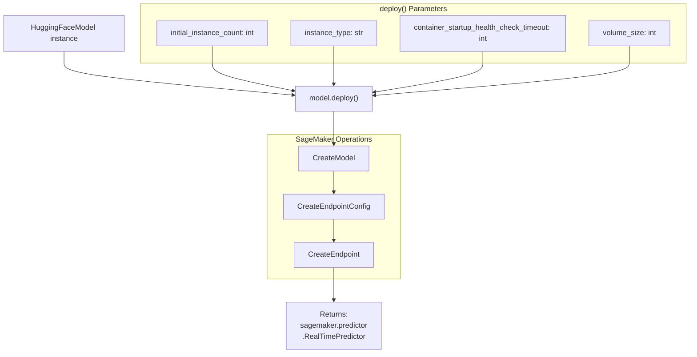
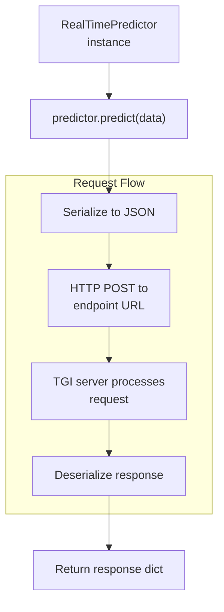
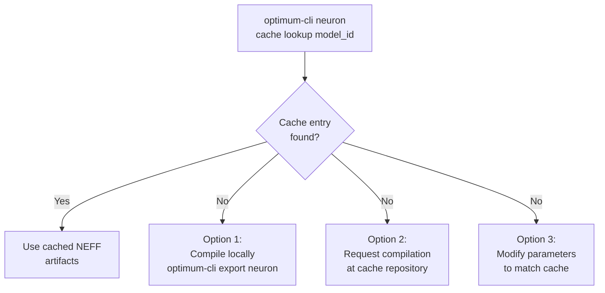
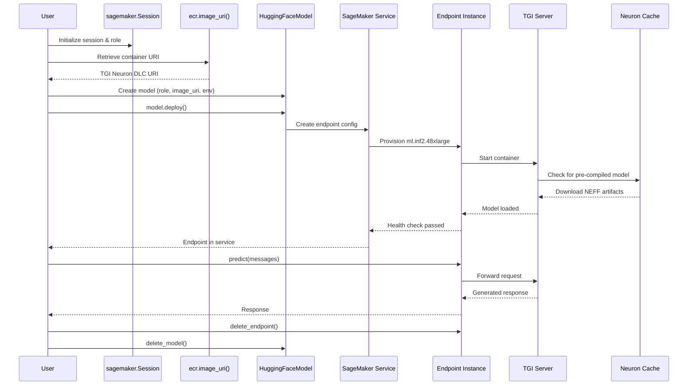

<!-- source: DeepWiki mcp.deepwiki.com · repo huggingface/optimum-neuron · page 9.2 SageMaker Deployment · fetched 2026-10-26 -->

# SageMaker Deployment

<details>
<summary>Relevant source files</summary>

The following files were used as context for generating this wiki page:

- [docs/source/guides/benchmark.mdx](docs/source/guides/benchmark.mdx)
- [docs/source/guides/export_model.mdx](docs/source/guides/export_model.mdx)
- [docs/source/guides/vllm_plugin.mdx](docs/source/guides/vllm_plugin.mdx)
- [docs/source/index.mdx](docs/source/index.mdx)
- [docs/source/inference_tutorials/llama2-13b-chatbot.mdx](docs/source/inference_tutorials/llama2-13b-chatbot.mdx)
- [docs/source/inference_tutorials/notebooks.mdx](docs/source/inference_tutorials/notebooks.mdx)

</details>


This page documents the deployment of Neuron-compiled models to Amazon SageMaker endpoints using the SageMaker Python SDK. It covers container image retrieval via `optimum.neuron.utils.ecr.image_uri()`, endpoint configuration with environment variables, and inference execution through the SageMaker `RealTimePredictor` interface.

For EC2-based deployment, see page 9.1. For container image details and TGI configuration, see page 9.3.

## Overview

Amazon SageMaker deployment for Neuron models uses the `sagemaker.huggingface.HuggingFaceModel` class to create real-time endpoints on `ml.inf2.*` instance types. The optimum-neuron library provides:

- `optimum.neuron.utils.ecr.image_uri()` function for retrieving Deep Learning Container (DLC) URIs
- Pre-built TGI (Text Generation Inference) containers with Neuron SDK integration
- Environment variable mappings for compilation parameters (`HF_NUM_CORES`, `MAX_BATCH_SIZE`, `MAX_TOTAL_TOKENS`)
- Support for pre-compiled models from the Neuron cache (`aws-neuron/optimum-neuron-cache`)

The deployment process provisions an Inferentia2 instance, loads the TGI Neuron container, retrieves pre-compiled NEFF artifacts from the cache, and exposes an HTTP endpoint for inference requests.

Sources: [docs/source/guides/export_model.mdx:337-361](), [docs/source/guides/vllm_plugin.mdx:1-105](), [docs/source/index.mdx:19-21]()

## Deployment Architecture

Deployment architecture with code entity mapping:



The deployment workflow instantiates `sagemaker.huggingface.HuggingFaceModel` with the container URI from `ecr.image_uri('tgi')`, then calls `model.deploy()` which invokes SageMaker's CreateModel, CreateEndpointConfig, and CreateEndpoint APIs. The endpoint instance launches the TGI container, which reads environment variables (`MODEL_ID`, `HF_NUM_CORES`, etc.) to locate and load pre-compiled NEFF artifacts from `aws-neuron/optimum-neuron-cache`.

Sources: [docs/source/guides/export_model.mdx:337-361](), [docs/source/containers.mdx:19-27]()

## Instance Types

Amazon SageMaker supports Inferentia2 instances with the `ml.inf2.*` prefix. The following table lists available instance types:

| Instance Type | Accelerators | Neuron Cores | Accelerator Memory (GB) | vCPUs | CPU Memory (GB) | On-Demand Price ($/h) |
|---------------|--------------|--------------|-------------------------|-------|-----------------|----------------------|
| ml.inf2.xlarge | 1 | 2 | 32 | 4 | 16 | 0.76 |
| ml.inf2.8xlarge | 1 | 2 | 32 | 32 | 128 | 1.97 |
| ml.inf2.24xlarge | 6 | 12 | 192 | 96 | 384 | 6.49 |
| ml.inf2.48xlarge | 12 | 24 | 384 | 192 | 768 | 12.98 |

**Instance Selection**: Choose instance type based on model size and compilation configuration. Large models (70B+ parameters) typically require `ml.inf2.48xlarge` with 24 Neuron Cores for optimal performance with tensor parallelism.

Sources: [notebooks/sagemaker/deploy-llama-3-3-70b.ipynb:21-28](), [notebooks/sagemaker/deploy-mixtral-8x7b.ipynb:23-30]()

## Environment Setup

### Prerequisites

Install the SageMaker SDK:

```bash
pip install sagemaker --upgrade
```

### Session Configuration

Initialize a SageMaker session and retrieve the execution role:

[notebooks/sagemaker/deploy-llama-3-3-70b.ipynb:66-87]()

The session requires:
- **IAM Role**: Execution role with permissions for SageMaker, S3, and ECR
- **Default Bucket**: S3 bucket for storing model artifacts and logs
- **Region**: AWS region where resources will be created

Sources: [notebooks/sagemaker/deploy-llama-3-3-70b.ipynb:66-87](), [notebooks/sagemaker/deploy-mixtral-8x7b.ipynb:68-89]()

## Container Image Retrieval

The `optimum.neuron.utils.ecr.image_uri()` function retrieves Deep Learning Container URIs from AWS ECR:



**Function Signature**:

```python
ecr.image_uri(
    image_type: str,  # 'tgi', 'inference', 'training'
    region: Optional[str] = None,  # Auto-detected from boto3
    version: Optional[str] = None  # Defaults to latest
) -> str
```

**Usage Example**:

[notebooks/sagemaker/deploy-llama-3-3-70b.ipynb:107-111]()

**Container Image Types**:

| `image_type` | Repository Name | Use Case | Base Framework |
|-------------|-----------------|----------|----------------|
| `'tgi'` | `huggingface-pytorch-tgi-inference` | LLM serving with TGI | PyTorch + TGI |
| `'inference'` | `huggingface-pytorch-inference` | General inference | PyTorch |
| `'training'` | `huggingface-pytorch-training` | Model training | PyTorch + NeuronSDK |

**Container Image URI Structure**:

```
{account_id}.dkr.ecr.{region}.amazonaws.com/{repo}:{pytorch_version}-optimum{optimum_version}-neuronx-py{python_version}-ubuntu{ubuntu_version}
```

Example: `763104351884.dkr.ecr.us-east-1.amazonaws.com/huggingface-pytorch-tgi-inference:2.5.1-optimum3.3.4-neuronx-py310-ubuntu22.04`

**Account IDs by Region**:

| Region | Account ID |
|--------|-----------|
| `us-east-1` | `763104351884` |
| `us-west-2` | `763104351884` |
| `eu-west-1` | `763104351884` |

Sources: [notebooks/sagemaker/deploy-llama-3-3-70b.ipynb:94-111]()

## Environment Variables

Environment variables configure the TGI server and must align with compilation parameters used during model export. The table below maps SageMaker environment variable names to their optimum-cli export equivalents:

| SageMaker Environment Variable | optimum-cli Export Parameter | Description | Example Value |
|-------------------------------|------------------------------|-------------|---------------|
| `MODEL_ID` | `--model` | Hugging Face model repository ID | `"meta-llama/Llama-3.3-70B-Instruct"` |
| `MAX_BATCH_SIZE` | `--batch_size` | Maximum concurrent requests | `4` |
| `MAX_TOTAL_TOKENS` | `--sequence_length` | Maximum total tokens (input + output) | `4096` |
| `HF_NUM_CORES` | `--tensor_parallel_size` | Neuron Cores for tensor parallelism | `24` |
| `HF_TOKEN` | N/A | Hugging Face User Access Token | `"hf_..."` |
| `MAX_INPUT_TOKENS` | N/A | Maximum input sequence length | `3500` |
| `MESSAGES_API_ENABLED` | N/A | Enable OpenAI Chat Completion API | `"true"` |

**TGI-Specific Variables**:



**vLLM-Specific Variables** (when using vLLM container instead of TGI):

| vLLM Variable | Equivalent TGI Variable | Description |
|---------------|------------------------|-------------|
| `SM_ON_MODEL` | `MODEL_ID` | Model repository ID |
| `SM_ON_BATCH_SIZE` | `MAX_BATCH_SIZE` | Batch size |
| `SM_ON_SEQUENCE_LENGTH` | `MAX_TOTAL_TOKENS` | Sequence length |
| `SM_ON_TENSOR_PARALLEL_SIZE` | `HF_NUM_CORES` | Tensor parallel size |

**Configuration Constraints**:

- `MAX_BATCH_SIZE` must equal the `--batch_size` used during model compilation
- `MAX_TOTAL_TOKENS` must equal the `--sequence_length` used during compilation
- `HF_NUM_CORES` must match the `--tensor_parallel_size` from compilation
- `MAX_INPUT_TOKENS` must be less than `MAX_TOTAL_TOKENS` to allow output generation
- All compilation parameters must match a cached configuration in `aws-neuron/optimum-neuron-cache`

**Example Configuration**:

[notebooks/sagemaker/deploy-llama-3-3-70b.ipynb:172-181]()

Sources: [docs/source/guides/export_model.mdx:337-361](), [docs/source/guides/vllm_plugin.mdx:1-16]()

## Model Deployment

### Creating the HuggingFaceModel

The `sagemaker.huggingface.HuggingFaceModel` class encapsulates deployment configuration:

**Constructor Parameters**:

| Parameter | Type | Description | Example |
|-----------|------|-------------|---------|
| `role` | `str` | IAM execution role ARN | `"arn:aws:iam::123:role/SageMakerRole"` |
| `image_uri` | `str` | ECR container URI | From `ecr.image_uri('tgi')` |
| `env` | `Dict[str, str]` | Environment variables | `{"MODEL_ID": "meta-llama/...", ...}` |
| `sagemaker_session` | `Session` | Optional session object | `sagemaker.Session()` |

**Code Example**:

[notebooks/sagemaker/deploy-llama-3-3-70b.ipynb:164-191]()

### Deploying the Endpoint

The `HuggingFaceModel.deploy()` method creates the SageMaker endpoint:



**Method Signature**:

```python
model.deploy(
    initial_instance_count: int = 1,
    instance_type: str = "ml.inf2.48xlarge",
    container_startup_health_check_timeout: int = 3600,
    volume_size: int = 512,
    wait: bool = True
) -> RealTimePredictor
```

**Parameter Guidelines**:

| Parameter | Recommended Value | Rationale |
|-----------|------------------|-----------|
| `initial_instance_count` | `1` | Single instance sufficient for most workloads |
| `instance_type` | `"ml.inf2.48xlarge"` | Required for 70B models with 24-core tensor parallelism |
| `container_startup_health_check_timeout` | `2400-3600` | Large models require extended load time |
| `volume_size` | `512` | Sufficient for model weights and cache |
| `wait` | `True` | Block until endpoint is ready |

**Code Example**:

[notebooks/sagemaker/deploy-llama-3-3-70b.ipynb:210-218]()

**Internal Attribute for Pre-compiled Models**:

Setting `_is_compiled_model = True` suppresses SageMaker warnings about model compilation:

[notebooks/sagemaker/deploy-llama-3-3-70b.ipynb:210-211]()

**Deployment Timeline**:

- Model loading: 5-10 minutes
- Container initialization: 5-10 minutes
- Health check validation: 2-5 minutes
- Total: 15-30 minutes (varies by model size)

Sources: [notebooks/sagemaker/deploy-llama-3-3-70b.ipynb:164-218](), [notebooks/sagemaker/deploy-mixtral-8x7b.ipynb:280-300]()

## Inference

### RealTimePredictor Interface

The `model.deploy()` method returns a `sagemaker.predictor.RealTimePredictor` instance for inference:



**Method Signature**:

```python
predictor.predict(
    data: Dict[str, Any],
    initial_args: Optional[Dict[str, Any]] = None
) -> Dict[str, Any]
```

### Messages API Request Format

When `MESSAGES_API_ENABLED="true"`, the endpoint accepts OpenAI Chat Completion format:

**Request Payload Structure**:

```python
{
    "messages": [
        {"role": "system", "content": str},  # Optional
        {"role": "user", "content": str},    # Required
        {"role": "assistant", "content": str}  # For multi-turn
    ],
    "max_tokens": int,          # Optional, default varies
    "temperature": float,       # Optional, 0.0-2.0, default 1.0
    "top_p": float,            # Optional, 0.0-1.0, default 1.0
    "frequency_penalty": float, # Optional, -2.0 to 2.0, default 0.0
    "presence_penalty": float   # Optional, -2.0 to 2.0, default 0.0
}
```

**Code Example**:

[notebooks/sagemaker/deploy-llama-3-3-70b.ipynb:258-267]()

**Message Role Definitions**:

| Role | Purpose | Frequency |
|------|---------|-----------|
| `system` | Set behavior, context, instructions | Once per conversation |
| `user` | User queries and inputs | Multiple per conversation |
| `assistant` | Model responses (for context) | Multiple per conversation |

**Generation Parameters**:

| Parameter | Type | Range | Description |
|-----------|------|-------|-------------|
| `max_tokens` | `int` | 1 to (MAX_TOTAL_TOKENS - input_length) | Maximum output tokens |
| `temperature` | `float` | 0.0 to 2.0 | Sampling randomness (0=deterministic) |
| `top_p` | `float` | 0.0 to 1.0 | Nucleus sampling threshold |
| `frequency_penalty` | `float` | -2.0 to 2.0 | Penalty for token frequency |
| `presence_penalty` | `float` | -2.0 to 2.0 | Penalty for token presence |

**Inference Code Example**:

[notebooks/sagemaker/deploy-llama-3-3-70b.ipynb:285-287]()

**Response Format**:

```python
{
    "choices": [
        {
            "message": {
                "role": "assistant",
                "content": str  # Generated text
            },
            "finish_reason": str  # "stop", "length", etc.
        }
    ],
    "usage": {
        "prompt_tokens": int,
        "completion_tokens": int,
        "total_tokens": int
    }
}
```

Sources: [notebooks/sagemaker/deploy-llama-3-3-70b.ipynb:234-287](), [notebooks/sagemaker/deploy-mixtral-8x7b.ipynb:316-370]()

## Resource Cleanup

To avoid ongoing charges, delete the endpoint and model resources:

[notebooks/sagemaker/deploy-llama-3-3-70b.ipynb:306-307]()

**Cleanup Operations**:
- `delete_endpoint()`: Terminates the endpoint and stops instance charges
- `delete_model()`: Removes the model configuration from SageMaker

**Best Practice**: Always clean up resources after testing or when no longer needed. Inferentia2 instances incur charges while running.

Sources: [notebooks/sagemaker/deploy-llama-3-3-70b.ipynb:295-307](), [notebooks/sagemaker/deploy-mixtral-8x7b.ipynb:377-390]()

## Cache Lookup and Validation

Pre-deployment validation requires checking `aws-neuron/optimum-neuron-cache` for matching compilation configurations.

### Using optimum-cli neuron cache

The `optimum-cli neuron cache lookup` command queries available pre-compiled configurations:

```bash
optimum-cli neuron cache lookup <model_id>
```

**Example Output**:

[notebooks/sagemaker/deploy-mixtral-8x7b.ipynb:182-204]()

**Cache Entry Fields**:

| Field | Description | Example Value |
|-------|-------------|---------------|
| `auto_cast_type` | Precision type | `"bf16"`, `"fp16"` |
| `batch_size` | Compiled batch size | `4`, `8` |
| `num_cores` | Neuron Cores (tensor parallel size) | `24`, `12` |
| `sequence_length` | Maximum sequence length | `4096`, `8192` |
| `compiler_version` | Neuron compiler version | `"2.x.x"` |

### Cache Miss Resolution

If no matching cache entry exists:



**Resolution Options**:

1. **Self-Compilation**: Use `optimum-cli export neuron` with desired parameters (see page 4.1)
2. **Cache Request**: Open discussion at [aws-neuron/optimum-neuron-cache](https://huggingface.co/aws-neuron/optimum-neuron-cache/discussions)
3. **Parameter Adjustment**: Modify `batch_size`, `sequence_length`, or `tensor_parallel_size` to match existing cache entry

**Cache Validation Logic**:

The TGI server validates environment variables against cached configurations:
- `MAX_BATCH_SIZE` must equal cached `batch_size`
- `MAX_TOTAL_TOKENS` must equal cached `sequence_length`
- `HF_NUM_CORES` must equal cached `num_cores`
- Mismatches cause deployment failure with error message

Sources: [notebooks/sagemaker/deploy-mixtral-8x7b.ipynb:119-204](), [notebooks/sagemaker/deploy-llama-3-3-70b.ipynb:118-154]()

## Complete Deployment Example

The following diagram shows the complete deployment workflow:



This workflow demonstrates the end-to-end process from environment setup through deployment to cleanup.

Sources: [notebooks/sagemaker/deploy-llama-3-3-70b.ipynb:1-308](), [notebooks/sagemaker/deploy-mixtral-8x7b.ipynb:1-390]()

## Troubleshooting

### Common Issues

**Health Check Timeout**:
- **Symptom**: Endpoint creation fails with health check timeout
- **Solution**: Increase `container_startup_health_check_timeout` to 3600 seconds for large models
- **Cause**: Large models require more time to load and compile

**Missing Cache Entry**:
- **Symptom**: Long deployment time or compilation errors
- **Solution**: Verify cache entry exists with `optimum-cli neuron cache lookup`
- **Cause**: Requested configuration not pre-compiled

**Token Authentication**:
- **Symptom**: Model loading fails with 401 error
- **Solution**: Ensure `HF_TOKEN` is set and has access to gated models
- **Cause**: Missing or invalid Hugging Face token

**Insufficient Memory**:
- **Symptom**: OOM errors during deployment
- **Solution**: Use larger instance type (e.g., upgrade from 24xlarge to 48xlarge)
- **Cause**: Model too large for instance memory

**Configuration Mismatch**:
- **Symptom**: Runtime errors about batch size or sequence length
- **Solution**: Ensure `MAX_BATCH_SIZE` ≤ compiled batch size and `MAX_TOTAL_TOKENS` ≤ compiled sequence length
- **Cause**: Runtime parameters exceed compilation limits

Sources: [notebooks/sagemaker/deploy-llama-3-3-70b.ipynb:168-169](), [notebooks/sagemaker/deploy-mixtral-8x7b.ipynb:251-252]()

---

