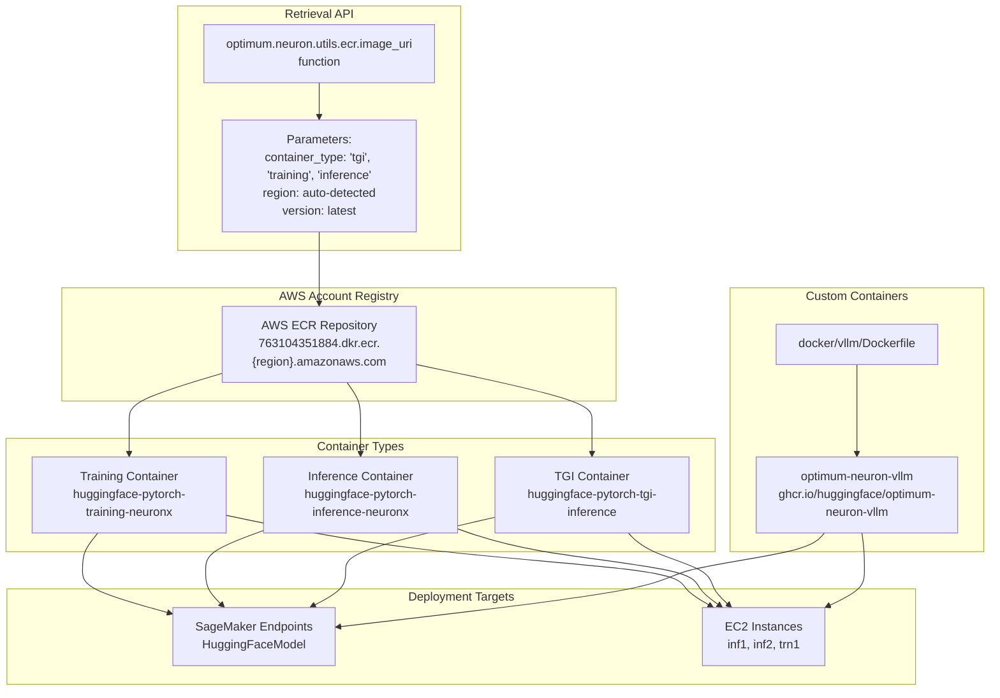
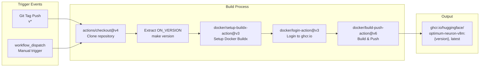
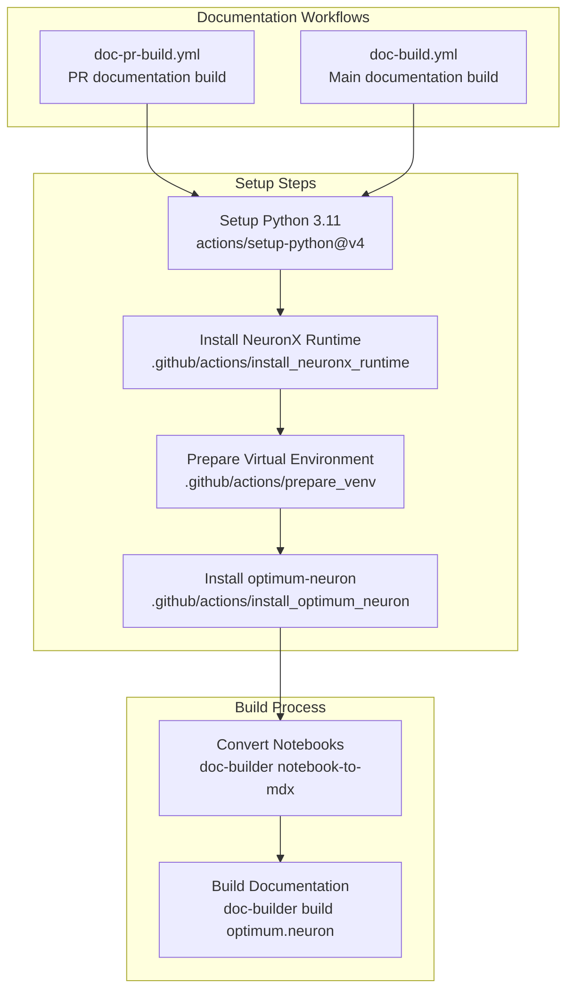

<!-- source: DeepWiki mcp.deepwiki.com · repo huggingface/optimum-neuron · page 9.3 Container Images and Docker · fetched 2026-10-26 -->

# Container Images and TGI

<details>
<summary>Relevant source files</summary>

The following files were used as context for generating this wiki page:

- [Makefile](Makefile)
- [docs/source/guides/benchmark.mdx](docs/source/guides/benchmark.mdx)
- [docs/source/guides/export_model.mdx](docs/source/guides/export_model.mdx)
- [docs/source/guides/vllm_plugin.mdx](docs/source/guides/vllm_plugin.mdx)
- [docs/source/index.mdx](docs/source/index.mdx)
- [docs/source/inference_tutorials/llama2-13b-chatbot.mdx](docs/source/inference_tutorials/llama2-13b-chatbot.mdx)
- [docs/source/inference_tutorials/notebooks.mdx](docs/source/inference_tutorials/notebooks.mdx)
- [optimum/neuron/version.py](optimum/neuron/version.py)

</details>


This page documents the pre-built container images available for deploying optimum-neuron models, with a focus on Hugging Face Text Generation Inference (TGI) Neuron containers. It covers container types, retrieval methods, configuration parameters, and building custom images.

For step-by-step deployment instructions using these containers, see [SageMaker Deployment](#8.1) and [EC2 Deployment](#8.2). For general deployment concepts, see [Deployment Guide](#8).

## Available Container Images

Optimum Neuron provides three types of pre-built Deep Learning Containers (DLCs) for Amazon SageMaker, each optimized for specific workloads on AWS Inferentia and Trainium accelerators.

| Container Type | Optimum Version | Image URI Pattern |
|----------------|-----------------|-------------------|
| Training | 0.0.25 | `763104351884.dkr.ecr.{region}.amazonaws.com/huggingface-pytorch-training-neuronx:2.1.2-transformers4.48.1-neuronx-py310-sdk2.20.0-ubuntu20.04` |
| Inference | 0.0.25 | `763104351884.dkr.ecr.{region}.amazonaws.com/huggingface-pytorch-inference-neuronx:2.1.2-transformers4.43.2-neuronx-py310-sdk2.20.0-ubuntu20.04` |
| Text Generation Inference (TGI) | 0.2.0 | `763104351884.dkr.ecr.{region}.amazonaws.com/huggingface-pytorch-tgi-inference:2.5.1-optimum3.3.4-neuronx-py310-ubuntu22.04` |

The account ID `763104351884` is AWS's official Deep Learning Containers account. The actual account ID varies by AWS region and should be retrieved dynamically.

**Sources:** [docs/source/containers.mdx:31-36]()

### Retrieving Container URIs

The `ecr.image_uri` function from `optimum.neuron.utils` provides programmatic access to the latest container URIs:

```python
from optimum.neuron.utils import ecr

# Retrieve the TGI image URI
llm_image = ecr.image_uri("tgi")
print(f"TGI image uri: {llm_image}")

# Retrieve training image URI
training_image = ecr.image_uri("training")

# Retrieve inference image URI
inference_image = ecr.image_uri("inference")
```

This function automatically determines the correct AWS region and account ID based on your credentials, and returns the latest available image URI. The result is equivalent to or newer than the URI provided by the SageMaker Python SDK.

**Sources:** [docs/source/containers.mdx:18-27](), [notebooks/sagemaker/deploy-mixtral-8x7b.ipynb:109-112](), [notebooks/sagemaker/deploy-llama-3-3-70b.ipynb:107-110]()

## Container Architecture



**Sources:** [docs/source/containers.mdx:1-39](), [Makefile:76-80](), [.github/workflows/build-vllm-image.yml:1-44]()

## Hugging Face TGI Neuron Containers

Text Generation Inference (TGI) Neuron containers are purpose-built for high-performance LLM serving on AWS Inferentia2. These containers integrate the Text Generation Inference server with Optimum Neuron compilation and inference capabilities.

### TGI Container Features

- **Pre-compiled Model Support**: Automatic cache lookup from [aws-neuron/optimum-neuron-cache](https://huggingface.co/aws-neuron/optimum-neuron-cache)
- **Messages API**: OpenAI-compatible chat completion endpoint
- **Dynamic Batching**: Efficient request batching within compiled batch size constraints
- **Multi-Core Sharding**: Automatic model distribution across Neuron Cores
- **Health Checks**: Container startup health monitoring for model loading

**Sources:** [notebooks/sagemaker/deploy-mixtral-8x7b.ipynb:12-12](), [docs/source/containers.mdx:15-16]()

### Configuration Parameters

TGI Neuron containers require both Neuron-specific compilation parameters and standard TGI runtime parameters:

#### Neuron Compilation Parameters

These parameters must match a cached model configuration or trigger compilation:

| Parameter | Description | Example |
|-----------|-------------|---------|
| `HF_NUM_CORES` | Number of Neuron Cores for tensor parallelism | `"24"` for inf2.48xlarge |
| `HF_BATCH_SIZE` | Compiled batch size (deprecated, use `MAX_BATCH_SIZE`) | `"4"` |
| `HF_SEQUENCE_LENGTH` | Compiled sequence length (deprecated, use `MAX_TOTAL_TOKENS`) | `"4096"` |
| `HF_AUTO_CAST_TYPE` | Precision for compiled model | `"bf16"` or `"fp16"` |

#### TGI Runtime Parameters

| Parameter | Description | Example |
|-----------|-------------|---------|
| `HF_MODEL_ID` | Hugging Face Hub model identifier | `"meta-llama/Meta-Llama-3-70B-Instruct"` |
| `HF_TOKEN` | Hub API token for gated models | `"hf_..."` |
| `MAX_BATCH_SIZE` | Maximum request batch size | `"4"` |
| `MAX_INPUT_TOKENS` | Maximum input token length | `"4000"` |
| `MAX_TOTAL_TOKENS` | Maximum total tokens (input + output) | `"4096"` |
| `MESSAGES_API_ENABLED` | Enable OpenAI-compatible Messages API | `"true"` |

**Sources:** [notebooks/sagemaker/deploy-mixtral-8x7b.ipynb:216-262](), [notebooks/sagemaker/deploy-llama-3-3-70b.ipynb:129-180]()

### Example TGI Configuration

```python
from sagemaker.huggingface import HuggingFaceModel

config = {
    # Neuron compilation parameters
    "HF_NUM_CORES": "24",
    "HF_AUTO_CAST_TYPE": "bf16",
    
    # TGI runtime parameters
    "HF_MODEL_ID": "mistralai/Mixtral-8x7B-Instruct-v0.1",
    "HF_TOKEN": "hf_...",
    "MAX_BATCH_SIZE": "4",
    "MAX_INPUT_TOKENS": "4000",
    "MAX_TOTAL_TOKENS": "4096",
    "MESSAGES_API_ENABLED": "true",
}

llm_image = ecr.image_uri("tgi")
llm_model = HuggingFaceModel(
    role=role,
    image_uri=llm_image,
    env=config
)
```

**Sources:** [notebooks/sagemaker/deploy-mixtral-8x7b.ipynb:255-272](), [notebooks/sagemaker/deploy-llama-3-3-70b.ipynb:172-191]()

### Messages API

When `MESSAGES_API_ENABLED="true"`, the TGI container exposes an OpenAI-compatible chat completion endpoint. This allows drop-in replacement of OpenAI API calls:

```python
messages = [
    {"role": "system", "content": "You are a helpful assistant."},
    {"role": "user", "content": "What is deep learning?"}
]

parameters = {
    "max_tokens": 100,
    "temperature": 0.7
}

response = llm.predict({"messages": messages, **parameters})
print(response["choices"][0]["message"]["content"])
```

Supported message roles: `system`, `user`, `assistant`. The chat template is automatically applied based on the model's tokenizer configuration.

**Sources:** [notebooks/sagemaker/deploy-mixtral-8x7b.ipynb:316-349](), [notebooks/sagemaker/deploy-llama-3-3-70b.ipynb:236-267]()

## optimum-neuron-vllm Container

The `optimum-neuron-vllm` container integrates vLLM's high-throughput serving capabilities with Optimum Neuron. This container is built and published separately from AWS DLCs and is available on GitHub Container Registry.

### Container Registry

```
ghcr.io/huggingface/optimum-neuron-vllm:latest
ghcr.io/huggingface/optimum-neuron-vllm:{version}
```

Example versions: `0.3.1.dev7`, `0.3.0`

**Sources:** [.github/workflows/build-vllm-image.yml:43-43]()

### Building from Source

The vLLM container can be built using the Makefile:

```bash
make optimum-neuron-vllm
```

This command executes the following Docker build process:

```bash
docker build --rm \
    -f docker/vllm/Dockerfile \
    -t optimum-neuron-vllm:${VERSION} .
docker tag optimum-neuron-vllm:${VERSION} optimum-neuron-vllm:latest
```

The version is automatically extracted from [optimum/neuron/version.py:27]() using `make version`.

**Sources:** [Makefile:76-80](), [Makefile:27-27]()

### Automated Build Workflow



The GitHub Actions workflow [.github/workflows/build-vllm-image.yml]() automatically builds and publishes the container on:
- Tag push matching pattern `v*` (e.g., `v0.3.0`)
- Manual workflow dispatch

Authentication uses the `GITHUB_TOKEN` secret with `packages: write` permission to push to GitHub Container Registry.

**Sources:** [.github/workflows/build-vllm-image.yml:1-44]()

## Container Build Configuration

### Version Management

Container versions are synchronized with the optimum-neuron package version from [optimum/neuron/version.py]():

```bash
export ON_VERSION=$(make version)
```

The `make version` target extracts the version using gawk:

```bash
gawk 'match($0, /__version__ = "(.*)"/, a) {print a[1]}' optimum/neuron/version.py
```

This ensures container tags match the installed optimum-neuron version.

**Sources:** [.github/workflows/build-vllm-image.yml:22-25](), [Makefile:27-30]()

### Dockerfile Location

All container Dockerfiles are located in the `docker/` directory:

- `docker/vllm/Dockerfile` - vLLM container definition

The Dockerfile includes optimum-neuron package files as build context:

```makefile
optimum-neuron-vllm: docker/vllm/Dockerfile ${PACKAGE_FILES}
```

Where `PACKAGE_FILES` includes all Python source files, `pyproject.toml`, `README.md`, and `MANIFEST.in`.

**Sources:** [Makefile:76-80](), [Makefile:34-38]()

## Instance Type Compatibility

TGI containers are optimized for specific Inferentia2 instance types based on model size:

| Instance Type | Neuron Cores | Accelerator Memory | Recommended For |
|---------------|--------------|-------------------|-----------------|
| `ml.inf2.xlarge` | 2 | 32 GB | Small models (<7B) |
| `ml.inf2.8xlarge` | 2 | 32 GB | Small models (<7B) |
| `ml.inf2.24xlarge` | 12 | 192 GB | Medium models (7B-30B) |
| `ml.inf2.48xlarge` | 24 | 384 GB | Large models (70B+) |

The `HF_NUM_CORES` parameter should match the available cores on the instance. For example, Mixtral 8x7B and Llama 3.3 70B require all 24 cores of an `inf2.48xlarge` instance.

**Sources:** [notebooks/sagemaker/deploy-mixtral-8x7b.ipynb:23-29](), [notebooks/sagemaker/deploy-llama-3-3-70b.ipynb:21-28](), [notebooks/sagemaker/deploy-mixtral-8x7b.ipynb:234-234](), [notebooks/sagemaker/deploy-llama-3-3-70b.ipynb:147-147]()

## Documentation Build System Integration

The documentation build workflows demonstrate container usage patterns:



The deployment notebooks ([notebooks/sagemaker/deploy-llama-3-3-70b.ipynb](), [notebooks/sagemaker/deploy-mixtral-8x7b.ipynb]()) are automatically converted to MDX documentation format using `doc-builder notebook-to-mdx` and serve as live examples of container usage.

**Sources:** [.github/workflows/doc-pr-build.yml:45-63](), [.github/workflows/doc-build.yml:58-79](), [docs/README.md:9-14]()

---

