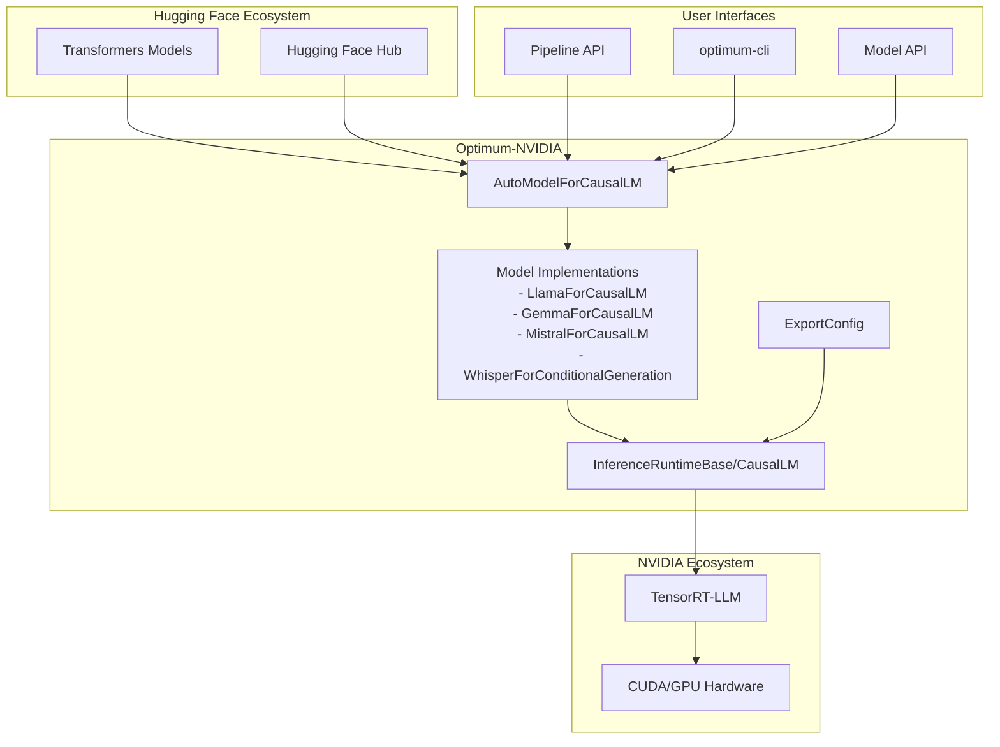
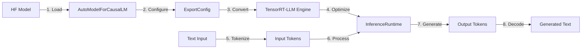
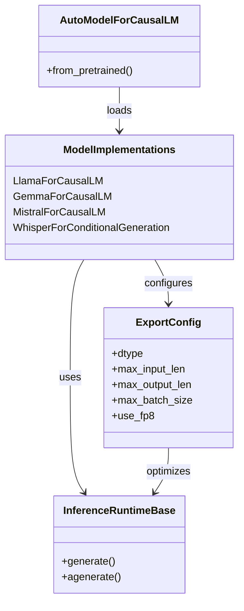

<!-- source: DeepWiki mcp.deepwiki.com · repo huggingface/optimum-nvidia · page 1 Overview · fetched 2026-10-26 -->

# Overview

<details>
<summary>Relevant source files</summary>

The following files were used as context for generating this wiki page:

- [CONTRIBUTING.md](CONTRIBUTING.md)
- [LICENSE](LICENSE)
- [README.md](README.md)
- [pyproject.toml](pyproject.toml)
- [setup.py](setup.py)
- [src/optimum/nvidia/__init__.py](src/optimum/nvidia/__init__.py)
- [src/optimum/nvidia/version.py](src/optimum/nvidia/version.py)

</details>


Optimum-NVIDIA is a Python library that bridges the Hugging Face Transformers ecosystem with NVIDIA's TensorRT-LLM acceleration platform to deliver optimized inference performance for Large Language Models (LLMs) on NVIDIA GPUs. This page provides a high-level introduction to the library, its architecture, key components, and core functionality.

For detailed installation instructions, see [Installation & Requirements](#1.1). For in-depth information about the core architecture, see [Core Architecture](#2).

## Purpose and Scope

Optimum-NVIDIA enables users to accelerate their existing Hugging Face Transformers workflows with minimal code changes while achieving significant performance improvements. The library converts Hugging Face models to optimized TensorRT-LLM engines and provides compatible APIs that mirror those in the Transformers library.

Key benefits include:
- Up to 28x faster inference compared to standard framework implementations
- Simple integration with existing Transformers code (often requiring just a single line change)
- Support for advanced features like FP8 precision on compatible hardware
- Familiar APIs for users of the Hugging Face ecosystem

Sources: [README.md:16-17](), [setup.py:74-77](), [pyproject.toml:5-7]()

## System Architecture

Optimum-NVIDIA follows a modular architecture that connects the Hugging Face ecosystem with NVIDIA's acceleration technologies.

### High-Level Architecture Diagram



Sources: [src/optimum/nvidia/__init__.py:19-21](), [setup.py:29-42](), [pyproject.toml:26-40]()

### Workflow Process



Sources: [README.md:66-107]()

## Key Components

### 1. Entry Points and User Interfaces

Optimum-NVIDIA provides three main ways to use the library:

| Interface | Description | Use Case |
|-----------|-------------|----------|
| Pipeline API | Drop-in replacement for Transformers pipelines | Simple use cases with minimal code changes |
| Model API | Direct model loading and inference with more configuration options | Advanced use cases requiring fine-grained control |
| optimum-cli | Command-line interface for model export and inference | CI/CD integration or script-based workflows |

Sources: [README.md:66-107](), [pyproject.toml:43-44]()

### 2. Core Components



Sources: [src/optimum/nvidia/__init__.py:19-21]()

## Hardware and Software Compatibility

### Supported NVIDIA GPUs

Optimum-NVIDIA has been tested on the following GPUs:
- NVIDIA 4090
- NVIDIA L40S
- NVIDIA H100 Tensor Core

The library is expected to work on GPUs based on these architectures:
- Ampere (A100/A30, with experimental support for A10, A40, RTX Ax000)
- Hopper
- Ada-Lovelace

Note: FP8 precision support is only available on Hopper and Ada-Lovelace architectures.

Sources: [README.md:114-121]()

### Supported Model Architectures

Currently, Optimum-NVIDIA accelerates the following model architectures:

| Architecture | Task |
|--------------|------|
| Llama | Text Generation |
| Gemma | Text Generation |
| Mistral | Text Generation |
| Whisper | Speech Recognition |

Sources: [README.md:121-133]()

### Dependencies and Requirements

- Python 3.10 or higher
- CUDA 12.6
- TensorRT-LLM 0.16.0
- PyTorch ≥ 2.4.0a, ≤ 2.6.0a
- Transformers ≥ 4.45.1
- Optimum ≥ 1.21.0

Sources: [README.md:8-12](), [pyproject.toml:3](), [pyproject.toml:26-40]()

## Example Usage

Optimum-NVIDIA is designed to integrate seamlessly with existing Transformers code. Here are the simplest ways to get started:

### Pipeline API

```diff
- from transformers.pipelines import pipeline
+ from optimum.nvidia.pipelines import pipeline

pipe = pipeline('text-generation', 'meta-llama/Llama-2-7b-chat-hf', use_fp8=True)
pipe("Describe a real-world application of AI in sustainable energy.")
```

### Model API (Generate)

```diff
- from transformers import AutoModelForCausalLM
+ from optimum.nvidia import AutoModelForCausalLM
from transformers import AutoTokenizer

tokenizer = AutoTokenizer.from_pretrained("meta-llama/Llama-2-7b-chat-hf", padding_side="left")

model = AutoModelForCausalLM.from_pretrained(
  "meta-llama/Llama-2-7b-chat-hf",
+ use_fp8=True,
+ max_prompt_length=1024,
+ max_output_length=2048,
+ max_batch_size=8,
)

model_inputs = tokenizer(["How is autonomous vehicle technology transforming the future of transportation?"], return_tensors="pt").to("cuda")

generated_ids = model.generate(
    **model_inputs, 
    top_k=40, 
    top_p=0.7, 
    repetition_penalty=10,
)

tokenizer.batch_decode(generated_ids, skip_special_tokens=True)[0]
```

Sources: [README.md:66-107]()

## Related Wiki Pages

- [Installation & Requirements](#1.1) - Detailed installation instructions and system requirements
- [Core Architecture](#2) - In-depth examination of the internal architecture
- [Runtime System](#2.1) - Details about the TensorRT-LLM runtime implementation
- [Export Configuration](#2.3) - How to configure model export for optimal performance
- [Supported Models](#3) - Information about supported model architectures
- [User Interfaces](#4) - Detailed documentation on pipeline API, command-line interface, and model API

Sources: [README.md]()

---

