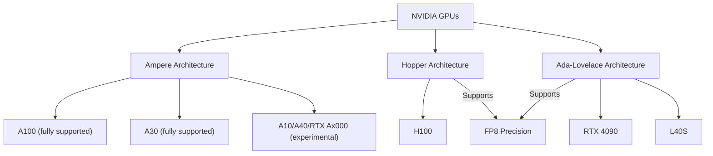
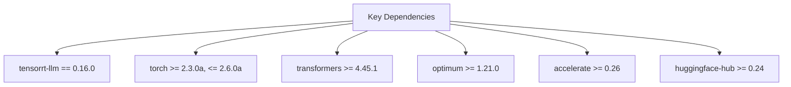
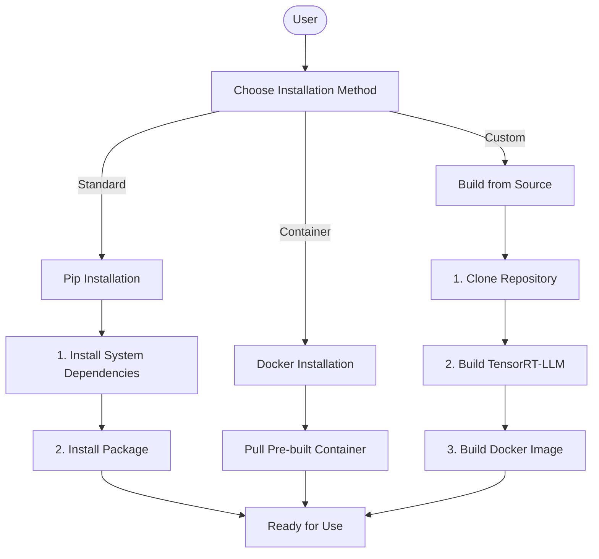
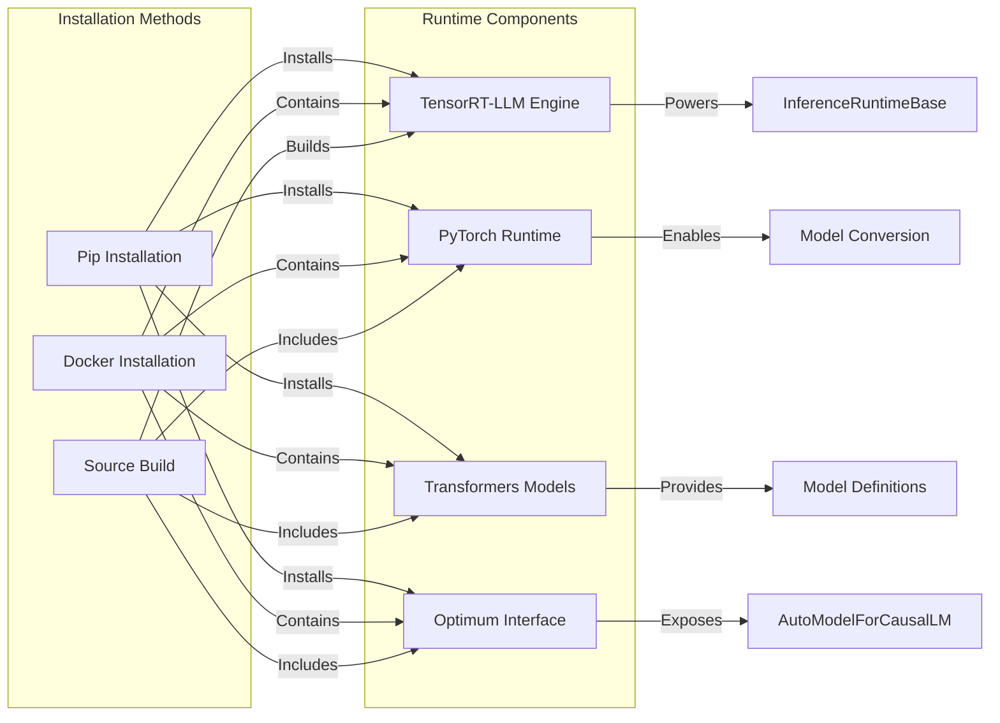

<!-- source: DeepWiki mcp.deepwiki.com · repo huggingface/optimum-nvidia · page 1.1 Installation & Requirements · fetched 2026-10-26 -->

# Installation & Requirements

<details>
<summary>Relevant source files</summary>

The following files were used as context for generating this wiki page:

- [.github/workflows/release.yml](.github/workflows/release.yml)
- [CONTRIBUTING.md](CONTRIBUTING.md)
- [LICENSE](LICENSE)
- [README.md](README.md)
- [docker/Dockerfile](docker/Dockerfile)
- [docker/Dockerfile.dev](docker/Dockerfile.dev)
- [pyproject.toml](pyproject.toml)
- [setup.py](setup.py)

</details>


This page provides detailed instructions for installing `optimum-nvidia` and explains the hardware and software requirements needed to run it. Optimum-NVIDIA bridges Hugging Face Transformers models with NVIDIA's TensorRT-LLM to provide optimized inference on NVIDIA GPUs. For information about the core architecture and components, see [Core Architecture](#2).

## System Requirements

Before installing Optimum-NVIDIA, ensure your system meets the following requirements:

### Supported Hardware



Optimum-NVIDIA is tested and supported on the following NVIDIA GPU architectures:
- **Ampere**: A100 and A30 are fully supported; experimental support for A10, A40, RTX Ax000
- **Hopper**: H100
- **Ada-Lovelace**: RTX 4090, L40S

Note that FP8 support is only available on GPUs based on Hopper and Ada-Lovelace architectures.

Sources: [README.md:114-121]()

### Software Requirements

| Requirement | Version | Notes |
|-------------|---------|-------|
| Python | 3.10 or 3.12 | Python 3.10 is the recommended version |
| CUDA | 12.6 | Required for TensorRT-LLM |
| Operating System | Linux | Windows support coming soon |

Sources: [setup.py:88-89](), [README.md:9-11](), [README.md:121-122]()

### Python Dependencies

Optimum-NVIDIA has several key dependencies that are automatically installed during the installation process:



For a complete list of dependencies, refer to [setup.py:29-43]() or [pyproject.toml:26-41]().

## Installation Methods

There are three main ways to install Optimum-NVIDIA:

### Installation Workflow



Sources: [README.md:21-55]()

### 1. Pip Installation

The pip installation method has been validated on Ubuntu:

```bash
apt-get update && apt-get -y install python3.10 python3-pip openmpi-bin libopenmpi-dev
python -m pip install --pre --extra-index-url https://pypi.nvidia.com optimum-nvidia
```

Note that the `--pre` flag is required as the package may include pre-release versions. The `--extra-index-url` points to NVIDIA's PyPI repository, which hosts the TensorRT-LLM package.

Sources: [README.md:27-30](), [setup.py:100]()

### 2. Docker Installation

For the simplest installation experience, you can use the pre-built Docker container:

```bash
docker pull huggingface/optimum-nvidia
```

This container includes all necessary dependencies and is ready to use out of the box.

Sources: [README.md:36-38](), [docker/Dockerfile:1-13]()

### 3. Building from Source

For advanced users or those needing specific GPU architecture optimizations, building from source is available:

```bash
TARGET_SM="90-real;89-real"  # Set target GPU architectures
git clone --recursive --depth=1 https://github.com/huggingface/optimum-nvidia.git
cd optimum-nvidia/third-party/tensorrt-llm
make -C docker release_build CUDA_ARCHS=$TARGET_SM
cd ../.. && docker build -t <organisation_name/image_name>:<version> -f docker/Dockerfile .
```

The `TARGET_SM` variable specifies the target GPU architectures for optimization. For example:
- `90-real` for H100 (Hopper)
- `89-real` for L40S/RTX 4090 (Ada Lovelace)
- `80-real` for A100 (Ampere)

Sources: [README.md:50-55](), [.github/workflows/release.yml:76-80]()

## Installation Architecture

The following diagram shows how installation methods relate to the components they provide:



Sources: [setup.py:71-102](), [pyproject.toml:1-56](), [docker/Dockerfile:1-13]()

## Verifying Installation

To verify your installation, you can run a simple test using the Pipeline API:

```python
from optimum.nvidia.pipelines import pipeline

pipe = pipeline('text-generation', 'meta-llama/Llama-2-7b-chat-hf')
result = pipe("What is TensorRT-LLM?")
print(result[0]['generated_text'])
```

If successful, this will load the Llama 2 model, convert it to TensorRT format if needed, and generate text.

Sources: [README.md:68-76]()

## Docker Development Environment

For developers, there's also a development Docker environment available:

```bash
# Build the development container
docker build -t optimum-nvidia-dev -f docker/Dockerfile.dev .

# Run with GPU access
docker run --gpus all -it optimum-nvidia-dev
```

This container includes development tools and test dependencies.

Sources: [docker/Dockerfile.dev:1-16]()

## Next Steps

After installation, you can explore:
- [Core Architecture](#2) - Understanding the Optimum-NVIDIA architecture
- [Supported Models](#3) - Learning about which models are supported
- [User Interfaces](#4) - Various ways to interact with models (Pipeline API, CLI, Model API)
- [Quantization](#5.1) - How to use FP8 and other precision options for faster inference

---

