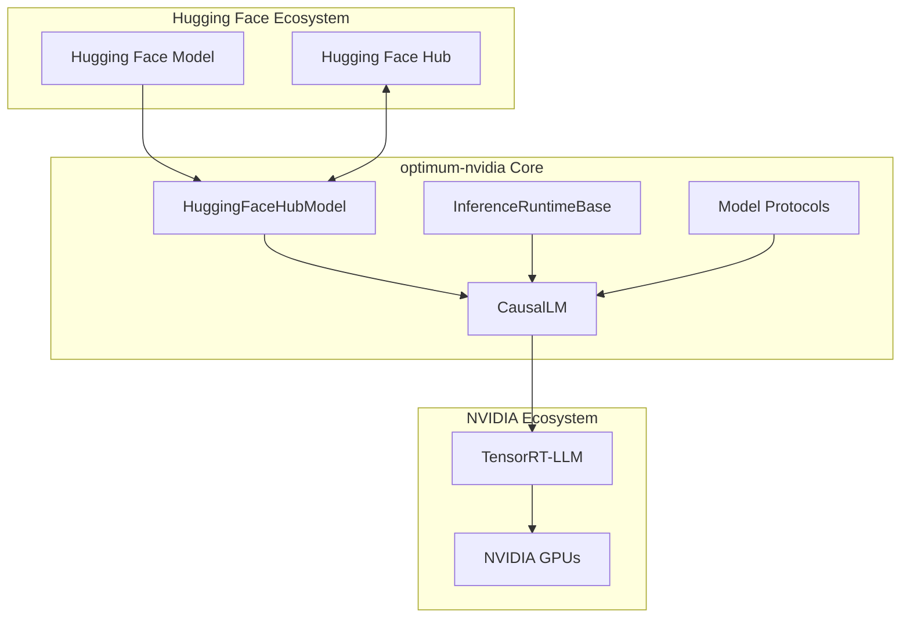
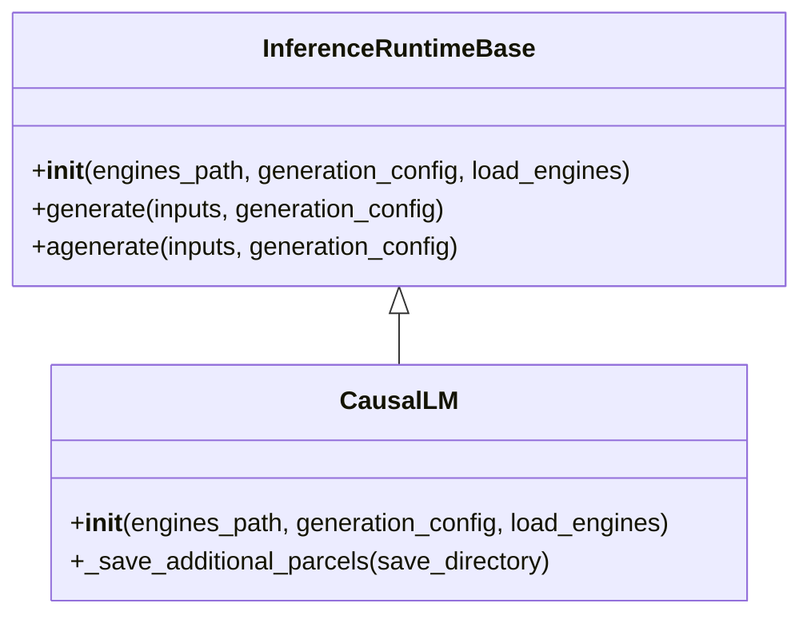
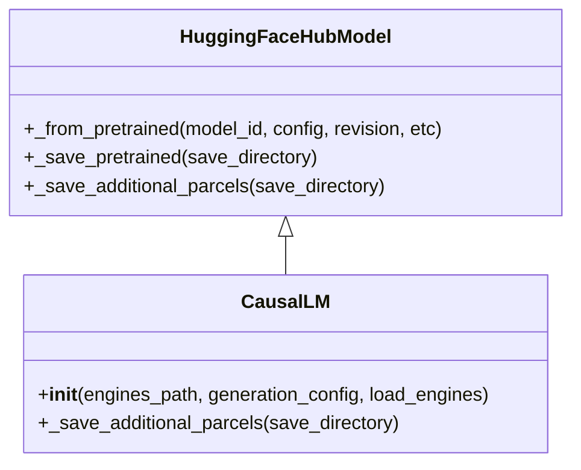
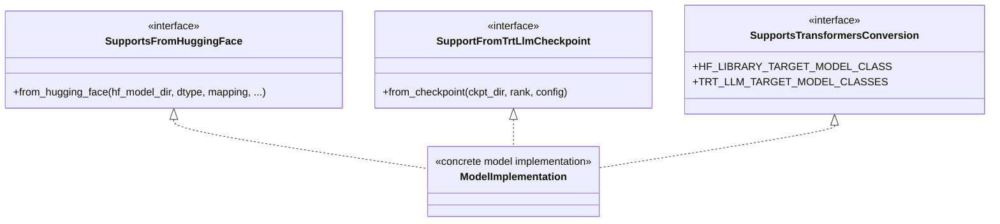
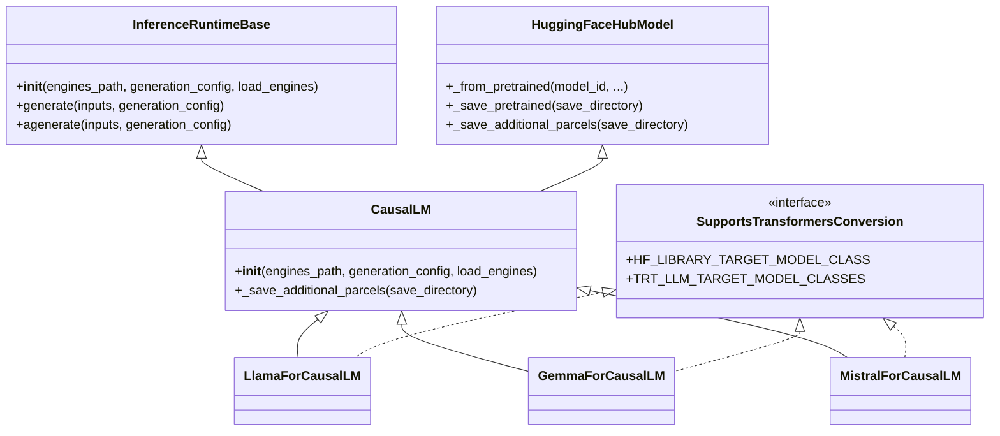
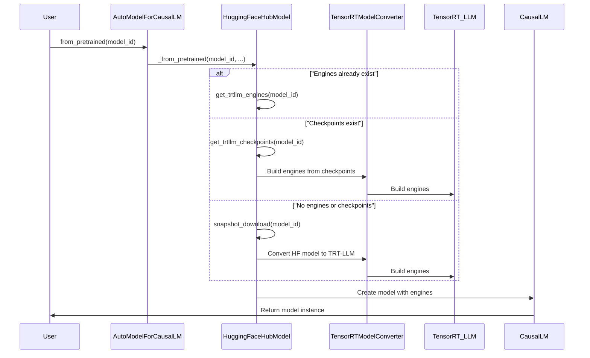
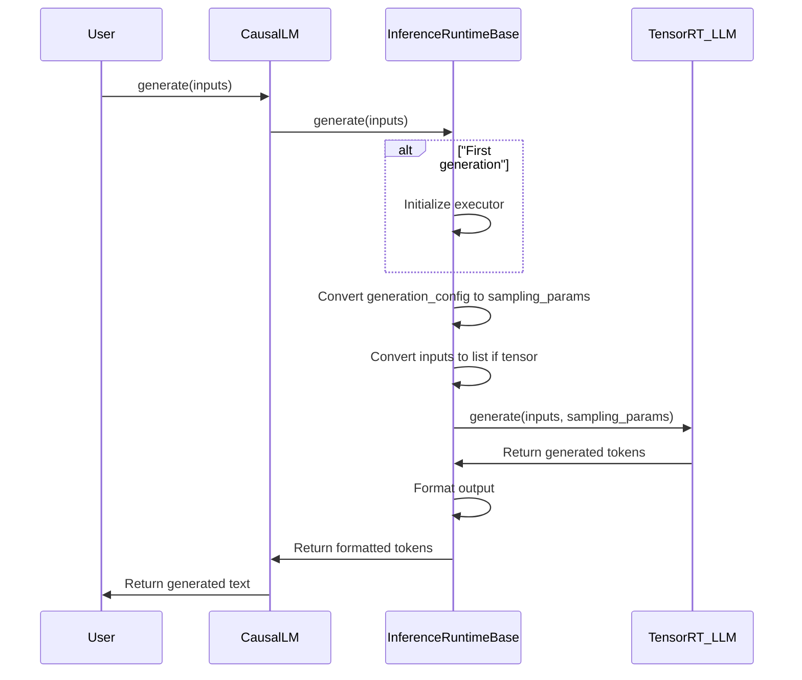

<!-- source: DeepWiki mcp.deepwiki.com · repo huggingface/optimum-nvidia · page 2 Core Architecture · fetched 2026-10-26 -->

# Core Architecture

<details>
<summary>Relevant source files</summary>

The following files were used as context for generating this wiki page:

- [src/optimum/nvidia/hub.py](src/optimum/nvidia/hub.py)
- [src/optimum/nvidia/models/__init__.py](src/optimum/nvidia/models/__init__.py)
- [src/optimum/nvidia/models/base.py](src/optimum/nvidia/models/base.py)
- [src/optimum/nvidia/runtime.py](src/optimum/nvidia/runtime.py)

</details>


The Core Architecture of optimum-nvidia provides a bridge between Hugging Face's Transformers ecosystem and NVIDIA's TensorRT-LLM acceleration framework. This document explains the key components and their relationships for enabling efficient inference of large language models on NVIDIA GPUs.

For details about specific runtime implementations, see [Runtime System](#2.1). For information about model loading and Hub integration, see [Model Loading & Hub Integration](#2.2).

## System Overview

Optimum-NVIDIA's architecture is designed to maintain compatibility with Hugging Face's Transformers interface while leveraging TensorRT-LLM's optimized inference capabilities. The system handles the entire workflow from loading models from the Hugging Face Hub to executing optimized inference on NVIDIA GPUs.



Sources: [src/optimum/nvidia/runtime.py](), [src/optimum/nvidia/hub.py](), [src/optimum/nvidia/models/base.py]()

## Key Components

### Runtime System

The Runtime System handles the execution of inference with TensorRT-LLM engines:

1. **InferenceRuntimeBase**: Base class that manages TensorRT-LLM engines, handling input/output conversion and providing generation methods.

2. **CausalLM**: Inherits from both `InferenceRuntimeBase` and `HuggingFaceHubModel`, combining inference capabilities with Hub integration.



Sources: [src/optimum/nvidia/runtime.py:82-206](), [src/optimum/nvidia/runtime.py:209-224]()

### Hub Integration

The Hub integration enables seamless loading and saving of models to/from the Hugging Face Hub:

1. **HuggingFaceHubModel**: A mixin class that provides Hub integration for TensorRT-LLM models with methods for loading from and saving to the Hub.



Sources: [src/optimum/nvidia/hub.py:190-452]()

### Model Protocols

The system uses several protocol classes to define interfaces that models must implement:



Sources: [src/optimum/nvidia/models/base.py:19-47]()

## Core Architecture Class Hierarchy

This diagram illustrates the inheritance relationships between the key classes:



Sources: [src/optimum/nvidia/runtime.py](), [src/optimum/nvidia/hub.py](), [src/optimum/nvidia/models/base.py]()

## System Operation Flows

### Model Loading Flow

This diagram shows the process of loading a model from the Hugging Face Hub:



Sources: [src/optimum/nvidia/hub.py:203-409]()

### Inference Flow

This diagram illustrates the inference process with a loaded model:



Sources: [src/optimum/nvidia/runtime.py:138-171]()

## Component Relationship Table

| Component | Primary Role | Interacts With | Key Methods |
|-----------|--------------|----------------|-------------|
| InferenceRuntimeBase | Manages TensorRT-LLM engines and inference | TensorRT-LLM | `generate()`, `agenerate()` |
| HuggingFaceHubModel | Provides Hub integration | Hugging Face Hub | `_from_pretrained()`, `_save_pretrained()` |
| CausalLM | Combines runtime and Hub capabilities | InferenceRuntimeBase, HuggingFaceHubModel | inherits methods from parents |
| Model Protocols | Define interfaces for model compatibility | Model implementations | N/A (interface definitions) |

## Implementation Details

### Generation Config Conversion

The system converts Hugging Face's `GenerationConfig` to TensorRT-LLM's `SamplingParams` through the `convert_generation_config` function:

```python
def convert_generation_config(config: "GenerationConfig") -> "SamplingParams":
    return SamplingParams(
        end_id=config.eos_token_id[-1] if isinstance(config.eos_token_id, list) else config.eos_token_id,
        pad_id=config.pad_token_id[-1] if isinstance(config.pad_token_id, list) else config.pad_token_id,
        top_k=config.top_k if config.do_sample else 1,
        top_p=config.top_p,
        temperature=config.temperature,
        beam_width=config.num_beams if config.do_sample else 1,
        # ... other parameters
    )
```

Source: [src/optimum/nvidia/runtime.py:33-55]()

### Model Loading Strategy

The `_from_pretrained` method in `HuggingFaceHubModel` implements a sophisticated strategy for loading models:

1. First, it tries to find pre-built TensorRT engines
2. If no engines are found, it looks for TensorRT-LLM checkpoints
3. If neither exists, it downloads the original Hugging Face model and converts it

This tiered approach optimizes the loading process by avoiding unnecessary conversions when optimized versions already exist.

Source: [src/optimum/nvidia/hub.py:203-409]()

## Summary

The Core Architecture of optimum-nvidia provides a flexible and extensible system for efficient inference of large language models on NVIDIA GPUs. By bridging Hugging Face's Transformers and NVIDIA's TensorRT-LLM, it allows users to leverage the familiar Transformers interface while benefiting from the performance optimizations of TensorRT-LLM.

The architecture follows object-oriented principles with a clear separation of concerns:
- `InferenceRuntimeBase` handles the inference process
- `HuggingFaceHubModel` manages model loading and saving
- `CausalLM` combines these capabilities for language models
- Protocol classes define interfaces for different types of model compatibility

This design makes the system extensible for supporting new model architectures while maintaining consistent interfaces.

---

