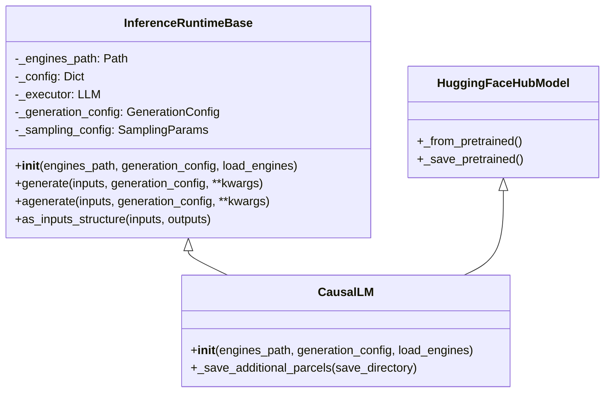
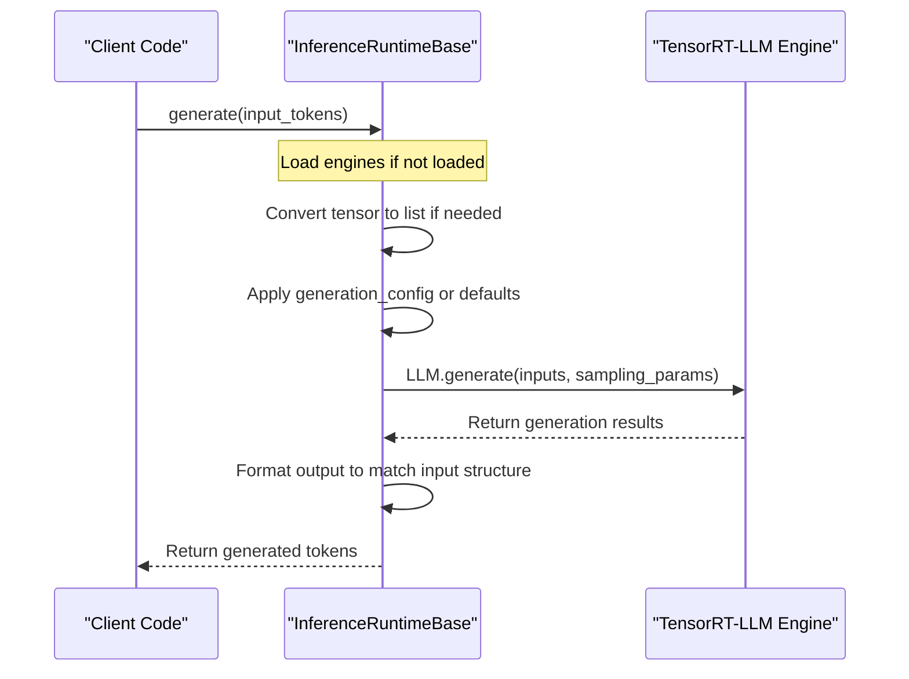
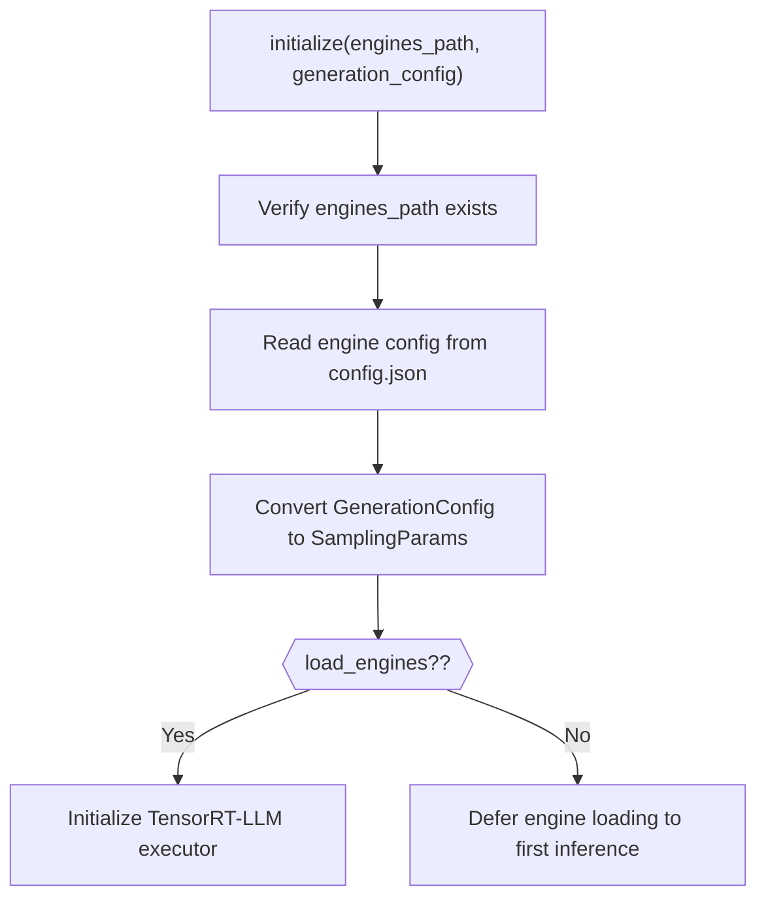

<!-- source: DeepWiki mcp.deepwiki.com · repo huggingface/optimum-nvidia · page 2.1 Runtime System · fetched 2026-10-26 -->

# Runtime System

<details>
<summary>Relevant source files</summary>

The following files were used as context for generating this wiki page:

- [src/optimum/nvidia/runtime.py](src/optimum/nvidia/runtime.py)

</details>


The Optimum-NVIDIA Runtime System provides the core infrastructure for executing TensorRT-LLM optimized models. It bridges Hugging Face's generation APIs and NVIDIA's TensorRT-LLM execution environment, handling inference and managing generation parameters. This page focuses on the runtime implementation details; for information about model loading, see [Model Loading & Hub Integration](#2.2).

## Runtime Architecture

The Runtime System consists of two principal classes: `InferenceRuntimeBase` and `CausalLM`, along with supporting utility functions to handle configuration conversion between Hugging Face and TensorRT-LLM.



Sources: [src/optimum/nvidia/runtime.py:82-206](). [src/optimum/nvidia/runtime.py:209-224]()

## Core Components

### InferenceRuntimeBase

The `InferenceRuntimeBase` class forms the foundation of the runtime system. It initializes TensorRT-LLM engines, converts configuration parameters, and provides methods for text generation.

Key responsibilities:
- Loading TensorRT-LLM engines from a specified directory
- Converting Hugging Face generation configurations to TensorRT-LLM sampling parameters
- Providing both synchronous and asynchronous generation APIs

```python
# Constructor signature
def __init__(
    self,
    engines_path: Union[str, PathLike],  # Path to TensorRT-LLM engines
    generation_config: "GenerationConfig",  # Hugging Face generation config
    load_engines: bool = True,  # Whether to load engines immediately
)
```

Sources: [src/optimum/nvidia/runtime.py:117-137]()

### CausalLM

The `CausalLM` class inherits from both `InferenceRuntimeBase` and `HuggingFaceHubModel`, combining inference capabilities with Hugging Face Hub integration. This dual inheritance allows model-specific implementations (like `LlamaForCausalLM`) to leverage both optimized TensorRT-LLM execution and Hugging Face ecosystem compatibility.

Sources: [src/optimum/nvidia/runtime.py:209-224]()

## Configuration Conversion

A critical aspect of the runtime is converting between Hugging Face's `GenerationConfig` and TensorRT-LLM's `SamplingParams`. This is handled by the `convert_generation_config` function:

| Hugging Face Parameter | TensorRT-LLM Parameter | Description |
|------------------------|------------------------|-------------|
| `eos_token_id` | `end_id` | Token ID signaling sequence end |
| `pad_token_id` | `pad_id` | Token ID for padding |
| `top_k` | `top_k` | Number of highest probability tokens to keep |
| `top_p` | `top_p` | Cumulative probability threshold for token filtering |
| `temperature` | `temperature` | Sampling temperature (higher = more random) |
| `num_beams` | `beam_width` | Number of beams for beam search |
| `bad_words_ids` | `bad_token_ids` | Token IDs to never generate |
| `repetition_penalty` | `repetition_penalty` | Penalty for repeating tokens |
| `max_new_tokens` | `max_tokens` | Maximum number of tokens to generate |

Sources: [src/optimum/nvidia/runtime.py:33-55]()

## Generation Process

The generation process follows these steps:



Sources: [src/optimum/nvidia/runtime.py:138-171]()

## Synchronous and Asynchronous APIs

The Runtime System provides two generation interfaces:

### Synchronous Generation

The `generate()` method performs blocking text generation:

```python
def generate(
    self,
    inputs: MaybeBatchedToken,  # Input token IDs (single or batched)
    generation_config: Optional["GenerationConfig"] = None,  # Optional config override
    **kwargs,  # Additional config parameters
) -> MaybeBatchedToken:  # Returns generated token IDs
```

Sources: [src/optimum/nvidia/runtime.py:138-171]()

### Asynchronous Generation

The `agenerate()` method provides non-blocking text generation, returning a coroutine that can be awaited:

```python
async def agenerate(
    self,
    inputs: MaybeBatchedToken,  # Input token IDs (single or batched)
    generation_config: Optional["GenerationConfig"] = None,  # Optional config override
    **kwargs,  # Additional config parameters
) -> MaybeBatchedToken:  # Returns generated token IDs
```

This is particularly useful for serving multiple requests concurrently in production environments.

Sources: [src/optimum/nvidia/runtime.py:173-206]()

## Runtime Initialization Flow

The initialization process follows these steps:



Sources: [src/optimum/nvidia/runtime.py:117-137]()

## Input and Output Format Handling

The runtime automatically handles conversion between different input and output formats using the `as_inputs_structure` static method. It supports:

- Single sequence (list of integers)
- Batched sequences (list of lists)
- PyTorch tensors (both single and batched)

The output format is matched to the input format for API consistency.

Sources: [src/optimum/nvidia/runtime.py:92-115]()

## Error Handling

The Runtime System implements several safeguards:

1. Validation of engine path existence at initialization
2. Lazy loading of engines when needed (if not loaded during initialization)
3. Automatic conversion between tensor and list formats
4. Support for both batched and single-sample inference

Sources: [src/optimum/nvidia/runtime.py:117-137]()

## Integration with Model Types

The `CausalLM` class serves as the base for model-specific implementations like `LlamaForCausalLM`, `GemmaForCausalLM`, and `MistralForCausalLM`. It saves additional model parcels (like generation configuration) when persisting models to disk.

Sources: [src/optimum/nvidia/runtime.py:209-224]()

---

