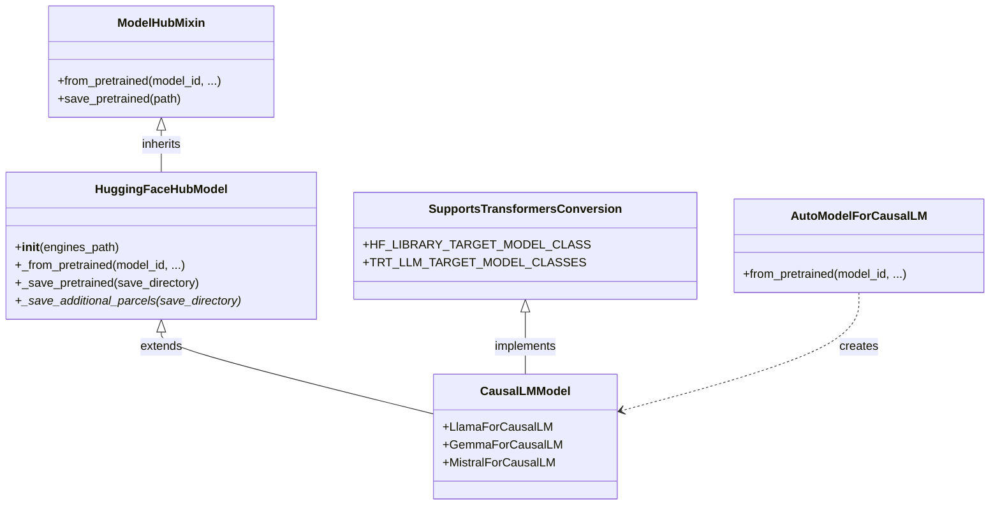
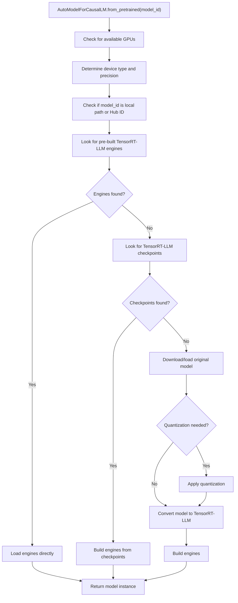
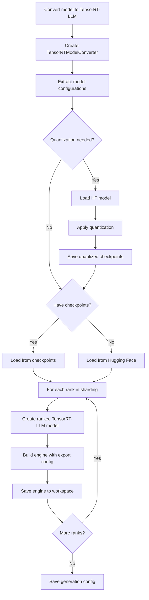
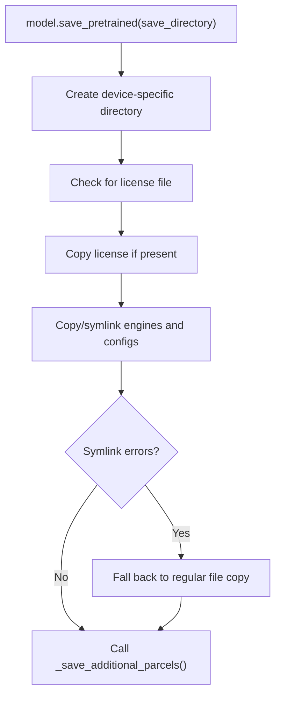
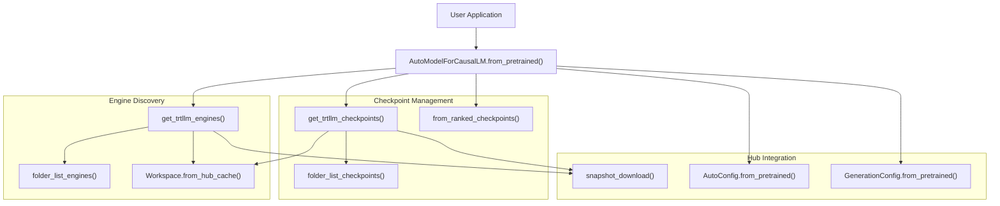

<!-- source: DeepWiki mcp.deepwiki.com · repo huggingface/optimum-nvidia · page 2.2 Model Loading & Hub Integration · fetched 2026-10-26 -->

# Model Loading & Hub Integration

<details>
<summary>Relevant source files</summary>

The following files were used as context for generating this wiki page:

- [src/optimum/nvidia/hub.py](src/optimum/nvidia/hub.py)
- [tests/test_hub.py](tests/test_hub.py)

</details>


## Purpose and Scope

This document explains how optimum-nvidia loads models from the Hugging Face Hub, converts them to TensorRT-LLM format, and manages the resulting engines. It covers the mechanisms for model discovery, loading, conversion, and saving to facilitate seamless integration with the Hugging Face ecosystem. For information on the runtime system that executes these models, see [Runtime System](#2.1). For details on export configurations, see [Export Configuration](#2.3).

## Hub Integration Architecture

At the core of the hub integration system is the `HuggingFaceHubModel` class, which provides standardized methods for loading models from and saving models to the Hugging Face Hub.



Sources: [src/optimum/nvidia/hub.py:190-198]()

The system is designed with these key components:

- `ModelHubMixin`: Hugging Face's standard interface for model hub operations
- `HuggingFaceHubModel`: Abstract base class that implements the core loading and saving functionality
- `AutoModelForCausalLM`: User-facing factory class that creates the appropriate model implementation
- Model implementations (like `LlamaForCausalLM`): Concrete classes that inherit from `HuggingFaceHubModel`
- `SupportsTransformersConversion`: Interface that defines how models are converted from Transformers to TensorRT-LLM

Sources: [src/optimum/nvidia/hub.py:190-452]()

## Model Loading Workflow

When a user calls `AutoModelForCausalLM.from_pretrained(model_id)`, the following workflow is executed:



Sources: [src/optimum/nvidia/hub.py:203-409]()

The loading process prioritizes finding pre-built engines for maximum efficiency. If engines aren't available, it attempts to leverage intermediate checkpoints before falling back to converting the original model.

Key steps in the process:

1. Detect available GPUs and determine device characteristics
2. Check if the model exists locally or on the Hub
3. Search for pre-built engines matching the model and device
4. If no engines are found, search for checkpoints
5. As a last resort, download and convert the original model
6. Apply any requested quantization during conversion
7. Return the fully initialized model

Sources: [src/optimum/nvidia/hub.py:222-239](), [src/optimum/nvidia/hub.py:236-270]()

## Model Conversion Process

When conversion from a Hugging Face model to TensorRT-LLM engines is required, the system follows this conversion workflow:



Sources: [src/optimum/nvidia/hub.py:310-401]()

The conversion process handles several scenarios:

1. Direct conversion from Hugging Face models
2. Building from existing TensorRT-LLM checkpoints
3. Optional quantization of models
4. Generation of engines for each rank when using model parallelism

The result is a set of optimized TensorRT-LLM engines saved to disk that can be loaded for inference.

Sources: [src/optimum/nvidia/hub.py:334-401]()

## Model Saving Process

Models can be saved using the `save_pretrained` method, which follows this workflow:



Sources: [src/optimum/nvidia/hub.py:415-452]()

The saving process:

1. Creates a device-specific directory structure (e.g., `/path/to/model/h100/`)
2. Preserves the original model's license information
3. Copies or symlinks engine files and configuration files
4. Falls back to regular file copying if symlinks fail (important for Windows compatibility)
5. Calls model-specific `_save_additional_parcels` method to save additional data

This creates a directory structure that can be pushed to the Hugging Face Hub or reloaded locally.

Sources: [src/optimum/nvidia/hub.py:415-452]()

## Engine and Checkpoint Management

The system includes several utility functions for managing engines and checkpoints:

| Function | Purpose |
|----------|---------|
| `folder_list_engines(folder)` | Lists all engine files in a directory |
| `folder_list_checkpoints(folder)` | Lists all checkpoint files in a directory |
| `get_trtllm_engines(model_id, device, dtype)` | Retrieves engines for a specific model, device, and precision |
| `get_trtllm_checkpoints(model_id, device, dtype)` | Retrieves checkpoints for a specific model, device, and precision |
| `from_ranked_checkpoints(checkpoints_folder, target_class)` | Creates models from ranked checkpoints |
| `from_ranked_hf_model(local_path, config, target_class, export_config)` | Creates ranked models from a Hugging Face model |

Sources: [src/optimum/nvidia/hub.py:84-107](), [src/optimum/nvidia/hub.py:118-154](), [src/optimum/nvidia/hub.py:156-187]()

These utilities handle:

- Discovery of engine and checkpoint files with specific naming patterns
- Mapping between ranks and filenames for multi-GPU setups
- Integration with the Hugging Face Hub caching system
- Workspace management for organized storage of artifacts



Sources: [src/optimum/nvidia/hub.py:84-187](), [tests/test_hub.py:30-59]()

## Practical Usage

The most common way to use this system is through the `AutoModelForCausalLM.from_pretrained` method:

```python
# Load a model with default settings
model = AutoModelForCausalLM.from_pretrained("meta-llama/Llama-2-7b-chat-hf")

# Load with custom export configuration
export_config = ExportConfig(
    dtype="float16",
    max_input_len=128,
    max_batch_size=1,
    max_output_len=128
)
model = AutoModelForCausalLM.from_pretrained(
    "meta-llama/Llama-2-7b-chat-hf", 
    export_config=export_config
)

# Save the model for later use
model.save_pretrained("./my_optimized_model")

# Later, load the optimized model directly
model = AutoModelForCausalLM.from_pretrained("./my_optimized_model")
```

Sources: [tests/test_hub.py:94-97](), [tests/test_hub.py:111-112]()

This system allows users to seamlessly work with models from the Hugging Face Hub, benefiting from TensorRT-LLM optimizations while maintaining the familiar Hugging Face interface.

---

