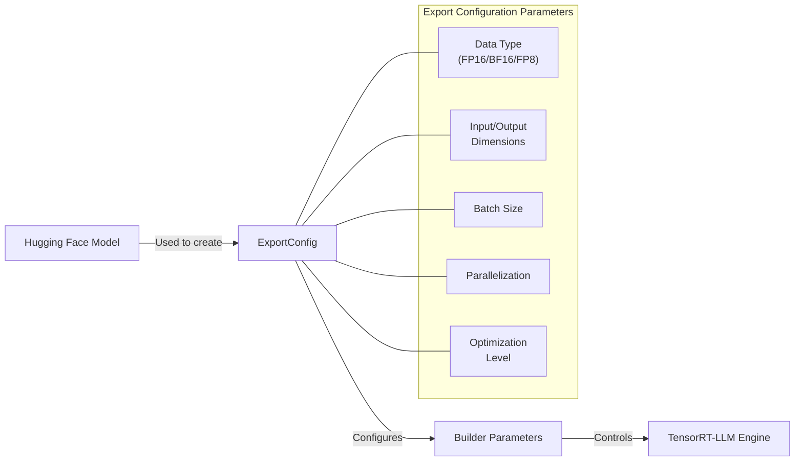
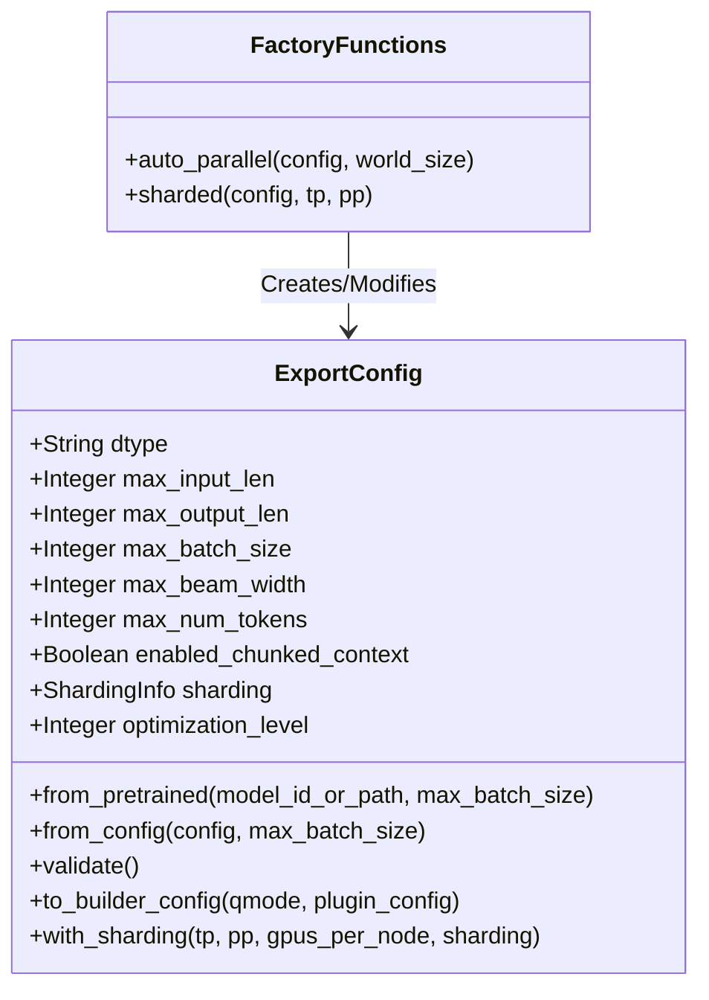
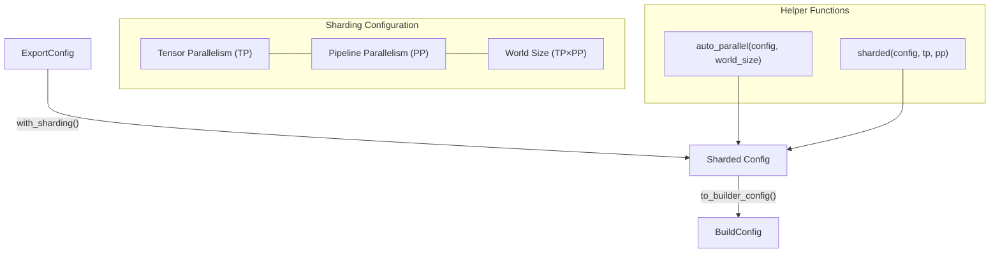
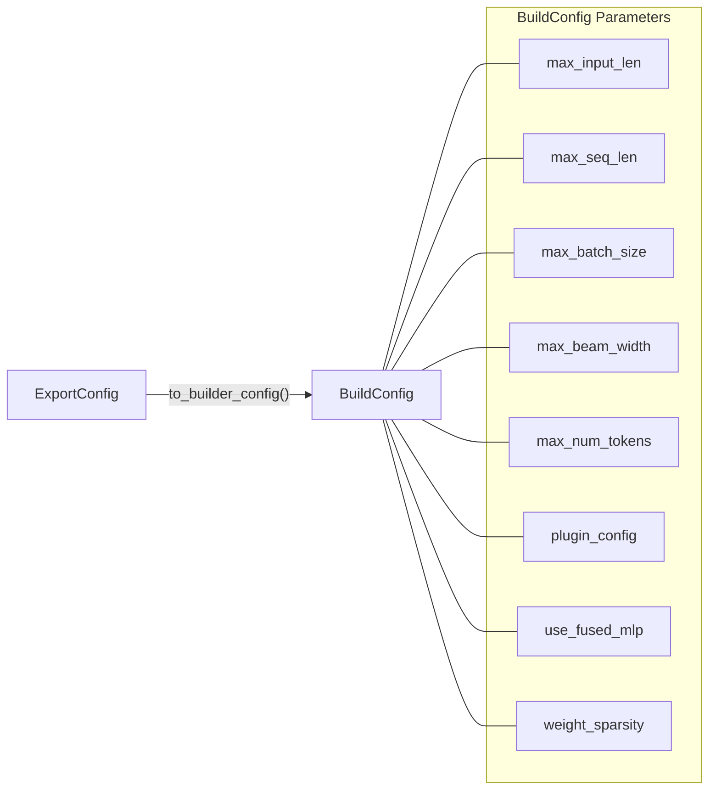
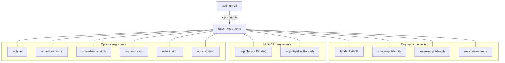

<!-- source: DeepWiki mcp.deepwiki.com · repo huggingface/optimum-nvidia · page 2.3 Export Configuration · fetched 2026-10-26 -->

# Export Configuration

<details>
<summary>Relevant source files</summary>

The following files were used as context for generating this wiki page:

- [src/optimum/nvidia/export/cli.py](src/optimum/nvidia/export/cli.py)
- [src/optimum/nvidia/export/config.py](src/optimum/nvidia/export/config.py)
- [src/optimum/nvidia/utils/cli.py](src/optimum/nvidia/utils/cli.py)

</details>


This document details the export configuration system in optimum-nvidia, which controls how Hugging Face Transformers models are exported to TensorRT-LLM engines. Export configurations determine critical aspects of the exported model such as precision, input/output dimensions, batch size limitations, and parallelization strategies.

For information on model loading and integration with the Hugging Face Hub, see [Model Loading & Hub Integration](#2.2). For details about configuring quantization, see [Quantization](#5.1).

## Core Concepts

The export configuration defines the parameters and constraints used when converting a Hugging Face model to a TensorRT-LLM engine. These configurations affect both the capabilities and performance characteristics of the resulting optimized model.



Sources: [src/optimum/nvidia/export/config.py:26-35]()

## ExportConfig Class

The central component of the export system is the `ExportConfig` class, which encapsulates all parameters needed to configure the TensorRT-LLM engine building process.

### Core Parameters

The `ExportConfig` class has the following required parameters:

| Parameter | Description | Default |
|-----------|-------------|---------|
| `dtype` | Data type for model computations (e.g., "float16", "bfloat16", "float8") | - |
| `max_input_len` | Maximum prompt length in tokens | - |
| `max_output_len` | Maximum total sequence length in tokens | - |
| `max_batch_size` | Maximum number of requests processed concurrently | - |

And these optional parameters:

| Parameter | Description | Default |
|-----------|-------------|---------|
| `max_beam_width` | Maximum beam search width | 1 |
| `max_num_tokens` | Maximum number of tokens across batch | Auto-calculated |
| `enabled_chunked_context` | Enable chunked context processing | False |
| `sharding` | Model parallelism configuration | Single GPU config |
| `optimization_level` | TensorRT optimization level | 3 |

Sources: [src/optimum/nvidia/export/config.py:26-40]()

### Validation

The `ExportConfig` class includes validation logic to ensure parameters are within acceptable ranges and consistent with each other. For example, `max_batch_size` must be at least 1, and `optimization_level` must be non-negative.

Sources: [src/optimum/nvidia/export/config.py:77-95]()

## Creating Export Configurations

There are several ways to create an `ExportConfig` instance:



Sources: [src/optimum/nvidia/export/config.py:46-75](), [src/optimum/nvidia/export/config.py:150-161]()

### From Pretrained Models

You can create an export configuration directly from a Hugging Face model ID or path:

```python
from optimum.nvidia.export.config import ExportConfig

# Create configuration from model, with default batch size of 1
config = ExportConfig.from_pretrained("meta-llama/Llama-2-7b")

# Specify a larger batch size
config = ExportConfig.from_pretrained("meta-llama/Llama-2-7b", max_batch_size=4)
```

The method automatically sets appropriate values for `dtype`, `max_input_len`, and `max_output_len` based on the model's configuration.

Sources: [src/optimum/nvidia/export/config.py:46-52]()

### From Configuration Objects

You can also create an export configuration from a Hugging Face model configuration:

```python
from transformers import AutoConfig
from optimum.nvidia.export.config import ExportConfig

# Load model configuration
model_config = AutoConfig.from_pretrained("meta-llama/Llama-2-7b")

# Create export configuration
config = ExportConfig.from_config(model_config, max_batch_size=2)
```

Sources: [src/optimum/nvidia/export/config.py:54-75]()

## Parallelization and Sharding

The `ExportConfig` supports configuring model parallelism for multi-GPU inference using Tensor Parallelism (TP) and Pipeline Parallelism (PP).



Sources: [src/optimum/nvidia/export/config.py:150-161](), [src/optimum/nvidia/export/config.py:163-221]()

### Manual Sharding Configuration

You can manually configure the parallelization strategy using the `with_sharding` method:

```python
# Configure for 4-way tensor parallelism
config.with_sharding(tp=4, pp=1)

# Configure for mixed parallelism (2×2)
config.with_sharding(tp=2, pp=2)
```

Sources: [src/optimum/nvidia/export/config.py:150-161]()

### Automatic Parallelization

The library provides a helper function to automatically determine an appropriate parallelization strategy based on the available hardware:

```python
from optimum.nvidia.export.config import auto_parallel

# Let the library choose the best strategy
config = auto_parallel(config)

# Specify the number of GPUs to use
config = auto_parallel(config, world_size=4)
```

The `auto_parallel` function selects different strategies based on the number of available GPUs:
- For 2 GPUs: TP=2, PP=1
- For 4 GPUs: TP=2, PP=2
- For 8 GPUs: TP=4, PP=2

Sources: [src/optimum/nvidia/export/config.py:163-202]()

### Manual Sharding Helper

There's also a `sharded` helper function that handles validation and setup:

```python
from optimum.nvidia.export.config import sharded

# Configure for 2-way tensor parallelism
config = sharded(config, tp=2, pp=1)
```

Sources: [src/optimum/nvidia/export/config.py:205-221]()

## Converting to TensorRT-LLM BuildConfig

The `ExportConfig` can be converted to a TensorRT-LLM `BuildConfig` using the `to_builder_config` method, which configures the underlying TensorRT-LLM engine build process.



Sources: [src/optimum/nvidia/export/config.py:115-148]()

## Plugin Configuration

The `ExportConfig` automatically configures TensorRT-LLM plugins based on your parameters and hardware. This includes:

- Enabling appropriate GEMM plugins
- Configuring attention mechanisms
- Setting up paged KV cache
- Enabling NCCL plugin for multi-GPU execution
- Configuring FP8 optimizations when applicable

Sources: [src/optimum/nvidia/export/config.py:98-113]()

## Command Line Interface

optimum-nvidia provides a command-line interface for exporting models, with arguments that map to the `ExportConfig` parameters.



Sources: [src/optimum/nvidia/export/cli.py:8-68](), [src/optimum/nvidia/utils/cli.py:21-57](), [src/optimum/nvidia/utils/cli.py:61-87]()

### Common Export CLI Arguments

| Argument | Description | Default |
|----------|-------------|---------|
| `--max-input-length` | Maximum prompt length | Model specific |
| `--max-output-length` | Maximum sequence length | Model specific |
| `--max-new-tokens` | Maximum new tokens to generate | - |
| `--tp` | Tensor Parallelism degree | 1 |
| `--pp` | Pipeline Parallelism degree | 1 |
| `--dtype` | Computation data type | "auto" |
| `--max-batch-size` | Maximum batch size | 1 |
| `--max-beams-width` | Maximum beam search width | 1 |
| `--quantization` | Path to quantization recipe | None |
| `--destination` | Output folder | Hub cache |
| `--push-to-hub` | Hub repo to push to | None |

Sources: [src/optimum/nvidia/export/cli.py:8-68]()

### Additional CLI Arguments

The CLI also supports additional arguments for model topology configuration:

| Argument | Description | Default |
|----------|-------------|---------|
| `--tensor-parallelism` | Same as `--tp` | 1 |
| `--pipeline-parallelism` | Same as `--pp` | 1 |
| `--world-size` | Total number of GPUs | 1 |
| `--gpus-per-node` | GPUs per node | 1 |
| `--opt-level` | Optimization level | 2 |

And arguments for optimization profiles:

| Argument | Description | Default |
|----------|-------------|---------|
| `--max-batch-size` | Maximum batch size | 1 |
| `--max-prompt-length` | Maximum prompt length | 128 |
| `--max-new-tokens` | Maximum tokens to generate | 1024 |
| `--max-beam-width` | Maximum beam search width | 1 |

Sources: [src/optimum/nvidia/utils/cli.py:21-57](), [src/optimum/nvidia/utils/cli.py:61-87]()

## Example Usage

Here's an example of exporting a model using the CLI:

```bash
optimum-cli export nvidia \
  meta-llama/Llama-2-7b \
  --max-input-length 2048 \
  --max-output-length 4096 \
  --max-batch-size 2 \
  --dtype bfloat16 \
  --tp 2 \
  --pp 1 \
  --destination ./exported_model
```

And an equivalent Python API usage:

```python
from optimum.nvidia.export.config import ExportConfig, sharded

# Create export configuration
config = ExportConfig.from_pretrained("meta-llama/Llama-2-7b", max_batch_size=2)
config.max_input_len = 2048
config.max_output_len = 4096
config.dtype = "bfloat16"

# Configure parallelism
config = sharded(config, tp=2, pp=1)

# Export the model (handled by other components not covered in this page)
```

Sources: [src/optimum/nvidia/export/config.py:26-161]()

---

