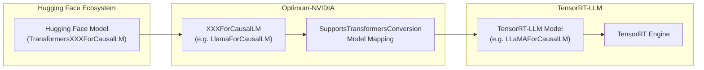
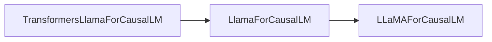
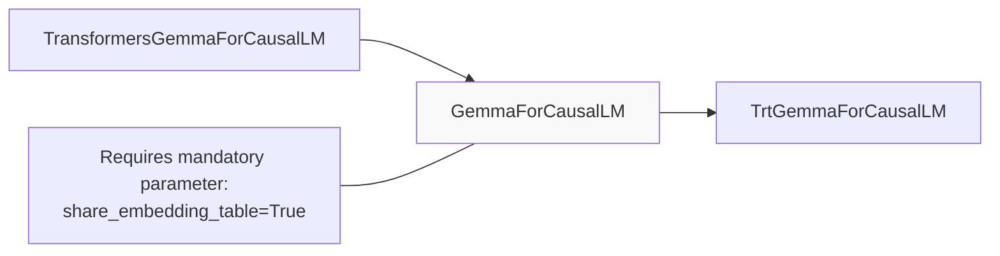
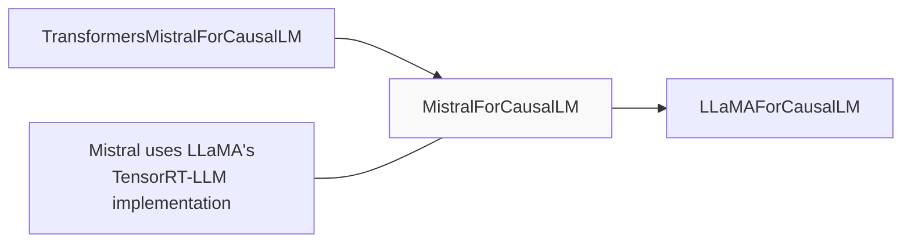
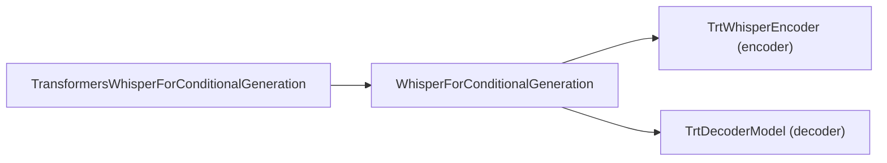
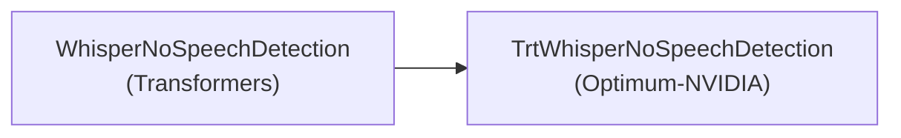

<!-- source: DeepWiki mcp.deepwiki.com · repo huggingface/optimum-nvidia · page 3 Supported Models · fetched 2026-10-26 -->

# Supported Models

<details>
<summary>Relevant source files</summary>

The following files were used as context for generating this wiki page:

- [src/optimum/nvidia/generation/logits_process.py](src/optimum/nvidia/generation/logits_process.py)
- [src/optimum/nvidia/models/gemma.py](src/optimum/nvidia/models/gemma.py)
- [src/optimum/nvidia/models/llama.py](src/optimum/nvidia/models/llama.py)
- [src/optimum/nvidia/models/mistral.py](src/optimum/nvidia/models/mistral.py)
- [src/optimum/nvidia/models/whisper.py](src/optimum/nvidia/models/whisper.py)

</details>


This page documents the model architectures currently supported by Optimum-NVIDIA for optimized inference using TensorRT-LLM. It covers which models can be converted from Hugging Face Transformers to TensorRT-LLM, how they are implemented in the codebase, and what specific features each model supports. For information about how to configure model export parameters, see [Export Configuration](#2.3).

## Model Architecture Overview

Optimum-NVIDIA implements a consistent architecture for all supported models. Each model:

1. Inherits from `SupportsTransformersConversion`, which defines the mapping between Hugging Face and TensorRT-LLM implementations
2. For causal language models, also inherits from `CausalLM`, which provides runtime functionality
3. Often inherits from `HuggingFaceHubModel` to enable direct loading from the Hugging Face Hub

The following diagram illustrates the inheritance structure for the supported models:

```mermaid
classDiagram
    class SupportsTransformersConversion {
        +HF_LIBRARY_TARGET_MODEL_CLASS
        +TRT_LLM_TARGET_MODEL_CLASSES
    }
    
    class CausalLM {
        +__init__(engines_path, generation_config, load_engines)
        +generate(inputs, generation_config)
        +agenerate(inputs, generation_config)
    }
    
    class HuggingFaceHubModel {
        +_from_pretrained(pretrained_model_name_or_path)
        +_save_pretrained(save_directory)
    }
    
    class LlamaForCausalLM {
        +HF_LIBRARY_TARGET_MODEL_CLASS = TransformersLlamaForCausalLM
        +TRT_LLM_TARGET_MODEL_CLASSES = LLaMAForCausalLM
    }
    
    class GemmaForCausalLM {
        +HF_LIBRARY_TARGET_MODEL_CLASS = TransformersGemmaForCausalLM
        +TRT_LLM_TARGET_MODEL_CLASSES = TrtGemmaForCausalLM
        +TRT_LLM_MANDATORY_CONVERSION_PARAMS = {"share_embedding_table": True}
    }
    
    class MistralForCausalLM {
        +HF_LIBRARY_TARGET_MODEL_CLASS = TransformersMistralForCausalLM
        +TRT_LLM_TARGET_MODEL_CLASSES = LLaMAForCausalLM
    }
    
    class WhisperForConditionalGeneration {
        +HF_LIBRARY_TARGET_MODEL_CLASS = TransformersWhisperForConditionalGeneration
        +TRT_LLM_TARGET_MODEL_CLASSES = {encoder: TrtWhisperEncoder, decoder: TrtDecoderModel}
    }
    
    SupportsTransformersConversion <|-- LlamaForCausalLM
    SupportsTransformersConversion <|-- GemmaForCausalLM
    SupportsTransformersConversion <|-- MistralForCausalLM
    SupportsTransformersConversion <|-- WhisperForConditionalGeneration
    
    CausalLM <|-- LlamaForCausalLM
    CausalLM <|-- GemmaForCausalLM
    CausalLM <|-- MistralForCausalLM
    
    HuggingFaceHubModel <|-- GemmaForCausalLM
    HuggingFaceHubModel <|-- MistralForCausalLM
```

Sources: [src/optimum/nvidia/models/llama.py:27-29](), [src/optimum/nvidia/models/gemma.py:28-32](), [src/optimum/nvidia/models/mistral.py:28-30](), [src/optimum/nvidia/models/whisper.py:36-41]()

## Model Conversion Flow

The diagram below illustrates how models are converted from Hugging Face Transformers to TensorRT-LLM:



Sources: [src/optimum/nvidia/models/llama.py](), [src/optimum/nvidia/models/gemma.py](), [src/optimum/nvidia/models/mistral.py](), [src/optimum/nvidia/models/whisper.py]()

## Supported Model Architectures

### Causal Language Models (LLMs)

Optimum-NVIDIA currently supports the following causal language models for text generation:

| Model Architecture | Optimum-NVIDIA Class | Hugging Face Class | TensorRT-LLM Class |
|--------------------|----------------------|-------------------|-------------------|
| Llama | `LlamaForCausalLM` | `TransformersLlamaForCausalLM` | `LLaMAForCausalLM` |
| Gemma | `GemmaForCausalLM` | `TransformersGemmaForCausalLM` | `TrtGemmaForCausalLM` |
| Mistral | `MistralForCausalLM` | `TransformersMistralForCausalLM` | `LLaMAForCausalLM` |

Sources: [src/optimum/nvidia/models/llama.py:27-29](), [src/optimum/nvidia/models/gemma.py:28-32](), [src/optimum/nvidia/models/mistral.py:28-30]()

#### Llama Models

Llama models (Llama, Llama 2, Llama 3, etc.) are supported through the `LlamaForCausalLM` class which maps from Hugging Face's implementation to TensorRT-LLM's `LLaMAForCausalLM`.



Sources: [src/optimum/nvidia/models/llama.py:27-29]()

#### Gemma Models

Gemma models are supported through the `GemmaForCausalLM` class, which includes a mandatory conversion parameter to share the embedding table.



Sources: [src/optimum/nvidia/models/gemma.py:28-32]()

#### Mistral Models

Mistral models are supported through the `MistralForCausalLM` class. Interestingly, Mistral models use the LLaMA TensorRT-LLM implementation:



Sources: [src/optimum/nvidia/models/mistral.py:28-30]()

### Audio Models

#### Whisper For Speech Recognition

Whisper is currently the only supported audio model, implemented as `WhisperForConditionalGeneration`. Unlike the causal language models, Whisper is an encoder-decoder model and has a different structure in TensorRT-LLM:



Whisper also includes special logits processors for speech recognition tasks:



Sources: [src/optimum/nvidia/models/whisper.py:36-41](), [src/optimum/nvidia/generation/logits_process.py:28-31]()

## Model Compatibility Matrix

The following table summarizes the compatibility between model architectures, supported features, and limitations:

| Model Family | Size Range | Supported Tasks | Notable Features | Quantization Support |
|--------------|------------|-----------------|------------------|----------------------|
| Llama | 7B to 70B+ | Text Generation, Chat | Standard causal LLM | FP16, INT8, FP8 |
| Gemma | 2B, 7B | Text Generation, Chat | Requires shared embedding table | FP16, INT8, FP8 |
| Mistral | 7B | Text Generation, Chat | Uses LLaMA TensorRT-LLM implementation | FP16, INT8, FP8 |
| Whisper | Tiny to Large | Speech Recognition | Encoder-decoder architecture | FP16 |

For details on how to use these models with various quantization options, see [Quantization](#5.1).

Sources: [src/optimum/nvidia/models/llama.py](), [src/optimum/nvidia/models/gemma.py](), [src/optimum/nvidia/models/mistral.py](), [src/optimum/nvidia/models/whisper.py]()

## Common Architecture Pattern

All model implementations in Optimum-NVIDIA follow a similar pattern:

1. They define mappings between Hugging Face Transformers and TensorRT-LLM implementations
2. They inherit from `SupportsTransformersConversion` to enable the conversion process
3. They inherit from appropriate runtime classes (`CausalLM` for text generation models)
4. Some models inherit from `HuggingFaceHubModel` for seamless Hub integration

This consistent architecture allows Optimum-NVIDIA to easily support new model architectures as they become available in both Hugging Face Transformers and TensorRT-LLM.

---

