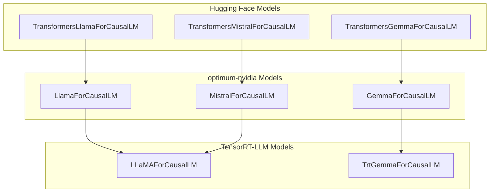
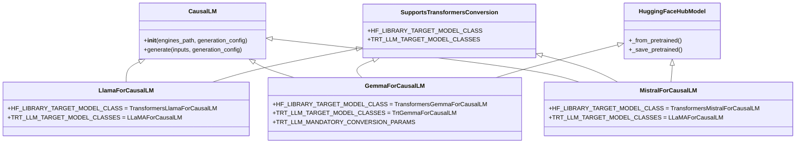
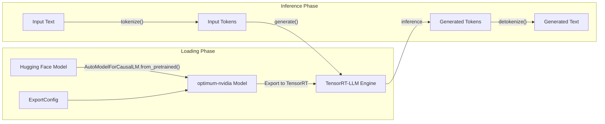
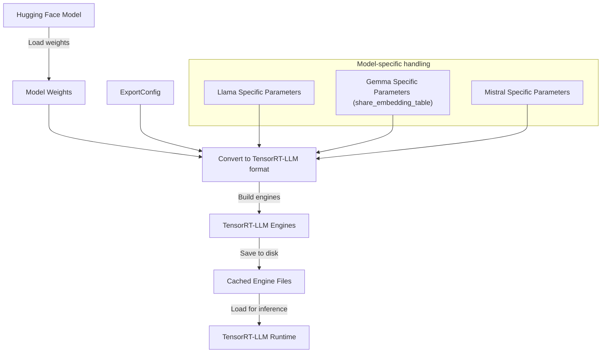
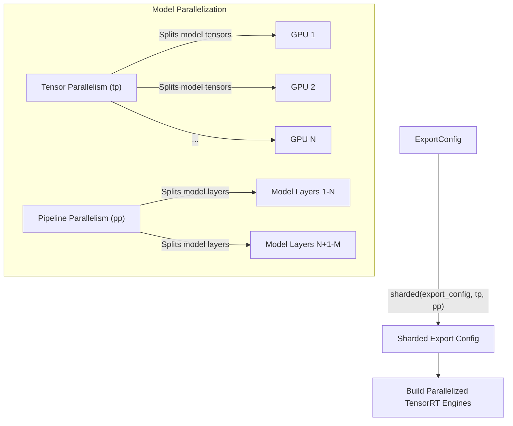

<!-- source: DeepWiki mcp.deepwiki.com · repo huggingface/optimum-nvidia · page 3.1 Causal Language Models · fetched 2026-10-26 -->

# Causal Language Models

<details>
<summary>Relevant source files</summary>

The following files were used as context for generating this wiki page:

- [src/optimum/nvidia/models/gemma.py](src/optimum/nvidia/models/gemma.py)
- [src/optimum/nvidia/models/llama.py](src/optimum/nvidia/models/llama.py)
- [src/optimum/nvidia/models/mistral.py](src/optimum/nvidia/models/mistral.py)
- [tests/integration/test_causal_lm.py](tests/integration/test_causal_lm.py)

</details>


This document describes the implementation and usage of Causal Language Models (CLMs) in the `optimum-nvidia` library. It covers the supported model architectures, their implementation details, and how they interface with both Hugging Face Transformers and NVIDIA's TensorRT-LLM. For information about other model types such as Whisper, see [Whisper Model for ASR](#3.2).

## Overview

Causal Language Models in `optimum-nvidia` provide optimized inference using TensorRT-LLM for autoregressive text generation. The library currently supports several popular architectures:

- LLaMA/LLaMA-2/LLaMA-3 (Meta)
- Gemma (Google)
- Mistral/Mixtral (Mistral AI)

These implementations allow seamless conversion from Hugging Face Transformers models to TensorRT-LLM's optimized runtime while maintaining the familiar Hugging Face interface.



Sources:
- [src/optimum/nvidia/models/llama.py:17-29]()
- [src/optimum/nvidia/models/gemma.py:17-32]()
- [src/optimum/nvidia/models/mistral.py:17-30]()

## Architecture

The Causal LM implementations in `optimum-nvidia` follow a consistent pattern that bridges Hugging Face Transformers models with TensorRT-LLM:



Sources:
- [src/optimum/nvidia/models/llama.py:27-29]()
- [src/optimum/nvidia/models/gemma.py:28-32]()
- [src/optimum/nvidia/models/mistral.py:28-30]()

Key components:

1. **Base Classes**:
   - `CausalLM`: Provides core functionality for text generation using TensorRT-LLM engines
   - `SupportsTransformersConversion`: Enables conversion from Hugging Face Transformers to TensorRT-LLM
   - `HuggingFaceHubModel`: Provides integration with the Hugging Face Hub (for some models)

2. **Model-Specific Classes**:
   - Each model defines target model classes for both Transformers and TensorRT-LLM
   - Gemma defines mandatory conversion parameters (like `share_embedding_table`)
   - Mistral uses LLaMA's TensorRT-LLM implementation under the hood

## Supported Models

### LLaMA

The LLaMA implementation supports all variants of Meta's LLaMA family, including LLaMA, LLaMA-2, and LLaMA-3.

```python
class LlamaForCausalLM(CausalLM, SupportsTransformersConversion):
    HF_LIBRARY_TARGET_MODEL_CLASS = TransformersLlamaForCausalLM
    TRT_LLM_TARGET_MODEL_CLASSES = LLaMAForCausalLM
```

Sources:
- [src/optimum/nvidia/models/llama.py:27-29]()

### Gemma

The Gemma implementation supports Google's Gemma models with specific conversion parameters.

```python
class GemmaForCausalLM(CausalLM, HuggingFaceHubModel, SupportsTransformersConversion):
    HF_LIBRARY_TARGET_MODEL_CLASS = TransformersGemmaForCausalLM
    TRT_LLM_TARGET_MODEL_CLASSES = TrtGemmaForCausalLM
    TRT_LLM_MANDATORY_CONVERSION_PARAMS = {"share_embedding_table": True}
```

Sources:
- [src/optimum/nvidia/models/gemma.py:28-32]()

### Mistral

The Mistral implementation supports both Mistral and Mixtral models, using LLaMA's TensorRT-LLM architecture.

```python
class MistralForCausalLM(CausalLM, HuggingFaceHubModel, SupportsTransformersConversion):
    HF_LIBRARY_TARGET_MODEL_CLASS = TransformersMistralForCausalLM
    TRT_LLM_TARGET_MODEL_CLASSES = LLaMAForCausalLM
```

Sources:
- [src/optimum/nvidia/models/mistral.py:28-30]()

## Model Loading and Inference

The following diagram illustrates the typical workflow for loading and running inference with a Causal LM:



Sources:
- [tests/integration/test_causal_lm.py:76-80]()
- [tests/integration/test_causal_lm.py:82-88]()

### Loading a Model

Models are loaded using the `AutoModelForCausalLM.from_pretrained` method:

```python
from optimum.nvidia import AutoModelForCausalLM, ExportConfig

export_config = ExportConfig(
    dtype="float16",              # Precision (float16, float32, etc.)
    max_input_len=128,            # Maximum input sequence length
    max_batch_size=batch_size,    # Maximum batch size for inference
    max_output_len=128,           # Maximum output sequence length
    max_num_tokens=max_new_tokens # Maximum tokens to generate
)

# Optional: Configure tensor and pipeline parallelism
from optimum.nvidia.export.config import sharded
export_config = sharded(export_config, tp=4, pp=1)

model = AutoModelForCausalLM.from_pretrained(
    "meta-llama/Llama-2-7b-chat-hf",
    force_export=True,            # Force re-export even if engines exist
    export_config=export_config,
)
```

Sources:
- [tests/integration/test_causal_lm.py:67-74]()
- [tests/integration/test_causal_lm.py:76-80]()

### Inference

Once loaded, models provide a `generate` method similar to Hugging Face Transformers:

```python
# Tokenize input text
from transformers import AutoTokenizer
tokenizer = AutoTokenizer.from_pretrained("meta-llama/Llama-2-7b-chat-hf")
inputs = tokenizer(["Today I am in Paris and I would like to eat crepes."], padding=False)

# Configure generation parameters
generation_kwargs = {
    "top_k": 1,
    "top_p": 1e-10,
    "length_penalty": 1,
    "repetition_penalty": 1,
    "temperature": 1,
}

# Generate text
output_ids = model.generate(
    inputs["input_ids"],
    num_beams=1,
    do_sample=True,
    max_new_tokens=110,
    **generation_kwargs,
)

# Decode generated tokens
output_text = tokenizer.batch_decode(output_ids)
```

Sources:
- [tests/integration/test_causal_lm.py:56-57]()
- [tests/integration/test_causal_lm.py:59-65]()
- [tests/integration/test_causal_lm.py:82-88]()

## Model Conversion Process

When a model is loaded via `AutoModelForCausalLM.from_pretrained`, the following conversion process occurs:



Sources:
- [src/optimum/nvidia/models/gemma.py:32]()
- [tests/integration/test_causal_lm.py:76-80]()

## Parallel Inference

Causal LMs in `optimum-nvidia` support parallel inference using tensor parallelism (TP) and pipeline parallelism (PP):



Example configuration for a 4-way tensor parallelism:

```python
from optimum.nvidia import ExportConfig
from optimum.nvidia.export.config import sharded

# Create basic export config
export_config = ExportConfig(
    dtype="float16",
    max_input_len=128,
    max_batch_size=2,
    max_output_len=128,
)

# Configure 4-GPU tensor parallelism, single pipeline stage
export_config = sharded(export_config, tp=4, pp=1)
```

Sources:
- [tests/integration/test_causal_lm.py:39-40]()
- [tests/integration/test_causal_lm.py:74]()

## Supported Models and Configurations

The following table summarizes the causal LMs supported by `optimum-nvidia`:

| Model Family | Example Model IDs | Implementation |
|--------------|-------------------|----------------|
| LLaMA | meta-llama/Llama-2-7b-chat-hf, meta-llama/Meta-Llama-3-8B | Uses native TensorRT-LLM LLaMA implementation |
| Gemma | google/gemma-2b-it | Uses native TensorRT-LLM Gemma implementation with shared embedding table |
| Mistral | mistralai/Mistral-7B-Instruct-v0.2 | Uses TensorRT-LLM LLaMA implementation |
| Mixtral | mistralai/Mixtral-8x7B-Instruct-v0.1 | Uses TensorRT-LLM LLaMA implementation, requires tensor parallelism |

Sources:
- [tests/integration/test_causal_lm.py:26-31]()
- [tests/integration/test_causal_lm.py:34]()

## Integration with Other Components

For more information on related components, see:

- [Runtime System](#2.1) - Details on the TensorRT-LLM runtime implementation
- [Export Configuration](#2.3) - In-depth explanation of export configuration options
- [Pipeline API](#4.1) - Using causal LMs with the pipeline API
- [Quantization](#5.1) - Quantization options for causal LMs
- [Parallel Inference](#5.2) - Detailed information on parallelism configurations

---

