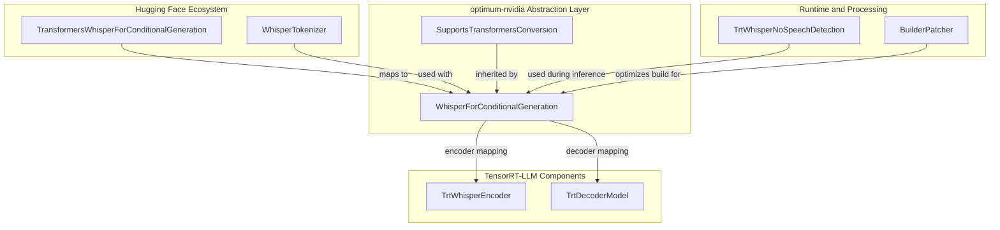
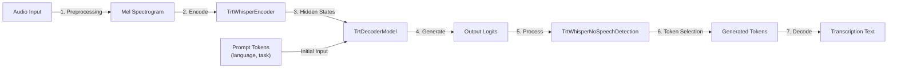

<!-- source: DeepWiki mcp.deepwiki.com · repo huggingface/optimum-nvidia · page 3.2 Whisper Model for ASR · fetched 2026-10-26 -->

# Whisper Model for ASR

<details>
<summary>Relevant source files</summary>

The following files were used as context for generating this wiki page:

- [.dockerignore](.dockerignore)
- [src/optimum/nvidia/generation/logits_process.py](src/optimum/nvidia/generation/logits_process.py)
- [src/optimum/nvidia/models/whisper.py](src/optimum/nvidia/models/whisper.py)
- [src/optimum/nvidia/utils/patching.py](src/optimum/nvidia/utils/patching.py)

</details>


## Purpose and Scope

This document explains the implementation and usage of the Whisper model for Automatic Speech Recognition (ASR) in the optimum-nvidia library. It covers how Whisper is integrated with TensorRT-LLM for optimized inference on NVIDIA GPUs, the architecture of the implementation, and specific considerations for this model type. This page focuses exclusively on the Whisper model; for information about causal language models like LLaMA, Gemma, and Mistral, see [Causal Language Models](#3.1).

## Architecture Overview

The Whisper model implementation in optimum-nvidia follows the core architectural pattern of the library, adapting the Hugging Face Transformers implementation of Whisper to work with TensorRT-LLM's optimized runtime.

### Whisper in the optimum-nvidia Ecosystem



Sources: [src/optimum/nvidia/models/whisper.py:36-41](), [src/optimum/nvidia/generation/logits_process.py:28-31](), [src/optimum/nvidia/utils/patching.py:6-42]()

### Whisper Model Components

```mermaid
classDiagram
    class SupportsTransformersConversion {
        +HF_LIBRARY_TARGET_MODEL_CLASS
        +TRT_LLM_TARGET_MODEL_CLASSES
    }
    
    class WhisperForConditionalGeneration {
        +HF_LIBRARY_TARGET_MODEL_CLASS = TransformersWhisperForConditionalGeneration
        +TRT_LLM_TARGET_MODEL_CLASSES = {"encoder": TrtWhisperEncoder, "decoder": TrtDecoderModel}
    }
    
    class TrtWhisperNoSpeechDetection {
        +__call__(step, input_ids, scores)
    }
    
    SupportsTransformersConversion <|-- WhisperForConditionalGeneration
    WhisperForConditionalGeneration ..> TrtWhisperNoSpeechDetection : uses
```

Sources: [src/optimum/nvidia/models/whisper.py:36-41](), [src/optimum/nvidia/generation/logits_process.py:28-31]()

## Implementation Details

### Core Model Class

The Whisper model implementation centers around the `WhisperForConditionalGeneration` class, which inherits from `SupportsTransformersConversion`. This class defines the mapping between the Hugging Face Transformers implementation and TensorRT-LLM.

The class establishes two critical relationships:
1. It identifies the source model class from Transformers (`TransformersWhisperForConditionalGeneration`)
2. It maps to the corresponding TensorRT-LLM components (`TrtWhisperEncoder` and `TrtDecoderModel`)

This mapping enables the automatic conversion from a Hugging Face Whisper model to an optimized TensorRT-LLM implementation.

Sources: [src/optimum/nvidia/models/whisper.py:36-41]()

### Logits Processing for Whisper

Whisper requires specialized logits processors for proper inference. The library provides TensorRT-compatible versions of these processors through classes like `TrtWhisperNoSpeechDetection`, which extends the original `WhisperNoSpeechDetection` from Transformers.

These logits processors adapt the original Transformers implementation to work with the TensorRT-LLM runtime, preserving functionality while enabling optimization.

The `LOGITS_PROCESSOR_MAP` dictionary maps Transformers logits processors to their TensorRT-compatible equivalents, ensuring that generation behavior remains consistent with the original model.

Sources: [src/optimum/nvidia/generation/logits_process.py:28-39]()

### Whisper-Specific Optimizations

The Whisper model implementation includes a special consideration in the form of the `BuilderPatcher` class. This utility temporarily modifies the TensorRT-LLM builder to disable network optimization for Whisper models, as standard optimization has been observed to lower predictive performance for this specific architecture.

The patcher is a context manager that:
1. Patches the TensorRT-LLM Builder code to make optimization conditional
2. Adds a configuration flag (`optimize_network`) that can be set to `False` for Whisper models
3. Restores the original code when exiting the context

This demonstrates how the optimum-nvidia implementation addresses model-specific requirements to maintain accuracy while still benefiting from TensorRT-LLM's performance advantages.

Sources: [src/optimum/nvidia/utils/patching.py:6-42]()

## Data Flow for ASR with Whisper

The following diagram illustrates the flow of data when using the Whisper model for automatic speech recognition:



Sources: [src/optimum/nvidia/models/whisper.py:36-41](), [src/optimum/nvidia/generation/logits_process.py:28-31]()

## Architecture Comparison with Hugging Face Transformers

The following table compares the Whisper components in Hugging Face Transformers with their optimum-nvidia TensorRT-LLM counterparts:

| Hugging Face Component | optimum-nvidia Component | Purpose |
|------------------------|--------------------------|---------|
| `WhisperForConditionalGeneration` | `WhisperForConditionalGeneration` | Top-level model class that handles the encoder-decoder architecture |
| `WhisperEncoder` | `TrtWhisperEncoder` | Processes the audio input (mel spectrogram) into hidden states |
| `WhisperDecoder` | `TrtDecoderModel` | Generates text tokens based on encoder output |
| `WhisperNoSpeechDetection` | `TrtWhisperNoSpeechDetection` | Handles the special case of detecting when no speech is present |

Sources: [src/optimum/nvidia/models/whisper.py:36-41](), [src/optimum/nvidia/generation/logits_process.py:28-31]()

## Usage Considerations

### Model Conversion Process

When using Whisper with optimum-nvidia, the model undergoes a conversion process from the Hugging Face Transformers format to TensorRT-LLM. This conversion preserves the model architecture and weights while optimizing for inference on NVIDIA GPUs.

The conversion is handled automatically through the `SupportsTransformersConversion` interface, which defines how the model components map between frameworks.

### Performance Optimization

The Whisper implementation includes special handling through the `BuilderPatcher` to ensure optimal performance without sacrificing accuracy. This addresses a specific characteristic of Whisper models where standard TensorRT-LLM optimization techniques can reduce predictive performance.

By using conditional optimization based on model configuration, optimum-nvidia balances the need for high performance with the requirement for accurate transcription results.

Sources: [src/optimum/nvidia/utils/patching.py:6-42]()

## Integration with Other Components

The Whisper implementation in optimum-nvidia is designed to work seamlessly with other components of the library, including:

1. The model loading and saving system through the Hugging Face Hub
2. The TensorRT-LLM runtime for optimized inference
3. The generation configuration system for controlling transcription behavior

This integration allows users to leverage Whisper models with the same efficiency advantages provided to language models in the library.

---

