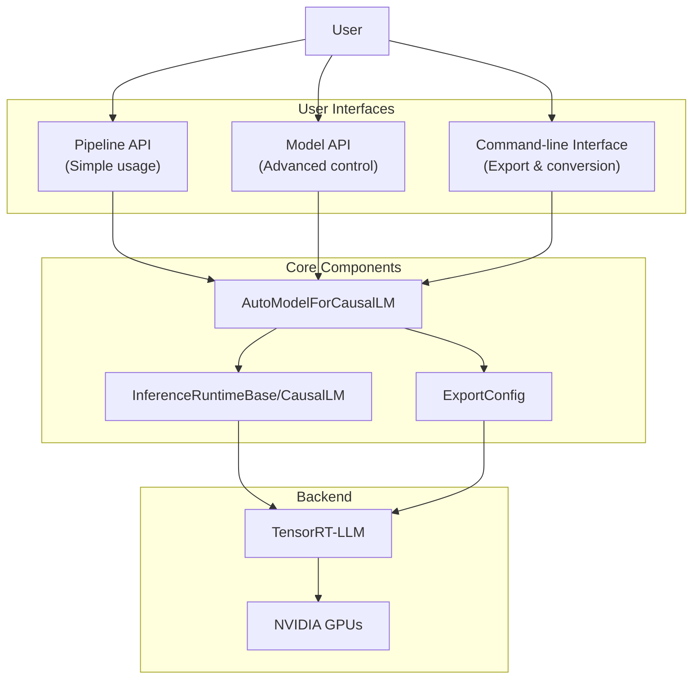
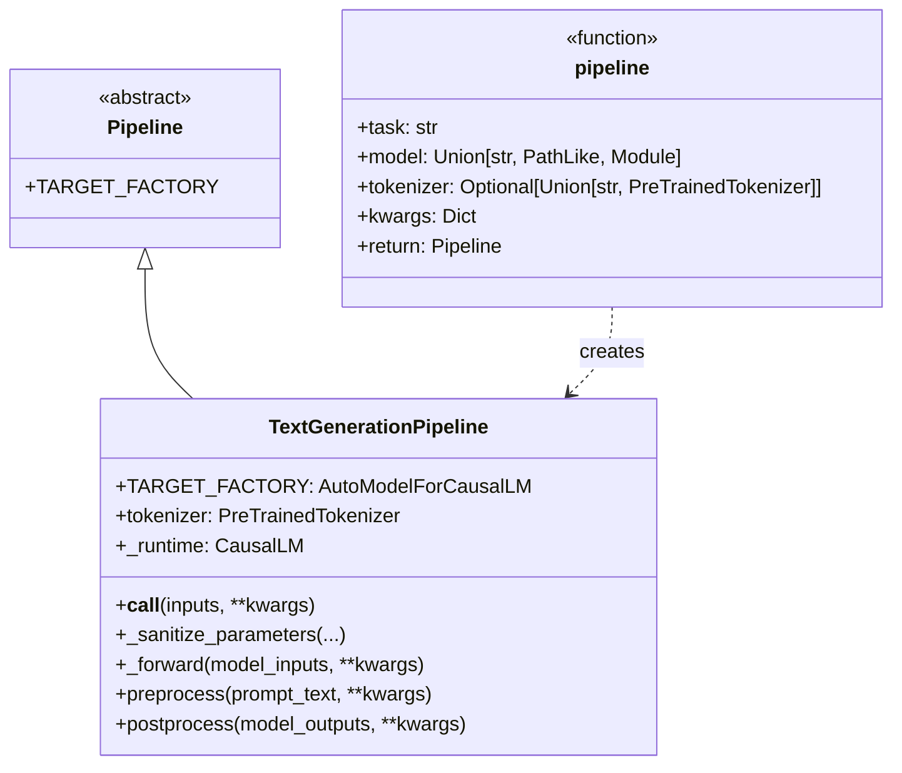
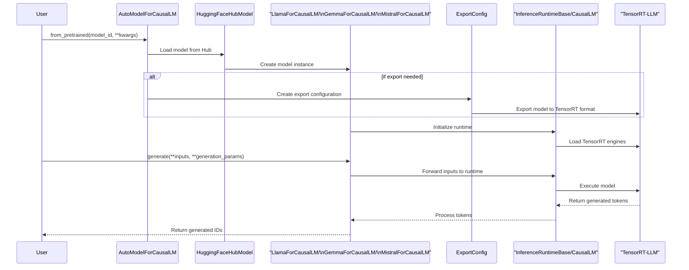
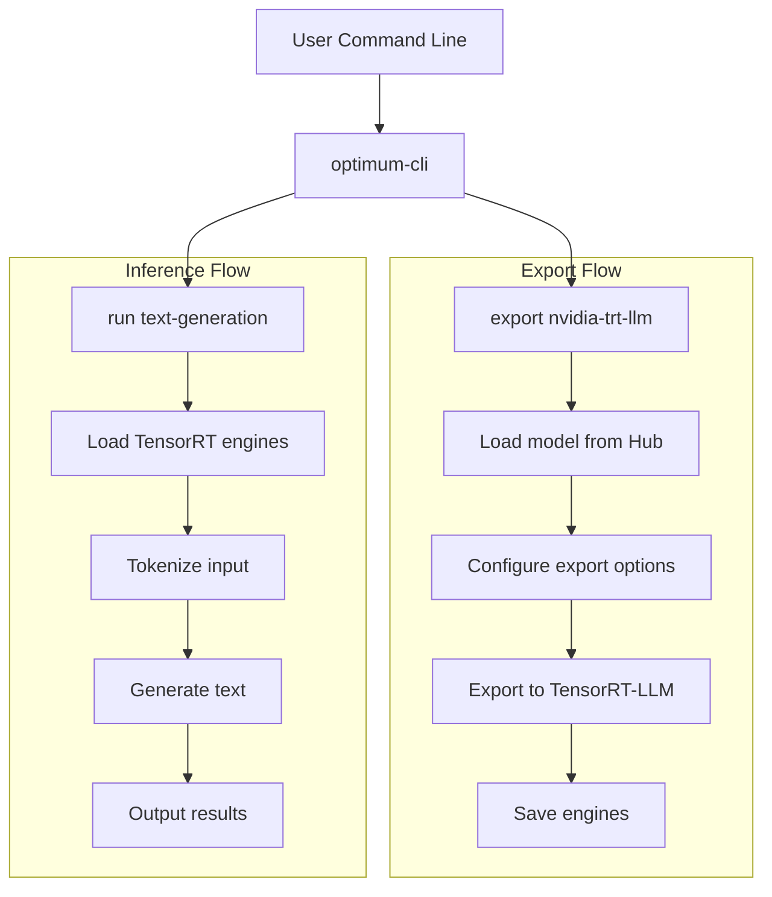
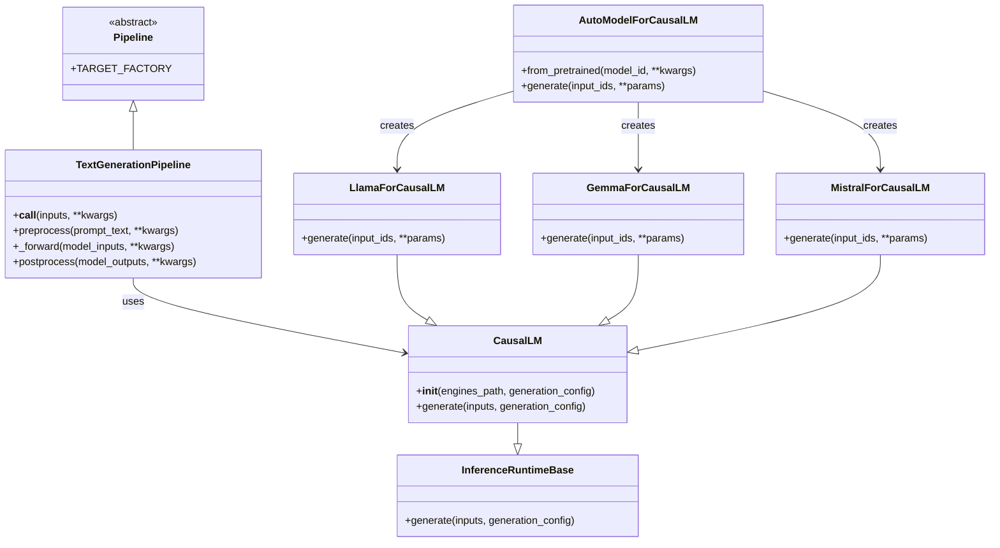

<!-- source: DeepWiki mcp.deepwiki.com · repo huggingface/optimum-nvidia · page 4 User Interfaces · fetched 2026-10-26 -->

# User Interfaces

<details>
<summary>Relevant source files</summary>

The following files were used as context for generating this wiki page:

- [CONTRIBUTING.md](CONTRIBUTING.md)
- [LICENSE](LICENSE)
- [README.md](README.md)
- [examples/text-generation.py](examples/text-generation.py)
- [src/optimum/nvidia/pipelines/__init__.py](src/optimum/nvidia/pipelines/__init__.py)
- [src/optimum/nvidia/pipelines/text_generation.py](src/optimum/nvidia/pipelines/text_generation.py)
- [src/optimum/nvidia/utils/tests/assertions.py](src/optimum/nvidia/utils/tests/assertions.py)

</details>


This page documents the various interfaces through which users can interact with the optimum-nvidia library. It covers the three main methods for working with optimized NVIDIA models: the Pipeline API for simple use cases, the direct Model API for more control, and the Command-line Interface (CLI) for model export and conversion. For information about model specific implementations, see [Supported Models](#3).

## Overview of User Interfaces

Optimum-NVIDIA provides multiple ways to interact with optimized models, catering to different user needs and use cases. These interfaces form the primary ways that end users will interact with the library.



Sources: [src/optimum/nvidia/pipelines/__init__.py](), [README.md:65-106]()

## Pipeline API

The Pipeline API provides the simplest way to interact with optimum-nvidia models. It's designed to mirror the Hugging Face Transformers pipeline API for easy migration from standard Transformers to optimized NVIDIA implementations.

### Implementation and Usage

The Pipeline API in optimum-nvidia is implemented through the `pipeline()` function, which creates specialized pipeline objects for specific tasks. Currently, the main implemented pipeline is the `TextGenerationPipeline` for text generation tasks using causal language models.



Sources: [src/optimum/nvidia/pipelines/text_generation.py:35-248](), [src/optimum/nvidia/pipelines/__init__.py:53-122]()

### How to Use the Pipeline API

The Pipeline API is designed to be as simple as possible, requiring minimal changes from existing Transformers code:

1. Import the pipeline from optimum.nvidia instead of transformers
2. Create a pipeline with the desired model and task
3. Pass input text to the pipeline to get generated output

```python
# Change only the import
from optimum.nvidia.pipelines import pipeline

# Create a pipeline with a Hugging Face model
pipe = pipeline('text-generation', 'meta-llama/Llama-2-7b-chat-hf', use_fp8=True)

# Generate text with a simple API call
result = pipe("Describe a real-world application of AI in sustainable energy.")
```

The pipeline automatically handles:
- Loading the model with TensorRT-LLM optimization
- Tokenizing the input text
- Running the inference with optimized settings
- Decoding the generated tokens

Sources: [README.md:66-76](), [src/optimum/nvidia/pipelines/__init__.py:53-122]()

### Supported Models and Tasks

The Pipeline API currently supports the following model architectures and tasks:

| Model Architecture | Supported Tasks   |
|--------------------|------------------|
| Gemma              | text-generation  |
| LLaMA              | text-generation  |
| Mistral            | text-generation  |
| Mixtral            | text-generation  |

Sources: [src/optimum/nvidia/pipelines/__init__.py:29-34]()

## Model API

The Model API provides more direct control over the model and generation process. It's based on the familiar Hugging Face Transformers API but adapted for optimized NVIDIA inference.

### Implementation and Usage Flow

The Model API centers around the `AutoModelForCausalLM` class that serves as the main entry point for loading and using models.



Sources: [README.md:78-106](), [examples/text-generation.py:72-86]()

### How to Use the Model API

The Model API provides a similar interface to Hugging Face Transformers with additional parameters for controlling the TensorRT-LLM optimization:

1. Import `AutoModelForCausalLM` from optimum.nvidia instead of transformers
2. Load a model using `from_pretrained()` with NVIDIA-specific parameters
3. Tokenize inputs using standard Hugging Face tokenizers
4. Generate text using the `generate()` method with generation parameters

```python
from optimum.nvidia import AutoModelForCausalLM
from transformers import AutoTokenizer

tokenizer = AutoTokenizer.from_pretrained("meta-llama/Llama-2-7b-chat-hf", padding_side="left")

model = AutoModelForCausalLM.from_pretrained(
  "meta-llama/Llama-2-7b-chat-hf",
  use_fp8=True,
  max_prompt_length=1024,
  max_output_length=2048,
  max_batch_size=8,
)

model_inputs = tokenizer(["How is autonomous vehicle technology transforming the future of transportation?"], return_tensors="pt").to("cuda")

generated_ids = model.generate(
    **model_inputs, 
    top_k=40, 
    top_p=0.7, 
    repetition_penalty=10,
)

generated_text = tokenizer.batch_decode(generated_ids, skip_special_tokens=True)[0]
```

Sources: [README.md:78-106](), [examples/text-generation.py:62-87]()

### Advanced Configuration Options

The Model API provides additional configuration options through the `ExportConfig` class, allowing fine-grained control over the TensorRT-LLM export process:

| Parameter         | Description                                          |
|-------------------|------------------------------------------------------|
| max_input_len     | Maximum input sequence length                        |
| max_output_len    | Maximum combined sequence length (input + output)    |
| max_batch_size    | Maximum batch size for inference                     |
| dtype             | Data type for model weights (e.g., fp16, fp8)        |
| use_fp8           | Enable FP8 precision for faster inference            |
| tensor_parallelism| Number of GPUs for tensor parallelism                |
| pipeline_parallelism| Number of GPUs for pipeline parallelism            |

Sources: [examples/text-generation.py:66-70]()

## Command-line Interface

The Command-line Interface (CLI) provides a way to export and run models through the command line using the `optimum-cli` tool.

### Implementation and Usage Flow

The CLI tool provides commands for exporting Hugging Face models to TensorRT-LLM format and running inference with optimized models.



Sources: [examples/text-generation.py:39-55]()

### Using the Command-line Interface

The CLI provides commands for exporting models and running inference:

```bash
# Export a model to TensorRT-LLM format
optimum-cli export nvidia-trt-llm \
  --model meta-llama/Llama-2-7b-chat-hf \
  --output llama-2-7b-trt \
  --max-input-len 1024 \
  --max-output-len 2048 \
  --max-batch-size 8 \
  --use-fp8

# Run inference with an exported model
optimum-cli run text-generation \
  --model llama-2-7b-trt \
  --text "Explain the impact of quantum computing on cryptography."
```

Sources: [examples/text-generation.py:39-55]()

## Comparing the User Interfaces

Each interface offers different tradeoffs between simplicity and control:

| Interface | Use Case | Pros | Cons |
|-----------|----------|------|------|
| Pipeline API | Simple text generation | - Minimal code changes<br>- One-line import change<br>- Familiar API | - Limited customization<br>- Limited to supported tasks |
| Model API | Advanced model control | - Fine-grained control<br>- Access to all generation parameters<br>- Flexible deployment | - More code required<br>- More knowledge of parameters needed |
| CLI | Model export & quick testing | - No code required<br>- Scriptable in shell<br>- Good for automation | - Limited interactive capabilities<br>- Parameters via CLI flags |

Sources: [README.md:66-106](), [examples/text-generation.py:39-87]()

## Internal Architecture

Understanding how the user interfaces connect to the underlying system can help developers choose the right interface for their needs and debug issues.



Sources: [src/optimum/nvidia/pipelines/text_generation.py:35-248](), [src/optimum/nvidia/pipelines/__init__.py:29-34]()

## Summary

Optimum-NVIDIA provides three main user interfaces for different use cases:

1. **Pipeline API**: Best for simple use cases with minimal code changes, offering a one-line change from standard Transformers pipelines.

2. **Model API**: Ideal for developers who need more control over the generation process, model loading, and configuration options.

3. **Command-line Interface**: Useful for model export, conversion, and quick testing without writing Python code.

These interfaces provide flexible options for integrating optimized NVIDIA inference into existing workflows, from simple implementations to advanced customized solutions.

Sources: [README.md:65-106](), [src/optimum/nvidia/pipelines/__init__.py:53-122](), [examples/text-generation.py:39-87]()

---

