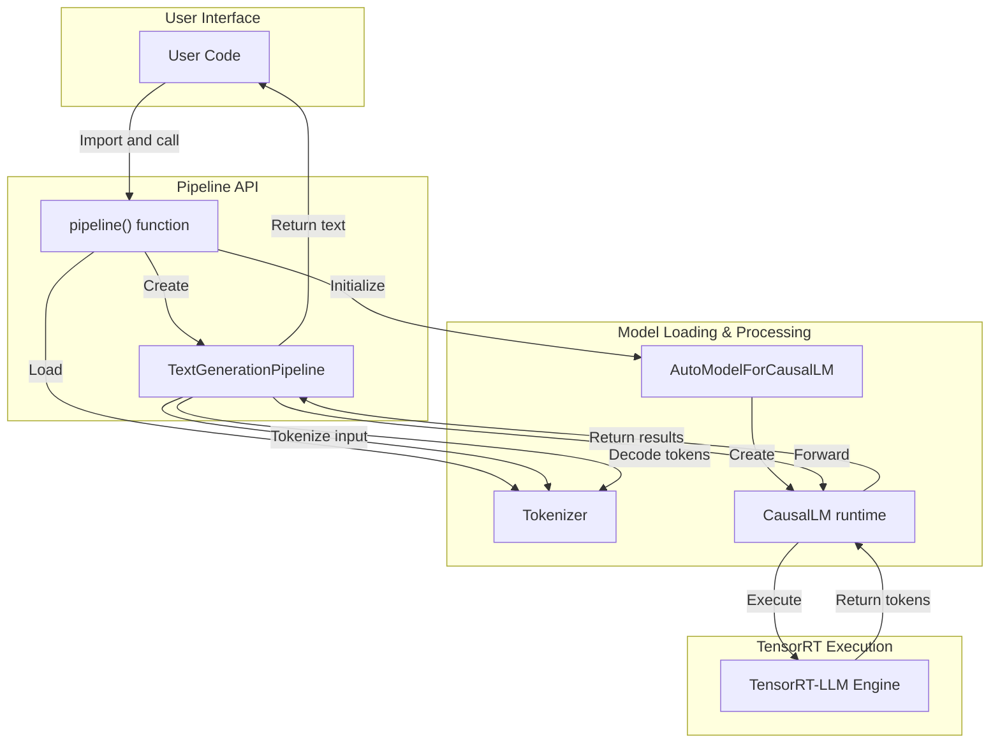
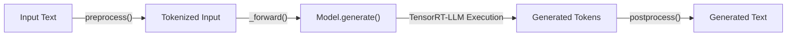

<!-- source: DeepWiki mcp.deepwiki.com · repo huggingface/optimum-nvidia · page 4.1 Pipeline API · fetched 2026-10-26 -->

# Pipeline API

<details>
<summary>Relevant source files</summary>

The following files were used as context for generating this wiki page:

- [CONTRIBUTING.md](CONTRIBUTING.md)
- [LICENSE](LICENSE)
- [README.md](README.md)
- [src/optimum/nvidia/pipelines/__init__.py](src/optimum/nvidia/pipelines/__init__.py)
- [src/optimum/nvidia/pipelines/text_generation.py](src/optimum/nvidia/pipelines/text_generation.py)

</details>


The Pipeline API in Optimum-NVIDIA provides an easy-to-use interface for running optimized inference with NVIDIA GPUs. It serves as a drop-in replacement for Hugging Face's Transformers pipelines, enabling users to achieve significant performance improvements with minimal code changes. For more advanced usage scenarios, see the [Model API](#4.3) documentation.

## Overview

The Pipeline API abstracts away the complexity of working directly with TensorRT-LLM while maintaining a familiar interface for Hugging Face users. It automatically handles model loading, optimization, tokenization, and result processing.



Sources: [src/optimum/nvidia/pipelines/__init__.py:53-122](), [src/optimum/nvidia/pipelines/text_generation.py:35-51]()

## Usage

### Basic Example

The primary benefit of the Pipeline API is its simplicity. Converting existing Transformers code requires changing just a single import statement:

```python
# Replace this line in Transformers code
from transformers.pipelines import pipeline

# With this line for Optimum-NVIDIA
from optimum.nvidia.pipelines import pipeline

# Then use the pipeline as usual
pipe = pipeline('text-generation', 'meta-llama/Llama-2-7b-chat-hf', use_fp8=True)
result = pipe("Describe a real-world application of AI in sustainable energy.")
```

Sources: [README.md:66-76]()

### Supported Models and Tasks

The Pipeline API currently supports the following combinations:

| Model Architecture | Supported Tasks |
|--------------------|-----------------|
| LLaMA              | text-generation |
| Gemma              | text-generation |
| Mistral            | text-generation |
| Mixtral            | text-generation |

Sources: [src/optimum/nvidia/pipelines/__init__.py:29-34]()

## Pipeline Architecture

The Pipeline API in Optimum-NVIDIA follows a structured workflow with distinct components working together:

```mermaid
classDiagram
    class "Pipeline" {
        <<abstract>>
        __call__(inputs, **kwargs)
        preprocess(inputs, **kwargs)
        _forward(model_inputs, **kwargs)
        postprocess(model_outputs, **kwargs)
    }
    
    class "TextGenerationPipeline" {
        TARGET_FACTORY: AutoModelForCausalLM
        tokenizer: PreTrainedTokenizer
        _runtime: CausalLM
        __init__(model, tokenizer)
        __call__(inputs, add_special_tokens, **kwargs)
        _sanitize_parameters(**kwargs)
        preprocess(prompt_text, **kwargs)
        _forward(model_inputs, **kwargs)
        postprocess(model_outputs, **kwargs)
    }
    
    class "ReturnType" {
        <<enum>>
        TENSORS
        NEW_TEXT
        FULL_TEXT
    }
    
    class "pipeline()" {
        <<function>>
        task: str
        model: str or Module
        tokenizer: optional
        **kwargs
    }
    
    class "CausalLM" {
        generate(input_ids, attention_mask, **kwargs)
    }
    
    class "AutoModelForCausalLM" {
        from_pretrained(model_id, **kwargs)
    }
    
    Pipeline <|-- TextGenerationPipeline
    TextGenerationPipeline --> ReturnType : uses
    TextGenerationPipeline --> CausalLM : uses for inference
    pipeline() --> TextGenerationPipeline : creates
    pipeline() --> AutoModelForCausalLM : loads via
```

Sources: [src/optimum/nvidia/pipelines/text_generation.py:29-51](), [src/optimum/nvidia/pipelines/__init__.py:53-122]()

## Pipeline Components

### The `pipeline()` Function

The `pipeline()` function is the main entry point to the Pipeline API:

```python
def pipeline(
    task: str = None,
    model: Union[str, PathLike, Module] = None,
    tokenizer: Optional[Union[str, PreTrainedTokenizer, PreTrainedTokenizerFast]] = None,
    **kwargs
)
```

This function:
1. Determines the model type and checks if it supports the requested task
2. Loads a tokenizer (or uses the provided one)
3. Creates an optimized model instance
4. Instantiates the appropriate pipeline class for the task
5. Returns a ready-to-use pipeline object

Sources: [src/optimum/nvidia/pipelines/__init__.py:53-122]()

### TextGenerationPipeline

The `TextGenerationPipeline` class handles text generation tasks and follows a three-step process:

1. **Preprocess**: Converts input text into tokenized inputs for the model
2. **Forward**: Runs the model to generate new tokens
3. **Postprocess**: Converts the generated tokens back into text

The pipeline execution flow is:



Sources: [src/optimum/nvidia/pipelines/text_generation.py:196-248]()

## Generation Parameters

When using the text generation pipeline, you can customize various parameters:

| Parameter | Description | Default |
|-----------|-------------|---------|
| max_new_tokens | Maximum number of tokens to generate | None |
| min_length | Minimum length of the sequence to be generated | -1 |
| num_beams | Number of beams for beam search | 1 |
| temperature | Temperature for sampling | 1.0 |
| top_k | Highest probability tokens to keep for top-k filtering | 50 |
| top_p | Nucleus sampling parameter | 1.0 |
| repetition_penalty | Penalty for repeating tokens | 1.0 |
| length_penalty | Exponential penalty to the length | 1.0 |
| seed | Random seed for reproducible generation | 2017 |

Sources: [src/optimum/nvidia/pipelines/text_generation.py:141-186]()

## Return Types

The pipeline can return results in different formats, controlled by the `return_type` parameter:

| Return Type | Description |
|-------------|-------------|
| TENSORS | Returns the generated token IDs without decoding to text |
| NEW_TEXT | Returns only the newly generated text (default) |
| FULL_TEXT | Returns the input text concatenated with the generated text |

These return types can be set using the parameters `return_tensors`, `return_text`, or `return_full_text`.

Sources: [src/optimum/nvidia/pipelines/text_generation.py:29-33](), [src/optimum/nvidia/pipelines/text_generation.py:102-126]()

## Performance Considerations

The Pipeline API leverages TensorRT-LLM's optimizations to deliver significantly faster inference:

- FP8 precision support (for Hopper and Ada-Lovelace architectures)
- Optimized kernels for core operations
- Efficient memory management

These optimizations can provide speedups of up to 28x compared to the standard Transformers implementation when running on supported NVIDIA GPUs.

Sources: [README.md:17]()

## Advanced Configuration

When creating a pipeline, you can pass additional configuration options to the underlying model:

```python
pipe = pipeline(
    'text-generation',
    'meta-llama/Llama-2-7b-chat-hf',
    use_fp8=True,                  # Enable FP8 precision
    max_prompt_length=1024,        # Maximum input prompt length
    max_output_length=2048,        # Maximum total output length
    max_batch_size=8,              # Maximum batch size for inference
)
```

These parameters control how the model is exported to TensorRT-LLM format and how inference is performed.

Sources: [README.md:90-95]()

---

