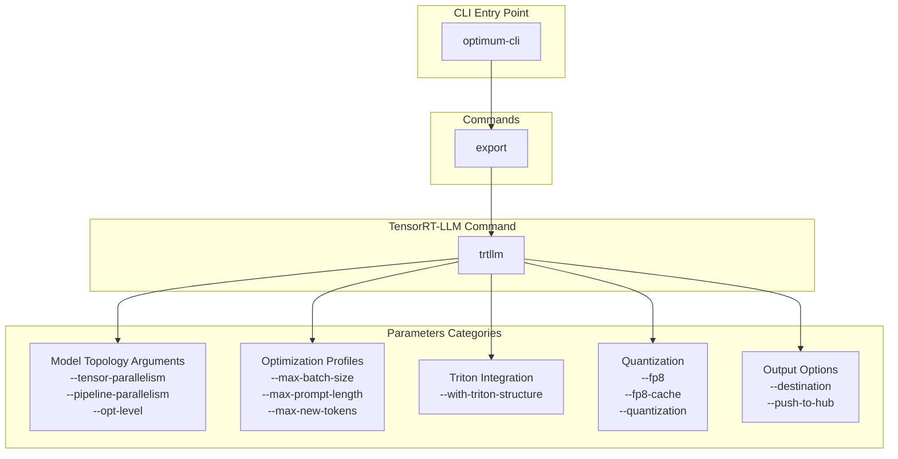
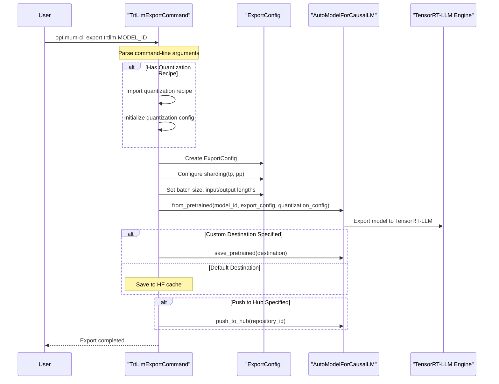
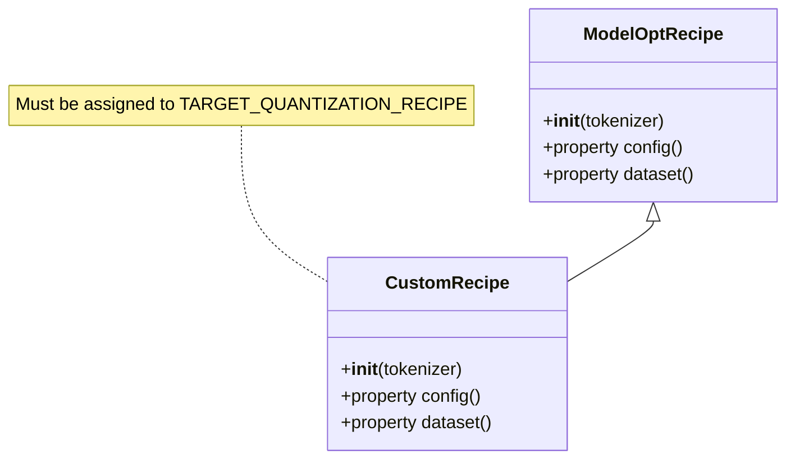

<!-- source: DeepWiki mcp.deepwiki.com · repo huggingface/optimum-nvidia · page 4.2 Command-line Interface · fetched 2026-10-26 -->

# Command-line Interface

<details>
<summary>Relevant source files</summary>

The following files were used as context for generating this wiki page:

- [src/optimum/nvidia/subpackage/commands/export.py](src/optimum/nvidia/subpackage/commands/export.py)
- [src/optimum/nvidia/utils/cli.py](src/optimum/nvidia/utils/cli.py)
- [tests/cli/test_export.py](tests/cli/test_export.py)
- [tests/fixtures/qawq_recipe.py](tests/fixtures/qawq_recipe.py)
- [tests/fixtures/qawq_recipe_no_target_recipe.py](tests/fixtures/qawq_recipe_no_target_recipe.py)
- [tests/fixtures/qfloat8_and_kv_cache_recipe.py](tests/fixtures/qfloat8_and_kv_cache_recipe.py)

</details>


The Command-line Interface (CLI) for Optimum-NVIDIA provides an efficient way to export and optimize Hugging Face Transformers models to TensorRT-LLM compiled engines without writing Python code. It offers a streamlined approach for model conversion, configuration, and optimization through the `optimum-cli` command.

For information about programmatic model export and inference, see [Pipeline API](#4.1) and [Model API](#4.3).

## CLI Structure and Components

The Optimum-NVIDIA CLI extends the Optimum CLI framework with TensorRT-LLM specific functionality. Its primary focus is the `export trtllm` command for converting Hugging Face models to TensorRT-LLM optimized engines.



Sources: [src/optimum/nvidia/subpackage/commands/export.py:30-32](), [src/optimum/nvidia/utils/cli.py:22-57](), [src/optimum/nvidia/utils/cli.py:61-86](), [src/optimum/nvidia/utils/cli.py:91-97](), [src/optimum/nvidia/utils/cli.py:101-116]()

## Export Command and Basic Usage

The `export trtllm` command is implemented by the `TrtLlmExportCommand` class and provides the functionality to convert Hugging Face Transformers models to TensorRT-LLM format.

### Basic Usage Syntax

```
optimum-cli export trtllm [OPTIONS] MODEL_ID
```

Where:
- `MODEL_ID` is the Hugging Face model ID or local path to a model
- `[OPTIONS]` are configuration parameters described in the sections below

### Simple Export Examples

```bash
# Basic export with default settings
optimum-cli export trtllm meta-llama/Meta-Llama-3.1-8B-Instruct

# Export with custom destination
optimum-cli export trtllm --destination ./exported_model meta-llama/Meta-Llama-3.1-8B-Instruct

# Push to Hugging Face Hub
optimum-cli export trtllm --push-to-hub my-username/my-model meta-llama/Meta-Llama-3.1-8B-Instruct
```

Sources: [src/optimum/nvidia/subpackage/commands/export.py:30-56](), [tests/cli/test_export.py:38-59](), [tests/cli/test_export.py:61-87]()

## Export Workflow

The following diagram illustrates the internal execution flow of the `export trtllm` command:



Sources: [src/optimum/nvidia/subpackage/commands/export.py:57-112]()

## Configuration Options

The CLI provides several categories of configuration options that control how models are exported and optimized.

### Model Topology Arguments

These arguments control model distribution across GPUs and optimization levels:

| Argument | Description | Default |
|----------|-------------|---------|
| `--tensor-parallelism` | Number of GPU slices for tensor parallelism | 1 |
| `--pipeline-parallelism` | Number of sections to split neural network layers | 1 |
| `--world-size` | Total number of GPUs across all nodes | 1 |
| `--gpus-per-node` | Number of GPUs on a single node | 1 |
| `--opt-level` | Optimization level (0-5) | 2 |

Sources: [src/optimum/nvidia/utils/cli.py:22-57]()

### Optimization Profiles

These arguments define constraints for TensorRT optimization:

| Argument | Description | Default |
|----------|-------------|---------|
| `--max-batch-size` | Maximum batch size for the model | 1 |
| `--max-prompt-length` | Maximum prompt length | 128 |
| `--max-new-tokens` | Maximum number of tokens to generate | 1024 |
| `--max-beam-width` | Maximum number of beams for sampling | 1 |

Sources: [src/optimum/nvidia/utils/cli.py:61-86]()

### Triton Server Arguments

| Argument | Description |
|----------|-------------|
| `--with-triton-structure` | Generate the Triton Inference Server structure |

Sources: [src/optimum/nvidia/utils/cli.py:91-97]()

### Quantization Arguments

These arguments control model quantization:

| Argument | Description | Default |
|----------|-------------|---------|
| `--fp8` | Enable FP8 quantization for Ada & Hopper GPUs | False |
| `--fp8-cache` | Enable KV cache as FP8 for Ada & Hopper GPUs | False |
| `--num-calibration-samples` | Number of samples to use for calibration | 512 |
| `--quantization` | Path to a Python script containing a quantization recipe | None |

Sources: [src/optimum/nvidia/utils/cli.py:101-116](), [src/optimum/nvidia/utils/cli.py:119-142]()

### Output Arguments

| Argument | Description |
|----------|-------------|
| `--destination` | Directory to save the exported model | Hub cache |
| `--push-to-hub` | Repository ID to push the model to | None |

Sources: [src/optimum/nvidia/subpackage/commands/export.py:104-112]()

## Quantization Support

Optimum-NVIDIA CLI supports advanced quantization through recipe files, which are Python scripts defining quantization configuration. The CLI can load these recipes and apply them during the export process.

### Using Quantization Recipes

```bash
optimum-cli export trtllm --quantization /path/to/recipe.py --destination ./output_dir MODEL_ID
```

### Quantization Recipe Structure

A quantization recipe file must define a `TARGET_QUANTIZATION_RECIPE` global variable that refers to a class implementing the quantization configuration.



The recipe class must:
1. Accept a tokenizer in the constructor
2. Provide a `config` property returning the quantization configuration
3. Provide a `dataset` property returning calibration data

Sources: [src/optimum/nvidia/subpackage/commands/export.py:60-77](), [tests/fixtures/qfloat8_and_kv_cache_recipe.py](), [tests/fixtures/qawq_recipe.py](), [tests/fixtures/qawq_recipe_no_target_recipe.py]()

## FP8 Quantization Example

For NVIDIA Ada and Hopper GPUs, FP8 quantization can be enabled directly with CLI flags:

```bash
optimum-cli export trtllm --fp8 --fp8-cache meta-llama/Meta-Llama-3.1-8B-Instruct
```

This enables FP8 quantization for both the model weights and the KV cache, providing significant performance improvements while maintaining model quality.

Sources: [src/optimum/nvidia/utils/cli.py:102-109](), [src/optimum/nvidia/utils/cli.py:119-142]()

## Multi-GPU Export Example

For large models that require distribution across multiple GPUs:

```bash
optimum-cli export trtllm --tensor-parallelism 4 --world-size 4 meta-llama/Meta-Llama-3.1-8B-Instruct
```

This splits the model across 4 GPUs using tensor parallelism, allowing for inference on models that are too large for a single GPU.

Sources: [src/optimum/nvidia/utils/cli.py:23-36]()

---

