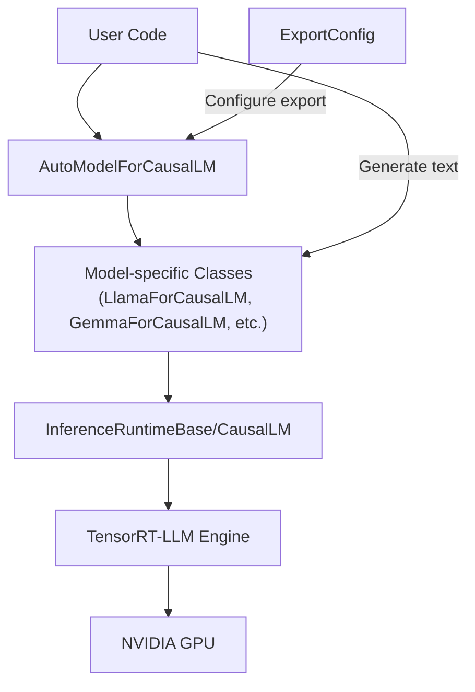
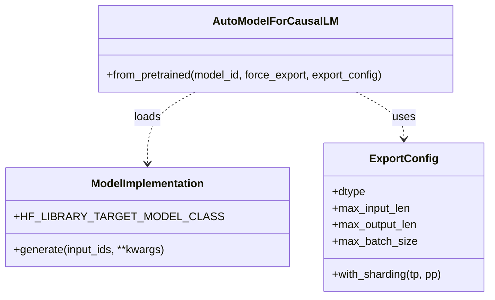
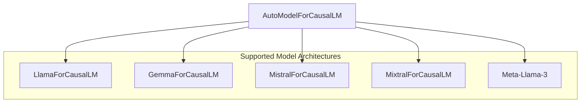
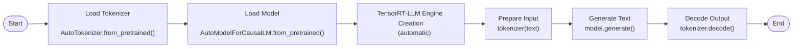

<!-- source: DeepWiki mcp.deepwiki.com · repo huggingface/optimum-nvidia · page 4.3 Model API · fetched 2026-10-26 -->

# Model API

<details>
<summary>Relevant source files</summary>

The following files were used as context for generating this wiki page:

- [CONTRIBUTING.md](CONTRIBUTING.md)
- [LICENSE](LICENSE)
- [README.md](README.md)
- [examples/text-generation.py](examples/text-generation.py)
- [src/optimum/nvidia/utils/tests/assertions.py](src/optimum/nvidia/utils/tests/assertions.py)
- [tests/integration/test_causal_lm.py](tests/integration/test_causal_lm.py)

</details>


The Model API in optimum-nvidia provides direct access to optimized TensorRT-LLM models for advanced use cases. It allows complete control over model loading, configuration, and generation parameters while accessing the performance benefits of NVIDIA's TensorRT-LLM. This page covers how to use the `AutoModelForCausalLM` class and model-specific implementations for optimized inference.

For information about using the simpler Pipeline API, see [Pipeline API](#4.1). For model export through the command line, see [Command-line Interface](#4.2).

## Model API Architecture

The Model API serves as the direct interface between users and the TensorRT-LLM optimized models. It follows a similar pattern to the Hugging Face Transformers library, allowing for an easy transition while providing access to NVIDIA-specific optimizations.



Sources: [README.md:79-106](), [tests/integration/test_causal_lm.py:76-88]()

## Loading Models with AutoModelForCausalLM

The `AutoModelForCausalLM` class is the main entry point for loading models. It automatically detects the model architecture and loads the appropriate model-specific implementation.



To load a model with the Model API:

```python
from optimum.nvidia import AutoModelForCausalLM
from transformers import AutoTokenizer

# Load tokenizer from Hugging Face
tokenizer = AutoTokenizer.from_pretrained("meta-llama/Llama-2-7b-chat-hf")

# Load model with optimum-nvidia
model = AutoModelForCausalLM.from_pretrained(
    "meta-llama/Llama-2-7b-chat-hf",
    use_fp8=True,  # Enable FP8 precision (Hopper/Ada Lovelace GPUs only)
    max_prompt_length=1024,  # Maximum input sequence length
    max_output_length=2048,  # Must be at least max_prompt_length + max_new_tokens
    max_batch_size=8,  # Maximum batch size for inference
)
```

Sources: [README.md:79-106](), [tests/integration/test_causal_lm.py:76-80]()

## Export Configuration

The `ExportConfig` class provides fine-grained control over how models are exported to TensorRT-LLM format. You can either use the simplified parameters in `from_pretrained()` or create an explicit `ExportConfig` object.

```python
from optimum.nvidia import AutoModelForCausalLM, ExportConfig

# Using explicit ExportConfig
export_config = ExportConfig(
    dtype="float16",  # Precision: float16, float32, fp8
    max_input_len=128,  # Maximum input sequence length
    max_batch_size=8,  # Maximum batch size
    max_output_len=256,  # Maximum output sequence length
    max_num_tokens=128,  # Maximum number of new tokens to generate
)

# Optional: Configure model sharding
from optimum.nvidia.export.config import sharded
export_config = sharded(export_config, tp=2, pp=1)  # Tensor parallelism=2, Pipeline parallelism=1

# Load with explicit export config
model = AutoModelForCausalLM.from_pretrained(
    "meta-llama/Llama-2-7b-chat-hf",
    force_export=True,  # Force re-export even if engines exist
    export_config=export_config,
)
```

Sources: [examples/text-generation.py:66-70](), [tests/integration/test_causal_lm.py:67-74]()

## Text Generation

Once loaded, you can use the model's `generate()` method to generate text. This method is highly configurable with parameters for controlling the generation process:

```python
from transformers import AutoTokenizer
from optimum.nvidia import AutoModelForCausalLM

tokenizer = AutoTokenizer.from_pretrained("meta-llama/Llama-2-7b-chat-hf")
model = AutoModelForCausalLM.from_pretrained("meta-llama/Llama-2-7b-chat-hf")

# Tokenize input text
inputs = tokenizer(["What is the latest generation of Nvidia GPUs?"], return_tensors="pt")

# Generate text
generated_ids = model.generate(
    inputs["input_ids"],
    do_sample=True,  # Enable sampling (vs greedy decoding)
    max_new_tokens=128,  # Maximum number of tokens to generate
    top_k=40,  # Sample from top-k most likely tokens
    top_p=0.7,  # Sample from tokens comprising top-p probability mass (nucleus sampling)
    repetition_penalty=10.0,  # Penalize repetition
    temperature=1.0,  # Control randomness (higher = more random)
)

# Decode generated tokens
if isinstance(generated_ids[0], int):
    generated_text = tokenizer.decode(generated_ids, skip_special_tokens=True)
else:
    generated_text = tokenizer.batch_decode(generated_ids, skip_special_tokens=True)
print(generated_text)
```

Sources: [examples/text-generation.py:77-87](), [README.md:98-106]()

## Generation Parameters

The `generate()` method supports a wide range of parameters to control text generation:

| Parameter | Description | Default |
|-----------|-------------|---------|
| `max_new_tokens` | Maximum number of tokens to generate | None |
| `do_sample` | Whether to use sampling; if False, uses greedy decoding | False |
| `temperature` | Controls randomness - higher values increase diversity | 1.0 |
| `top_k` | Sample from the top-k most likely tokens | 50 |
| `top_p` | Sample from tokens comprising top-p probability mass | 1.0 |
| `repetition_penalty` | Penalizes repeated tokens | 1.0 |
| `length_penalty` | Penalizes/rewards sequence length | 1.0 |
| `num_beams` | Number of beams for beam search | 1 |
| `num_return_sequences` | Number of sequences to return | 1 |

Sources: [tests/integration/test_causal_lm.py:59-65](), [examples/text-generation.py:79-81]()

## Advanced Features

### Model Sharding

The Model API supports sharding models across multiple GPUs using tensor parallelism (TP) and pipeline parallelism (PP):

```python
from optimum.nvidia import AutoModelForCausalLM, ExportConfig
from optimum.nvidia.export.config import sharded

# Create export configuration
export_config = ExportConfig(
    dtype="float16",
    max_input_len=128,
    max_batch_size=8,
    max_output_len=128,
)

# Configure sharding (TP=4, PP=1)
export_config = sharded(export_config, tp=4, pp=1)

# Load sharded model
model = AutoModelForCausalLM.from_pretrained(
    "mistralai/Mixtral-8x7B-Instruct-v0.1",  # Large model suitable for sharding
    force_export=True,
    export_config=export_config,
)
```

Sources: [tests/integration/test_causal_lm.py:39-41](), [tests/integration/test_causal_lm.py:74]()

### Precision Control

The Model API provides control over numerical precision, including FP8 support for compatible hardware:

```python
# Using FP8 precision (Hopper/Ada Lovelace GPUs only)
model = AutoModelForCausalLM.from_pretrained(
    "meta-llama/Llama-2-7b-chat-hf",
    use_fp8=True,  # Enable FP8 precision
)

# Using FP16 precision via ExportConfig
export_config = ExportConfig(
    dtype="float16",  # Other options: "float32", "fp8"
    # ... other parameters
)
```

Sources: [README.md:91-94](), [tests/integration/test_causal_lm.py:67-68]()

## Supported Models

The Model API currently supports the following model architectures:



Sources: [tests/integration/test_causal_lm.py:26-31]()

## Model API Workflow

The typical workflow for using the Model API follows these steps:



Sources: [examples/text-generation.py:62-87](), [README.md:82-106]()

## Comparison with Transformers API

The Model API is designed to be a drop-in replacement for the Hugging Face Transformers API with minimal changes required:

```diff
- from transformers import AutoModelForCausalLM
+ from optimum.nvidia import AutoModelForCausalLM
from transformers import AutoTokenizer

tokenizer = AutoTokenizer.from_pretrained("meta-llama/Llama-2-7b-chat-hf")

model = AutoModelForCausalLM.from_pretrained(
  "meta-llama/Llama-2-7b-chat-hf",
+ use_fp8=True,
+ max_prompt_length=1024,
+ max_output_length=2048,
+ max_batch_size=8,
)

# Generate text - same API as transformers
generated_ids = model.generate(
    input_ids,
    max_new_tokens=128,
    do_sample=True,
    temperature=0.7,
)
```

Sources: [README.md:82-106]()

## Performance Considerations

The Model API provides significant performance improvements over the standard Transformers implementation:

- FP8 precision (on supported GPUs) offers significant speedups with minimal quality loss
- Tensor parallelism enables scaling to very large models
- TensorRT-LLM optimizations provide execution speedups (up to 28x faster as mentioned in the README)

When using the Model API, consider:
- Setting appropriate `max_batch_size`, `max_prompt_length`, and `max_output_length` values
- Using FP8 precision when available
- Configuring appropriate tensor parallelism based on your GPU configuration

Sources: [README.md:17](), [README.md:91-94]()

## Conclusion

The Model API in optimum-nvidia provides a powerful interface for direct access to TensorRT-LLM optimized models. It offers similar syntax to the Hugging Face Transformers library with minimal changes required, while unlocking significant performance improvements through NVIDIA's TensorRT-LLM.

For simpler use cases, consider using the [Pipeline API](#4.1). For more advanced configurations like quantization and parallel inference, refer to [Quantization](#5.1) and [Parallel Inference](#5.2).

---

