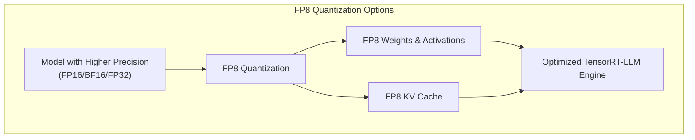
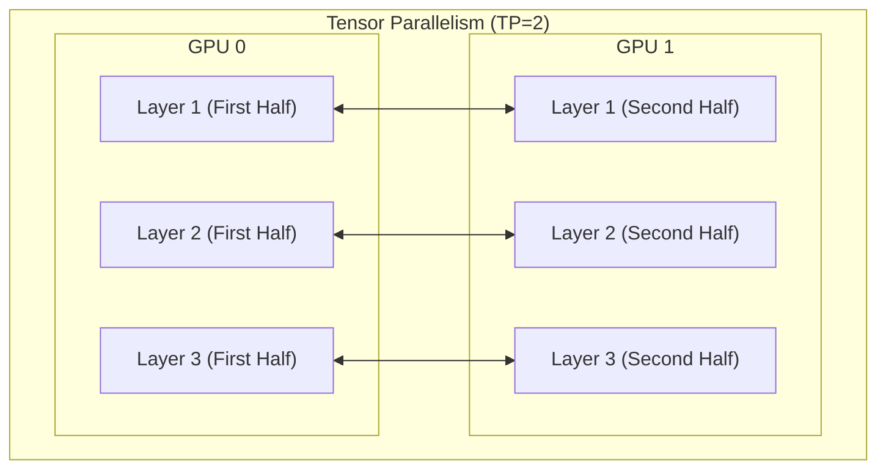
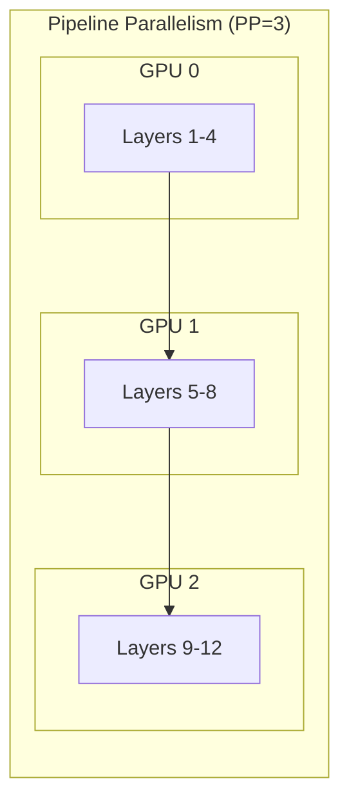
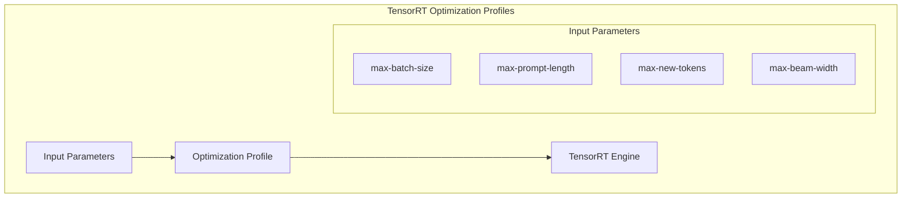
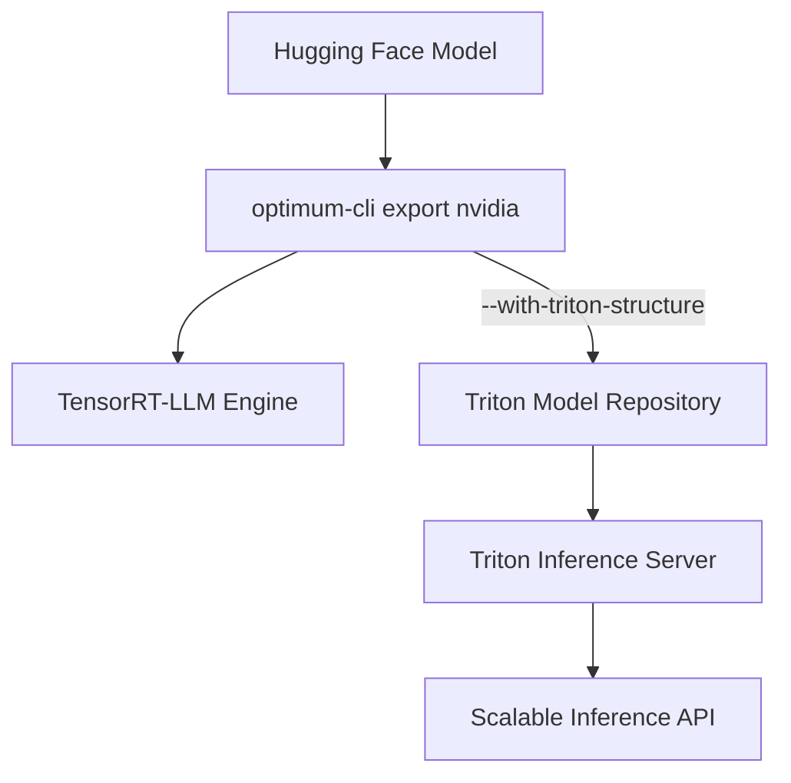

<!-- source: DeepWiki mcp.deepwiki.com · repo huggingface/optimum-nvidia · page 5 Advanced Topics · fetched 2026-10-26 -->

# Advanced Topics

<details>
<summary>Relevant source files</summary>

The following files were used as context for generating this wiki page:

- [.gitignore](.gitignore)
- [src/optimum/nvidia/lang/__init__.py](src/optimum/nvidia/lang/__init__.py)
- [src/optimum/nvidia/utils/cli.py](src/optimum/nvidia/utils/cli.py)
- [tests/test_dtype.py](tests/test_dtype.py)

</details>


This document covers advanced usage topics for Optimum-NVIDIA, focusing on performance optimization, hardware utilization, and specialized configuration options. It is intended for users who need to fine-tune their model deployment for maximum performance, efficiency, and scalability.

For basic usage patterns, see [User Interfaces](#4). For information about supported model architectures, see [Supported Models](#3).

## Quantization

Quantization reduces model precision to improve performance and memory efficiency while maintaining reasonable accuracy. Optimum-NVIDIA supports several quantization options, with a focus on NVIDIA's specialized hardware capabilities.

### FP8 Quantization

NVIDIA Ada and Hopper architectures provide hardware-accelerated FP8 computation, which offers significant performance benefits with minimal accuracy loss.



Sources: [src/optimum/nvidia/utils/cli.py:101-109]()

To enable FP8 quantization using the CLI:

```bash
# Enable FP8 quantization for weights and activations
optimum-cli export nvidia --fp8 ...

# Enable FP8 quantization for KV cache
optimum-cli export nvidia --fp8-cache ...

# Enable both
optimum-cli export nvidia --fp8 --fp8-cache ...
```

### Quantization Configuration

Under the hood, Optimum-NVIDIA uses TensorRT-LLM's `QuantMode` to configure quantization settings:

```mermaid
classDiagram
    class "QuantMode" {
        +from_description()
        +use_fp8_qdq
        +use_fp8_kv_cache
        +use_int8_kv_cache
        +use_int4_weights
    }
    class "CLI Arguments" {
        +fp8: bool
        +fp8_cache: bool
        +num_calibration_samples: int
    }
    class "Quantization Process" {
        +Calibration
        +Engine Building
        +Inference
    }
    "CLI Arguments" --> "QuantMode" : Configures
    "QuantMode" --> "Quantization Process" : Controls
```

Sources: [src/optimum/nvidia/utils/cli.py:119-142]()

The quantization configuration process involves:

1. Setting the appropriate `QuantMode` flags based on user arguments
2. Collecting calibration data if needed (using `num_calibration_samples`)
3. Applying the quantization during the TensorRT-LLM engine building process

## Parallel Inference

For large models or high throughput requirements, Optimum-NVIDIA provides mechanisms to distribute model inference across multiple GPUs.

### Tensor Parallelism

Tensor Parallelism (TP) splits individual tensors across multiple GPUs, allowing larger models to fit in memory.



Sources: [src/optimum/nvidia/utils/cli.py:22-29]()

### Pipeline Parallelism

Pipeline Parallelism (PP) splits model layers across multiple GPUs, creating a processing pipeline.



Sources: [src/optimum/nvidia/utils/cli.py:30-36]()

### Multi-GPU Configuration

To configure parallel inference using the CLI:

```bash
# Using 4 GPUs with tensor parallelism
optimum-cli export nvidia --tensor-parallelism 4 ...

# Using pipeline parallelism across 2 GPUs
optimum-cli export nvidia --pipeline-parallelism 2 ...

# Hybrid parallelism: 2-way TP and 2-way PP (4 GPUs total)
optimum-cli export nvidia --tensor-parallelism 2 --pipeline-parallelism 2 ...
```

For multi-node deployments, use the `--world-size` and `--gpus-per-node` arguments:

```bash
# 8 GPUs across 2 nodes (4 GPUs per node)
optimum-cli export nvidia --tensor-parallelism 4 --pipeline-parallelism 2 --world-size 8 --gpus-per-node 4 ...
```

Sources: [src/optimum/nvidia/utils/cli.py:22-48]()

## Optimization Configurations

TensorRT-LLM provides various optimization levels and profiles to tune model performance.

### Optimization Levels

The optimization level controls how aggressively TensorRT optimizes the model:

| Level | Description |
|-------|-------------|
| 0     | No optimization |
| 1     | Basic optimizations |
| 2     | Default: Standard optimizations (recommended) |
| 3     | More aggressive optimizations |
| 4     | Very aggressive optimizations |
| 5     | Maximum optimization (may impact build time) |

```bash
# Set optimization level to maximum
optimum-cli export nvidia --opt-level 5 ...
```

Sources: [src/optimum/nvidia/utils/cli.py:49-56]()

### TensorRT Optimization Profiles

Optimization profiles define the execution boundaries for the TensorRT engine:



Sources: [src/optimum/nvidia/utils/cli.py:61-86]()

Key profile parameters include:

| Parameter | Description | Default |
|-----------|-------------|---------|
| `max-batch-size` | Maximum number of requests processed at once | 1 |
| `max-prompt-length` | Maximum length of input prompts | 128 |
| `max-new-tokens` | Maximum number of tokens to generate | 1024 |
| `max-beam-width` | Maximum beam width for beam search | 1 |

```bash
# Configure for higher throughput with larger batches
optimum-cli export nvidia --max-batch-size 8 --max-prompt-length 256 --max-new-tokens 512 ...
```

## Precision and Data Types

Optimum-NVIDIA supports various precision modes through its `DataType` enum.

```mermaid
classDiagram
    class "DataType" {
        +FLOAT32
        +FLOAT16
        +BFLOAT16
        +FLOAT8
        +INT64
        +INT32
        +INT8
        +UINT8
        +BOOL
        +from_torch()
        +to_trt()
        +to_torch()
    }
    class "PyTorch Types" {
        +torch.float32
        +torch.float16
        +torch.bfloat16
        +torch.float8_e4m3fn
        +torch.int64
        +etc...
    }
    class "TensorRT Types" {
        +trt.DataType.FLOAT
        +trt.DataType.HALF
        +trt.DataType.BF16
        +trt.DataType.FP8
        +etc...
    }
    "DataType" --> "PyTorch Types" : to_torch()
    "DataType" --> "TensorRT Types" : to_trt()
    "PyTorch Types" --> "DataType" : from_torch()
```

Sources: [src/optimum/nvidia/lang/__init__.py:16-117](), [tests/test_dtype.py:16-57]()

### Supported Data Types

The following data types are supported:

| DataType | PyTorch | TensorRT | Description |
|----------|---------|----------|-------------|
| FLOAT32 | torch.float32 | trt.DataType.FLOAT | Full precision (32-bit) |
| FLOAT16 | torch.float16 | trt.DataType.HALF | Half precision (16-bit) |
| BFLOAT16 | torch.bfloat16 | trt.DataType.BF16 | Brain floating point (16-bit) |
| FLOAT8 | torch.float8_e4m3fn | trt.DataType.FP8 | 8-bit floating point (e4m3) |
| INT8 | torch.int8 | trt.DataType.INT8 | 8-bit integer |
| INT32 | torch.int32 | trt.DataType.INT32 | 32-bit integer |
| INT64 | torch.int64 | trt.DataType.INT64 | 64-bit integer |
| UINT8 | torch.uint8 | trt.DataType.UINT8 | Unsigned 8-bit integer |
| BOOL | torch.bool | trt.DataType.BOOL | Boolean |

Sources: [src/optimum/nvidia/lang/__init__.py:23-33](), [tests/test_dtype.py:24-57]()

The `DataType` enum provides seamless conversion between PyTorch and TensorRT data types, which is useful when integrating these frameworks.

## Triton Inference Server Integration

Optimum-NVIDIA can generate model structures compatible with NVIDIA Triton Inference Server for production deployment.



Sources: [src/optimum/nvidia/utils/cli.py:90-97]()

To generate a Triton-compatible model structure:

```bash
optimum-cli export nvidia --with-triton-structure --output /path/to/model_repository ...
```

The generated structure includes:

1. The TensorRT-LLM engine files
2. Triton model configuration files
3. Required directory layout for Triton Inference Server deployment

This allows for deploying the optimized model in production environments with features like dynamic batching, instance scaling, and model versioning.

## Advanced Usage Patterns

### Combining Multiple Optimizations

For maximum performance, multiple optimizations can be combined:

```bash
# Complete example with multiple optimizations
optimum-cli export nvidia \
  --tensor-parallelism 2 \
  --pipeline-parallelism 2 \
  --opt-level 4 \
  --max-batch-size 16 \
  --fp8 \
  --fp8-cache \
  --with-triton-structure \
  --output /path/to/optimized_model
```

This configuration:
1. Distributes the model across 4 GPUs (2×2 TP×PP)
2. Uses aggressive TensorRT optimizations (level 4)
3. Supports batch sizes up to 16
4. Enables FP8 quantization for weights, activations, and KV cache
5. Generates a Triton-compatible model structure

Sources: [src/optimum/nvidia/utils/cli.py:22-97]()

### Hardware-Specific Optimizations

Different NVIDIA GPU architectures have different optimization capabilities:

| Architecture | Key Optimizations |
|--------------|-------------------|
| Ampere (A100) | INT8/FP16 tensor cores, Multi-GPU scaling |
| Ada Lovelace (L40S) | FP8 tensor cores, Faster tensor parallelism |
| Hopper (H100) | FP8/FP16/BF16 tensor cores, Transformer Engine |

For Hopper and Ada architecture GPUs, FP8 quantization is particularly effective:

```bash
# Optimized for H100 GPUs
optimum-cli export nvidia --fp8 --fp8-cache --tensor-parallelism 2 ...
```

Sources: [src/optimum/nvidia/utils/cli.py:101-109]()

---

