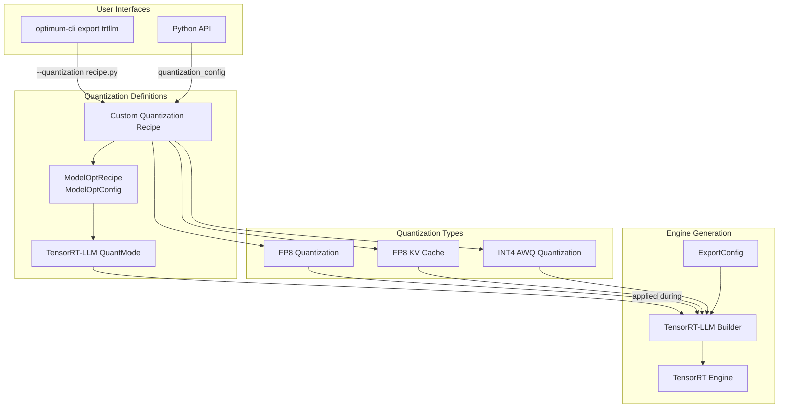
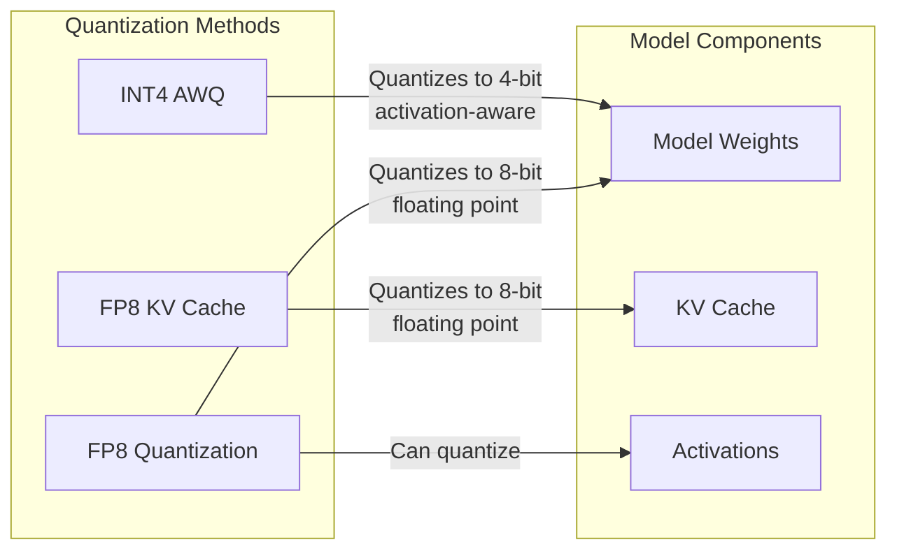
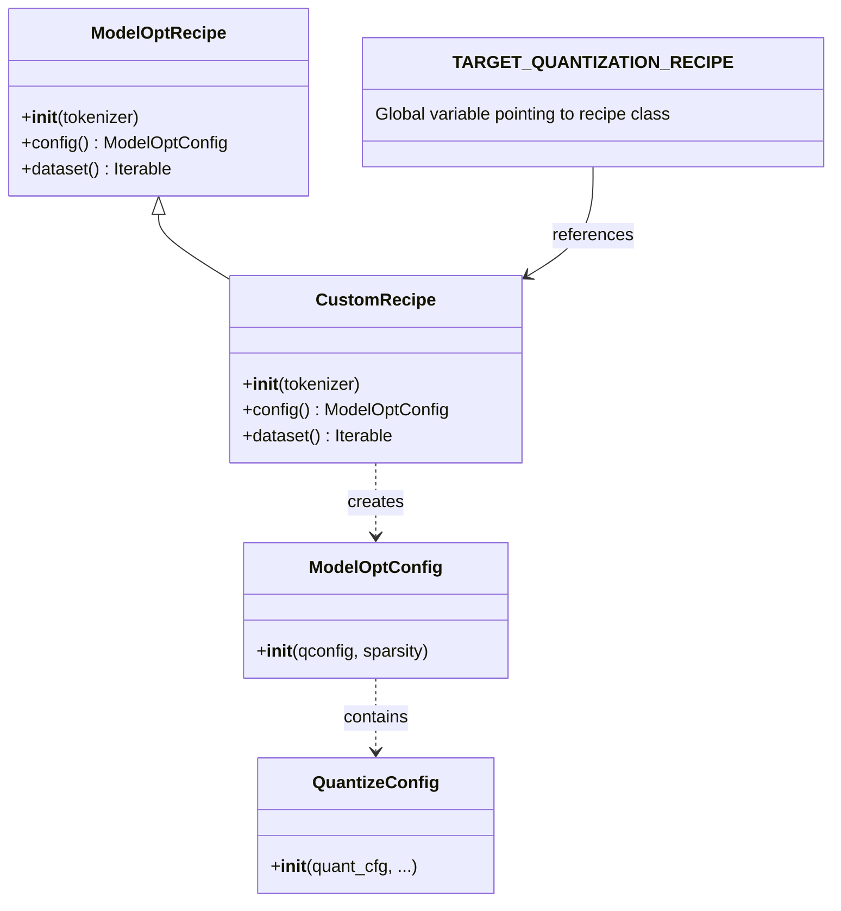
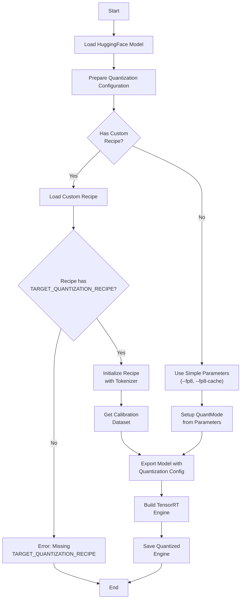

<!-- source: DeepWiki mcp.deepwiki.com · repo huggingface/optimum-nvidia · page 5.1 Quantization · fetched 2026-10-26 -->

# Quantization

<details>
<summary>Relevant source files</summary>

The following files were used as context for generating this wiki page:

- [src/optimum/nvidia/subpackage/commands/export.py](src/optimum/nvidia/subpackage/commands/export.py)
- [src/optimum/nvidia/utils/cli.py](src/optimum/nvidia/utils/cli.py)
- [tests/cli/test_export.py](tests/cli/test_export.py)
- [tests/fixtures/qawq_recipe.py](tests/fixtures/qawq_recipe.py)
- [tests/fixtures/qawq_recipe_no_target_recipe.py](tests/fixtures/qawq_recipe_no_target_recipe.py)
- [tests/fixtures/qfloat8_and_kv_cache_recipe.py](tests/fixtures/qfloat8_and_kv_cache_recipe.py)

</details>


## Purpose and Overview

This page documents the quantization capabilities in the optimum-nvidia library. Quantization is a technique that reduces the precision of model weights and/or activations to decrease memory usage and improve inference performance while maintaining acceptable model quality. For information about parallel inference across multiple GPUs, see [Parallel Inference](#5.2).

The optimum-nvidia library supports several quantization techniques with a focus on leveraging NVIDIA's hardware capabilities, particularly FP8 precision support in newer GPUs like Ada Lovelace and Hopper architectures (e.g., RTX 4000 series, H100).

Sources: [src/optimum/nvidia/utils/cli.py:100-116]()

## Quantization Architecture

The following diagram illustrates the quantization architecture in optimum-nvidia:



Sources: [src/optimum/nvidia/utils/cli.py:100-142](), [src/optimum/nvidia/subpackage/commands/export.py:57-113]()

## Supported Quantization Types

### FP8 Quantization

FP8 (8-bit floating point) quantization reduces memory usage and improves inference performance by converting weights and/or activations to 8-bit floating point precision. This format maintains better numerical stability than INT8 in many cases, especially for language models.

Requirements:
- NVIDIA GPU with Ada Lovelace or Hopper architecture (RTX 4000 series, H100, etc.)
- TensorRT-LLM compatible with FP8

### FP8 KV Cache Quantization

This quantization applies FP8 precision specifically to the key-value cache in transformer models. The KV cache can occupy significant memory during inference, especially with long contexts, so quantizing it can substantially reduce memory usage.

### INT4 AWQ Quantization

Activation-aware Weight Quantization (AWQ) is a technique that quantizes weights to 4-bit precision while considering the impact on activations to preserve model accuracy.

The following diagram shows how different quantization methods affect model components:



Sources: [src/optimum/nvidia/utils/cli.py:121-131](), [tests/fixtures/qfloat8_and_kv_cache_recipe.py:1-59](), [tests/fixtures/qawq_recipe.py:1-53]()

## Quantization CLI Options

The optimum-nvidia CLI provides options for applying quantization when exporting models:

| Option | Description |
|--------|-------------|
| `--fp8` | Enable FP8 quantization for weights and activations (requires Ada or Hopper GPU) |
| `--fp8-cache` | Enable FP8 quantization for the KV cache (requires Ada or Hopper GPU) |
| `--num-calibration-samples` | Number of samples to use for calibration (default: 512) |
| `--quantization` | Path to a custom quantization recipe file |

Example CLI usage:

```bash
optimum-cli export trtllm --fp8 --fp8-cache --num-calibration-samples 256 meta-llama/Llama-2-7b-chat
```

Or with a custom quantization recipe:

```bash
optimum-cli export trtllm --quantization my_recipe.py meta-llama/Llama-2-7b-chat
```

Sources: [src/optimum/nvidia/utils/cli.py:100-116](), [src/optimum/nvidia/subpackage/commands/export.py:57-113]()

## Custom Quantization Recipes

Custom quantization recipes provide more advanced control over quantization parameters. A recipe is a Python file that defines a `TARGET_QUANTIZATION_RECIPE` class that derives from `ModelOptRecipe`.

### Recipe Components

The following diagram shows the structure of a quantization recipe:



A recipe must implement:

1. **Configuration**: Define quantization parameters through `config()` method
2. **Calibration Dataset**: Provide calibration data through `dataset()` method
3. **Export**: Set the `TARGET_QUANTIZATION_RECIPE` global variable

### Example Recipe

Here's what a typical quantization recipe contains:

```python
# Custom recipe file structure
from optimum.nvidia.compression.modelopt import ModelOptConfig, ModelOptRecipe

class CustomQuantizationRecipe(ModelOptRecipe):
    def __init__(self, tokenizer):
        self._tokenizer = tokenizer
        self._nb_samples = 32  # Number of calibration samples
    
    @property
    def config(self) -> ModelOptConfig:
        # Define quantization configuration
        # (e.g., FP8, INT4, etc.)
        ...
        
    @property
    def dataset(self) -> Iterable:
        # Prepare calibration dataset
        # (usually tokenized text samples)
        ...

# Important: This global variable is required
TARGET_QUANTIZATION_RECIPE = CustomQuantizationRecipe
```

Sources: [tests/fixtures/qfloat8_and_kv_cache_recipe.py:1-59](), [src/optimum/nvidia/subpackage/commands/export.py:61-74]()

## Recipe Examples

### FP8 and KV Cache Quantization Recipe

This recipe enables FP8 quantization for both weights/activations and the KV cache:

```python
# Example structure of FP8 and KV cache recipe
from modelopt.torch.quantization import FP8_DEFAULT_CFG, QuantizeConfig
from optimum.nvidia.compression.modelopt import ModelOptConfig, ModelOptRecipe

class FP8Recipe(ModelOptRecipe):
    @property
    def config(self) -> ModelOptConfig:
        # Start with default FP8 configuration
        config = FP8_DEFAULT_CFG.copy()
        # Customize output quantizer parameters
        config["quant_cfg"]["*output_quantizer"] = {
            "num_bits": (4, 3),  # (exponent, mantissa)
            "axis": None,
            "enable": True,
        }
        qconfig = QuantizeConfig(**config)
        return ModelOptConfig(qconfig, sparsity=None)
        
    @property
    def dataset(self) -> Iterable:
        # Setup calibration dataset
        # (load dataset, tokenize text samples, etc.)
        ...

TARGET_QUANTIZATION_RECIPE = FP8Recipe
```

### INT4 AWQ Quantization Recipe

This recipe enables INT4 Activation-aware Weight Quantization:

```python
# Example structure of INT4 AWQ recipe
from modelopt.torch.quantization import INT4_AWQ_CFG, QuantizeConfig
from optimum.nvidia.compression.modelopt import ModelOptConfig, ModelOptRecipe

class INT4AWQRecipe(ModelOptRecipe):
    @property
    def config(self) -> ModelOptConfig:
        # Use default INT4 AWQ configuration
        qconfig = QuantizeConfig(**INT4_AWQ_CFG.copy())
        return ModelOptConfig(qconfig, sparsity=None)
        
    @property
    def dataset(self) -> Iterable:
        # Setup calibration dataset
        # (load dataset, tokenize text samples, etc.)
        ...

TARGET_QUANTIZATION_RECIPE = INT4AWQRecipe
```

Sources: [tests/fixtures/qawq_recipe.py:1-53](), [tests/fixtures/qfloat8_and_kv_cache_recipe.py:1-59]()

## Quantization Process Flow

The following diagram illustrates the process flow for quantizing a model:



Sources: [src/optimum/nvidia/subpackage/commands/export.py:57-113](), [tests/cli/test_export.py:111-146]()

## Validation and Testing

When using quantization, it's important to validate that the model still performs adequately. This typically involves:

1. **Accuracy Testing**: Compare model outputs before and after quantization
2. **Performance Benchmarking**: Measure inference speed and memory usage
3. **Hardware Compatibility**: Ensure that your hardware supports the selected quantization method

The optimum-nvidia test suite includes automated tests for quantization support:

```python
# Test components verify:
# 1. Whether quantization is applied correctly
# 2. Whether the quantized model loads successfully
# 3. Whether expected quantization features are present in the exported model
# 4. Hardware compatibility (e.g., skipping FP8 tests on unsupported hardware)
```

Sources: [tests/cli/test_export.py:90-149]()

## Hardware Requirements

Different quantization methods have specific hardware requirements:

| Quantization Method | Hardware Requirements |
|---------------------|------------------------|
| FP8 Quantization | NVIDIA Ada Lovelace (RTX 4000+) or Hopper architecture (H100) |
| FP8 KV Cache | NVIDIA Ada Lovelace (RTX 4000+) or Hopper architecture (H100) |
| INT4 AWQ | Most recent NVIDIA GPUs |

The library includes utilities to detect hardware capabilities and skip unsupported quantization methods:

```python
from optimum.nvidia.utils.nvml import has_float8_support

if not has_float8_support():
    # Skip FP8 quantization
```

Sources: [tests/cli/test_export.py:115-116]()

## Summary

Quantization in optimum-nvidia offers powerful options for reducing model size and improving inference performance. By leveraging NVIDIA's hardware capabilities, particularly FP8 precision support in newer GPUs, you can achieve significant performance improvements while maintaining model quality.

Key points:
- FP8 quantization requires newer NVIDIA GPUs (Ada Lovelace or Hopper architecture)
- Custom quantization recipes provide fine-grained control over quantization parameters
- The quantization process involves model export, calibration, and TensorRT engine building

For more information on configuring models for parallel inference across multiple GPUs, see [Parallel Inference](#5.2).

---

