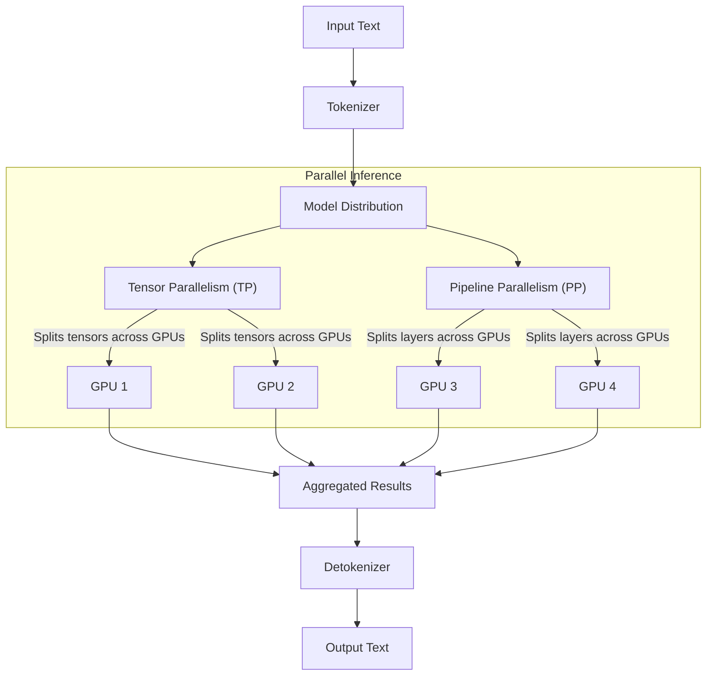
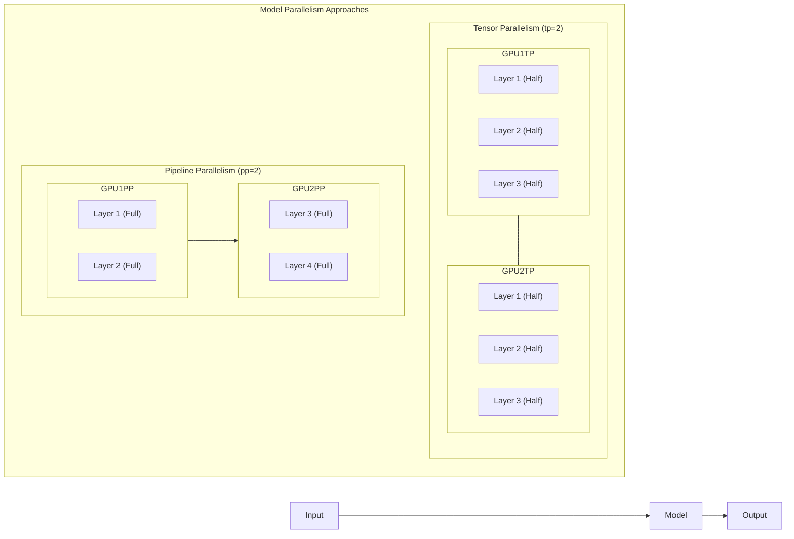
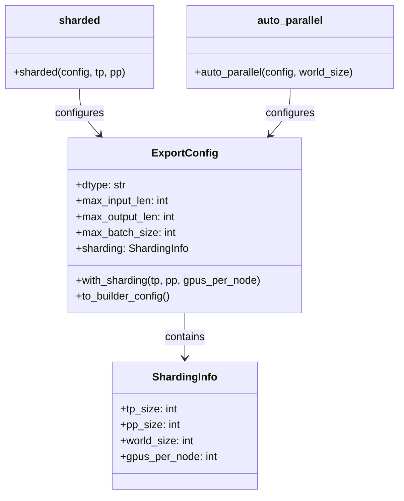
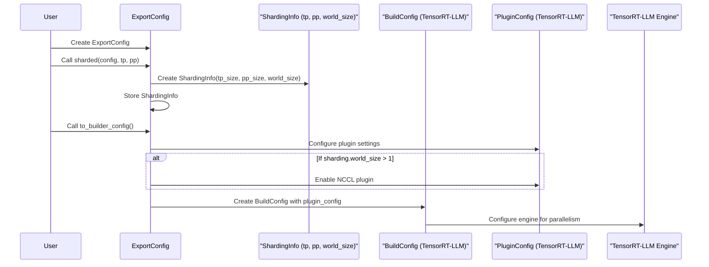

<!-- source: DeepWiki mcp.deepwiki.com · repo huggingface/optimum-nvidia · page 5.2 Parallel Inference · fetched 2026-10-26 -->

# Parallel Inference

<details>
<summary>Relevant source files</summary>

The following files were used as context for generating this wiki page:

- [src/optimum/nvidia/export/cli.py](src/optimum/nvidia/export/cli.py)
- [src/optimum/nvidia/export/config.py](src/optimum/nvidia/export/config.py)
- [src/optimum/nvidia/utils/cli.py](src/optimum/nvidia/utils/cli.py)
- [tests/integration/test_causal_lm.py](tests/integration/test_causal_lm.py)

</details>


This document explains how to configure and use parallel inference capabilities in Optimum-NVIDIA. Parallel inference enables the distribution of model computation across multiple GPUs, which is critical for deploying large language models efficiently. For information about quantization techniques, see [Quantization](#5.1).

## What is Parallel Inference?

Parallel inference distributes model execution across multiple GPUs to overcome memory limitations and increase throughput. This is especially important for large language models (LLMs) that may not fit into a single GPU's memory or require significant computational resources.



Sources: [src/optimum/nvidia/export/config.py:150-160](src/optimum/nvidia/export/config.py:150-160), [src/optimum/nvidia/export/config.py:205-221]()

## Types of Parallelism

Optimum-NVIDIA supports two main types of parallelism for inference:

### Tensor Parallelism (TP)

Tensor Parallelism splits individual tensors across multiple GPUs. Each GPU holds a portion of the model's weights and performs computations on its portion in parallel.

### Pipeline Parallelism (PP)

Pipeline Parallelism splits the model's layers across multiple GPUs. Each GPU holds complete layers but only a subset of the entire model, and computations are pipelined through the GPUs.



Sources: [src/optimum/nvidia/export/config.py:150-160](src/optimum/nvidia/export/config.py:150-160), [src/optimum/nvidia/export/config.py:205-221]()

## Configuring Parallel Inference

### Using ExportConfig

The primary way to configure parallel inference is through the `ExportConfig` class, which provides methods to specify sharding strategies:



Sources: [src/optimum/nvidia/export/config.py:26-160](src/optimum/nvidia/export/config.py:26-160)

### Using Helper Functions

Optimum-NVIDIA provides two helper functions to configure parallel inference:

1. **`sharded(config, tp, pp)`**: Manually configure tensor and pipeline parallelism
2. **`auto_parallel(config, world_size)`**: Automatically determine the optimal parallelism strategy based on available GPUs

#### Manual Configuration with `sharded()`

```python
from optimum.nvidia import ExportConfig
from optimum.nvidia.export.config import sharded

# Create an export configuration
export_config = ExportConfig(
    dtype="float16",
    max_input_len=128,
    max_batch_size=1,
    max_output_len=128
)

# Apply sharding with tensor parallelism = 2 and pipeline parallelism = 1
export_config = sharded(export_config, tp=2, pp=1)
```

#### Automatic Configuration with `auto_parallel()`

```python
from optimum.nvidia import ExportConfig
from optimum.nvidia.export.config import auto_parallel

# Create an export configuration
export_config = ExportConfig(
    dtype="float16",
    max_input_len=128,
    max_batch_size=1,
    max_output_len=128
)

# Let the system automatically determine the best parallelism strategy
export_config = auto_parallel(export_config)
```

Sources: [src/optimum/nvidia/export/config.py:163-221](src/optimum/nvidia/export/config.py:163-221)

## Using Parallel Inference with `AutoModelForCausalLM`

The following example demonstrates how to use parallel inference with `AutoModelForCausalLM`:

```python
from optimum.nvidia import AutoModelForCausalLM, ExportConfig
from optimum.nvidia.export.config import sharded
from transformers import AutoTokenizer

# Create an export configuration with TP=2 and PP=1
export_config = ExportConfig(
    dtype="float16",
    max_input_len=128,
    max_batch_size=1,
    max_output_len=128,
    max_num_tokens=110  # Maximum new tokens to generate
)
export_config = sharded(export_config, tp=2, pp=1)

# Load the model with the parallel configuration
model_id = "meta-llama/Llama-2-7b-chat-hf"
trt_model = AutoModelForCausalLM.from_pretrained(
    model_id,
    force_export=True,
    export_config=export_config
)

# Use the model for inference
tokenizer = AutoTokenizer.from_pretrained(model_id)
inputs = tokenizer(["Today I am in Paris and I would like to"], padding=False)
outputs = trt_model.generate(inputs["input_ids"], max_new_tokens=110)
```

Sources: [tests/integration/test_causal_lm.py:36-95](tests/integration/test_causal_lm.py:36-95)

## Command-Line Interface for Parallel Inference

Optimum-NVIDIA's CLI provides arguments to configure parallel inference when exporting models:

| Argument | Description |
|----------|-------------|
| `--tensor-parallelism`, `--tp` | Number of slices for tensor parallelism |
| `--pipeline-parallelism`, `--pp` | Number of sections for pipeline parallelism |
| `--world-size` | Total number of GPUs across all nodes |
| `--gpus-per-node` | Total number of GPUs on a single node |

Example CLI command:

```bash
optimum-cli export nvidia-trt-llm \
  --model meta-llama/Llama-2-7b-chat-hf \
  --tp 2 \
  --pp 1 \
  --max-input-length 128 \
  --max-output-length 256 \
  --max-batch-size 4 \
  --dtype float16
```

Sources: [src/optimum/nvidia/utils/cli.py:21-57](src/optimum/nvidia/utils/cli.py:21-57), [src/optimum/nvidia/export/cli.py:8-68](src/optimum/nvidia/export/cli.py:8-68)

## Internal Implementation

When you configure parallel inference, Optimum-NVIDIA creates a `ShardingInfo` object that is passed to TensorRT-LLM during the model export process:



When `sharding.world_size > 1` (meaning TP or PP is greater than 1), the NCCL plugin is automatically enabled to facilitate communication between GPUs.

Sources: [src/optimum/nvidia/export/config.py:97-114](src/optimum/nvidia/export/config.py:97-114), [src/optimum/nvidia/export/config.py:115-148](src/optimum/nvidia/export/config.py:115-148)

## Automatic Parallelization Strategy

The `auto_parallel` function automatically determines the optimal parallelization strategy based on the number of available GPUs:

| Number of GPUs | Tensor Parallelism (TP) | Pipeline Parallelism (PP) |
|----------------|-------------------------|---------------------------|
| 1              | 1                       | 1                         |
| 2              | 2                       | 1                         |
| 4              | 2                       | 2                         |
| 8              | 4                       | 2                         |

For other configurations, you'll need to manually specify the TP and PP values appropriate for your hardware.

Sources: [src/optimum/nvidia/export/config.py:163-202](src/optimum/nvidia/export/config.py:163-202)

## Hardware Requirements and Considerations

When using parallel inference, consider the following:

1. **GPU Count**: You must have at least as many GPUs as the product of TP and PP (i.e., TP × PP ≤ number of available GPUs)

2. **GPU Connectivity**: For best performance, GPUs should be connected with high-bandwidth interconnects (like NVLink)

3. **Memory Usage**: Each GPU will use less memory than a single-GPU deployment, allowing for larger models, but there is overhead for communication

4. **Performance Implications**:
   - Tensor Parallelism: Reduces memory per GPU but adds communication overhead
   - Pipeline Parallelism: Efficiently utilizes GPU memory but may introduce pipeline bubbles

5. **Load Balancing**: The automatic strategy attempts to balance the workload, but manual tuning may be required for specific models

Sources: [src/optimum/nvidia/export/config.py:163-202](src/optimum/nvidia/export/config.py:163-202), [tests/integration/test_causal_lm.py:36-95](tests/integration/test_causal_lm.py:36-95)

## Limitations

- Pipeline parallelism may introduce latency due to the sequential nature of layer processing
- Not all models support both tensor and pipeline parallelism equally well
- The auto-parallelization strategy is currently in beta and might not be optimal for all use cases
- Currently supported configurations include 1, 2, 4, and 8 GPUs with predefined TP and PP values

Sources: [src/optimum/nvidia/export/config.py:186-202](src/optimum/nvidia/export/config.py:186-202)

## Debugging Parallel Inference

When working with parallel inference, it's important to verify that you have sufficient GPU resources:

```python
from optimum.nvidia.utils.nvml import get_device_count

# Check available GPUs
num_gpus = get_device_count()
if num_gpus < required_gpus:  # where required_gpus = tp * pp
    # Handle insufficient GPU resources
    raise ValueError(f"Not enough GPUs available: need {required_gpus}, have {num_gpus}")
```

In integration tests, this check is often used to skip tests when insufficient GPUs are available:

```python
if get_device_count() < tp * pp:
    pytest.skip("Not enough GPU on the system")
```

Sources: [tests/integration/test_causal_lm.py:41-43](tests/integration/test_causal_lm.py:41-43)

---

