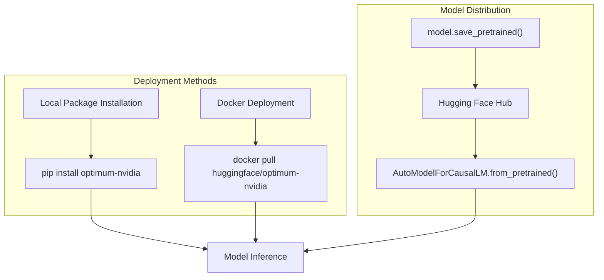
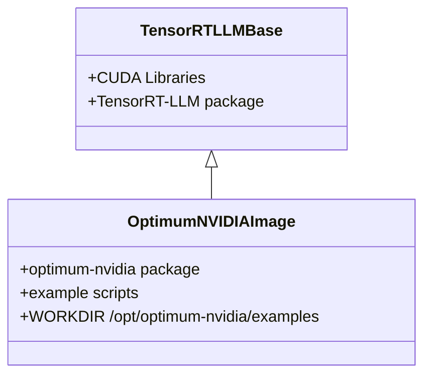
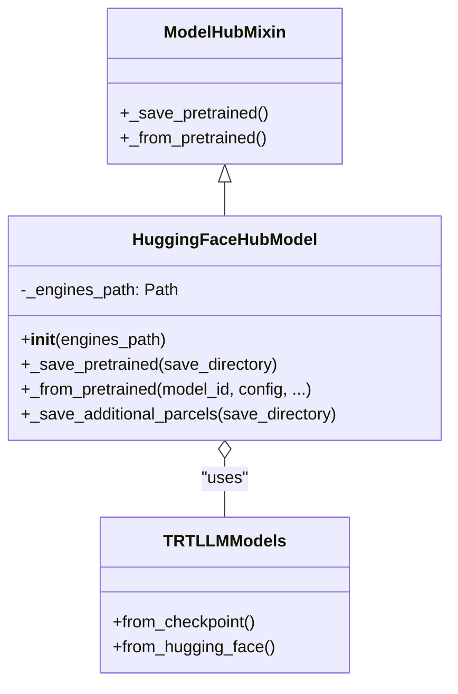
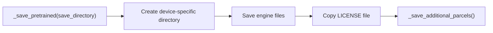
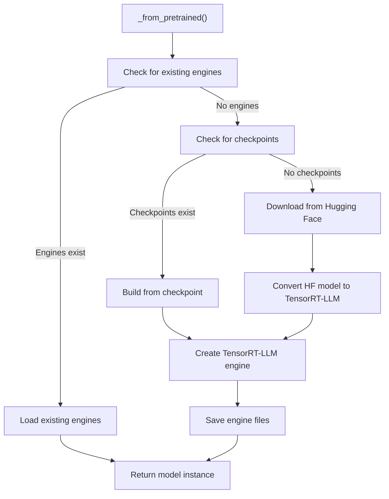
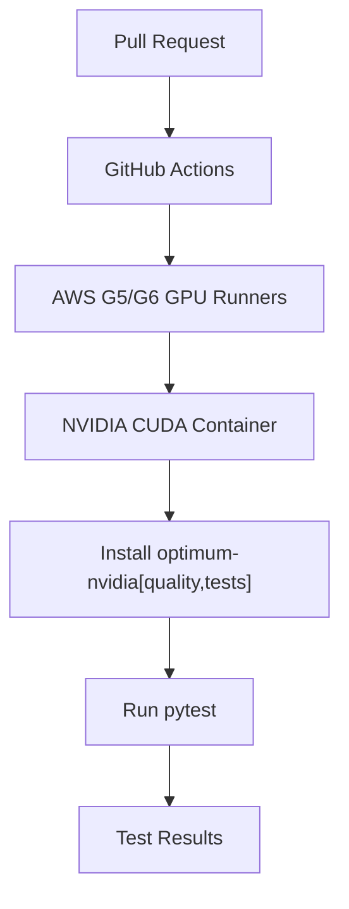
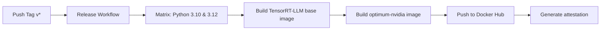

<!-- source: DeepWiki mcp.deepwiki.com · repo huggingface/optimum-nvidia · page 6 Deployment & Distribution · fetched 2026-10-26 -->

# Deployment & Distribution

<details>
<summary>Relevant source files</summary>

The following files were used as context for generating this wiki page:

- [.github/workflows/pr_tests.yml](.github/workflows/pr_tests.yml)
- [.github/workflows/release.yml](.github/workflows/release.yml)
- [docker/Dockerfile](docker/Dockerfile)
- [docker/Dockerfile.dev](docker/Dockerfile.dev)
- [src/optimum/nvidia/hub.py](src/optimum/nvidia/hub.py)

</details>


This page documents the deployment and distribution options for Optimum-NVIDIA, covering Docker containers, package installation, model sharing via the Hugging Face Hub, and CI/CD infrastructure. For information about model export options, see [Export Configuration](#2.3).

## 1. Deployment Options

Optimum-NVIDIA supports two primary deployment methods:

1. **Python Package**: Installing directly via pip
2. **Docker Containers**: Using pre-built Docker images with all dependencies



Sources:
- [docker/Dockerfile:1-13]()
- [.github/workflows/release.yml:38-112]()
- [src/optimum/nvidia/hub.py:415-452]()

## 2. Docker Deployment

### 2.1 Docker Image Architecture

Optimum-NVIDIA provides official Docker images based on NVIDIA's TensorRT-LLM images, which come with all required dependencies pre-installed.



Sources:
- [docker/Dockerfile:1-13]()

### 2.2 Available Docker Images

Docker images are available on Docker Hub under the `huggingface/optimum-nvidia` repository. Images are tagged with:

- Version number (e.g., `v0.1.0`)
- Python version (e.g., `-py310` or `-py312`)

Example tags:
- `huggingface/optimum-nvidia:v0.1.0-py310`
- `huggingface/optimum-nvidia:v0.1.0-py312`

Sources:
- [.github/workflows/release.yml:92-98]()

### 2.3 Using Docker Images

To use the Docker images:

```bash
# Pull the latest image with Python 3.10
docker pull huggingface/optimum-nvidia:latest-py310

# Run a container with GPU access and interactive terminal
docker run --gpus all -it huggingface/optimum-nvidia:latest-py310
```

### 2.4 Development Container

A development container is also provided for contributors:

```bash
# Build the development container
docker build -f docker/Dockerfile.dev -t optimum-nvidia-dev .

# Run the development container
docker run --gpus all -it optimum-nvidia-dev
```

Sources:
- [docker/Dockerfile.dev:1-16]()

## 3. Model Distribution

Optimum-NVIDIA integrates with the Hugging Face Hub for seamless model distribution through the `HuggingFaceHubModel` class.

### 3.1 Hub Integration Architecture



Sources:
- [src/optimum/nvidia/hub.py:190-196]() (HuggingFaceHubModel class definition)
- [src/optimum/nvidia/hub.py:203-409]() (_from_pretrained method)
- [src/optimum/nvidia/hub.py:415-452]() (_save_pretrained method)

### 3.2 Saving Models to Hub

The `_save_pretrained` method handles saving optimized models to a local directory or the Hugging Face Hub:



The method:
1. Creates a device-specific directory (e.g., `A10G/`)
2. Copies or creates symlinks to engine files 
3. Copies the LICENSE file if present
4. Calls model-specific `_save_additional_parcels()` to save additional files

Sources:
- [src/optimum/nvidia/hub.py:415-452]() (_save_pretrained method)

### 3.3 Loading Models from Hub

The `_from_pretrained` method handles loading optimized models:



The method follows this decision tree:
1. Check if pre-built engines already exist for the target device
2. If not, check if TensorRT-LLM checkpoints are available
3. If not, download the Hugging Face model and convert to TensorRT-LLM
4. Finally, load the engines and return the model instance

Sources:
- [src/optimum/nvidia/hub.py:203-409]() (_from_pretrained method)

## 4. CI/CD and Testing Infrastructure

### 4.1 Testing on GPU Infrastructure

Optimum-NVIDIA uses GPU-enabled GitHub Actions runners for testing:

| Test Type | Infrastructure | Container | Description |
|-----------|---------------|-----------|-------------|
| Core Tests | AWS G5/G6 instances | CUDA 12.6.3 | Tests for core functionality |
| CLI Tests | AWS G5/G6 instances | CUDA 12.6.3 | Tests for command-line interface |

Sources:
- [.github/workflows/pr_tests.yml:20-72]() (Core tests)
- [.github/workflows/pr_tests.yml:73-134]() (CLI tests)

### 4.2 Test Environment Configuration

Tests run in containerized environments with:
- NVIDIA CUDA container
- Shared cache mount for Hugging Face models
- GPU device access
- OpenMPI for distributed testing



Sources:
- [.github/workflows/pr_tests.yml:33-36]() (Container configuration)
- [.github/workflows/pr_tests.yml:56-59]() (Dependency installation)
- [.github/workflows/pr_tests.yml:71]() (Test execution)

### 4.3 Release Pipeline

The release process is automated through GitHub Actions and triggered by pushing a tag prefixed with "v":



Sources:
- [.github/workflows/release.yml:3-7]() (Trigger)
- [.github/workflows/release.yml:46-48]() (Python version matrix)
- [.github/workflows/release.yml:73-81]() (Build TensorRT-LLM base)
- [.github/workflows/release.yml:100-111]() (Docker build and push)
- [.github/workflows/release.yml:113-117]() (Generate attestation)

## 5. Package Distribution

### 5.1 PyPI Distribution

The release workflow includes a commented-out section for PyPI distribution, indicating this may be enabled in a future release:

```yaml
# Currently commented out in the workflow
pypi:
  name: Publish release artifact on PyPi repository
  runs-on: ubuntu-latest
  steps:
    # ...
    - name: Upload to PyPi
      env:
        OPTIMUM_NVIDIA_PYPI_TOKEN: ${{ secrets.OPTIMUM_NVIDIA_PYPI_TOKEN }}
      run: |
        twine upload dist/* -u __token__ -p "$OPTIMUM_NVIDIA_PYPI_TOKEN"
```

Sources:
- [.github/workflows/release.yml:10-36]() (Commented PyPI section)

### 5.2 Docker Distribution

Docker images are distributed through Docker Hub at `huggingface/optimum-nvidia` with automatic builds for Python 3.10 and 3.12. The images include:

1. CUDA and TensorRT libraries from the base image
2. TensorRT-LLM package of the appropriate version
3. Optimum-NVIDIA package
4. Example scripts in `/opt/optimum-nvidia/examples`

Sources:
- [.github/workflows/release.yml:38-118]() (Docker build and push)
- [docker/Dockerfile:1-13]() (Dockerfile definition)

---

