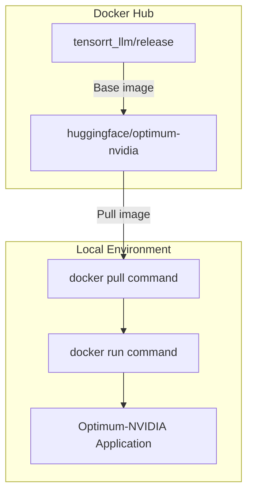
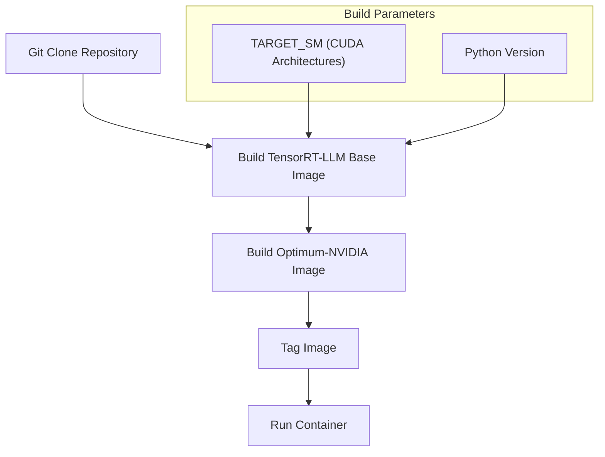
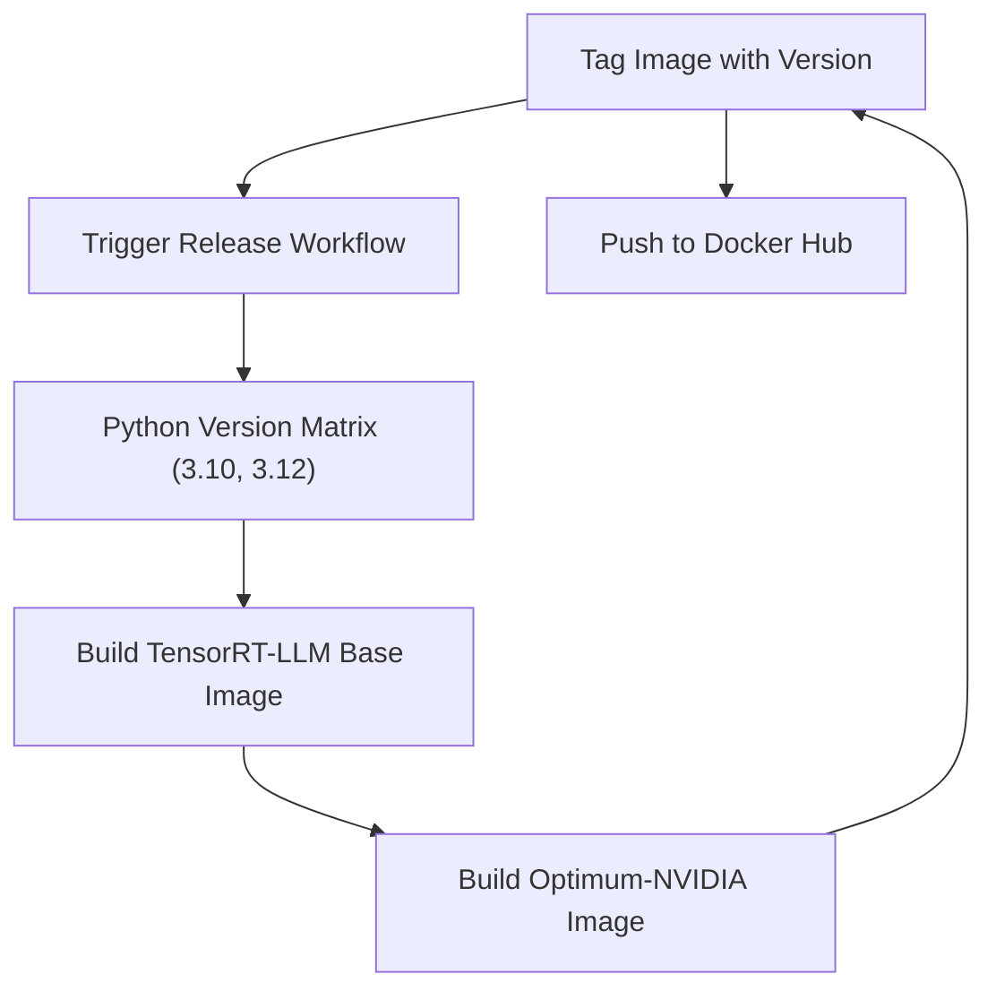

<!-- source: DeepWiki mcp.deepwiki.com · repo huggingface/optimum-nvidia · page 6.1 Docker Deployment · fetched 2026-10-26 -->

# Docker Deployment

<details>
<summary>Relevant source files</summary>

The following files were used as context for generating this wiki page:

- [.github/workflows/release.yml](.github/workflows/release.yml)
- [CONTRIBUTING.md](CONTRIBUTING.md)
- [LICENSE](LICENSE)
- [README.md](README.md)
- [docker/Dockerfile](docker/Dockerfile)
- [docker/Dockerfile.dev](docker/Dockerfile.dev)

</details>


This page provides a comprehensive guide on using, customizing, and building Docker containers for Optimum-NVIDIA. Docker provides an isolated environment with all dependencies pre-installed, making it the easiest way to get started with Optimum-NVIDIA. For information about other installation methods, such as pip installation, see [Installation & Requirements](#1.1).

## Overview of Docker Deployment

Optimum-NVIDIA provides official Docker images through the Hugging Face Docker Hub repository. These images come pre-configured with all the necessary dependencies, including CUDA, TensorRT-LLM, and the Optimum-NVIDIA package itself.



Sources: [README.md:34-39](), [docker/Dockerfile:4]()

## Available Docker Images

Optimum-NVIDIA provides Docker images with multiple Python versions to suit different needs. Images are tagged using the following convention:

```
huggingface/optimum-nvidia:v{version}-py{python_version}
```

Where:
- `{version}` is the Optimum-NVIDIA version (e.g., `0.1.0`)
- `{python_version}` is the Python version without the dot (e.g., `310` for Python 3.10)

### Available Image Variants

| Tag Format | Description | Use Case |
|------------|-------------|----------|
| `huggingface/optimum-nvidia:latest` | Latest stable release | General usage |
| `huggingface/optimum-nvidia:v0.1.0-py310` | Specific version with Python 3.10 | Production deployment |
| `huggingface/optimum-nvidia:v0.1.0-py312` | Specific version with Python 3.12 | Latest Python features |

Sources: [.github/workflows/release.yml:94-98]()

## Using the Docker Images

You can use the pre-built Docker images directly from Docker Hub.

### Pulling the Image

To pull the latest image from Docker Hub:

```bash
docker pull huggingface/optimum-nvidia
```

To pull a specific version with a specific Python version:

```bash
docker pull huggingface/optimum-nvidia:v0.1.0-py310
```

### Running the Container

The Docker image comes with examples pre-installed. You can run the container interactively:

```bash
docker run --gpus all -it huggingface/optimum-nvidia
```

This will place you in the `/opt/optimum-nvidia/examples` directory where you can run the provided examples.

### Using Optimum-NVIDIA in the Container

The container comes with Optimum-NVIDIA pre-installed, so you can directly import it in your Python code:

```python
from optimum.nvidia import AutoModelForCausalLM
from transformers import AutoTokenizer

tokenizer = AutoTokenizer.from_pretrained("meta-llama/Llama-2-7b-chat-hf", padding_side="left")
model = AutoModelForCausalLM.from_pretrained(
    "meta-llama/Llama-2-7b-chat-hf",
    use_fp8=True,
    max_prompt_length=1024,
    max_output_length=2048,
    max_batch_size=8,
)
```

Sources: [README.md:34-39](), [docker/Dockerfile:9-12]()

## Docker Image Architecture

The Optimum-NVIDIA Docker images are built on top of the TensorRT-LLM images. Understanding this architecture helps when customizing or extending the images.

```mermaid
classDiagram
    class "NVIDIA CUDA Base" {
        nvidia/cuda:12.3.0-devel-ubuntu22.04
        Base CUDA libraries
    }
    
    class "TensorRT-LLM Release" {
        tensorrt_llm/release:v{version}-py{python_version}
        TensorRT-LLM optimizations
        CUDA compilation tools
    }
    
    class "Optimum-NVIDIA" {
        huggingface/optimum-nvidia:{tag}
        Optimum-NVIDIA package
        Examples folder
    }
    
    "NVIDIA CUDA Base" <|-- "TensorRT-LLM Release" : builds on
    "TensorRT-LLM Release" <|-- "Optimum-NVIDIA" : builds on
```

Sources: [docker/Dockerfile:1-13](), [docker/Dockerfile.dev:1-9]()

## Customizing Docker Images

You might want to customize the Docker image for your specific needs. You can create a new Dockerfile that builds on top of the Optimum-NVIDIA image.

### Creating a Custom Image

Create a `Dockerfile` with your customizations:

```dockerfile
FROM huggingface/optimum-nvidia:latest

# Install additional packages
RUN pip install additional-package

# Copy your application code
COPY ./my-app /opt/my-app
WORKDIR /opt/my-app

# Set the entrypoint
CMD ["python", "my_script.py"]
```

Then build and run your custom image:

```bash
docker build -t my-optimum-app .
docker run --gpus all my-optimum-app
```

## Building from Source

If you need the latest features or want to modify the base image, you can build the Docker image from source.

### Building Process



### Steps to Build from Source

1. Clone the repository and set target architectures:

```bash
TARGET_SM="90-real;89-real"
git clone --recursive --depth=1 https://github.com/huggingface/optimum-nvidia.git
```

2. Build the TensorRT-LLM base image:

```bash
cd optimum-nvidia/third-party/tensorrt-llm
make -C docker release_build CUDA_ARCHS=$TARGET_SM
```

3. Build the Optimum-NVIDIA image:

```bash
cd ../.. && docker build -t my-optimum-nvidia:custom -f docker/Dockerfile .
```

Sources: [README.md:47-55]()

## CI/CD Integration

The Optimum-NVIDIA repository includes a GitHub Actions workflow for automatically building and pushing Docker images when new versions are released.

### Release Process



The GitHub Actions workflow builds images for different Python versions and automatically pushes them to Docker Hub when a new tag is created. This ensures that Docker images are always available for the latest release.

Sources: [.github/workflows/release.yml:38-118]()

## Development Container

For developers contributing to Optimum-NVIDIA, a separate development Dockerfile is provided.

```dockerfile
FROM nvidia/cuda:12.3.0-devel-ubuntu22.04

RUN apt-get update && \
    apt-get -y install \
      git \
    python3.10 \
    python3-pip \
    openmpi-bin \
    libopenmpi-dev

COPY . /opt/optimum-nvidia
WORKDIR /opt/optimum-nvidia

RUN pip install --pre --extra-index-url https://pypi.nvidia.com -e '.[quality, tests]' && \
    pip uninstall -y optimum-nvidia && \
    rm -rf /opt/optimum-nvidia
```

This development container includes additional dependencies for testing and quality checks.

Sources: [docker/Dockerfile.dev:1-16]()

## Supported NVIDIA GPUs

The Docker images will work with any NVIDIA GPU that is compatible with the CUDA version included in the image. Optimum-NVIDIA specifically tests on and supports:

- NVIDIA RTX 4090 (Ada Lovelace)
- NVIDIA L40S (Ada Lovelace)
- NVIDIA H100 (Hopper)

The library should also work on GPUs based on these architectures:
- Ampere (A100, A30, A10, A40, RTX A-series)
- Hopper (H100)
- Ada Lovelace (RTX 4000 series, L40S)

Note that FP8 support is only available on GPUs based on Hopper and Ada-Lovelace architectures.

Sources: [README.md:113-119]()

---

