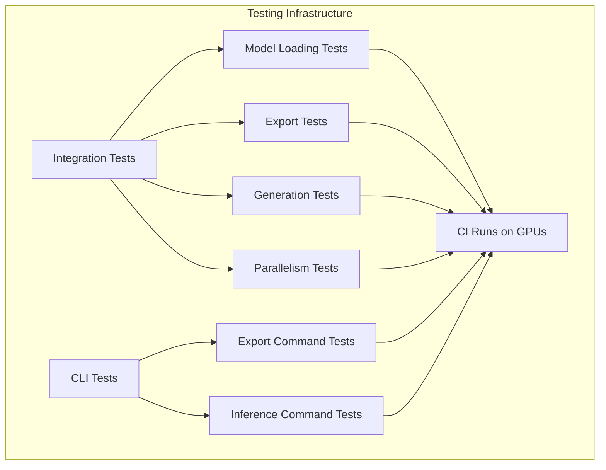
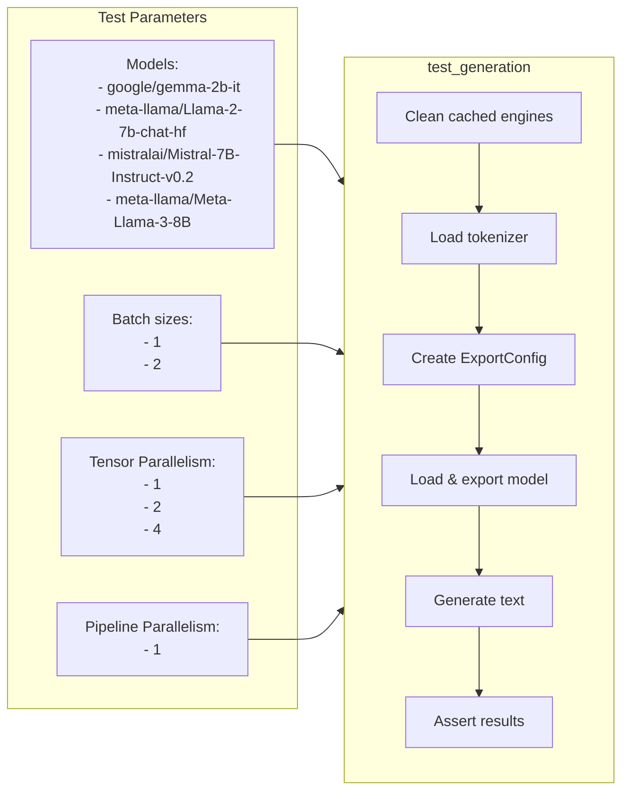
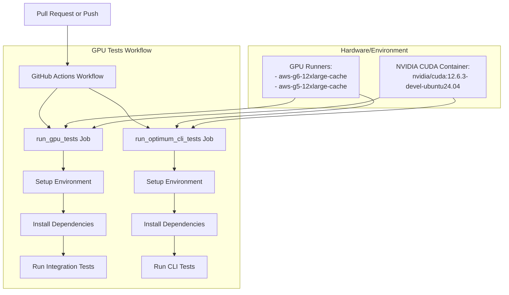

<!-- source: DeepWiki mcp.deepwiki.com · repo huggingface/optimum-nvidia · page 6.2 Testing & Integration · fetched 2026-10-26 -->

# Testing & Integration

<details>
<summary>Relevant source files</summary>

The following files were used as context for generating this wiki page:

- [.github/workflows/pr_tests.yml](.github/workflows/pr_tests.yml)
- [tests/integration/test_causal_lm.py](tests/integration/test_causal_lm.py)

</details>


This document details the testing infrastructure and continuous integration (CI) setup for optimum-nvidia. It covers the integration testing approach, CI pipeline configuration, and how tests ensure proper functionality across NVIDIA GPUs with different model architectures and parallelism strategies.

## Overview of Testing Infrastructure

The optimum-nvidia repository implements a comprehensive testing strategy to verify the correct operation of the TensorRT-LLM integration with Hugging Face models. The testing infrastructure focuses primarily on GPU-enabled integration tests to validate that models can be properly:

1. Loaded from the Hugging Face Hub
2. Exported to TensorRT-LLM engines
3. Used for inference with various configurations
4. Scaled across multiple GPUs with tensor and pipeline parallelism



Sources: [tests/integration/test_causal_lm.py:1-149](), [.github/workflows/pr_tests.yml:1-134]()

## Integration Test Suite

The integration tests focus on end-to-end functionality, verifying that the optimum-nvidia library correctly interfaces with both Hugging Face Transformers and TensorRT-LLM.

### Causal Language Model Tests

The primary integration test suite centers on causal language models (CLMs), testing various model architectures with different configurations. The `test_causal_lm.py` file implements parametrized tests that iterate through:

- Multiple model architectures (Gemma, Llama, Mistral)
- Different batch sizes
- Various tensor parallelism (TP) configurations
- Pipeline parallelism (PP) settings



Sources: [tests/integration/test_causal_lm.py:37-96]()

The test suite includes GPU-specific utilities to:
- Check available device count to skip tests that require more GPUs than available
- Clean cached engines before tests to ensure a fresh environment
- Configure models with specific parallelism strategies
- Verify generation output formats

## CI Pipeline Configuration

The optimum-nvidia repository uses GitHub Actions workflows to run integration tests on GPU-equipped runners. The configuration automatically executes these tests for pull requests to the main branch and pushes to CI-specific branches.

### CI Workflow Architecture



Sources: [.github/workflows/pr_tests.yml:1-134]()

### Key CI Pipeline Features

The CI pipeline is configured with several important features:

1. **GPU Runners**: Tests run on AWS GPU instances (`g5` and `g6` instances) to provide the necessary hardware for TensorRT-LLM
2. **CUDA Container**: The workflow uses NVIDIA CUDA 12.6.3 development containers
3. **Concurrency Control**: Uses GitHub's concurrency controls to cancel redundant workflows
4. **Caching**: Mounts cache directories to speed up the test execution
5. **Environmental Configuration**: Sets environment variables for optimizing CI behavior:
   - `OPTIMUM_NVIDIA_IS_CI`: Indicates tests are running in CI environment
   - `HF_HUB_ENABLE_HF_TRANSFER`: Enables optimized model transfers from Hub
6. **Debug Support**: Includes Tailscale integration for debugging failed runs

## Test Configuration Parameters

The test suite is highly parameterized to ensure comprehensive coverage across different hardware and model configurations.

| Parameter | Values | Purpose |
|-----------|--------|---------|
| Model ID | `google/gemma-2b-it`, `meta-llama/Llama-2-7b-chat-hf`, `mistralai/Mistral-7B-Instruct-v0.2`, `meta-llama/Meta-Llama-3-8B` | Test different model architectures |
| Batch Size | 1, 2 | Test different batch sizes |
| Tensor Parallelism (TP) | 1, 2, 4 | Test different tensor parallelism configurations |
| Pipeline Parallelism (PP) | 1 | Test pipeline parallelism |
| Data Type | float16 | Test model precision |
| Max Input Length | 128 | Configure context window size |
| Max Output Length | 128 | Configure generation length |

Sources: [tests/integration/test_causal_lm.py:26-31](), [tests/integration/test_causal_lm.py:67-73]()

## Running Tests Locally

To run the tests locally, you'll need:

1. One or more NVIDIA GPUs
2. TensorRT-LLM installed
3. optimum-nvidia installed with test dependencies

The test suite can be executed using pytest:

```bash
# Install test dependencies
pip install -e ".[quality,tests]" --extra-index-url https://pypi.nvidia.com

# Run integration tests
pytest -s -v tests/integration/

# Run CLI tests
pytest -s -v tests/cli/
```

Tests that require more GPUs than available will be automatically skipped.

Sources: [.github/workflows/pr_tests.yml:57-61](), [.github/workflows/pr_tests.yml:71-71](), [.github/workflows/pr_tests.yml:122-124]()

## Code Quality and Validation

Beyond functional testing, the test suite helps ensure:

1. **Compatibility** across different model architectures
2. **Scalability** with different parallelism strategies
3. **Correctness** of text generation results
4. **Resource efficiency** in different batch configurations

The tests also serve as examples of how to configure the library for different use cases, showing the proper way to:
- Configure export parameters
- Set up tensor and pipeline parallelism
- Handle tokenization and generation settings
- Clean up resources properly

Sources: [tests/integration/test_causal_lm.py:37-96]()