# Page: Overview

# Overview

<details>
<summary>Relevant source files</summary>

The following files were used as context for generating this wiki page:

- [CONTRIBUTING.md](CONTRIBUTING.md)
- [LICENSE](LICENSE)
- [README.md](README.md)
- [pyproject.toml](pyproject.toml)
- [setup.py](setup.py)
- [src/optimum/nvidia/__init__.py](src/optimum/nvidia/__init__.py)
- [src/optimum/nvidia/version.py](src/optimum/nvidia/version.py)

</details>


Optimum-NVIDIA is a Python library that bridges the Hugging Face Transformers ecosystem with NVIDIA's TensorRT-LLM acceleration platform to deliver optimized inference performance for Large Language Models (LLMs) on NVIDIA GPUs. This page provides a high-level introduction to the library, its architecture, key components, and core functionality.

For detailed installation instructions, see [Installation & Requirements](#1.1). For in-depth information about the core architecture, see [Core Architecture](#2).

## Purpose and Scope

Optimum-NVIDIA enables users to accelerate their existing Hugging Face Transformers workflows with minimal code changes while achieving significant performance improvements. The library converts Hugging Face models to optimized TensorRT-LLM engines and provides compatible APIs that mirror those in the Transformers library.

Key benefits include:
- Up to 28x faster inference compared to standard framework implementations
- Simple integration with existing Transformers code (often requiring just a single line change)
- Support for advanced features like FP8 precision on compatible hardware
- Familiar APIs for users of the Hugging Face ecosystem

Sources: [README.md:16-17](), [setup.py:74-77](), [pyproject.toml:5-7]()

## System Architecture

Optimum-NVIDIA follows a modular architecture that connects the Hugging Face ecosystem with NVIDIA's acceleration technologies.

### High-Level Architecture Diagram

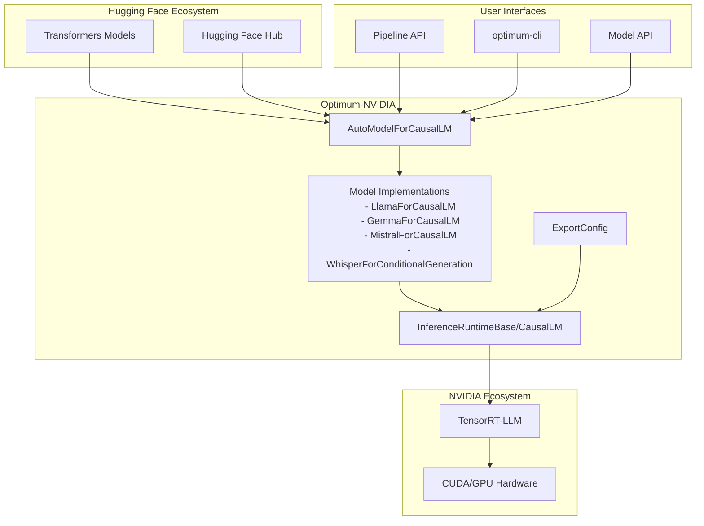

Sources: [src/optimum/nvidia/__init__.py:19-21](), [setup.py:29-42](), [pyproject.toml:26-40]()

### Workflow Process

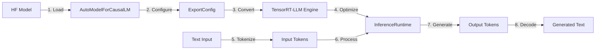

Sources: [README.md:66-107]()

## Key Components

### 1. Entry Points and User Interfaces

Optimum-NVIDIA provides three main ways to use the library:

| Interface | Description | Use Case |
|-----------|-------------|----------|
| Pipeline API | Drop-in replacement for Transformers pipelines | Simple use cases with minimal code changes |
| Model API | Direct model loading and inference with more configuration options | Advanced use cases requiring fine-grained control |
| optimum-cli | Command-line interface for model export and inference | CI/CD integration or script-based workflows |

Sources: [README.md:66-107](), [pyproject.toml:43-44]()

### 2. Core Components

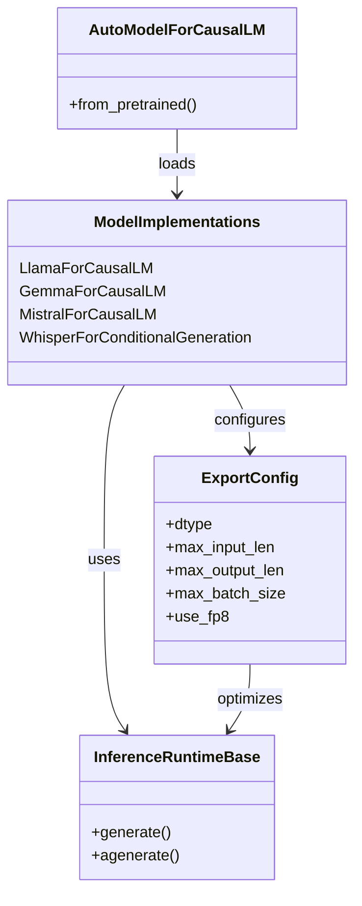

Sources: [src/optimum/nvidia/__init__.py:19-21]()

## Hardware and Software Compatibility

### Supported NVIDIA GPUs

Optimum-NVIDIA has been tested on the following GPUs:
- NVIDIA 4090
- NVIDIA L40S
- NVIDIA H100 Tensor Core

The library is expected to work on GPUs based on these architectures:
- Ampere (A100/A30, with experimental support for A10, A40, RTX Ax000)
- Hopper
- Ada-Lovelace

Note: FP8 precision support is only available on Hopper and Ada-Lovelace architectures.

Sources: [README.md:114-121]()

### Supported Model Architectures

Currently, Optimum-NVIDIA accelerates the following model architectures:

| Architecture | Task |
|--------------|------|
| Llama | Text Generation |
| Gemma | Text Generation |
| Mistral | Text Generation |
| Whisper | Speech Recognition |

Sources: [README.md:121-133]()

### Dependencies and Requirements

- Python 3.10 or higher
- CUDA 12.6
- TensorRT-LLM 0.16.0
- PyTorch ≥ 2.4.0a, ≤ 2.6.0a
- Transformers ≥ 4.45.1
- Optimum ≥ 1.21.0

Sources: [README.md:8-12](), [pyproject.toml:3](), [pyproject.toml:26-40]()

## Example Usage

Optimum-NVIDIA is designed to integrate seamlessly with existing Transformers code. Here are the simplest ways to get started:

### Pipeline API

```diff
- from transformers.pipelines import pipeline
+ from optimum.nvidia.pipelines import pipeline

pipe = pipeline('text-generation', 'meta-llama/Llama-2-7b-chat-hf', use_fp8=True)
pipe("Describe a real-world application of AI in sustainable energy.")
```

### Model API (Generate)

```diff
- from transformers import AutoModelForCausalLM
+ from optimum.nvidia import AutoModelForCausalLM
from transformers import AutoTokenizer

tokenizer = AutoTokenizer.from_pretrained("meta-llama/Llama-2-7b-chat-hf", padding_side="left")

model = AutoModelForCausalLM.from_pretrained(
  "meta-llama/Llama-2-7b-chat-hf",
+ use_fp8=True,
+ max_prompt_length=1024,
+ max_output_length=2048,
+ max_batch_size=8,
)

model_inputs = tokenizer(["How is autonomous vehicle technology transforming the future of transportation?"], return_tensors="pt").to("cuda")

generated_ids = model.generate(
    **model_inputs, 
    top_k=40, 
    top_p=0.7, 
    repetition_penalty=10,
)

tokenizer.batch_decode(generated_ids, skip_special_tokens=True)[0]
```

Sources: [README.md:66-107]()

## Related Wiki Pages

- [Installation & Requirements](#1.1) - Detailed installation instructions and system requirements
- [Core Architecture](#2) - In-depth examination of the internal architecture
- [Runtime System](#2.1) - Details about the TensorRT-LLM runtime implementation
- [Export Configuration](#2.3) - How to configure model export for optimal performance
- [Supported Models](#3) - Information about supported model architectures
- [User Interfaces](#4) - Detailed documentation on pipeline API, command-line interface, and model API

Sources: [README.md]()

---

# Page: Installation & Requirements

# Installation & Requirements

<details>
<summary>Relevant source files</summary>

The following files were used as context for generating this wiki page:

- [.github/workflows/release.yml](.github/workflows/release.yml)
- [CONTRIBUTING.md](CONTRIBUTING.md)
- [LICENSE](LICENSE)
- [README.md](README.md)
- [docker/Dockerfile](docker/Dockerfile)
- [docker/Dockerfile.dev](docker/Dockerfile.dev)
- [pyproject.toml](pyproject.toml)
- [setup.py](setup.py)

</details>


This page provides detailed instructions for installing `optimum-nvidia` and explains the hardware and software requirements needed to run it. Optimum-NVIDIA bridges Hugging Face Transformers models with NVIDIA's TensorRT-LLM to provide optimized inference on NVIDIA GPUs. For information about the core architecture and components, see [Core Architecture](#2).

## System Requirements

Before installing Optimum-NVIDIA, ensure your system meets the following requirements:

### Supported Hardware

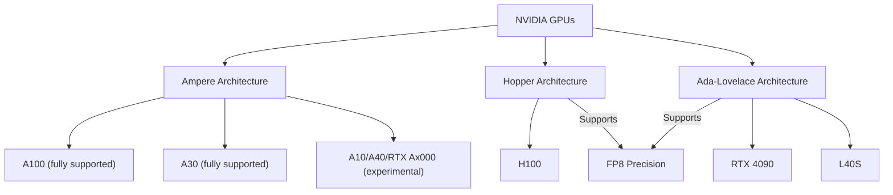

Optimum-NVIDIA is tested and supported on the following NVIDIA GPU architectures:
- **Ampere**: A100 and A30 are fully supported; experimental support for A10, A40, RTX Ax000
- **Hopper**: H100
- **Ada-Lovelace**: RTX 4090, L40S

Note that FP8 support is only available on GPUs based on Hopper and Ada-Lovelace architectures.

Sources: [README.md:114-121]()

### Software Requirements

| Requirement | Version | Notes |
|-------------|---------|-------|
| Python | 3.10 or 3.12 | Python 3.10 is the recommended version |
| CUDA | 12.6 | Required for TensorRT-LLM |
| Operating System | Linux | Windows support coming soon |

Sources: [setup.py:88-89](), [README.md:9-11](), [README.md:121-122]()

### Python Dependencies

Optimum-NVIDIA has several key dependencies that are automatically installed during the installation process:

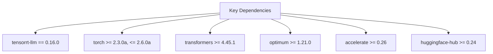

For a complete list of dependencies, refer to [setup.py:29-43]() or [pyproject.toml:26-41]().

## Installation Methods

There are three main ways to install Optimum-NVIDIA:

### Installation Workflow

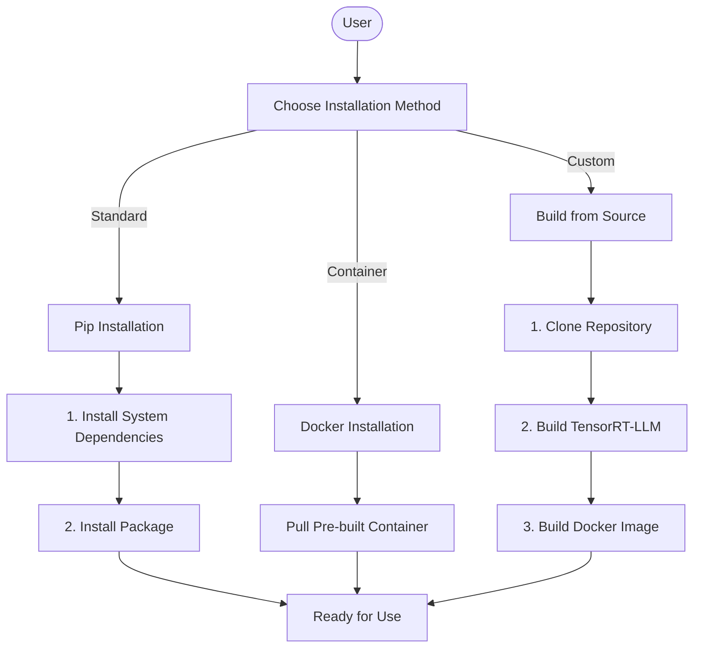

Sources: [README.md:21-55]()

### 1. Pip Installation

The pip installation method has been validated on Ubuntu:

```bash
apt-get update && apt-get -y install python3.10 python3-pip openmpi-bin libopenmpi-dev
python -m pip install --pre --extra-index-url https://pypi.nvidia.com optimum-nvidia
```

Note that the `--pre` flag is required as the package may include pre-release versions. The `--extra-index-url` points to NVIDIA's PyPI repository, which hosts the TensorRT-LLM package.

Sources: [README.md:27-30](), [setup.py:100]()

### 2. Docker Installation

For the simplest installation experience, you can use the pre-built Docker container:

```bash
docker pull huggingface/optimum-nvidia
```

This container includes all necessary dependencies and is ready to use out of the box.

Sources: [README.md:36-38](), [docker/Dockerfile:1-13]()

### 3. Building from Source

For advanced users or those needing specific GPU architecture optimizations, building from source is available:

```bash
TARGET_SM="90-real;89-real"  # Set target GPU architectures
git clone --recursive --depth=1 https://github.com/huggingface/optimum-nvidia.git
cd optimum-nvidia/third-party/tensorrt-llm
make -C docker release_build CUDA_ARCHS=$TARGET_SM
cd ../.. && docker build -t <organisation_name/image_name>:<version> -f docker/Dockerfile .
```

The `TARGET_SM` variable specifies the target GPU architectures for optimization. For example:
- `90-real` for H100 (Hopper)
- `89-real` for L40S/RTX 4090 (Ada Lovelace)
- `80-real` for A100 (Ampere)

Sources: [README.md:50-55](), [.github/workflows/release.yml:76-80]()

## Installation Architecture

The following diagram shows how installation methods relate to the components they provide:

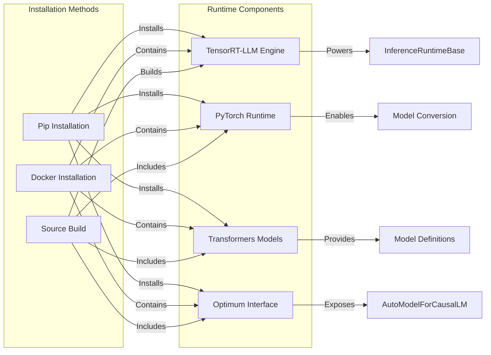

Sources: [setup.py:71-102](), [pyproject.toml:1-56](), [docker/Dockerfile:1-13]()

## Verifying Installation

To verify your installation, you can run a simple test using the Pipeline API:

```python
from optimum.nvidia.pipelines import pipeline

pipe = pipeline('text-generation', 'meta-llama/Llama-2-7b-chat-hf')
result = pipe("What is TensorRT-LLM?")
print(result[0]['generated_text'])
```

If successful, this will load the Llama 2 model, convert it to TensorRT format if needed, and generate text.

Sources: [README.md:68-76]()

## Docker Development Environment

For developers, there's also a development Docker environment available:

```bash
# Build the development container
docker build -t optimum-nvidia-dev -f docker/Dockerfile.dev .

# Run with GPU access
docker run --gpus all -it optimum-nvidia-dev
```

This container includes development tools and test dependencies.

Sources: [docker/Dockerfile.dev:1-16]()

## Next Steps

After installation, you can explore:
- [Core Architecture](#2) - Understanding the Optimum-NVIDIA architecture
- [Supported Models](#3) - Learning about which models are supported
- [User Interfaces](#4) - Various ways to interact with models (Pipeline API, CLI, Model API)
- [Quantization](#5.1) - How to use FP8 and other precision options for faster inference

---

# Page: Core Architecture

# Core Architecture

<details>
<summary>Relevant source files</summary>

The following files were used as context for generating this wiki page:

- [src/optimum/nvidia/hub.py](src/optimum/nvidia/hub.py)
- [src/optimum/nvidia/models/__init__.py](src/optimum/nvidia/models/__init__.py)
- [src/optimum/nvidia/models/base.py](src/optimum/nvidia/models/base.py)
- [src/optimum/nvidia/runtime.py](src/optimum/nvidia/runtime.py)

</details>


The Core Architecture of optimum-nvidia provides a bridge between Hugging Face's Transformers ecosystem and NVIDIA's TensorRT-LLM acceleration framework. This document explains the key components and their relationships for enabling efficient inference of large language models on NVIDIA GPUs.

For details about specific runtime implementations, see [Runtime System](#2.1). For information about model loading and Hub integration, see [Model Loading & Hub Integration](#2.2).

## System Overview

Optimum-NVIDIA's architecture is designed to maintain compatibility with Hugging Face's Transformers interface while leveraging TensorRT-LLM's optimized inference capabilities. The system handles the entire workflow from loading models from the Hugging Face Hub to executing optimized inference on NVIDIA GPUs.

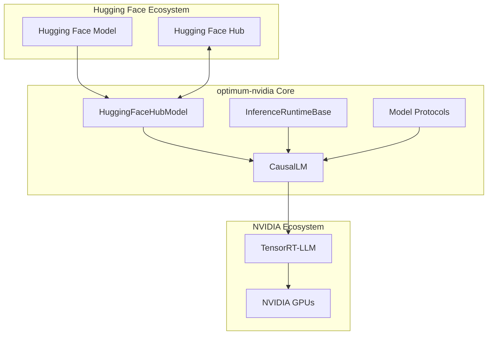

Sources: [src/optimum/nvidia/runtime.py](), [src/optimum/nvidia/hub.py](), [src/optimum/nvidia/models/base.py]()

## Key Components

### Runtime System

The Runtime System handles the execution of inference with TensorRT-LLM engines:

1. **InferenceRuntimeBase**: Base class that manages TensorRT-LLM engines, handling input/output conversion and providing generation methods.

2. **CausalLM**: Inherits from both `InferenceRuntimeBase` and `HuggingFaceHubModel`, combining inference capabilities with Hub integration.

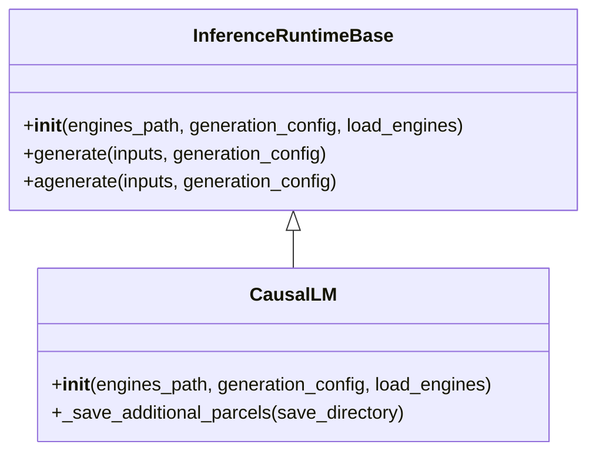

Sources: [src/optimum/nvidia/runtime.py:82-206](), [src/optimum/nvidia/runtime.py:209-224]()

### Hub Integration

The Hub integration enables seamless loading and saving of models to/from the Hugging Face Hub:

1. **HuggingFaceHubModel**: A mixin class that provides Hub integration for TensorRT-LLM models with methods for loading from and saving to the Hub.

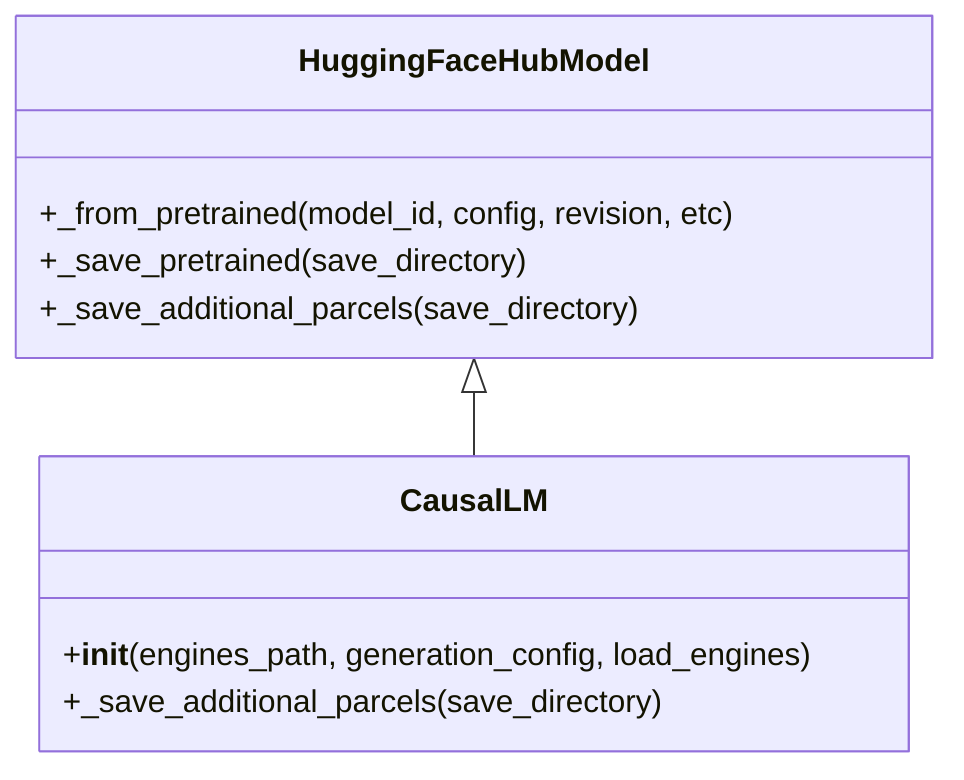

Sources: [src/optimum/nvidia/hub.py:190-452]()

### Model Protocols

The system uses several protocol classes to define interfaces that models must implement:

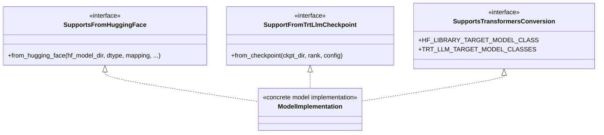

Sources: [src/optimum/nvidia/models/base.py:19-47]()

## Core Architecture Class Hierarchy

This diagram illustrates the inheritance relationships between the key classes:

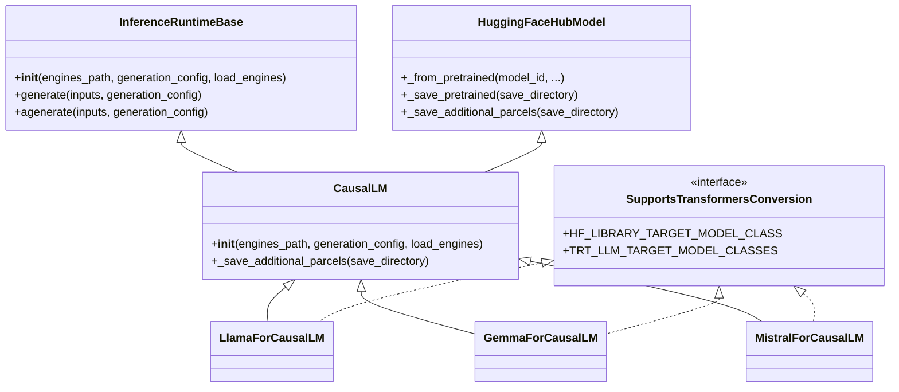

Sources: [src/optimum/nvidia/runtime.py](), [src/optimum/nvidia/hub.py](), [src/optimum/nvidia/models/base.py]()

## System Operation Flows

### Model Loading Flow

This diagram shows the process of loading a model from the Hugging Face Hub:

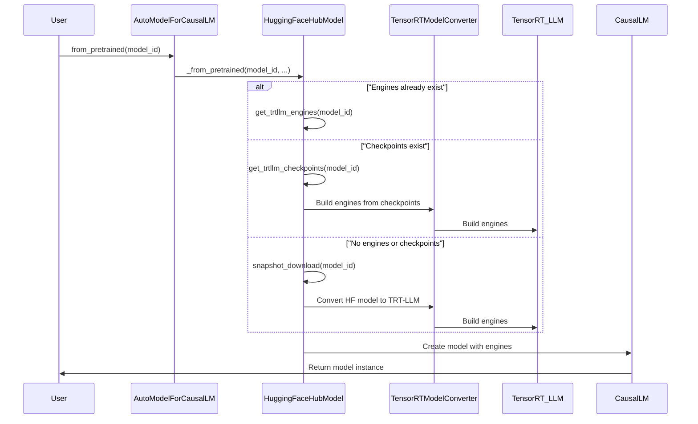

Sources: [src/optimum/nvidia/hub.py:203-409]()

### Inference Flow

This diagram illustrates the inference process with a loaded model:

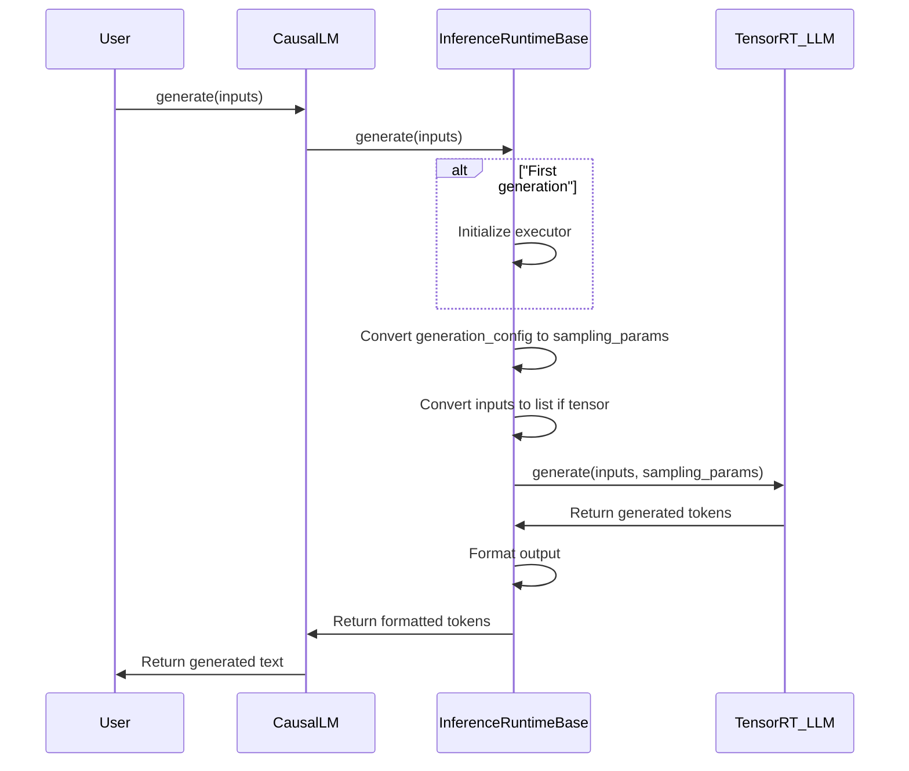

Sources: [src/optimum/nvidia/runtime.py:138-171]()

## Component Relationship Table

| Component | Primary Role | Interacts With | Key Methods |
|-----------|--------------|----------------|-------------|
| InferenceRuntimeBase | Manages TensorRT-LLM engines and inference | TensorRT-LLM | `generate()`, `agenerate()` |
| HuggingFaceHubModel | Provides Hub integration | Hugging Face Hub | `_from_pretrained()`, `_save_pretrained()` |
| CausalLM | Combines runtime and Hub capabilities | InferenceRuntimeBase, HuggingFaceHubModel | inherits methods from parents |
| Model Protocols | Define interfaces for model compatibility | Model implementations | N/A (interface definitions) |

## Implementation Details

### Generation Config Conversion

The system converts Hugging Face's `GenerationConfig` to TensorRT-LLM's `SamplingParams` through the `convert_generation_config` function:

```python
def convert_generation_config(config: "GenerationConfig") -> "SamplingParams":
    return SamplingParams(
        end_id=config.eos_token_id[-1] if isinstance(config.eos_token_id, list) else config.eos_token_id,
        pad_id=config.pad_token_id[-1] if isinstance(config.pad_token_id, list) else config.pad_token_id,
        top_k=config.top_k if config.do_sample else 1,
        top_p=config.top_p,
        temperature=config.temperature,
        beam_width=config.num_beams if config.do_sample else 1,
        # ... other parameters
    )
```

Source: [src/optimum/nvidia/runtime.py:33-55]()

### Model Loading Strategy

The `_from_pretrained` method in `HuggingFaceHubModel` implements a sophisticated strategy for loading models:

1. First, it tries to find pre-built TensorRT engines
2. If no engines are found, it looks for TensorRT-LLM checkpoints
3. If neither exists, it downloads the original Hugging Face model and converts it

This tiered approach optimizes the loading process by avoiding unnecessary conversions when optimized versions already exist.

Source: [src/optimum/nvidia/hub.py:203-409]()

## Summary

The Core Architecture of optimum-nvidia provides a flexible and extensible system for efficient inference of large language models on NVIDIA GPUs. By bridging Hugging Face's Transformers and NVIDIA's TensorRT-LLM, it allows users to leverage the familiar Transformers interface while benefiting from the performance optimizations of TensorRT-LLM.

The architecture follows object-oriented principles with a clear separation of concerns:
- `InferenceRuntimeBase` handles the inference process
- `HuggingFaceHubModel` manages model loading and saving
- `CausalLM` combines these capabilities for language models
- Protocol classes define interfaces for different types of model compatibility

This design makes the system extensible for supporting new model architectures while maintaining consistent interfaces.

---

# Page: Runtime System

# Runtime System

<details>
<summary>Relevant source files</summary>

The following files were used as context for generating this wiki page:

- [src/optimum/nvidia/runtime.py](src/optimum/nvidia/runtime.py)

</details>


The Optimum-NVIDIA Runtime System provides the core infrastructure for executing TensorRT-LLM optimized models. It bridges Hugging Face's generation APIs and NVIDIA's TensorRT-LLM execution environment, handling inference and managing generation parameters. This page focuses on the runtime implementation details; for information about model loading, see [Model Loading & Hub Integration](#2.2).

## Runtime Architecture

The Runtime System consists of two principal classes: `InferenceRuntimeBase` and `CausalLM`, along with supporting utility functions to handle configuration conversion between Hugging Face and TensorRT-LLM.

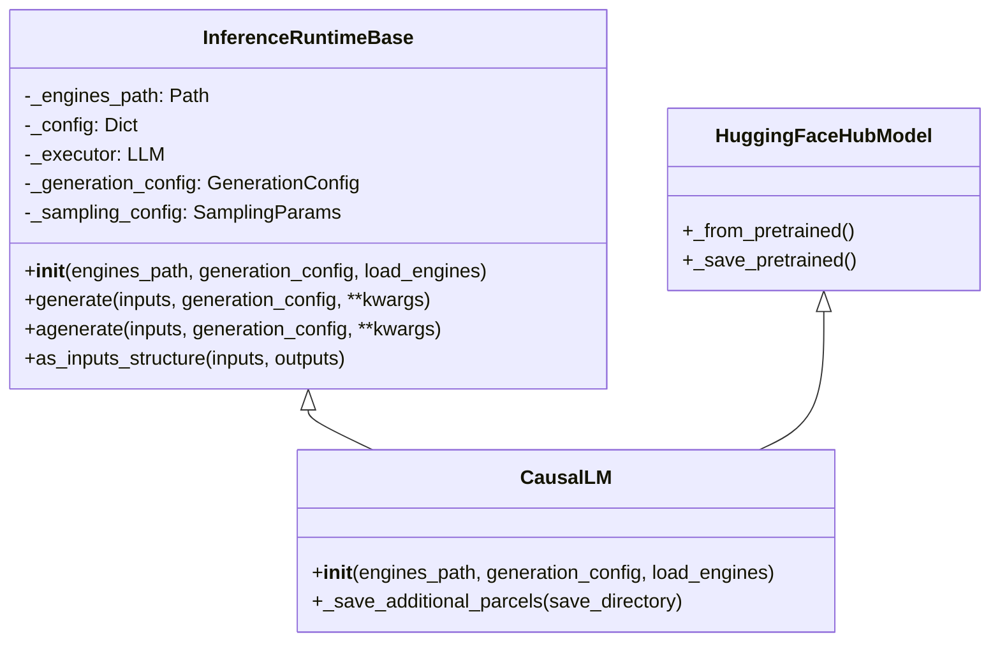

Sources: [src/optimum/nvidia/runtime.py:82-206](). [src/optimum/nvidia/runtime.py:209-224]()

## Core Components

### InferenceRuntimeBase

The `InferenceRuntimeBase` class forms the foundation of the runtime system. It initializes TensorRT-LLM engines, converts configuration parameters, and provides methods for text generation.

Key responsibilities:
- Loading TensorRT-LLM engines from a specified directory
- Converting Hugging Face generation configurations to TensorRT-LLM sampling parameters
- Providing both synchronous and asynchronous generation APIs

```python
# Constructor signature
def __init__(
    self,
    engines_path: Union[str, PathLike],  # Path to TensorRT-LLM engines
    generation_config: "GenerationConfig",  # Hugging Face generation config
    load_engines: bool = True,  # Whether to load engines immediately
)
```

Sources: [src/optimum/nvidia/runtime.py:117-137]()

### CausalLM

The `CausalLM` class inherits from both `InferenceRuntimeBase` and `HuggingFaceHubModel`, combining inference capabilities with Hugging Face Hub integration. This dual inheritance allows model-specific implementations (like `LlamaForCausalLM`) to leverage both optimized TensorRT-LLM execution and Hugging Face ecosystem compatibility.

Sources: [src/optimum/nvidia/runtime.py:209-224]()

## Configuration Conversion

A critical aspect of the runtime is converting between Hugging Face's `GenerationConfig` and TensorRT-LLM's `SamplingParams`. This is handled by the `convert_generation_config` function:

| Hugging Face Parameter | TensorRT-LLM Parameter | Description |
|------------------------|------------------------|-------------|
| `eos_token_id` | `end_id` | Token ID signaling sequence end |
| `pad_token_id` | `pad_id` | Token ID for padding |
| `top_k` | `top_k` | Number of highest probability tokens to keep |
| `top_p` | `top_p` | Cumulative probability threshold for token filtering |
| `temperature` | `temperature` | Sampling temperature (higher = more random) |
| `num_beams` | `beam_width` | Number of beams for beam search |
| `bad_words_ids` | `bad_token_ids` | Token IDs to never generate |
| `repetition_penalty` | `repetition_penalty` | Penalty for repeating tokens |
| `max_new_tokens` | `max_tokens` | Maximum number of tokens to generate |

Sources: [src/optimum/nvidia/runtime.py:33-55]()

## Generation Process

The generation process follows these steps:

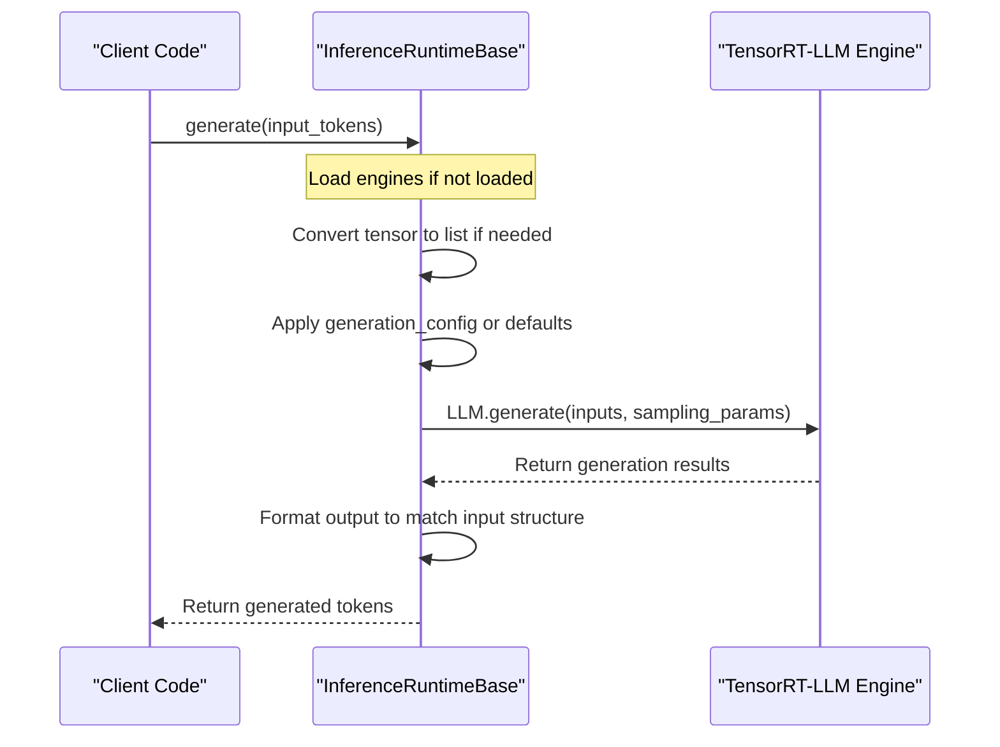

Sources: [src/optimum/nvidia/runtime.py:138-171]()

## Synchronous and Asynchronous APIs

The Runtime System provides two generation interfaces:

### Synchronous Generation

The `generate()` method performs blocking text generation:

```python
def generate(
    self,
    inputs: MaybeBatchedToken,  # Input token IDs (single or batched)
    generation_config: Optional["GenerationConfig"] = None,  # Optional config override
    **kwargs,  # Additional config parameters
) -> MaybeBatchedToken:  # Returns generated token IDs
```

Sources: [src/optimum/nvidia/runtime.py:138-171]()

### Asynchronous Generation

The `agenerate()` method provides non-blocking text generation, returning a coroutine that can be awaited:

```python
async def agenerate(
    self,
    inputs: MaybeBatchedToken,  # Input token IDs (single or batched)
    generation_config: Optional["GenerationConfig"] = None,  # Optional config override
    **kwargs,  # Additional config parameters
) -> MaybeBatchedToken:  # Returns generated token IDs
```

This is particularly useful for serving multiple requests concurrently in production environments.

Sources: [src/optimum/nvidia/runtime.py:173-206]()

## Runtime Initialization Flow

The initialization process follows these steps:

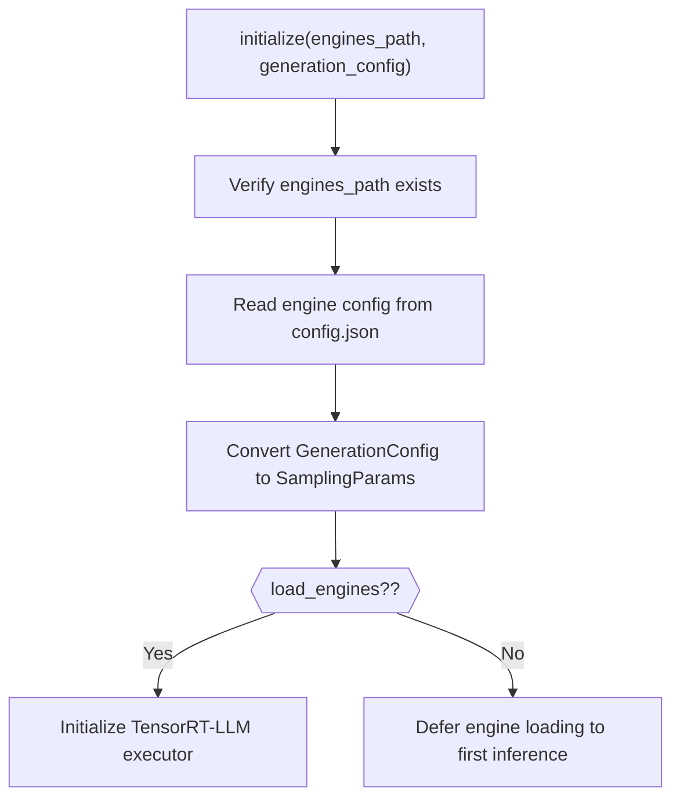

Sources: [src/optimum/nvidia/runtime.py:117-137]()

## Input and Output Format Handling

The runtime automatically handles conversion between different input and output formats using the `as_inputs_structure` static method. It supports:

- Single sequence (list of integers)
- Batched sequences (list of lists)
- PyTorch tensors (both single and batched)

The output format is matched to the input format for API consistency.

Sources: [src/optimum/nvidia/runtime.py:92-115]()

## Error Handling

The Runtime System implements several safeguards:

1. Validation of engine path existence at initialization
2. Lazy loading of engines when needed (if not loaded during initialization)
3. Automatic conversion between tensor and list formats
4. Support for both batched and single-sample inference

Sources: [src/optimum/nvidia/runtime.py:117-137]()

## Integration with Model Types

The `CausalLM` class serves as the base for model-specific implementations like `LlamaForCausalLM`, `GemmaForCausalLM`, and `MistralForCausalLM`. It saves additional model parcels (like generation configuration) when persisting models to disk.

Sources: [src/optimum/nvidia/runtime.py:209-224]()

---

# Page: Model Loading & Hub Integration

# Model Loading & Hub Integration

<details>
<summary>Relevant source files</summary>

The following files were used as context for generating this wiki page:

- [src/optimum/nvidia/hub.py](src/optimum/nvidia/hub.py)
- [tests/test_hub.py](tests/test_hub.py)

</details>


## Purpose and Scope

This document explains how optimum-nvidia loads models from the Hugging Face Hub, converts them to TensorRT-LLM format, and manages the resulting engines. It covers the mechanisms for model discovery, loading, conversion, and saving to facilitate seamless integration with the Hugging Face ecosystem. For information on the runtime system that executes these models, see [Runtime System](#2.1). For details on export configurations, see [Export Configuration](#2.3).

## Hub Integration Architecture

At the core of the hub integration system is the `HuggingFaceHubModel` class, which provides standardized methods for loading models from and saving models to the Hugging Face Hub.

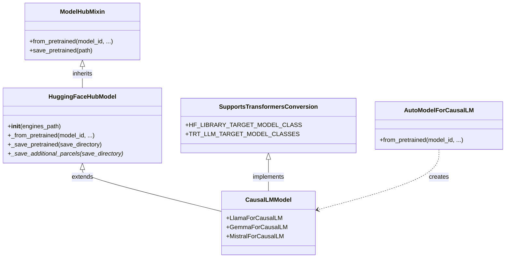

Sources: [src/optimum/nvidia/hub.py:190-198]()

The system is designed with these key components:

- `ModelHubMixin`: Hugging Face's standard interface for model hub operations
- `HuggingFaceHubModel`: Abstract base class that implements the core loading and saving functionality
- `AutoModelForCausalLM`: User-facing factory class that creates the appropriate model implementation
- Model implementations (like `LlamaForCausalLM`): Concrete classes that inherit from `HuggingFaceHubModel`
- `SupportsTransformersConversion`: Interface that defines how models are converted from Transformers to TensorRT-LLM

Sources: [src/optimum/nvidia/hub.py:190-452]()

## Model Loading Workflow

When a user calls `AutoModelForCausalLM.from_pretrained(model_id)`, the following workflow is executed:

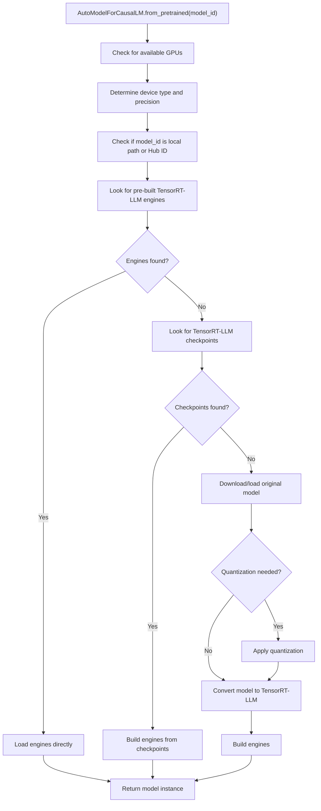

Sources: [src/optimum/nvidia/hub.py:203-409]()

The loading process prioritizes finding pre-built engines for maximum efficiency. If engines aren't available, it attempts to leverage intermediate checkpoints before falling back to converting the original model.

Key steps in the process:

1. Detect available GPUs and determine device characteristics
2. Check if the model exists locally or on the Hub
3. Search for pre-built engines matching the model and device
4. If no engines are found, search for checkpoints
5. As a last resort, download and convert the original model
6. Apply any requested quantization during conversion
7. Return the fully initialized model

Sources: [src/optimum/nvidia/hub.py:222-239](), [src/optimum/nvidia/hub.py:236-270]()

## Model Conversion Process

When conversion from a Hugging Face model to TensorRT-LLM engines is required, the system follows this conversion workflow:

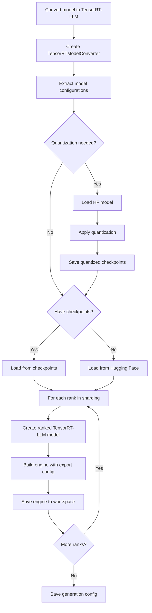

Sources: [src/optimum/nvidia/hub.py:310-401]()

The conversion process handles several scenarios:

1. Direct conversion from Hugging Face models
2. Building from existing TensorRT-LLM checkpoints
3. Optional quantization of models
4. Generation of engines for each rank when using model parallelism

The result is a set of optimized TensorRT-LLM engines saved to disk that can be loaded for inference.

Sources: [src/optimum/nvidia/hub.py:334-401]()

## Model Saving Process

Models can be saved using the `save_pretrained` method, which follows this workflow:

```mermaid
flowchart TD
    Start["model.save_pretrained(save_directory)"] --> CreateDir["Create device-specific directory"]
    CreateDir --> CheckLicense["Check for license file"]
    CheckLicense --> CopyLicense["Copy license if present"]
    CopyLicense --> CopyEngines["Copy/symlink engines and configs"]
    CopyEngines --> HandleErrors{"Symlink errors?"}
    
    HandleErrors -- "Yes" --> FallbackCopy["Fall back to regular file copy"]
    HandleErrors -- "No" --> SaveAdditional["Call _save_additional_parcels()"]
    
    FallbackCopy --> SaveAdditional
```

Sources: [src/optimum/nvidia/hub.py:415-452]()

The saving process:

1. Creates a device-specific directory structure (e.g., `/path/to/model/h100/`)
2. Preserves the original model's license information
3. Copies or symlinks engine files and configuration files
4. Falls back to regular file copying if symlinks fail (important for Windows compatibility)
5. Calls model-specific `_save_additional_parcels` method to save additional data

This creates a directory structure that can be pushed to the Hugging Face Hub or reloaded locally.

Sources: [src/optimum/nvidia/hub.py:415-452]()

## Engine and Checkpoint Management

The system includes several utility functions for managing engines and checkpoints:

| Function | Purpose |
|----------|---------|
| `folder_list_engines(folder)` | Lists all engine files in a directory |
| `folder_list_checkpoints(folder)` | Lists all checkpoint files in a directory |
| `get_trtllm_engines(model_id, device, dtype)` | Retrieves engines for a specific model, device, and precision |
| `get_trtllm_checkpoints(model_id, device, dtype)` | Retrieves checkpoints for a specific model, device, and precision |
| `from_ranked_checkpoints(checkpoints_folder, target_class)` | Creates models from ranked checkpoints |
| `from_ranked_hf_model(local_path, config, target_class, export_config)` | Creates ranked models from a Hugging Face model |

Sources: [src/optimum/nvidia/hub.py:84-107](), [src/optimum/nvidia/hub.py:118-154](), [src/optimum/nvidia/hub.py:156-187]()

These utilities handle:

- Discovery of engine and checkpoint files with specific naming patterns
- Mapping between ranks and filenames for multi-GPU setups
- Integration with the Hugging Face Hub caching system
- Workspace management for organized storage of artifacts

```mermaid
flowchart TD
    User["User Application"] --> Auto["AutoModelForCausalLM.from_pretrained()"]
    
    subgraph "Engine Discovery"
        GetEngines["get_trtllm_engines()"]
        ListEngines["folder_list_engines()"]
        Workspace["Workspace.from_hub_cache()"]
    end
    
    subgraph "Checkpoint Management"
        GetCheckpoints["get_trtllm_checkpoints()"]
        ListCheckpoints["folder_list_checkpoints()"]
        FromCheckpoints["from_ranked_checkpoints()"]
    end
    
    subgraph "Hub Integration"
        SnapshotDownload["snapshot_download()"]
        HFConfig["AutoConfig.from_pretrained()"]
        GenConfig["GenerationConfig.from_pretrained()"]
    end
    
    Auto --> GetEngines
    GetEngines --> Workspace
    GetEngines --> ListEngines
    GetEngines --> SnapshotDownload
    
    Auto --> GetCheckpoints
    GetCheckpoints --> Workspace
    GetCheckpoints --> ListCheckpoints
    GetCheckpoints --> SnapshotDownload
    
    Auto --> FromCheckpoints
    Auto --> HFConfig
    Auto --> GenConfig
```

Sources: [src/optimum/nvidia/hub.py:84-187](), [tests/test_hub.py:30-59]()

## Practical Usage

The most common way to use this system is through the `AutoModelForCausalLM.from_pretrained` method:

```python
# Load a model with default settings
model = AutoModelForCausalLM.from_pretrained("meta-llama/Llama-2-7b-chat-hf")

# Load with custom export configuration
export_config = ExportConfig(
    dtype="float16",
    max_input_len=128,
    max_batch_size=1,
    max_output_len=128
)
model = AutoModelForCausalLM.from_pretrained(
    "meta-llama/Llama-2-7b-chat-hf", 
    export_config=export_config
)

# Save the model for later use
model.save_pretrained("./my_optimized_model")

# Later, load the optimized model directly
model = AutoModelForCausalLM.from_pretrained("./my_optimized_model")
```

Sources: [tests/test_hub.py:94-97](), [tests/test_hub.py:111-112]()

This system allows users to seamlessly work with models from the Hugging Face Hub, benefiting from TensorRT-LLM optimizations while maintaining the familiar Hugging Face interface.

---

# Page: Export Configuration

# Export Configuration

<details>
<summary>Relevant source files</summary>

The following files were used as context for generating this wiki page:

- [src/optimum/nvidia/export/cli.py](src/optimum/nvidia/export/cli.py)
- [src/optimum/nvidia/export/config.py](src/optimum/nvidia/export/config.py)
- [src/optimum/nvidia/utils/cli.py](src/optimum/nvidia/utils/cli.py)

</details>


This document details the export configuration system in optimum-nvidia, which controls how Hugging Face Transformers models are exported to TensorRT-LLM engines. Export configurations determine critical aspects of the exported model such as precision, input/output dimensions, batch size limitations, and parallelization strategies.

For information on model loading and integration with the Hugging Face Hub, see [Model Loading & Hub Integration](#2.2). For details about configuring quantization, see [Quantization](#5.1).

## Core Concepts

The export configuration defines the parameters and constraints used when converting a Hugging Face model to a TensorRT-LLM engine. These configurations affect both the capabilities and performance characteristics of the resulting optimized model.

```mermaid
flowchart LR
    HFModel["Hugging Face Model"] --> |Used to create| EC["ExportConfig"]
    EC --> |Configures| BP["Builder Parameters"]
    BP --> |Controls| Engine["TensorRT-LLM Engine"]
    
    subgraph "Export Configuration Parameters"
        dtype["Data Type\n(FP16/BF16/FP8)"]
        maxlen["Input/Output\nDimensions"]
        batch["Batch Size"]
        parallel["Parallelization"]
        optim["Optimization\nLevel"]
    end
    
    EC --- dtype
    EC --- maxlen
    EC --- batch
    EC --- parallel
    EC --- optim
```

Sources: [src/optimum/nvidia/export/config.py:26-35]()

## ExportConfig Class

The central component of the export system is the `ExportConfig` class, which encapsulates all parameters needed to configure the TensorRT-LLM engine building process.

### Core Parameters

The `ExportConfig` class has the following required parameters:

| Parameter | Description | Default |
|-----------|-------------|---------|
| `dtype` | Data type for model computations (e.g., "float16", "bfloat16", "float8") | - |
| `max_input_len` | Maximum prompt length in tokens | - |
| `max_output_len` | Maximum total sequence length in tokens | - |
| `max_batch_size` | Maximum number of requests processed concurrently | - |

And these optional parameters:

| Parameter | Description | Default |
|-----------|-------------|---------|
| `max_beam_width` | Maximum beam search width | 1 |
| `max_num_tokens` | Maximum number of tokens across batch | Auto-calculated |
| `enabled_chunked_context` | Enable chunked context processing | False |
| `sharding` | Model parallelism configuration | Single GPU config |
| `optimization_level` | TensorRT optimization level | 3 |

Sources: [src/optimum/nvidia/export/config.py:26-40]()

### Validation

The `ExportConfig` class includes validation logic to ensure parameters are within acceptable ranges and consistent with each other. For example, `max_batch_size` must be at least 1, and `optimization_level` must be non-negative.

Sources: [src/optimum/nvidia/export/config.py:77-95]()

## Creating Export Configurations

There are several ways to create an `ExportConfig` instance:

```mermaid
classDiagram
    class ExportConfig {
        +String dtype
        +Integer max_input_len
        +Integer max_output_len
        +Integer max_batch_size
        +Integer max_beam_width
        +Integer max_num_tokens
        +Boolean enabled_chunked_context
        +ShardingInfo sharding
        +Integer optimization_level
        +from_pretrained(model_id_or_path, max_batch_size)
        +from_config(config, max_batch_size)
        +validate()
        +to_builder_config(qmode, plugin_config)
        +with_sharding(tp, pp, gpus_per_node, sharding)
    }

    class FactoryFunctions {
        +auto_parallel(config, world_size)
        +sharded(config, tp, pp)
    }

    FactoryFunctions --> ExportConfig : Creates/Modifies
```

Sources: [src/optimum/nvidia/export/config.py:46-75](), [src/optimum/nvidia/export/config.py:150-161]()

### From Pretrained Models

You can create an export configuration directly from a Hugging Face model ID or path:

```python
from optimum.nvidia.export.config import ExportConfig

# Create configuration from model, with default batch size of 1
config = ExportConfig.from_pretrained("meta-llama/Llama-2-7b")

# Specify a larger batch size
config = ExportConfig.from_pretrained("meta-llama/Llama-2-7b", max_batch_size=4)
```

The method automatically sets appropriate values for `dtype`, `max_input_len`, and `max_output_len` based on the model's configuration.

Sources: [src/optimum/nvidia/export/config.py:46-52]()

### From Configuration Objects

You can also create an export configuration from a Hugging Face model configuration:

```python
from transformers import AutoConfig
from optimum.nvidia.export.config import ExportConfig

# Load model configuration
model_config = AutoConfig.from_pretrained("meta-llama/Llama-2-7b")

# Create export configuration
config = ExportConfig.from_config(model_config, max_batch_size=2)
```

Sources: [src/optimum/nvidia/export/config.py:54-75]()

## Parallelization and Sharding

The `ExportConfig` supports configuring model parallelism for multi-GPU inference using Tensor Parallelism (TP) and Pipeline Parallelism (PP).

```mermaid
flowchart TB
    subgraph "Sharding Configuration"
        direction LR
        TP["Tensor Parallelism (TP)"]
        PP["Pipeline Parallelism (PP)"]
        WS["World Size (TP×PP)"]
    end

    EC["ExportConfig"] --> |"with_sharding()"| Sharded["Sharded Config"]
    Sharded --> |"to_builder_config()"| BC["BuildConfig"]
    
    TP --- PP
    PP --- WS
    
    subgraph "Helper Functions"
        direction TB
        AP["auto_parallel(config, world_size)"]
        S["sharded(config, tp, pp)"]
    end
    
    AP --> Sharded
    S --> Sharded
```

Sources: [src/optimum/nvidia/export/config.py:150-161](), [src/optimum/nvidia/export/config.py:163-221]()

### Manual Sharding Configuration

You can manually configure the parallelization strategy using the `with_sharding` method:

```python
# Configure for 4-way tensor parallelism
config.with_sharding(tp=4, pp=1)

# Configure for mixed parallelism (2×2)
config.with_sharding(tp=2, pp=2)
```

Sources: [src/optimum/nvidia/export/config.py:150-161]()

### Automatic Parallelization

The library provides a helper function to automatically determine an appropriate parallelization strategy based on the available hardware:

```python
from optimum.nvidia.export.config import auto_parallel

# Let the library choose the best strategy
config = auto_parallel(config)

# Specify the number of GPUs to use
config = auto_parallel(config, world_size=4)
```

The `auto_parallel` function selects different strategies based on the number of available GPUs:
- For 2 GPUs: TP=2, PP=1
- For 4 GPUs: TP=2, PP=2
- For 8 GPUs: TP=4, PP=2

Sources: [src/optimum/nvidia/export/config.py:163-202]()

### Manual Sharding Helper

There's also a `sharded` helper function that handles validation and setup:

```python
from optimum.nvidia.export.config import sharded

# Configure for 2-way tensor parallelism
config = sharded(config, tp=2, pp=1)
```

Sources: [src/optimum/nvidia/export/config.py:205-221]()

## Converting to TensorRT-LLM BuildConfig

The `ExportConfig` can be converted to a TensorRT-LLM `BuildConfig` using the `to_builder_config` method, which configures the underlying TensorRT-LLM engine build process.

```mermaid
flowchart LR
    EC["ExportConfig"] --> |"to_builder_config()"| BC["BuildConfig"]
    
    subgraph "BuildConfig Parameters"
        direction TB
        ML["max_input_len"]
        MS["max_seq_len"]
        MB["max_batch_size"]
        MW["max_beam_width"]
        MT["max_num_tokens"]
        PC["plugin_config"]
        FM["use_fused_mlp"]
        WS["weight_sparsity"]
    end
    
    BC --- ML
    BC --- MS
    BC --- MB
    BC --- MW
    BC --- MT
    BC --- PC
    BC --- FM
    BC --- WS
```

Sources: [src/optimum/nvidia/export/config.py:115-148]()

## Plugin Configuration

The `ExportConfig` automatically configures TensorRT-LLM plugins based on your parameters and hardware. This includes:

- Enabling appropriate GEMM plugins
- Configuring attention mechanisms
- Setting up paged KV cache
- Enabling NCCL plugin for multi-GPU execution
- Configuring FP8 optimizations when applicable

Sources: [src/optimum/nvidia/export/config.py:98-113]()

## Command Line Interface

optimum-nvidia provides a command-line interface for exporting models, with arguments that map to the `ExportConfig` parameters.

```mermaid
flowchart TD
    CLI["optimum-cli"] --> |"export nvidia"| ARGS["Export Arguments"]
    
    subgraph "Required Arguments"
        model["Model Path/ID"]
        maxin["--max-input-length"]
        maxout["--max-output-length"]
        maxnew["--max-new-tokens"]
    end
    
    subgraph "Multi-GPU Arguments"
        tp["--tp (Tensor Parallel)"]
        pp["--pp (Pipeline Parallel)"]
    end
    
    subgraph "Optional Arguments"
        dtype["--dtype"]
        maxbatch["--max-batch-size"]
        maxbeam["--max-beams-width"]
        quant["--quantization"]
        dest["--destination"]
        hub["--push-to-hub"]
    end
    
    ARGS --- model
    ARGS --- maxin
    ARGS --- maxout
    ARGS --- maxnew
    ARGS --- tp
    ARGS --- pp
    ARGS --- dtype
    ARGS --- maxbatch
    ARGS --- maxbeam
    ARGS --- quant
    ARGS --- dest
    ARGS --- hub
```

Sources: [src/optimum/nvidia/export/cli.py:8-68](), [src/optimum/nvidia/utils/cli.py:21-57](), [src/optimum/nvidia/utils/cli.py:61-87]()

### Common Export CLI Arguments

| Argument | Description | Default |
|----------|-------------|---------|
| `--max-input-length` | Maximum prompt length | Model specific |
| `--max-output-length` | Maximum sequence length | Model specific |
| `--max-new-tokens` | Maximum new tokens to generate | - |
| `--tp` | Tensor Parallelism degree | 1 |
| `--pp` | Pipeline Parallelism degree | 1 |
| `--dtype` | Computation data type | "auto" |
| `--max-batch-size` | Maximum batch size | 1 |
| `--max-beams-width` | Maximum beam search width | 1 |
| `--quantization` | Path to quantization recipe | None |
| `--destination` | Output folder | Hub cache |
| `--push-to-hub` | Hub repo to push to | None |

Sources: [src/optimum/nvidia/export/cli.py:8-68]()

### Additional CLI Arguments

The CLI also supports additional arguments for model topology configuration:

| Argument | Description | Default |
|----------|-------------|---------|
| `--tensor-parallelism` | Same as `--tp` | 1 |
| `--pipeline-parallelism` | Same as `--pp` | 1 |
| `--world-size` | Total number of GPUs | 1 |
| `--gpus-per-node` | GPUs per node | 1 |
| `--opt-level` | Optimization level | 2 |

And arguments for optimization profiles:

| Argument | Description | Default |
|----------|-------------|---------|
| `--max-batch-size` | Maximum batch size | 1 |
| `--max-prompt-length` | Maximum prompt length | 128 |
| `--max-new-tokens` | Maximum tokens to generate | 1024 |
| `--max-beam-width` | Maximum beam search width | 1 |

Sources: [src/optimum/nvidia/utils/cli.py:21-57](), [src/optimum/nvidia/utils/cli.py:61-87]()

## Example Usage

Here's an example of exporting a model using the CLI:

```bash
optimum-cli export nvidia \
  meta-llama/Llama-2-7b \
  --max-input-length 2048 \
  --max-output-length 4096 \
  --max-batch-size 2 \
  --dtype bfloat16 \
  --tp 2 \
  --pp 1 \
  --destination ./exported_model
```

And an equivalent Python API usage:

```python
from optimum.nvidia.export.config import ExportConfig, sharded

# Create export configuration
config = ExportConfig.from_pretrained("meta-llama/Llama-2-7b", max_batch_size=2)
config.max_input_len = 2048
config.max_output_len = 4096
config.dtype = "bfloat16"

# Configure parallelism
config = sharded(config, tp=2, pp=1)

# Export the model (handled by other components not covered in this page)
```

Sources: [src/optimum/nvidia/export/config.py:26-161]()

---

# Page: Supported Models

# Supported Models

<details>
<summary>Relevant source files</summary>

The following files were used as context for generating this wiki page:

- [src/optimum/nvidia/generation/logits_process.py](src/optimum/nvidia/generation/logits_process.py)
- [src/optimum/nvidia/models/gemma.py](src/optimum/nvidia/models/gemma.py)
- [src/optimum/nvidia/models/llama.py](src/optimum/nvidia/models/llama.py)
- [src/optimum/nvidia/models/mistral.py](src/optimum/nvidia/models/mistral.py)
- [src/optimum/nvidia/models/whisper.py](src/optimum/nvidia/models/whisper.py)

</details>


This page documents the model architectures currently supported by Optimum-NVIDIA for optimized inference using TensorRT-LLM. It covers which models can be converted from Hugging Face Transformers to TensorRT-LLM, how they are implemented in the codebase, and what specific features each model supports. For information about how to configure model export parameters, see [Export Configuration](#2.3).

## Model Architecture Overview

Optimum-NVIDIA implements a consistent architecture for all supported models. Each model:

1. Inherits from `SupportsTransformersConversion`, which defines the mapping between Hugging Face and TensorRT-LLM implementations
2. For causal language models, also inherits from `CausalLM`, which provides runtime functionality
3. Often inherits from `HuggingFaceHubModel` to enable direct loading from the Hugging Face Hub

The following diagram illustrates the inheritance structure for the supported models:

```mermaid
classDiagram
    class SupportsTransformersConversion {
        +HF_LIBRARY_TARGET_MODEL_CLASS
        +TRT_LLM_TARGET_MODEL_CLASSES
    }
    
    class CausalLM {
        +__init__(engines_path, generation_config, load_engines)
        +generate(inputs, generation_config)
        +agenerate(inputs, generation_config)
    }
    
    class HuggingFaceHubModel {
        +_from_pretrained(pretrained_model_name_or_path)
        +_save_pretrained(save_directory)
    }
    
    class LlamaForCausalLM {
        +HF_LIBRARY_TARGET_MODEL_CLASS = TransformersLlamaForCausalLM
        +TRT_LLM_TARGET_MODEL_CLASSES = LLaMAForCausalLM
    }
    
    class GemmaForCausalLM {
        +HF_LIBRARY_TARGET_MODEL_CLASS = TransformersGemmaForCausalLM
        +TRT_LLM_TARGET_MODEL_CLASSES = TrtGemmaForCausalLM
        +TRT_LLM_MANDATORY_CONVERSION_PARAMS = {"share_embedding_table": True}
    }
    
    class MistralForCausalLM {
        +HF_LIBRARY_TARGET_MODEL_CLASS = TransformersMistralForCausalLM
        +TRT_LLM_TARGET_MODEL_CLASSES = LLaMAForCausalLM
    }
    
    class WhisperForConditionalGeneration {
        +HF_LIBRARY_TARGET_MODEL_CLASS = TransformersWhisperForConditionalGeneration
        +TRT_LLM_TARGET_MODEL_CLASSES = {encoder: TrtWhisperEncoder, decoder: TrtDecoderModel}
    }
    
    SupportsTransformersConversion <|-- LlamaForCausalLM
    SupportsTransformersConversion <|-- GemmaForCausalLM
    SupportsTransformersConversion <|-- MistralForCausalLM
    SupportsTransformersConversion <|-- WhisperForConditionalGeneration
    
    CausalLM <|-- LlamaForCausalLM
    CausalLM <|-- GemmaForCausalLM
    CausalLM <|-- MistralForCausalLM
    
    HuggingFaceHubModel <|-- GemmaForCausalLM
    HuggingFaceHubModel <|-- MistralForCausalLM
```

Sources: [src/optimum/nvidia/models/llama.py:27-29](), [src/optimum/nvidia/models/gemma.py:28-32](), [src/optimum/nvidia/models/mistral.py:28-30](), [src/optimum/nvidia/models/whisper.py:36-41]()

## Model Conversion Flow

The diagram below illustrates how models are converted from Hugging Face Transformers to TensorRT-LLM:

```mermaid
flowchart LR
    subgraph "Hugging Face Ecosystem"
        HFModel["Hugging Face Model\n(TransformersXXXForCausalLM)"]
    end
    
    subgraph "Optimum-NVIDIA"
        ModelClass["XXXForCausalLM\n(e.g. LlamaForCausalLM)"]
        ConversionProcess["SupportsTransformersConversion\nModel Mapping"]
    end
    
    subgraph "TensorRT-LLM"
        TRTModel["TensorRT-LLM Model\n(e.g. LLaMAForCausalLM)"]
        TRTEngine["TensorRT Engine"]
    end
    
    HFModel --> ModelClass
    ModelClass --> ConversionProcess
    ConversionProcess --> TRTModel
    TRTModel --> TRTEngine
```

Sources: [src/optimum/nvidia/models/llama.py](), [src/optimum/nvidia/models/gemma.py](), [src/optimum/nvidia/models/mistral.py](), [src/optimum/nvidia/models/whisper.py]()

## Supported Model Architectures

### Causal Language Models (LLMs)

Optimum-NVIDIA currently supports the following causal language models for text generation:

| Model Architecture | Optimum-NVIDIA Class | Hugging Face Class | TensorRT-LLM Class |
|--------------------|----------------------|-------------------|-------------------|
| Llama | `LlamaForCausalLM` | `TransformersLlamaForCausalLM` | `LLaMAForCausalLM` |
| Gemma | `GemmaForCausalLM` | `TransformersGemmaForCausalLM` | `TrtGemmaForCausalLM` |
| Mistral | `MistralForCausalLM` | `TransformersMistralForCausalLM` | `LLaMAForCausalLM` |

Sources: [src/optimum/nvidia/models/llama.py:27-29](), [src/optimum/nvidia/models/gemma.py:28-32](), [src/optimum/nvidia/models/mistral.py:28-30]()

#### Llama Models

Llama models (Llama, Llama 2, Llama 3, etc.) are supported through the `LlamaForCausalLM` class which maps from Hugging Face's implementation to TensorRT-LLM's `LLaMAForCausalLM`.

```mermaid
flowchart LR
    HFLlama["TransformersLlamaForCausalLM"] --> OptimumLlama["LlamaForCausalLM"]
    OptimumLlama --> TRTLlama["LLaMAForCausalLM"]
```

Sources: [src/optimum/nvidia/models/llama.py:27-29]()

#### Gemma Models

Gemma models are supported through the `GemmaForCausalLM` class, which includes a mandatory conversion parameter to share the embedding table.

```mermaid
flowchart LR
    HFGemma["TransformersGemmaForCausalLM"] --> OptimumGemma["GemmaForCausalLM"]
    OptimumGemma --> TRTGemma["TrtGemmaForCausalLM"]
    
    style OptimumGemma fill:#f9f9f9
    note["Requires mandatory parameter:\nshare_embedding_table=True"] --- OptimumGemma
```

Sources: [src/optimum/nvidia/models/gemma.py:28-32]()

#### Mistral Models

Mistral models are supported through the `MistralForCausalLM` class. Interestingly, Mistral models use the LLaMA TensorRT-LLM implementation:

```mermaid
flowchart LR
    HFMistral["TransformersMistralForCausalLM"] --> OptimumMistral["MistralForCausalLM"]
    OptimumMistral --> TRTLlama["LLaMAForCausalLM"]
    
    style OptimumMistral fill:#f9f9f9
    note["Mistral uses LLaMA's\nTensorRT-LLM implementation"] --- OptimumMistral
```

Sources: [src/optimum/nvidia/models/mistral.py:28-30]()

### Audio Models

#### Whisper For Speech Recognition

Whisper is currently the only supported audio model, implemented as `WhisperForConditionalGeneration`. Unlike the causal language models, Whisper is an encoder-decoder model and has a different structure in TensorRT-LLM:

```mermaid
flowchart LR
    HFWhisper["TransformersWhisperForConditionalGeneration"] --> OptimumWhisper["WhisperForConditionalGeneration"]
    OptimumWhisper --> TRTWhisperEnc["TrtWhisperEncoder (encoder)"]
    OptimumWhisper --> TRTDecoder["TrtDecoderModel (decoder)"]
```

Whisper also includes special logits processors for speech recognition tasks:

```mermaid
flowchart LR
    WhisperNoSpeech["WhisperNoSpeechDetection\n(Transformers)"] --> TrtWhisperNoSpeech["TrtWhisperNoSpeechDetection\n(Optimum-NVIDIA)"]
```

Sources: [src/optimum/nvidia/models/whisper.py:36-41](), [src/optimum/nvidia/generation/logits_process.py:28-31]()

## Model Compatibility Matrix

The following table summarizes the compatibility between model architectures, supported features, and limitations:

| Model Family | Size Range | Supported Tasks | Notable Features | Quantization Support |
|--------------|------------|-----------------|------------------|----------------------|
| Llama | 7B to 70B+ | Text Generation, Chat | Standard causal LLM | FP16, INT8, FP8 |
| Gemma | 2B, 7B | Text Generation, Chat | Requires shared embedding table | FP16, INT8, FP8 |
| Mistral | 7B | Text Generation, Chat | Uses LLaMA TensorRT-LLM implementation | FP16, INT8, FP8 |
| Whisper | Tiny to Large | Speech Recognition | Encoder-decoder architecture | FP16 |

For details on how to use these models with various quantization options, see [Quantization](#5.1).

Sources: [src/optimum/nvidia/models/llama.py](), [src/optimum/nvidia/models/gemma.py](), [src/optimum/nvidia/models/mistral.py](), [src/optimum/nvidia/models/whisper.py]()

## Common Architecture Pattern

All model implementations in Optimum-NVIDIA follow a similar pattern:

1. They define mappings between Hugging Face Transformers and TensorRT-LLM implementations
2. They inherit from `SupportsTransformersConversion` to enable the conversion process
3. They inherit from appropriate runtime classes (`CausalLM` for text generation models)
4. Some models inherit from `HuggingFaceHubModel` for seamless Hub integration

This consistent architecture allows Optimum-NVIDIA to easily support new model architectures as they become available in both Hugging Face Transformers and TensorRT-LLM.

---

# Page: Causal Language Models

# Causal Language Models

<details>
<summary>Relevant source files</summary>

The following files were used as context for generating this wiki page:

- [src/optimum/nvidia/models/gemma.py](src/optimum/nvidia/models/gemma.py)
- [src/optimum/nvidia/models/llama.py](src/optimum/nvidia/models/llama.py)
- [src/optimum/nvidia/models/mistral.py](src/optimum/nvidia/models/mistral.py)
- [tests/integration/test_causal_lm.py](tests/integration/test_causal_lm.py)

</details>


This document describes the implementation and usage of Causal Language Models (CLMs) in the `optimum-nvidia` library. It covers the supported model architectures, their implementation details, and how they interface with both Hugging Face Transformers and NVIDIA's TensorRT-LLM. For information about other model types such as Whisper, see [Whisper Model for ASR](#3.2).

## Overview

Causal Language Models in `optimum-nvidia` provide optimized inference using TensorRT-LLM for autoregressive text generation. The library currently supports several popular architectures:

- LLaMA/LLaMA-2/LLaMA-3 (Meta)
- Gemma (Google)
- Mistral/Mixtral (Mistral AI)

These implementations allow seamless conversion from Hugging Face Transformers models to TensorRT-LLM's optimized runtime while maintaining the familiar Hugging Face interface.

```mermaid
flowchart TD
    subgraph "Hugging Face Models"
        HFLlama["TransformersLlamaForCausalLM"]
        HFGemma["TransformersGemmaForCausalLM"]
        HFMistral["TransformersMistralForCausalLM"]
    end

    subgraph "optimum-nvidia Models"
        ONLlama["LlamaForCausalLM"]
        ONGemma["GemmaForCausalLM"]
        ONMistral["MistralForCausalLM"]
    end

    subgraph "TensorRT-LLM Models"
        TRTLlama["LLaMAForCausalLM"]
        TRTGemma["TrtGemmaForCausalLM"]
    end

    HFLlama --> ONLlama
    HFGemma --> ONGemma
    HFMistral --> ONMistral

    ONLlama --> TRTLlama
    ONGemma --> TRTGemma
    ONMistral --> TRTLlama

    class ONLlama,ONGemma,ONMistral emphasis
```

Sources:
- [src/optimum/nvidia/models/llama.py:17-29]()
- [src/optimum/nvidia/models/gemma.py:17-32]()
- [src/optimum/nvidia/models/mistral.py:17-30]()

## Architecture

The Causal LM implementations in `optimum-nvidia` follow a consistent pattern that bridges Hugging Face Transformers models with TensorRT-LLM:

```mermaid
classDiagram
    class CausalLM {
        +__init__(engines_path, generation_config)
        +generate(inputs, generation_config)
    }
    
    class SupportsTransformersConversion {
        +HF_LIBRARY_TARGET_MODEL_CLASS
        +TRT_LLM_TARGET_MODEL_CLASSES
    }
    
    class HuggingFaceHubModel {
        +_from_pretrained()
        +_save_pretrained()
    }
    
    class LlamaForCausalLM {
        +HF_LIBRARY_TARGET_MODEL_CLASS = TransformersLlamaForCausalLM
        +TRT_LLM_TARGET_MODEL_CLASSES = LLaMAForCausalLM
    }
    
    class GemmaForCausalLM {
        +HF_LIBRARY_TARGET_MODEL_CLASS = TransformersGemmaForCausalLM
        +TRT_LLM_TARGET_MODEL_CLASSES = TrtGemmaForCausalLM
        +TRT_LLM_MANDATORY_CONVERSION_PARAMS
    }
    
    class MistralForCausalLM {
        +HF_LIBRARY_TARGET_MODEL_CLASS = TransformersMistralForCausalLM
        +TRT_LLM_TARGET_MODEL_CLASSES = LLaMAForCausalLM
    }
    
    CausalLM <|-- LlamaForCausalLM
    CausalLM <|-- GemmaForCausalLM
    CausalLM <|-- MistralForCausalLM
    
    SupportsTransformersConversion <|-- LlamaForCausalLM
    SupportsTransformersConversion <|-- GemmaForCausalLM
    SupportsTransformersConversion <|-- MistralForCausalLM
    
    HuggingFaceHubModel <|-- GemmaForCausalLM
    HuggingFaceHubModel <|-- MistralForCausalLM
```

Sources:
- [src/optimum/nvidia/models/llama.py:27-29]()
- [src/optimum/nvidia/models/gemma.py:28-32]()
- [src/optimum/nvidia/models/mistral.py:28-30]()

Key components:

1. **Base Classes**:
   - `CausalLM`: Provides core functionality for text generation using TensorRT-LLM engines
   - `SupportsTransformersConversion`: Enables conversion from Hugging Face Transformers to TensorRT-LLM
   - `HuggingFaceHubModel`: Provides integration with the Hugging Face Hub (for some models)

2. **Model-Specific Classes**:
   - Each model defines target model classes for both Transformers and TensorRT-LLM
   - Gemma defines mandatory conversion parameters (like `share_embedding_table`)
   - Mistral uses LLaMA's TensorRT-LLM implementation under the hood

## Supported Models

### LLaMA

The LLaMA implementation supports all variants of Meta's LLaMA family, including LLaMA, LLaMA-2, and LLaMA-3.

```python
class LlamaForCausalLM(CausalLM, SupportsTransformersConversion):
    HF_LIBRARY_TARGET_MODEL_CLASS = TransformersLlamaForCausalLM
    TRT_LLM_TARGET_MODEL_CLASSES = LLaMAForCausalLM
```

Sources:
- [src/optimum/nvidia/models/llama.py:27-29]()

### Gemma

The Gemma implementation supports Google's Gemma models with specific conversion parameters.

```python
class GemmaForCausalLM(CausalLM, HuggingFaceHubModel, SupportsTransformersConversion):
    HF_LIBRARY_TARGET_MODEL_CLASS = TransformersGemmaForCausalLM
    TRT_LLM_TARGET_MODEL_CLASSES = TrtGemmaForCausalLM
    TRT_LLM_MANDATORY_CONVERSION_PARAMS = {"share_embedding_table": True}
```

Sources:
- [src/optimum/nvidia/models/gemma.py:28-32]()

### Mistral

The Mistral implementation supports both Mistral and Mixtral models, using LLaMA's TensorRT-LLM architecture.

```python
class MistralForCausalLM(CausalLM, HuggingFaceHubModel, SupportsTransformersConversion):
    HF_LIBRARY_TARGET_MODEL_CLASS = TransformersMistralForCausalLM
    TRT_LLM_TARGET_MODEL_CLASSES = LLaMAForCausalLM
```

Sources:
- [src/optimum/nvidia/models/mistral.py:28-30]()

## Model Loading and Inference

The following diagram illustrates the typical workflow for loading and running inference with a Causal LM:

```mermaid
flowchart LR
    subgraph "Loading Phase"
        HF["Hugging Face Model"] --> |"AutoModelForCausalLM.from_pretrained()"| ON["optimum-nvidia Model"]
        EC["ExportConfig"] --> ON
        ON --> |"Export to TensorRT"| TRT["TensorRT-LLM Engine"]
    end
    
    subgraph "Inference Phase"
        Text["Input Text"] --> |"tokenize()"| Tokens["Input Tokens"]
        Tokens --> |"generate()"| TRT
        TRT --> |"inference"| Generated["Generated Tokens"]
        Generated --> |"detokenize()"| Output["Generated Text"]
    end
```

Sources:
- [tests/integration/test_causal_lm.py:76-80]()
- [tests/integration/test_causal_lm.py:82-88]()

### Loading a Model

Models are loaded using the `AutoModelForCausalLM.from_pretrained` method:

```python
from optimum.nvidia import AutoModelForCausalLM, ExportConfig

export_config = ExportConfig(
    dtype="float16",              # Precision (float16, float32, etc.)
    max_input_len=128,            # Maximum input sequence length
    max_batch_size=batch_size,    # Maximum batch size for inference
    max_output_len=128,           # Maximum output sequence length
    max_num_tokens=max_new_tokens # Maximum tokens to generate
)

# Optional: Configure tensor and pipeline parallelism
from optimum.nvidia.export.config import sharded
export_config = sharded(export_config, tp=4, pp=1)

model = AutoModelForCausalLM.from_pretrained(
    "meta-llama/Llama-2-7b-chat-hf",
    force_export=True,            # Force re-export even if engines exist
    export_config=export_config,
)
```

Sources:
- [tests/integration/test_causal_lm.py:67-74]()
- [tests/integration/test_causal_lm.py:76-80]()

### Inference

Once loaded, models provide a `generate` method similar to Hugging Face Transformers:

```python
# Tokenize input text
from transformers import AutoTokenizer
tokenizer = AutoTokenizer.from_pretrained("meta-llama/Llama-2-7b-chat-hf")
inputs = tokenizer(["Today I am in Paris and I would like to eat crepes."], padding=False)

# Configure generation parameters
generation_kwargs = {
    "top_k": 1,
    "top_p": 1e-10,
    "length_penalty": 1,
    "repetition_penalty": 1,
    "temperature": 1,
}

# Generate text
output_ids = model.generate(
    inputs["input_ids"],
    num_beams=1,
    do_sample=True,
    max_new_tokens=110,
    **generation_kwargs,
)

# Decode generated tokens
output_text = tokenizer.batch_decode(output_ids)
```

Sources:
- [tests/integration/test_causal_lm.py:56-57]()
- [tests/integration/test_causal_lm.py:59-65]()
- [tests/integration/test_causal_lm.py:82-88]()

## Model Conversion Process

When a model is loaded via `AutoModelForCausalLM.from_pretrained`, the following conversion process occurs:

```mermaid
flowchart TD
    HF["Hugging Face Model"] --> |"Load weights"| Weights["Model Weights"]
    Weights --> Convert["Convert to TensorRT-LLM format"]
    ExportConfig --> Convert
    Convert --> |"Build engines"| TRTEngines["TensorRT-LLM Engines"]
    TRTEngines --> |"Save to disk"| Disk["Cached Engine Files"]
    Disk --> |"Load for inference"| Runtime["TensorRT-LLM Runtime"]
    
    subgraph "Model-specific handling"
        direction LR
        LlamaSpec["Llama Specific Parameters"]
        GemmaSpec["Gemma Specific Parameters (share_embedding_table)"]
        MistralSpec["Mistral Specific Parameters"]
    end
    
    LlamaSpec --> Convert
    GemmaSpec --> Convert
    MistralSpec --> Convert
```

Sources:
- [src/optimum/nvidia/models/gemma.py:32]()
- [tests/integration/test_causal_lm.py:76-80]()

## Parallel Inference

Causal LMs in `optimum-nvidia` support parallel inference using tensor parallelism (TP) and pipeline parallelism (PP):

```mermaid
flowchart TD
    subgraph "Model Parallelization"
        TP["Tensor Parallelism (tp)"] --> |"Splits model tensors"| GPU1["GPU 1"]
        TP --> |"Splits model tensors"| GPU2["GPU 2"]
        TP --> |"..."| GPU3["GPU N"]
        
        PP["Pipeline Parallelism (pp)"] --> |"Splits model layers"| Layer1["Model Layers 1-N"]
        PP --> |"Splits model layers"| Layer2["Model Layers N+1-M"]
    end
    
    ExportConfig["ExportConfig"] --> |"sharded(export_config, tp, pp)"| ShardedConfig["Sharded Export Config"]
    ShardedConfig --> Build["Build Parallelized TensorRT Engines"]
```

Example configuration for a 4-way tensor parallelism:

```python
from optimum.nvidia import ExportConfig
from optimum.nvidia.export.config import sharded

# Create basic export config
export_config = ExportConfig(
    dtype="float16",
    max_input_len=128,
    max_batch_size=2,
    max_output_len=128,
)

# Configure 4-GPU tensor parallelism, single pipeline stage
export_config = sharded(export_config, tp=4, pp=1)
```

Sources:
- [tests/integration/test_causal_lm.py:39-40]()
- [tests/integration/test_causal_lm.py:74]()

## Supported Models and Configurations

The following table summarizes the causal LMs supported by `optimum-nvidia`:

| Model Family | Example Model IDs | Implementation |
|--------------|-------------------|----------------|
| LLaMA | meta-llama/Llama-2-7b-chat-hf, meta-llama/Meta-Llama-3-8B | Uses native TensorRT-LLM LLaMA implementation |
| Gemma | google/gemma-2b-it | Uses native TensorRT-LLM Gemma implementation with shared embedding table |
| Mistral | mistralai/Mistral-7B-Instruct-v0.2 | Uses TensorRT-LLM LLaMA implementation |
| Mixtral | mistralai/Mixtral-8x7B-Instruct-v0.1 | Uses TensorRT-LLM LLaMA implementation, requires tensor parallelism |

Sources:
- [tests/integration/test_causal_lm.py:26-31]()
- [tests/integration/test_causal_lm.py:34]()

## Integration with Other Components

For more information on related components, see:

- [Runtime System](#2.1) - Details on the TensorRT-LLM runtime implementation
- [Export Configuration](#2.3) - In-depth explanation of export configuration options
- [Pipeline API](#4.1) - Using causal LMs with the pipeline API
- [Quantization](#5.1) - Quantization options for causal LMs
- [Parallel Inference](#5.2) - Detailed information on parallelism configurations

---

# Page: Whisper Model for ASR

# Whisper Model for ASR

<details>
<summary>Relevant source files</summary>

The following files were used as context for generating this wiki page:

- [.dockerignore](.dockerignore)
- [src/optimum/nvidia/generation/logits_process.py](src/optimum/nvidia/generation/logits_process.py)
- [src/optimum/nvidia/models/whisper.py](src/optimum/nvidia/models/whisper.py)
- [src/optimum/nvidia/utils/patching.py](src/optimum/nvidia/utils/patching.py)

</details>


## Purpose and Scope

This document explains the implementation and usage of the Whisper model for Automatic Speech Recognition (ASR) in the optimum-nvidia library. It covers how Whisper is integrated with TensorRT-LLM for optimized inference on NVIDIA GPUs, the architecture of the implementation, and specific considerations for this model type. This page focuses exclusively on the Whisper model; for information about causal language models like LLaMA, Gemma, and Mistral, see [Causal Language Models](#3.1).

## Architecture Overview

The Whisper model implementation in optimum-nvidia follows the core architectural pattern of the library, adapting the Hugging Face Transformers implementation of Whisper to work with TensorRT-LLM's optimized runtime.

### Whisper in the optimum-nvidia Ecosystem

```mermaid
flowchart TD
    subgraph "Hugging Face Ecosystem"
        HFWhisper["TransformersWhisperForConditionalGeneration"]
        HFTokenizer["WhisperTokenizer"]
    end
    
    subgraph "optimum-nvidia Abstraction Layer"
        WhisperModel["WhisperForConditionalGeneration"]
        SupportsConversion["SupportsTransformersConversion"]
    end
    
    subgraph "TensorRT-LLM Components"
        TrtEncoder["TrtWhisperEncoder"]
        TrtDecoder["TrtDecoderModel"]
    end
    
    subgraph "Runtime and Processing"
        LogitsProcessors["TrtWhisperNoSpeechDetection"]
        BuilderPatcher["BuilderPatcher"]
    end
    
    HFWhisper -->|"maps to"| WhisperModel
    SupportsConversion -->|"inherited by"| WhisperModel
    WhisperModel -->|"encoder mapping"| TrtEncoder
    WhisperModel -->|"decoder mapping"| TrtDecoder
    HFTokenizer -->|"used with"| WhisperModel
    LogitsProcessors -->|"used during inference"| WhisperModel
    BuilderPatcher -->|"optimizes build for"| WhisperModel
```

Sources: [src/optimum/nvidia/models/whisper.py:36-41](), [src/optimum/nvidia/generation/logits_process.py:28-31](), [src/optimum/nvidia/utils/patching.py:6-42]()

### Whisper Model Components

```mermaid
classDiagram
    class SupportsTransformersConversion {
        +HF_LIBRARY_TARGET_MODEL_CLASS
        +TRT_LLM_TARGET_MODEL_CLASSES
    }
    
    class WhisperForConditionalGeneration {
        +HF_LIBRARY_TARGET_MODEL_CLASS = TransformersWhisperForConditionalGeneration
        +TRT_LLM_TARGET_MODEL_CLASSES = {"encoder": TrtWhisperEncoder, "decoder": TrtDecoderModel}
    }
    
    class TrtWhisperNoSpeechDetection {
        +__call__(step, input_ids, scores)
    }
    
    SupportsTransformersConversion <|-- WhisperForConditionalGeneration
    WhisperForConditionalGeneration ..> TrtWhisperNoSpeechDetection : uses
```

Sources: [src/optimum/nvidia/models/whisper.py:36-41](), [src/optimum/nvidia/generation/logits_process.py:28-31]()

## Implementation Details

### Core Model Class

The Whisper model implementation centers around the `WhisperForConditionalGeneration` class, which inherits from `SupportsTransformersConversion`. This class defines the mapping between the Hugging Face Transformers implementation and TensorRT-LLM.

The class establishes two critical relationships:
1. It identifies the source model class from Transformers (`TransformersWhisperForConditionalGeneration`)
2. It maps to the corresponding TensorRT-LLM components (`TrtWhisperEncoder` and `TrtDecoderModel`)

This mapping enables the automatic conversion from a Hugging Face Whisper model to an optimized TensorRT-LLM implementation.

Sources: [src/optimum/nvidia/models/whisper.py:36-41]()

### Logits Processing for Whisper

Whisper requires specialized logits processors for proper inference. The library provides TensorRT-compatible versions of these processors through classes like `TrtWhisperNoSpeechDetection`, which extends the original `WhisperNoSpeechDetection` from Transformers.

These logits processors adapt the original Transformers implementation to work with the TensorRT-LLM runtime, preserving functionality while enabling optimization.

The `LOGITS_PROCESSOR_MAP` dictionary maps Transformers logits processors to their TensorRT-compatible equivalents, ensuring that generation behavior remains consistent with the original model.

Sources: [src/optimum/nvidia/generation/logits_process.py:28-39]()

### Whisper-Specific Optimizations

The Whisper model implementation includes a special consideration in the form of the `BuilderPatcher` class. This utility temporarily modifies the TensorRT-LLM builder to disable network optimization for Whisper models, as standard optimization has been observed to lower predictive performance for this specific architecture.

The patcher is a context manager that:
1. Patches the TensorRT-LLM Builder code to make optimization conditional
2. Adds a configuration flag (`optimize_network`) that can be set to `False` for Whisper models
3. Restores the original code when exiting the context

This demonstrates how the optimum-nvidia implementation addresses model-specific requirements to maintain accuracy while still benefiting from TensorRT-LLM's performance advantages.

Sources: [src/optimum/nvidia/utils/patching.py:6-42]()

## Data Flow for ASR with Whisper

The following diagram illustrates the flow of data when using the Whisper model for automatic speech recognition:

```mermaid
flowchart LR
    AudioInput["Audio Input"] -->|"1. Preprocessing"| MelSpectrogram["Mel Spectrogram"]
    MelSpectrogram -->|"2. Encode"| TrtEncoder["TrtWhisperEncoder"]
    TrtEncoder -->|"3. Hidden States"| TrtDecoder["TrtDecoderModel"]
    
    PromptTokens["Prompt Tokens\n(language, task)"] -->|"Initial Input"| TrtDecoder
    
    TrtDecoder -->|"4. Generate"| OutputLogits["Output Logits"]
    OutputLogits -->|"5. Process"| TrtWhisperNoSpeechDetection["TrtWhisperNoSpeechDetection"]
    TrtWhisperNoSpeechDetection -->|"6. Token Selection"| GeneratedTokens["Generated Tokens"]
    GeneratedTokens -->|"7. Decode"| Transcription["Transcription Text"]
```

Sources: [src/optimum/nvidia/models/whisper.py:36-41](), [src/optimum/nvidia/generation/logits_process.py:28-31]()

## Architecture Comparison with Hugging Face Transformers

The following table compares the Whisper components in Hugging Face Transformers with their optimum-nvidia TensorRT-LLM counterparts:

| Hugging Face Component | optimum-nvidia Component | Purpose |
|------------------------|--------------------------|---------|
| `WhisperForConditionalGeneration` | `WhisperForConditionalGeneration` | Top-level model class that handles the encoder-decoder architecture |
| `WhisperEncoder` | `TrtWhisperEncoder` | Processes the audio input (mel spectrogram) into hidden states |
| `WhisperDecoder` | `TrtDecoderModel` | Generates text tokens based on encoder output |
| `WhisperNoSpeechDetection` | `TrtWhisperNoSpeechDetection` | Handles the special case of detecting when no speech is present |

Sources: [src/optimum/nvidia/models/whisper.py:36-41](), [src/optimum/nvidia/generation/logits_process.py:28-31]()

## Usage Considerations

### Model Conversion Process

When using Whisper with optimum-nvidia, the model undergoes a conversion process from the Hugging Face Transformers format to TensorRT-LLM. This conversion preserves the model architecture and weights while optimizing for inference on NVIDIA GPUs.

The conversion is handled automatically through the `SupportsTransformersConversion` interface, which defines how the model components map between frameworks.

### Performance Optimization

The Whisper implementation includes special handling through the `BuilderPatcher` to ensure optimal performance without sacrificing accuracy. This addresses a specific characteristic of Whisper models where standard TensorRT-LLM optimization techniques can reduce predictive performance.

By using conditional optimization based on model configuration, optimum-nvidia balances the need for high performance with the requirement for accurate transcription results.

Sources: [src/optimum/nvidia/utils/patching.py:6-42]()

## Integration with Other Components

The Whisper implementation in optimum-nvidia is designed to work seamlessly with other components of the library, including:

1. The model loading and saving system through the Hugging Face Hub
2. The TensorRT-LLM runtime for optimized inference
3. The generation configuration system for controlling transcription behavior

This integration allows users to leverage Whisper models with the same efficiency advantages provided to language models in the library.

---

# Page: User Interfaces

# User Interfaces

<details>
<summary>Relevant source files</summary>

The following files were used as context for generating this wiki page:

- [CONTRIBUTING.md](CONTRIBUTING.md)
- [LICENSE](LICENSE)
- [README.md](README.md)
- [examples/text-generation.py](examples/text-generation.py)
- [src/optimum/nvidia/pipelines/__init__.py](src/optimum/nvidia/pipelines/__init__.py)
- [src/optimum/nvidia/pipelines/text_generation.py](src/optimum/nvidia/pipelines/text_generation.py)
- [src/optimum/nvidia/utils/tests/assertions.py](src/optimum/nvidia/utils/tests/assertions.py)

</details>


This page documents the various interfaces through which users can interact with the optimum-nvidia library. It covers the three main methods for working with optimized NVIDIA models: the Pipeline API for simple use cases, the direct Model API for more control, and the Command-line Interface (CLI) for model export and conversion. For information about model specific implementations, see [Supported Models](#3).

## Overview of User Interfaces

Optimum-NVIDIA provides multiple ways to interact with optimized models, catering to different user needs and use cases. These interfaces form the primary ways that end users will interact with the library.

```mermaid
flowchart TD
    User["User"]
    
    subgraph "User Interfaces"
        direction LR
        Pipeline["Pipeline API\n(Simple usage)"]
        ModelAPI["Model API\n(Advanced control)"]
        CLI["Command-line Interface\n(Export & conversion)"]
    end
    
    subgraph "Core Components"
        AutoModel["AutoModelForCausalLM"]
        Runtime["InferenceRuntimeBase/CausalLM"]
        Export["ExportConfig"]
    end
    
    subgraph "Backend"
        TRTLLM["TensorRT-LLM"]
        NVGPU["NVIDIA GPUs"]
    end
    
    User --> Pipeline
    User --> ModelAPI
    User --> CLI
    
    Pipeline --> AutoModel
    ModelAPI --> AutoModel
    CLI --> AutoModel
    
    AutoModel --> Runtime
    AutoModel --> Export
    
    Runtime --> TRTLLM
    Export --> TRTLLM
    TRTLLM --> NVGPU
```

Sources: [src/optimum/nvidia/pipelines/__init__.py](), [README.md:65-106]()

## Pipeline API

The Pipeline API provides the simplest way to interact with optimum-nvidia models. It's designed to mirror the Hugging Face Transformers pipeline API for easy migration from standard Transformers to optimized NVIDIA implementations.

### Implementation and Usage

The Pipeline API in optimum-nvidia is implemented through the `pipeline()` function, which creates specialized pipeline objects for specific tasks. Currently, the main implemented pipeline is the `TextGenerationPipeline` for text generation tasks using causal language models.

```mermaid
classDiagram
    class Pipeline {
        <<abstract>>
        +TARGET_FACTORY
    }
    
    class TextGenerationPipeline {
        +TARGET_FACTORY: AutoModelForCausalLM
        +tokenizer: PreTrainedTokenizer
        +_runtime: CausalLM
        +__call__(inputs, **kwargs)
        +_sanitize_parameters(...) 
        +_forward(model_inputs, **kwargs)
        +preprocess(prompt_text, **kwargs)
        +postprocess(model_outputs, **kwargs)
    }
    
    class pipeline {
        <<function>>
        +task: str
        +model: Union[str, PathLike, Module]
        +tokenizer: Optional[Union[str, PreTrainedTokenizer]]
        +kwargs: Dict
        +return: Pipeline
    }
    
    Pipeline <|-- TextGenerationPipeline
    pipeline ..> TextGenerationPipeline : creates
```

Sources: [src/optimum/nvidia/pipelines/text_generation.py:35-248](), [src/optimum/nvidia/pipelines/__init__.py:53-122]()

### How to Use the Pipeline API

The Pipeline API is designed to be as simple as possible, requiring minimal changes from existing Transformers code:

1. Import the pipeline from optimum.nvidia instead of transformers
2. Create a pipeline with the desired model and task
3. Pass input text to the pipeline to get generated output

```python
# Change only the import
from optimum.nvidia.pipelines import pipeline

# Create a pipeline with a Hugging Face model
pipe = pipeline('text-generation', 'meta-llama/Llama-2-7b-chat-hf', use_fp8=True)

# Generate text with a simple API call
result = pipe("Describe a real-world application of AI in sustainable energy.")
```

The pipeline automatically handles:
- Loading the model with TensorRT-LLM optimization
- Tokenizing the input text
- Running the inference with optimized settings
- Decoding the generated tokens

Sources: [README.md:66-76](), [src/optimum/nvidia/pipelines/__init__.py:53-122]()

### Supported Models and Tasks

The Pipeline API currently supports the following model architectures and tasks:

| Model Architecture | Supported Tasks   |
|--------------------|------------------|
| Gemma              | text-generation  |
| LLaMA              | text-generation  |
| Mistral            | text-generation  |
| Mixtral            | text-generation  |

Sources: [src/optimum/nvidia/pipelines/__init__.py:29-34]()

## Model API

The Model API provides more direct control over the model and generation process. It's based on the familiar Hugging Face Transformers API but adapted for optimized NVIDIA inference.

### Implementation and Usage Flow

The Model API centers around the `AutoModelForCausalLM` class that serves as the main entry point for loading and using models.

```mermaid
sequenceDiagram
    participant User
    participant AutoModelForCausalLM
    participant HuggingFaceHubModel
    participant ModelClass as "LlamaForCausalLM/\nGemmaForCausalLM/\nMistralForCausalLM"
    participant ExportConfig
    participant Runtime as "InferenceRuntimeBase/CausalLM"
    participant TRTLLM as "TensorRT-LLM"
    
    User->>AutoModelForCausalLM: from_pretrained(model_id, **kwargs)
    AutoModelForCausalLM->>HuggingFaceHubModel: Load model from Hub
    HuggingFaceHubModel->>ModelClass: Create model instance
    
    alt if export needed
        AutoModelForCausalLM->>ExportConfig: Create export configuration
        ExportConfig->>TRTLLM: Export model to TensorRT format
    end
    
    ModelClass->>Runtime: Initialize runtime
    Runtime->>TRTLLM: Load TensorRT engines
    
    User->>ModelClass: generate(**inputs, **generation_params)
    ModelClass->>Runtime: Forward inputs to runtime
    Runtime->>TRTLLM: Execute model
    TRTLLM-->>Runtime: Return generated tokens
    Runtime-->>ModelClass: Process tokens
    ModelClass-->>User: Return generated IDs
```

Sources: [README.md:78-106](), [examples/text-generation.py:72-86]()

### How to Use the Model API

The Model API provides a similar interface to Hugging Face Transformers with additional parameters for controlling the TensorRT-LLM optimization:

1. Import `AutoModelForCausalLM` from optimum.nvidia instead of transformers
2. Load a model using `from_pretrained()` with NVIDIA-specific parameters
3. Tokenize inputs using standard Hugging Face tokenizers
4. Generate text using the `generate()` method with generation parameters

```python
from optimum.nvidia import AutoModelForCausalLM
from transformers import AutoTokenizer

tokenizer = AutoTokenizer.from_pretrained("meta-llama/Llama-2-7b-chat-hf", padding_side="left")

model = AutoModelForCausalLM.from_pretrained(
  "meta-llama/Llama-2-7b-chat-hf",
  use_fp8=True,
  max_prompt_length=1024,
  max_output_length=2048,
  max_batch_size=8,
)

model_inputs = tokenizer(["How is autonomous vehicle technology transforming the future of transportation?"], return_tensors="pt").to("cuda")

generated_ids = model.generate(
    **model_inputs, 
    top_k=40, 
    top_p=0.7, 
    repetition_penalty=10,
)

generated_text = tokenizer.batch_decode(generated_ids, skip_special_tokens=True)[0]
```

Sources: [README.md:78-106](), [examples/text-generation.py:62-87]()

### Advanced Configuration Options

The Model API provides additional configuration options through the `ExportConfig` class, allowing fine-grained control over the TensorRT-LLM export process:

| Parameter         | Description                                          |
|-------------------|------------------------------------------------------|
| max_input_len     | Maximum input sequence length                        |
| max_output_len    | Maximum combined sequence length (input + output)    |
| max_batch_size    | Maximum batch size for inference                     |
| dtype             | Data type for model weights (e.g., fp16, fp8)        |
| use_fp8           | Enable FP8 precision for faster inference            |
| tensor_parallelism| Number of GPUs for tensor parallelism                |
| pipeline_parallelism| Number of GPUs for pipeline parallelism            |

Sources: [examples/text-generation.py:66-70]()

## Command-line Interface

The Command-line Interface (CLI) provides a way to export and run models through the command line using the `optimum-cli` tool.

### Implementation and Usage Flow

The CLI tool provides commands for exporting Hugging Face models to TensorRT-LLM format and running inference with optimized models.

```mermaid
flowchart TD
    User["User Command Line"]
    CLI["optimum-cli"]
    
    subgraph "Export Flow"
        ExportCmd["export nvidia-trt-llm"]
        LoadModel["Load model from Hub"]
        Config["Configure export options"]
        Export["Export to TensorRT-LLM"]
        SaveEngine["Save engines"]
    end
    
    subgraph "Inference Flow"
        RunCmd["run text-generation"]
        LoadEngine["Load TensorRT engines"]
        Tokenize["Tokenize input"]
        Generate["Generate text"]
        Output["Output results"]
    end
    
    User --> CLI
    CLI --> ExportCmd
    CLI --> RunCmd
    
    ExportCmd --> LoadModel --> Config --> Export --> SaveEngine
    RunCmd --> LoadEngine --> Tokenize --> Generate --> Output
```

Sources: [examples/text-generation.py:39-55]()

### Using the Command-line Interface

The CLI provides commands for exporting models and running inference:

```bash
# Export a model to TensorRT-LLM format
optimum-cli export nvidia-trt-llm \
  --model meta-llama/Llama-2-7b-chat-hf \
  --output llama-2-7b-trt \
  --max-input-len 1024 \
  --max-output-len 2048 \
  --max-batch-size 8 \
  --use-fp8

# Run inference with an exported model
optimum-cli run text-generation \
  --model llama-2-7b-trt \
  --text "Explain the impact of quantum computing on cryptography."
```

Sources: [examples/text-generation.py:39-55]()

## Comparing the User Interfaces

Each interface offers different tradeoffs between simplicity and control:

| Interface | Use Case | Pros | Cons |
|-----------|----------|------|------|
| Pipeline API | Simple text generation | - Minimal code changes<br>- One-line import change<br>- Familiar API | - Limited customization<br>- Limited to supported tasks |
| Model API | Advanced model control | - Fine-grained control<br>- Access to all generation parameters<br>- Flexible deployment | - More code required<br>- More knowledge of parameters needed |
| CLI | Model export & quick testing | - No code required<br>- Scriptable in shell<br>- Good for automation | - Limited interactive capabilities<br>- Parameters via CLI flags |

Sources: [README.md:66-106](), [examples/text-generation.py:39-87]()

## Internal Architecture

Understanding how the user interfaces connect to the underlying system can help developers choose the right interface for their needs and debug issues.

```mermaid
classDiagram
    class Pipeline {
        <<abstract>>
        +TARGET_FACTORY
    }
    
    class TextGenerationPipeline {
        +__call__(inputs, **kwargs)
        +preprocess(prompt_text, **kwargs)
        +_forward(model_inputs, **kwargs)
        +postprocess(model_outputs, **kwargs)
    }
    
    class AutoModelForCausalLM {
        +from_pretrained(model_id, **kwargs)
        +generate(input_ids, **params)
    }
    
    class LlamaForCausalLM {
        +generate(input_ids, **params)
    }
    
    class GemmaForCausalLM {
        +generate(input_ids, **params)
    }
    
    class MistralForCausalLM {
        +generate(input_ids, **params)
    }
    
    class CausalLM {
        +__init__(engines_path, generation_config)
        +generate(inputs, generation_config)
    }
    
    class InferenceRuntimeBase {
        +generate(inputs, generation_config)
    }
    
    Pipeline <|-- TextGenerationPipeline
    TextGenerationPipeline --> CausalLM : uses
    
    AutoModelForCausalLM --> LlamaForCausalLM : creates
    AutoModelForCausalLM --> GemmaForCausalLM : creates
    AutoModelForCausalLM --> MistralForCausalLM : creates
    
    LlamaForCausalLM --|> CausalLM
    GemmaForCausalLM --|> CausalLM
    MistralForCausalLM --|> CausalLM
    
    CausalLM --|> InferenceRuntimeBase
```

Sources: [src/optimum/nvidia/pipelines/text_generation.py:35-248](), [src/optimum/nvidia/pipelines/__init__.py:29-34]()

## Summary

Optimum-NVIDIA provides three main user interfaces for different use cases:

1. **Pipeline API**: Best for simple use cases with minimal code changes, offering a one-line change from standard Transformers pipelines.

2. **Model API**: Ideal for developers who need more control over the generation process, model loading, and configuration options.

3. **Command-line Interface**: Useful for model export, conversion, and quick testing without writing Python code.

These interfaces provide flexible options for integrating optimized NVIDIA inference into existing workflows, from simple implementations to advanced customized solutions.

Sources: [README.md:65-106](), [src/optimum/nvidia/pipelines/__init__.py:53-122](), [examples/text-generation.py:39-87]()

---

# Page: Pipeline API

# Pipeline API

<details>
<summary>Relevant source files</summary>

The following files were used as context for generating this wiki page:

- [CONTRIBUTING.md](CONTRIBUTING.md)
- [LICENSE](LICENSE)
- [README.md](README.md)
- [src/optimum/nvidia/pipelines/__init__.py](src/optimum/nvidia/pipelines/__init__.py)
- [src/optimum/nvidia/pipelines/text_generation.py](src/optimum/nvidia/pipelines/text_generation.py)

</details>


The Pipeline API in Optimum-NVIDIA provides an easy-to-use interface for running optimized inference with NVIDIA GPUs. It serves as a drop-in replacement for Hugging Face's Transformers pipelines, enabling users to achieve significant performance improvements with minimal code changes. For more advanced usage scenarios, see the [Model API](#4.3) documentation.

## Overview

The Pipeline API abstracts away the complexity of working directly with TensorRT-LLM while maintaining a familiar interface for Hugging Face users. It automatically handles model loading, optimization, tokenization, and result processing.

```mermaid
flowchart TD
    subgraph "User Interface"
        UserCode["User Code"]
    end
    
    subgraph "Pipeline API"
        PipelineFunc["pipeline() function"]
        TaskPipeline["TextGenerationPipeline"]
    end
    
    subgraph "Model Loading & Processing"
        ModelFactory["AutoModelForCausalLM"]
        Tokenizer["Tokenizer"]
        Runtime["CausalLM runtime"]
    end
    
    subgraph "TensorRT Execution"
        TRT["TensorRT-LLM Engine"]
    end
    
    UserCode -->|"Import and call"| PipelineFunc
    PipelineFunc -->|"Create"| TaskPipeline
    PipelineFunc -->|"Load"| Tokenizer
    PipelineFunc -->|"Initialize"| ModelFactory
    ModelFactory -->|"Create"| Runtime
    TaskPipeline -->|"Tokenize input"| Tokenizer
    TaskPipeline -->|"Forward"| Runtime
    Runtime -->|"Execute"| TRT
    TRT -->|"Return tokens"| Runtime
    Runtime -->|"Return results"| TaskPipeline
    TaskPipeline -->|"Decode tokens"| Tokenizer
    TaskPipeline -->|"Return text"| UserCode
```

Sources: [src/optimum/nvidia/pipelines/__init__.py:53-122](), [src/optimum/nvidia/pipelines/text_generation.py:35-51]()

## Usage

### Basic Example

The primary benefit of the Pipeline API is its simplicity. Converting existing Transformers code requires changing just a single import statement:

```python
# Replace this line in Transformers code
from transformers.pipelines import pipeline

# With this line for Optimum-NVIDIA
from optimum.nvidia.pipelines import pipeline

# Then use the pipeline as usual
pipe = pipeline('text-generation', 'meta-llama/Llama-2-7b-chat-hf', use_fp8=True)
result = pipe("Describe a real-world application of AI in sustainable energy.")
```

Sources: [README.md:66-76]()

### Supported Models and Tasks

The Pipeline API currently supports the following combinations:

| Model Architecture | Supported Tasks |
|--------------------|-----------------|
| LLaMA              | text-generation |
| Gemma              | text-generation |
| Mistral            | text-generation |
| Mixtral            | text-generation |

Sources: [src/optimum/nvidia/pipelines/__init__.py:29-34]()

## Pipeline Architecture

The Pipeline API in Optimum-NVIDIA follows a structured workflow with distinct components working together:

```mermaid
classDiagram
    class "Pipeline" {
        <<abstract>>
        __call__(inputs, **kwargs)
        preprocess(inputs, **kwargs)
        _forward(model_inputs, **kwargs)
        postprocess(model_outputs, **kwargs)
    }
    
    class "TextGenerationPipeline" {
        TARGET_FACTORY: AutoModelForCausalLM
        tokenizer: PreTrainedTokenizer
        _runtime: CausalLM
        __init__(model, tokenizer)
        __call__(inputs, add_special_tokens, **kwargs)
        _sanitize_parameters(**kwargs)
        preprocess(prompt_text, **kwargs)
        _forward(model_inputs, **kwargs)
        postprocess(model_outputs, **kwargs)
    }
    
    class "ReturnType" {
        <<enum>>
        TENSORS
        NEW_TEXT
        FULL_TEXT
    }
    
    class "pipeline()" {
        <<function>>
        task: str
        model: str or Module
        tokenizer: optional
        **kwargs
    }
    
    class "CausalLM" {
        generate(input_ids, attention_mask, **kwargs)
    }
    
    class "AutoModelForCausalLM" {
        from_pretrained(model_id, **kwargs)
    }
    
    Pipeline <|-- TextGenerationPipeline
    TextGenerationPipeline --> ReturnType : uses
    TextGenerationPipeline --> CausalLM : uses for inference
    pipeline() --> TextGenerationPipeline : creates
    pipeline() --> AutoModelForCausalLM : loads via
```

Sources: [src/optimum/nvidia/pipelines/text_generation.py:29-51](), [src/optimum/nvidia/pipelines/__init__.py:53-122]()

## Pipeline Components

### The `pipeline()` Function

The `pipeline()` function is the main entry point to the Pipeline API:

```python
def pipeline(
    task: str = None,
    model: Union[str, PathLike, Module] = None,
    tokenizer: Optional[Union[str, PreTrainedTokenizer, PreTrainedTokenizerFast]] = None,
    **kwargs
)
```

This function:
1. Determines the model type and checks if it supports the requested task
2. Loads a tokenizer (or uses the provided one)
3. Creates an optimized model instance
4. Instantiates the appropriate pipeline class for the task
5. Returns a ready-to-use pipeline object

Sources: [src/optimum/nvidia/pipelines/__init__.py:53-122]()

### TextGenerationPipeline

The `TextGenerationPipeline` class handles text generation tasks and follows a three-step process:

1. **Preprocess**: Converts input text into tokenized inputs for the model
2. **Forward**: Runs the model to generate new tokens
3. **Postprocess**: Converts the generated tokens back into text

The pipeline execution flow is:

```mermaid
flowchart LR
    Input["Input Text"] -->|"preprocess()"| Tokens["Tokenized Input"]
    Tokens -->|"_forward()"| Generate["Model.generate()"]
    Generate -->|"TensorRT-LLM Execution"| GenTokens["Generated Tokens"]
    GenTokens -->|"postprocess()"| Output["Generated Text"]
```

Sources: [src/optimum/nvidia/pipelines/text_generation.py:196-248]()

## Generation Parameters

When using the text generation pipeline, you can customize various parameters:

| Parameter | Description | Default |
|-----------|-------------|---------|
| max_new_tokens | Maximum number of tokens to generate | None |
| min_length | Minimum length of the sequence to be generated | -1 |
| num_beams | Number of beams for beam search | 1 |
| temperature | Temperature for sampling | 1.0 |
| top_k | Highest probability tokens to keep for top-k filtering | 50 |
| top_p | Nucleus sampling parameter | 1.0 |
| repetition_penalty | Penalty for repeating tokens | 1.0 |
| length_penalty | Exponential penalty to the length | 1.0 |
| seed | Random seed for reproducible generation | 2017 |

Sources: [src/optimum/nvidia/pipelines/text_generation.py:141-186]()

## Return Types

The pipeline can return results in different formats, controlled by the `return_type` parameter:

| Return Type | Description |
|-------------|-------------|
| TENSORS | Returns the generated token IDs without decoding to text |
| NEW_TEXT | Returns only the newly generated text (default) |
| FULL_TEXT | Returns the input text concatenated with the generated text |

These return types can be set using the parameters `return_tensors`, `return_text`, or `return_full_text`.

Sources: [src/optimum/nvidia/pipelines/text_generation.py:29-33](), [src/optimum/nvidia/pipelines/text_generation.py:102-126]()

## Performance Considerations

The Pipeline API leverages TensorRT-LLM's optimizations to deliver significantly faster inference:

- FP8 precision support (for Hopper and Ada-Lovelace architectures)
- Optimized kernels for core operations
- Efficient memory management

These optimizations can provide speedups of up to 28x compared to the standard Transformers implementation when running on supported NVIDIA GPUs.

Sources: [README.md:17]()

## Advanced Configuration

When creating a pipeline, you can pass additional configuration options to the underlying model:

```python
pipe = pipeline(
    'text-generation',
    'meta-llama/Llama-2-7b-chat-hf',
    use_fp8=True,                  # Enable FP8 precision
    max_prompt_length=1024,        # Maximum input prompt length
    max_output_length=2048,        # Maximum total output length
    max_batch_size=8,              # Maximum batch size for inference
)
```

These parameters control how the model is exported to TensorRT-LLM format and how inference is performed.

Sources: [README.md:90-95]()

---

# Page: Command-line Interface

# Command-line Interface

<details>
<summary>Relevant source files</summary>

The following files were used as context for generating this wiki page:

- [src/optimum/nvidia/subpackage/commands/export.py](src/optimum/nvidia/subpackage/commands/export.py)
- [src/optimum/nvidia/utils/cli.py](src/optimum/nvidia/utils/cli.py)
- [tests/cli/test_export.py](tests/cli/test_export.py)
- [tests/fixtures/qawq_recipe.py](tests/fixtures/qawq_recipe.py)
- [tests/fixtures/qawq_recipe_no_target_recipe.py](tests/fixtures/qawq_recipe_no_target_recipe.py)
- [tests/fixtures/qfloat8_and_kv_cache_recipe.py](tests/fixtures/qfloat8_and_kv_cache_recipe.py)

</details>


The Command-line Interface (CLI) for Optimum-NVIDIA provides an efficient way to export and optimize Hugging Face Transformers models to TensorRT-LLM compiled engines without writing Python code. It offers a streamlined approach for model conversion, configuration, and optimization through the `optimum-cli` command.

For information about programmatic model export and inference, see [Pipeline API](#4.1) and [Model API](#4.3).

## CLI Structure and Components

The Optimum-NVIDIA CLI extends the Optimum CLI framework with TensorRT-LLM specific functionality. Its primary focus is the `export trtllm` command for converting Hugging Face models to TensorRT-LLM optimized engines.

```mermaid
graph TD
    subgraph "CLI Entry Point"
        OptimumCLI["optimum-cli"]
    end
    
    subgraph "Commands"
        Export["export"]
    end
    
    subgraph "TensorRT-LLM Command"
        TRTLLM["trtllm"]
    end
    
    subgraph "Parameters Categories"
        ModelTopology["Model Topology Arguments<br>--tensor-parallelism<br>--pipeline-parallelism<br>--opt-level"]
        OptProfiles["Optimization Profiles<br>--max-batch-size<br>--max-prompt-length<br>--max-new-tokens"]
        Triton["Triton Integration<br>--with-triton-structure"]
        Quant["Quantization<br>--fp8<br>--fp8-cache<br>--quantization"]
        Output["Output Options<br>--destination<br>--push-to-hub"]
    end
    
    OptimumCLI --> Export
    Export --> TRTLLM
    TRTLLM --> ModelTopology
    TRTLLM --> OptProfiles
    TRTLLM --> Triton
    TRTLLM --> Quant
    TRTLLM --> Output
```

Sources: [src/optimum/nvidia/subpackage/commands/export.py:30-32](), [src/optimum/nvidia/utils/cli.py:22-57](), [src/optimum/nvidia/utils/cli.py:61-86](), [src/optimum/nvidia/utils/cli.py:91-97](), [src/optimum/nvidia/utils/cli.py:101-116]()

## Export Command and Basic Usage

The `export trtllm` command is implemented by the `TrtLlmExportCommand` class and provides the functionality to convert Hugging Face Transformers models to TensorRT-LLM format.

### Basic Usage Syntax

```
optimum-cli export trtllm [OPTIONS] MODEL_ID
```

Where:
- `MODEL_ID` is the Hugging Face model ID or local path to a model
- `[OPTIONS]` are configuration parameters described in the sections below

### Simple Export Examples

```bash
# Basic export with default settings
optimum-cli export trtllm meta-llama/Meta-Llama-3.1-8B-Instruct

# Export with custom destination
optimum-cli export trtllm --destination ./exported_model meta-llama/Meta-Llama-3.1-8B-Instruct

# Push to Hugging Face Hub
optimum-cli export trtllm --push-to-hub my-username/my-model meta-llama/Meta-Llama-3.1-8B-Instruct
```

Sources: [src/optimum/nvidia/subpackage/commands/export.py:30-56](), [tests/cli/test_export.py:38-59](), [tests/cli/test_export.py:61-87]()

## Export Workflow

The following diagram illustrates the internal execution flow of the `export trtllm` command:

```mermaid
sequenceDiagram
    participant User
    participant CLI as "TrtLlmExportCommand"
    participant ExConfig as "ExportConfig"
    participant AutoModel as "AutoModelForCausalLM"
    participant TRT as "TensorRT-LLM Engine"
    
    User->>CLI: optimum-cli export trtllm MODEL_ID
    Note over CLI: Parse command-line arguments
    
    alt Has Quantization Recipe
        CLI->>CLI: Import quantization recipe
        CLI->>CLI: Initialize quantization config
    end
    
    CLI->>ExConfig: Create ExportConfig
    CLI->>ExConfig: Configure sharding(tp, pp)
    CLI->>ExConfig: Set batch size, input/output lengths
    
    CLI->>AutoModel: from_pretrained(model_id, export_config, quantization_config)
    AutoModel->>TRT: Export model to TensorRT-LLM
    
    alt Custom Destination Specified
        CLI->>AutoModel: save_pretrained(destination)
    else Default Destination
        Note over CLI: Save to HF cache
    end
    
    alt Push to Hub Specified
        CLI->>AutoModel: push_to_hub(repository_id)
    end
    
    CLI-->>User: Export completed
```

Sources: [src/optimum/nvidia/subpackage/commands/export.py:57-112]()

## Configuration Options

The CLI provides several categories of configuration options that control how models are exported and optimized.

### Model Topology Arguments

These arguments control model distribution across GPUs and optimization levels:

| Argument | Description | Default |
|----------|-------------|---------|
| `--tensor-parallelism` | Number of GPU slices for tensor parallelism | 1 |
| `--pipeline-parallelism` | Number of sections to split neural network layers | 1 |
| `--world-size` | Total number of GPUs across all nodes | 1 |
| `--gpus-per-node` | Number of GPUs on a single node | 1 |
| `--opt-level` | Optimization level (0-5) | 2 |

Sources: [src/optimum/nvidia/utils/cli.py:22-57]()

### Optimization Profiles

These arguments define constraints for TensorRT optimization:

| Argument | Description | Default |
|----------|-------------|---------|
| `--max-batch-size` | Maximum batch size for the model | 1 |
| `--max-prompt-length` | Maximum prompt length | 128 |
| `--max-new-tokens` | Maximum number of tokens to generate | 1024 |
| `--max-beam-width` | Maximum number of beams for sampling | 1 |

Sources: [src/optimum/nvidia/utils/cli.py:61-86]()

### Triton Server Arguments

| Argument | Description |
|----------|-------------|
| `--with-triton-structure` | Generate the Triton Inference Server structure |

Sources: [src/optimum/nvidia/utils/cli.py:91-97]()

### Quantization Arguments

These arguments control model quantization:

| Argument | Description | Default |
|----------|-------------|---------|
| `--fp8` | Enable FP8 quantization for Ada & Hopper GPUs | False |
| `--fp8-cache` | Enable KV cache as FP8 for Ada & Hopper GPUs | False |
| `--num-calibration-samples` | Number of samples to use for calibration | 512 |
| `--quantization` | Path to a Python script containing a quantization recipe | None |

Sources: [src/optimum/nvidia/utils/cli.py:101-116](), [src/optimum/nvidia/utils/cli.py:119-142]()

### Output Arguments

| Argument | Description |
|----------|-------------|
| `--destination` | Directory to save the exported model | Hub cache |
| `--push-to-hub` | Repository ID to push the model to | None |

Sources: [src/optimum/nvidia/subpackage/commands/export.py:104-112]()

## Quantization Support

Optimum-NVIDIA CLI supports advanced quantization through recipe files, which are Python scripts defining quantization configuration. The CLI can load these recipes and apply them during the export process.

### Using Quantization Recipes

```bash
optimum-cli export trtllm --quantization /path/to/recipe.py --destination ./output_dir MODEL_ID
```

### Quantization Recipe Structure

A quantization recipe file must define a `TARGET_QUANTIZATION_RECIPE` global variable that refers to a class implementing the quantization configuration.

```mermaid
classDiagram
    class ModelOptRecipe {
        +__init__(tokenizer)
        +property config()
        +property dataset()
    }
    
    class CustomRecipe {
        +__init__(tokenizer)
        +property config()
        +property dataset()
    }
    
    ModelOptRecipe <|-- CustomRecipe
    
    note for CustomRecipe "Must be assigned to TARGET_QUANTIZATION_RECIPE"
```

The recipe class must:
1. Accept a tokenizer in the constructor
2. Provide a `config` property returning the quantization configuration
3. Provide a `dataset` property returning calibration data

Sources: [src/optimum/nvidia/subpackage/commands/export.py:60-77](), [tests/fixtures/qfloat8_and_kv_cache_recipe.py](), [tests/fixtures/qawq_recipe.py](), [tests/fixtures/qawq_recipe_no_target_recipe.py]()

## FP8 Quantization Example

For NVIDIA Ada and Hopper GPUs, FP8 quantization can be enabled directly with CLI flags:

```bash
optimum-cli export trtllm --fp8 --fp8-cache meta-llama/Meta-Llama-3.1-8B-Instruct
```

This enables FP8 quantization for both the model weights and the KV cache, providing significant performance improvements while maintaining model quality.

Sources: [src/optimum/nvidia/utils/cli.py:102-109](), [src/optimum/nvidia/utils/cli.py:119-142]()

## Multi-GPU Export Example

For large models that require distribution across multiple GPUs:

```bash
optimum-cli export trtllm --tensor-parallelism 4 --world-size 4 meta-llama/Meta-Llama-3.1-8B-Instruct
```

This splits the model across 4 GPUs using tensor parallelism, allowing for inference on models that are too large for a single GPU.

Sources: [src/optimum/nvidia/utils/cli.py:23-36]()

---

# Page: Model API

# Model API

<details>
<summary>Relevant source files</summary>

The following files were used as context for generating this wiki page:

- [CONTRIBUTING.md](CONTRIBUTING.md)
- [LICENSE](LICENSE)
- [README.md](README.md)
- [examples/text-generation.py](examples/text-generation.py)
- [src/optimum/nvidia/utils/tests/assertions.py](src/optimum/nvidia/utils/tests/assertions.py)
- [tests/integration/test_causal_lm.py](tests/integration/test_causal_lm.py)

</details>


The Model API in optimum-nvidia provides direct access to optimized TensorRT-LLM models for advanced use cases. It allows complete control over model loading, configuration, and generation parameters while accessing the performance benefits of NVIDIA's TensorRT-LLM. This page covers how to use the `AutoModelForCausalLM` class and model-specific implementations for optimized inference.

For information about using the simpler Pipeline API, see [Pipeline API](#4.1). For model export through the command line, see [Command-line Interface](#4.2).

## Model API Architecture

The Model API serves as the direct interface between users and the TensorRT-LLM optimized models. It follows a similar pattern to the Hugging Face Transformers library, allowing for an easy transition while providing access to NVIDIA-specific optimizations.

```mermaid
flowchart TD
    User["User Code"] --> AutoModel["AutoModelForCausalLM"]
    AutoModel --> ModelClasses["Model-specific Classes
    (LlamaForCausalLM, GemmaForCausalLM, etc.)"]
    ModelClasses --> Runtime["InferenceRuntimeBase/CausalLM"]
    Runtime --> TRTLLM["TensorRT-LLM Engine"]
    TRTLLM --> GPU["NVIDIA GPU"]
    
    ExportConfig["ExportConfig"] --> |"Configure export"| AutoModel
    User --> |"Generate text"| ModelClasses
```

Sources: [README.md:79-106](), [tests/integration/test_causal_lm.py:76-88]()

## Loading Models with AutoModelForCausalLM

The `AutoModelForCausalLM` class is the main entry point for loading models. It automatically detects the model architecture and loads the appropriate model-specific implementation.

```mermaid
classDiagram
    class AutoModelForCausalLM {
        +from_pretrained(model_id, force_export, export_config)
    }
    
    class ModelImplementation {
        +HF_LIBRARY_TARGET_MODEL_CLASS
        +generate(input_ids, **kwargs)
    }
    
    class ExportConfig {
        +dtype
        +max_input_len
        +max_output_len
        +max_batch_size
        +with_sharding(tp, pp)
    }
    
    AutoModelForCausalLM ..> ModelImplementation : loads
    AutoModelForCausalLM ..> ExportConfig : uses
```

To load a model with the Model API:

```python
from optimum.nvidia import AutoModelForCausalLM
from transformers import AutoTokenizer

# Load tokenizer from Hugging Face
tokenizer = AutoTokenizer.from_pretrained("meta-llama/Llama-2-7b-chat-hf")

# Load model with optimum-nvidia
model = AutoModelForCausalLM.from_pretrained(
    "meta-llama/Llama-2-7b-chat-hf",
    use_fp8=True,  # Enable FP8 precision (Hopper/Ada Lovelace GPUs only)
    max_prompt_length=1024,  # Maximum input sequence length
    max_output_length=2048,  # Must be at least max_prompt_length + max_new_tokens
    max_batch_size=8,  # Maximum batch size for inference
)
```

Sources: [README.md:79-106](), [tests/integration/test_causal_lm.py:76-80]()

## Export Configuration

The `ExportConfig` class provides fine-grained control over how models are exported to TensorRT-LLM format. You can either use the simplified parameters in `from_pretrained()` or create an explicit `ExportConfig` object.

```python
from optimum.nvidia import AutoModelForCausalLM, ExportConfig

# Using explicit ExportConfig
export_config = ExportConfig(
    dtype="float16",  # Precision: float16, float32, fp8
    max_input_len=128,  # Maximum input sequence length
    max_batch_size=8,  # Maximum batch size
    max_output_len=256,  # Maximum output sequence length
    max_num_tokens=128,  # Maximum number of new tokens to generate
)

# Optional: Configure model sharding
from optimum.nvidia.export.config import sharded
export_config = sharded(export_config, tp=2, pp=1)  # Tensor parallelism=2, Pipeline parallelism=1

# Load with explicit export config
model = AutoModelForCausalLM.from_pretrained(
    "meta-llama/Llama-2-7b-chat-hf",
    force_export=True,  # Force re-export even if engines exist
    export_config=export_config,
)
```

Sources: [examples/text-generation.py:66-70](), [tests/integration/test_causal_lm.py:67-74]()

## Text Generation

Once loaded, you can use the model's `generate()` method to generate text. This method is highly configurable with parameters for controlling the generation process:

```python
from transformers import AutoTokenizer
from optimum.nvidia import AutoModelForCausalLM

tokenizer = AutoTokenizer.from_pretrained("meta-llama/Llama-2-7b-chat-hf")
model = AutoModelForCausalLM.from_pretrained("meta-llama/Llama-2-7b-chat-hf")

# Tokenize input text
inputs = tokenizer(["What is the latest generation of Nvidia GPUs?"], return_tensors="pt")

# Generate text
generated_ids = model.generate(
    inputs["input_ids"],
    do_sample=True,  # Enable sampling (vs greedy decoding)
    max_new_tokens=128,  # Maximum number of tokens to generate
    top_k=40,  # Sample from top-k most likely tokens
    top_p=0.7,  # Sample from tokens comprising top-p probability mass (nucleus sampling)
    repetition_penalty=10.0,  # Penalize repetition
    temperature=1.0,  # Control randomness (higher = more random)
)

# Decode generated tokens
if isinstance(generated_ids[0], int):
    generated_text = tokenizer.decode(generated_ids, skip_special_tokens=True)
else:
    generated_text = tokenizer.batch_decode(generated_ids, skip_special_tokens=True)
print(generated_text)
```

Sources: [examples/text-generation.py:77-87](), [README.md:98-106]()

## Generation Parameters

The `generate()` method supports a wide range of parameters to control text generation:

| Parameter | Description | Default |
|-----------|-------------|---------|
| `max_new_tokens` | Maximum number of tokens to generate | None |
| `do_sample` | Whether to use sampling; if False, uses greedy decoding | False |
| `temperature` | Controls randomness - higher values increase diversity | 1.0 |
| `top_k` | Sample from the top-k most likely tokens | 50 |
| `top_p` | Sample from tokens comprising top-p probability mass | 1.0 |
| `repetition_penalty` | Penalizes repeated tokens | 1.0 |
| `length_penalty` | Penalizes/rewards sequence length | 1.0 |
| `num_beams` | Number of beams for beam search | 1 |
| `num_return_sequences` | Number of sequences to return | 1 |

Sources: [tests/integration/test_causal_lm.py:59-65](), [examples/text-generation.py:79-81]()

## Advanced Features

### Model Sharding

The Model API supports sharding models across multiple GPUs using tensor parallelism (TP) and pipeline parallelism (PP):

```python
from optimum.nvidia import AutoModelForCausalLM, ExportConfig
from optimum.nvidia.export.config import sharded

# Create export configuration
export_config = ExportConfig(
    dtype="float16",
    max_input_len=128,
    max_batch_size=8,
    max_output_len=128,
)

# Configure sharding (TP=4, PP=1)
export_config = sharded(export_config, tp=4, pp=1)

# Load sharded model
model = AutoModelForCausalLM.from_pretrained(
    "mistralai/Mixtral-8x7B-Instruct-v0.1",  # Large model suitable for sharding
    force_export=True,
    export_config=export_config,
)
```

Sources: [tests/integration/test_causal_lm.py:39-41](), [tests/integration/test_causal_lm.py:74]()

### Precision Control

The Model API provides control over numerical precision, including FP8 support for compatible hardware:

```python
# Using FP8 precision (Hopper/Ada Lovelace GPUs only)
model = AutoModelForCausalLM.from_pretrained(
    "meta-llama/Llama-2-7b-chat-hf",
    use_fp8=True,  # Enable FP8 precision
)

# Using FP16 precision via ExportConfig
export_config = ExportConfig(
    dtype="float16",  # Other options: "float32", "fp8"
    # ... other parameters
)
```

Sources: [README.md:91-94](), [tests/integration/test_causal_lm.py:67-68]()

## Supported Models

The Model API currently supports the following model architectures:

```mermaid
graph TD
    AutoModel["AutoModelForCausalLM"] --> Llama["LlamaForCausalLM"]
    AutoModel --> Gemma["GemmaForCausalLM"]
    AutoModel --> Mistral["MistralForCausalLM"]
    AutoModel --> Mixtral["MixtralForCausalLM"] 
    AutoModel --> Meta["Meta-Llama-3"]
    
    subgraph "Supported Model Architectures"
        Llama
        Gemma
        Mistral
        Mixtral
        Meta
    end
```

Sources: [tests/integration/test_causal_lm.py:26-31]()

## Model API Workflow

The typical workflow for using the Model API follows these steps:

```mermaid
flowchart LR
    Start(["Start"]) --> LoadTokenizer["Load Tokenizer
    AutoTokenizer.from_pretrained()"]
    LoadTokenizer --> LoadModel["Load Model
    AutoModelForCausalLM.from_pretrained()"]
    LoadModel --> ConvertTRTLLM["TensorRT-LLM Engine Creation
    (automatic)"]
    ConvertTRTLLM --> PrepareInput["Prepare Input 
    tokenizer(text)"]
    PrepareInput --> GenerateText["Generate Text
    model.generate()"]
    GenerateText --> DecodeOutput["Decode Output
    tokenizer.decode()"]
    DecodeOutput --> End(["End"])
```

Sources: [examples/text-generation.py:62-87](), [README.md:82-106]()

## Comparison with Transformers API

The Model API is designed to be a drop-in replacement for the Hugging Face Transformers API with minimal changes required:

```diff
- from transformers import AutoModelForCausalLM
+ from optimum.nvidia import AutoModelForCausalLM
from transformers import AutoTokenizer

tokenizer = AutoTokenizer.from_pretrained("meta-llama/Llama-2-7b-chat-hf")

model = AutoModelForCausalLM.from_pretrained(
  "meta-llama/Llama-2-7b-chat-hf",
+ use_fp8=True,
+ max_prompt_length=1024,
+ max_output_length=2048,
+ max_batch_size=8,
)

# Generate text - same API as transformers
generated_ids = model.generate(
    input_ids,
    max_new_tokens=128,
    do_sample=True,
    temperature=0.7,
)
```

Sources: [README.md:82-106]()

## Performance Considerations

The Model API provides significant performance improvements over the standard Transformers implementation:

- FP8 precision (on supported GPUs) offers significant speedups with minimal quality loss
- Tensor parallelism enables scaling to very large models
- TensorRT-LLM optimizations provide execution speedups (up to 28x faster as mentioned in the README)

When using the Model API, consider:
- Setting appropriate `max_batch_size`, `max_prompt_length`, and `max_output_length` values
- Using FP8 precision when available
- Configuring appropriate tensor parallelism based on your GPU configuration

Sources: [README.md:17](), [README.md:91-94]()

## Conclusion

The Model API in optimum-nvidia provides a powerful interface for direct access to TensorRT-LLM optimized models. It offers similar syntax to the Hugging Face Transformers library with minimal changes required, while unlocking significant performance improvements through NVIDIA's TensorRT-LLM.

For simpler use cases, consider using the [Pipeline API](#4.1). For more advanced configurations like quantization and parallel inference, refer to [Quantization](#5.1) and [Parallel Inference](#5.2).

---

# Page: Advanced Topics

# Advanced Topics

<details>
<summary>Relevant source files</summary>

The following files were used as context for generating this wiki page:

- [.gitignore](.gitignore)
- [src/optimum/nvidia/lang/__init__.py](src/optimum/nvidia/lang/__init__.py)
- [src/optimum/nvidia/utils/cli.py](src/optimum/nvidia/utils/cli.py)
- [tests/test_dtype.py](tests/test_dtype.py)

</details>


This document covers advanced usage topics for Optimum-NVIDIA, focusing on performance optimization, hardware utilization, and specialized configuration options. It is intended for users who need to fine-tune their model deployment for maximum performance, efficiency, and scalability.

For basic usage patterns, see [User Interfaces](#4). For information about supported model architectures, see [Supported Models](#3).

## Quantization

Quantization reduces model precision to improve performance and memory efficiency while maintaining reasonable accuracy. Optimum-NVIDIA supports several quantization options, with a focus on NVIDIA's specialized hardware capabilities.

### FP8 Quantization

NVIDIA Ada and Hopper architectures provide hardware-accelerated FP8 computation, which offers significant performance benefits with minimal accuracy loss.

```mermaid
flowchart TD
    subgraph "FP8 Quantization Options"
        A["Model with Higher Precision \n(FP16/BF16/FP32)"] --> B["FP8 Quantization"]
        B --> C["FP8 Weights & Activations"]
        B --> D["FP8 KV Cache"]
        C --> E["Optimized TensorRT-LLM Engine"]
        D --> E
    end
```

Sources: [src/optimum/nvidia/utils/cli.py:101-109]()

To enable FP8 quantization using the CLI:

```bash
# Enable FP8 quantization for weights and activations
optimum-cli export nvidia --fp8 ...

# Enable FP8 quantization for KV cache
optimum-cli export nvidia --fp8-cache ...

# Enable both
optimum-cli export nvidia --fp8 --fp8-cache ...
```

### Quantization Configuration

Under the hood, Optimum-NVIDIA uses TensorRT-LLM's `QuantMode` to configure quantization settings:

```mermaid
classDiagram
    class "QuantMode" {
        +from_description()
        +use_fp8_qdq
        +use_fp8_kv_cache
        +use_int8_kv_cache
        +use_int4_weights
    }
    class "CLI Arguments" {
        +fp8: bool
        +fp8_cache: bool
        +num_calibration_samples: int
    }
    class "Quantization Process" {
        +Calibration
        +Engine Building
        +Inference
    }
    "CLI Arguments" --> "QuantMode" : Configures
    "QuantMode" --> "Quantization Process" : Controls
```

Sources: [src/optimum/nvidia/utils/cli.py:119-142]()

The quantization configuration process involves:

1. Setting the appropriate `QuantMode` flags based on user arguments
2. Collecting calibration data if needed (using `num_calibration_samples`)
3. Applying the quantization during the TensorRT-LLM engine building process

## Parallel Inference

For large models or high throughput requirements, Optimum-NVIDIA provides mechanisms to distribute model inference across multiple GPUs.

### Tensor Parallelism

Tensor Parallelism (TP) splits individual tensors across multiple GPUs, allowing larger models to fit in memory.

```mermaid
flowchart TD
    subgraph "Tensor Parallelism (TP=2)"
        subgraph "GPU 0"
            A["Layer 1 (First Half)"]
            B["Layer 2 (First Half)"]
            C["Layer 3 (First Half)"]
        end
        subgraph "GPU 1"
            D["Layer 1 (Second Half)"]
            E["Layer 2 (Second Half)"]
            F["Layer 3 (Second Half)"]
        end
        A <--> D
        B <--> E
        C <--> F
    end
```

Sources: [src/optimum/nvidia/utils/cli.py:22-29]()

### Pipeline Parallelism

Pipeline Parallelism (PP) splits model layers across multiple GPUs, creating a processing pipeline.

```mermaid
flowchart LR
    subgraph "Pipeline Parallelism (PP=3)"
        subgraph "GPU 0"
            A["Layers 1-4"]
        end
        subgraph "GPU 1"
            B["Layers 5-8"]
        end
        subgraph "GPU 2"
            C["Layers 9-12"]
        end
        A --> B --> C
    end
```

Sources: [src/optimum/nvidia/utils/cli.py:30-36]()

### Multi-GPU Configuration

To configure parallel inference using the CLI:

```bash
# Using 4 GPUs with tensor parallelism
optimum-cli export nvidia --tensor-parallelism 4 ...

# Using pipeline parallelism across 2 GPUs
optimum-cli export nvidia --pipeline-parallelism 2 ...

# Hybrid parallelism: 2-way TP and 2-way PP (4 GPUs total)
optimum-cli export nvidia --tensor-parallelism 2 --pipeline-parallelism 2 ...
```

For multi-node deployments, use the `--world-size` and `--gpus-per-node` arguments:

```bash
# 8 GPUs across 2 nodes (4 GPUs per node)
optimum-cli export nvidia --tensor-parallelism 4 --pipeline-parallelism 2 --world-size 8 --gpus-per-node 4 ...
```

Sources: [src/optimum/nvidia/utils/cli.py:22-48]()

## Optimization Configurations

TensorRT-LLM provides various optimization levels and profiles to tune model performance.

### Optimization Levels

The optimization level controls how aggressively TensorRT optimizes the model:

| Level | Description |
|-------|-------------|
| 0     | No optimization |
| 1     | Basic optimizations |
| 2     | Default: Standard optimizations (recommended) |
| 3     | More aggressive optimizations |
| 4     | Very aggressive optimizations |
| 5     | Maximum optimization (may impact build time) |

```bash
# Set optimization level to maximum
optimum-cli export nvidia --opt-level 5 ...
```

Sources: [src/optimum/nvidia/utils/cli.py:49-56]()

### TensorRT Optimization Profiles

Optimization profiles define the execution boundaries for the TensorRT engine:

```mermaid
flowchart TD
    subgraph "TensorRT Optimization Profiles"
        A["Input Parameters"] --> B["Optimization Profile"]
        B --> C["TensorRT Engine"]
        
        subgraph "Input Parameters"
            D["max-batch-size"]
            E["max-prompt-length"]
            F["max-new-tokens"]
            G["max-beam-width"]
        end
    end
```

Sources: [src/optimum/nvidia/utils/cli.py:61-86]()

Key profile parameters include:

| Parameter | Description | Default |
|-----------|-------------|---------|
| `max-batch-size` | Maximum number of requests processed at once | 1 |
| `max-prompt-length` | Maximum length of input prompts | 128 |
| `max-new-tokens` | Maximum number of tokens to generate | 1024 |
| `max-beam-width` | Maximum beam width for beam search | 1 |

```bash
# Configure for higher throughput with larger batches
optimum-cli export nvidia --max-batch-size 8 --max-prompt-length 256 --max-new-tokens 512 ...
```

## Precision and Data Types

Optimum-NVIDIA supports various precision modes through its `DataType` enum.

```mermaid
classDiagram
    class "DataType" {
        +FLOAT32
        +FLOAT16
        +BFLOAT16
        +FLOAT8
        +INT64
        +INT32
        +INT8
        +UINT8
        +BOOL
        +from_torch()
        +to_trt()
        +to_torch()
    }
    class "PyTorch Types" {
        +torch.float32
        +torch.float16
        +torch.bfloat16
        +torch.float8_e4m3fn
        +torch.int64
        +etc...
    }
    class "TensorRT Types" {
        +trt.DataType.FLOAT
        +trt.DataType.HALF
        +trt.DataType.BF16
        +trt.DataType.FP8
        +etc...
    }
    "DataType" --> "PyTorch Types" : to_torch()
    "DataType" --> "TensorRT Types" : to_trt()
    "PyTorch Types" --> "DataType" : from_torch()
```

Sources: [src/optimum/nvidia/lang/__init__.py:16-117](), [tests/test_dtype.py:16-57]()

### Supported Data Types

The following data types are supported:

| DataType | PyTorch | TensorRT | Description |
|----------|---------|----------|-------------|
| FLOAT32 | torch.float32 | trt.DataType.FLOAT | Full precision (32-bit) |
| FLOAT16 | torch.float16 | trt.DataType.HALF | Half precision (16-bit) |
| BFLOAT16 | torch.bfloat16 | trt.DataType.BF16 | Brain floating point (16-bit) |
| FLOAT8 | torch.float8_e4m3fn | trt.DataType.FP8 | 8-bit floating point (e4m3) |
| INT8 | torch.int8 | trt.DataType.INT8 | 8-bit integer |
| INT32 | torch.int32 | trt.DataType.INT32 | 32-bit integer |
| INT64 | torch.int64 | trt.DataType.INT64 | 64-bit integer |
| UINT8 | torch.uint8 | trt.DataType.UINT8 | Unsigned 8-bit integer |
| BOOL | torch.bool | trt.DataType.BOOL | Boolean |

Sources: [src/optimum/nvidia/lang/__init__.py:23-33](), [tests/test_dtype.py:24-57]()

The `DataType` enum provides seamless conversion between PyTorch and TensorRT data types, which is useful when integrating these frameworks.

## Triton Inference Server Integration

Optimum-NVIDIA can generate model structures compatible with NVIDIA Triton Inference Server for production deployment.

```mermaid
flowchart TD
    A["Hugging Face Model"] --> B["optimum-cli export nvidia"]
    B --> C["TensorRT-LLM Engine"]
    B --> |"--with-triton-structure"| D["Triton Model Repository"]
    D --> E["Triton Inference Server"]
    E --> F["Scalable Inference API"]
```

Sources: [src/optimum/nvidia/utils/cli.py:90-97]()

To generate a Triton-compatible model structure:

```bash
optimum-cli export nvidia --with-triton-structure --output /path/to/model_repository ...
```

The generated structure includes:

1. The TensorRT-LLM engine files
2. Triton model configuration files
3. Required directory layout for Triton Inference Server deployment

This allows for deploying the optimized model in production environments with features like dynamic batching, instance scaling, and model versioning.

## Advanced Usage Patterns

### Combining Multiple Optimizations

For maximum performance, multiple optimizations can be combined:

```bash
# Complete example with multiple optimizations
optimum-cli export nvidia \
  --tensor-parallelism 2 \
  --pipeline-parallelism 2 \
  --opt-level 4 \
  --max-batch-size 16 \
  --fp8 \
  --fp8-cache \
  --with-triton-structure \
  --output /path/to/optimized_model
```

This configuration:
1. Distributes the model across 4 GPUs (2×2 TP×PP)
2. Uses aggressive TensorRT optimizations (level 4)
3. Supports batch sizes up to 16
4. Enables FP8 quantization for weights, activations, and KV cache
5. Generates a Triton-compatible model structure

Sources: [src/optimum/nvidia/utils/cli.py:22-97]()

### Hardware-Specific Optimizations

Different NVIDIA GPU architectures have different optimization capabilities:

| Architecture | Key Optimizations |
|--------------|-------------------|
| Ampere (A100) | INT8/FP16 tensor cores, Multi-GPU scaling |
| Ada Lovelace (L40S) | FP8 tensor cores, Faster tensor parallelism |
| Hopper (H100) | FP8/FP16/BF16 tensor cores, Transformer Engine |

For Hopper and Ada architecture GPUs, FP8 quantization is particularly effective:

```bash
# Optimized for H100 GPUs
optimum-cli export nvidia --fp8 --fp8-cache --tensor-parallelism 2 ...
```

Sources: [src/optimum/nvidia/utils/cli.py:101-109]()

---

# Page: Quantization

# Quantization

<details>
<summary>Relevant source files</summary>

The following files were used as context for generating this wiki page:

- [src/optimum/nvidia/subpackage/commands/export.py](src/optimum/nvidia/subpackage/commands/export.py)
- [src/optimum/nvidia/utils/cli.py](src/optimum/nvidia/utils/cli.py)
- [tests/cli/test_export.py](tests/cli/test_export.py)
- [tests/fixtures/qawq_recipe.py](tests/fixtures/qawq_recipe.py)
- [tests/fixtures/qawq_recipe_no_target_recipe.py](tests/fixtures/qawq_recipe_no_target_recipe.py)
- [tests/fixtures/qfloat8_and_kv_cache_recipe.py](tests/fixtures/qfloat8_and_kv_cache_recipe.py)

</details>


## Purpose and Overview

This page documents the quantization capabilities in the optimum-nvidia library. Quantization is a technique that reduces the precision of model weights and/or activations to decrease memory usage and improve inference performance while maintaining acceptable model quality. For information about parallel inference across multiple GPUs, see [Parallel Inference](#5.2).

The optimum-nvidia library supports several quantization techniques with a focus on leveraging NVIDIA's hardware capabilities, particularly FP8 precision support in newer GPUs like Ada Lovelace and Hopper architectures (e.g., RTX 4000 series, H100).

Sources: [src/optimum/nvidia/utils/cli.py:100-116]()

## Quantization Architecture

The following diagram illustrates the quantization architecture in optimum-nvidia:

```mermaid
flowchart TD
    subgraph "User Interfaces"
        CLI["optimum-cli export trtllm"]
        PyAPI["Python API"]
    end

    subgraph "Quantization Definitions"
        QRecipe["Custom Quantization Recipe"]
        TRTQuantMode["TensorRT-LLM QuantMode"]
        ModelOpt["ModelOptRecipe\nModelOptConfig"]
    end

    subgraph "Quantization Types"
        FP8["FP8 Quantization"]
        FP8KV["FP8 KV Cache"]
        INT4["INT4 AWQ Quantization"]
    end

    subgraph "Engine Generation"
        ExportConfig["ExportConfig"]
        TRTBuilder["TensorRT-LLM Builder"]
        Engine["TensorRT Engine"]
    end

    CLI -->|"--quantization recipe.py"| QRecipe
    PyAPI -->|"quantization_config"| QRecipe
    QRecipe --> ModelOpt
    ModelOpt --> TRTQuantMode
    QRecipe --> FP8
    QRecipe --> FP8KV
    QRecipe --> INT4
    TRTQuantMode -->|"applied during"| TRTBuilder
    FP8 --> TRTBuilder
    FP8KV --> TRTBuilder
    INT4 --> TRTBuilder
    ExportConfig --> TRTBuilder
    TRTBuilder --> Engine
```

Sources: [src/optimum/nvidia/utils/cli.py:100-142](), [src/optimum/nvidia/subpackage/commands/export.py:57-113]()

## Supported Quantization Types

### FP8 Quantization

FP8 (8-bit floating point) quantization reduces memory usage and improves inference performance by converting weights and/or activations to 8-bit floating point precision. This format maintains better numerical stability than INT8 in many cases, especially for language models.

Requirements:
- NVIDIA GPU with Ada Lovelace or Hopper architecture (RTX 4000 series, H100, etc.)
- TensorRT-LLM compatible with FP8

### FP8 KV Cache Quantization

This quantization applies FP8 precision specifically to the key-value cache in transformer models. The KV cache can occupy significant memory during inference, especially with long contexts, so quantizing it can substantially reduce memory usage.

### INT4 AWQ Quantization

Activation-aware Weight Quantization (AWQ) is a technique that quantizes weights to 4-bit precision while considering the impact on activations to preserve model accuracy.

The following diagram shows how different quantization methods affect model components:

```mermaid
flowchart LR
    subgraph "Model Components"
        Weights["Model Weights"]
        KVCache["KV Cache"]
        Activations["Activations"]
    end

    subgraph "Quantization Methods"
        FP8["FP8 Quantization"]
        FP8KV["FP8 KV Cache"]
        INT4AWQ["INT4 AWQ"]
    end

    FP8 -->|"Quantizes to 8-bit\nfloating point"| Weights
    FP8 -->|"Can quantize"| Activations
    FP8KV -->|"Quantizes to 8-bit\nfloating point"| KVCache
    INT4AWQ -->|"Quantizes to 4-bit\nactivation-aware"| Weights
```

Sources: [src/optimum/nvidia/utils/cli.py:121-131](), [tests/fixtures/qfloat8_and_kv_cache_recipe.py:1-59](), [tests/fixtures/qawq_recipe.py:1-53]()

## Quantization CLI Options

The optimum-nvidia CLI provides options for applying quantization when exporting models:

| Option | Description |
|--------|-------------|
| `--fp8` | Enable FP8 quantization for weights and activations (requires Ada or Hopper GPU) |
| `--fp8-cache` | Enable FP8 quantization for the KV cache (requires Ada or Hopper GPU) |
| `--num-calibration-samples` | Number of samples to use for calibration (default: 512) |
| `--quantization` | Path to a custom quantization recipe file |

Example CLI usage:

```bash
optimum-cli export trtllm --fp8 --fp8-cache --num-calibration-samples 256 meta-llama/Llama-2-7b-chat
```

Or with a custom quantization recipe:

```bash
optimum-cli export trtllm --quantization my_recipe.py meta-llama/Llama-2-7b-chat
```

Sources: [src/optimum/nvidia/utils/cli.py:100-116](), [src/optimum/nvidia/subpackage/commands/export.py:57-113]()

## Custom Quantization Recipes

Custom quantization recipes provide more advanced control over quantization parameters. A recipe is a Python file that defines a `TARGET_QUANTIZATION_RECIPE` class that derives from `ModelOptRecipe`.

### Recipe Components

The following diagram shows the structure of a quantization recipe:

```mermaid
classDiagram
    class ModelOptRecipe {
        +__init__(tokenizer)
        +config() ModelOptConfig
        +dataset() Iterable
    }
    
    class ModelOptConfig {
        +__init__(qconfig, sparsity)
    }
    
    class QuantizeConfig {
        +__init__(quant_cfg, ...)
    }
    
    class CustomRecipe {
        +__init__(tokenizer)
        +config() ModelOptConfig
        +dataset() Iterable
    }
    
    class TARGET_QUANTIZATION_RECIPE {
        Global variable pointing to recipe class
    }
    
    ModelOptRecipe <|-- CustomRecipe
    CustomRecipe ..> ModelOptConfig : creates
    ModelOptConfig ..> QuantizeConfig : contains
    TARGET_QUANTIZATION_RECIPE --> CustomRecipe : references
```

A recipe must implement:

1. **Configuration**: Define quantization parameters through `config()` method
2. **Calibration Dataset**: Provide calibration data through `dataset()` method
3. **Export**: Set the `TARGET_QUANTIZATION_RECIPE` global variable

### Example Recipe

Here's what a typical quantization recipe contains:

```python
# Custom recipe file structure
from optimum.nvidia.compression.modelopt import ModelOptConfig, ModelOptRecipe

class CustomQuantizationRecipe(ModelOptRecipe):
    def __init__(self, tokenizer):
        self._tokenizer = tokenizer
        self._nb_samples = 32  # Number of calibration samples
    
    @property
    def config(self) -> ModelOptConfig:
        # Define quantization configuration
        # (e.g., FP8, INT4, etc.)
        ...
        
    @property
    def dataset(self) -> Iterable:
        # Prepare calibration dataset
        # (usually tokenized text samples)
        ...

# Important: This global variable is required
TARGET_QUANTIZATION_RECIPE = CustomQuantizationRecipe
```

Sources: [tests/fixtures/qfloat8_and_kv_cache_recipe.py:1-59](), [src/optimum/nvidia/subpackage/commands/export.py:61-74]()

## Recipe Examples

### FP8 and KV Cache Quantization Recipe

This recipe enables FP8 quantization for both weights/activations and the KV cache:

```python
# Example structure of FP8 and KV cache recipe
from modelopt.torch.quantization import FP8_DEFAULT_CFG, QuantizeConfig
from optimum.nvidia.compression.modelopt import ModelOptConfig, ModelOptRecipe

class FP8Recipe(ModelOptRecipe):
    @property
    def config(self) -> ModelOptConfig:
        # Start with default FP8 configuration
        config = FP8_DEFAULT_CFG.copy()
        # Customize output quantizer parameters
        config["quant_cfg"]["*output_quantizer"] = {
            "num_bits": (4, 3),  # (exponent, mantissa)
            "axis": None,
            "enable": True,
        }
        qconfig = QuantizeConfig(**config)
        return ModelOptConfig(qconfig, sparsity=None)
        
    @property
    def dataset(self) -> Iterable:
        # Setup calibration dataset
        # (load dataset, tokenize text samples, etc.)
        ...

TARGET_QUANTIZATION_RECIPE = FP8Recipe
```

### INT4 AWQ Quantization Recipe

This recipe enables INT4 Activation-aware Weight Quantization:

```python
# Example structure of INT4 AWQ recipe
from modelopt.torch.quantization import INT4_AWQ_CFG, QuantizeConfig
from optimum.nvidia.compression.modelopt import ModelOptConfig, ModelOptRecipe

class INT4AWQRecipe(ModelOptRecipe):
    @property
    def config(self) -> ModelOptConfig:
        # Use default INT4 AWQ configuration
        qconfig = QuantizeConfig(**INT4_AWQ_CFG.copy())
        return ModelOptConfig(qconfig, sparsity=None)
        
    @property
    def dataset(self) -> Iterable:
        # Setup calibration dataset
        # (load dataset, tokenize text samples, etc.)
        ...

TARGET_QUANTIZATION_RECIPE = INT4AWQRecipe
```

Sources: [tests/fixtures/qawq_recipe.py:1-53](), [tests/fixtures/qfloat8_and_kv_cache_recipe.py:1-59]()

## Quantization Process Flow

The following diagram illustrates the process flow for quantizing a model:

```mermaid
flowchart TD
    Start["Start"] --> LoadModel["Load HuggingFace Model"]
    LoadModel --> PrepQuantization["Prepare Quantization Configuration"]
    PrepQuantization --> HasCustomRecipe{"Has Custom\nRecipe?"}
    
    HasCustomRecipe -->|"Yes"| LoadRecipe["Load Custom Recipe"]
    HasCustomRecipe -->|"No"| UseSimpleParams["Use Simple Parameters\n(--fp8, --fp8-cache)"]
    
    LoadRecipe --> ValidateRecipe{"Recipe has\nTARGET_QUANTIZATION_RECIPE?"}
    ValidateRecipe -->|"No"| Error["Error: Missing\nTARGET_QUANTIZATION_RECIPE"]
    ValidateRecipe -->|"Yes"| InitRecipe["Initialize Recipe\nwith Tokenizer"]
    
    UseSimpleParams --> SetupQuantMode["Setup QuantMode\nfrom Parameters"]
    InitRecipe --> GetCalibration["Get Calibration\nDataset"]
    
    GetCalibration --> ExportWithQuant["Export Model with\nQuantization Config"]
    SetupQuantMode --> ExportWithQuant
    
    ExportWithQuant --> BuildEngine["Build TensorRT\nEngine"]
    BuildEngine --> SaveEngine["Save Quantized\nEngine"]
    SaveEngine --> End["End"]
    
    Error --> End
```

Sources: [src/optimum/nvidia/subpackage/commands/export.py:57-113](), [tests/cli/test_export.py:111-146]()

## Validation and Testing

When using quantization, it's important to validate that the model still performs adequately. This typically involves:

1. **Accuracy Testing**: Compare model outputs before and after quantization
2. **Performance Benchmarking**: Measure inference speed and memory usage
3. **Hardware Compatibility**: Ensure that your hardware supports the selected quantization method

The optimum-nvidia test suite includes automated tests for quantization support:

```python
# Test components verify:
# 1. Whether quantization is applied correctly
# 2. Whether the quantized model loads successfully
# 3. Whether expected quantization features are present in the exported model
# 4. Hardware compatibility (e.g., skipping FP8 tests on unsupported hardware)
```

Sources: [tests/cli/test_export.py:90-149]()

## Hardware Requirements

Different quantization methods have specific hardware requirements:

| Quantization Method | Hardware Requirements |
|---------------------|------------------------|
| FP8 Quantization | NVIDIA Ada Lovelace (RTX 4000+) or Hopper architecture (H100) |
| FP8 KV Cache | NVIDIA Ada Lovelace (RTX 4000+) or Hopper architecture (H100) |
| INT4 AWQ | Most recent NVIDIA GPUs |

The library includes utilities to detect hardware capabilities and skip unsupported quantization methods:

```python
from optimum.nvidia.utils.nvml import has_float8_support

if not has_float8_support():
    # Skip FP8 quantization
```

Sources: [tests/cli/test_export.py:115-116]()

## Summary

Quantization in optimum-nvidia offers powerful options for reducing model size and improving inference performance. By leveraging NVIDIA's hardware capabilities, particularly FP8 precision support in newer GPUs, you can achieve significant performance improvements while maintaining model quality.

Key points:
- FP8 quantization requires newer NVIDIA GPUs (Ada Lovelace or Hopper architecture)
- Custom quantization recipes provide fine-grained control over quantization parameters
- The quantization process involves model export, calibration, and TensorRT engine building

For more information on configuring models for parallel inference across multiple GPUs, see [Parallel Inference](#5.2).

---

# Page: Parallel Inference

# Parallel Inference

<details>
<summary>Relevant source files</summary>

The following files were used as context for generating this wiki page:

- [src/optimum/nvidia/export/cli.py](src/optimum/nvidia/export/cli.py)
- [src/optimum/nvidia/export/config.py](src/optimum/nvidia/export/config.py)
- [src/optimum/nvidia/utils/cli.py](src/optimum/nvidia/utils/cli.py)
- [tests/integration/test_causal_lm.py](tests/integration/test_causal_lm.py)

</details>


This document explains how to configure and use parallel inference capabilities in Optimum-NVIDIA. Parallel inference enables the distribution of model computation across multiple GPUs, which is critical for deploying large language models efficiently. For information about quantization techniques, see [Quantization](#5.1).

## What is Parallel Inference?

Parallel inference distributes model execution across multiple GPUs to overcome memory limitations and increase throughput. This is especially important for large language models (LLMs) that may not fit into a single GPU's memory or require significant computational resources.

```mermaid
flowchart TB
    Input["Input Text"] --> Tokenizer["Tokenizer"]
    Tokenizer --> ModelDistribution["Model Distribution"]
    
    subgraph "Parallel Inference"
        ModelDistribution --> TP["Tensor Parallelism (TP)"]
        ModelDistribution --> PP["Pipeline Parallelism (PP)"]
        
        TP --> |"Splits tensors across GPUs"| GPU1["GPU 1"]
        TP --> |"Splits tensors across GPUs"| GPU2["GPU 2"]
        
        PP --> |"Splits layers across GPUs"| GPU3["GPU 3"]
        PP --> |"Splits layers across GPUs"| GPU4["GPU 4"]
    end
    
    GPU1 --> Results["Aggregated Results"]
    GPU2 --> Results
    GPU3 --> Results
    GPU4 --> Results
    
    Results --> Detokenizer["Detokenizer"]
    Detokenizer --> Output["Output Text"]
```

Sources: [src/optimum/nvidia/export/config.py:150-160](src/optimum/nvidia/export/config.py:150-160), [src/optimum/nvidia/export/config.py:205-221]()

## Types of Parallelism

Optimum-NVIDIA supports two main types of parallelism for inference:

### Tensor Parallelism (TP)

Tensor Parallelism splits individual tensors across multiple GPUs. Each GPU holds a portion of the model's weights and performs computations on its portion in parallel.

### Pipeline Parallelism (PP)

Pipeline Parallelism splits the model's layers across multiple GPUs. Each GPU holds complete layers but only a subset of the entire model, and computations are pipelined through the GPUs.

```mermaid
flowchart LR
    Input["Input"] --> Model

    subgraph "Model Parallelism Approaches"
        subgraph "Tensor Parallelism (tp=2)"
            direction TB
            GPU1TP["GPU 1"] --- GPU2TP["GPU 2"]
            
            subgraph GPU1TP
                Layer1A["Layer 1 (Half)"]
                Layer2A["Layer 2 (Half)"]
                Layer3A["Layer 3 (Half)"]
            end
            
            subgraph GPU2TP
                Layer1B["Layer 1 (Half)"]
                Layer2B["Layer 2 (Half)"]
                Layer3B["Layer 3 (Half)"]
            end
        end

        subgraph "Pipeline Parallelism (pp=2)"
            direction LR
            GPU1PP["GPU 1"] --> GPU2PP["GPU 2"]
            
            subgraph GPU1PP
                Layer1["Layer 1 (Full)"]
                Layer2["Layer 2 (Full)"]
            end
            
            subgraph GPU2PP
                Layer3["Layer 3 (Full)"]
                Layer4["Layer 4 (Full)"]
            end
        end
    end

    Model --> Output["Output"]
```

Sources: [src/optimum/nvidia/export/config.py:150-160](src/optimum/nvidia/export/config.py:150-160), [src/optimum/nvidia/export/config.py:205-221]()

## Configuring Parallel Inference

### Using ExportConfig

The primary way to configure parallel inference is through the `ExportConfig` class, which provides methods to specify sharding strategies:

```mermaid
classDiagram
    class ExportConfig {
        +dtype: str
        +max_input_len: int
        +max_output_len: int
        +max_batch_size: int
        +sharding: ShardingInfo
        +with_sharding(tp, pp, gpus_per_node)
        +to_builder_config()
    }
    
    class ShardingInfo {
        +tp_size: int
        +pp_size: int
        +world_size: int
        +gpus_per_node: int
    }
    
    ExportConfig --> ShardingInfo : contains
    
    class sharded {
        +sharded(config, tp, pp)
    }
    
    class auto_parallel {
        +auto_parallel(config, world_size)
    }
    
    sharded --> ExportConfig : configures
    auto_parallel --> ExportConfig : configures
```

Sources: [src/optimum/nvidia/export/config.py:26-160](src/optimum/nvidia/export/config.py:26-160)

### Using Helper Functions

Optimum-NVIDIA provides two helper functions to configure parallel inference:

1. **`sharded(config, tp, pp)`**: Manually configure tensor and pipeline parallelism
2. **`auto_parallel(config, world_size)`**: Automatically determine the optimal parallelism strategy based on available GPUs

#### Manual Configuration with `sharded()`

```python
from optimum.nvidia import ExportConfig
from optimum.nvidia.export.config import sharded

# Create an export configuration
export_config = ExportConfig(
    dtype="float16",
    max_input_len=128,
    max_batch_size=1,
    max_output_len=128
)

# Apply sharding with tensor parallelism = 2 and pipeline parallelism = 1
export_config = sharded(export_config, tp=2, pp=1)
```

#### Automatic Configuration with `auto_parallel()`

```python
from optimum.nvidia import ExportConfig
from optimum.nvidia.export.config import auto_parallel

# Create an export configuration
export_config = ExportConfig(
    dtype="float16",
    max_input_len=128,
    max_batch_size=1,
    max_output_len=128
)

# Let the system automatically determine the best parallelism strategy
export_config = auto_parallel(export_config)
```

Sources: [src/optimum/nvidia/export/config.py:163-221](src/optimum/nvidia/export/config.py:163-221)

## Using Parallel Inference with `AutoModelForCausalLM`

The following example demonstrates how to use parallel inference with `AutoModelForCausalLM`:

```python
from optimum.nvidia import AutoModelForCausalLM, ExportConfig
from optimum.nvidia.export.config import sharded
from transformers import AutoTokenizer

# Create an export configuration with TP=2 and PP=1
export_config = ExportConfig(
    dtype="float16",
    max_input_len=128,
    max_batch_size=1,
    max_output_len=128,
    max_num_tokens=110  # Maximum new tokens to generate
)
export_config = sharded(export_config, tp=2, pp=1)

# Load the model with the parallel configuration
model_id = "meta-llama/Llama-2-7b-chat-hf"
trt_model = AutoModelForCausalLM.from_pretrained(
    model_id,
    force_export=True,
    export_config=export_config
)

# Use the model for inference
tokenizer = AutoTokenizer.from_pretrained(model_id)
inputs = tokenizer(["Today I am in Paris and I would like to"], padding=False)
outputs = trt_model.generate(inputs["input_ids"], max_new_tokens=110)
```

Sources: [tests/integration/test_causal_lm.py:36-95](tests/integration/test_causal_lm.py:36-95)

## Command-Line Interface for Parallel Inference

Optimum-NVIDIA's CLI provides arguments to configure parallel inference when exporting models:

| Argument | Description |
|----------|-------------|
| `--tensor-parallelism`, `--tp` | Number of slices for tensor parallelism |
| `--pipeline-parallelism`, `--pp` | Number of sections for pipeline parallelism |
| `--world-size` | Total number of GPUs across all nodes |
| `--gpus-per-node` | Total number of GPUs on a single node |

Example CLI command:

```bash
optimum-cli export nvidia-trt-llm \
  --model meta-llama/Llama-2-7b-chat-hf \
  --tp 2 \
  --pp 1 \
  --max-input-length 128 \
  --max-output-length 256 \
  --max-batch-size 4 \
  --dtype float16
```

Sources: [src/optimum/nvidia/utils/cli.py:21-57](src/optimum/nvidia/utils/cli.py:21-57), [src/optimum/nvidia/export/cli.py:8-68](src/optimum/nvidia/export/cli.py:8-68)

## Internal Implementation

When you configure parallel inference, Optimum-NVIDIA creates a `ShardingInfo` object that is passed to TensorRT-LLM during the model export process:

```mermaid
sequenceDiagram
    participant User
    participant ExportConfig
    participant ShardingInfo as "ShardingInfo (tp, pp, world_size)"
    participant BuildConfig as "BuildConfig (TensorRT-LLM)"
    participant PluginConfig as "PluginConfig (TensorRT-LLM)"
    participant TRTLLMEngine as "TensorRT-LLM Engine"

    User->>ExportConfig: Create ExportConfig
    User->>ExportConfig: Call sharded(config, tp, pp)
    ExportConfig->>ShardingInfo: Create ShardingInfo(tp_size, pp_size, world_size)
    ExportConfig->>ExportConfig: Store ShardingInfo
    
    User->>ExportConfig: Call to_builder_config()
    ExportConfig->>PluginConfig: Configure plugin settings
    
    alt If sharding.world_size > 1
        ExportConfig->>PluginConfig: Enable NCCL plugin
    end
    
    ExportConfig->>BuildConfig: Create BuildConfig with plugin_config
    BuildConfig->>TRTLLMEngine: Configure engine for parallelism
```

When `sharding.world_size > 1` (meaning TP or PP is greater than 1), the NCCL plugin is automatically enabled to facilitate communication between GPUs.

Sources: [src/optimum/nvidia/export/config.py:97-114](src/optimum/nvidia/export/config.py:97-114), [src/optimum/nvidia/export/config.py:115-148](src/optimum/nvidia/export/config.py:115-148)

## Automatic Parallelization Strategy

The `auto_parallel` function automatically determines the optimal parallelization strategy based on the number of available GPUs:

| Number of GPUs | Tensor Parallelism (TP) | Pipeline Parallelism (PP) |
|----------------|-------------------------|---------------------------|
| 1              | 1                       | 1                         |
| 2              | 2                       | 1                         |
| 4              | 2                       | 2                         |
| 8              | 4                       | 2                         |

For other configurations, you'll need to manually specify the TP and PP values appropriate for your hardware.

Sources: [src/optimum/nvidia/export/config.py:163-202](src/optimum/nvidia/export/config.py:163-202)

## Hardware Requirements and Considerations

When using parallel inference, consider the following:

1. **GPU Count**: You must have at least as many GPUs as the product of TP and PP (i.e., TP × PP ≤ number of available GPUs)

2. **GPU Connectivity**: For best performance, GPUs should be connected with high-bandwidth interconnects (like NVLink)

3. **Memory Usage**: Each GPU will use less memory than a single-GPU deployment, allowing for larger models, but there is overhead for communication

4. **Performance Implications**:
   - Tensor Parallelism: Reduces memory per GPU but adds communication overhead
   - Pipeline Parallelism: Efficiently utilizes GPU memory but may introduce pipeline bubbles

5. **Load Balancing**: The automatic strategy attempts to balance the workload, but manual tuning may be required for specific models

Sources: [src/optimum/nvidia/export/config.py:163-202](src/optimum/nvidia/export/config.py:163-202), [tests/integration/test_causal_lm.py:36-95](tests/integration/test_causal_lm.py:36-95)

## Limitations

- Pipeline parallelism may introduce latency due to the sequential nature of layer processing
- Not all models support both tensor and pipeline parallelism equally well
- The auto-parallelization strategy is currently in beta and might not be optimal for all use cases
- Currently supported configurations include 1, 2, 4, and 8 GPUs with predefined TP and PP values

Sources: [src/optimum/nvidia/export/config.py:186-202](src/optimum/nvidia/export/config.py:186-202)

## Debugging Parallel Inference

When working with parallel inference, it's important to verify that you have sufficient GPU resources:

```python
from optimum.nvidia.utils.nvml import get_device_count

# Check available GPUs
num_gpus = get_device_count()
if num_gpus < required_gpus:  # where required_gpus = tp * pp
    # Handle insufficient GPU resources
    raise ValueError(f"Not enough GPUs available: need {required_gpus}, have {num_gpus}")
```

In integration tests, this check is often used to skip tests when insufficient GPUs are available:

```python
if get_device_count() < tp * pp:
    pytest.skip("Not enough GPU on the system")
```

Sources: [tests/integration/test_causal_lm.py:41-43](tests/integration/test_causal_lm.py:41-43)

---

# Page: Deployment & Distribution

# Deployment & Distribution

<details>
<summary>Relevant source files</summary>

The following files were used as context for generating this wiki page:

- [.github/workflows/pr_tests.yml](.github/workflows/pr_tests.yml)
- [.github/workflows/release.yml](.github/workflows/release.yml)
- [docker/Dockerfile](docker/Dockerfile)
- [docker/Dockerfile.dev](docker/Dockerfile.dev)
- [src/optimum/nvidia/hub.py](src/optimum/nvidia/hub.py)

</details>


This page documents the deployment and distribution options for Optimum-NVIDIA, covering Docker containers, package installation, model sharing via the Hugging Face Hub, and CI/CD infrastructure. For information about model export options, see [Export Configuration](#2.3).

## 1. Deployment Options

Optimum-NVIDIA supports two primary deployment methods:

1. **Python Package**: Installing directly via pip
2. **Docker Containers**: Using pre-built Docker images with all dependencies

```mermaid
flowchart TD
    subgraph "Deployment Methods"
        LocalInstall["Local Package Installation"] --> PyPIInstall["pip install optimum-nvidia"]
        DockerDeploy["Docker Deployment"] --> DockerPull["docker pull huggingface/optimum-nvidia"]
    end
    
    subgraph "Model Distribution"
        ModelSave["model.save_pretrained()"] --> HFHub["Hugging Face Hub"]
        HFHub --> ModelLoad["AutoModelForCausalLM.from_pretrained()"]
    end
    
    PyPIInstall --> Inference["Model Inference"]
    DockerPull --> Inference
    ModelLoad --> Inference
```

Sources:
- [docker/Dockerfile:1-13]()
- [.github/workflows/release.yml:38-112]()
- [src/optimum/nvidia/hub.py:415-452]()

## 2. Docker Deployment

### 2.1 Docker Image Architecture

Optimum-NVIDIA provides official Docker images based on NVIDIA's TensorRT-LLM images, which come with all required dependencies pre-installed.

```mermaid
classDiagram
    class TensorRTLLMBase {
        +CUDA Libraries
        +TensorRT-LLM package
    }
    
    class OptimumNVIDIAImage {
        +optimum-nvidia package
        +example scripts
        +WORKDIR /opt/optimum-nvidia/examples
    }
    
    TensorRTLLMBase <|-- OptimumNVIDIAImage
```

Sources:
- [docker/Dockerfile:1-13]()

### 2.2 Available Docker Images

Docker images are available on Docker Hub under the `huggingface/optimum-nvidia` repository. Images are tagged with:

- Version number (e.g., `v0.1.0`)
- Python version (e.g., `-py310` or `-py312`)

Example tags:
- `huggingface/optimum-nvidia:v0.1.0-py310`
- `huggingface/optimum-nvidia:v0.1.0-py312`

Sources:
- [.github/workflows/release.yml:92-98]()

### 2.3 Using Docker Images

To use the Docker images:

```bash
# Pull the latest image with Python 3.10
docker pull huggingface/optimum-nvidia:latest-py310

# Run a container with GPU access and interactive terminal
docker run --gpus all -it huggingface/optimum-nvidia:latest-py310
```

### 2.4 Development Container

A development container is also provided for contributors:

```bash
# Build the development container
docker build -f docker/Dockerfile.dev -t optimum-nvidia-dev .

# Run the development container
docker run --gpus all -it optimum-nvidia-dev
```

Sources:
- [docker/Dockerfile.dev:1-16]()

## 3. Model Distribution

Optimum-NVIDIA integrates with the Hugging Face Hub for seamless model distribution through the `HuggingFaceHubModel` class.

### 3.1 Hub Integration Architecture

```mermaid
classDiagram
    class ModelHubMixin {
        +_save_pretrained()
        +_from_pretrained()
    }
    
    class HuggingFaceHubModel {
        -_engines_path: Path
        +__init__(engines_path)
        +_save_pretrained(save_directory)
        +_from_pretrained(model_id, config, ...)
        +_save_additional_parcels(save_directory)
    }
    
    class TRTLLMModels {
        +from_checkpoint()
        +from_hugging_face()
    }
    
    ModelHubMixin <|-- HuggingFaceHubModel
    HuggingFaceHubModel o-- TRTLLMModels : "uses"
```

Sources:
- [src/optimum/nvidia/hub.py:190-196]() (HuggingFaceHubModel class definition)
- [src/optimum/nvidia/hub.py:203-409]() (_from_pretrained method)
- [src/optimum/nvidia/hub.py:415-452]() (_save_pretrained method)

### 3.2 Saving Models to Hub

The `_save_pretrained` method handles saving optimized models to a local directory or the Hugging Face Hub:

```mermaid
flowchart LR
    SaveMethod["_save_pretrained(save_directory)"] --> CreateDir["Create device-specific directory"]
    CreateDir --> SaveFiles["Save engine files"]
    SaveFiles --> CopyLicense["Copy LICENSE file"]
    CopyLicense --> SaveParcels["_save_additional_parcels()"]
```

The method:
1. Creates a device-specific directory (e.g., `A10G/`)
2. Copies or creates symlinks to engine files 
3. Copies the LICENSE file if present
4. Calls model-specific `_save_additional_parcels()` to save additional files

Sources:
- [src/optimum/nvidia/hub.py:415-452]() (_save_pretrained method)

### 3.3 Loading Models from Hub

The `_from_pretrained` method handles loading optimized models:

```mermaid
flowchart TD
    FromPretrained["_from_pretrained()"] --> CheckEngines["Check for existing engines"]
    CheckEngines -- "Engines exist" --> LoadEngines["Load existing engines"]
    CheckEngines -- "No engines" --> CheckCheckpoints["Check for checkpoints"]
    CheckCheckpoints -- "Checkpoints exist" --> BuildFromCheckpoint["Build from checkpoint"]
    CheckCheckpoints -- "No checkpoints" --> DownloadHF["Download from Hugging Face"]
    DownloadHF --> ConvertHF["Convert HF model to TensorRT-LLM"]
    BuildFromCheckpoint --> CreateEngine["Create TensorRT-LLM engine"]
    ConvertHF --> CreateEngine
    CreateEngine --> SaveEngine["Save engine files"]
    LoadEngines --> Return["Return model instance"]
    SaveEngine --> Return
```

The method follows this decision tree:
1. Check if pre-built engines already exist for the target device
2. If not, check if TensorRT-LLM checkpoints are available
3. If not, download the Hugging Face model and convert to TensorRT-LLM
4. Finally, load the engines and return the model instance

Sources:
- [src/optimum/nvidia/hub.py:203-409]() (_from_pretrained method)

## 4. CI/CD and Testing Infrastructure

### 4.1 Testing on GPU Infrastructure

Optimum-NVIDIA uses GPU-enabled GitHub Actions runners for testing:

| Test Type | Infrastructure | Container | Description |
|-----------|---------------|-----------|-------------|
| Core Tests | AWS G5/G6 instances | CUDA 12.6.3 | Tests for core functionality |
| CLI Tests | AWS G5/G6 instances | CUDA 12.6.3 | Tests for command-line interface |

Sources:
- [.github/workflows/pr_tests.yml:20-72]() (Core tests)
- [.github/workflows/pr_tests.yml:73-134]() (CLI tests)

### 4.2 Test Environment Configuration

Tests run in containerized environments with:
- NVIDIA CUDA container
- Shared cache mount for Hugging Face models
- GPU device access
- OpenMPI for distributed testing

```mermaid
flowchart TD
    PR["Pull Request"] --> Workflow["GitHub Actions"]
    Workflow --> GPU["AWS G5/G6 GPU Runners"]
    GPU --> Container["NVIDIA CUDA Container"]
    Container --> Install["Install optimum-nvidia[quality,tests]"]
    Install --> TestSuite["Run pytest"]
    TestSuite --> Results["Test Results"]
```

Sources:
- [.github/workflows/pr_tests.yml:33-36]() (Container configuration)
- [.github/workflows/pr_tests.yml:56-59]() (Dependency installation)
- [.github/workflows/pr_tests.yml:71]() (Test execution)

### 4.3 Release Pipeline

The release process is automated through GitHub Actions and triggered by pushing a tag prefixed with "v":

```mermaid
flowchart LR
    Tag["Push Tag v*"] --> Release["Release Workflow"]
    Release --> Matrix["Matrix: Python 3.10 & 3.12"]
    Matrix --> TRTLLM["Build TensorRT-LLM base image"]
    TRTLLM --> Docker["Build optimum-nvidia image"]
    Docker --> Push["Push to Docker Hub"]
    Push --> Attest["Generate attestation"]
```

Sources:
- [.github/workflows/release.yml:3-7]() (Trigger)
- [.github/workflows/release.yml:46-48]() (Python version matrix)
- [.github/workflows/release.yml:73-81]() (Build TensorRT-LLM base)
- [.github/workflows/release.yml:100-111]() (Docker build and push)
- [.github/workflows/release.yml:113-117]() (Generate attestation)

## 5. Package Distribution

### 5.1 PyPI Distribution

The release workflow includes a commented-out section for PyPI distribution, indicating this may be enabled in a future release:

```yaml
# Currently commented out in the workflow
pypi:
  name: Publish release artifact on PyPi repository
  runs-on: ubuntu-latest
  steps:
    # ...
    - name: Upload to PyPi
      env:
        OPTIMUM_NVIDIA_PYPI_TOKEN: ${{ secrets.OPTIMUM_NVIDIA_PYPI_TOKEN }}
      run: |
        twine upload dist/* -u __token__ -p "$OPTIMUM_NVIDIA_PYPI_TOKEN"
```

Sources:
- [.github/workflows/release.yml:10-36]() (Commented PyPI section)

### 5.2 Docker Distribution

Docker images are distributed through Docker Hub at `huggingface/optimum-nvidia` with automatic builds for Python 3.10 and 3.12. The images include:

1. CUDA and TensorRT libraries from the base image
2. TensorRT-LLM package of the appropriate version
3. Optimum-NVIDIA package
4. Example scripts in `/opt/optimum-nvidia/examples`

Sources:
- [.github/workflows/release.yml:38-118]() (Docker build and push)
- [docker/Dockerfile:1-13]() (Dockerfile definition)

---

# Page: Docker Deployment

# Docker Deployment

<details>
<summary>Relevant source files</summary>

The following files were used as context for generating this wiki page:

- [.github/workflows/release.yml](.github/workflows/release.yml)
- [CONTRIBUTING.md](CONTRIBUTING.md)
- [LICENSE](LICENSE)
- [README.md](README.md)
- [docker/Dockerfile](docker/Dockerfile)
- [docker/Dockerfile.dev](docker/Dockerfile.dev)

</details>


This page provides a comprehensive guide on using, customizing, and building Docker containers for Optimum-NVIDIA. Docker provides an isolated environment with all dependencies pre-installed, making it the easiest way to get started with Optimum-NVIDIA. For information about other installation methods, such as pip installation, see [Installation & Requirements](#1.1).

## Overview of Docker Deployment

Optimum-NVIDIA provides official Docker images through the Hugging Face Docker Hub repository. These images come pre-configured with all the necessary dependencies, including CUDA, TensorRT-LLM, and the Optimum-NVIDIA package itself.

```mermaid
flowchart TD
    subgraph "Docker Hub"
        TRTLLM["tensorrt_llm/release"]
        OPNV["huggingface/optimum-nvidia"]
    end
    
    subgraph "Local Environment"
        Pull["docker pull command"]
        Run["docker run command"]
        App["Optimum-NVIDIA Application"]
    end
    
    TRTLLM --> |"Base image"| OPNV
    OPNV --> |"Pull image"| Pull
    Pull --> Run
    Run --> App
```

Sources: [README.md:34-39](), [docker/Dockerfile:4]()

## Available Docker Images

Optimum-NVIDIA provides Docker images with multiple Python versions to suit different needs. Images are tagged using the following convention:

```
huggingface/optimum-nvidia:v{version}-py{python_version}
```

Where:
- `{version}` is the Optimum-NVIDIA version (e.g., `0.1.0`)
- `{python_version}` is the Python version without the dot (e.g., `310` for Python 3.10)

### Available Image Variants

| Tag Format | Description | Use Case |
|------------|-------------|----------|
| `huggingface/optimum-nvidia:latest` | Latest stable release | General usage |
| `huggingface/optimum-nvidia:v0.1.0-py310` | Specific version with Python 3.10 | Production deployment |
| `huggingface/optimum-nvidia:v0.1.0-py312` | Specific version with Python 3.12 | Latest Python features |

Sources: [.github/workflows/release.yml:94-98]()

## Using the Docker Images

You can use the pre-built Docker images directly from Docker Hub.

### Pulling the Image

To pull the latest image from Docker Hub:

```bash
docker pull huggingface/optimum-nvidia
```

To pull a specific version with a specific Python version:

```bash
docker pull huggingface/optimum-nvidia:v0.1.0-py310
```

### Running the Container

The Docker image comes with examples pre-installed. You can run the container interactively:

```bash
docker run --gpus all -it huggingface/optimum-nvidia
```

This will place you in the `/opt/optimum-nvidia/examples` directory where you can run the provided examples.

### Using Optimum-NVIDIA in the Container

The container comes with Optimum-NVIDIA pre-installed, so you can directly import it in your Python code:

```python
from optimum.nvidia import AutoModelForCausalLM
from transformers import AutoTokenizer

tokenizer = AutoTokenizer.from_pretrained("meta-llama/Llama-2-7b-chat-hf", padding_side="left")
model = AutoModelForCausalLM.from_pretrained(
    "meta-llama/Llama-2-7b-chat-hf",
    use_fp8=True,
    max_prompt_length=1024,
    max_output_length=2048,
    max_batch_size=8,
)
```

Sources: [README.md:34-39](), [docker/Dockerfile:9-12]()

## Docker Image Architecture

The Optimum-NVIDIA Docker images are built on top of the TensorRT-LLM images. Understanding this architecture helps when customizing or extending the images.

```mermaid
classDiagram
    class "NVIDIA CUDA Base" {
        nvidia/cuda:12.3.0-devel-ubuntu22.04
        Base CUDA libraries
    }
    
    class "TensorRT-LLM Release" {
        tensorrt_llm/release:v{version}-py{python_version}
        TensorRT-LLM optimizations
        CUDA compilation tools
    }
    
    class "Optimum-NVIDIA" {
        huggingface/optimum-nvidia:{tag}
        Optimum-NVIDIA package
        Examples folder
    }
    
    "NVIDIA CUDA Base" <|-- "TensorRT-LLM Release" : builds on
    "TensorRT-LLM Release" <|-- "Optimum-NVIDIA" : builds on
```

Sources: [docker/Dockerfile:1-13](), [docker/Dockerfile.dev:1-9]()

## Customizing Docker Images

You might want to customize the Docker image for your specific needs. You can create a new Dockerfile that builds on top of the Optimum-NVIDIA image.

### Creating a Custom Image

Create a `Dockerfile` with your customizations:

```dockerfile
FROM huggingface/optimum-nvidia:latest

# Install additional packages
RUN pip install additional-package

# Copy your application code
COPY ./my-app /opt/my-app
WORKDIR /opt/my-app

# Set the entrypoint
CMD ["python", "my_script.py"]
```

Then build and run your custom image:

```bash
docker build -t my-optimum-app .
docker run --gpus all my-optimum-app
```

## Building from Source

If you need the latest features or want to modify the base image, you can build the Docker image from source.

### Building Process

```mermaid
flowchart TD
    Clone["Git Clone Repository"] --> TRT["Build TensorRT-LLM Base Image"]
    TRT --> Build["Build Optimum-NVIDIA Image"]
    Build --> Tag["Tag Image"]
    Tag --> Run["Run Container"]
    
    subgraph "Build Parameters"
        SM["TARGET_SM (CUDA Architectures)"]
        PV["Python Version"]
    end
    
    SM --> TRT
    PV --> TRT
```

### Steps to Build from Source

1. Clone the repository and set target architectures:

```bash
TARGET_SM="90-real;89-real"
git clone --recursive --depth=1 https://github.com/huggingface/optimum-nvidia.git
```

2. Build the TensorRT-LLM base image:

```bash
cd optimum-nvidia/third-party/tensorrt-llm
make -C docker release_build CUDA_ARCHS=$TARGET_SM
```

3. Build the Optimum-NVIDIA image:

```bash
cd ../.. && docker build -t my-optimum-nvidia:custom -f docker/Dockerfile .
```

Sources: [README.md:47-55]()

## CI/CD Integration

The Optimum-NVIDIA repository includes a GitHub Actions workflow for automatically building and pushing Docker images when new versions are released.

### Release Process

```mermaid
flowchart TD
    Tag["Push Git Tag (v*)"] --> Workflow["Trigger Release Workflow"]
    Workflow --> Matrix["Python Version Matrix (3.10, 3.12)"]
    Matrix --> TRTLLM["Build TensorRT-LLM Base Image"]
    TRTLLM --> Build["Build Optimum-NVIDIA Image"]
    Build --> Tag["Tag Image with Version"]
    Tag --> Push["Push to Docker Hub"]
```

The GitHub Actions workflow builds images for different Python versions and automatically pushes them to Docker Hub when a new tag is created. This ensures that Docker images are always available for the latest release.

Sources: [.github/workflows/release.yml:38-118]()

## Development Container

For developers contributing to Optimum-NVIDIA, a separate development Dockerfile is provided.

```dockerfile
FROM nvidia/cuda:12.3.0-devel-ubuntu22.04

RUN apt-get update && \
    apt-get -y install \
      git \
    python3.10 \
    python3-pip \
    openmpi-bin \
    libopenmpi-dev

COPY . /opt/optimum-nvidia
WORKDIR /opt/optimum-nvidia

RUN pip install --pre --extra-index-url https://pypi.nvidia.com -e '.[quality, tests]' && \
    pip uninstall -y optimum-nvidia && \
    rm -rf /opt/optimum-nvidia
```

This development container includes additional dependencies for testing and quality checks.

Sources: [docker/Dockerfile.dev:1-16]()

## Supported NVIDIA GPUs

The Docker images will work with any NVIDIA GPU that is compatible with the CUDA version included in the image. Optimum-NVIDIA specifically tests on and supports:

- NVIDIA RTX 4090 (Ada Lovelace)
- NVIDIA L40S (Ada Lovelace)
- NVIDIA H100 (Hopper)

The library should also work on GPUs based on these architectures:
- Ampere (A100, A30, A10, A40, RTX A-series)
- Hopper (H100)
- Ada Lovelace (RTX 4000 series, L40S)

Note that FP8 support is only available on GPUs based on Hopper and Ada-Lovelace architectures.

Sources: [README.md:113-119]()

---

# Page: Testing & Integration

# Testing & Integration

<details>
<summary>Relevant source files</summary>

The following files were used as context for generating this wiki page:

- [.github/workflows/pr_tests.yml](.github/workflows/pr_tests.yml)
- [tests/integration/test_causal_lm.py](tests/integration/test_causal_lm.py)

</details>


This document details the testing infrastructure and continuous integration (CI) setup for optimum-nvidia. It covers the integration testing approach, CI pipeline configuration, and how tests ensure proper functionality across NVIDIA GPUs with different model architectures and parallelism strategies.

## Overview of Testing Infrastructure

The optimum-nvidia repository implements a comprehensive testing strategy to verify the correct operation of the TensorRT-LLM integration with Hugging Face models. The testing infrastructure focuses primarily on GPU-enabled integration tests to validate that models can be properly:

1. Loaded from the Hugging Face Hub
2. Exported to TensorRT-LLM engines
3. Used for inference with various configurations
4. Scaled across multiple GPUs with tensor and pipeline parallelism

```mermaid
flowchart TD
    subgraph "Testing Infrastructure"
        IntegrationTests["Integration Tests"]
        CLITests["CLI Tests"]
        CIRuns["CI Runs on GPUs"]
        
        IntegrationTests --> ModelLoading["Model Loading Tests"]
        IntegrationTests --> ExportTests["Export Tests"]
        IntegrationTests --> GenerationTests["Generation Tests"]
        IntegrationTests --> ParallelismTests["Parallelism Tests"]
        
        CLITests --> ExportCLI["Export Command Tests"]
        CLITests --> InferenceCLI["Inference Command Tests"]
        
        ModelLoading --> CIRuns
        ExportTests --> CIRuns
        GenerationTests --> CIRuns
        ParallelismTests --> CIRuns
        ExportCLI --> CIRuns
        InferenceCLI --> CIRuns
    end
```

Sources: [tests/integration/test_causal_lm.py:1-149](), [.github/workflows/pr_tests.yml:1-134]()

## Integration Test Suite

The integration tests focus on end-to-end functionality, verifying that the optimum-nvidia library correctly interfaces with both Hugging Face Transformers and TensorRT-LLM.

### Causal Language Model Tests

The primary integration test suite centers on causal language models (CLMs), testing various model architectures with different configurations. The `test_causal_lm.py` file implements parametrized tests that iterate through:

- Multiple model architectures (Gemma, Llama, Mistral)
- Different batch sizes
- Various tensor parallelism (TP) configurations
- Pipeline parallelism (PP) settings

```mermaid
flowchart LR
    subgraph "test_generation"
        Clean["Clean cached engines"] --> LoadTokenizer["Load tokenizer"]
        LoadTokenizer --> CreateExportConfig["Create ExportConfig"]
        CreateExportConfig --> LoadModel["Load & export model"]
        LoadModel --> Generate["Generate text"]
        Generate --> AssertResults["Assert results"]
    end
    
    subgraph "Test Parameters"
        Models["Models:
        - google/gemma-2b-it
        - meta-llama/Llama-2-7b-chat-hf
        - mistralai/Mistral-7B-Instruct-v0.2
        - meta-llama/Meta-Llama-3-8B"]
        
        BatchSizes["Batch sizes:
        - 1
        - 2"]
        
        TP["Tensor Parallelism:
        - 1
        - 2
        - 4"]
        
        PP["Pipeline Parallelism:
        - 1"]
    end
    
    Models --> test_generation
    BatchSizes --> test_generation
    TP --> test_generation
    PP --> test_generation
```

Sources: [tests/integration/test_causal_lm.py:37-96]()

The test suite includes GPU-specific utilities to:
- Check available device count to skip tests that require more GPUs than available
- Clean cached engines before tests to ensure a fresh environment
- Configure models with specific parallelism strategies
- Verify generation output formats

## CI Pipeline Configuration

The optimum-nvidia repository uses GitHub Actions workflows to run integration tests on GPU-equipped runners. The configuration automatically executes these tests for pull requests to the main branch and pushes to CI-specific branches.

### CI Workflow Architecture

```mermaid
flowchart TD
    PR["Pull Request or Push"] --> Workflow["GitHub Actions Workflow"]
    
    subgraph "GPU Tests Workflow"
        Workflow --> Job1["run_gpu_tests Job"]
        Workflow --> Job2["run_optimum_cli_tests Job"]
        
        Job1 --> Setup1["Setup Environment"]
        Setup1 --> InstallDeps1["Install Dependencies"]
        InstallDeps1 --> RunTests1["Run Integration Tests"]
        
        Job2 --> Setup2["Setup Environment"]
        Setup2 --> InstallDeps2["Install Dependencies"] 
        InstallDeps2 --> RunTests2["Run CLI Tests"]
    end
    
    subgraph "Hardware/Environment"
        GPURunners["GPU Runners:
        - aws-g6-12xlarge-cache
        - aws-g5-12xlarge-cache"]
        
        Container["NVIDIA CUDA Container:
        nvidia/cuda:12.6.3-devel-ubuntu24.04"]
    end
    
    GPURunners --> Job1
    GPURunners --> Job2
    Container --> Job1
    Container --> Job2
```

Sources: [.github/workflows/pr_tests.yml:1-134]()

### Key CI Pipeline Features

The CI pipeline is configured with several important features:

1. **GPU Runners**: Tests run on AWS GPU instances (`g5` and `g6` instances) to provide the necessary hardware for TensorRT-LLM
2. **CUDA Container**: The workflow uses NVIDIA CUDA 12.6.3 development containers
3. **Concurrency Control**: Uses GitHub's concurrency controls to cancel redundant workflows
4. **Caching**: Mounts cache directories to speed up the test execution
5. **Environmental Configuration**: Sets environment variables for optimizing CI behavior:
   - `OPTIMUM_NVIDIA_IS_CI`: Indicates tests are running in CI environment
   - `HF_HUB_ENABLE_HF_TRANSFER`: Enables optimized model transfers from Hub
6. **Debug Support**: Includes Tailscale integration for debugging failed runs

## Test Configuration Parameters

The test suite is highly parameterized to ensure comprehensive coverage across different hardware and model configurations.

| Parameter | Values | Purpose |
|-----------|--------|---------|
| Model ID | `google/gemma-2b-it`, `meta-llama/Llama-2-7b-chat-hf`, `mistralai/Mistral-7B-Instruct-v0.2`, `meta-llama/Meta-Llama-3-8B` | Test different model architectures |
| Batch Size | 1, 2 | Test different batch sizes |
| Tensor Parallelism (TP) | 1, 2, 4 | Test different tensor parallelism configurations |
| Pipeline Parallelism (PP) | 1 | Test pipeline parallelism |
| Data Type | float16 | Test model precision |
| Max Input Length | 128 | Configure context window size |
| Max Output Length | 128 | Configure generation length |

Sources: [tests/integration/test_causal_lm.py:26-31](), [tests/integration/test_causal_lm.py:67-73]()

## Running Tests Locally

To run the tests locally, you'll need:

1. One or more NVIDIA GPUs
2. TensorRT-LLM installed
3. optimum-nvidia installed with test dependencies

The test suite can be executed using pytest:

```bash
# Install test dependencies
pip install -e ".[quality,tests]" --extra-index-url https://pypi.nvidia.com

# Run integration tests
pytest -s -v tests/integration/

# Run CLI tests
pytest -s -v tests/cli/
```

Tests that require more GPUs than available will be automatically skipped.

Sources: [.github/workflows/pr_tests.yml:57-61](), [.github/workflows/pr_tests.yml:71-71](), [.github/workflows/pr_tests.yml:122-124]()

## Code Quality and Validation

Beyond functional testing, the test suite helps ensure:

1. **Compatibility** across different model architectures
2. **Scalability** with different parallelism strategies
3. **Correctness** of text generation results
4. **Resource efficiency** in different batch configurations

The tests also serve as examples of how to configure the library for different use cases, showing the proper way to:
- Configure export parameters
- Set up tensor and pipeline parallelism
- Handle tokenization and generation settings
- Clean up resources properly

Sources: [tests/integration/test_causal_lm.py:37-96]()