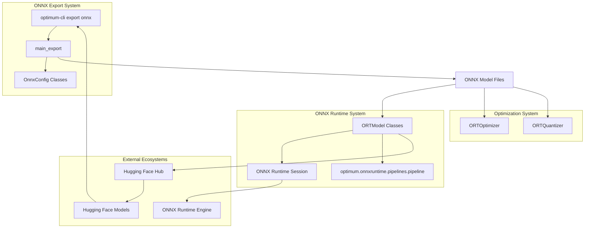
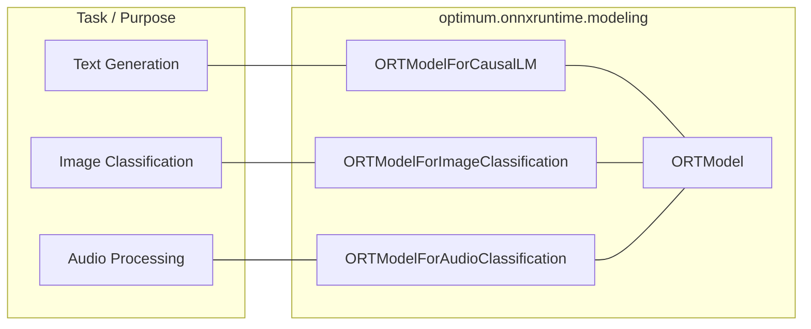

<!-- source: DeepWiki mcp.deepwiki.com · repo huggingface/optimum-onnx · page 1 Overview · fetched 2026-10-26 -->

# Overview

<details>
<summary>Relevant source files</summary>

The following files were used as context for generating this wiki page:

- [README.md](README.md)
- [docs/source/installation.mdx](docs/source/installation.mdx)
- [docs/source/onnx/overview.mdx](docs/source/onnx/overview.mdx)
- [examples/gemma3.py](examples/gemma3.py)
- [optimum/onnxruntime/modeling_seq2seq.py](optimum/onnxruntime/modeling_seq2seq.py)
- [pyproject.toml](pyproject.toml)
- [tests/onnxruntime/test_seq2seq.py](tests/onnxruntime/test_seq2seq.py)

</details>


This document provides an overview of the `optimum-onnx` repository, which serves as a bridge between Hugging Face libraries and ONNX / ONNX Runtime for optimized model inference. The repository enables users to export Hugging Face models to the ONNX format and run them with enhanced performance using ONNX Runtime.

For specific installation procedures, see [Installation and Setup](#1.1). For a quick introduction to model usage, see [Quick Start Guide](#1.2).

## Repository Purpose and Scope

Optimum ONNX bridges the gap between the Hugging Face ecosystem and ONNX Runtime by providing:

- **Model Export**: Convert Transformers, Diffusers, Timm, and Sentence Transformers models to ONNX format.
- **Optimized Inference**: Run ONNX models using specialized `ORTModel` classes with an ONNX Runtime backend.
- **Performance Optimization**: Apply graph optimizations and quantization to reduce model size and improve inference speed.
- **Seamless Integration**: Drop-in replacements for standard Transformers models with minimal code changes, including support for `transformers.pipeline`.

The repository supports a vast range of architectures, from Large Language Models like Llama and Gemma to Vision and Audio models.

Sources: [README.md:3-59](), [docs/source/onnx/overview.mdx:13-146](), [optimum/onnxruntime/pipelines.py:156-177]()

## High-Level System Architecture

The following diagram illustrates how the export, runtime, and optimization systems interact with the Hugging Face and ONNX ecosystems.

**System Architecture Diagram**

Sources: [README.md:28-58](), [optimum/onnxruntime/__init__.py:24-76](), [optimum/exporters/onnx/__init__.py:22-34]()

## Operational Modes

Optimum ONNX primarily operates in two modes: Command Line Interface (CLI) and Programmatic API.

### 1. Command Line Interface (CLI)
The `optimum-cli` provides a straightforward way to export models without writing Python code. It handles task detection and library-specific configurations automatically.

```bash
optimum-cli export onnx --model meta-llama/Llama-3.2-1B onnx_llama/
```
Sources: [README.md:32-34]()

### 2. Programmatic API
The Python API allows for dynamic model loading and inference. It uses task-specific classes like `ORTModelForCausalLM` or `ORTModelForSequenceClassification` that inherit from the base `ORTModel`.

**Code Entity Association Diagram**

Sources: [optimum/onnxruntime/__init__.py:47-71](), [optimum/onnxruntime/modeling.py:48-48]()

## Core Components

| Component | Key Code Entities | Purpose |
|-----------|-------------------|---------|
| **Export** | `main_export`, `OnnxConfig` | Handles the conversion from PyTorch/Timm/Diffusers to ONNX. |
| **Inference** | `ORTModel`, `pipeline` | Wraps ONNX Runtime sessions to provide a Transformers-compatible API. |
| **Optimization** | `ORTOptimizer`, `OptimizationConfig` | Performs graph-level fusions and hardware-specific optimizations. |
| **Quantization** | `ORTQuantizer`, `QuantizationConfig` | Reduces model precision (e.g., to INT8) for faster execution. |

Sources: [optimum/onnxruntime/__init__.py:24-76](), [optimum/exporters/onnx/__init__.py:22-34]()

## Installation and Dependencies

The package requires `onnxruntime` (for CPU) or `onnxruntime-gpu` (for CUDA/GPU acceleration). Users should avoid installing both simultaneously to prevent conflicts.

```bash
# For CPU
pip install "optimum-onnx[onnxruntime]"

# For GPU
pip install "optimum-onnx[onnxruntime-gpu]"
```

For detailed environment requirements and source installation, see [Installation and Setup](#1.1).

Sources: [README.md:12-26](), [docs/source/installation.mdx:16-27]()

## Quick Start Example

A common pattern for using Optimum ONNX is the `from_pretrained` method with the `export=True` flag, which exports and loads the model in a single step.

```python
from optimum.onnxruntime import ORTModelForCausalLM
from transformers import AutoTokenizer

model_id = "google/gemma-3-270m-it"
# Export and load
model = ORTModelForCausalLM.from_pretrained(model_id, export=True)
```

For a complete walkthrough, see [Quick Start Guide](#1.2).

Sources: [examples/gemma3.py:10-15](), [README.md:48-51]()

---

