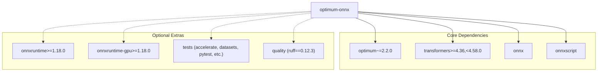
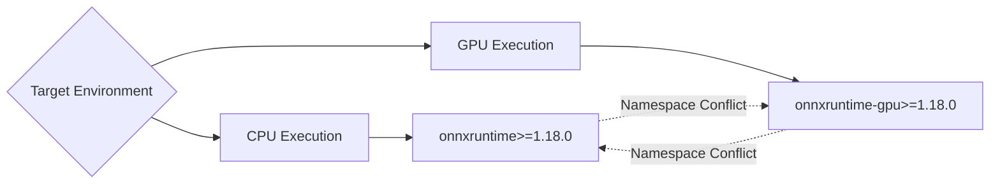
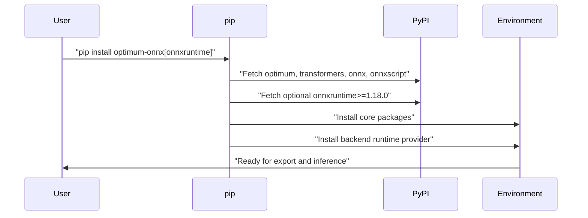
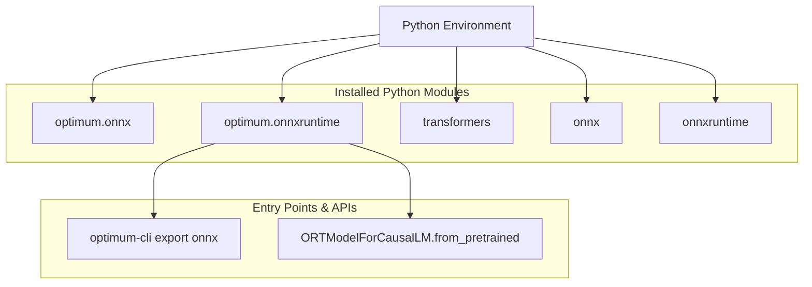

<!-- source: DeepWiki mcp.deepwiki.com · repo huggingface/optimum-onnx · page 1.1 Installation and Setup · fetched 2026-10-26 -->

# Installation and Setup

<details>
<summary>Relevant source files</summary>

The following files were used as context for generating this wiki page:

- [README.md](README.md)
- [docs/source/installation.mdx](docs/source/installation.mdx)
- [docs/source/onnxruntime/package_reference/modeling_diffusion.mdx](docs/source/onnxruntime/package_reference/modeling_diffusion.mdx)
- [docs/source/onnxruntime/package_reference/pipelines.mdx](docs/source/onnxruntime/package_reference/pipelines.mdx)
- [docs/source/onnxruntime/usage_guides/amdgpu.mdx](docs/source/onnxruntime/usage_guides/amdgpu.mdx)
- [docs/source/onnxruntime/usage_guides/gpu.mdx](docs/source/onnxruntime/usage_guides/gpu.mdx)
- [docs/source/onnxruntime/usage_guides/pipelines.mdx](docs/source/onnxruntime/usage_guides/pipelines.mdx)
- [examples/gemma3.py](examples/gemma3.py)
- [optimum/onnxruntime/modeling_seq2seq.py](optimum/onnxruntime/modeling_seq2seq.py)
- [pyproject.toml](pyproject.toml)
- [tests/onnxruntime/test_seq2seq.py](tests/onnxruntime/test_seq2seq.py)

</details>


This document covers the installation and setup process for `optimum-onnx`, including system requirements, dependency management, extras syntax, environment requirements, and configuration options for both CPU and GPU execution environments.

## System Requirements

`optimum-onnx` requires Python 3.9 or higher and supports multiple execution environments across different operating systems and hardware configurations.

### Python Version Support

The package explicitly supports Python versions 3.9 through 3.13 as configured in the project specification:

| Python Version | Support Status |
|----------------|----------------|
| 3.9            | ✅ Supported   |
| 3.10           | ✅ Supported   |
| 3.11           | ✅ Supported   |
| 3.12           | ✅ Supported   |
| 3.13           | ✅ Supported   |

### Hardware Requirements

- **CPU**: Standard x86_64, ARM, or equivalent CPU environments supporting ONNX Runtime.
- **GPU**: NVIDIA CUDA-compatible GPU or AMD Instinct GPU satisfying the corresponding execution provider requirements for ONNX Runtime.

Sources: [pyproject.toml:10-10](), [pyproject.toml:24-28](), [README.md:20-21]()

## Dependency Architecture

Understanding the dependency structure is essential for setting up correct export and inference pipelines. The core dependencies include `optimum`, `transformers`, `onnx`, and `onnxscript`. Optional extras manage backend execution providers (`onnxruntime`, `onnxruntime-gpu`), testing utilities, and code quality tools.

### Core and Optional Dependencies



### The `onnxruntime` vs `onnxruntime-gpu` Conflict

A critical constraint in the installation architecture is the mutual exclusivity of `onnxruntime` and `onnxruntime-gpu`. Both packages write to the same namespace (`onnxruntime`), causing runtime symbol collisions or silent fallbacks to CPU execution if both are present. Users must uninstall the CPU package before installing the GPU package.



Sources: [pyproject.toml:31-36](), [pyproject.toml:42-43](), [README.md:26-26]()

## Installation Options

Installation commands vary based on whether you are targeting a CPU runtime, a GPU accelerator, or setting up a development environment.

### Basic CPU Installation

To install `optimum-onnx` along with standard CPU execution support via `onnxruntime`:

```bash
pip install "optimum-onnx[onnxruntime]"
```

### GPU-Accelerated Installation

For NVIDIA CUDA environments, ensure CUDA and cuDNN requirements are met, purge any existing CPU runtime, and install the GPU extra:

```bash
pip uninstall onnxruntime
pip install "optimum-onnx[onnxruntime-gpu]"
```

### Source and Development Installation

To install directly from the development repository or set up full testing and linting packages:

```bash
python -m pip install git+https://github.com/huggingface/optimum-onnx.git
pip install "optimum-onnx[onnxruntime,tests,quality]"
```

Sources: [README.md:17-18](), [README.md:23-26](), [docs/source/installation.mdx:22-27](), [pyproject.toml:44-62]()

## Installation Process Flow

The installation workflow resolves package trees from PyPI and configures runtime bindings for execution entry points.

### Installation Sequence



### Code Entity Mapping



Sources: [pyproject.toml:67-68](), [README.md:33-33](), [examples/gemma3.py:10-15]()

## Installation Verification

### Command Line Verification

Verify that the CLI exporter tool is correctly registered in your PATH:

```bash
optimum-cli --help
optimum-cli export onnx --help
```

### Programmatic Verification

Run a quick script to verify that `onnxruntime` loads correctly and that `optimum-onnx` can export and instantiate models such as `google/gemma-3-270m-it`:

```python
import onnxruntime as ort
from optimum.onnxruntime import ORTModelForCausalLM
from transformers import AutoTokenizer

providers = ort.get_available_providers()
print(f"Available execution providers: {providers}")

model_id = "google/gemma-3-270m-it"
tokenizer = AutoTokenizer.from_pretrained(model_id)
model = ORTModelForCausalLM.from_pretrained(model_id, export=True)
print("✅ Optimum-ONNX successfully initialized and loaded model graph.")
```

Sources: [README.md:33-34](), [examples/gemma3.py:8-15]()

## Configuration and Environment Setup

### Execution Provider Mapping

ONNX Runtime relies on Execution Providers (EPs) to dispatch operations to hardware accelerators.

| Execution Provider | Target Hardware | Requirements |
|--------------------|-----------------|--------------|
| `CPUExecutionProvider` | CPU | None (Default) |
| `CUDAExecutionProvider` | NVIDIA GPU | CUDA toolkit, cuDNN |
| `TensorrtExecutionProvider` | NVIDIA TensorRT | TensorRT, CUDA toolkit |
| `ROCmExecutionProvider` | AMD Instinct GPU | ROCm 6.0+ |

### Test Suite Execution

The repository uses `pytest` custom markers defined in `pyproject.toml` to partition test suites by hardware and feature flags:

```bash
# Run CUDA EP tests
pytest -m "cuda_ep_test"

# Run quantization validation tests
pytest -m "quantization"
```

Sources: [pyproject.toml:131-139](), [docs/source/onnxruntime/usage_guides/gpu.mdx:33-40]()

## Troubleshooting Common Issues

### Package Conflicts Between Runtimes
- **Symptom**: `onnxruntime` methods failing with unexpected attribute errors or executing on CPU despite specifying GPU provider.
- **Solution**: Run `pip uninstall onnxruntime` and reinstall `optimum-onnx[onnxruntime-gpu]` [README.md:26-26]().

### Version Constraints with Transformers
- **Symptom**: Import errors during model export or missing attributes on tokenizer/config classes.
- **Solution**: Ensure `transformers` falls within the supported range `>=4.36,<4.58.0` [pyproject.toml:33-33]().

### Large Model External Data Limit
- **Symptom**: `ValueError: Protocol message ModelProto exceeds maximum size of 2GB` when exporting large models.
- **Solution**: Ensure sufficient local storage is available for auxiliary external weight files (`.data`) generated during protobuf serialization [docs/source/installation.mdx:22-27]().

Sources: [README.md:26-26](), [pyproject.toml:33-33](), [docs/source/installation.mdx:22-27]()

---

