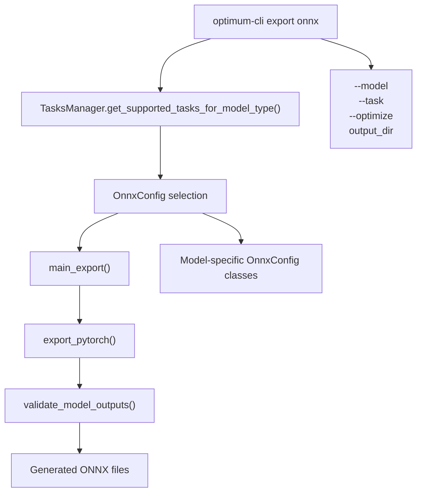
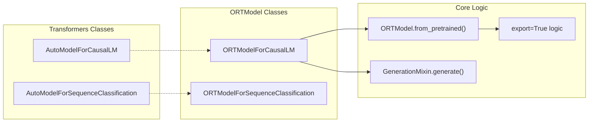
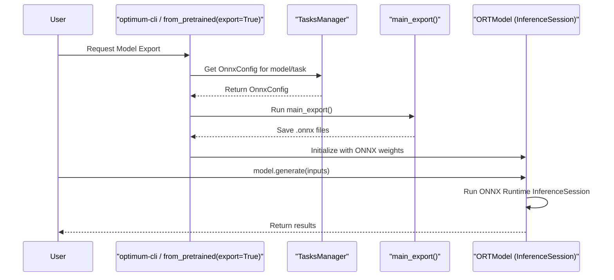

<!-- source: DeepWiki mcp.deepwiki.com · repo huggingface/optimum-onnx · page 1.2 Quick Start Guide · fetched 2026-10-26 -->

# Quick Start Guide

<details>
<summary>Relevant source files</summary>

The following files were used as context for generating this wiki page:

- [README.md](README.md)
- [docs/source/installation.mdx](docs/source/installation.mdx)
- [docs/source/onnxruntime/quickstart.mdx](docs/source/onnxruntime/quickstart.mdx)
- [docs/source/quickstart.mdx](docs/source/quickstart.mdx)
- [examples/gemma3.py](examples/gemma3.py)

</details>


This guide provides a minimal working example to export a Hugging Face model to ONNX format and run inference using ONNX Runtime. The process involves two main steps: exporting your PyTorch model to ONNX, then loading and running the ONNX model for optimized inference.

For detailed export configuration options, see [Export Configuration System](#2.2). For comprehensive inference features and optimization, see [ONNX Runtime Inference](#3) and [Model Optimization and Quantization](#4).

Sources: [docs/source/quickstart.mdx:13-18](), [README.md:39-42]()

## Basic Export Workflow

The export process converts Hugging Face models to ONNX format using the command-line interface or the programmatic API. The system automatically detects model architecture and applies appropriate configurations.

### Export Command Structure



Sources: [README.md:32-34](), [docs/source/quickstart.mdx:17-25]()

### Export Examples

**Basic model export via CLI:**
```bash
optimum-cli export onnx --model meta-llama/Llama-3.2-1B --output_dir llama_onnx/
```

**Export with optimization:**
```bash
optimum-cli export onnx --model meta-llama/Llama-3.2-1B --optimize O2 onnx_llama/
```

Sources: [README.md:33](), [docs/source/quickstart.mdx:24-25]()

## Basic Inference Workflow

After export, use `ORTModel` classes as drop-in replacements for Hugging Face `AutoModel` classes. The API remains nearly identical while providing ONNX Runtime acceleration.

### Inference Class Mapping



Sources: [README.md:44-56](), [docs/source/quickstart.mdx:30-41]()

### Programmatic Export and Inference (Gemma 3 Example)

You can load a PyTorch checkpoint and convert it to ONNX on-the-fly by setting `export=True` in the `from_pretrained` method [examples/gemma3.py:15](). This is the fastest way to get started with new models like Gemma 3 [examples/gemma3.py:1-25]().

```python
from transformers import AutoTokenizer
from optimum.onnxruntime import ORTModelForCausalLM

model_id = "google/gemma-3-270m-it"
tokenizer = AutoTokenizer.from_pretrained(model_id)

# Load PyTorch checkpoint and export to ONNX on-the-fly
model = ORTModelForCausalLM.from_pretrained(model_id, export=True)

# Inference using the standard Transformers API
conversation = [{"role": "user", "content": "Hello! How are you?"}]
prompt = tokenizer.apply_chat_template(conversation, tokenize=False, add_generation_prompt=True)
inputs = tokenizer(prompt, return_tensors="pt")

outputs = model.generate(**inputs, max_new_tokens=50)
print(tokenizer.decode(outputs[0], skip_special_tokens=True))
```

Sources: [examples/gemma3.py:8-25]()

## Complete CLI to Inference Workflow

### Step 1: Export Model

```bash
optimum-cli export onnx --model meta-llama/Llama-3.2-1B --output_dir llama_onnx/
```

Sources: [docs/source/quickstart.mdx:24-25]()

### Step 2: Load and Run Inference

```python
from transformers import AutoTokenizer, pipeline
from optimum.onnxruntime import ORTModelForCausalLM

# Load tokenizer and ONNX model from the local directory
tokenizer = AutoTokenizer.from_pretrained("llama_onnx")
model = ORTModelForCausalLM.from_pretrained("llama_onnx")

# Use with transformers pipeline
pipe = pipeline("text-generation", model=model, tokenizer=tokenizer)
result = pipe("He never went out without a book under his arm")
```

Sources: [README.md:44-56](), [docs/source/quickstart.mdx:32-41]()

## End-to-End Data Flow



Sources: [README.md:33-55](), [docs/source/quickstart.mdx:13-31]()

## Common Export Tasks

| Model Type | Task | CLI Command |
|------------|------|-------------|
| GPT/Llama/Gemma | Text Generation | `optimum-cli export onnx --model ID --task text-generation-with-past out/` |
| BERT/RoBERTa | Sequence Classification | `optimum-cli export onnx --model ID --task text-classification out/` |
| ViT | Image Classification | `optimum-cli export onnx --model ID --task image-classification out/` |
| Whisper | Automatic Speech Recognition | `optimum-cli export onnx --model ID --task automatic-speech-recognition out/` |

Sources: [README.md:33](), [docs/source/quickstart.mdx:17-31]()

## Key CLI Options

| Option | Description | Example |
|--------|-------------|---------|
| `--model` | Model ID (Hub) or local path | `--model google/gemma-3-270m-it` |
| `--task` | Specific task to export for | `--task text-generation-with-past` |
| `--optimize` | Apply ORT graph optimizations (O1, O2, O3, O4) | `--optimize O2` |
| `--device` | Device to run the export on | `--device cuda` |

Sources: [README.md:33](), [docs/source/quickstart.mdx:24-25]()

## Next Steps

- **Installation**: Ensure you have the correct `onnxruntime` or `onnxruntime-gpu` package. See [Installation and Setup](#1.1).
- **Optimization**: Use `ORTOptimizer` to further speed up your models. See [ORTOptimizer](#4.1).
- **Quantization**: Reduce model size using `ORTQuantizer`. See [Model Quantization](#4.2).

Sources: [README.md:12-26](), [docs/source/installation.mdx:16-20]()

---

