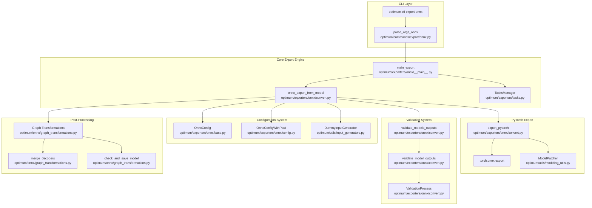
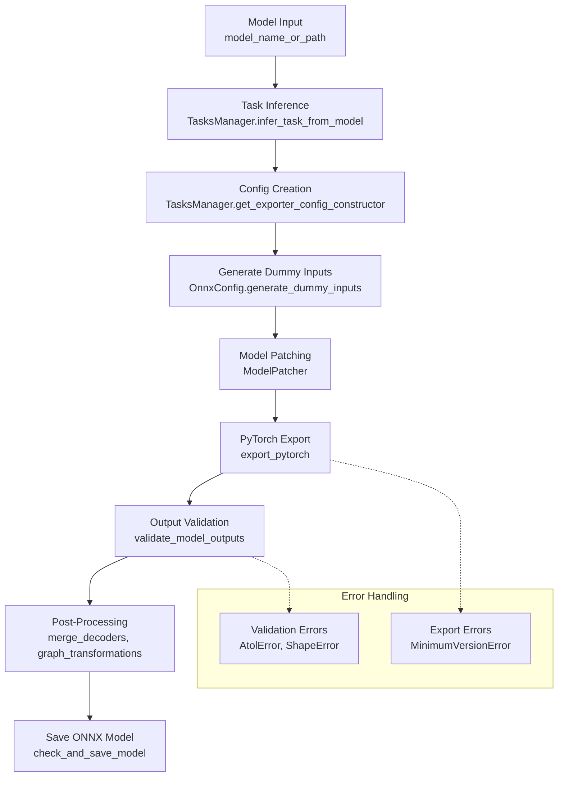

<!-- source: DeepWiki mcp.deepwiki.com · repo huggingface/optimum-onnx · page 2 ONNX Model Export · fetched 2026-10-26 -->

# ONNX Model Export

<details>
<summary>Relevant source files</summary>

The following files were used as context for generating this wiki page:

- [docs/source/onnx/package_reference/export.mdx](docs/source/onnx/package_reference/export.mdx)
- [optimum/exporters/onnx/__main__.py](optimum/exporters/onnx/__main__.py)
- [optimum/exporters/onnx/convert.py](optimum/exporters/onnx/convert.py)
- [optimum/exporters/onnx/utils.py](optimum/exporters/onnx/utils.py)
- [tests/exporters/onnx/test_export.py](tests/exporters/onnx/test_export.py)

</details>


The ONNX Model Export system converts Hugging Face models from PyTorch to ONNX format, enabling optimized inference across different runtime environments. This system handles the conversion of Transformers, Diffusers, and other model types to ONNX while maintaining compatibility and correctness through validation and post-processing.

For information about using the export command line interface, see [Export Command Line Interface](#2.1). For details about the configuration classes and model-specific logic, see [Export Configuration System](#2.2) and [Model-Specific Export Configurations](#2.3). For advanced topics like model patching or the TorchDynamo path, see [Advanced Export Topics](#2.4).

## Export System Architecture

The export system consists of several interconnected components that bridge high-level model artifacts to underlying code entities like `main_export`, `onnx_export_from_model`, and `TasksManager`.



Sources: [optimum/commands/export/onnx.py:33-174](), [optimum/exporters/onnx/__main__.py:57-268](), [optimum/exporters/onnx/convert.py:465-836](), [optimum/onnx/graph_transformations.py:132-308]()

## Export Workflow and Pipeline

The export process follows a structured workflow mapping user inputs directly to concrete code routines across `TasksManager`, `export_pytorch`, and validation modules.



Sources: [optimum/exporters/onnx/__main__.py:57-268](), [optimum/exporters/onnx/convert.py:465-611](), [optimum/exporters/tasks.py:1753-1823](), [optimum/onnx/graph_transformations.py:183-308]()

## Core Export Functions

### Main Export Function

The `main_export` function in `optimum.exporters.onnx.__main__` serves as the primary entry point for ONNX export operations. It coordinates model loading, configuration, conversion, and validation.

| Function | Location | Purpose |
|----------|----------|---------|
| `main_export` | [optimum/exporters/onnx/__main__.py:57-268]() | High-level export orchestrator (Hub/Local) |
| `onnx_export_from_model` | [optimum/exporters/onnx/convert.py:726-836]() | Core export logic for loaded models |
| `export_pytorch` | [optimum/exporters/onnx/convert.py:465-611]() | Low-level PyTorch to ONNX conversion |
| `export_models` | [optimum/exporters/onnx/convert.py:839-952]() | Multi-model export handler (e.g. for Encoders/Decoders) |

The `export_pytorch` function handles low-level PyTorch to ONNX conversion using `torch.onnx.export`. It manages device placement, dynamic axes configuration via `OnnxConfig.inputs` and `OnnxConfig.outputs`, and external data handling.

Sources: [optimum/exporters/onnx/__main__.py:57-268](), [optimum/exporters/onnx/convert.py:465-952]()

### Task and Configuration Management

The export system automatically infers tasks and configurations using the `TasksManager` registry.

```python
# Task inference from model type
task = TasksManager.infer_task_from_model(model_name_or_path)

# Configuration retrieval
onnx_config_constructor = TasksManager.get_exporter_config_constructor(
    model_type=model_type,
    exporter="onnx",
    task=task
)
onnx_config = onnx_config_constructor(model.config)
```

Sources: [optimum/exporters/onnx/convert.py:726-836](), [optimum/exporters/tasks.py:1753-1823]()

## Model Validation System

The validation system ensures exported ONNX models produce outputs matching original PyTorch models within tolerance limits.

Validation is performed by `validate_models_outputs` [optimum/exporters/onnx/convert.py:90-170](). It can run in separate subprocesses via `ValidationProcess` [optimum/exporters/onnx/convert.py:417-462]() to avoid memory leaks from ONNX Runtime sessions.

### Validation Error Types

| Error Type | Class | Description |
|------------|-------|-------------|
| Shape Mismatch | `ShapeError` | Output tensor shapes do not match |
| Value Tolerance | `AtolError` | Values exceed absolute tolerance (`atol`) |
| Output Names | `OutputMatchError` | ONNX outputs do not match expected config |
| Dynamic Axes | `DynamicAxisNameError` | Unknown or mismatched dynamic axis names |

Sources: [optimum/exporters/onnx/convert.py:84-462](), [optimum/exporters/error_utils.py:20-51]()

## Graph Transformations and Post-Processing

After export, ONNX models undergo transformations to optimize them for runtime execution and reduce memory overhead.

### Key Transformations

The `merge_decoders` function [optimum/onnx/graph_transformations.py:183-308]() combines separate decoder models (with and without past key values) into a single ONNX file using an `If` node. 

The `remove_duplicate_weights` function [optimum/onnx/graph_transformations.py:46-67]() identifies identical model initializers and creates references to unique instances, minimizing footprint for shared weights.

Sources: [optimum/onnx/graph_transformations.py:46-344](), [optimum/exporters/onnx/convert.py:726-836]()

---

